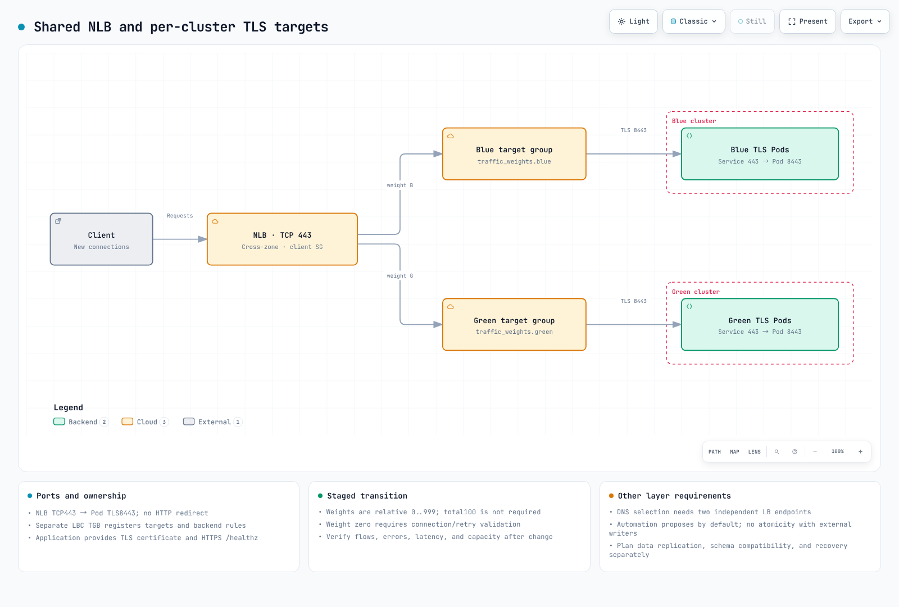

# 高度なインフラストラクチャ

> **レビュー基準**: Terraform 1.15.7、AWS Provider 6.69.1、AWS Load Balancer Controller 3.5.0、Boto3 1.43.92
> **最終レビュー日**: 2026年10月16日。例はスキーマとテストダブルを使ってローカルで確認しており、実際のAWS環境での切り替えは行っていません。

< [前へ: Terraformインフラストラクチャ](01-infrastructure-setup.md) | [目次](README.md) | [次へ: CIパイプライン](03-ci-pipelines.md) >

このガイドでは、2つのトラフィック設計を分けて説明します。**1つのNLBと重み付きターゲットグループ**を使う設計と、**独立した2つのロードバランサーの間でDNSにより振り分ける**設計です。これらは代替手段です。同じ共有NLBの背後にあるクラスターを、それぞれ独立した2つの制御で選択できるわけではありません。

## 1. Blue/Greenアーキテクチャの概要

Blue/Green構成では、検証用の別環境とトラフィックを戻す経路を用意できます。ただし、ダウンタイムゼロ、即時ロールバック、自動データ複製、AZ間通信コストゼロを保証するものではありません。移行先は流入する負荷に合わせてサイジングし、データベースやスキーマの変更は両方のバージョンと互換性を保ってください。

[基盤の例](01-infrastructure-setup.md)では、複数のAZと組み込みのAuto Modeプールを使います。クラスターをBlue/Greenに分けても、ワーカーが特定のAZに固定されるわけではありません。EKSのマネージドコントロールプレーンはリージョン単位です。**ワーカー**を単一AZに置くには、NodePool/NodeClassの別個の制約と復旧用キャパシティが必要です。[AZ単位の運用](15-zonal-operations-guide.md)も参照してください。

| 検討事項 | 必要な計画 |
|---|---|
| トラフィックの移行 | 新規フロー、既存接続、伝播、クライアントの再試行、SLO |
| データ | レプリケーション、一貫性、書き込み元の管理、移行互換性、復旧ポイント |
| キャパシティ | 移行先の正常なターゲットと負荷試験済みキャパシティ。AZ障害時も考慮 |
| 設定の所有者 | リスナーアクションの書き込み元を1つにする。Terraform、スクリプト、自動化を調整 |
| コスト | 両方のクラスター群、LB/エンドポイント、複製、AZ間経路。実使用量を測定 |



[インタラクティブな図を見る](https://www.atomai.click/kubernetes-docs/archmaps/en-ops-02-infrastructure-advanced-0.html)

## 2. NLBの重み付きターゲットグループ

この例では、**TCP/443リスナーからPodの8443番ポートへTLSをパススルー**します。各クラスターには、`production/app-https`、Serviceの443番ポートからtargetPort 8443への転送、稼働中のTLSエンドポイント、および200を返すHTTPS `/healthz` があらかじめ必要です。バックエンドでTLSを終端し、アプリケーション証明書を提示します。NLBのTCPリスナーはHTTPからHTTPSへのリダイレクトを生成できません。

第1章のネットワークstateを使います。次のファイルを新しい`nlb/` Terraformルートに置き、S3バックエンドを`nlb/terraform.tfstate`のような個別のkeyで初期化してください。実際のstate bucket、VPC CIDR、承認済みクライアントCIDRを指定します。ドキュメント用アドレスをクライアント許可設定に使うことはできません。

### NLBとターゲットグループ

```hcl
# nlb/main.tf
terraform {
  required_version = ">= 1.10.0"
  backend "s3" {}
  required_providers {
    aws = { source = "hashicorp/aws", version = "6.69.1" }
  }
}
provider "aws" { region = var.region }
data "aws_caller_identity" "current" {}
data "terraform_remote_state" "network" {
  backend = "s3"
  config = {
    bucket = var.state_bucket_name
    key    = "network/terraform.tfstate"
    region = var.region
  }
}
locals {
  name_prefix = "${var.project_name}-${var.environment}"
  tags        = { Project = var.project_name, Environment = var.environment, ManagedBy = "terraform" }
  alarm_names = { for color in ["blue", "green"] : color => "${local.name_prefix}-${color}-no-healthy" }
  alarm_arns  = { for color, name in local.alarm_names : color => "arn:aws:cloudwatch:${var.region}:${data.aws_caller_identity.current.account_id}:alarm:${name}" }
}
resource "aws_security_group" "nlb" {
  name_prefix = "docs-nlb-"
  description = "Approved clients to the TLS passthrough listener"
  vpc_id      = data.terraform_remote_state.network.outputs.vpc_id
  tags        = local.tags
}
resource "aws_vpc_security_group_ingress_rule" "clients" {
  for_each          = toset(var.allowed_client_cidrs)
  security_group_id = aws_security_group.nlb.id
  cidr_ipv4         = each.value
  ip_protocol       = "tcp"
  from_port         = 443
  to_port           = 443
}
resource "aws_vpc_security_group_egress_rule" "targets" {
  security_group_id = aws_security_group.nlb.id
  cidr_ipv4         = var.target_vpc_cidr
  ip_protocol       = "tcp"
  from_port         = var.backend_port
  to_port           = var.backend_port
}
resource "aws_lb" "shared" {
  name_prefix                      = "docs-"
  internal                         = false
  load_balancer_type               = "network"
  subnets                          = data.terraform_remote_state.network.outputs.public_subnet_ids
  security_groups                  = [aws_security_group.nlb.id]
  enable_cross_zone_load_balancing = true
  enable_deletion_protection       = var.environment == "prod"
  tags                             = local.tags
}
resource "aws_lb_target_group" "cluster" {
  for_each    = toset(["blue", "green"])
  name_prefix = each.key == "blue" ? "doc-b-" : "doc-g-"
  port        = var.backend_port
  protocol    = "TCP"
  target_type = "ip"
  vpc_id      = data.terraform_remote_state.network.outputs.vpc_id
  health_check {
    enabled             = true
    protocol            = "HTTPS"
    port                = "traffic-port"
    path                = "/healthz"
    matcher             = "200"
    interval            = 10
    healthy_threshold   = 2
    unhealthy_threshold = 2
  }
  deregistration_delay   = 30
  connection_termination = true
  preserve_client_ip     = true
  proxy_protocol_v2      = false
  lifecycle { create_before_destroy = true }
  tags = merge(local.tags, { Cluster = each.key })
}
resource "aws_lb_listener" "tls_passthrough" {
  load_balancer_arn = aws_lb.shared.arn
  port              = 443
  protocol          = "TCP"
  default_action {
    type = "forward"
    forward {
      target_group {
        arn    = aws_lb_target_group.cluster["blue"].arn
        weight = var.traffic_weights.blue
      }
      target_group {
        arn    = aws_lb_target_group.cluster["green"].arn
        weight = var.traffic_weights.green
      }
    }
  }
  tags = local.tags
}
```

### 入力値

```hcl
# nlb/variables.tf
variable "region" {
  type    = string
  default = "ap-northeast-2"
}
variable "project_name" {
  type    = string
  default = "eks-platform"
}
variable "environment" {
  type    = string
  default = "dev"
}
variable "state_bucket_name" { type = string }
variable "target_vpc_cidr" {
  description = "CIDR of the same VPC containing the target Pods"
  type        = string
}
variable "allowed_client_cidrs" {
  description = "Approved IPv4 client CIDRs. Supply real values, not documentation addresses"
  type        = list(string)
  validation {
    condition     = length(var.allowed_client_cidrs) > 0 && alltrue([for cidr in var.allowed_client_cidrs : can(cidrnetmask(cidr)) && cidr != "0.0.0.0/0"])
    error_message = "Supply explicit IPv4 CIDRs. Do not expose this example to 0.0.0.0/0."
  }
}
variable "traffic_weights" {
  type    = object({ blue = number, green = number })
  default = { blue = 100, green = 0 }
  validation {
    condition     = alltrue([for value in values(var.traffic_weights) : value >= 0 && value <= 999 && floor(value) == value]) && var.traffic_weights.blue + var.traffic_weights.green > 0
    error_message = "Use integer weights 0..999 with at least one positive weight. The sum need not be 100."
  }
}
variable "automatic_failover" {
  description = "Opt in only after validating capacity, reconnection behavior, and single-writer ownership"
  type        = bool
  default     = false
}
variable "minimum_destination_targets" {
  description = "A demo health gate, not proof of enough capacity. Size from load testing"
  type        = number
  default     = 1
  validation {
    condition     = var.minimum_destination_targets >= 1 && floor(var.minimum_destination_targets) == var.minimum_destination_targets
    error_message = "Use a positive integer destination target count."
  }
}
variable "notification_email" {
  type    = string
  default = null
}

variable "backend_port" {
  description = "Actual Pod TLS targetPort, shared with the Service/TGB networking example"
  type        = number
  default     = 8443
  validation {
    condition     = var.backend_port >= 1 && var.backend_port <= 65535 && floor(var.backend_port) == var.backend_port
    error_message = "Use an integer TCP backend port."
  }
}
```

重みは**0～999の整数で、相対値**です。必ず合計を100にする割合ではありません。5:5と50:50は同じ相対配分です。フローの大きさ、スティッキーセッション、サンプリングによって、観測されるリクエスト数やバイト数の比率は異なる場合があります。この例では、すべての重みがゼロになる設定を明示的に拒否します。

[NLBリスナーのドキュメント](https://docs.aws.amazon.com/elasticloadbalancing/latest/network/load-balancer-listeners.html)では、通常の重み変更と重みをゼロにする場合を区別しています。ゼロを設定すると、まもなく新しい接続が停止し、既存の接続は終了します。登録解除の遅延は別の制御です。重みをゼロにする前に接続と再試行の動作を検証し、変更後に`NewFlowCount`、`ActiveFlowCount`、エラー、レイテンシーを確認してください。

一方のAZに限定されたグループにも、フリート移行中は別のAZにあるNLBノードから到達できるよう、クロスゾーン負荷分散を有効にしています。これを無効にするとルーティング条件が変わり、意図した振り分けができなくなる場合があります。実際のAZ間経路とコストを考慮してください。セキュリティグループはNLB作成時に関連付けます。セキュリティグループなしで作成したNLBに、後から追加することはできません。

### ターゲットの動的登録

各クラスターに**セルフマネージドのAWS Load Balancer Controller**をインストールして設定します。`elbv2.k8s.aws/v1beta1`のTGBを使い、クラスターごとに別のターゲットグループを指定します。TerraformはLB/TGとフロントエンドのセキュリティグループを所有します。TGBのnetworking設定は、そのコントローラーにバックエンドルールを要求します。同じバックエンドルールや変更されるPod IPの関連付けをTerraformでも管理しないでください。

```yaml
# tgb.yaml
# Separately installed AWS Load Balancer Controller, not the built-in Auto Mode TGB API.
# Replace all IDs. The production/app-https Service and its TLS targetPort 8443 must exist.
apiVersion: elbv2.k8s.aws/v1beta1
kind: TargetGroupBinding
metadata:
  name: app-tls
  namespace: production
spec:
  targetGroupARN: arn:aws:elasticloadbalancing:ap-northeast-2:111122223333:targetgroup/REPLACE_BLUE_GROUP/0000000000000001
  targetType: ip
  vpcID: vpc-REPLACE_ME
  serviceRef:
    name: app-https
    port: 443
  networking:
    ingress:
      - from:
          - securityGroup:
              groupID: sg-REPLACE_NLB_SG
        ports:
          - protocol: TCP
            port: 8443
```

BlueクラスターにはBlueのARNを、GreenクラスターにはGreenのARNを指定し、VPC/NLBのセキュリティグループIDを置き換えてください。PodのtargetPortを変える場合は、`backend_port`とTGBのnetworking portの両方を更新します。コントローラーには、ターゲット登録と対象バックエンドセキュリティグループの調整に必要な権限が必要です。

組み込みAuto ModeのTGBは`eks.amazonaws.com/v1`を使います。[タグとライフサイクルの規則](https://docs.aws.amazon.com/eks/latest/userguide/auto-configure-alb.html)も異なります。AWSの説明では、そのTGBまたはクラスターを削除するとターゲットグループも削除されます。この例の外部所有ターゲットグループに代用しないでください。`multiClusterTargetGroup`は1つのTGを意図的に複数クラスターで共有する場合に関係します。この手順では個別のTGを使います。

### 出力値

```hcl
# nlb/outputs.tf
output "nlb_arn" { value = aws_lb.shared.arn }
output "nlb_dns_name" { value = aws_lb.shared.dns_name }
output "nlb_zone_id" { value = aws_lb.shared.zone_id }
output "listener_arn" { value = aws_lb_listener.tls_passthrough.arn }
output "nlb_security_group_id" { value = aws_security_group.nlb.id }
output "target_group_arns" { value = { for color, group in aws_lb_target_group.cluster : color => group.arn } }
output "traffic_weights" { value = var.traffic_weights }
output "automatic_failover" { value = var.automatic_failover }
output "minimum_destination_targets" { value = var.minimum_destination_targets }

output "backend_port" { value = var.backend_port }
```

## 3. DNSによるトラフィック切り替え

DNSで振り分ける場合は、実際に独立したALB/NLBエンドポイントを2つ用意し、それぞれを対象のクラスターに接続します。`blue.example.com`と`green.example.com`を同じ共有NLBに向けても、レコードの重みやヘルスチェック名を変えるだけでは別のターゲットグループを選択できません。

この個別の`dns/`ルートは、2つのロードバランサーがすでに存在することを前提とします。重み付きの`app.<domain>`、色ごとの直接レコード、別名の`failover.<domain>`を例示します。必要な名前を選んでください。互換性のないルーティングポリシーを同じ名前とレコードタイプに組み合わせないでください。

```hcl
# dns/main.tf
terraform {
  required_version = ">= 1.10.0"
  backend "s3" {}
  required_providers {
    aws = { source = "hashicorp/aws", version = "6.69.1" }
  }
}
provider "aws" { region = var.region }
# This is an ALTERNATIVE with two independently provisioned load balancers.
# Supplying the shared NLB from the first example for both entries is rejected.
resource "aws_route53_record" "weighted" {
  for_each       = var.endpoints
  zone_id        = var.hosted_zone_id
  name           = "app.${var.domain_name}"
  type           = "A"
  set_identifier = each.key
  weighted_routing_policy { weight = each.value.weight }
  alias {
    name                   = each.value.dns_name
    zone_id                = each.value.zone_id
    evaluate_target_health = true
  }
}
resource "aws_route53_record" "direct" {
  for_each = var.endpoints
  zone_id  = var.hosted_zone_id
  name     = "${each.key}.${var.domain_name}"
  type     = "A"
  alias {
    name                   = each.value.dns_name
    zone_id                = each.value.zone_id
    evaluate_target_health = true
  }
}
# Different DNS name from the weighted example: don't mix policies on one name/type.
resource "aws_route53_record" "failover" {
  for_each       = var.endpoints
  zone_id        = var.hosted_zone_id
  name           = "failover.${var.domain_name}"
  type           = "A"
  set_identifier = each.key
  failover_routing_policy {
    type = each.key == "blue" ? "PRIMARY" : "SECONDARY"
  }
  alias {
    name                   = each.value.dns_name
    zone_id                = each.value.zone_id
    evaluate_target_health = true
  }
}
```

```hcl
# dns/variables.tf
variable "region" {
  type    = string
  default = "ap-northeast-2"
}
variable "hosted_zone_id" { type = string }
variable "domain_name" { type = string }
variable "endpoints" {
  description = "Two existing independent ALB/NLB endpoints with healthy targets"
  type        = map(object({ dns_name = string, zone_id = string, weight = number }))
  validation {
    condition     = toset(keys(var.endpoints)) == toset(["blue", "green"])
    error_message = "Exactly blue and green endpoints are required."
  }
  validation {
    condition     = length(distinct([for e in values(var.endpoints) : trimprefix(lower(trimsuffix(e.dns_name, ".")), "dualstack.")])) == 2
    error_message = "Two records pointing at the same shared NLB cannot select different clusters."
  }
  validation {
    condition     = alltrue([for e in values(var.endpoints) : e.weight >= 0 && e.weight <= 255 && floor(e.weight) == e.weight]) && sum([for e in values(var.endpoints) : e.weight]) > 0
    error_message = "Use integer DNS weights0..255 with a positive total for this example."
  }
}
```

Route 53の重みはELBの重みとは異なり、**0～255の整数**です。重み付きレコードは同じDNS名とレコードタイプを共有し、異なるset identifierを使います。DNS応答はキャッシュされ、DNSレコードの有効期間を超えて接続が続くことがあります。AliasレコードはELBターゲットのTTLを引き継ぎます。TTLを設定するためだけに、生成されたLBのDNSエンドポイントを手動でコピーしたIPアドレスに置き換えないでください。

`evaluate_target_health`が評価するのはターゲットLBであり、アプリケーション固有のトランザクションではありません。すべての選択肢が異常な場合、DNSポリシーにはフォールバック動作があり、トラフィックを確実に停止する仕組みではありません。TTL、異常検知、リゾルバーの動作、伝播、再接続が組み合わさって復旧時間が決まります。TTLが60秒だから復旧SLAも60秒だと解釈しないでください。

## 4. データノードの配置

Topology制約が制御するのは配置であり、レプリケーションや復旧ではありません。AZ固有のEBSボリュームと、それを使うワークロードの配置条件は互換性が必要です。`WaitForFirstConsumer`を使うと、スケジューラーが選んだノードに合わせてボリュームがプロビジョニングされます。PodのnodeSelector/affinityは配置可能なノードを選び、NodePoolのrequirementsはautoscalerが作るノードを制約し、NodeClassはサブネットを選択します。

次の**単一インスタンスPostgreSQLラボはHAデータベースではありません**。第1章の組み込みAuto ModeプールがデフォルトNodeClassを作成済みで、選択したAZにキャパシティがあり、承認済みのsecret workflowで`data-demo/postgresql-auth`に`password` keyが準備されている前提です。ワークロードを作る前にnamespaceとsecretを作成してください。イメージdigestとUID/GID 999は公式PostgreSQL 17 Bookwormイメージに照らして確認済みです。

```yaml
# data-placement.yaml
apiVersion: v1
kind: Namespace
metadata:
  name: data-demo
---
apiVersion: karpenter.sh/v1
kind: NodePool
metadata:
  name: database-a
spec:
  template:
    metadata:
      labels:
        workload-type: database
    spec:
      nodeClassRef:
        group: eks.amazonaws.com
        kind: NodeClass
        name: default
      requirements:
        - key: topology.kubernetes.io/zone
          operator: In
          values: [ap-northeast-2a]
        - key: karpenter.sh/capacity-type
          operator: In
          values: [on-demand]
        - key: node.kubernetes.io/instance-type
          operator: In
          values: [r6i.2xlarge, r6i.4xlarge]
      taints:
        - key: dedicated
          value: database
          effect: NoSchedule
  limits:
    cpu: "100"
    memory: 400Gi
  disruption:
    consolidationPolicy: WhenEmpty
    consolidateAfter: 30m
---
apiVersion: storage.k8s.io/v1
kind: StorageClass
metadata:
  name: demo-gp3-auto
provisioner: ebs.csi.eks.amazonaws.com
parameters:
  type: gp3
  encrypted: "true"
volumeBindingMode: WaitForFirstConsumer
reclaimPolicy: Retain
allowVolumeExpansion: true
allowedTopologies:
  - matchLabelExpressions:
      - key: eks.amazonaws.com/compute-type
        values: [auto]
---
apiVersion: v1
kind: Service
metadata:
  name: postgresql
  namespace: data-demo
spec:
  clusterIP: None
  selector:
    app: postgresql
  ports:
    - name: postgres
      port: 5432
      targetPort: postgres
---
# Create data-demo/postgresql-auth with a password key through the approved
# secret-management workflow before deploying this single-instance lab.
apiVersion: apps/v1
kind: StatefulSet
metadata:
  name: postgresql
  namespace: data-demo
spec:
  serviceName: postgresql
  replicas: 1
  selector:
    matchLabels:
      app: postgresql
  template:
    metadata:
      labels:
        app: postgresql
    spec:
      nodeSelector:
        workload-type: database
        topology.kubernetes.io/zone: ap-northeast-2a
        eks.amazonaws.com/compute-type: auto
      tolerations:
        - key: dedicated
          operator: Equal
          value: database
          effect: NoSchedule
      securityContext:
        runAsNonRoot: true
        runAsUser: 999
        runAsGroup: 999
        fsGroup: 999
        seccompProfile:
          type: RuntimeDefault
      containers:
        - name: postgres
          image: docker.io/library/postgres@sha256:051f7b7b3abdd564d5d1bd1e8c4b9c1b6e77087d1dd22020ede611c096a272e0
          env:
            - name: POSTGRES_USER
              value: app
            - name: POSTGRES_DB
              value: app
            - name: POSTGRES_PASSWORD_FILE
              value: /run/postgresql-auth/password
            - name: PGDATA
              value: /var/lib/postgresql/data/pgdata
          ports:
            - name: postgres
              containerPort: 5432
          securityContext:
            allowPrivilegeEscalation: false
            capabilities:
              drop: [ALL]
          readinessProbe:
            exec:
              command: [pg_isready, -U, app, -d, app]
            initialDelaySeconds: 10
            periodSeconds: 5
          resources:
            requests:
              cpu: "2"
              memory: 4Gi
            limits:
              cpu: "4"
              memory: 8Gi
          volumeMounts:
            - name: data
              mountPath: /var/lib/postgresql/data
            - name: auth
              mountPath: /run/postgresql-auth
              readOnly: true
      volumes:
        - name: auth
          secret:
            secretName: postgresql-auth
            defaultMode: 0440
  volumeClaimTemplates:
    - metadata:
        name: data
      spec:
        accessModes: [ReadWriteOnce]
        storageClassName: demo-gp3-auto
        resources:
          requests:
            storage: 10Gi
```

Podはdatabaseプールのラベルを選択し、そのtaintを許容してAZ-aを選びます。StorageClassはAuto Modeのprovisionerを使い、WFFCによって配置先に合うストレージを選びます。`pgdata`サブディレクトリを使うのは、`lost+found`を含むEBSファイルシステムのルートでPostgreSQLが初期化されるのを避けるためです。`Retain`はclaim削除後もボリュームを保持しますが、バックアップではありません。ラボの後片付けでは、保持されたPV/EBSリソースを確認してください。

別のAZを使う場合は、NodePoolのrequirementと利用側の配置条件を一緒に変更してください。NLBの重みを変えてもボリュームは別のAZに移動しません。本番環境ではバックアップ、レプリケーション/フェイルオーバー、移行、測定済みの復旧手順が必要です。[ストレージ](../core/04-storage.md)と[EKS上のKafka](../data-on-eks/kafka/README.md)を参照してください。

### 分散配置とaffinityの断片例

複製されたPodを配置可能なノードに分散するには、既存ワークロードにtopology spreadルールを追加します。`maxSkew: 1`と`DoNotSchedule`は、配置可能なドメイン間の偏りを制約します。不足しているノードを作ったり、3つのAZが存在することを保証したりはしません。

```yaml
# Fragment under spec.template.spec of an existing Deployment.
topologySpreadConstraints:
  - maxSkew: 1
    topologyKey: kubernetes.io/hostname
    whenUnsatisfiable: DoNotSchedule
    labelSelector:
      matchLabels:
        app: api-server
```

別namespaceにあるcacheを使う場合は、affinityの対象Podが存在する場所を指定する必要があります。これはAZを優先するソフトな設定であり、レプリケーション設定でも同じノードへの配置保証でもありません。

```yaml
# Fragment under spec.template.spec.
affinity:
  podAffinity:
    preferredDuringSchedulingIgnoredDuringExecution:
      - weight: 100
        podAffinityTerm:
          namespaces: [production]
          labelSelector:
            matchLabels:
              app: api-server
          topologyKey: topology.kubernetes.io/zone
```

以前の簡略化されたKafka/ZooKeeper StatefulSetだけでは、完全なKafkaデプロイメントになりません。Pod名は数値のbroker IDではなく、quorum/listener/advertised address/storage/replicationをまとめて設定する必要があります。[Strimziガイド](../data-on-eks/kafka/02-strimzi-operator.md)と[rack-awarenessの説明](15-zonal-operations-guide.md)を使ってください。Kubernetes Podを分散するだけでは、クラスター間Kafkaレプリケーションは作られません。

## 5. フェイルオーバーの自動化

これは**単一リスナーを対象とする参考例**であり、本番フェイルオーバーの安全性を保証しません。既定の`automatic_failover=false`は変更案を提示するだけで、`ModifyListener`権限も付与しません。移行先のキャパシティ、接続終了/再試行の動作、監視、単一の書き込み元による運用手順を検証してから有効にしてください。

イベント経路は1つにします。**CloudWatchメトリクスアラーム → アラーム入力用SNS → Lambda**です。判定結果と失敗通知は別のSNSトピックに送ります。Lambda ARNをアラームアクションにも直接追加しないでください。CloudWatchからの直接Lambdaアクションは`alarmData.state.value`を使いますが、このハンドラーが受け取るのは意図的にSNS envelopeのみです。

```hcl
# nlb/failover.tf
resource "aws_sns_topic" "alarm_input" {
  name = "${local.name_prefix}-alarm-input"
  tags = local.tags
}
resource "aws_sns_topic" "notifications" {
  name = "${local.name_prefix}-transition-notifications"
  tags = local.tags
}
resource "aws_sns_topic_policy" "alarms" {
  for_each = { input = aws_sns_topic.alarm_input.arn, output = aws_sns_topic.notifications.arn }
  arn      = each.value
  policy = jsonencode({
    Version = "2012-10-17"
    Statement = [{
      Effect    = "Allow"
      Principal = { Service = "cloudwatch.amazonaws.com" }
      Action    = "sns:Publish"
      Resource  = each.value
      Condition = {
        StringEquals = { "aws:SourceAccount" = data.aws_caller_identity.current.account_id }
        ArnEquals    = { "aws:SourceArn" = values(local.alarm_arns) }
      }
    }]
  })
}

resource "aws_cloudwatch_metric_alarm" "health" {
  for_each            = toset(["blue", "green"])
  alarm_name          = local.alarm_names[each.key]
  namespace           = "AWS/NetworkELB"
  metric_name         = "HealthyHostCount"
  statistic           = "Maximum"
  period              = 60
  evaluation_periods  = 2
  datapoints_to_alarm = 2
  comparison_operator = "LessThanThreshold"
  threshold           = 1
  treat_missing_data  = "missing"
  dimensions = {
    LoadBalancer = aws_lb.shared.arn_suffix
    TargetGroup  = aws_lb_target_group.cluster[each.key].arn_suffix
  }
  alarm_actions             = [aws_sns_topic.alarm_input.arn]
  ok_actions                = [aws_sns_topic.notifications.arn]
  insufficient_data_actions = [aws_sns_topic.notifications.arn]
  depends_on                = [aws_sns_topic_policy.alarms]
  tags                      = local.tags
}
resource "aws_iam_role" "failover" {
  name_prefix = "docs-failover-"
  assume_role_policy = jsonencode({
    Version   = "2012-10-17"
    Statement = [{ Effect = "Allow", Action = "sts:AssumeRole", Principal = { Service = "lambda.amazonaws.com" } }]
  })
  tags = local.tags
}
resource "aws_cloudwatch_log_group" "failover" {
  name              = "/aws/lambda/${local.name_prefix}-failover"
  retention_in_days = 30
  tags              = local.tags
}
resource "aws_iam_role_policy" "failover" {
  role = aws_iam_role.failover.id
  policy = jsonencode({
    Version = "2012-10-17"
    Statement = concat([
      {
        Effect    = "Allow"
        Action    = ["elasticloadbalancing:DescribeListeners", "elasticloadbalancing:DescribeTargetHealth", "cloudwatch:DescribeAlarms"]
        Resource  = "*"
        Condition = { StringEquals = { "aws:RequestedRegion" = var.region } }
      },
      {
        Effect   = "Allow"
        Action   = ["logs:CreateLogStream", "logs:PutLogEvents"]
        Resource = "${aws_cloudwatch_log_group.failover.arn}:*"
      },
      {
        Effect   = "Allow"
        Action   = "sns:Publish"
        Resource = aws_sns_topic.notifications.arn
      }
      ], var.automatic_failover ? [{
        Effect   = "Allow"
        Action   = "elasticloadbalancing:ModifyListener"
        Resource = aws_lb_listener.tls_passthrough.arn
    }] : [])
  })
}
resource "aws_lambda_function" "failover" {
  function_name                  = "${local.name_prefix}-failover"
  filename                       = "${path.module}/lambda/failover.zip"
  source_code_hash               = filebase64sha256("${path.module}/lambda/failover.zip")
  handler                        = "failover.lambda_handler"
  runtime                        = "python3.12"
  timeout                        = 60
  memory_size                    = 256
  reserved_concurrent_executions = 1
  role                           = aws_iam_role.failover.arn
  environment {
    variables = {
      ACCOUNT_ID                  = data.aws_caller_identity.current.account_id
      LISTENER_ARN                = aws_lb_listener.tls_passthrough.arn
      ALARM_ARNS_JSON             = jsonencode(local.alarm_arns)
      TARGET_GROUP_ARNS_JSON      = jsonencode({ for color, group in aws_lb_target_group.cluster : color => group.arn })
      ALARM_TOPIC_ARN             = aws_sns_topic.alarm_input.arn
      NOTIFICATION_TOPIC_ARN      = aws_sns_topic.notifications.arn
      AUTOMATIC_FAILOVER          = tostring(var.automatic_failover)
      MINIMUM_DESTINATION_TARGETS = tostring(var.minimum_destination_targets)
    }
  }
  depends_on = [aws_iam_role_policy.failover, aws_cloudwatch_log_group.failover]
  tags       = local.tags
}
resource "aws_lambda_permission" "sns" {
  statement_id   = "AlarmTopicOnly"
  action         = "lambda:InvokeFunction"
  function_name  = aws_lambda_function.failover.function_name
  principal      = "sns.amazonaws.com"
  source_arn     = aws_sns_topic.alarm_input.arn
  source_account = data.aws_caller_identity.current.account_id
}
resource "aws_sns_topic_subscription" "lambda" {
  topic_arn  = aws_sns_topic.alarm_input.arn
  protocol   = "lambda"
  endpoint   = aws_lambda_function.failover.arn
  depends_on = [aws_lambda_permission.sns, aws_lambda_function_event_invoke_config.failover]
}
resource "aws_sns_topic_subscription" "operator" {
  for_each = var.notification_email == null ? {} : {
    alarms    = aws_sns_topic.alarm_input.arn
    decisions = aws_sns_topic.notifications.arn
  }
  topic_arn = each.value
  protocol  = "email"
  endpoint  = var.notification_email
}
resource "aws_lambda_function_event_invoke_config" "failover" {
  function_name                = aws_lambda_function.failover.function_name
  maximum_event_age_in_seconds = 300
  maximum_retry_attempts       = 1
  destination_config {
    on_failure { destination = aws_sns_topic.notifications.arn }
  }
}
```

ヘルスアラームはHealthyHostCountのMaximumを使い、複数の報告にわたって正常なターゲットがない状態を検知します。メトリクスが欠落した場合は`INSUFFICIENT_DATA`のままとなり、運用担当者へ通知します。欠落値を0とみなして切り替えを無条件に実行することはありません。移行先にターゲットが1つ以上あることは必要な確認ですが、十分なキャパシティやアプリケーション全体の正常性を証明するものではありません。

### ハンドラーとパッケージ

ハンドラーは、アラーム/送信元/accountの完全一致、イベントの新しさ、現在のアラーム状態、現在のターゲット正常性、リスナーとTGの正確な対応を確認します。他のforward action属性を保持し、すでに適用済みの切り替えはスキップします。リスナーARNの文字列からportを推定しません。通知がアラーム入力へフィードバックすることもありません。

```python
# nlb/lambda/failover.py
"""SNS alarm -> checked proposal or single-listener update. No automatic failback."""
import copy
import json
import logging
import os
from datetime import datetime, timezone
from functools import lru_cache

import boto3
from botocore.config import Config

LOG = logging.getLogger(__name__)
LOG.setLevel(logging.INFO)


def timestamp(value):
    parsed = value if isinstance(value, datetime) else datetime.fromisoformat(value.replace("Z", "+00:00"))
    if parsed.tzinfo is None:
        raise ValueError("Timezone is required")
    return parsed.astimezone(timezone.utc)


def configuration(env):
    alarms = json.loads(env["ALARM_ARNS_JSON"])
    targets = json.loads(env["TARGET_GROUP_ARNS_JSON"])
    if set(alarms) != {"blue", "green"} or set(targets) != {"blue", "green"}:
        raise ValueError("Exactly blue and green are required")
    if len(set(alarms.values())) != 2 or len(set(targets.values())) != 2:
        raise ValueError("Alarm and target-group ARNs must be distinct")
    if env["ALARM_TOPIC_ARN"] == env["NOTIFICATION_TOPIC_ARN"]:
        raise ValueError("Alarm input and notification output must be separate")
    minimum = int(env.get("MINIMUM_DESTINATION_TARGETS", "1"))
    if minimum < 1:
        raise ValueError("Destination target minimum must be positive")
    return {
        "alarms": alarms, "targets": targets,
        "listener": env["LISTENER_ARN"], "account": env["ACCOUNT_ID"],
        "input_topic": env["ALARM_TOPIC_ARN"], "output_topic": env["NOTIFICATION_TOPIC_ARN"],
        "apply": env.get("AUTOMATIC_FAILOVER", "false") == "true",
        "minimum": minimum,
    }


def healthy_count(elb, arn):
    response = elb.describe_target_health(TargetGroupArn=arn)
    return sum(t["TargetHealth"]["State"] == "healthy" for t in response["TargetHealthDescriptions"])


def listener_actions(elb, cfg):
    listeners = elb.describe_listeners(ListenerArns=[cfg["listener"]])["Listeners"]
    if len(listeners) != 1 or listeners[0]["Port"] != 443 or listeners[0]["Protocol"] != "TCP":
        raise ValueError("Expected the configured TCP/443 listener")
    actions = listeners[0]["DefaultActions"]
    if len(actions) != 1 or actions[0]["Type"] != "forward":
        raise ValueError("Expected one forward action")
    groups = actions[0].get("ForwardConfig", {}).get("TargetGroups", [])
    if len(groups) != 2 or {g["TargetGroupArn"] for g in groups} != set(cfg["targets"].values()):
        raise ValueError("Unexpected target groups: refusing to overwrite listener configuration")
    return actions


def process_record(record, cfg, clients, now):
    if not isinstance(record, dict):
        return {"status": "invalid_record"}
    if record.get("EventSource") != "aws:sns" or record.get("Sns", {}).get("TopicArn") != cfg["input_topic"]:
        return {"status": "ignored_source"}
    try:
        message = json.loads(record["Sns"]["Message"])
        if not isinstance(message, dict) or message.get("NewStateValue") != "ALARM":
            return {"status": "ignored_state"}
        source = next((color for color, arn in cfg["alarms"].items() if message.get("AlarmArn") == arn), None)
        if source is None or str(message.get("AWSAccountId")) != cfg["account"]:
            return {"status": "ignored_alarm"}
        changed = timestamp(message["StateChangeTime"])
    except (KeyError, ValueError, TypeError, AttributeError):
        return {"status": "invalid_message"}
    age = (now - changed).total_seconds()
    if age < -30 or age > 300:
        return {"status": "stale_message"}

    destination = "green" if source == "blue" else "blue"
    names = [arn.split(":alarm:", 1)[1] for arn in cfg["alarms"].values()]
    alarms = clients["cloudwatch"].describe_alarms(AlarmNames=names)["MetricAlarms"]
    states = {alarm["AlarmArn"]: alarm for alarm in alarms}
    current = states.get(cfg["alarms"][source])
    other = states.get(cfg["alarms"][destination])
    if not current or not other or current["StateValue"] != "ALARM" or other["StateValue"] != "OK":
        return {"status": "alarm_state_changed"}
    transition = timestamp(current.get("StateTransitionedTimestamp") or current.get("StateUpdatedTimestamp"))
    if abs((transition - changed).total_seconds()) > 1:
        return {"status": "stale_transition"}

    elb = clients["elbv2"]
    if healthy_count(elb, cfg["targets"][source]) != 0:
        return {"status": "source_recovered"}
    if healthy_count(elb, cfg["targets"][destination]) < cfg["minimum"]:
        return {"status": "destination_not_ready"}
    before = listener_actions(elb, cfg)
    groups = before[0]["ForwardConfig"]["TargetGroups"]
    weights = {g["TargetGroupArn"]: g.get("Weight", 1) for g in groups}
    if weights[cfg["targets"][source]] == 0 and weights[cfg["targets"][destination]] > 0:
        return {"status": "already_shifted"}
    proposed = copy.deepcopy(before)
    for group in proposed[0]["ForwardConfig"]["TargetGroups"]:
        group["Weight"] = 100 if group["TargetGroupArn"] == cfg["targets"][destination] else 0

    status = "proposal"
    if cfg["apply"]:
        # Point-in-time checks, not an atomic compare-and-swap with external writers.
        if listener_actions(elb, cfg) != before:
            return {"status": "concurrent_change"}
        if healthy_count(elb, cfg["targets"][destination]) < cfg["minimum"]:
            return {"status": "destination_changed"}
        elb.modify_listener(ListenerArn=cfg["listener"], DefaultActions=proposed)
        status = "weights_updated"
    result = {"status": status, "from": source, "to": destination}
    try:
        clients["sns"].publish(
            TopicArn=cfg["output_topic"], Subject="EKS traffic transition decision",
            Message=json.dumps(result),
        )
    except Exception:
        # Do not replay a successful listener mutation merely because notification failed.
        LOG.exception("Decision notification failed", extra={"decision_status": status})
        result["notification_failed"] = True
    LOG.info("Traffic transition decision: %s", json.dumps(result))
    return result


def handle(event, cfg, clients, now):
    if not isinstance(event, dict) or not isinstance(event.get("Records"), list):
        return [{"status": "unsupported_envelope"}]
    return [process_record(record, cfg, clients, now) for record in event["Records"]]


@lru_cache(maxsize=1)
def aws_clients():
    config = Config(connect_timeout=2, read_timeout=5, retries={"mode": "standard", "total_max_attempts": 2})
    return {name: boto3.client(name, config=config) for name in ("elbv2", "cloudwatch", "sns")}


def lambda_handler(event, context):
    return handle(event, configuration(os.environ), aws_clients(), datetime.now(timezone.utc))
```

`nlb/lambda/requirements.txt`:

```text
boto3==1.43.92
botocore==1.43.92
jmespath==1.1.0
python-dateutil==2.9.0.post0
s3transfer==0.19.2
six==1.17.0
urllib3==2.7.0
```

Terraformのplan前に成果物をビルドします。依存関係は`failover.py`とともにパッケージ化し、設定された`failover.lambda_handler` entry pointと一致させます。

```bash
# From nlb/, in a clean build environment with Python 3.12.
python3.12 -m pip install --target lambda/package -r lambda/requirements.txt
cp lambda/failover.py lambda/package/failover.py
python3.12 - <<'PYCODE'
from pathlib import Path
from zipfile import ZipFile, ZIP_DEFLATED
package = Path("lambda/package")
with ZipFile("lambda/failover.zip", "w", ZIP_DEFLATED) as archive:
    for file in sorted(package.rglob("*")):
        if file.is_file() and "__pycache__" not in file.parts:
            archive.write(file, file.relative_to(package))
PYCODE
terraform init -backend-config=../environment.backend.json -backend-config=key=nlb/terraform.tfstate
terraform validate
terraform plan -var-file=environment.tfvars.json
# Review the plan; apply only after prerequisites and notification subscriptions are ready.
terraform apply -var-file=environment.tfvars.json
```

backendと変数ファイルには実環境の値を設定してください。ビルドごとに新しいpackage directoryを使います。Lambdaのcode hashは生成されたZIPを追跡します。ここに示すPure Python依存関係は、native wheelをビルドせずにLambda runtimeをサポートします。

予約済み同時実行数はこの関数の呼び出しを直列化しますが、Terraformや手動APIの書き込み元を直列化しません。最後に行う読み取り/ヘルスチェックはその時点での確認であり、atomic compare-and-swapではありません。他の書き込み元と調整し、計画的なデプロイでは自動化を停止し、以降のapplyに備えて結果の重みをIaCに反映してください。API失敗、quota制限、通知配送、control plane停止には、引き続き運用上の対応が必要です。80/20に自動復旧するタイマーはありません。

独自実装と権限がないため、定期実行するEventBridgeヘルスチェッカーは意図的に定義していません。CloudWatchはすでにこれらのヘルスメトリクスを評価します。定期的なアプリケーションprobeが必要なら、そのworkloadとevent契約を別途定義してテストしてください。

### 手動および段階的な切り替え

次の手順は、意図したbackend/cacheと完全な変数ファイルを備え、初期化済みのNLBルートでのみ使用します。最初に自動フェイルオーバーと他の書き込み元を停止してください。数値の重みを検証し、ターゲットの正常性を確認して、完全なplanを表示し、そのplanへの承認を求めます。通常の`-target`、既定の移行先、終了条件のないtimer loopは使いません。

```bash
# traffic-shift.sh
#!/usr/bin/env bash
set -euo pipefail
if (( $# != 4 )); then
  echo "Usage: $0 <initialized-nlb-root> <variables-file> <blue-weight> <green-weight>" >&2
  exit 2
fi
DOCS_NLB_ROOT="$(cd -- "$1" && pwd -P)"
DOCS_VARIABLES_FILE="$(cd -- "$(dirname -- "$2")" && pwd -P)/$(basename -- "$2")"
[[ -f "$DOCS_VARIABLES_FILE" ]] || exit 2
for value in "$3" "$4"; do
  [[ "$value" =~ ^[0-9]{1,3}$ ]] || { echo "Weights must be integers 0..999" >&2; exit 2; }
done
blue_weight=$((10#$3))
green_weight=$((10#$4))
(( blue_weight + green_weight > 0 )) || { echo "At least one weight must be positive" >&2; exit 2; }
: "${AWS_REGION:?Set the intended AWS region}"
outputs="$(terraform -chdir="$DOCS_NLB_ROOT" output -json)"
[[ "$(jq -er '.automatic_failover.value | tostring' <<<"$outputs")" == false ]] || {
  echo "Pause automatic failover and other writers before manual changes" >&2
  exit 1
}
listener="$(jq -er '.listener_arn.value' <<<"$outputs")"
minimum="$(jq -er '.minimum_destination_targets.value' <<<"$outputs")"
[[ "$minimum" =~ ^[1-9][0-9]*$ ]] || exit 1
aws elbv2 describe-listeners --region "$AWS_REGION" --listener-arns "$listener" \
  --query 'Listeners[0].DefaultActions' --output json
for color in blue green; do
  weight="$blue_weight"
  [[ "$color" == green ]] && weight="$green_weight"
  target="$(jq -er --arg color "$color" '.target_group_arns.value[$color]' <<<"$outputs")"
  count="$(aws elbv2 describe-target-health --region "$AWS_REGION" \
    --target-group-arn "$target" --output json | jq '[.TargetHealthDescriptions[] | select(.TargetHealth.State == "healthy")] | length')"
  if (( weight > 0 )) && ! jq -en --argjson count "$count" --argjson minimum "$minimum" '$count >= $minimum' >/dev/null; then
    echo "$color has insufficient healthy targets ($count < $minimum)" >&2
    exit 1
  fi
done
workdir="$(mktemp -d "${TMPDIR:-/tmp}/docs-traffic.XXXXXX")"
plan="$workdir/traffic.tfplan"
trap 'rm -f -- "$plan"; rmdir -- "$workdir"' EXIT
terraform -chdir="$DOCS_NLB_ROOT" plan -input=false -out="$plan" -var-file="$DOCS_VARIABLES_FILE" \
  -var=automatic_failover=false -var="traffic_weights={blue=$blue_weight,green=$green_weight}"
terraform -chdir="$DOCS_NLB_ROOT" show -no-color "$plan"
echo "Review the FULL plan and capacity/SLO checks. Weight zero can close existing connections."
read -r -p "Type apply to execute this reviewed plan: " confirmation
[[ "$confirmation" == apply ]] || { echo "No changes applied"; exit 0; }
terraform -chdir="$DOCS_NLB_ROOT" apply "$plan"
echo "Configuration applied. Verify new/active flows, errors, and latency before another step."
```

```bash
# One reviewed step at a time; replace paths and AWS context.
export AWS_REGION=ap-northeast-2
bash traffic-shift.sh ./nlb ./nlb/environment.tfvars.json 95 5
# Check new/active flows, errors, latency, destination capacity, and data compatibility.
bash traffic-shift.sh ./nlb ./nlb/environment.tfvars.json 50 50
# Only after the checks pass and reconnection behavior is acceptable:
bash traffic-shift.sh ./nlb ./nlb/environment.tfvars.json 0 100
```

API/applyが成功すると設定は変更されますが、すべてのトラフィックや既存接続の移動を証明するわけではありません。一律の「エラー5% / レイテンシー200%」ルールではなく、workloadのSLOに基づいて停止/ロールバックのしきい値を選んでください。

## 参考資料

- [NLBリスナーと重み付きグループ](https://docs.aws.amazon.com/elasticloadbalancing/latest/network/load-balancer-listeners.html)
- [NLBのセキュリティグループ](https://docs.aws.amazon.com/elasticloadbalancing/latest/network/load-balancer-security-groups.html)
- [NLBのCloudWatchメトリクス](https://docs.aws.amazon.com/elasticloadbalancing/latest/network/load-balancer-cloudwatch-metrics.html)
- [Route 53重み付きレコードの値](https://docs.aws.amazon.com/Route53/latest/DeveloperGuide/resource-record-sets-values-weighted.html)
- [CloudWatchからLambdaへの直接イベント形式](https://docs.aws.amazon.com/AmazonCloudWatch/latest/monitoring/alarms-and-actions-Lambda.html)
- [LBC 3.5.0 TargetGroupBinding](https://github.com/kubernetes-sigs/aws-load-balancer-controller/blob/v3.5.0/docs/guide/targetgroupbinding/targetgroupbinding.md)

< [前へ: Terraformインフラストラクチャ](01-infrastructure-setup.md) | [目次](README.md) | [次へ: CIパイプライン](03-ci-pipelines.md) >
