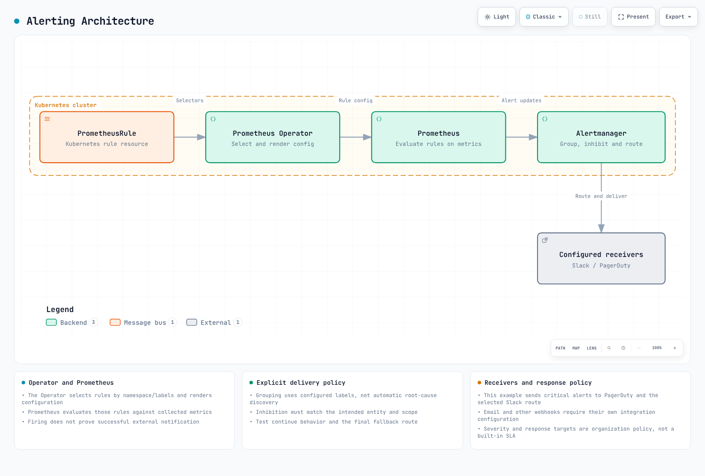

# 運用アラートの設定

> **レビュー時の基準**: Prometheus 3.15.0、Alertmanager 0.34.1、kube-prometheus-stack 92.9.0 / Prometheus Operator 0.94.1\
> **最終レビュー日**: 2026年10月16日。ルール評価、テンプレート、ルーティング、抑制範囲、chart の配線をローカルで検証しました。実クラスターへのアラート設定は行っておらず、Slack/PagerDuty 通知も送信していません。

< [前へ: スケーリング](06-scaling-strategies.md) | [目次](README.md) | [次へ: オブザーバビリティ分析](08-observability-analysis.md) >

アラート設定は、メトリクス名をコピーするだけでは完了しません。収集元、メトリクスの型、ラベル、単位、データ欠損時の動作を確認し、サービスへの影響と運用対応要件に基づいてしきい値を選んでください。以下のしきい値は例です。既存の kube-prometheus-stack 既定ルールと重複するものは、適切なルールを選択または調整してください。

## アラートのアーキテクチャ



[インタラクティブな図](https://www.atomai.click/kubernetes-docs/archmaps/en-ops-07-observability-alerts-0.html)

PrometheusRule は Kubernetes リソースです。**Prometheus Operator は namespace／ラベルの selector でリソースを選び、ルール設定を生成します**。Prometheus は生成されたルールを収集済み時系列に対して評価します。

この例では namespace と Helm release 名を `monitoring` とし、Rule の `release: monitoring` ラベルを生成された selector に一致させます。実際の release 名または selector が異なる場合は、両方を変更してください。

| フィールド／概念 | 意味 |
|---|---|
| `labels` | アラートインスタンスの識別、およびグループ化／ルーティング／抑制に使う入力 |
| `annotations` | 要約、説明、実在する Runbook リンク |
| `for` | 特定のラベル集合で条件が成立している必要のある時間 |
| `keep_firing_for` | 条件が解消した後も発火状態を任意の期間維持する設定 |
| Severity | 組織が定義するラベル値と対応方針 |

`critical`、`warning`、`info` はよく使われる慣例ですが、固定された列挙値でも、ツールが強制する SLA でもありません。評価間隔、`for`、転送、group_wait、受信先の処理がすべて通知時間に影響します。

### 評価状態と解決通知


[状態図](https://www.atomai.click/kubernetes-docs/archmaps/en-ops-07-observability-alerts-1.html)

ルールの評価と通知の配信は別のものです。`Firing` になっても Slack にメッセージが届いたことにはなりません。発火状態が終了すると解決通知を送れる場合がありますが、外部への復旧通知は `send_resolved`、ルーティング、ミュート設定、配信状況によって決まります。

アラートは、数値がゼロの要素も含め、**返された vector 要素**に対して発火します。`Ready == 0` はそのような要素を意図的に返します。アラート式に `bool` を加えて、偽の比較結果を残さないでください。

時系列が消えると、サービスが実際に復旧していなくても式の結果から要素がなくなる場合があります。`ALERTS` は Pending／Firing 状態の確認に便利ですが、Node の終了やオペレーター操作を完全に記録するものではありません。

## 検証済みの基本ルール

以下の例では、実際の node-exporter、kubelet/cAdvisor、kube-state-metrics の収集が必要です。メトリクス名、job、ラベル、対象の Node／ボリュームモードを確認してください。基本例は Prometheus 1つにつきクラスター1つを前提とします。中央集約クエリでクラスターを混在させないため、**収集された時系列自体にクラスターラベルが必要です。**

```yaml
# prometheusrule.yaml
apiVersion: monitoring.coreos.com/v1
kind: PrometheusRule
metadata:
  name: reviewed-operational-alerts
  namespace: monitoring
  labels:
    release: monitoring
spec:
  groups:
  - name: docs.network
    rules:
    - alert: NodeNetworkReceiveDropsHigh
      expr: rate(node_network_receive_drop_total{device!~"lo|veth.*|docker.*|br-.*|cali.*"}[5m]) > 100
      for: 5m
      labels:
        severity: warning
        alert_family: network_receive_drop
        team: network
      annotations:
        summary: Elevated receive drops on {{ $labels.instance }}
        description: '{{ $labels.device }} reports {{ printf "%.2f" $value }} dropped packets/s. Correlate with
          workload symptoms.'
        runbook_url: https://www.atomai.click/kubernetes-docs/en/ops/16-troubleshooting-playbook
    - alert: NodeNetworkTransmitDropsHigh
      expr: rate(node_network_transmit_drop_total{device!~"lo|veth.*|docker.*|br-.*|cali.*"}[5m]) > 100
      for: 5m
      labels:
        severity: warning
        alert_family: network_transmit_drop
        team: network
      annotations:
        summary: Elevated transmit drops on {{ $labels.instance }}
        description: '{{ $labels.device }} reports {{ printf "%.2f" $value }} dropped packets/s. Check the actual
          interface and path.'
        runbook_url: https://www.atomai.click/kubernetes-docs/en/ops/16-troubleshooting-playbook
  - name: docs.cpu
    rules:
    - alert: NodeCPUUsageHigh
      expr: (1 - avg by (cluster, instance, job) (rate(node_cpu_seconds_total{mode="idle"}[5m]))) > 0.85
      for: 5m
      labels:
        severity: warning
        alert_family: node_cpu
        team: platform
      annotations:
        summary: Elevated CPU utilization on {{ $labels.instance }}
        description: '{{ $value | humanizePercentage }} non-idle CPU time. This alone does not establish CPU pressure
          or customer impact.'
        runbook_url: https://www.atomai.click/kubernetes-docs/en/ops/16-troubleshooting-playbook
    - alert: NodeCPUUsageCritical
      expr: (1 - avg by (cluster, instance, job) (rate(node_cpu_seconds_total{mode="idle"}[5m]))) > 0.95
      for: 5m
      labels:
        severity: critical
        alert_family: node_cpu
        team: platform
      annotations:
        summary: Elevated CPU utilization on {{ $labels.instance }}
        description: '{{ $value | humanizePercentage }} non-idle CPU time. This alone does not establish CPU pressure
          or customer impact.'
        runbook_url: https://www.atomai.click/kubernetes-docs/en/ops/16-troubleshooting-playbook
    - alert: ContainerCPUThrottlingHigh
      expr: (sum by (cluster, namespace, pod, container) (rate(container_cpu_cfs_throttled_periods_total{container!="",container!="POD"}[5m])))
        / ((sum by (cluster, namespace, pod, container) (rate(container_cpu_cfs_periods_total{container!="",container!="POD"}[5m])))
        > 0) > 0.25
      for: 5m
      labels:
        severity: warning
        alert_family: container_cpu_throttling
        team: platform
      annotations:
        summary: CPU throttling on {{ $labels.namespace }}/{{ $labels.pod }}/{{ $labels.container }}
        description: '{{ $value | humanizePercentage }} of observed CFS periods included throttling. Correlate with
          latency and CPU quota before changing limits.'
        runbook_url: https://www.atomai.click/kubernetes-docs/en/ops/16-troubleshooting-playbook
    - alert: ContainerCPUThrottlingCritical
      expr: (sum by (cluster, namespace, pod, container) (rate(container_cpu_cfs_throttled_periods_total{container!="",container!="POD"}[5m])))
        / ((sum by (cluster, namespace, pod, container) (rate(container_cpu_cfs_periods_total{container!="",container!="POD"}[5m])))
        > 0) > 0.5
      for: 5m
      labels:
        severity: critical
        alert_family: container_cpu_throttling
        team: platform
      annotations:
        summary: CPU throttling on {{ $labels.namespace }}/{{ $labels.pod }}/{{ $labels.container }}
        description: '{{ $value | humanizePercentage }} of observed CFS periods included throttling. Correlate with
          latency and CPU quota before changing limits.'
        runbook_url: https://www.atomai.click/kubernetes-docs/en/ops/16-troubleshooting-playbook
    - alert: ContainerCPUAboveRequest
      expr: (sum by (cluster, namespace, pod, container) (rate(container_cpu_usage_seconds_total{container!="",container!="POD"}[5m])))
        / ((max by (cluster, namespace, pod, container) (kube_pod_container_resource_requests{resource="cpu",unit="core",container!=""}))
        > 0) > 1.5
      for: 30m
      labels:
        severity: info
        alert_family: container_cpu_request
        team: platform
      annotations:
        summary: CPU use exceeds request on {{ $labels.namespace }}/{{ $labels.pod }}
        description: '{{ printf "%.2f" $value }} times the request. CPU requests are not a hard usage limit; review
          sustained demand.'
        runbook_url: https://www.atomai.click/kubernetes-docs/en/ops/16-troubleshooting-playbook
  - name: docs.storage
    rules:
    - alert: NodeFilesystemUsageHigh
      expr: ((1 - node_filesystem_avail_bytes{fstype!~"tmpfs|overlay|squashfs|nsfs|tracefs"} / (node_filesystem_size_bytes{fstype!~"tmpfs|overlay|squashfs|nsfs|tracefs"}
        > 0)) > 0.85) and (node_filesystem_readonly{fstype!~"tmpfs|overlay|squashfs|nsfs|tracefs"} == 0)
      for: 5m
      labels:
        severity: warning
        alert_family: node_filesystem
        team: storage
      annotations:
        summary: Filesystem usage on {{ $labels.instance }} {{ $labels.mountpoint }}
        description: '{{ $value | humanizePercentage }} of reported capacity is unavailable. Check actual mount
          layout and workload storage.'
        runbook_url: https://www.atomai.click/kubernetes-docs/en/ops/16-troubleshooting-playbook
    - alert: NodeFilesystemUsageCritical
      expr: ((1 - node_filesystem_avail_bytes{fstype!~"tmpfs|overlay|squashfs|nsfs|tracefs"} / (node_filesystem_size_bytes{fstype!~"tmpfs|overlay|squashfs|nsfs|tracefs"}
        > 0)) > 0.95) and (node_filesystem_readonly{fstype!~"tmpfs|overlay|squashfs|nsfs|tracefs"} == 0)
      for: 5m
      labels:
        severity: critical
        alert_family: node_filesystem
        team: storage
      annotations:
        summary: Filesystem usage on {{ $labels.instance }} {{ $labels.mountpoint }}
        description: '{{ $value | humanizePercentage }} of reported capacity is unavailable. Check actual mount
          layout and workload storage.'
        runbook_url: https://www.atomai.click/kubernetes-docs/en/ops/16-troubleshooting-playbook
    - alert: PVCUsageHigh
      expr: (max by (cluster, namespace, persistentvolumeclaim) (kubelet_volume_stats_used_bytes{persistentvolumeclaim!=""}
        / (kubelet_volume_stats_capacity_bytes{persistentvolumeclaim!=""} > 0))) > 0.85
      for: 5m
      labels:
        severity: warning
        alert_family: pvc_usage
        team: storage
      annotations:
        summary: PVC usage on {{ $labels.namespace }}/{{ $labels.persistentvolumeclaim }}
        description: '{{ $value | humanizePercentage }} filesystem usage. This is not an EBS IOPS/throughput measurement.'
        runbook_url: https://www.atomai.click/kubernetes-docs/en/ops/16-troubleshooting-playbook
    - alert: PVCUsageCritical
      expr: (max by (cluster, namespace, persistentvolumeclaim) (kubelet_volume_stats_used_bytes{persistentvolumeclaim!=""}
        / (kubelet_volume_stats_capacity_bytes{persistentvolumeclaim!=""} > 0))) > 0.95
      for: 5m
      labels:
        severity: critical
        alert_family: pvc_usage
        team: storage
      annotations:
        summary: PVC usage on {{ $labels.namespace }}/{{ $labels.persistentvolumeclaim }}
        description: '{{ $value | humanizePercentage }} filesystem usage. This is not an EBS IOPS/throughput measurement.'
        runbook_url: https://www.atomai.click/kubernetes-docs/en/ops/16-troubleshooting-playbook
    - alert: PVCInodesHigh
      expr: max by (cluster, namespace, persistentvolumeclaim) (kubelet_volume_stats_inodes_used{persistentvolumeclaim!=""}
        / (kubelet_volume_stats_inodes{persistentvolumeclaim!=""} > 0)) > 0.9
      for: 5m
      labels:
        severity: warning
        alert_family: pvc_inodes
        team: storage
      annotations:
        summary: PVC inode usage on {{ $labels.namespace }}/{{ $labels.persistentvolumeclaim }}
        description: '{{ $value | humanizePercentage }} of reported inodes are used. The driver/filesystem must
          support these statistics.'
        runbook_url: https://www.atomai.click/kubernetes-docs/en/ops/16-troubleshooting-playbook
    - alert: PVCGrowthProjectionHigh
      expr: max by (cluster, namespace, persistentvolumeclaim) ((predict_linear(kubelet_volume_stats_used_bytes{persistentvolumeclaim!=""}[6h],
        24*3600) / (kubelet_volume_stats_capacity_bytes{persistentvolumeclaim!=""} > 0)) and (kubelet_volume_stats_used_bytes{persistentvolumeclaim!=""}
        / (kubelet_volume_stats_capacity_bytes{persistentvolumeclaim!=""} > 0) > 0.7)) > 1
      for: 1h
      labels:
        severity: warning
        alert_family: pvc_growth
        team: storage
      annotations:
        summary: PVC growth projection on {{ $labels.namespace }}/{{ $labels.persistentvolumeclaim }}
        description: A linear fit projects usage beyond current capacity within 24h. Check data coverage, resizing
          and nonlinear changes.
        runbook_url: https://www.atomai.click/kubernetes-docs/en/ops/16-troubleshooting-playbook
  - name: docs.nodes
    rules:
    - alert: NodeNotReady
      expr: max by (cluster, node) (kube_node_status_condition{condition="Ready",status="true"}) == 0
      for: 5m
      labels:
        severity: warning
        alert_family: node_ready
        team: platform
      annotations:
        summary: Node {{ $labels.node }} is not Ready
        description: An observed Node has Ready=false or unknown. Inspect conditions and events; this is not proof
          of termination.
        runbook_url: https://www.atomai.click/kubernetes-docs/en/ops/16-troubleshooting-playbook
    - alert: NodeDiskPressure
      expr: max by (cluster, node) (kube_node_status_condition{condition="DiskPressure",status="true"}) == 1
      for: 5m
      labels:
        severity: critical
        alert_family: node_disk_pressure
        team: storage
      annotations:
        summary: Node {{ $labels.node }} reports DiskPressure
        description: Kubelet reports disk pressure. Correlate filesystem space/inodes and eviction events.
        runbook_url: https://www.atomai.click/kubernetes-docs/en/ops/16-troubleshooting-playbook
    - alert: PDBHealthyBelowDesired
      expr: max by (cluster, namespace, poddisruptionbudget) (kube_poddisruptionbudget_status_desired_healthy -
        kube_poddisruptionbudget_status_current_healthy) > 0
      for: 5m
      labels:
        severity: warning
        alert_family: pdb_health
        team: platform
      annotations:
        summary: PDB healthy count below desired in {{ $labels.namespace }}
        description: '{{ printf "%.0f" $value }} fewer healthy Pods than desired for {{ $labels.poddisruptionbudget
          }}. This does not prove a policy was bypassed.'
        runbook_url: https://www.atomai.click/kubernetes-docs/en/ops/16-troubleshooting-playbook
  - name: docs.collection
    rules:
    - alert: KnownScrapeTargetDown
      expr: up == 0
      for: 5m
      labels:
        severity: warning
        alert_family: scrape
        team: platform
      annotations:
        summary: Cannot scrape {{ $labels.job }} at {{ $labels.instance }}
        description: A known target failed scraping. A target removed from discovery needs separate absence/inventory
          monitoring.
        runbook_url: https://www.atomai.click/kubernetes-docs/en/ops/16-troubleshooting-playbook
```

比率には `humanizePercentage` を使います。Prometheus アラートの annotation では任意の Sprig `mul`/`div` 関数を使えません。`0.96` を `0.96%` と表示したり、存在しない `$labels.used_bytes` を参照したりしないでください。`$value` は式の結果です。他のオペランドが自動的にラベルになるわけではありません。

### ネットワーク

パケットドロップカウンターには `rate()` を使います。単位はパケット／秒です。毎秒と毎分を混同しないでください。ポリシーによる拒否や一時的なドロップは想定されることもあるため、継続時間、トラフィック量、サービス症状を合わせて確認してください。

帯域幅をビット／秒で確認します。

```promql
rate(node_network_transmit_bytes_total{device!~"lo|veth.*|docker.*|br-.*"}[5m]) * 8
```

実際の EC2 ベースライン／バースト契約、通信経路、PPS 上限と比較してください。Gbps の `10^9` ビットと2進の Gi 単位を区別します。`node_network_speed_bytes` がゼロ／不明の場合や、仮想 NIC が公称速度を示す場合があります。RX+TX は常に全二重の飽和率を表すわけではありません。すべての Node の分母が10 Gbps だと仮定しないでください。

### CPU

CFS の throttled-period 比率は**スロットリングされた期間の割合**であり、失われた CPU 時間ではありません。throttled seconds を実際の CPU 使用量で割っても、実時間に対する単純な割合にはなりません。カウンターに合った関数を使い、ゼロ除算を除外してください。

CPU requests を超えることは、正当なバースト利用の場合があります。高い使用率、スロットリング、iowait、steal だけでは、顧客への影響や根本原因を証明できません。limits/requests は、サービスレイテンシー、クォータ、スケジューリング、HPA の影響と合わせて評価してください。

`process_cpu_seconds_total{job="containerd"}` のような式は、実際にその process exporter/job が必要です。マネージド Auto Mode サービスが従来型のインストールと同じ Deployment/DaemonSet メトリクスを公開すると仮定しないでください。

### ファイルシステム、PVC、inode

`kubelet_volume_stats_*` は、対応するドライバー／ファイルシステムの統計値を提供します。PVC 使用量は EBS の IOPS／スループット飽和を示すものではなく、すべてのボリュームモードで同じ統計が公開されるわけでもありません。

容量がゼロまたは欠落している状態は「使用率0%」ではありません。目的に応じて読み取り専用／仮想ファイルシステムを除外し、実際のマウントを調べてください。`/var/lib/kubelet` が常に独立したマウントポイントとは限りません。

`container_fs_limit_bytes` が Kubernetes の `resources.limits.ephemeral-storage` と一致する保証はありません。書き込み可能レイヤー、ログ、emptyDir、Node のファイルシステム会計を区別してください。

`predict_linear` は当てはめた傾向を外挿します。リサイズ、削除、サンプル欠損、非線形な増加により解釈が変わります。正確な期限に容量が尽きる保証ではなく、無条件の自動拡張を正当化するものでもありません。

## CNI、DNS、ポリシーのメトリクスを導入構成に合わせる

### VPC CNI

従来型 VPC CNI の IPAM エンドポイントと cni-metrics-helper の CloudWatch 集約では、経路や名前が異なります。次の gauge／counter 定義は v1.23.1 にあります。使用前に、インストール済みバージョンと実際の `/metrics` を確認してください。

```promql
# Spare addresses in the currently allocated pool
awscni_total_ip_addresses - awscni_assigned_ip_addresses

# IPAM error counter
rate(awscni_ipamd_error_count[5m])

# Failure to obtain an available IP address
rate(awscni_no_available_ip_addresses[5m])
```

ウォームプールの余裕がゼロでも、それだけでサブネット枯渇を示したり、新しい Pod がすべて起動不能だと証明したりはしません。追加割り当て、prefix delegation、ENI 上限、実際のエラー、サブネット容量を確認してください。

`awscni_add_ip_req_count` に存在しない `status="failed"` ラベルを追加したり、存在しない ENI レイテンシーヒストグラムを作ったりしないでください。元の Prometheus メトリクス名と、cni-metrics-helper が改名したクラスター単位の CloudWatch 集約値を区別します。

### DNS

`NXDOMAIN` は正常な否定応答の場合があります。失敗条件とトラフィックしきい値を意図的に定義してください。CoreDNS メトリクスを収集している場合、次の診断式で SERVFAIL/REFUSED の比率を計算できます。

```promql
(
  sum by (cluster) (rate(coredns_dns_responses_total{rcode=~"SERVFAIL|REFUSED"}[5m]))
  or on (cluster)
  (0 * sum by (cluster) (rate(coredns_dns_responses_total[5m])))
)
/
(sum by (cluster) (rate(coredns_dns_responses_total[5m])) > 0)
```

スクレイプ失敗と DNS クエリ失敗は別の状態です。`absent(up{job="coredns"} == 1)` だけでは、クラスター DNS が機能しないことを証明できません。**EKS Auto Mode のみの構成では、CoreDNS は Node のシステムサービスとして動作します**。従来型 Node が混在する環境では、実際の DNS アーキテクチャを確認してください。

### ネットワークポリシーによるドロップ

ドロップメトリクスを有効にした Cilium 1.20.3 では、Hubble が reason/protocol と設定済みコンテキストラベルを含む `hubble_drop_total` を公開します。

```promql
sum by (cluster, reason) (
  rate(hubble_drop_total{reason="POLICY_DENIED"}[5m])
)
```

namespace のコンテキストは設定した場合にのみ存在します。ポリシーによるドロップが必ずしも設定ミスとは限りません。共通の `denied_packets` メトリクスを作らず、実際の Cilium/Calico 配布物、機能、メトリクス設定を確認してください。[レビュー済みの Cilium オブザーバビリティ章](../service-mesh/cilium-service-mesh/04-observability.md)を参照してください。

## Auto Mode の Node 状態と終了原因

`NodeNotReady` は、観測された Node の Ready 状態が false または unknown であることを意味します。それだけで終了、置換、容量枯渇が証明されるわけではありません。インベントリの欠落と exporter 障害も区別してください。

```promql
# Previously observed Nodes missing from current inventory: diagnostic only
max by (cluster, node) (kube_node_info offset 5m)
unless on (cluster, node)
max by (cluster, node) (kube_node_info)

# Currently retained Evicted Pod state, not a historical event counter
sum by (cluster, namespace) (kube_pod_status_reason{reason="Evicted"} == 1)
```

Pod の phase/reason や削除タイムスタンプはイベントカウンターではありません。`increase()` で期間内の退避数に変換したり、存在しない `reason="NodeDrain"` ラベルを追加したりしないでください。Pod のガベージコレクション後も履歴を残せるよう、Kubernetes Events と監査／運用ログを保持してください。

PDB の currentHealthy が desiredHealthy を下回る状態は、健全性の不足を示しますが、誰かがポリシーに違反した証明ではありません。自発的でない障害、レプリカ数の直接変更、その他の原因を別々に調査してください。

### マネージド Auto Mode と自己管理 Karpenter

Auto Mode が自己管理 Karpenter コントローラーの scrape endpoint を公開すると仮定しないでください。サポートされる Node condition、NodeClaim/NodePool の状態、マネージドコントロールプレーンの監査ログを使います。

AWS の Auto Mode トラブルシューティングガイドでは、`DisruptionBlocked`、`DisruptionTerminating`、`FailedScheduling`、`FailedDraining` などのイベントがコントロールプレーン監査ログに記録されると説明されています。監査ログを有効にした場合は、実際のクラスターのロググループを対象にクエリしてください。

```text
fields @timestamp, @message
| filter @logStream like /kube-apiserver-audit/
| filter @message like /DisruptionBlocked|DisruptionTerminating|FailedScheduling|FailedDraining|NodeRepairBlocked/
| sort @timestamp desc
| limit 100
```

自己管理 Karpenter では、インストール済みバージョンのメトリクスカタログを参照してください。現在の NodeClaim 終了カウンターは集計値であり、Node／理由ごとの完全な監査記録ではありません。中断キューのカウンターには Spot 以外のメッセージ種別が含まれる場合があります。

`karpenter_nodepools_usage` が測定するのは**プロビジョニング済みリソース**であり、CPU の稼働率ではありません。上限と比較する前に、リソースラベル、単位、クラスター識別、欠損／ゼロの上限値を確認してください。Pending Pod と余剰容量メトリクスがあっても、スケジュール可能とは証明できません。affinity、taint、トポロジー、ボリュームも影響します。

## Alertmanager の設定と chart の配線

以下は**ネイティブ Alertmanager YAML**です。AlertmanagerConfig CRD の構造化 matcher や camelCase フィールドと混在させないでください。ネイティブ Alertmanager は `${NAME}` 環境変数プレースホルダーを自動置換しません。

### ファイルと Secret の準備

`monitoring` namespace に次のオブジェクトを準備してください。

| オブジェクト | 内容 |
|---|---|
| Secret `reviewed-alertmanager-config` | `alertmanager.yaml` キー |
| ConfigMap `notification-templates` | `notifications.tmpl` キー |
| Secret `notification-credentials` | `slack-default`、`slack-network`、`slack-storage`、`slack-info`、`pagerduty-routing-key` |

認証情報には承認済みの Secret 管理手順を使ってください。実 URL／キーを Git、Helm values、PR ログに含めないでください。現行の Slack Incoming Webhook は選択済みのインストールチャネルにひも付きます。`channel` フィールドを変えても、1つの URL から複数チャネルに送れるようにはなりません。この例では URL ファイルを分けています。

ここでは PagerDuty Events API v2 の routing key を使います。`service_key`/`service_key_file` は別の v1 統合経路として引き続きサポートされます。実際の統合タイプに対応する認証情報を選んでください。

```yaml
# alertmanager.yaml
global:
  resolve_timeout: 5m
route:
  receiver: default-slack
  group_by: [cluster, alertname, namespace, severity]
  group_wait: 30s
  group_interval: 5m
  repeat_interval: 4h
  routes:
    - receiver: oncall
      matchers: ['severity="critical"']
      group_wait: 10s
      repeat_interval: 1h
      continue: true
    - receiver: low-priority
      matchers: ['severity="info"']
      mute_time_intervals: [nightly-maintenance]
    - receiver: network-team
      matchers: ['team="network"']
    - receiver: storage-team
      matchers: ['team="storage"']
    # Explicit sibling fallback: a matched critical route does not fall back
    # to the root receiver merely because its continue flag is true.
    - receiver: default-slack

inhibit_rules:
  - source_matchers: ['severity="critical"', 'cluster!=""', 'alert_family!=""', 'instance!=""']
    target_matchers: ['severity="warning"', 'cluster!=""', 'alert_family!=""', 'instance!=""']
    equal: [cluster, alert_family, instance, job, device, mountpoint, fstype]
  - source_matchers: ['severity="critical"', 'cluster!=""', 'alert_family!=""', 'namespace!=""', 'pod!=""', 'container!=""']
    target_matchers: ['severity="warning"', 'cluster!=""', 'alert_family!=""', 'namespace!=""', 'pod!=""', 'container!=""']
    equal: [cluster, alert_family, namespace, pod, container]
  - source_matchers: ['severity="critical"', 'cluster!=""', 'alert_family!=""', 'namespace!=""', 'persistentvolumeclaim!=""']
    target_matchers: ['severity="warning"', 'cluster!=""', 'alert_family!=""', 'namespace!=""', 'persistentvolumeclaim!=""']
    equal: [cluster, alert_family, namespace, persistentvolumeclaim]

receivers:
  - name: default-slack
    slack_configs:
      - api_url_file: /etc/alertmanager/secrets/notification-credentials/slack-default
        send_resolved: true
        title: '{{ template "docs.title" . }}'
        text: '{{ template "docs.text" . }}'
  - name: network-team
    slack_configs:
      - api_url_file: /etc/alertmanager/secrets/notification-credentials/slack-network
        send_resolved: true
        title: '{{ template "docs.title" . }}'
        text: '{{ template "docs.text" . }}'
  - name: storage-team
    slack_configs:
      - api_url_file: /etc/alertmanager/secrets/notification-credentials/slack-storage
        send_resolved: true
        title: '{{ template "docs.title" . }}'
        text: '{{ template "docs.text" . }}'
  - name: low-priority
    slack_configs:
      - api_url_file: /etc/alertmanager/secrets/notification-credentials/slack-info
        send_resolved: true
        title: '{{ template "docs.title" . }}'
        text: '{{ template "docs.text" . }}'
  - name: oncall
    pagerduty_configs:
      - routing_key_file: /etc/alertmanager/secrets/notification-credentials/pagerduty-routing-key
        send_resolved: true
        severity: critical
        description: '{{ template "docs.title" . }}'
        details:
          alerts: '{{ template "docs.text" . }}'

templates:
  - /etc/alertmanager/configmaps/notification-templates/*.tmpl

time_intervals:
  - name: nightly-maintenance
    time_intervals:
      - location: Asia/Seoul
        times:
          - start_time: "02:00"
            end_time: "04:00"
```

Critical アラートはまず on-call に届き、その後、チーム固有の Slack 経路にも届きます。明示的な最後の sibling fallback により、team ラベルのない critical アラートも Slack に送られます。子ルートが一致した後、`continue: true` だけでは root receiver への fallback は発生しません。

Info は別経路を使い、**Asia/Seoul の02:00～04:00**は毎日ミュートされます。これは日次ダイジェストを蓄積する設定ではありません。再通知／グループ化の遅延は、カレンダーに基づくダイジェスト処理の代わりにはなりません。

抑制には実際の cluster/entity 識別子が必要です。warning と critical で名前は異なってもかまいませんが、`alert_family` と対象の node/container/PVC 範囲を共有する必要があります。ラベル欠落同士は空値として一致する場合があります。`equal: [node]` だけでは、無関係なアラートまで抑制しかねません。

`resolve_timeout` は `EndsAt` を含む Prometheus アラートの `for` や解決通知の遅延を変えません。`send_resolved` を含め、受信先の実際の挙動を別途確認してください。

### 通知テンプレート

`notifications.tmpl`:

```text
{{ define "docs.title" -}}
[{{ .Status | toUpper }}] {{ .GroupLabels.alertname }} — {{ .CommonLabels.cluster }}
{{- end }}

{{ define "docs.text" -}}
{{ range .Alerts -}}
[{{ .Status | toUpper }}] {{ .Annotations.summary }}
{{ .Annotations.description }}
{{ if .Labels.namespace }}Namespace: {{ .Labels.namespace }}
{{ end -}}
{{ if .Annotations.runbook_url }}Runbook: {{ .Annotations.runbook_url }}
{{ end -}}
{{ end -}}
{{ if .ExternalURL }}Alertmanager: {{ .ExternalURL }}
{{ end -}}
{{- end }}
```

このテンプレートは、発火中と解決済みのアラートが同じグループにある場合も、それぞれの status を表示します。空の Runbook ボタンを常に表示したり、label 値を URL エスケープせず手作業で silence URL を組み立てたりしないでください。認証済み Alertmanager UI で対象アラートを選び、silence を作成してください。

次の Kubernetes オブジェクトを使って設定とテンプレートを渡せます。この手順では認証情報 Secret は作成されません。

```bash
kubectl --context "$TARGET_CONTEXT" -n monitoring create secret generic \
  reviewed-alertmanager-config --from-file=alertmanager.yaml \
  --dry-run=client -o yaml |
  kubectl --context "$TARGET_CONTEXT" -n monitoring apply -f -

kubectl --context "$TARGET_CONTEXT" -n monitoring create configmap \
  notification-templates --from-file=notifications.tmpl \
  --dry-run=client -o yaml |
  kubectl --context "$TARGET_CONTEXT" -n monitoring apply -f -
```

### kube-prometheus-stack values

```yaml
# alerting-values.yaml
# Merge into the reviewed full values for the actual release named "monitoring".
alertmanager:
  enabled: true
  alertmanagerSpec:
    useExistingSecret: true
    configSecret: reviewed-alertmanager-config
    secrets: [notification-credentials]
    configMaps: [notification-templates]
    externalUrl: https://alertmanager.example.com
    # No AlertmanagerConfig object is supplied in this example.
    # Adding one with this label is an explicit, separately reviewed choice.
    alertmanagerConfigSelector:
      matchLabels:
        alertmanager-config: platform-approved
    alertmanagerConfigNamespaceSelector:
      matchLabels:
        kubernetes.io/metadata.name: monitoring
prometheus:
  prometheusSpec:
    externalLabels:
      cluster: REPLACE_CLUSTER_NAME
    additionalAlertRelabelConfigs:
      - action: labeldrop
        regex: prometheus_replica
```

クラスター名とアクセス URL を置き換えたうえで、release の**レビュー済み全 values**にマージしてください。この断片だけで既存のインストールを上書きしないでください。Chart 92.9.0 は追加の alert relabeling を Secret に生成し、その Secret を Prometheus が参照します。

```bash
helm template monitoring prometheus-community/kube-prometheus-stack \
  --version 92.9.0 --namespace monitoring \
  --values monitoring-values.yaml --values alerting-values.yaml \
  > rendered-monitoring.yaml
```

適用前に Helm repository を準備し、CRD/chart のアップグレードを確認してください。重複する既定ルールや、利用できないマネージドコントロールプレーン／Auto Mode job に関する前提を調べてから、運用デプロイ手順を通じて適用します。

External label は外部へ送るアラートを識別しますが、ローカルクエリのすべてのサンプルに自動でラベルを付けるわけではありません。HA 重複排除が必要な場合はレプリカごとの識別情報を取り除き、実際のクラスター識別は保持します。

この例では基本 Secret と、明示的にラベル付けされた追加の AlertmanagerConfig リソースを選択します。一致する CRD を追加することも設定のマージであり、意図したレビューが必要です。

## 検証と保守

PyYAML がある場合は、PrometheusRule spec をネイティブのルールファイルとして抽出します。

```bash
python3 - <<'PY'
from pathlib import Path
import yaml
resource = yaml.safe_load(Path("prometheusrule.yaml").read_text())
Path("rules.yaml").write_text(yaml.safe_dump(resource["spec"], sort_keys=False))
PY
promtool check rules rules.yaml
```

準備したテンプレート／認証情報のパスを使う検証用コピーで Alertmanager を確認します。

```bash
amtool check-config alertmanager.yaml --enable-feature=utf8-strict-mode
amtool config routes test --config.file=alertmanager.yaml \
  --verify.receivers=oncall,network-team severity=critical team=network
```

ローカル検証用ファイルでは実認証情報を置き換えられます。この章では、外部送信先をすべて取り除いたローカル Alertmanager で17ルール、評価シナリオ18件、ルーティングケース10件、ネイティブテンプレート2件、抑制ケース16件を検証しました。実際の exporter データ、チャネル認証、配信は、環境に接続した後に別途検証する必要があります。

Silence の作成／期限切れは通知ポリシーを変更します。Alertmanager URL、クラスター／namespace／entity matcher、所有者、理由、期間を確認してください。silence しても Prometheus の評価は止まりません。長期間ミュートされたアラートも、インシデントの解決を意味しません。

最後の終了状態を示す OOMKilled gauge は、過去の状態を保持する場合があります。常に上限を増やしたりメモリリークと決めつけたりせず、再起動数、終了時刻、Events と照合してください。

## 参考資料

- [Prometheus アラートルール](https://prometheus.io/docs/prometheus/latest/configuration/alerting_rules/)
- [Alertmanager の設定](https://prometheus.io/docs/alerting/latest/configuration/)
- [VPC CNI v1.23.1 メトリクス定義](https://github.com/aws/amazon-vpc-cni-k8s/blob/v1.23.1/utils/prometheusmetrics/prometheusmetrics.go)
- [Auto Mode のトラブルシューティング](https://docs.aws.amazon.com/eks/latest/userguide/auto-troubleshoot.html)
- [Karpenter メトリクス](https://karpenter.sh/docs/reference/metrics/)
- [Slack Incoming Webhook](https://docs.slack.dev/messaging/sending-messages-using-incoming-webhooks/)
- [章のクイズ](../quizzes/ops/07-observability-alerts-quiz.md)

< [前へ: スケーリング](06-scaling-strategies.md) | [目次](README.md) | [次へ: オブザーバビリティ分析](08-observability-analysis.md) >
