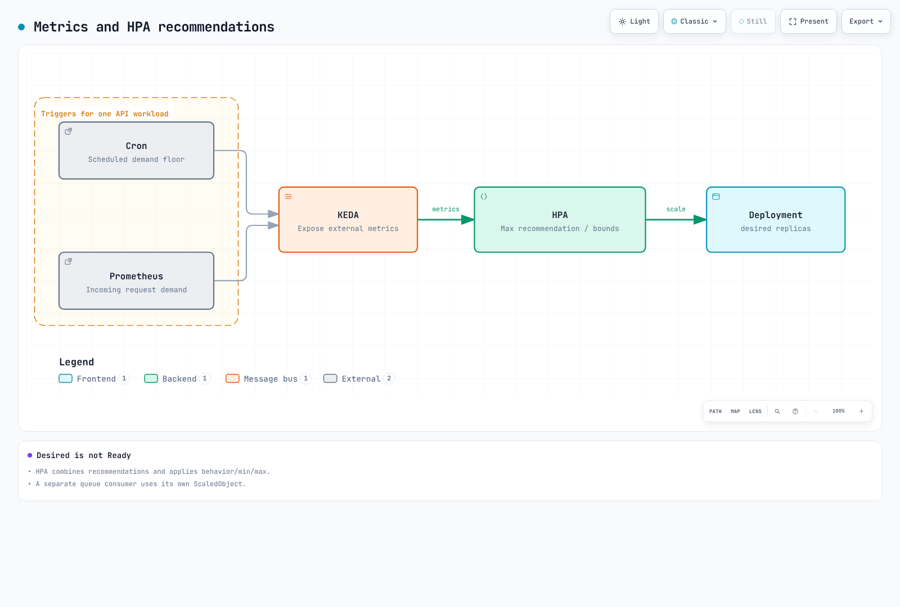
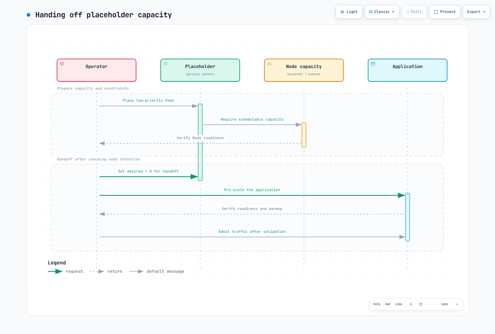
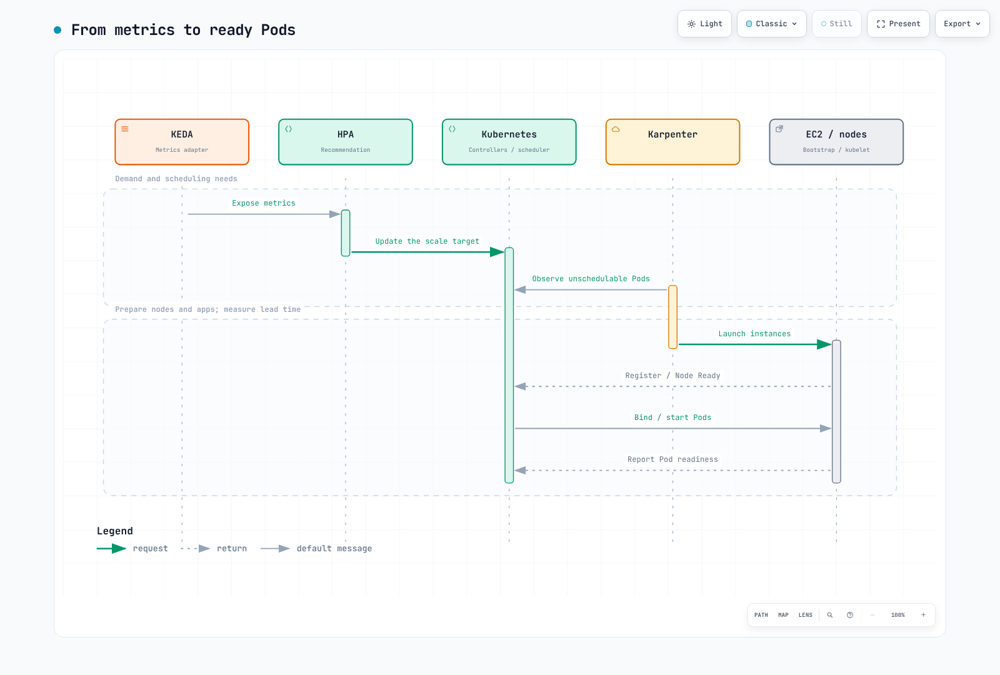

# イベント容量計画のプレイブック

> **最終更新日**：2026年9月12日。KEDA 2.20.2 と自己管理型 Karpenter AWS provider 1.14.1 に基づきます。
> 数値は明示した前提条件に基づく計算であり、本番ベンチマークの結果ではありません。

PM/計画担当者は需要、タイミング、レイテンシー、障害時の目標を提示します。運用担当者はアプリケーション、ノード、DB、ネットワーク、キューの処理能力、quota、準備にかかる時間を検証します。
イベント種別だけでは、トラフィック倍率や固定のウォームアップ時間は保証できません。必要に応じて rate limit、waiting room、backpressure を使ってください。過負荷制御はスケーリングだけではありません。

## 1. 入力と単位

| 入力 | 確認事項 |
|---|---|
| ピーク時の RPM/RPS | 単位、ユーザー動作、cache hit、retry による増幅、API ごとの需要 |
| Pod あたりの処理量 | 代表的な入力、request、並列度で測定した SLO 達成可能な容量 |
| Node 容量 | 実際の allocatable から DaemonSet 分を差し引く。CPU、memory、Pod slot の制約 |
| 障害時の目標 | Pod/node/AZ 喪失中のトラフィック目標を定義 |
| 時刻 | IANA time zone、明示的な UTC offset、Node/予約の実際の有効期間 |
| 費用 | 価格の日付、region、OS、tenancy、未使用予約、他サービス/税 |

計算ツールは丸め、単位、予約の二重計上、AZ 喪失を検査します。
Pod の構成は1種類にそろっている前提です。他の workload も集計し、topology、volume、port の制約を別途検証してください。
容量を30%追加することと、容量の30%を未使用のまま残すことは異なります。
AZ 喪失のテストが対象とするのは基準ピーク需要であり、同時に発生する追加需要は含みません。

`scenario.json`

```json
{
  "description": "Illustrative inputs; replace throughput and allocatable values with measured evidence.",
  "peak_rpm": 600000,
  "pod_rpm_at_slo": 3000,
  "extra_capacity_fraction": "0.30",
  "pod_cpu_milli": 1500,
  "pod_memory_mib": 2048,
  "allocatable_cpu_milli": 15500,
  "daemon_cpu_milli": 500,
  "allocatable_memory_mib": 29696,
  "daemon_memory_mib": 1024,
  "max_pods": 58,
  "daemon_pods": 7,
  "nodes_by_az": {"az-a": 15, "az-b": 11},
  "reserved_nodes_by_az": {"az-a": 15, "az-b": 11},
  "node_start": "2026-11-27T11:00:00+09:00",
  "node_end": "2026-11-27T15:00:00+09:00",
  "reservation_start": "2026-11-27T11:00:00+09:00",
  "reservation_end": "2026-11-27T15:00:00+09:00",
  "usd_per_instance_hour": "0.768",
  "price_region": "ap-northeast-2",
  "price_instance_type": "c5.4xlarge",
  "price_observed_date": "2026-09-12",
  "hpa_max_replicas": 300,
  "node_budget": 40,
  "require_one_az_loss": true,
  "other_services_budget_usd": null
}
```

```python
# capacity.py
"""Deterministic planning arithmetic, not a benchmark or AWS provisioning tool."""
import argparse
import json
from datetime import datetime, timezone
from decimal import Decimal, ROUND_CEILING, ROUND_HALF_UP


def number(value, name, minimum=Decimal(0), positive=False):
    if isinstance(value, bool):
        raise ValueError(f"{name}: boolean is not a number")
    result = Decimal(str(value))
    if not result.is_finite() or result < minimum or (positive and result == minimum):
        raise ValueError(f"{name}: invalid finite range")
    return result


def integer(value, name, positive=False):
    result = number(value, name, positive=positive)
    if result != result.to_integral_value():
        raise ValueError(f"{name}: integer required")
    return int(result)


def instant(value):
    result = datetime.fromisoformat(value.replace("Z", "+00:00"))
    if result.tzinfo is None or result.utcoffset() is None:
        raise ValueError("Use timestamps with an explicit UTC offset")
    return result.astimezone(timezone.utc)


def seconds_between(start, end):
    delta = end-start
    return Decimal(delta.days*86400 + delta.seconds) + Decimal(delta.microseconds)/Decimal(1_000_000)


def hours(start, end):
    seconds = seconds_between(start,end)
    if seconds < 60:
        raise ValueError("Planning intervals must be at least 60 seconds")
    return seconds/Decimal(3600)


def ceiling(value):
    return int(value.to_integral_value(rounding=ROUND_CEILING))


def calculate(config):
    if type(config.get("require_one_az_loss",False)) is not bool:
        raise ValueError("require_one_az_loss must be a boolean")
    demand = number(config["peak_rpm"], "peak_rpm", positive=True)
    pod_rate = number(config["pod_rpm_at_slo"], "pod_rpm_at_slo", positive=True)
    margin = number(config["extra_capacity_fraction"], "extra_capacity_fraction")
    pod_cpu = number(config["pod_cpu_milli"], "pod_cpu_milli", positive=True)
    pod_mem = number(config["pod_memory_mib"], "pod_memory_mib", positive=True)
    cpu = number(config["allocatable_cpu_milli"], "allocatable_cpu_milli", positive=True) - number(config["daemon_cpu_milli"], "daemon_cpu_milli")
    memory = number(config["allocatable_memory_mib"], "allocatable_memory_mib", positive=True) - number(config["daemon_memory_mib"], "daemon_memory_mib")
    slots = integer(config["max_pods"], "max_pods", positive=True) - integer(config["daemon_pods"], "daemon_pods")
    if cpu <= 0 or memory <= 0 or slots <= 0:
        raise ValueError("No allocatable application capacity after DaemonSet overhead")
    per_node = min(int(cpu//pod_cpu), int(memory//pod_mem), slots)
    if per_node < 1:
        raise ValueError("The workload cannot fit this node profile")
    base_pods = ceiling(demand/pod_rate)
    planned_pods = ceiling(demand*(Decimal(1)+margin)/pod_rate)
    needed_nodes = ceiling(Decimal(planned_pods)/Decimal(per_node))
    placements = {zone:integer(count, "nodes_by_az") for zone,count in config["nodes_by_az"].items()}
    reservations = {zone:integer(count, "reserved_nodes_by_az") for zone,count in config["reserved_nodes_by_az"].items()}
    if not placements or sum(placements.values()) < 1:
        raise ValueError("Provide at least one planned node")
    nodes = sum(placements.values())
    survivors = nodes-max(placements.values())
    surviving_rpm = Decimal(survivors*per_node)*pod_rate
    start, end = instant(config["node_start"]), instant(config["node_end"])
    reserve_start, reserve_end = instant(config["reservation_start"]), instant(config["reservation_end"])
    node_hours = hours(start,end)
    reservation_hours = hours(reserve_start,reserve_end)
    overlap_start, overlap_end = max(start,reserve_start), min(end,reserve_end)
    overlap = (seconds_between(overlap_start,overlap_end)/Decimal(3600)
               if overlap_end > overlap_start else Decimal(0))
    price = number(config["usd_per_instance_hour"], "usd_per_instance_hour", positive=True)
    # Pay for running instances and unused reserved slots, without double-counting
    # a matching instance occupying a reservation. Assume one instance profile/type.
    running_cost = Decimal(nodes)*node_hours*price
    unused_cost = Decimal(0)
    for zone,reserved in reservations.items():
        used = min(reserved,placements.get(zone,0))
        unused_slot_hours = Decimal(reserved)*reservation_hours-Decimal(used)*overlap
        unused_cost += unused_slot_hours*price
    compute_cost = running_cost+unused_cost
    other = config.get("other_services_budget_usd")
    total = None if other is None else compute_cost+number(other,"other_services_budget_usd")
    findings = []
    if nodes < needed_nodes:
        findings.append("Planned nodes do not satisfy the capacity target")
    if planned_pods > integer(config["hpa_max_replicas"],"hpa_max_replicas",positive=True):
        findings.append("Planned Pod target exceeds the approved HPA maximum")
    if nodes > integer(config["node_budget"],"node_budget",positive=True):
        findings.append("Planned nodes exceed the approved node budget")
    if config.get("require_one_az_loss") and surviving_rpm < demand:
        findings.append("Losing the largest AZ leaves less than the baseline peak demand capacity")
    money = lambda value: format(value.quantize(Decimal("0.01"),rounding=ROUND_HALF_UP),"f")
    return {
        "base_pods":base_pods, "planned_pods_with_extra_capacity":planned_pods,
        "pods_per_node_from_inputs":per_node, "minimum_nodes_for_capacity":needed_nodes,
        "planned_nodes":nodes, "surviving_nodes_after_largest_az_loss":survivors,
        "surviving_rpm":str(surviving_rpm), "node_hours_per_instance":str(node_hours),
        "reservation_hours_per_slot":str(reservation_hours),
        "running_instances_usd":money(running_cost), "unused_reservations_usd":money(unused_cost),
        "ec2_compute_subtotal_usd":money(compute_cost),
        "total_budget_estimate_usd":None if total is None else money(total),
        "findings":findings,
        "assumptions":[
            "Input throughput/allocatable values require workload-specific measurement.",
            "Extra capacity is added once; it is not the same as leaving that fraction unused.",
            "Constant node counts over the interval; matching reservations consumed first within each AZ.",
            "All instances/reservations have the same type/platform/tenancy and supplied hourly rate.",
            "Current public pricing is an estimate for a future event, not a guaranteed charge.",
            "EC2 subtotal excludes EBS, EKS/Auto Mode, networking, load balancers, databases, telemetry and tax.",
            "Capacity and AZ arithmetic do not prove scheduling, recovery or application SLO."
        ]
    }


if __name__ == "__main__":
    parser = argparse.ArgumentParser()
    parser.add_argument("input")
    args = parser.parse_args()
    try:
        with open(args.input,encoding="utf-8") as stream:
            result = calculate(json.load(stream))
    except (ValueError, KeyError, ArithmeticError) as error:
        parser.error(str(error))
    print(json.dumps(result,indent=2))
```

```bash
python3 capacity.py scenario.json
```

この例の計算では、基準で200 Pod、追加容量を含めると260 Pod、最小26 Node です。
ただし、15 Node と11 Node の AZ のうち、より大きい方を失うと、残り11 Node の処理量は330,000 RPM となり、基準ピークの600,000 RPM を下回ります。指摘事項を無視して計画を承認しないでください。
3つの AZ に各10 Node を配置する別計算では、同じ Pod profile で基準ピークを満たしますが、配置と復旧のテストは引き続き必要です。

予約容量を実際に消費している instance と未使用 slot を区別してください。
ハードウェアが一致するだけで、既存 instance が targeted reservation に自動的に割り当てられるわけではありません。
実際の CapacityReservationId と利用可能数を確認してください。計算ツールが前提とする消費状況は検証が必要です。
他サービスの費用が不明な場合、総予算は null のままにします。EC2 の小計はイベント全体の費用ではありません。

### 価格の根拠

2026年9月12日、AWS Price List API は Seoul の Linux/shared tenancy における、プリインストールソフトウェアなしの On-Demand 時間単価として以下を返しました。契約割引、Spot、税は含みません。

| インスタンスタイプ | vCPU | メモリ | USD/時間 |
|---|---:|---:|---:|
| c5.2xlarge | 8 | 16 GiB | 0.384 |
| c5.4xlarge | 16 | 32 GiB | 0.768 |
| c6i.4xlarge | 16 | 32 GiB | 0.768 |
| m5.4xlarge | 16 | 64 GiB | 0.944 |

例示した c5.4xlarge を26 Node、4時間使う場合、小計は $79.87 です。
元の $70.72 という見積もりは、Seoul の単価を誤って $0.68/時間としていました。
同じ予約が Node の30日前に有効になる場合、未使用 slot を含む例示小計は $14,456.83 です。これらは計算値であり、実請求額ではありません。
イベント前に料金と有効化時刻を再確認してください。EBS、EKS/Auto Mode、LB、NAT/転送、DB、telemetry、および基準費用と追加費用の違いも含めてください。

## 2. 担当範囲と前提条件

EC2NodeClass/NodePool の例は自己管理型 Karpenter 用です。
Auto Mode では eks.amazonaws.com NodeClass を使うため、同じ YAML をコピーしないでください。
現在の Auto Mode NodeClass も capacityReservationSelectorTerms をサポートするため、予約が未対応だと想定しないでください。そのサービスの selector、権限、サポート範囲を個別に確認してください。

基本インストールと operator IRSA は[スケーリングの章](./06-scaling-strategies.md)を参照してください。
事前にアプリケーション Deployment、ecommerce namespace、Prometheus、metric の契約を準備します。
この認証は operator の IAM identity を使用します。IAM role を作成するものではありません。

```yaml
# trigger-auth.yaml
apiVersion: keda.sh/v1alpha1
kind: TriggerAuthentication
metadata:
  name: event-aws
  namespace: ecommerce
spec:
  podIdentity:
    provider: aws
    identityOwner: keda
```

`operator-read-policy.json`

```json
{
  "Version": "2012-10-17",
  "Statement": [
    {
      "Effect": "Allow",
      "Action": ["sqs:GetQueueAttributes"],
      "Resource": "arn:aws:sqs:ap-northeast-2:123456789012:order-processing"
    },
    {
      "Effect": "Allow",
      "Action": ["cloudwatch:GetMetricData"],
      "Resource": "*",
      "Condition": {
        "StringEquals": {
          "aws:RequestedRegion": "ap-northeast-2"
        }
      }
    }
  ]
}
```

account/queue ARN の値を置き換え、必要な read 権限を operator role に付与します。
CloudWatch GetMetricData は resource 単位の制限ではなく、request された region に対する condition を使います。
この policy は worker に ReceiveMessage/DeleteMessage 権限を付与しません。
共有インストールでは、誰が ScaledObject と TriggerAuthentication を作成できるかも制御してください。

## 3. KEDA：ワークロードごとにスケーリングの所有者を1つにする

1つの Deployment に複数の ScaledObject/HPA を接続しないでください。
以下の例が対象とするのは、order-api、order-worker、frontend という別々の3つの workload です。
基準となる metric autoscaling を維持し、イベント用 Cron は後から削除または更新してください。

完了した注文数だけを使って API をスケールしないでください。飽和状態では完了数が頭打ちになったり減少したりし、誤って縮小すべきだと判断する可能性があります。受信 request、backlog、待ち時間を実際の処理能力に結び付けてください。
以下の例はアプリケーションの http_requests_total counter と namespace/service の scrape label を前提とします。
標準 NGINX exporter が path/page-view metric を自動で提供すると想定しないでください。
この Prometheus は cluster ごとです。共有 backend を使う場合は cluster scope を追加してください。

```yaml
# prometheus-rule.yaml
apiVersion: monitoring.coreos.com/v1
kind: PrometheusRule
metadata:
  name: event-demand
  namespace: observability
  labels:
    release: prometheus
spec:
  groups:
  - name: event-demand
    rules:
    - record: event:incoming_requests_per_minute:rate1m
      expr: sum by (namespace, service) (rate(http_requests_total{namespace="ecommerce",service="order-api"}[1m]))
        * 60
    - record: event:order_api_error_ratio:rate5m
      expr: (sum by (namespace, service) (rate(http_requests_total{namespace="ecommerce",service="order-api",status=~"5.."}[5m]))
        or 0 * sum by (namespace, service) (rate(http_requests_total{namespace="ecommerce",service="order-api"}[5m])))
        / (sum by (namespace, service) (rate(http_requests_total{namespace="ecommerce",service="order-api"}[5m]))
        > 0)
```

```yaml
# order-api-scaledobject.yaml
apiVersion: keda.sh/v1alpha1
kind: ScaledObject
metadata:
  name: order-api
  namespace: ecommerce
  labels:
    event: flash-sale-2026-11
spec:
  scaleTargetRef:
    name: order-api
  minReplicaCount: 5
  maxReplicaCount: 300
  pollingInterval: 15
  advanced:
    horizontalPodAutoscalerConfig:
      behavior:
        scaleUp:
          stabilizationWindowSeconds: 0
          policies:
          - type: Percent
            value: 100
            periodSeconds: 15
        scaleDown:
          stabilizationWindowSeconds: 600
          policies:
          - type: Percent
            value: 10
            periodSeconds: 120
  triggers:
  - type: cron
    metricType: AverageValue
    metadata:
      timezone: Asia/Seoul
      start: 0 11 27 11 *
      end: 0 15 27 11 *
      desiredReplicas: '260'
  - type: prometheus
    metricType: AverageValue
    metadata:
      serverAddress: http://prometheus-kube-prometheus-prometheus.observability.svc:9090
      query: event:incoming_requests_per_minute:rate1m{namespace="ecommerce",service="order-api"}
      threshold: '3000'
      ignoreNullValues: 'false'
```

しきい値の3,000は Pod あたり毎分の request 数で、例示した処理量の単位と一致します。
負荷テストの結果に基づいて値を置き換えてください。query は1つの値に解決される必要があります。
ignoreNullValues=false は観測値の欠落を需要ゼロとして隠さないための設定です。
本番以外の環境で、HPA の error/欠損データ時の挙動と手動対応をテストしてください。

Cron は Linux の5フィールドで、年フィールドはありません。11月27日の例を設定したままにすると、翌年も実行されます。単発イベントの後は Git からイベント設定を削除してください。
IANA time zone は夏時間に従います。5月の New York は EST ではなく EDT です。
時刻の境界、重なる時間帯、曖昧な夏時間の時刻をテストしてください。

HPA は各 metric が推奨する replica 数の最大値を取り、min/max と behavior の制約を適用します。
Cron が提供するのは需要の下限であり、Ready な Pod の保証ではありません。
上限は maxReplicaCount や他の制限で決まり、他の metric によって決まるわけではありません。
policy や容量の制約によって、目標到達が遅れることがあります。



[インタラクティブな図を開く](https://www.atomai.click/kubernetes-docs/archmaps/en-ops-12-event-capacity-planning-1.html)

minReplicaCount が0より大きい場合、cooldownPeriod は基準 replica 数へ戻る前に使う汎用的な待ち時間ではありません。
KEDA の activation/scale-to-zero と、HPA の1→N loop、およびそれぞれの polling/sync/cache 間隔を区別してください。
Percent/periodSeconds は rolling window 内で許される変更量を制限するもので、正確な繰り返し timer ではありません。
stabilization は、一定時間待ってから一度だけ処理する仕組みではありません。

### SQS worker

queueLength は Pod あたりの目標 backlog であり、各 Pod が必ず10件ずつ処理する保証ではありません。
処理時間、同時実行数、許容待ち時間に基づいて値を選び、最古 message の経過時間、DLQ、retry を監視してください。例は可視と処理中の message を含み、遅延 message は含みません。件数は概算です。
visibility timeout、冪等性、shutdown/ack の動作は別途実装してください。

```yaml
# worker-scaledobject.yaml
apiVersion: keda.sh/v1alpha1
kind: ScaledObject
metadata:
  name: order-worker
  namespace: ecommerce
  labels:
    event: flash-sale-2026-11
spec:
  scaleTargetRef:
    name: order-worker
  minReplicaCount: 2
  maxReplicaCount: 100
  pollingInterval: 15
  advanced:
    horizontalPodAutoscalerConfig:
      behavior:
        scaleUp:
          stabilizationWindowSeconds: 0
          policies:
          - type: Percent
            value: 100
            periodSeconds: 15
        scaleDown:
          stabilizationWindowSeconds: 600
          policies:
          - type: Percent
            value: 10
            periodSeconds: 120
  triggers:
  - type: aws-sqs-queue
    metricType: AverageValue
    metadata:
      queueURL: https://sqs.ap-northeast-2.amazonaws.com/123456789012/order-processing
      awsRegion: ap-northeast-2
      queueLength: '10'
      activationQueueLength: '1'
      scaleOnInFlight: 'true'
      scaleOnDelayed: 'false'
    authenticationRef:
      name: event-aws
```

### CloudWatch frontend

RequestCount はアプリケーションが公開する request 数または差分です。60秒間の Sum はその期間内の request 数になります。毎分 rate を繰り返し公開する gauge や累積 counter を合計しないでください。
KEDA 2.20.2 が使うのは metricStatType ではなく metricStat です。
minMetricValue は NoData 時の fallback であり、activation のしきい値ではありません。
ignoreNullValues=false の設定が優先されます。収集時刻、end offset、公開遅延を検証してください。

```yaml
# frontend-scaledobject.yaml
apiVersion: keda.sh/v1alpha1
kind: ScaledObject
metadata:
  name: frontend
  namespace: ecommerce
  labels:
    event: flash-sale-2026-11
spec:
  scaleTargetRef:
    name: frontend
  minReplicaCount: 3
  maxReplicaCount: 100
  triggers:
  - type: aws-cloudwatch
    metricType: AverageValue
    metadata:
      namespace: ECommerce/Frontend
      dimensionName: Service
      dimensionValue: frontend
      metricName: RequestCount
      metricStat: Sum
      metricStatPeriod: '60'
      metricCollectionTime: '180'
      metricEndTimeOffset: '60'
      metricUnit: Count
      targetMetricValue: '3000'
      activationTargetMetricValue: '0'
      minMetricValue: '0'
      ignoreNullValues: 'false'
      awsRegion: ap-northeast-2
    authenticationRef:
      name: event-aws
```

## 4. 動的/静的な事前プロビジョニング

NodePool の weight と limits だけでは warm node は作成されません。動的 pool は Pod の scheduling demand に反応します。実際のアプリケーションを事前スケールして初期化を検証することが基本です。
自己管理型 Karpenter は spec.replicas による static NodePool もサポートします。
これは停止中の instance を使う EC2 Auto Scaling Warm Pool とは異なります。

この NodeClass は自己管理型 Karpenter 用です。実際の IAM role、subnet/SG tag、cluster version を設定してください。
alias は Seoul の EKS 1.36 AL2023 x86_64 用の公開 SSM parameter から確認した release に固定されています。他の Kubernetes version/architecture との互換性は再確認してください。
予約がない、または使い切った場合に fallback を許可するか明示的に決めてください。

```yaml
# nodeclass.yaml
apiVersion: karpenter.k8s.aws/v1
kind: EC2NodeClass
metadata:
  name: event-nodes
spec:
  role: KarpenterNodeRole-my-cluster
  amiSelectorTerms:
  - alias: al2023@v20260903
  subnetSelectorTerms:
  - tags:
      karpenter.sh/discovery: my-cluster
  securityGroupSelectorTerms:
  - tags:
      karpenter.sh/discovery: my-cluster
  capacityReservationSelectorTerms:
  - tags:
      event: flash-sale-2026-11
  blockDeviceMappings:
  - deviceName: /dev/xvda
    ebs:
      volumeSize: 100Gi
      volumeType: gp3
      encrypted: true
  tags:
    event: flash-sale-2026-11
```

### 選択肢 A：実アプリケーションを事前スケールする dynamic pool

reserved が表すのは ODCR/capacity block の容量であり、Reserved Instance の割引ではありません。
Karpenter は許可された instance type の中で reserved 容量を優先し、その後に許可された代替へ fallback します。
この例では Spot を除外していますが、On-Demand もサービス稼働継続や新たな容量の確保を保証しません。
weight が表すのは、互換性のある dynamic pool 間でのプロビジョニング優先度です。既存 node への配置を強制するものではありません。

```yaml
# dynamic-nodepool.yaml
apiVersion: karpenter.sh/v1
kind: NodePool
metadata:
  name: event-dynamic
spec:
  template:
    metadata:
      labels:
        event: flash-sale-2026-11
    spec:
      nodeClassRef:
        group: karpenter.k8s.aws
        kind: EC2NodeClass
        name: event-nodes
      taints:
      - key: event
        value: flash-sale-2026-11
        effect: NoSchedule
      requirements:
      - key: kubernetes.io/arch
        operator: In
        values:
        - amd64
      - key: karpenter.sh/capacity-type
        operator: In
        values:
        - reserved
        - on-demand
      - key: node.kubernetes.io/instance-type
        operator: In
        values:
        - c5.4xlarge
  limits:
    cpu: '640'
  weight: 100
  disruption:
    consolidationPolicy: WhenEmptyOrUnderutilized
    consolidateAfter: 10m
```

Node/Pod の event label、selector、taint、toleration を一致させてください。
これは既存 Deployment の配置 patch であり、単独で完結する manifest ではありません。
namespace label が Pod label や EC2 billing tag を自動作成するわけではありません。
稼働中 workload の selector を変更すると rollout/配置が変わります。先に Ready な容量と PDB を確認してください。

```yaml
# workload-placement-patch.yaml
spec:
  template:
    metadata:
      labels:
        event: flash-sale-2026-11
    spec:
      nodeSelector:
        event: flash-sale-2026-11
      tolerations:
      - key: event
        operator: Equal
        value: flash-sale-2026-11
        effect: NoSchedule
```

### 選択肢 B：static pool

これは選択肢 A への意図しない追加ではなく、代替案です。
replicas=0 は node を作成せずに static pool を定義します。承認された時刻に replica 数を増やしてください。
一度設定した spec.replicas を削除して dynamic mode に切り替えることはできません。
static pool は weight を使えず、limits.nodes のみをサポートします。
これらの node は consolidation の対象になりません。scale 操作は NodePool disruption budget を迂回しますが、PDB は尊重します。
複数 AZ を許可する1つの pool では均等な配置が保証されません。そのため、この例では AZ ごとに分けています。

```yaml
# static-nodepools.yaml
apiVersion: karpenter.sh/v1
kind: NodePool
metadata:
  name: event-static-a
spec:
  replicas: 0
  template:
    metadata:
      labels:
        event: flash-sale-2026-11
    spec:
      nodeClassRef:
        group: karpenter.k8s.aws
        kind: EC2NodeClass
        name: event-nodes
      taints:
      - key: event
        value: flash-sale-2026-11
        effect: NoSchedule
      requirements:
      - key: kubernetes.io/arch
        operator: In
        values:
        - amd64
      - key: karpenter.sh/capacity-type
        operator: In
        values:
        - reserved
        - on-demand
      - key: node.kubernetes.io/instance-type
        operator: In
        values:
        - c5.4xlarge
      - key: topology.kubernetes.io/zone
        operator: In
        values:
        - ap-northeast-2a
  limits:
    nodes: 12
---
apiVersion: karpenter.sh/v1
kind: NodePool
metadata:
  name: event-static-b
spec:
  replicas: 0
  template:
    metadata:
      labels:
        event: flash-sale-2026-11
    spec:
      nodeClassRef:
        group: karpenter.k8s.aws
        kind: EC2NodeClass
        name: event-nodes
      taints:
      - key: event
        value: flash-sale-2026-11
        effect: NoSchedule
      requirements:
      - key: kubernetes.io/arch
        operator: In
        values:
        - amd64
      - key: karpenter.sh/capacity-type
        operator: In
        values:
        - reserved
        - on-demand
      - key: node.kubernetes.io/instance-type
        operator: In
        values:
        - c5.4xlarge
      - key: topology.kubernetes.io/zone
        operator: In
        values:
        - ap-northeast-2b
  limits:
    nodes: 12
---
apiVersion: karpenter.sh/v1
kind: NodePool
metadata:
  name: event-static-c
spec:
  replicas: 0
  template:
    metadata:
      labels:
        event: flash-sale-2026-11
    spec:
      nodeClassRef:
        group: karpenter.k8s.aws
        kind: EC2NodeClass
        name: event-nodes
      taints:
      - key: event
        value: flash-sale-2026-11
        effect: NoSchedule
      requirements:
      - key: kubernetes.io/arch
        operator: In
        values:
        - amd64
      - key: karpenter.sh/capacity-type
        operator: In
        values:
        - reserved
        - on-demand
      - key: node.kubernetes.io/instance-type
        operator: In
        values:
        - c5.4xlarge
      - key: topology.kubernetes.io/zone
        operator: In
        values:
        - ap-northeast-2c
  limits:
    nodes: 12
```

```bash
# Example only after approval of matching capacity and cost:
DOCS_CONTEXT="my-event-cluster"
kubectl --context "$DOCS_CONTEXT" scale nodepool event-static-a --replicas=10
kubectl --context "$DOCS_CONTEXT" scale nodepool event-static-b --replicas=10
kubectl --context "$DOCS_CONTEXT" scale nodepool event-static-c --replicas=10
```

replica 数を GitOps が管理している場合は、そちらの desired state も更新してください。
配置とイベントスケーリングを有効にする前に、static Node が Ready であることを確認してください。
0 replica の容量へ稼働中 workload を移したり、準備前に Cron を有効化したりしないでください。
早めの準備期間も node_start/reservation_start の費用入力に含めてください。

### placeholder を使う場合

優先度の低い Pod は preemption の候補になりますが、即時の配置や Ready 状態は保証されません。
Deployment の desired count を変更せずにおくと、preempt された placeholder が再作成されて node が追加でプロビジョニングされる場合があります。node の保持/有効期限と引き継ぎを確認し、placeholder の需要を取り除いてからアプリケーションの Ready 状態を検証してください。
大きすぎる request、selector の欠落、基準 autoscaler との競合も確認します。



[インタラクティブな図を開く](https://www.atomai.click/kubernetes-docs/archmaps/en-ops-12-event-capacity-planning-0.html)

## 5. キャパシティ予約：容量と課金

targeted には予約の明示的な target 指定が必要ですが、特定の NodePool に限定する security ACL ではありません。
account/共有権限、AZ、instance type、platform、tenancy、有効化の成功を確認してください。
selector、status.capacityReservations、実 instance の CapacityReservationId を確認します。
予約容量はアプリケーションの Ready 状態、SLO、障害のない実行を保証しません。

以下の Terraform は即時に有効な予約を作成します。将来の end_date を指定しても開始時刻が将来になるわけではありません。
D-30 に apply すると、イベント前に未使用容量の料金が発生する場合があります。
将来日付の予約には、別の適格条件、commitment、開始時刻の規則があります。
az_counts は承認済みの容量/予算計画から設定してください。

```hcl
# reservations/main.tf
terraform {
  required_version = ">= 1.15.0, < 2.0.0"
  required_providers {
    aws = {
      source  = "hashicorp/aws"
      version = "6.69.1"
    }
  }
}

provider "aws" {
  region = var.region
}

variable "region" {
  type    = string
  default = "ap-northeast-2"
}

variable "event" {
  type    = string
  default = "flash-sale-2026-11"
}

variable "instance_type" {
  type    = string
  default = "c5.4xlarge"
}

variable "az_counts" {
  type        = map(number)
  description = "Approved matching capacity per Availability Zone in this AWS account."
  validation {
    condition = length(var.az_counts) > 0 && alltrue([
      for count in values(var.az_counts) : count > 0 && floor(count) == count
    ])
    error_message = "Provide positive integer reservation counts."
  }
}

variable "reservation_end_utc" {
  type        = string
  description = "RFC3339 expiration. This resource creates an immediate reservation, not a future-dated request."
  validation {
    condition     = can(timecmp(var.reservation_end_utc, plantimestamp())) && try(timecmp(var.reservation_end_utc, plantimestamp()) > 0, false)
    error_message = "The expiration must be a valid future RFC3339 timestamp."
  }
}

resource "aws_ec2_capacity_reservation" "event" {
  for_each                = var.az_counts
  instance_type           = var.instance_type
  instance_platform       = "Linux/UNIX"
  tenancy                 = "default"
  availability_zone       = each.key
  instance_count          = each.value
  instance_match_criteria = "targeted"
  end_date_type           = "limited"
  end_date                = var.reservation_end_utc
  tags = {
    Name  = "${var.event}-${each.key}"
    event = var.event
  }
}

output "reservation_ids" {
  value = { for zone, reservation in aws_ec2_capacity_reservation.event : zone => reservation.id }
}
```

```json
{
  "az_counts": {
    "ap-northeast-2a": 10,
    "ap-northeast-2b": 10,
    "ap-northeast-2c": 10
  },
  "reservation_end_utc": "2026-11-27T06:00:00Z"
}
```

これらは入力例です。reservations/approved-event.tfvars.json を保存する前に、account の AZ、容量、有効期限を確認してください。
15:00 KST は06:00 UTC です。
過去の有効期限や UTC offset のない timestamp を使わないでください。
計画のレビューと実際の作成時刻を分けてください。

```bash
terraform -chdir=reservations init
terraform -chdir=reservations plan -var-file=approved-event.tfvars.json -out=event.tfplan
terraform -chdir=reservations show event.tfplan
```

使用中の予約 slot を、その slot を消費する instance と別に二重課金計上しないでください。
未使用 slot には同等の On-Demand 料金が発生する場合があります。
即時/将来予約の課金開始時刻、最小課金単位、適用対象の割引を確認してください。
cancel/期限切れになっても稼働中の EC2 instance は自動終了しません。
cleanup 時は Node、volume、予約を個別に検証してください。

## 6. 起動時間とイメージ

KEDA polling、HPA sync、controller の reconciliation、EC2 容量/bootstrapping、CNI、volume attachment、image pull、アプリケーションの warm-up を個別に測定してください。
以下の流れでは desired count と Ready count を区別します。
Node 数が常に Pod 数を10で割った値になるわけではありません。



[インタラクティブな図を開く](https://www.atomai.click/kubernetes-docs/archmaps/en-ops-12-event-capacity-planning-2.html)

実アプリケーションの事前スケールは、image pull だけでなく初期化と依存先への負荷を検証します。
任意のアプリケーション image 内で sh -c echo cached を実行する汎用 cache DaemonSet は、distroless など shell のない image では失敗します。cache tool を使う場合は、サポートされる安全な command、registry 権限、architecture、一致する digest、Node selector を確認してください。
image GC、Node 交換、pull policy があるため、cache は永続保持やすべての pull の排除を保証しません。
cold start がゼロになると約束しないでください。

## 7. 運用手順書

| 段階 | 完了条件 |
|---|---|
| 計画 | 需要、SLO、障害目標、依存関係、予算、quota、予約の実現可能性 |
| 非本番テスト | 代表的な負荷、障害/復旧、起動時間の分布、metric 欠落 |
| 準備 | 固定した設定を render/検証し、GitOps の所有者と基準値への復元設定を記録 |
| 有効化 | 承認済みの課金時間帯に容量を準備し、Node、配置、アプリケーションの Ready 状態、SLO を確認 |
| イベント | desired/available、error、latency、backlog の経過時間、制約、費用を監視 |
| 完了 | Cron/一時的な下限を戻し、backlog/session/Job を処理し、実 Node/予約を確認 |

render、schema、server dry-run では、実際の EC2 容量やアプリケーションの warm-up を検証できません。
実際の事前スケールテストは resource と料金を発生させる場合があるため、別途、非本番環境で行ってください。
変更前に実際の context と region を設定して確認します。

```bash
DOCS_CONTEXT="my-event-cluster"
DOCS_REGION="ap-northeast-2"
kubectl --context "$DOCS_CONTEXT" -n ecommerce get scaledobjects
kubectl --context "$DOCS_CONTEXT" get nodes -l event=flash-sale-2026-11 -o wide
kubectl --context "$DOCS_CONTEXT" -n ecommerce get deployment order-api
DOCS_HPA=$(kubectl --context "$DOCS_CONTEXT" -n ecommerce get scaledobject order-api \
  -o jsonpath='{.status.hpaName}')
test -n "$DOCS_HPA" || exit 1
kubectl --context "$DOCS_CONTEXT" -n ecommerce get hpa "$DOCS_HPA"
```

Deployment を直接 scale したり、KEDA が所有する HPA に patch したりすると、reconciliation によって上書きされる場合があります。
HPA 名が Deployment 名と同じだと想定しないでください。
必要であれば、承認された maximum の範囲内で ScaledObject の minReplicaCount を一時的に引き上げ、元の値を記録してから戻します。GitOps が管理している場合は Git も更新してください。
pool を無条件に作成したり、上限を引き上げたりする緊急 script を既定の対応にしないでください。

```bash
# Example only after checking the current maximum and change ownership:
kubectl --context "$DOCS_CONTEXT" -n ecommerce patch scaledobject order-api \
  --type merge -p '{"spec":{"minReplicaCount":260}}'
```

イベント後は、基準 metric trigger を維持しながら Cron/一時的な下限を戻してください。
ScaledObject を削除しても、元の replica 数が自動的に復元されるわけではありません。
NodePool を削除すると関連 node が終了する場合があります。時刻指定の削除や terraform destroy -target で cleanup を自動化しないでください。
static pool では workload を安全に移動し、desired count を0に下げ、実際に終了したことを確認してください。
PDB、長時間実行 Job、session、予約、volume、費用を個別に確認します。

## 8. 監視とイベント後の分析

同じ workload scope で需要、Deployment の desired/available 数、HPA の推奨、error rate、latency を比較してください。target metric は target Pod 数ではありません。Running phase の gauge series 数も Ready Pod 数とは異なります。

```promql
max(kube_deployment_spec_replicas{namespace="ecommerce",deployment="order-api"})
```

```promql
max(kube_deployment_status_replicas_available{namespace="ecommerce",deployment="order-api"})
```

```promql
event:incoming_requests_per_minute:rate1m{namespace="ecommerce",service="order-api"} / 60
```

```promql
event:order_api_error_ratio:rate5m{namespace="ecommerce",service="order-api"}
```

複数 cluster の収集では cluster label を含めてください。
SQS、CloudWatch、費用データについて、実際の exporter metric/label 名を確認します。
node_cost_hourly のような未定義 metric があると想定しないでください。
OpenCost/Kubecost API と費用 scope は[FinOps の章](./13-finops-cost-platform.md)を参照してください。
GET API で curl -G と --data-urlencode が必要か確認します。
API wrapper や一部の panel ではなく、完全な dashboard JSON body を用意してください。

予測/実測値、時間帯/sample 数、request と完了注文の比較、desired と available の比較、依存先のボトルネック、実際の Node/予約期間、費用 scope を記録します。
仮定の売上/費用を実測結果として提示しないでください。
On-Demand は Spot による回収リスクを避けますが、あらゆる障害をなくすわけではありません。
Spot の中断、通知の制約、retry、復旧をテストしてください。固定の節約率やイベント時間だけで判断しないでください。

検証には Decimal 計算、固定した schema/metadata、Cron 境界/time zone、Terraform mock、図を使いました。
実際のイベント負荷、EC2 容量、SQS 処理、課金はテストしていません。

## 公式リファレンス

- [KEDA Cron](https://keda.sh/docs/2.20/scalers/cron/)
- [KEDA ScaledObject](https://keda.sh/docs/2.20/reference/scaledobject-spec/)
- [KEDA CloudWatch](https://keda.sh/docs/2.20/scalers/aws-cloudwatch/)
- [KEDA SQS](https://keda.sh/docs/2.20/scalers/aws-sqs/)
- [Karpenter NodePool](https://karpenter.sh/docs/concepts/nodepools/)
- [Karpenter NodeClass](https://karpenter.sh/docs/concepts/nodeclasses/)
- [Auto Mode NodeClass](https://docs.aws.amazon.com/eks/latest/userguide/create-node-class.html)
- [Capacity Reservation](https://docs.aws.amazon.com/AWSEC2/latest/UserGuide/ec2-capacity-reservations.html)
- [予約の課金](https://docs.aws.amazon.com/AWSEC2/latest/UserGuide/capacity-reservations-pricing-billing.html)
- [AWS Price List API](https://docs.aws.amazon.com/awsaccountbilling/latest/aboutv2/price-changes.html)

---

< [前へ：EKS アップグレード](./11-upgrade-operations.md) | [目次](./README.md) | [次へ：FinOps](./13-finops-cost-platform.md) >
