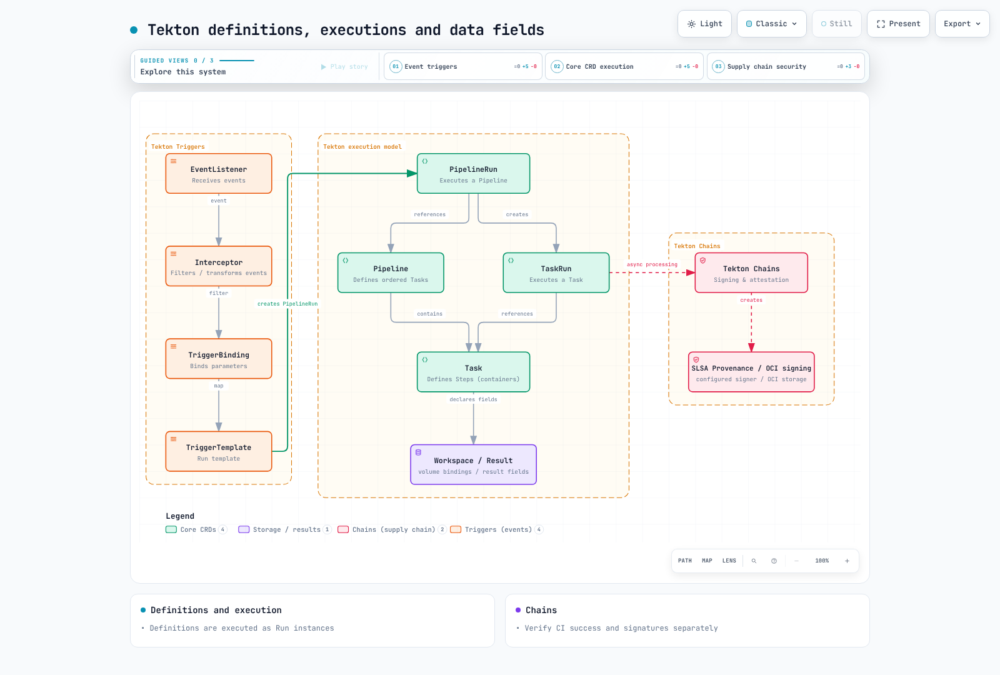
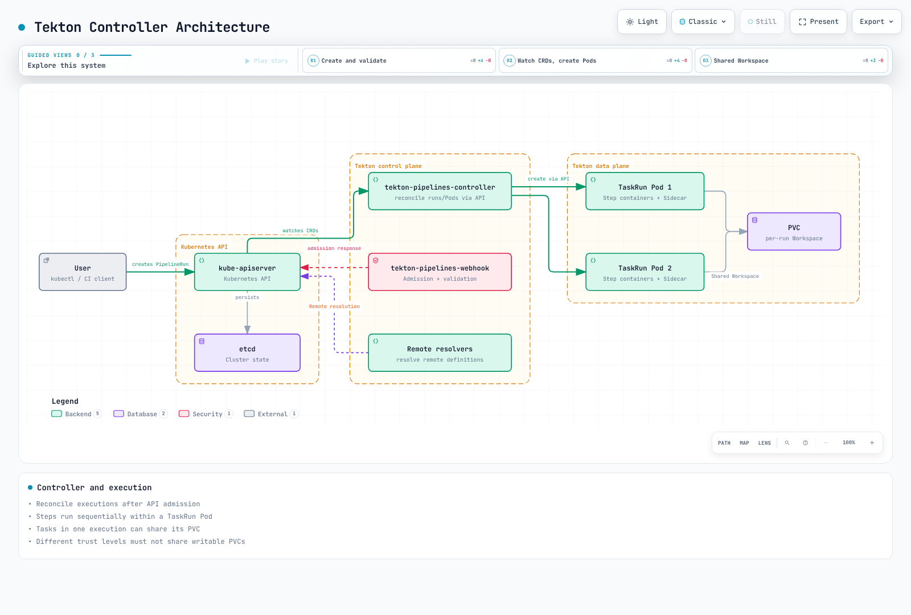

# Tekton Pipelines: Kubernetes ネイティブ CI

> **最終更新日**: 2026年10月16日。Pipelines 1.17.0、Triggers 0.37.1、Chains 0.29.0、Dashboard 0.73.0、tkn 0.46.1。
> **検証**: リリース CRD スキーマ、Task の依存関係、ローカルスクリプト、モックプログラムを検証しました。実際の EKS インストール、イメージのビルド/プッシュ、KMS 署名、外部 Webhook、通知は実行していません。

< [前へ: FinOps](./13-finops-cost-platform.md) | [目次](./README.md) | [次へ: ゾーン運用](./15-zonal-operations-guide.md) >

## 概要

Tekton は Kubernetes API を通じて Task、Pipeline、その実行を定義します。運用者は引き続きコントローラー、ワーカーキャパシティ、ストレージ、アップグレード、アクセスを管理します。他の CI システムも Kubernetes エグゼキューター、自動スケーリング、アテステーションをサポートできます。特定の機能を Tekton だけのものとしたり、運用コストがゼロだと主張したりしないでください。

この例では、**承認済みリポジトリの保護された main ブランチ**に対して Go アプリケーションの CI を実行します。clone → vet/test の並列実行 → 候補イメージの公開 → ダイジェスト指定スキャンの順です。Chains による処理と暗号学的検証が完了した後、別途レビューされた GitOps 変更へ進みます。外部フォークからの PR に、この Pipeline の IRSA ロール、PVC、署名権限を共有させてはいけません。

## 1. 実行モデル

| コンポーネント | 役割 |
| --- | --- |
| Task / Pipeline | 再利用可能な処理と依存関係の定義 |
| TaskRun / PipelineRun | パラメーターとステータスを持つ実行 |
| Step / Sidecar | 順次実行する処理 / 補助サービス。通常は TaskRun の Pod 内で動作 |
| Workspace / Result | ボリュームの割り当て / 小さな出力値。独立した CRD ではない |

Task 定義そのものは Pod ではありません。TaskRun を実行すると Pod が作成されます。Result は文字列、配列、オブジェクト型をサポートします。大きなレポートには成果物ストレージを使ってください。同じ Pod 内の Step はネットワークとボリュームを共有するため、互いに信頼できないコードを隔離する強い境界にはなりません。



[インタラクティブ図を表示](https://www.atomai.click/kubernetes-docs/archmaps/en-ops-14-tekton-pipelines-0.html)



[インタラクティブ図を表示](https://www.atomai.click/kubernetes-docs/archmaps/en-ops-14-tekton-pipelines-1.html)

## 2. インストールと実行権限

### 2.1 バージョンとインストール方法

公式のインストール最小要件は Kubernetes 1.28 ですが、この章のセキュリティフィールドとスキーマ検証は Kubernetes 1.36 を対象とします。上流プロジェクトの最小要件は、現在サポートされている EKS バージョンの推奨値ではありません。Dashboard 0.73.0 は、Pipelines 1.15 LTS/1.17 と Triggers 0.37 LTS のサポートを明記しています。

これはバージョンを固定した手動インストール例です。公式ガイドでは、本番環境のライフサイクル管理に Tekton Operator も案内しています。手動 apply と Operator 管理リソースを混在させる前に、管理主体を決めてください。ここにあるコマンドは実クラスターを変更します。競合をむやみに強制せず、リソースの所有者を確認してください。

```bash
kubectl version -o yaml
kubectl get storageclass

curl --fail --location \
  https://infra.tekton.dev/tekton-releases/pipeline/previous/v1.17.0/release.yaml \
  -o pipelines-release.yaml
kubectl apply --server-side --field-manager=tekton-install -f pipelines-release.yaml
kubectl wait --for=condition=Established --timeout=120s \
  crd/tasks.tekton.dev crd/taskruns.tekton.dev \
  crd/pipelines.tekton.dev crd/pipelineruns.tekton.dev
kubectl -n tekton-pipelines wait deployment --all \
  --for=condition=Available --timeout=300s

kubectl apply --server-side -f \
  https://infra.tekton.dev/tekton-releases/triggers/previous/v0.37.1/release.yaml
kubectl apply --server-side -f \
  https://infra.tekton.dev/tekton-releases/triggers/previous/v0.37.1/interceptors.yaml
kubectl apply --server-side -f \
  https://infra.tekton.dev/tekton-releases/chains/previous/v0.29.0/release.yaml
kubectl apply --server-side -f \
  https://infra.tekton.dev/tekton-releases/dashboard/previous/v0.73.0/release.yaml
kubectl -n tekton-pipelines port-forward service/tekton-dashboard 9097:9097
```

`release.yaml` は読み取り専用 Dashboard をインストールします。`release-full.yaml` には書き込み機能も含まれます。読み取り専用モードはユーザーを認証せず、名前空間ごとのユーザー権限も自動では強制しません。運用環境に公開する前に、認証プロキシ/OIDC とアクセスモデルを検証してください。内部 ALB は認証機能ではありません。Cognito との連携には、実際の HTTPS リスナー、Cognito/OIDC エンドポイント、Secret が必要です。

この例では `https://tekton.dev/helm-charts` は公式チャートリポジトリとして機能しません。以前案内されていた存在しないチャートと values をインストールしないでください。

### 2.2 現行設定の意味

| 設定 | 現在の意味 |
| --- | --- |
| `feature-flags.coschedule: workspaces` | PVC Workspace を共有する TaskRun を同時にスケジュールします。この RWO の例では維持します。 |
| `disable-affinity-assistant` | v0.68 以降に削除された旧フラグです。 |
| `set-security-context: true` | 1.17 では Tekton が挿入するコンテナの既定値です。ユーザーの Step には、互換性のある独自のコンテキストが必要です。 |
| `results-from: termination-message` | 既定の取得経路です。Kubernetes の終了メッセージ上限が適用されます。 |
| `max-result-size` | `sidecar-logs` に適用されます。これだけを変更しても、既定の終了メッセージ上限は増えません。 |
| 既定のタイムアウト | `config-defaults` で管理します。この例では PipelineRun のタイムアウトを明示します。 |

`running-in-environment-with-injected-sidecars` は Workspace の分離設定ではありません。また、`keep-pod-on-cancel` は PipelineRun の保持 TTL ではありません。完全な ConfigMap を短い抜粋で置き換えないでください。

### 2.3 ServiceAccount と IAM ロールを分離する

コントローラーには `tekton-pipelines` / `tekton-chains`、ビルドには `tekton-builds` を使います。単純な Task/Pipeline 名参照は同じ名前空間内で解決されます。共有名前空間にある Task は、名前だけでは参照できません。

先に IAM ロールを作成してください。それぞれの IRSA 信頼ポリシーで、既存クラスターの OIDC プロバイダー、`aud=sts.amazonaws.com`、および正確な `sub=system:serviceaccount:tekton-builds:<SA name>` を条件に指定します。ECR リポジトリは事前に作成してください。ビルドに `CreateRepository` 権限は不要です。名前に反して、この例の `ci-readonly` には Kubernetes API の Role がありません。既定の非特権実行アカウントです。

**`service-accounts.yaml`**

```yaml
apiVersion: v1
kind: Namespace
metadata:
  name: tekton-builds
---
apiVersion: v1
kind: ServiceAccount
metadata:
  name: ci-readonly
  namespace: tekton-builds
automountServiceAccountToken: false
---
apiVersion: v1
kind: ServiceAccount
metadata:
  name: ci-image-push
  namespace: tekton-builds
  annotations:
    eks.amazonaws.com/role-arn: arn:aws:iam::123456789012:role/tekton-candidate-push
automountServiceAccountToken: false
---
apiVersion: v1
kind: ServiceAccount
metadata:
  name: ci-image-read
  namespace: tekton-builds
  annotations:
    eks.amazonaws.com/role-arn: arn:aws:iam::123456789012:role/tekton-candidate-read
automountServiceAccountToken: false
---
apiVersion: v1
kind: ServiceAccount
metadata:
  name: ci-triggers
  namespace: tekton-builds
---
apiVersion: rbac.authorization.k8s.io/v1
kind: Role
metadata:
  name: ci-triggers
  namespace: tekton-builds
rules:
  - apiGroups: [triggers.tekton.dev]
    resources: [eventlisteners, triggers, triggerbindings, triggertemplates, interceptors]
    verbs: [get, list, watch]
  - apiGroups: [tekton.dev]
    resources: [pipelineruns]
    verbs: [create]
  - apiGroups: [""]
    resources: [configmaps]
    verbs: [get, list, watch]
  - apiGroups: [""]
    resources: [secrets]
    resourceNames: [github-webhook]
    verbs: [get]
---
apiVersion: rbac.authorization.k8s.io/v1
kind: RoleBinding
metadata:
  name: ci-triggers
  namespace: tekton-builds
subjects:
  - kind: ServiceAccount
    name: ci-triggers
    namespace: tekton-builds
roleRef:
  apiGroup: rbac.authorization.k8s.io
  kind: Role
  name: ci-triggers
---
apiVersion: rbac.authorization.k8s.io/v1
kind: ClusterRole
metadata:
  name: ci-triggers-interceptors
rules:
  - apiGroups: [triggers.tekton.dev]
    resources: [clusterinterceptors, clustertriggerbindings]
    verbs: [get, list, watch]
---
apiVersion: rbac.authorization.k8s.io/v1
kind: ClusterRoleBinding
metadata:
  name: ci-triggers-interceptors
subjects:
  - kind: ServiceAccount
    name: ci-triggers
    namespace: tekton-builds
roleRef:
  apiGroup: rbac.authorization.k8s.io
  kind: ClusterRole
  name: ci-triggers-interceptors
```

**`ecr-push-policy.json`**

```json
{
  "Version": "2012-10-17",
  "Statement": [
    {
      "Effect": "Allow",
      "Action": "ecr:GetAuthorizationToken",
      "Resource": "*",
      "Condition": {
        "StringEquals": {"aws:RequestedRegion": "ap-northeast-2"}
      }
    },
    {
      "Effect": "Allow",
      "Action": [
        "ecr:BatchCheckLayerAvailability",
        "ecr:GetDownloadUrlForLayer",
        "ecr:BatchGetImage",
        "ecr:InitiateLayerUpload",
        "ecr:UploadLayerPart",
        "ecr:CompleteLayerUpload",
        "ecr:PutImage"
      ],
      "Resource": "arn:aws:ecr:ap-northeast-2:123456789012:repository/myapp-candidates"
    }
  ]
}
```

**`ecr-read-policy.json`**

```json
{
  "Version": "2012-10-17",
  "Statement": [
    {
      "Effect": "Allow",
      "Action": "ecr:GetAuthorizationToken",
      "Resource": "*",
      "Condition": {
        "StringEquals": {"aws:RequestedRegion": "ap-northeast-2"}
      }
    },
    {
      "Effect": "Allow",
      "Action": [
        "ecr:BatchCheckLayerAvailability",
        "ecr:GetDownloadUrlForLayer",
        "ecr:BatchGetImage"
      ],
      "Resource": "arn:aws:ecr:ap-northeast-2:123456789012:repository/myapp-candidates"
    }
  ]
}
```

push ポリシーを `tekton-candidate-push` に、read ポリシーを `tekton-candidate-read` にアタッチします。アカウント、リージョン、リポジトリ名をすべての箇所で置き換えてください。`GetAuthorizationToken` はリポジトリ単位のリソーススコープをサポートしないため、この権限は別にし、要求リージョンの条件で制限します。

IRSA は Pod 内からの AWS SDK/CLI 呼び出しを認証します。kubelet による ECR イメージの取得には、ノードロール、Fargate 実行ロール、または imagePullSecrets という別経路が使われます。Task の IRSA アノテーションだけでは ImagePullBackOff は解消しません。

## 3. Task 定義の全体像

以下の6つの Task は、整合性のある1つの例を構成します。ソースリポジトリには Go モジュール、テスト、Dockerfile が必要です。checkout に固定されている `myorg/myapp` URL を承認済みのリポジトリへ置き換え、Trigger の許可リストと一致させてください。Webhook 入力から任意の Git URL やシェルコマンドを受け取らないでください。

Tekton の置換はテキスト置換です。script 本文へ値を埋め込まず、環境変数または引数でパラメーターを渡してください。40文字すべてのコミット SHA を検証します。ECR 認証ファイルには Task 内の `emptyDir` を使ってください。読み取り専用 Secret ボリュームに書き込んだり、別 Step のイメージにも同じツールがあると想定したりしないでください。

Rootless BuildKit を使うには、ユーザー名前空間、マウント、適切な seccomp/AppArmor 設定を備えた、検証済みの専用ビルド環境が必要です。`Unconfined` と `--oci-worker-no-process-sandbox` は明示的なセキュリティ上のトレードオフであり、restricted 名前空間ポリシーでは拒否されます。あらゆる環境で安全な既定値ではありません。外部 PR には別環境を使ってください。

**`tasks.yaml`**

```yaml
apiVersion: tekton.dev/v1
kind: Task
metadata:
  name: checkout
  namespace: tekton-builds
spec:
  params:
  - name: revision
    type: string
  workspaces:
  - name: source
  results:
  - name: CHAINS-GIT_URL
    type: string
  - name: CHAINS-GIT_COMMIT
    type: string
  steps:
  - name: checkout
    image: golang:1.27.2
    script: |
      #!/usr/bin/env bash
      set -euo pipefail
      if [[ ! "$REVISION" =~ ^[0-9a-f]{40}$ ]]; then
        echo "Expected a full commit SHA" >&2
        exit 1
      fi
      cd "$SOURCE"
      git init .
      git config credential.helper ''
      git remote add origin "$REPOSITORY"
      git -c protocol.file.allow=never fetch --depth=1 origin "$REVISION"
      git -c advice.detachedHead=false checkout --detach FETCH_HEAD
      test "$(git rev-parse HEAD)" = "$REVISION"
      printf '%s' "$REPOSITORY" > "$GIT_URL_RESULT"
      printf '%s' "$REVISION" > "$GIT_COMMIT_RESULT"
    env:
    - name: REVISION
      value: $(params.revision)
    - name: REPOSITORY
      value: https://github.com/myorg/myapp.git
    - name: SOURCE
      value: $(workspaces.source.path)
    - name: GIT_URL_RESULT
      value: $(results.CHAINS-GIT_URL.path)
    - name: GIT_COMMIT_RESULT
      value: $(results.CHAINS-GIT_COMMIT.path)
    computeResources:
      requests:
        cpu: 100m
        memory: 128Mi
      limits:
        memory: 1Gi
  stepTemplate:
    securityContext:
      runAsUser: 1000
      runAsGroup: 1000
---
apiVersion: tekton.dev/v1
kind: Task
metadata:
  name: go-vet
  namespace: tekton-builds
spec:
  params: []
  workspaces:
  - name: source
  results: []
  steps:
  - name: vet
    image: golang:1.27.2
    script: |
      #!/usr/bin/env bash
      set -euo pipefail
      cd "$SOURCE"
      go vet ./...
    env:
    - name: SOURCE
      value: $(workspaces.source.path)
    - name: GOCACHE
      value: /tmp/go-build
    - name: GOMODCACHE
      value: /tmp/go-mod
    computeResources:
      requests:
        cpu: 100m
        memory: 128Mi
      limits:
        memory: 1Gi
  stepTemplate:
    securityContext:
      runAsUser: 1000
      runAsGroup: 1000
---
apiVersion: tekton.dev/v1
kind: Task
metadata:
  name: go-test
  namespace: tekton-builds
spec:
  params: []
  workspaces:
  - name: source
  results: []
  steps:
  - name: test
    image: golang:1.27.2
    script: |
      #!/usr/bin/env bash
      set -euo pipefail
      cd "$SOURCE"
      go test -count=1 -race -coverprofile=/tmp/coverage.out ./...
      go tool cover -func=/tmp/coverage.out
    env:
    - name: SOURCE
      value: $(workspaces.source.path)
    - name: GOCACHE
      value: /tmp/go-build
    - name: GOMODCACHE
      value: /tmp/go-mod
    computeResources:
      requests:
        cpu: 100m
        memory: 128Mi
      limits:
        memory: 1Gi
  stepTemplate:
    securityContext:
      runAsUser: 1000
      runAsGroup: 1000
---
apiVersion: tekton.dev/v1
kind: Task
metadata:
  name: build-image
  namespace: tekton-builds
spec:
  params:
  - name: image
    type: string
  - name: revision
    type: string
  - name: region
    type: string
  workspaces:
  - name: source
  results:
  - name: IMAGE_URL
    type: string
  - name: IMAGE_DIGEST
    type: string
  steps:
  - name: ecr-token
    image: public.ecr.aws/aws-cli/aws-cli:2.36.44
    script: |
      #!/bin/bash
      set -euo pipefail
      umask 077
      aws ecr get-authorization-token --region "$AWS_REGION" \
        --query 'authorizationData[0].authorizationToken' --output text > /auth/token
    env:
    - name: AWS_REGION
      value: $(params.region)
    - name: AWS_DEFAULT_REGION
      value: $(params.region)
    computeResources:
      requests:
        cpu: 100m
        memory: 128Mi
      limits:
        memory: 1Gi
    volumeMounts:
    - name: auth
      mountPath: /auth
  - name: docker-config
    image: python:3.12.13-slim
    script: |
      #!/usr/bin/env python3
      import base64, json, os, re
      from pathlib import Path
      image, region = os.environ["IMAGE"], os.environ["REGION"]
      match = re.fullmatch(r"([0-9]{12})\.dkr\.ecr\.([a-z0-9-]+)\.amazonaws\.com/([a-z0-9][a-z0-9._/-]*)", image)
      if not match or match.group(2) != region or ".." in match.group(3):
          raise SystemExit("Use a private ECR repository in the configured region")
      token = Path("/auth/token").read_text().strip()
      decoded = base64.b64decode(token, validate=True)
      if not decoded.startswith(b"AWS:") or len(decoded) <= 4:
          raise SystemExit("Invalid ECR authorization token")
      Path("/auth/config.json").write_text(json.dumps({"auths": {image.split("/")[0]: {"auth": token}}}))
      Path("/auth/config.json").chmod(0o600)
      Path("/auth/token").unlink()
    env:
    - name: IMAGE
      value: $(params.image)
    - name: REGION
      value: $(params.region)
    computeResources:
      requests:
        cpu: 100m
        memory: 128Mi
      limits:
        memory: 1Gi
    volumeMounts:
    - name: auth
      mountPath: /auth
  - name: build-and-push
    image: moby/buildkit:v0.33.0-rootless
    script: |
      #!/bin/sh
      set -eu
      case "$REVISION" in *[!0-9a-f]*|"") echo "Invalid commit tag" >&2; exit 1;; esac
      test "${#REVISION}" -eq 40
      buildctl-daemonless.sh build \
        --frontend dockerfile.v0 \
        --local "context=$SOURCE" --local "dockerfile=$SOURCE" \
        --output "type=image,name=$IMAGE:$REVISION,push=true" \
        --metadata-file /build-result/metadata.json
    env:
    - name: SOURCE
      value: $(workspaces.source.path)
    - name: IMAGE
      value: $(params.image)
    - name: REVISION
      value: $(params.revision)
    - name: DOCKER_CONFIG
      value: /auth
    - name: BUILDKITD_FLAGS
      value: --oci-worker-no-process-sandbox
    computeResources:
      requests:
        cpu: '1'
        memory: 1Gi
      limits:
        memory: 4Gi
    securityContext:
      runAsUser: 1000
      runAsGroup: 1000
      seccompProfile:
        type: Unconfined
      appArmorProfile:
        type: Unconfined
    volumeMounts:
    - name: auth
      mountPath: /auth
      readOnly: true
    - name: buildkit-state
      mountPath: /home/user/.local/share/buildkit
    - name: build-result
      mountPath: /build-result
  - name: record-digest
    image: python:3.12.13-slim
    script: |
      #!/usr/bin/env python3
      import json, os, re
      from pathlib import Path
      data = json.loads(Path("/build-result/metadata.json").read_text())
      digest = data.get("containerimage.digest", "")
      if not re.fullmatch(r"sha256:[0-9a-f]{64}", digest):
          raise SystemExit("BuildKit did not return an image digest")
      Path(os.environ["URL_RESULT"]).write_text(os.environ["IMAGE"])
      Path(os.environ["DIGEST_RESULT"]).write_text(digest)
    env:
    - name: IMAGE
      value: $(params.image)
    - name: URL_RESULT
      value: $(results.IMAGE_URL.path)
    - name: DIGEST_RESULT
      value: $(results.IMAGE_DIGEST.path)
    computeResources:
      requests:
        cpu: 100m
        memory: 128Mi
      limits:
        memory: 1Gi
    volumeMounts:
    - name: build-result
      mountPath: /build-result
      readOnly: true
  volumes:
  - name: auth
    emptyDir: {}
  - name: buildkit-state
    emptyDir: {}
  - name: build-result
    emptyDir: {}
  stepTemplate:
    securityContext:
      runAsUser: 1000
      runAsGroup: 1000
---
apiVersion: tekton.dev/v1
kind: Task
metadata:
  name: scan-image
  namespace: tekton-builds
spec:
  params:
  - name: image
    type: string
  - name: digest
    type: string
  - name: region
    type: string
  workspaces: []
  results: []
  steps:
  - name: ecr-token
    image: public.ecr.aws/aws-cli/aws-cli:2.36.44
    script: |
      #!/bin/bash
      set -euo pipefail
      umask 077
      aws ecr get-authorization-token --region "$AWS_REGION" \
        --query 'authorizationData[0].authorizationToken' --output text > /auth/token
    env:
    - name: AWS_REGION
      value: $(params.region)
    - name: AWS_DEFAULT_REGION
      value: $(params.region)
    computeResources:
      requests:
        cpu: 100m
        memory: 128Mi
      limits:
        memory: 1Gi
    volumeMounts:
    - name: auth
      mountPath: /auth
  - name: docker-config
    image: python:3.12.13-slim
    script: |
      #!/usr/bin/env python3
      import base64, json, os, re
      from pathlib import Path
      image, region = os.environ["IMAGE"], os.environ["REGION"]
      match = re.fullmatch(r"([0-9]{12})\.dkr\.ecr\.([a-z0-9-]+)\.amazonaws\.com/([a-z0-9][a-z0-9._/-]*)", image)
      if not match or match.group(2) != region or ".." in match.group(3):
          raise SystemExit("Use a private ECR repository in the configured region")
      token = Path("/auth/token").read_text().strip()
      decoded = base64.b64decode(token, validate=True)
      if not decoded.startswith(b"AWS:") or len(decoded) <= 4:
          raise SystemExit("Invalid ECR authorization token")
      Path("/auth/config.json").write_text(json.dumps({"auths": {image.split("/")[0]: {"auth": token}}}))
      Path("/auth/config.json").chmod(0o600)
      Path("/auth/token").unlink()
    env:
    - name: IMAGE
      value: $(params.image)
    - name: REGION
      value: $(params.region)
    computeResources:
      requests:
        cpu: 100m
        memory: 128Mi
      limits:
        memory: 1Gi
    volumeMounts:
    - name: auth
      mountPath: /auth
  - name: scan
    image: aquasec/trivy:0.76.0
    script: |
      #!/bin/sh
      set -eu
      trivy image --scanners vuln --severity HIGH,CRITICAL \
        --exit-code 1 --format json --output /tmp/trivy-report.json "$IMAGE@$DIGEST"
    env:
    - name: IMAGE
      value: $(params.image)
    - name: DIGEST
      value: $(params.digest)
    - name: DOCKER_CONFIG
      value: /auth
    - name: TRIVY_CACHE_DIR
      value: /tmp/trivy-cache
    computeResources:
      requests:
        cpu: 100m
        memory: 128Mi
      limits:
        memory: 1Gi
    volumeMounts:
    - name: auth
      mountPath: /auth
      readOnly: true
  volumes:
  - name: auth
    emptyDir: {}
  stepTemplate:
    securityContext:
      runAsUser: 1000
      runAsGroup: 1000
---
apiVersion: tekton.dev/v1
kind: Task
metadata:
  name: report-status
  namespace: tekton-builds
spec:
  params:
  - name: run
    type: string
  - name: status
    type: string
  workspaces: []
  results: []
  steps:
  - name: report
    image: python:3.12.13-slim
    script: |
      #!/usr/bin/env python3
      import json, os
      print(json.dumps({"pipelineRun": os.environ["RUN"], "status": os.environ["STATUS"]}))
    env:
    - name: RUN
      value: $(params.run)
    - name: STATUS
      value: $(params.status)
    computeResources:
      requests:
        cpu: 100m
        memory: 128Mi
      limits:
        memory: 1Gi
  stepTemplate:
    securityContext:
      runAsUser: 1000
      runAsGroup: 1000
```

元の Google Kaniko リポジトリはアーカイブされています。この新しい例では BuildKit 0.33.0 を使います。Rootless でも完全なプロセス分離は保証されません。本番投入前にイメージのダイジェストとプラットフォームを検証して固定し、実際のノードで書き込み可能なパスとセキュリティコンテキストをテストしてください。

検出事項がある場合のスキャナー終了コード1も、それ以外のエラーコードも、すべて Task を失敗させます。レポートがない状態を「脆弱性ゼロ」と扱わないでください。`/tmp/trivy-report.json` は一時ファイルです。長期保持が必要なら、実行環境のクリーンアップ前に承認済みの成果物ストアへ出力してください。

## 4. Pipeline と実行


[インタラクティブ図を表示](https://www.atomai.click/kubernetes-docs/archmaps/en-ops-14-tekton-pipelines-2.html)

**`pipeline.yaml`**

```yaml
apiVersion: tekton.dev/v1
kind: Pipeline
metadata:
  name: trusted-image-ci
  namespace: tekton-builds
spec:
  params:
    - name: revision
      type: string
    - name: image
      type: string
    - name: region
      type: string
      default: ap-northeast-2
  workspaces:
    - name: source
  results:
    - name: CHAINS-GIT_URL
      value: $(tasks.clone.results.CHAINS-GIT_URL)
    - name: CHAINS-GIT_COMMIT
      value: $(tasks.clone.results.CHAINS-GIT_COMMIT)
    - name: IMAGE_URL
      value: $(tasks.build.results.IMAGE_URL)
    - name: IMAGE_DIGEST
      value: $(tasks.build.results.IMAGE_DIGEST)
  tasks:
    - name: clone
      taskRef:
        name: checkout
      params:
        - name: revision
          value: $(params.revision)
      workspaces:
        - name: source
          workspace: source
    - name: lint
      runAfter: [clone]
      taskRef:
        name: go-vet
      workspaces:
        - name: source
          workspace: source
    - name: test
      runAfter: [clone]
      taskRef:
        name: go-test
      workspaces:
        - name: source
          workspace: source
    - name: build
      runAfter: [lint, test]
      taskRef:
        name: build-image
      params:
        - name: image
          value: $(params.image)
        - name: revision
          value: $(tasks.clone.results.CHAINS-GIT_COMMIT)
        - name: region
          value: $(params.region)
      workspaces:
        - name: source
          workspace: source
    - name: scan
      runAfter: [build]
      taskRef:
        name: scan-image
      params:
        - name: image
          value: $(tasks.build.results.IMAGE_URL)
        - name: digest
          value: $(tasks.build.results.IMAGE_DIGEST)
        - name: region
          value: $(params.region)
  finally:
    - name: report
      taskRef:
        name: report-status
      params:
        - name: run
          value: $(context.pipelineRun.name)
        - name: status
          value: $(tasks.status)
```

**`pipelinerun.yaml`**

```yaml
apiVersion: tekton.dev/v1
kind: PipelineRun
metadata:
  generateName: trusted-image-ci-
  namespace: tekton-builds
spec:
  pipelineRef:
    name: trusted-image-ci
  params:
    - name: revision
      value: REPLACE_WITH_FULL_40_CHARACTER_COMMIT_SHA
    - name: image
      value: 123456789012.dkr.ecr.ap-northeast-2.amazonaws.com/myapp-candidates
  workspaces:
    - name: source
      volumeClaimTemplate:
        spec:
          accessModes: [ReadWriteOnce]
          storageClassName: gp3
          resources:
            requests:
              storage: 10Gi
  taskRunTemplate:
    serviceAccountName: ci-readonly
    podTemplate:
      automountServiceAccountToken: false
      securityContext:
        fsGroup: 1000
  taskRunSpecs:
    - pipelineTaskName: build
      serviceAccountName: ci-image-push
    - pipelineTaskName: scan
      serviceAccountName: ci-image-read
  timeouts:
    pipeline: 1h
    tasks: 50m
    finally: 5m
```

```bash
kubectl apply -f service-accounts.yaml
kubectl apply -f tasks.yaml -f pipeline.yaml
# Replace the commit placeholder and provision the referenced IAM roles first.
kubectl create -f pipelinerun.yaml
tkn pipelinerun logs --last -n tekton-builds --follow --exit-with-pipelinerun-error
```

実行ごとに新しい PVC が作成されます。ReadWriteOnce は同じノード上の複数 Pod を許可しますが、複数ノードから使える RWX ではありません。emptyDir は異なる TaskRun Pod 間で共有するストレージではありません。信頼レベルごとにキャッシュを分離し、同時書き込みを調整してください。

`finally` は通常の Task の後に実行されますが、無条件に実行されるわけではありません。存在しない Result の参照によってスキップされることがあります。キャンセルモード、全体のタイムアウト、リソース障害、未解決の参照によっても実行されない場合があります。この例では、生成されない可能性があるイメージ Result を避け、run 名と `tasks.status` だけを報告します。複数の finally Task 間の実行順序を想定しないでください。

## 5. Webhook と Trigger

この Trigger は最初に GitHub HMAC を検証し、その後で**リポジトリ、ブランチ、削除状態、完全な SHA**を確認します。Git URL、ECR パス、Task 名、ServiceAccount は信頼された定義内で固定します。外部 PR イベントをこのテンプレートにつながないでください。HMAC は配信元を確認するものであり、PR コードのデプロイを認可するものではありません。


[インタラクティブ図を表示](https://www.atomai.click/kubernetes-docs/archmaps/en-ops-14-tekton-pipelines-3.html)

**`triggers.yaml`**

```yaml
apiVersion: triggers.tekton.dev/v1beta1
kind: EventListener
metadata:
  name: trusted-github
  namespace: tekton-builds
spec:
  serviceAccountName: ci-triggers
  triggers:
    - name: protected-main-push
      interceptors:
        - ref:
            name: github
          params:
            - name: secretRef
              value:
                secretName: github-webhook
                secretKey: token
            - name: eventTypes
              value: [push]
        - ref:
            name: cel
          params:
            - name: filter
              value: >-
                body.repository.full_name == 'myorg/myapp' &&
                body.ref == 'refs/heads/main' &&
                body.deleted == false &&
                body.after.matches('^[0-9a-f]{40}$')
      bindings:
        - ref: trusted-commit
      template:
        ref: trusted-image-ci
---
apiVersion: triggers.tekton.dev/v1beta1
kind: TriggerBinding
metadata:
  name: trusted-commit
  namespace: tekton-builds
spec:
  params:
    - name: revision
      value: $(body.after)
---
apiVersion: triggers.tekton.dev/v1beta1
kind: TriggerTemplate
metadata:
  name: trusted-image-ci
  namespace: tekton-builds
spec:
  params:
    - name: revision
  resourcetemplates:
    - apiVersion: tekton.dev/v1
      kind: PipelineRun
      metadata:
        generateName: trusted-image-ci-
        namespace: tekton-builds
      spec:
        pipelineRef:
          name: trusted-image-ci
        params:
          - name: revision
            value: $(tt.params.revision)
          - name: image
            value: 123456789012.dkr.ecr.ap-northeast-2.amazonaws.com/myapp-candidates
        workspaces:
          - name: source
            volumeClaimTemplate:
              spec:
                accessModes: [ReadWriteOnce]
                storageClassName: gp3
                resources:
                  requests:
                    storage: 10Gi
        taskRunTemplate:
          serviceAccountName: ci-readonly
          podTemplate:
            automountServiceAccountToken: false
            securityContext:
              fsGroup: 1000
        taskRunSpecs:
          - pipelineTaskName: build
            serviceAccountName: ci-image-push
          - pipelineTaskName: scan
            serviceAccountName: ci-image-read
        timeouts:
          pipeline: 1h
          tasks: 50m
          finally: 5m
```

`github-webhook` Secret の `token` は GitHub の Webhook secret と一致させます。Git に保存せず、保護されたストレージから渡してください。外部 HTTPS エンドポイントと、配信の再試行/重複排除ポリシーは別途設定します。EventListener は既定で内部 Service を作ります。この YAML だけではインターネット向けエンドポイントは作成されません。

HMAC 検証に使えるよう、TLS 終端と Gateway/Ingress 処理を通過した後も元の本文を保持してください。コールバックには適切な認証、レート制限、可用性、固定ルーティングを適用します。静かな時間帯だからといって Webhook 障害とは限りません。実際の配信結果と EventListener の処理エラーを調べてください。

`head_commit` が常に存在すると想定したり、split の1要素だけを使って `refs/heads/feature/a` を切り詰めたりしないでください。ファイル変更フィルターでは追加、変更、削除されたパスとペイロード上限を考慮します。この例では、業務固有のパスフィルターを独自に作っていません。

## 6. Chains と署名検証

### 6.1 CI の成功と署名処理の完了は別

Chains は完了した TaskRun/PipelineRun を処理する別個のコントローラーです。イメージ署名があるだけでは、すべてのテストとスキャンの成功は証明されません。`chains.tekton.dev/signed=true` はデプロイ承認でも暗号学的な検証でもありません。

Pipeline レベルの来歴情報は Pipeline の完了後に作成されます。Pipeline 自身のアテステーションを Pipeline の内部で待つと、この処理順序と衝突する場合があります。この例では CI の完了後に、別の検証と昇格手順を実行します。


[インタラクティブ図を表示](https://www.atomai.click/kubernetes-docs/archmaps/en-ops-14-tekton-pipelines-4.html)

### 6.2 KMS の設定

既存の非対称 `SIGN_VERIFY` KMS キーを使ってください。キー ARN と `builder.id` を置き換えます。**Chains コントローラーの ServiceAccount `tekton-chains/tekton-chains-controller`** に専用の IRSA ロールを設定し、候補リポジトリへの ECR 書き込み権限と以下の KMS 権限を付与してください。ビルド Pod に IRSA ロールを付けても、コントローラーにその認証情報は渡りません。

現在の OCI バックエンドは Kubernetes の認証情報検索と、既定/ECR credential-helper のチェーンを使います。コントローラーに環境内の AWS アイデンティティを設定し、実際に署名がアップロードされることを確認してください。ビルド Task の `/auth` emptyDir は Chains が読める共有 Secret ではありません。

**`chains-kms-policy.json`**

```json
{
  "Version": "2012-10-17",
  "Statement": [{
    "Effect": "Allow",
    "Action": ["kms:Sign", "kms:GetPublicKey", "kms:DescribeKey"],
    "Resource": "arn:aws:kms:ap-northeast-2:123456789012:key/REPLACE_KEY_ID"
  }]
}
```

**`chains-config.yaml`**

```yaml
apiVersion: v1
kind: ConfigMap
metadata:
  name: chains-config
  namespace: tekton-chains
data:
  artifacts.taskrun.storage: ""
  artifacts.pipelinerun.format: slsa/v2alpha3
  artifacts.pipelinerun.storage: oci
  artifacts.pipelinerun.signer: kms
  artifacts.oci.format: simplesigning
  artifacts.oci.storage: oci
  artifacts.oci.signer: kms
  signers.kms.kmsref: awskms:///arn:aws:kms:ap-northeast-2:123456789012:key/REPLACE_KEY_ID
  signers.x509.fulcio.enabled: "false"
  transparency.enabled: "false"
  storage.oci.encoding-format: dsse
  builder.id: https://ci.example.com/tekton/trusted-image-ci
  builddefinition.buildtype: https://tekton.dev/chains/v2/slsa
```

フォーマッター名 `slsa/v1` は SLSA provenance v1.0 を意味しません。現在の Chains では、`slsa/v1` / `in-toto` は v0.2 に、`slsa/v2alpha3` / `slsa/v2alpha4` は v1.0 に対応します。この例では Pipeline レベルで `slsa/v2alpha3` を使い、重複する Task レベルの来歴情報保存を無効にし、イメージ署名は別に有効化します。

`storage.oci.encoding-format: dsse` は従来の `.sig` / `.att` 保存を維持します。バージョン0.29の `sigstore-bundle` は OCI 1.1 referrers を使うため、保存方式と検証ツールを併せて変更してください。ここでは Rekor へのアップロードを無効にしているため、検証では内部の公開鍵ポリシーに明示的に従います。透明性ログが必要なら、公開されるビルドメタデータも確認したうえで別途設定してください。

キーレス署名には、実際の Fulcio サービスが信頼する発行者と有効なワークロードトークンが必要です。EKS Pod に GitHub Actions の発行者文字列を設定しても認証は得られません。署名とアテステーションだけで特定の SLSA レベルが成立するわけではありません。

### 6.3 実行と成果物の独立検証

このスクリプトは、**信頼できる API から読み取った** PipelineRun について、CI の成功、Chains の処理完了、承認されたリポジトリ/コミット/イメージの出力を確認します。署名自体は検証しません。後続の Cosign チェックと来歴ポリシーのレビューも必要です。

**`check_run.py`**

```python
"""Check trusted API output before separate cryptographic artifact verification."""
import argparse
import json
import re
from pathlib import Path


def check(run, repository, revision, image):
    if run.get("kind") != "PipelineRun" or run.get("apiVersion") != "tekton.dev/v1":
        raise ValueError("Expected a tekton.dev/v1 PipelineRun")
    metadata = run.get("metadata", {})
    if metadata.get("namespace") != "tekton-builds" or not metadata.get("uid"):
        raise ValueError("Unexpected namespace or missing run UID")
    if run.get("spec", {}).get("pipelineRef", {}).get("name") != "trusted-image-ci":
        raise ValueError("Unexpected pipeline")
    succeeded = [c for c in run.get("status", {}).get("conditions", []) if c.get("type") == "Succeeded"]
    if len(succeeded) != 1 or succeeded[0].get("status") != "True":
        raise ValueError("CI has not succeeded")
    if not run.get("status", {}).get("completionTime"):
        raise ValueError("CI completion time is missing")
    if metadata.get("annotations", {}).get("chains.tekton.dev/signed") != "true":
        raise ValueError("Chains has not completed; retry later with a fresh API read")
    results = {}
    for result in run.get("status", {}).get("results", []):
        if result["name"] in results:
            raise ValueError("Duplicate result")
        results[result["name"]] = result["value"]
    if not re.fullmatch(r"[0-9a-f]{40}", revision):
        raise ValueError("Expected full source revision")
    expected = {"CHAINS-GIT_URL": repository, "CHAINS-GIT_COMMIT": revision, "IMAGE_URL": image}
    if any(results.get(k) != v for k, v in expected.items()):
        raise ValueError("Run outputs do not match the approved source and repository")
    digest = results.get("IMAGE_DIGEST", "")
    if not isinstance(digest, str) or not re.fullmatch(r"sha256:[0-9a-f]{64}", digest):
        raise ValueError("Missing or invalid image digest")
    return image + "@" + digest


if __name__ == "__main__":
    parser = argparse.ArgumentParser()
    parser.add_argument("--run", type=Path, required=True)
    parser.add_argument("--repository", required=True)
    parser.add_argument("--revision", required=True)
    parser.add_argument("--image", required=True)
    args = parser.parse_args()
    try:
        print(check(json.loads(args.run.read_text()), args.repository, args.revision, args.image))
    except (ValueError, KeyError, TypeError) as error:
        parser.exit(1, f"Run gate failed: {error}\n")
```

```bash
set -euo pipefail
DOCS_RUN="REPLACE_PIPELINERUN_NAME"
DOCS_REVISION="REPLACE_WITH_FULL_40_CHARACTER_COMMIT_SHA"
DOCS_IMAGE="123456789012.dkr.ecr.ap-northeast-2.amazonaws.com/myapp-candidates"
kubectl -n tekton-builds get pipelinerun "$DOCS_RUN" -o json > run.json
DOCS_IMAGE_REF="$(python3 check_run.py --run run.json \
  --repository https://github.com/myorg/myapp.git \
  --revision "$DOCS_REVISION" --image "$DOCS_IMAGE")"

# chains.pub must be the independently trusted public key for the configured KMS key.
# Registry read authentication must already be configured.
# Explicit private-key policy: verify signatures, without requiring a Rekor entry.
cosign verify --key chains.pub --insecure-ignore-tlog=true "$DOCS_IMAGE_REF" \
  > verified-signature.json
cosign verify-attestation --key chains.pub --insecure-ignore-tlog=true \
  --type https://slsa.dev/provenance/v1 "$DOCS_IMAGE_REF" \
  > verified-attestations.json
```

`--insecure-ignore-tlog` は、公開 Rekor エントリを要求しないという明示的な選択です。信頼する鍵を使った署名検証は引き続き有効です。組織のポリシーで透明性検証が必要なら、この例外ではなく検証チェーンを設定してください。

検証済みアテステーションの subject digest、`runDetails.builder.id`、`buildDefinition.buildType`、正確なソース URI/コミット、承認済み Task/Pipeline 定義にポリシーを適用してください。任意の生成者による有効な署名や、別ビルドのアテステーションでは不十分です。上記のコマンドは組織固有のチェックを自動実装するものではありません。

同じ信頼済みの鍵/アイデンティティ、ダイジェスト、来歴条件を使って、アドミッション時の検証も別途設定してください。不完全な `BEGIN PUBLIC KEY ...` のプレースホルダーを適用したり、存在しない predicate フィールドを比較したりしないでください。インストール済みバージョンの Kyverno ImageValidatingPolicy とレジストリ認証を確認し、正しい/誤った鍵、ソース、未署名イメージを使って許可/拒否の両方をテストしてください。

## 7. GitOps への引き継ぎ

検証済みの `repository@sha256:...` を、実際の Kustomize/Helm 設定に反映します。この章には、PR を自動でプッシュ、作成、マージする Task はありません。担当者または別途承認された昇格ワークフローが、固定されたリポジトリ/ファイルを編集し、CI とレビューの後にマージします。Tekton の kubectl デプロイと ArgoCD に、同じマニフェストを同時に管理させないでください。


[インタラクティブ図を表示](https://www.atomai.click/kubernetes-docs/archmaps/en-ops-14-tekton-pipelines-5.html)

```bash
# In a reviewed checkout with the Kustomize CLI installed:
cd overlays/production
kustomize edit set image "myapp=$DOCS_IMAGE_REF"
kustomize build . > /tmp/rendered-myapp.yaml
git diff -- kustomization.yaml
# Run repository checks and submit the focused change for review.
```

イメージ参照を `cut -d: -f1/2` で分割すると、レジストリのポートやダイジェストが壊れます。完全な参照をツールへ渡してください。SSH known_hosts は信頼できる経路から準備します。未検証の ssh-keyscan 結果は信頼の基点になりません。ある Step のホームディレクトリにコピーした認証情報が、別の Step に自動的に共有されることもありません。

ArgoCD は Git のマニフェストを同期し、kubelet/コンテナランタイムはアプリケーションイメージを取得します。同期完了とアプリケーションの健全性を別々に確認してください。ロールバックでデータやスキーマの変更が自動的に元に戻るわけではありません。

## 8. 運用とクリーンアップ

### 8.1 実行記録と PVC

`keep` と `keep-since` は tkn の削除コマンドなどが持つオプションであり、PipelineRun に組み込まれた TTL フィールドではありません。tkn 0.46.1 の `pipelinerun delete` に `--dry-run` はありません。削除前にログ、スキャンレポート、署名/来歴情報、監査データの保持を確認してください。経過時間に基づくポリシーなしで、成功した Pod をすべて削除しないでください。

このツールは、1つの名前空間内で**レビュー候補だけ**を出力します。完了から7日を超えた成功実行と、14日を超えた失敗実行です。作成時刻ではなく完了時刻を使い、Chains の処理完了とアーカイブ確認を条件とします。`ci.example.com/archive-complete` は、実際のアーカイブ成功後に運用者が記録するアノテーションです。Tekton が自動で付けるフィールドではありません。スクリプトは Kubernetes API を呼び出さず、削除も実行しません。

**`cleanup_candidates.py`**

```python
"""Print names for review; this script never deletes Kubernetes objects."""
import argparse
import json
from datetime import datetime, timedelta, timezone
from pathlib import Path


def timestamp(value):
    parsed = datetime.fromisoformat(value.replace("Z", "+00:00"))
    if parsed.tzinfo is None:
        raise ValueError("Timezone required")
    return parsed.astimezone(timezone.utc)


def candidates(document, now, namespace):
    if now.tzinfo is None:
        raise ValueError("Timezone required")
    result, skipped = [], []
    for obj in document.get("items", []):
        meta, status = obj.get("metadata", {}), obj.get("status", {})
        name = meta.get("name", "<unnamed>")
        conditions = [c for c in status.get("conditions", []) if c.get("type") == "Succeeded"]
        annotations = meta.get("annotations", {})
        if (obj.get("kind") != "PipelineRun" or meta.get("namespace") != namespace
                or not meta.get("uid") or len(conditions) != 1
                or conditions[0].get("status") not in ("True", "False")):
            skipped.append({"name": name, "reason": "not a terminal run in the selected namespace"})
            continue
        if annotations.get("ci.example.com/retain") == "true":
            skipped.append({"name": name, "reason": "retention hold"})
            continue
        if (annotations.get("chains.tekton.dev/signed") != "true"
                or annotations.get("ci.example.com/archive-complete") != "true"):
            skipped.append({"name": name, "reason": "Chains processing or archive acknowledgement incomplete"})
            continue
        try:
            completed = timestamp(status["completionTime"])
        except (ValueError, KeyError, TypeError, AttributeError):
            skipped.append({"name": name, "reason": "invalid completion time"})
            continue
        retention_days = 7 if conditions[0]["status"] == "True" else 14
        if completed < now - timedelta(days=retention_days):
            result.append({"namespace": namespace, "name": name, "uid": meta["uid"],
                           "completed": completed.isoformat(), "retentionDays": retention_days})
    return {"mode": "review-only", "candidates": result, "skipped": skipped}


if __name__ == "__main__":
    parser = argparse.ArgumentParser()
    parser.add_argument("--input", type=Path, required=True)
    parser.add_argument("--namespace", default="tekton-builds")
    parser.add_argument("--now", default=datetime.now(timezone.utc).isoformat())
    args = parser.parse_args()
    print(json.dumps(candidates(json.loads(args.input.read_text()), timestamp(args.now), args.namespace), indent=2))
```

```bash
kubectl -n tekton-builds get pipelineruns -o json > runs.json
python3 cleanup_candidates.py --input runs.json --namespace tekton-builds
```

PVC のライフサイクルは `coschedule` によって異なります。

| モード | 完了後の volumeClaimTemplate PVC |
| --- | --- |
| `workspaces` | 既定では保持します。Run の `tekton.dev/auto-cleanup-pvc: "true"` アノテーションを付けると完了時にクリーンアップします。 |
| `pipelineruns`, `isolate-pipelinerun` | 完了時にクリーンアップします。 |
| `disabled` | owner-reference GC を使います。Run 削除時の挙動を確認してください。 |

Workspace に直接バインドされた既存 PVC は、そのアノテーションでは削除されません。アーカイブが必要なデータに自動クリーンアップを有効にしないでください。TaskRun を孤立リソースと分類する前に ownerReferences を確認します。

### 8.2 監視

Pipelines 1.17 は OpenTelemetry 経由でメトリクスを公開します。`metrics-protocol: prometheus` を `config-observability` で指定すると、コントローラー Service のポート名は **`http-metrics`** になります。ServiceMonitor の選択条件と Prometheus 側の選択条件を両方一致させてください。

**`servicemonitor.yaml`**

```yaml
apiVersion: monitoring.coreos.com/v1
kind: ServiceMonitor
metadata:
  name: tekton-pipelines
  namespace: observability
  labels:
    release: prometheus
spec:
  namespaceSelector:
    matchNames: [tekton-pipelines]
  selector:
    matchLabels:
      app.kubernetes.io/component: controller
      app.kubernetes.io/part-of: tekton-pipelines
  endpoints:
    - port: http-metrics
      path: /metrics
      interval: 30s
      honorLabels: true
```

**`monitoring-rules.yaml`**

```yaml
groups:
  - name: tekton-ci
    rules:
      - record: tekton:completed_duration_seconds:mean1h
        expr: |
          sum(rate(tekton_pipelines_controller_pipelinerun_duration_seconds_sum[1h]))
          /
          sum(rate(tekton_pipelines_controller_pipelinerun_duration_seconds_count[1h]))
      - alert: TektonCompletedRunFailureRatio
        expr: |
          (
            sum(increase(tekton_pipelines_controller_pipelinerun_total{status="failed"}[1h]))
            /
            sum(increase(tekton_pipelines_controller_pipelinerun_total{status=~"success|failed"}[1h]))
            > 0.30
          )
          and
          (
            sum(increase(tekton_pipelines_controller_pipelinerun_total{status=~"success|failed"}[1h])) >= 10
          )
        for: 15m
        labels:
          severity: warning
        annotations:
          summary: "More than 30% failed among at least 10 completed non-cancelled CI runs"
      - alert: TektonControllerMetricsUnavailable
        expr: |
          absent(up{namespace="tekton-pipelines",service="tekton-pipelines-controller",endpoint="http-metrics"} == 1)
        for: 5m
        labels:
          severity: warning
        annotations:
          summary: "No healthy scrape target for the Tekton controller"
```

このファイルは通常の Prometheus ルール形式です。Operator を使う場合は `PrometheusRule.spec` の下へ配置します。現在の完了数は `pipelinerun_total`、実行中の数は `running_pipelineruns` です。カウンターの status は `success`、`failed`、`cancelled` で、namespace ラベルは付きません。この例ではキャンセルを除外し、クラスター全体の成功/失敗を比較します。

平均所要時間は、**ヒストグラムの sum の合計を count の合計で割って**計算します。系列ごとの平均値を単純平均しても全体平均にはなりません。完了所要時間メトリクスの `status=running` から、実行中 Run の経過時間は分かりません。実際の Run の startTime、conditions、Pod status を確認してください。

### 8.3 トラブルシューティングとログ

```bash
tkn pipelinerun describe "$DOCS_RUN" -n tekton-builds
tkn pipelinerun logs "$DOCS_RUN" -n tekton-builds --log-failed
tkn pipelinerun logs "$DOCS_RUN" -n tekton-builds --task build
kubectl -n tekton-builds get pipelinerun "$DOCS_RUN" -o yaml
kubectl -n tekton-builds describe pod -l "tekton.dev/pipelineRun=$DOCS_RUN"
kubectl -n tekton-pipelines logs deployment/tekton-pipelines-controller --tail=100
kubectl -n tekton-chains logs deployment/tekton-chains-controller --tail=100
```

`--last` が選ぶのは最新の実行であり、最新の失敗実行ではありません。未対応の CRD 条件フィールドセレクターを使わず、JSON から conditions を読み取ってください。Loki/Alloy が実際に収集した名前空間と PipelineRun ラベルを対象にします。コントローラー名前空間のファイルだけを集めても、`tekton-builds` で動くビルドは見つかりません。

Pending Pod については、クォータ、ノード、PVC、スケジューリングイベントを調べてください。YAML で gp3 RWO を RWX に変えても、EFS のようには動作しません。タイムアウトを延ばしても、大きすぎる Result、権限不足、Task の不足、ツールの不在は解消しません。

## 9. 再利用と運用上の選択肢

- **Sidecar**: DB の準備状態と実際の接続を確認してください。sleep を準備完了の証拠にしないでください。インストール済みバージョンのネイティブサイドカー機能設定と終了動作を確認します。
- **StepAction**: この機能は1.17で安定版ですが、リリースのストレージ API は `tekton.dev/v1beta1` のままです。実際のツール、認証情報、結果パスを利用する Task に接続してください。
- **カタログ**: Hub サービスの非推奨化と CLI への機能内包は別の変更です。tkn 0.46 の Hub コマンドが長期にわたるサービス提供を保証するものではありません。承認済み定義は固定コミットまたは検証済み OCI バンドルダイジェストで管理し、resolver アクセスを制限してください。
- **ネットワーク**: TCP 443 と `to: []` を指定した NetworkPolicy は、すべての宛先への同ポート通信を許可します。ECR/GitHub のドメイン許可リストではありません。必要な DNS、STS/ECR/S3、レジストリ、API への経路を、実際の CNI/プロキシ/VPC 設計で制限してください。
- **Spot とコスト**: Karpenter は `karpenter.sh/capacity-type: spot` を使います。EKS マネージドノードグループでは、実際の `eks.amazonaws.com/capacityType` ラベルを確認してください。中断、再試行、クォータ、ストレージを考慮します。稼働中のビルド Pod がないからといって総コストがゼロとは限りません。
- **キャッシュ**: ワークロードごとに再利用効果を測定してください。一律に40–60%改善すると約束しないでください。信頼レベルの異なる処理で、書き込み可能なキャッシュを共有してはいけません。

## 10. 参考資料

- [Pipelines 1.17.0](https://github.com/tektoncd/pipeline/releases/tag/v1.17.0)
- [Triggers 0.37.1](https://github.com/tektoncd/triggers/releases/tag/v0.37.1)
- [Chains 0.29.0](https://github.com/tektoncd/chains/releases/tag/v0.29.0)
- [Dashboard 0.73.0](https://github.com/tektoncd/dashboard/releases/tag/v0.73.0)
- [Pipelines のセキュリティモデル](https://github.com/tektoncd/pipeline/blob/v1.17.0/docs/security/README.md)
- [Affinity と PVC ライフサイクル](https://github.com/tektoncd/pipeline/blob/v1.17.0/docs/affinityassistants.md)
- [Pipelines のメトリクス](https://github.com/tektoncd/pipeline/blob/v1.17.0/docs/metrics.md)
- [Chains の設定](https://github.com/tektoncd/chains/blob/v0.29.0/docs/config.md)
- [SLSA フォーマッターと型ヒント](https://github.com/tektoncd/chains/blob/v0.29.0/docs/slsa-provenance.md)
- [BuildKit の Rootless 要件](https://github.com/moby/buildkit/blob/v0.33.0/docs/rootless.md)
- [Cosign 3.1.3](https://github.com/sigstore/cosign/releases/tag/v3.1.3)
- [CI インフラストラクチャー](./03-ci-pipelines.md)
- [GitOps マルチクラスター](./04-gitops-multi-cluster.md)
- [可観測性スタック](./09-observability-stack.md)
