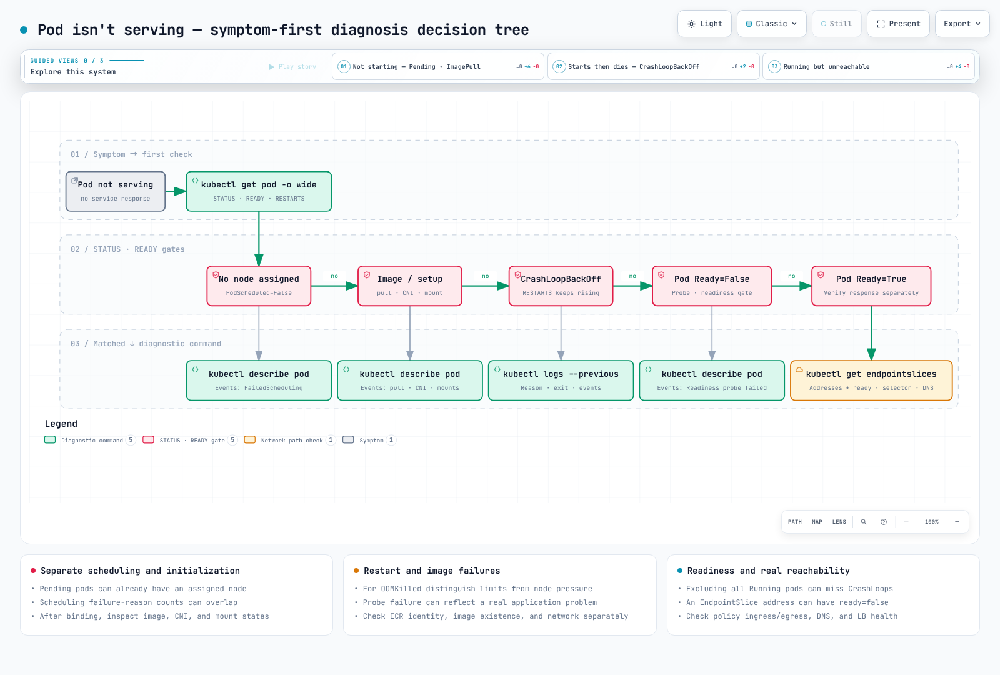

# Kubernetes/EKS トラブルシューティング・プレイブック: 症状 → 診断 → 原因 → 修正

> **元の例に記録されたバージョン**: Amazon EKS 1.36 の元の出力例（コントロールプレーン v1.36.2-eks-bca9cf6、プラットフォームバージョン eks.9、Karpenter 1.4、VPC CNI v1.21、CoreDNS v1.14）
> **最終レビュー日**: 2026年9月11日

< [前へ: ゾーンクラスターの運用](15-zonal-operations-guide.md) | [目次](./README.md) >

***

午前3時にページャーが鳴り、ターミナルを開いたときに必要なのは、概念の説明ではなく、「**いま目の前に見えている状況に応じて、次に入力するコマンド**」です。このドキュメントは概念ではなく、**症状**を起点にしています。それぞれの症状について、「見えているもの → 実行するもの → 出力例 → よくある原因と修正方法」を1つのブロックにまとめています。

以下の出力例は、元の2026年9月2日のドキュメントに記録された環境と、公式ドキュメントの情報を示しています。このレビューでは、そのクラスターを再実行したり、元のキャプチャログを独自に検証したりしていません。特に、[Karpenter の互換性マトリックス](https://karpenter.sh/docs/upgrading/compatibility/)では、Kubernetes 1.36 に対して Karpenter 1.13 以降が必要です。記録された 1.4.0 の組み合わせを、サポート対象のデプロイとして再利用しないでください。

根本原因の詳しい分析（コントロールプレーンログ、CloudWatch Logs Insights のクエリ、ノード参加失敗の8つの原因など）は、すでに[EKS トラブルシューティング](../eks/09-eks-troubleshooting.md)と[EKS 高度なデバッグ](../eks/11-eks-advanced-debugging.md)にあります。このページはそれらの入口です。役割は、**30秒以内にどのページを開くか判断すること**なので、内容を繰り返すのではなく、該当ページへリンクしています。

## 目次

1. [30秒で確認: 症状 → 最初のコマンド → よくある原因](#30-second-summary-symptom--first-command--most-common-cause)
2. [診断の決定木](#diagnostic-decision-tree)
3. [症状別プレイブック](#playbook-by-symptom)
4. [kubectl 診断チートシート](#kubectl-diagnostic-cheat-sheet)
5. [さらに詳しく: 関連ドキュメント](#going-deeper-related-documents)
6. [参考資料](#references)

***

<span id="30-second-summary-symptom--first-command--most-common-cause"></span>

## 30秒で確認: 症状 → 最初のコマンド → よくある原因

各症状のセルから、以下のプレイブックの該当セクションに移動できます。

| 症状（`kubectl get pods`/`nodes` の表示） | 最初のコマンド | よくある原因 |
|---|---|---|
| [`Pending`](#1-pod-stuck-in-pending) | `kubectl describe pod <pod>` → Events の `FailedScheduling` メッセージ | リソース不足（`Insufficient cpu/memory`）、toleration の欠落、nodeSelector の不一致、未バインドの PVC |
| [`ImagePullBackOff` / `ErrImagePull`](#2-imagepullbackoff--errimagepull) | `kubectl describe pod <pod>` → `Failed to pull image` の行 | タグの誤記、プライベートレジストリ認証（imagePullSecrets/ノード IAM）、ECR のリージョン/アカウント不一致 |
| [`CrashLoopBackOff`](#3-crashloopbackoff-exit-137-oomkilled-probe-failures-config-errors) | `kubectl logs <pod> --previous` + `lastState.terminated` の確認 | 起動時にアプリが失敗（exit 1）、`OOMKilled`（exit 137）、liveness probe の失敗、ConfigMap/Secret の欠落 |
| [`Running` だが READY が `0/1`](#4-running-but-not-ready--empty-endpoints) | `kubectl describe pod <pod>` → `Readiness probe failed` | readiness のパス/ポートが誤っている、依存先を待機中、sidecar が未 Ready |
| [リクエストが Service に届かない](#5-service-is-unreachable) | `kubectl get endpointslices -l kubernetes.io/service-name=<svc>` | セレクターラベルの不一致、`targetPort` の誤り、NetworkPolicy による遮断、CoreDNS の停止 |
| [ノードが `NotReady`](#6-node-notready--kubelet-pressure-diskpressure-memorypressure-pidpressure) | `kubectl describe node <node>` → Conditions | kubelet の停止/ネットワーク分断、`DiskPressure`、`MemoryPressure`、`PIDPressure` |
| [PVC が `Pending`](#7-pvc-stuck-in-pending) | `kubectl describe pvc <pvc>` → Events | `WaitForFirstConsumer`（通常の待機）、StorageClass の欠落/誤記、AZ の不一致 |
| [アプリログに `AccessDenied`（AWS API）](#8-eks-irsa--pod-identity-accessdenied) | `kubectl get sa <sa> -o yaml` + 注入された認証情報プロバイダーのフィールド | IRSA（IAM Roles for Service Accounts）のアノテーション/信頼ポリシーの誤り、Pod Identity の関連付けの欠落、Pod が再起動されていない |
| [`ContainerCreating` のまま `failed to assign an IP address` が発生](#9-eks-enivpc-cni-ip-exhaustion) | `kubectl describe pod <pod>` → `FailedCreatePodSandBox` | サブネットの IP 枯渇、ノードの max-pods 到達、`aws-node` の異常 |
| [Karpenter がノードを起動しない](#10-eks-karpenter-does-not-launch-a-node) | `kubectl get events -A --field-selector reason=FailedScheduling` | NodePool の `limits` 到達、requirements/taint の不一致、インスタンスタイプの制限 |
| [`failed calling webhook` により Service の作成が拒否される](#11-no-service-can-be-created-failed-calling-webhook) | `kubectl -n kube-system get endpointslices -l kubernetes.io/service-name=aws-load-balancer-webhook-service` | すべての namespace に一致する `failurePolicy: Fail` の webhook の背後で、Webhook Deployment が異常（CrashLoop） |

***

## 診断の決定木



[🔍 インタラクティブ図を表示](https://www.atomai.click/kubernetes-docs/archmaps/en-ops-16-troubleshooting-playbook-0.html)

まずコンテキストと namespace を確認します。`<pod>` や `<ns>` などのプレースホルダーは実際の値に置き換えてください。Pod のフェーズとコンテナの状態は異なります。すべての `Running` Pod を除外すると、一部の CrashLoop や readiness の失敗を見落とします。このクエリは完了済みの Pod を除外し、異常なフェーズ、または Ready 条件がない/false の Pod を含めます。

```bash
# Inspect phase and Ready condition together
kubectl get pods -A -o json | jq -r '
  .items[]
  | select(.status.phase != "Succeeded")
  | select(.status.phase != "Running" or
      ([.status.conditions[]? | select(.type == "Ready" and .status == "True")] | length == 0))
  | [.metadata.namespace, .metadata.name, .status.phase,
     ([.status.initContainerStatuses[]?, .status.containerStatuses[]?
       | .state.waiting.reason // empty] | join(","))] | @tsv
'

# Recent Warning events (cluster-wide, sorted by lastTimestamp)
kubectl get events -A --field-selector type=Warning --sort-by=.lastTimestamp | tail -30
```

***

## 症状別プレイブック

<span id="1-pod-stuck-in-pending"></span>

### 1. Pod が `Pending` のまま

**症状**: `Pending` にはスケジューリング待ちと、イメージのダウンロード/コンテナのセットアップ待ちの両方が含まれます。まず `.spec.nodeName` と `PodScheduled` 条件を確認してください。未バインドの Pod ではスケジューリングイベントを調べ、バインド済みの Pod ではコンテナ、マウント、CNI の状態を確認します。

**診断**: スケジュールされていない Pod では、`FailedScheduling` を確認します。これは失敗理由ごとにノード数を集計します。各グループの数は重複する場合があります。

```bash
kubectl describe pod <pod> -n <ns> | sed -n '/^Events:/,$p'
```

```
Warning  FailedScheduling  default-scheduler  0/15 nodes are available: 1 Insufficient cpu, 1 Insufficient memory,
  6 node(s) didn't match Pod's node affinity/selector, 8 node(s) had untolerated taint(s).
  no new claims to deallocate, preemption: 0/15 nodes are available:
  1 No preemption victims found for incoming pod, 14 Preemption is not helpful for scheduling.
```

この要約だけから、CPU とメモリの不足が必ず同じノードを指している、あるいは他のすべての制約を満たすノードがちょうど1つある、と推測しないでください。[スケジューラーの集計コード](https://github.com/kubernetes/kubernetes/blob/v1.36.2/pkg/scheduler/framework/types.go)では、1つのノードに対して複数の理由が数えられることがあります。実際のノードラベル、taint、割り当て状況を比較し、DRA のメッセージは ResourceClaim の使用状況を踏まえて解釈してください。

**原因と修正方法**:

| メッセージの一部 | 原因 | 修正方法 |
|---|---|---|
| `Insufficient cpu` / `Insufficient memory` | リクエストがノードの残り容量を超えている | リクエストを適正化し、オートスケーラーを確認（→ [10. Karpenter](#10-eks-karpenter-does-not-launch-a-node)）。`kubectl describe node` の `Allocated resources` を調べる |
| `Too many pods` | 設定されたノードの max-pods に到達。CNI の IP 容量は別途確認する | → [9. ENI/IP 枯渇](#9-eks-enivpc-cni-ip-exhaustion) |
| `node(s) had untolerated taint(s)` | ノードの taint に対する toleration がない | `kubectl get nodes -o custom-columns=NAME:.metadata.name,TAINTS:.spec.taints[*].key` で taint を一覧表示し、toleration を追加するか NodePool を調整する |
| `node(s) didn't match Pod's node affinity/selector` | nodeSelector/affinity のラベルを持つノードがない | `kubectl get nodes --show-labels` を確認する。Karpenter の場合は、NodePool テンプレートのラベルまたは requirements で指定された既知のキーと値を確認する |
| `pod has unbound immediate PersistentVolumeClaims` | PVC が `Pending` | → [7. PVC Pending](#7-pvc-stuck-in-pending) |
| `node(s) had volume node affinity conflict` | PV（EBS）が存在する AZ にスケジュール可能なノードがない | PV の `nodeAffinity` の zone を確認し、その AZ に容量を用意する |
| `node(s) didn't match pod topology spread constraints` / `pod anti-affinity rules` | 分散制約を満たすノードがない | 適切なノードを追加する。トポロジー分散では、可用性目標を確認したうえでのみ ScheduleAnyway を検討する。pod anti-affinity には別個の required/preferred ルールがある |
| イベントがまったくない | Scheduler の問題、または `schedulerName` の誤記 | `kubectl get pod <pod> -o jsonpath='{.spec.schedulerName}'` を確認する |

<span id="2-imagepullbackoff--errimagepull"></span>

### 2. `ImagePullBackOff` / `ErrImagePull`

**症状**: STATUS が最初は `ErrImagePull` で、数回再試行した後に `ImagePullBackOff` になります。kubelet の pull back-off は最大5分まで延びます。

**診断**:

```bash
kubectl describe pod <pod> -n <ns> | grep -A2 -E "Failed to pull|Back-off pulling"
kubectl get pod <pod> -n <ns> -o jsonpath='{range .spec.containers[*]}{.name}{"\t"}{.image}{"\n"}{end}'
kubectl get pod <pod> -n <ns> -o jsonpath='{.spec.imagePullSecrets}'
```

```
Warning  Failed   kubelet  Failed to pull image "123456789012.dkr.ecr.ap-northeast-2.amazonaws.com/app:v1.2.3": ... not found
Warning  Failed   kubelet  Error: ErrImagePull
Normal   BackOff  kubelet  Back-off pulling image "123456789012.dkr.ecr.ap-northeast-2.amazonaws.com/app:v1.2.3"
Warning  Failed   kubelet  Error: ImagePullBackOff
```

正常に pull できた場合は、`Pulling image "..."` → `Successfully pulled image "..." in 4.501s ...` の2つが残ります。すでにキャッシュされているイメージでは、`Container image "..." already present on machine` と記録されます。pull の成功はダウンロードが成功したことを示しますが、イメージの内容、アーキテクチャ、エントリーポイントに問題がないことまでは示しません。

**原因と修正方法**:

| `Failed to pull image` に続く内容 | 原因 | 修正方法 |
|---|---|---|
| `not found` / `manifest unknown` | タグの誤記、まだ push されていないタグ、リポジトリの誤り | `aws ecr describe-images --repository-name <repo> --image-ids imageTag=<tag>` で確認する |
| `401 Unauthorized` / `no basic auth credentials` | プライベートレジストリの認証に失敗 | ECR の場合、ノード IAM ロールに `AmazonEC2ContainerRegistryPullOnly`（または `ReadOnly`）が必要。外部レジストリの場合は `imagePullSecrets` を確認する |
| 別の ECR リージョン/アカウントからの pull に失敗 | 別のアドレスであること自体は問題ではない。クロスアカウントポリシーとリージョナルエンドポイントへのアクセスを確認する | pull する主体を ECR リポジトリポリシーに追加する |
| `dial tcp ... i/o timeout` | NAT/VPC エンドポイントがないプライベートサブネット | `com.amazonaws.<region>.ecr.api`、`ecr.dkr`、S3 ゲートウェイエンドポイントを確認する |
| `toomanyrequests` | Docker Hub のレート制限 | ECR pull through cache 経由でミラーする |

ノードを診断する場合は、まず kubelet のイベント/ログと、イメージ pull に使用される認証情報プロバイダーを確認してください。`crictl pull` は kubelet の ECR 認証情報プロバイダーや Pod の imagePullSecrets を自動的に再利用しないため、同じ認証経路を再現しません。Fargate のイメージ pull では Pod 実行ロールを使用します。これはアプリケーションの IRSA ロールとは別です。

<span id="3-crashloopbackoff-exit-137-oomkilled-probe-failures-config-errors"></span>

### 3. `CrashLoopBackOff`（exit 137 `OOMKilled`、probe の失敗、設定エラー）

**症状**: コンテナが繰り返し終了し、RESTARTS が増えていきます。通常の backoff は10秒から始まり、最大300秒まで倍増しますが、feature gate や kubelet の設定によって変わる場合があります。[Pod のライフサイクル](https://kubernetes.io/docs/concepts/workloads/pods/pod-lifecycle/)で restart policy を確認してください。

**診断**: 次の3点を順番に確認します。**終了理由と exit code**、**前回のコンテナのログ**、**Events**。

```bash
# (1) Why did it die: lastState.terminated
kubectl get pod <pod> -n <ns> -o jsonpath='{range .status.containerStatuses[*]}{.name}{"\t"}restarts={.restartCount}{"\t"}reason={.lastState.terminated.reason}{"\t"}exit={.lastState.terminated.exitCode}{"\n"}{end}'

# (2) Logs right before death (the previous container, not the current one)
kubectl logs <pod> -n <ns> -c <container> --previous --tail=100

# (3) Probe/kill events
kubectl describe pod <pod> -n <ns> | sed -n '/^Events:/,$p'
```

メモリ上限が128Miのコンテナについて、元のドキュメントに記録された出力:

```
    Last State:     Terminated
      Reason:       OOMKilled
      Exit Code:    137
      Started:      Mon, 31 Aug 2026 08:55:27 +0000
      Finished:     Tue, 01 Sep 2026 21:13:37 +0000
    Restart Count:  3
```

約36時間稼働した後に終了していることは、即時の起動失敗とは異なりますが、メモリリークを証明するものではありません。メモリの時系列データやカーネル/cgroup イベントを使い、トラフィックの急増、バッチジョブ、ノードの OOM、上限の変更も調査してください。

**exit code の読み方**:

| Exit Code | 理由 | 意味 | 修正方法 |
|---|---|---|---|
| `0` | `Completed` | プロセスは正常終了。Deployment では、アプリがフォアグラウンドで実行され続けていないことを意味する | 長時間実行するエントリーポイントをフォアグラウンドで動かすか、Job に切り替える |
| `1` | `Error` | アプリが自ら終了した（設定エラー、依存先への接続失敗） | スタックトレースは `logs --previous` にある |
| `126` | `Error` | shell のエントリーポイントからコマンドは見つかったが、実行できない。実行ビットがない、または shell が `cannot execute binary file: Exec format error`（アーキテクチャ不一致）を報告している | Dockerfile で `chmod +x` を実行する。`kubectl get nodes -L kubernetes.io/arch` で arm64/amd64 を確認し、マルチアーキテクチャイメージを使う |
| `127` | `Error` | shell のエントリーポイントでコマンドが見つからない。パスの誤記、または最終イメージのステージにバイナリがコピーされていない | `command`/`args` と、イメージ内の実際の内容を比較する（`kubectl debug ... -- ls <path>`） |
| `137` | `OOMKilled` | OOM による終了。コンテナ上限とノードのメモリプレッシャーを区別する | 上限を引き上げるか、リークを修正する。JVM では `-XX:MaxRAMPercentage` を確認 → [リソース最適化](10-resource-optimization.md) |
| `137` | `Error` | 別の理由による SIGKILL: liveness の失敗後、`terminationGracePeriodSeconds` 以内にコンテナが終了しなかった | preStop/グレースフルシャットダウンを確認する |
| `143` | `Error` | SIGTERM で終了した（通常のロールアウト/エビクションの場合もある） | 繰り返し発生する場合は、Events から終了させた主体を特定する |

- イメージがバイナリを直接 exec する場合（間に shell がない場合）、アーキテクチャの不一致で exit 126 が返ることはありません。コンテナは起動せず、`lastState.terminated` には Reason `StartError` が示され、メッセージに `exec format error` と記録されます。修正方法は同じです。マルチアーキテクチャイメージを使うか、`kubernetes.io/arch` の nodeSelector を指定します。

**Probe の失敗**: これらのイベントは、liveness の失敗によって再起動がトリガーされたことを示しています。原因はパス/ポートの誤りだけでなく、アプリケーションの実際の障害、過負荷、デッドロックの場合もあります。probe を緩和する前に、応答とアプリケーションを調べてください。

```
Warning  Unhealthy  kubelet  Liveness probe failed: HTTP probe failed with statuscode: 503
Normal   Killing    kubelet  Container app failed liveness probe, will be restarted
```

- アプリの起動に時間がかかる場合は、liveness の `initialDelaySeconds` を大きくするのではなく、**`startupProbe`** を追加してください（startup probe が成功するまで liveness は開始されません）。
- `Readiness probe failed: dial tcp 10.0.2.45:8080: connect: connection refused` のような TCP 接続拒否がある場合は、まずコンテナのポートと probe のポートが異なっていないかを確認してください。

**設定参照エラー**: 厳密には CrashLoop ではありません。Pod は `CreateContainerConfigError` で停止します。

```
Warning  Failed  kubelet  Error: configmap "app-config" not found
Warning  Failed  kubelet  Error: secret "db-credentials" not found
```

`kubectl get cm,secret -n <ns>` で名前と namespace を照合すれば原因を特定できます。参照先がボリュームマウントの場合は、代わりに `FailedMount` イベントとして表示されます（`MountVolume.SetUp failed for volume "cfg" : configmap "app-config" not found`）。

<span id="4-running-but-not-ready--empty-endpoints"></span>

### 4. `Running` だが Ready でない / Endpoints が空

**症状**: STATUS は `Running` ですが READY が `0/1` です（sidecar がある場合は `1/2`）。通常の Service ルーティングでは、not-ready のエンドポイントは除外されます。publishNotReadyAddresses、終了中のエンドポイント、LB の fail-open などの例外は個別に確認してください。プロキシによっては、クライアントにエラーやタイムアウトが発生することがあります。

**診断**:

```bash
kubectl describe pod <pod> -n <ns> | grep -E "Ready|Readiness probe"
kubectl get endpointslices -n <ns> -l kubernetes.io/service-name=<svc>
```

**EndpointSlice のアドレスと readiness は別々のものです。** 一致する not-ready Pod が、アドレスと `ready: false` を持つエンドポイントとして表示されることがあります。ENDPOINTS 列から readiness を推測せず、`ready`、`serving`、`terminating` を確認してください。

```bash
kubectl get endpointslices -n <ns> -l kubernetes.io/service-name=<svc> -o json | jq -r '
  .items[] as $slice | $slice.endpoints[]?
  | [$slice.metadata.name, (.addresses | join(",")), (.conditions | tojson)] | @tsv
'
```

`ready` が未設定の場合は状態不明であり、コンシューマーは ready として解釈する必要があります。`publishNotReadyAddresses: true` を設定すると readiness によるフィルタリングが変わります。プロキシは終了中の serving エンドポイントを処理する場合もあります。セレクターのない Service では、手動管理の EndpointSlice を確認してください。v1 Endpoints API は Kubernetes 1.33 以降非推奨です。新しい診断には EndpointSlice を使用してください。

**原因と修正方法**:

| 観察事項 | 原因 | 修正方法 |
|---|---|---|
| Events に `Readiness probe failed` が繰り返し表示される | probe のパス/ポートが誤っているか、アプリが依存先（DB など）をまだ待っている | probe をアプリの実際のヘルスエンドポイントに向ける。依存先の待機は readiness に含め、liveness には含めない |
| reason が `ReadinessGatesNotReady` で Condition が `Ready False` | Pod readiness gate を待機中。典型例は AWS Load Balancer Controller の `target-health.elbv2.k8s.aws/*` gate | Target Group のヘルスチェックが失敗する理由を調べる → [AWS Load Balancer Controller](../networking/03-aws-lb-controller.md) |
| Running が `1/2` で、アプリコンテナだけが Ready | sidecar（istio-proxy など）が Ready でない、または sidecar がアプリの後に起動し、初期接続に失敗した | sidecar のログを確認する。インジェクター/バージョンでサポートされる起動順序と readiness を確認する。native-sidecar への変換だけでは readiness は修正されない |
| Ready なのに EndpointSlice が空 | Service セレクターが Pod ラベルに一致しない | → [5. Service に到達できない](#5-service-is-unreachable) |

<span id="5-service-is-unreachable"></span>

### 5. Service に到達できない

**症状**: コンテナは `1/1 Running` ですが、`curl http://<svc>.<ns>.svc.cluster.local` がタイムアウトする、接続拒否を返す、または名前解決に失敗します。

**診断を3つの層に分けます**。(a) Service → Pod のマッピング、(b) ネットワークポリシー、(c) DNS。

```bash
# (a) Compare the selector with actual labels
kubectl get svc <svc> -n <ns> -o jsonpath='{.spec.selector}{"\n"}{.spec.ports}{"\n"}'
kubectl get pods -n <ns> -l <key>=<value> -o wide
kubectl get endpointslices -n <ns> -l kubernetes.io/service-name=<svc>

# (b) NetworkPolicies applied to the namespace
kubectl get networkpolicies -n <ns>
kubectl describe networkpolicy <policy> -n <ns>

# (c) CoreDNS status and logs
kubectl get pods -n kube-system -l k8s-app=kube-dns
kubectl logs -n kube-system -l k8s-app=kube-dns --tail=50
kubectl get cm -n kube-system coredns -o jsonpath='{.data.Corefile}'
```

**原因と修正方法**:

| 観察事項 | 原因 | 修正方法 |
|---|---|---|
| セレクターが `{"app":"api"}` だが、Pod のラベルが `app=api-server` | ラベルの不一致 → EndpointSlice が空 | ラベル/セレクターを統一する。Helm Chart では `selectorLabels` と `podLabels` の食い違いがよくある原因 |
| EndpointSlice に IP があるが `connection refused` | `targetPort` とコンテナが実際に待ち受けているポートが異なる | `kubectl get pod <pod> -n <ns> -o jsonpath='{.spec.containers[*].ports}'` と比較する。アプリが `127.0.0.1` だけに bind している場合も同じ症状になる |
| 特定の namespace からだけ失敗する | `default-deny` NetworkPolicy が存在し、ingress の許可ルールがない | `podSelector`/`namespaceSelector` を確認する。VPC CNI のネットワークポリシーを使用している場合、`kubectl get policyendpoints -n <ns>` で実際に適用されている内容を確認できる → [ネットワークポリシー](../security/04-network-policies.md) |
| `nslookup <svc>` が `NXDOMAIN` を返す | 別の namespace から短縮名を使用している、または CoreDNS が停止している | FQDN（`<svc>.<ns>.svc.cluster.local`）を使う。CoreDNS Pod が `Running` であること、および `/etc/resolv.conf` の `nameserver` が kube-dns ClusterIP（このクラスターでは `172.20.0.10`）であることを確認する |
| 外部ドメインの名前解決が遅い | デフォルトの `ndots:5` では、ドットが5個未満の名前は、絶対名として問い合わせる前にすべての search domain（`<ns>.svc.cluster.local`、`svc.cluster.local`、`cluster.local`、ノードの VPC ドメイン）に対して順に試行される | 外部名の末尾に `.` を付けるか、name が ndots、string value が "2" の dnsConfig.options エントリーを検討する |
| NodePort/LB が一部のノード経由でしか動作しない | そのノードに Pod がない状態で `externalTrafficPolicy: Local` を使用している | これは想定された動作。クライアント IP の保持とノード間トラフィックを確認したうえで、Cluster を検討する |

Pod から見た DNS を再現するには、一時的な Pod を起動します: `kubectl run -it --rm dns-test --image=busybox:1.36 --restart=Never -- nslookup kubernetes.default.svc.cluster.local`。CoreDNS の概念と Corefile については、[Service とネットワーキング](../core/03-services-networking.md#coredns)を参照してください。

宛先側の ingress と送信元側の egress、両方の NetworkPolicy を確認してください。containerPort を宣言しても、リッスンソケットは作成されません。アプリログまたはソケットの状態を確認してください。NodeLocal DNSCache を使用している場合、resolv.conf が kube-dns ClusterIP 以外の nameserver を正しく使用することがあります。

**Auto Mode の DNS:** [現在の Auto Mode](https://docs.aws.amazon.com/eks/latest/userguide/auto-networking.html) では、CoreDNS はノードのシステムサービスとして実行されます。Auto Mode のみのクラスターでは、kube-dns Pod/Service がないことだけで障害を示すわけではありません。混在クラスターでは、通常のノードに対して CoreDNS Deployment が必要です。上記の Pod/ConfigMap コマンドは Deployment ベースの DNS を調べます。Auto Mode では、実際の Pod の名前解決、ノードの DNS ログ、上流リゾルバーへの到達性を確認してください。

<span id="6-node-notready--kubelet-pressure-diskpressure-memorypressure-pidpressure"></span>

### 6. ノードが `NotReady` / kubelet のプレッシャー（`DiskPressure`、`MemoryPressure`、`PIDPressure`）

**症状**: `kubectl get nodes` が `NotReady` を示す、またはノードは `Ready` だが Pod が `Evicted` になる、あるいは新しい Pod が `node(s) had untolerated taint(s)` によってそのノードを避ける。

**診断**:

```bash
# One-line summary of node conditions
kubectl get nodes -o custom-columns='NAME:.metadata.name,READY:.status.conditions[?(@.type=="Ready")].status,MEM:.status.conditions[?(@.type=="MemoryPressure")].status,DISK:.status.conditions[?(@.type=="DiskPressure")].status,PID:.status.conditions[?(@.type=="PIDPressure")].status'

# Conditions with their reason
kubectl get node <node> -o jsonpath='{range .status.conditions[*]}{.type}{"="}{.status}{" ("}{.reason}{")\n"}{end}'

# Taints the node picked up automatically
kubectl get node <node> -o jsonpath='{.spec.taints}'
```

正常なノードの出力（EKS Node Monitoring Agent がインストールされている場合は、`ContainerRuntimeReady`/`NetworkingReady`/`KernelReady`/`StorageReady` の各条件も表示されます）:

```
MemoryPressure=False (KubeletHasSufficientMemory)
DiskPressure=False (KubeletHasNoDiskPressure)
PIDPressure=False (KubeletHasSufficientPID)
Ready=True (KubeletReady)
ContainerRuntimeReady=True (ContainerRuntimeIsReady)
NetworkingReady=True (NetworkingIsReady)
KernelReady=True (KernelIsReady)
StorageReady=True (DiskIsReady)
```

**原因と修正方法**:

| Condition / reason | 自動付与される taint | 原因 | 修正方法 |
|---|---|---|---|
| `Ready=Unknown`（`NodeStatusUnknown`、「Kubelet stopped posting node status.」） | `node.kubernetes.io/unreachable` | kubelet プロセスの停止、インスタンスの停止/ネットワーク分断、API server の認証失敗 | EC2 インスタンスの状態を確認する → ノードが応答する場合はサポート対象のログアクセス方法を使う。kubelet が停止していると、デバッグ Pod を起動できないことがある |
| `Ready=False` | `node.kubernetes.io/not-ready` | コンテナランタイムの停止、CNI の未初期化（`aws-node` の異常） | `kubectl get pods -n kube-system -l k8s-app=aws-node -o wide` で、そのノードの aws-node を確認する |
| `DiskPressure=True`（`KubeletHasDiskPressure`） | `node.kubernetes.io/disk-pressure` | イメージキャッシュ/コンテナログでルートボリュームがいっぱいになった | `crictl rmi --prune`、ログローテーション、ルート EBS の拡張を行う。Pod は `The node was low on resource: ephemeral-storage` で `Evicted` になる |
| `MemoryPressure=True`（`KubeletHasInsufficientMemory`） | `node.kubernetes.io/memory-pressure` | 実際の使用量が予約量を超えている、またはシステム予約が不足している。request のない limit は、その limit を request としてデフォルト設定される場合がある | request を適用する（LimitRange）。`kube-reserved`/`system-reserved` を確認する |
| `PIDPressure=True`（`KubeletHasInsufficientPID`） | `node.kubernetes.io/pid-pressure` | fork の急増（スレッドリーク） | 問題の Pod を特定して再起動し、`podPidsLimit` を設定する |

以下は特権付きのデバッグ Pod を作成します。一般的な Linux ワーカーにホストシェル、journalctl、crictl があることを前提としています。同じ chroot 手順が、変更不可の Bottlerocket/EKS Auto Mode ホストでも使えると想定しないでください。[Auto Mode のトラブルシューティング](https://docs.aws.amazon.com/eks/latest/userguide/auto-troubleshoot.html)に記載されている debug-container とコンソールログの手順を使用してください。

```bash
kubectl debug node/<node> -it --image=busybox --profile=sysadmin -- chroot /host
# once inside
journalctl -u kubelet --since "10 min ago" | tail -50
df -h /var/lib/containerd
crictl ps -a | head
```

`kubectl get nodes` に**一度も表示されない**ノード（参加失敗: IAM ロール/access entry、サブネットルーティング、セキュリティグループ、AMI の不一致）は別のトピックです → [EKS 高度なデバッグ: ノード参加失敗の診断](../eks/11-eks-advanced-debugging.md#node-join-diagnosis)、[EKS トラブルシューティング: ノードと Pod の問題](../eks/09-eks-troubleshooting.md#node-and-pod-issues)。Karpenter ノードの場合は、まず[セクション10](#10-eks-karpenter-does-not-launch-a-node)の NodeClaim チェックから始めてください。

<span id="7-pvc-stuck-in-pending"></span>

### 7. PVC が `Pending` のまま

**症状**: `kubectl get pvc` が `Pending` を示し、その PVC を使用する Pod も `pod has unbound immediate PersistentVolumeClaims` で `Pending` になる。

**診断**:

```bash
kubectl get pvc -n <ns>
kubectl describe pvc <pvc> -n <ns> | sed -n '/^Events:/,$p'
kubectl get storageclass
kubectl get pods -n kube-system -l app=ebs-csi-node -o wide     # is the CSI node plugin on that node?
```

```
NAME   PROVISIONER             RECLAIMPOLICY   VOLUMEBINDINGMODE      ALLOWVOLUMEEXPANSION   AGE
gp2    kubernetes.io/aws-ebs   Delete          WaitForFirstConsumer   false                  145d
gp3    ebs.csi.aws.com         Delete          WaitForFirstConsumer   true                   76d
```

StorageClass の一覧は環境例です。Auto Mode の ebs.csi.eks.amazonaws.com と、別途インストールされた ebs.csi.aws.com ドライバーを区別してください。Auto Mode で通常の ebs-csi-node DaemonSet がないことだけで、障害を示すわけではありません。明示的に storageClassName: "" を指定するとデフォルトクラスは使われません。フィールドを省略する場合とは異なります。

**原因と修正方法**: `describe pvc` の Events メッセージが診断の手掛かりです。

| Events メッセージ | 原因 | 修正方法 |
|---|---|---|
| `WaitForFirstConsumer: waiting for first consumer to be created before binding` | **正常な状態です。** `volumeBindingMode: WaitForFirstConsumer` により、Pod がスケジュールされるまでボリュームの作成が保留される | まだ Pod が使用していないために Pending なら、そのままにする。Pod も Pending なら、Pod の `FailedScheduling` を確認する |
| `FailedBinding: no persistent volumes available for this claim and no storage class is set` | `storageClassName` がなく、デフォルト StorageClass もない | PVC に `storageClassName: gp3` を設定するか、SC に `storageclass.kubernetes.io/is-default-class: "true"` のアノテーションを付ける |
| `ProvisioningFailed: storageclass.storage.k8s.io "<name>" not found` | StorageClass の誤記、別のクラスターからコピーしたマニフェスト | `kubectl get sc` で実際の名前を確認する |
| `ProvisioningFailed: error generating accessibility requirements: no topology key found for node <node>` | Pod が配置されたノードで EBS CSI node plugin が登録されていない（`CSINode` にドライバーがない） | `kubectl get csinode <node>` の DRIVERS 列を確認し、そのノードで `ebs-csi-node` DaemonSet が動作していることを確認する |
| `ProvisioningFailed` + `UnauthorizedOperation`/`AccessDenied` | EBS CSI controller の IRSA/Pod Identity に権限がない | → [8. IRSA/Pod Identity](#8-eks-irsa--pod-identity-accessdenied)（対象は `ebs-csi-controller-sa`） |
| Pod 側の `node(s) had volume node affinity conflict` | 既存の PV（EBS）が AZ `ap-northeast-2a` にある一方、スケジュール可能なノードが別の AZ にある | EBS は AZ をまたげない。`kubectl get pv <pv> -o jsonpath='{.spec.nodeAffinity}'` で zone を確認し、その AZ に容量を用意する（NodePool の zone 要件または nodeSelector） |
| Pod 側の `FailedAttachVolume: Multi-Attach error for volume` | RWO ボリュームがまだ以前のノードにアタッチされている（ノード障害後に StatefulSet が再スケジュールされた） | `kubectl get volumeattachments` で古いアタッチメントを確認する。ノードが消失した場合は、クリーンアップまで数分待つ |

`WaitForFirstConsumer`、StorageClass、動的プロビジョニングの概念については[ストレージ](../core/04-storage.md#storage-classes)、EBS/EFS CSI のエラーパターンについては[EKS 高度なデバッグ: ストレージのトラブルシューティング](../eks/11-eks-advanced-debugging.md#6-storage-troubleshooting)を参照してください。

<span id="8-eks-irsa--pod-identity-accessdenied"></span>

### 8. EKS: IRSA / Pod Identity の `AccessDenied`

**症状**: Pod は問題なく `Running` ですが、アプリログに AWS SDK のエラーが出ます。

```
An error occurred (AccessDenied) when calling the AssumeRoleWithWebIdentity operation:
  Not authorized to perform sts:AssumeRoleWithWebIdentity
```

または、S3/DynamoDB の呼び出し自体が `... is not authorized to perform: s3:GetObject` で拒否されます。この場合、拒否された主体はサービスアカウントのロールではなく、**ノード IAM ロール**（`assumed-role/<node-role>/i-0abc...`）です。これは SDK がノードの認証情報を選択したことを示します。IMDS アクセスがブロックされている場合は、ノードロールへのフォールバックは利用できません。注入状況、SDK のバージョン、プロバイダーの優先順位、明示的な認証情報を確認してください。

**診断**: まず、どの仕組みを使っているかを特定します。Pod の環境変数で判断できます。

```bash
# Service account annotation (IRSA)
kubectl get sa <sa> -n <ns> -o jsonpath='{.metadata.annotations.eks\.amazonaws\.com/role-arn}{"\n"}'

# Credential-related env injected into the pod
kubectl get pod <pod> -n <ns> -o json | jq -r '
  (.spec.initContainers[]?, .spec.containers[]?) as $container
  | $container.env[]?
  | select(.name == "AWS_ROLE_ARN" or .name == "AWS_WEB_IDENTITY_TOKEN_FILE"
        or .name == "AWS_CONTAINER_CREDENTIALS_FULL_URI"
        or .name == "AWS_CONTAINER_AUTHORIZATION_TOKEN_FILE")
  | [$container.name, .name, (.value // "valueFrom")] | @tsv
'
```

| 注入された環境変数 | 仕組み | 意味 |
|---|---|---|
| `AWS_ROLE_ARN=arn:aws:iam::...:role/<role>` + `AWS_WEB_IDENTITY_TOKEN_FILE=/var/run/secrets/eks.amazonaws.com/serviceaccount/token` | **IRSA** | pod-identity-webhook によって注入されたもの。存在しない場合、Pod 作成**後**に SA のアノテーションが追加されたか、SA の名前が異なる |
| `AWS_CONTAINER_CREDENTIALS_FULL_URI` + `AWS_CONTAINER_AUTHORIZATION_TOKEN_FILE` | **EKS Pod Identity** | `eks-pod-identity-agent` が `169.254.170.23` で認証情報を提供する。関連付けが存在する場合にのみ注入される |
| どちらもない | 別のプロバイダー、または認証情報なし | 以下の表を参照 |

```bash
# Pod Identity: agent and association
kubectl get pods -n kube-system -l app.kubernetes.io/name=eks-pod-identity-agent
aws eks list-pod-identity-associations --cluster-name <cluster> --namespace <ns> --service-account <sa>

# IRSA: OIDC condition in the trust policy
aws eks describe-cluster --name <cluster> --query 'cluster.identity.oidc.issuer' --output text
aws iam get-role --role-name <role> --query 'Role.AssumeRolePolicyDocument'
```

**原因と修正方法**:

| 観察事項 | 原因 | 修正方法 |
|---|---|---|
| 環境変数がないが、SA のアノテーションは存在する | 作成順序、実際の serviceAccountName、または webhook の注入設定 | 設定を確認/修正し、適切な namespace で Pod を再作成する。ロールアウトの影響も考慮する |
| 環境変数も関連付けもない | Pod Identity の関連付けが作成されていない、または別の SA/namespace に対して作成されている | `aws eks create-pod-identity-association ...` を実行し、Pod を再起動する |
| `Not authorized to perform sts:AssumeRoleWithWebIdentity` | IRSA の信頼ポリシー: `Federated` OIDC プロバイダー ARN が誤っている、または `sub`（`system:serviceaccount:<ns>:<sa>`）/`aud`（`sts.amazonaws.com`）条件が一致しない | 信頼ポリシーを修正する。クラスターを再作成した場合は OIDC issuer が変わるため、プロバイダーも再作成する |
| Pod Identity で `AssumeRole` が拒否される | 信頼ポリシーの principal が `pods.eks.amazonaws.com` ではない、または `sts:TagSession` がない | 信頼ポリシーで `sts:AssumeRole` と `sts:TagSession` の両方を許可する |
| 環境変数は正常だが、特定の API だけが `AccessDenied` | identity/resource ポリシー、SCP、境界、セッション、VPC endpoint ポリシーによる拒否 | 呼び出し元/リソースと明示的な Deny を確認する。関連する CloudTrail データイベントにはログ設定が必要な場合がある |
| Pod Identity の環境変数が存在するが、SDK が `Unable to locate credentials` と表示する | SDK が古く、コンテナ認証情報プロバイダー（`FULL_URI`）をサポートしていない | SDK を更新する（サポートされる最低バージョンは EKS ドキュメントに記載） |

IRSA と Pod Identity の仕組みや設定方法については[EKS セキュリティのベストプラクティス](../security/06-eks-security-best-practices.md#irsa-iam-roles-for-service-accounts)と[EKS Pod Identity](../eks/05-eks-security-pod-identity.md)、トークンの有効期限切れや webhook の問題については[EKS 高度なデバッグ: コントロールプレーンのデバッグ](../eks/11-eks-advanced-debugging.md#2-control-plane-debugging)を参照してください。

<span id="9-eks-enivpc-cni-ip-exhaustion"></span>

### 9. EKS: ENI/VPC CNI の IP 枯渇

**症状**: Pod が `ContainerCreating` のままになり、Events に `FailedCreatePodSandBox` が表示されます。

```
Warning  FailedCreatePodSandBox  kubelet  Failed to create pod sandbox: rpc error: code = Unknown desc =
  failed to setup network for sandbox "...": plugin type="aws-cni" name="aws-cni" failed (add):
  add cmd: failed to assign an IP address to container
```

スケジューリング時の `Too many pods` は kubelet の Pod 数上限に到達したことを意味します。IP 容量が関係することはありますが、IP 枯渇の証拠ではありません。CNI の `FailedCreatePodSandBox` はノード割り当て後に発生します。

**診断**:

```bash
# Read the actual pod ceiling; distinguish secondary-IP defaults from prefix/custom networking configuration
kubectl get node <node> -o jsonpath='{.status.allocatable.pods}{"\n"}'
kubectl get pods -A --field-selector spec.nodeName=<node>,status.phase!=Succeeded,status.phase!=Failed --no-headers | wc -l

# aws-node status and IPAM settings
kubectl get pods -n kube-system -l k8s-app=aws-node -o wide
kubectl get ds -n kube-system aws-node -o jsonpath='{range .spec.template.spec.containers[?(@.name=="aws-node")].env[*]}{.name}={.value}{"\n"}{end}' | grep -E "PREFIX|WARM|MINIMUM|CUSTOM_NETWORK"

# Free IPs in the subnet
aws ec2 describe-subnets --subnet-ids <subnet-id> --query 'Subnets[].{id:SubnetId,az:AvailabilityZone,free:AvailableIpAddressCount}' --output table
```

IPv4 のセカンダリ IP モードでは、余分な ENI 容量の目標値として `WARM_ENI_TARGET=1` がデフォルトで設定されています。各 ENI はプライマリ IP も1つ消費します。m5.xlarge では ENI ごとに IPv4 アドレスが15個あり、そのうち14個が通常の Pod に割り当てるセカンダリアドレスです。WARM_IP_TARGET/MINIMUM_IP_TARGET に正の値を設定すると、warm-ENI のルールが上書きされます。warm が3、minimum が6の場合、使用中の IP が1つなら合計6個（予備5個）が必要になることがあります。使用中の IP が5つなら、合計8個（予備3個）が目標になります。予備容量が常にちょうど3つになるわけではありません。IPAM の調整、ENI の上限、プレフィックス割り当ての粒度が実際の数に影響します。

**原因と修正方法**:

| 観察事項 | 原因 | 修正方法 |
|---|---|---|
| サブネットの `AvailableIpAddressCount` が1桁 | サブネット自体が枯渇している。warm pool が IP を先行確保している | 前述の設定例のように `WARM_IP_TARGET`/`MINIMUM_IP_TARGET` で warm pool を小さくする。**custom networking**（`ENIConfig`）でセカンダリ CIDR（例: 100.64.0.0/16）を追加し、長期的には IPv6 を使う |
| ノード上の Pod 数 = allocatable pods | 設定された Pod 数の上限。IP 容量は別途確認する | 対応状況とサブネット容量を確認したうえで**プレフィックス委任**（`ENABLE_PREFIX_DELEGATION=true`。/28 プレフィックスを割り当てるため、対応インスタンスと連続した /28 ブロックが必要）を使い、max-pods を再計算するか、より大きなインスタンスを使う |
| そのノードで `aws-node` が `CrashLoopBackOff` | CNI 自体の障害（`AmazonEKS_CNI_Policy` の欠落、バージョン不一致） | `kubectl logs -n kube-system <aws-node-pod> -c aws-node` を実行し、ノード上の `/var/log/aws-routed-eni/ipamd.log` を確認する |
| Security Groups for Pods を使用していて `vpc.amazonaws.com/pod-eni` が不足 | Branch ENI の上限 | trunk ENI に対応するインスタンスに移行し、`ENABLE_POD_ENI=true` を確認する |

IPAM の動作（warm pool、プレフィックス委任、custom networking）については[VPC CNI: IP アドレス管理](../networking/01-vpc-cni.md#ip-address-management)、IP 枯渇への対処手順については[EKS 高度なデバッグ: ネットワーク診断](../eks/11-eks-advanced-debugging.md#5-networking-diagnostics)と[EKS トラブルシューティング: VPC CNI の問題](../eks/09-eks-troubleshooting.md#networking-issues)を参照してください。

<span id="10-eks-karpenter-does-not-launch-a-node"></span>

### 10. EKS: Karpenter がノードを起動しない

**症状**: Pod が `Pending` で、`kubectl get nodeclaims` に新しい NodeClaim が表示されません。デフォルトの scheduler が出す `FailedScheduling` とは**別に**、Karpenter は同じ Pod に対して独自の理由を Events として記録します。

**診断**:

```bash
# Events emitted by Karpenter (source is karpenter)
kubectl get events -n <ns> --field-selector involvedObject.name=<pod> -o custom-columns=REASON:.reason,SRC:.source.component,MSG:.message

# NodePool limits vs current usage
kubectl get nodepool -o custom-columns='NAME:.metadata.name,CPU_LIMIT:.spec.limits.cpu,CPU_USED:.status.resources.cpu,MEM_LIMIT:.spec.limits.memory,MEM_USED:.status.resources.memory,READY:.status.conditions[?(@.type=="Ready")].status'

# NodeClaim progress
kubectl get nodeclaims -o custom-columns='NAME:.metadata.name,TYPE:.metadata.labels.node\.kubernetes\.io/instance-type,LAUNCHED:.status.conditions[?(@.type=="Launched")].status,REGISTERED:.status.conditions[?(@.type=="Registered")].status,READY:.status.conditions[?(@.type=="Ready")].status'

kubectl logs -n kube-system -l app.kubernetes.io/name=karpenter --tail=100
```

元のドキュメントに記録された Karpenter イベント。拒否された NodePool が列挙されています。

```
FailedScheduling  karpenter  Failed to schedule pod, incompatible with nodepool "system",
  daemonset overhead={"cpu":"821m","memory":"1350Mi","pods":"10"}, incompatible requirements,
  label "nvidia.com/device-plugin.config" does not have known values;
  incompatible with nodepool "runner-arm", ..., did not tolerate workload-type=ci-runner:NoSchedule;
  all available instance types exceed limits for nodepool "graviton";
  incompatible with nodepool "gpu-ner", ..., incompatible requirements, key node.kubernetes.io/instance-type,
  node.kubernetes.io/instance-type In [g6e.4xlarge] not in node.kubernetes.io/instance-type In [g6.2xlarge g6.4xlarge g6.xlarge]
```

記録された例では CPU_LIMIT が8、CPU_USED が8ですが、`exceed limits` が発生するのに現在の使用量が上限と等しい必要はありません。候補となるインスタンスがすべて残りの余裕を超える場合は、上限に達していなくても発生します。`Nominated` はスケジューリング上の指名であり、完了を意味しません。NodeClaim の Launched、Registered、Initialized、Ready と、実際の Pod 割り当てを確認してください。

**原因と修正方法**:

| メッセージの一部 | 原因 | 修正方法 |
|---|---|---|
| `all available instance types exceed limits for nodepool "<np>"` | 候補インスタンスを追加すると NodePool の上限を超える | 上限を引き上げるか、consolidation によってアイドル状態のノードが解放されているかを確認する |
| `label "<key>" does not have known values` | 要求されたカスタムラベルに対し、NodePool のテンプレートラベル/requirements で値が指定されていない | NodePool の `spec.template.spec.requirements` に、キーと値のリストを追加する |
| `did not tolerate <key>=<value>:NoSchedule` | NodePool の `taints` に対する toleration がない | 隔離が意図したものであれば別の NodePool を使う。そうでなければ toleration を追加する |
| `key node.kubernetes.io/instance-type, ... In [X] not in ... In [Y Z]` | Pod が NodePool で許可されていないインスタンスタイプを要求している | いずれか一方を調整する。通常は Pod 側の要件が狭すぎる |
| `daemonset overhead={...}` が大きく `Insufficient` | DaemonSet の予約分を差し引いた後に容量が不足 | requirements により大きなインスタンスを含める |
| NodeClaim が数分間 `LAUNCHED=True, REGISTERED=False` | EC2 は起動したが、ノードがクラスターに参加できない（EC2NodeClass の subnet/SG セレクター、ノード IAM ロールの access entry、AMI） | `kubectl describe nodeclaim <name>` の Conditions/Events と、EC2 コンソールのシステムログを確認する |
| Karpenter のログに `InsufficientInstanceCapacity` | その AZ/インスタンスタイプに EC2 容量がない（ICE: Insufficient Capacity Error） | インスタンスタイプ、AZ、capacity-type（spot/on-demand）の範囲を広げる |
| イベントがなく、Karpenter のログも静か | Pod が Karpenter の対象ではない（nodeSelector が MNG のラベルを指している、またはスケジューリング制約が Karpenter と無関係） | Pod spec のノード関連制約をすべて再確認する |

NodePool/EC2NodeClass の構造と詳しいトラブルシューティングについては、[Karpenter: トラブルシューティング](../autoscaling/02-karpenter.md#troubleshooting)と[EKS 高度なデバッグ: Karpenter のプロビジョニング問題](../eks/11-eks-advanced-debugging.md#karpenter-provisioning-issues)を参照してください。

<span id="11-no-service-can-be-created-failed-calling-webhook"></span>

### 11. Service を作成できない: webhook の呼び出しに失敗

**症状**: どの namespace でも、ロードバランサーに関係のない namespace を含めて、Service に対する `kubectl apply`/`create` が API server に拒否されます。Service を含む Deployment のデプロイ、Helm のインストール、ArgoCD の同期はそこで停止しますが、**既存の Service は引き続き動作する**ため、Pod レベルでは異常が見えません。

```
Internal error occurred: failed calling webhook "mservice.elbv2.k8s.aws": failed to call webhook:
  ... no endpoints available for service "aws-load-balancer-webhook-service"
```

**診断**: メッセージには webhook とその背後にある Service がすでに示されています。webhook configuration → webhook Service のエンドポイント → その背後にある Deployment の順に調べます。

```bash
# (1) Which webhooks are registered, and what each does on failure (rules, namespaceSelector, objectSelector, failurePolicy)
kubectl get mutatingwebhookconfigurations,validatingwebhookconfigurations
kubectl get mutatingwebhookconfiguration aws-load-balancer-webhook -o jsonpath='{range .webhooks[*]}{.name}{"\t"}failurePolicy={.failurePolicy}{"\t"}ns={.namespaceSelector}{"\t"}obj={.objectSelector}{"\t"}{.rules[*].operations}{" "}{.rules[*].resources}{"\n"}{end}'

# (2) Is there a Ready pod behind the webhook Service?
kubectl -n kube-system get endpointslices -l kubernetes.io/service-name=aws-load-balancer-webhook-service

# (3) Why does that Deployment keep dying?
kubectl -n kube-system get pods -l app.kubernetes.io/name=aws-load-balancer-controller
kubectl -n kube-system logs deploy/aws-load-balancer-controller --previous
```

元のドキュメントには、2026年9月2日に LBC v3.2.1 が繰り返し再起動し、以下のログが記録されています。このレビューでは、過去の再起動回数や期間を独自に検証していないため、再現された結果としては示していません。対応に役立つ根拠は、インストール済み CRD と、controller が要求する API バージョンとの不一致です。

```
{"ts":"2026-09-02T07:54:42Z","logger":"setup","msg":"Disabling NLBGatewayAPI: missing required Gateway API CRDs","missing":["TLSRoute","TCPRoute","UDPRoute"]}
{"level":"error","logger":"controller-runtime.source.Kind","msg":"if kind is a CRD, it should be installed before calling Start","kind":"ListenerSet.gateway.networking.k8s.io","error":"no matches for kind \"ListenerSet\" in version \"gateway.networking.k8s.io/v1\""}
{"ts":"2026-09-02T07:57:00Z","level":"error","logger":"setup","msg":"problem running manager","error":"failed to wait for gateway.k8s.aws/alb caches to sync kind source: *v1.ListenerSet: timed out waiting for cache to be synced for Kind *v1.ListenerSet"}
```

これらのログは、ListenerSet.gateway.networking.k8s.io/v1 が見つからず、キャッシュ同期に失敗していることを示します。**Gateway API 1.5.0 では、standard channel に ListenerSet が含まれています。** バージョン要件、standard CRD、LBC 固有の CRD を[LBC v3.2.1 ガイド](https://github.com/kubernetes-sigs/aws-load-balancer-controller/blob/v3.2.1/docs/guide/gateway/gateway.md)で確認してください。TCPRoute/UDPRoute などの追加 API が必要な場合は、experimental のインストール要件も確認してください。影響範囲は実際の webhook ルール、セレクター、failurePolicy によって異なります。ターゲットの更新や新しいリソースの調整が妨げられている間も、既存の LB データパスは動作し続ける場合があります。

**原因と修正方法**:

| 観察事項 | 原因 | 修正方法 |
|---|---|---|
| `no endpoints available for service "aws-load-balancer-webhook-service"` | webhook Deployment の Ready Pod が0個（CrashLoop、スケジュール不能、replicas が0） | まず**controller を正常な状態にする**（次の行を参照）。EndpointSlice のアドレスと ready 条件を確認し、実際の webhook リクエストをテストする |
| ログに `no matches for kind "ListenerSet"` → `timed out waiting for cache to be synced` がある | この controller バージョンが必要とする Gateway API CRD がインストールされていない | (a) controller バージョンが必要とする Gateway API CRD をインストールする（ListenerSet は Gateway API 1.5.0 の standard channel に含まれる）、(b) CRD が揃うまで Helm の feature-gate 値で controller の Gateway API 機能を無効にする（そのバージョンの `values.yaml` で正確な gate 名を確認する）、(c) インストール済み CRD に合った controller バージョンを固定する |
| エンドポイントは存在するが `connection refused` / `context deadline exceeded` / `x509` が発生する | webhook ポートへの経路が遮断されている（NetworkPolicy/セキュリティグループ）、証明書が期限切れまたは不一致 | API server → Pod の webhook ポートへの経路、`clientConfig.caBundle`、証明書の更新を確認する |
| どうしても今すぐ Service を作成する必要がある | - | **影響範囲を理解したうえでの、意図的な緊急措置としてのみ**: `mservice.elbv2.k8s.aws` の `failurePolicy` を `Ignore` に変更する。その間に作成した Service には controller の mutation が適用されない（デフォルトの `loadBalancerClass` が注入されない）。復旧後は **`Fail` に戻し**、その間に作成した Service を確認する |

してはいけないこと: `objectSelector` を回避するため、Service に `app.kubernetes.io/name=aws-load-balancer-controller` のラベルを付けることです。webhook を通過しますが、その Service には**mutation が適用されず**、ラベルも実態を表さなくなります。このセレクターは、controller 自身の Service を作成できるようにするためだけのものです。

未使用の Gateway API 機能を一時的に無効にする場合は、以下の v3.2.1 の chart 値を既存の設定にマージし、Helm の差分を確認してください。まず、既存の Gateway リソースがこれらの controller に依存していないか確認します。

```yaml
controllerConfig:
  featureGates:
    ALBGatewayAPI: false
    NLBGatewayAPI: false
```

**予防策**: webhook Deployment の利用可能な replica 数と CrashLoop 状態に対してアラートを設定します。たとえば、次の kube-state-metrics 式に5分間の保留時間を設定します。

```promql
kube_deployment_status_replicas_available{
  namespace="kube-system", deployment="aws-load-balancer-controller"
} < 1
```

メトリクスが存在しない場合、この式も時系列を返しません。`absent_over_time(...[5m])` または scrape 失敗の監視も別途追加してください。Deployment が利用可能であっても、Service のセレクター、証明書、ネットワーク経路が正しいとは限りません。EndpointSlice の条件と webhook への経路も確認してください。replica を AZ 間に分散し、PDB を設定すればノード障害には役立ちますが、すべての replica に共通する設定エラーには対処できません。

元の[Pod ネットワークベンチマーク](../networking/06-pod-network-benchmark.md)では、ClusterIP の測定を除外したことが説明されています。これは記録されたベンチマークの制約として引き続き当てはまります。このレビューではインシデントを再現していません。

***

## kubectl 診断チートシート

リソースの確認とデバッグ操作は区別してください。get/describe/logs/top はリソースを調べるコマンドです。kubectl debug と kubectl run はコンテナまたは Pod を作成します。コピーされたデバッグ Pod のラベルが誤って Service セレクターに一致しないようにし、使用後はデバッグ Pod を削除してください。Ephemeral container は元の Pod に記録されたままになります。

```bash
# ── Status scan ────────────────────────────────────────────────────────
# Unhealthy pods only
kubectl get pods -A -o json | jq -r '
  .items[]
  | select(.status.phase != "Succeeded")
  | select(.status.phase != "Running" or
      ([.status.conditions[]? | select(.type == "Ready" and .status == "True")] | length == 0))
  | [.metadata.namespace, .metadata.name, .status.phase,
     ([.status.initContainerStatuses[]?, .status.containerStatuses[]?
       | .state.waiting.reason // empty] | join(","))] | @tsv
'
# Restart counts ascending, so the 15 worst pods come LAST (after tail) + last termination reason.
# Reads the first container only ([0]); for multi-container pods check the others separately.
kubectl get pods -A --sort-by='.status.containerStatuses[0].restartCount' \
  -o custom-columns='NS:.metadata.namespace,NAME:.metadata.name,RESTARTS:.status.containerStatuses[0].restartCount,REASON:.status.containerStatuses[0].lastState.terminated.reason' | tail -15
# Pods on a given node
kubectl get pods -A --field-selector spec.nodeName=<node> -o wide
# Node conditions + zone + instance type
kubectl get nodes -o custom-columns='NAME:.metadata.name,READY:.status.conditions[?(@.type=="Ready")].status,DISK:.status.conditions[?(@.type=="DiskPressure")].status,MEM:.status.conditions[?(@.type=="MemoryPressure")].status,ZONE:.metadata.labels.topology\.kubernetes\.io/zone,TYPE:.metadata.labels.node\.kubernetes\.io/instance-type'

# ── Events ─────────────────────────────────────────────────────────────
kubectl get events -A --field-selector type=Warning --sort-by=.lastTimestamp | tail -30
kubectl get events -n <ns> --field-selector involvedObject.name=<pod>,reason=FailedScheduling
kubectl events -n <ns> --for pod/<pod> --watch          # follow one object live
kubectl events -A --types=Warning                       # kubectl events subcommand (1.26+)

# ── jsonpath for exactly the fields you need ──────────────────────────
kubectl get pod <pod> -o jsonpath='{.status.containerStatuses[*].lastState.terminated}'
kubectl get pod <pod> -o jsonpath='{range .spec.containers[*]}{.name}{": "}{.resources}{"\n"}{end}'
kubectl get svc <svc> -o jsonpath='{.spec.selector}'
kubectl get sa <sa> -o jsonpath='{.metadata.annotations.eks\.amazonaws\.com/role-arn}'
kubectl get pv <pv> -o jsonpath='{.spec.nodeAffinity.required.nodeSelectorTerms[0].matchExpressions}'

# ── Logs ───────────────────────────────────────────────────────────────
kubectl logs <pod> -c <container> --previous --tail=100   # logs of the dead container
kubectl logs -n kube-system -l k8s-app=kube-dns --tail=50  # several pods by label
kubectl logs deploy/<name> --all-containers --since=10m

# ── Debug containers ───────────────────────────────────────────────────
# Attach an ephemeral container (target process namespace requires runtime support)
kubectl debug -it <pod> --image=nicolaka/netshoot --target=<container>
# Copy with an approved shell-capable debug-image; review copied labels and volume access
kubectl debug <pod> -it --copy-to=<pod>-debug --container=<container> --set-image=<container>=<debug-image> -- sh
# Node shell without SSH. --profile=sysadmin is a privileged container
kubectl debug node/<node> -it --image=busybox --profile=sysadmin -- chroot /host

# ── Resource usage (requires metrics-server) ───────────────────────────
kubectl top nodes
kubectl top pods -n <ns> --sort-by=memory
# Without metrics-server: "error: Metrics API not available"

# ── Schema lookup ──────────────────────────────────────────────────────
kubectl explain pod.status.containerStatuses.lastState.terminated
kubectl explain nodepool.spec.limits        # works for CRDs too
kubectl api-resources | grep -E "karpenter|k8s.aws"

# ── Rollouts ───────────────────────────────────────────────────────────
kubectl rollout status deploy/<name> -n <ns>
kubectl rollout history deploy/<name> -n <ns>
```

`kubectl debug` の有効な `--profile` 値は `legacy`、`general`、`baseline`、`restricted`、`netadmin`、`sysadmin` です（デフォルトは kubectl のバージョンにより `legacy` または `general`。`kubectl debug --help` で確認してください）。制限付きポリシーでは、`--profile=restricted` と互換性のあるイメージ/セキュリティコンテキストを使用してください。それ以外の admission policy によって拒否される場合もあります。特権付きノードデバッグには別途認可が必要です。

***

## さらに詳しく: 関連ドキュメント

このプレイブックは「次にどこを見るか」を判断する入口です。原因を絞り込んだら、以下のドキュメントに進んでください。

| 絞り込まれた領域 | 概念ドキュメント | 詳細なトラブルシューティング |
|---|---|---|
| Pod のライフサイクル、probe、restart policy | [Pod とワークロード](../core/02-pods-and-workloads.md#pod-lifecycle) | [EKS 高度なデバッグ: ワークロードのデバッグ](../eks/11-eks-advanced-debugging.md#4-workload-debugging) |
| Service、EndpointSlice、CoreDNS、NetworkPolicy | [Service とネットワーキング](../core/03-services-networking.md)、[ネットワークポリシー](../security/04-network-policies.md) | [EKS トラブルシューティング: ネットワークの問題](../eks/09-eks-troubleshooting.md#networking-issues) |
| PV/PVC/StorageClass、EBS CSI | [ストレージ](../core/04-storage.md) | [EKS トラブルシューティング: ストレージの問題](../eks/09-eks-troubleshooting.md#storage-issues) |
| ノード参加、kubelet、リソースプレッシャー | [クラスターアーキテクチャ](../core/01-cluster-architecture.md) | [EKS トラブルシューティング: ノードと Pod の問題](../eks/09-eks-troubleshooting.md#node-and-pod-issues) |
| Karpenter NodePool/NodeClaim | [Karpenter](../autoscaling/02-karpenter.md) | [スケーリング戦略](06-scaling-strategies.md) |
| VPC CNI IPAM、プレフィックス委任、custom networking | [VPC CNI](../networking/01-vpc-cni.md) | [EKS ネットワーキング第3部: トラブルシューティング](../eks/03-eks-networking-part3.md) |
| IRSA、Pod Identity、RBAC | [EKS セキュリティのベストプラクティス](../security/06-eks-security-best-practices.md)、[Kubernetes 認証と認可](../security/02-kubernetes-auth-authz.md) | [EKS トラブルシューティング: IAM と認証の問題](../eks/09-eks-troubleshooting.md#iam-and-authentication-issues) |
| ログの場所と探し方 | [ロギングの概要](../observability/logging/README.md) | [オブザーバビリティ分析](08-observability-analysis.md) |
| requests/limits、OOM、JVM メモリ | [リソース最適化](10-resource-optimization.md) | [EKS トラブルシューティング: パフォーマンスの問題](../eks/09-eks-troubleshooting.md#performance-issues) |
| インシデント対応プロセス、重大度、最初の5分間のチェックリスト | - | [EKS 高度なデバッグ: インシデント対応フレームワーク](../eks/11-eks-advanced-debugging.md#1-incident-response-framework) |

***

## 参考資料

このページで引用した文字列と経験則の根拠となる公式ドキュメントです。

**Kubernetes**

- [Taints と Tolerations](https://kubernetes.io/docs/concepts/scheduling-eviction/taint-and-toleration/): node controller が自動的に追加する `node.kubernetes.io/*` taint（セクション6）
- [kubectl を使用した Kubernetes ノードのデバッグ](https://kubernetes.io/docs/tasks/debug/debug-cluster/kubectl-node-debug/)と[`kubectl debug` リファレンス](https://kubernetes.io/docs/reference/kubectl/generated/kubectl_debug/): ノードの debug Pod と `--profile` の値（セクション2、6、チートシート）
- [実行中の Pod のデバッグ](https://kubernetes.io/docs/tasks/debug/debug-application/debug-running-pod/): Ephemeral container、`--copy-to`、`--target`（チートシート）
- [EndpointSlice](https://kubernetes.io/docs/concepts/services-networking/endpoint-slices/): `v1 Endpoints` が1.33以降非推奨である理由（セクション4）
- [Service のデバッグ](https://kubernetes.io/docs/tasks/debug/debug-application/debug-service/)と[DNS 名前解決のデバッグ](https://kubernetes.io/docs/tasks/administer-cluster/dns-debugging-resolution/): セレクター/ポート/DNS の確認と `ndots`（セクション5）

**Amazon EKS / AWS**

- [Amazon VPC CNI plugin README](https://github.com/aws/amazon-vpc-cni-k8s/blob/master/README.md): `WARM_ENI_TARGET`、`WARM_IP_TARGET`、`MINIMUM_IP_TARGET`、`ENABLE_PREFIX_DELEGATION` の動作と優先順位（セクション9）
- [プレフィックスを使用して Amazon EKS ノードにより多くの IP アドレスを割り当てる](https://docs.aws.amazon.com/eks/latest/userguide/cni-increase-ip-addresses.html): プレフィックス委任と max-pods の再計算（セクション9）
- [EKS Pod Identity](https://docs.aws.amazon.com/eks/latest/userguide/pod-identities.html)と[サービスアカウントの IAM ロール](https://docs.aws.amazon.com/eks/latest/userguide/iam-roles-for-service-accounts.html): 信頼ポリシーの形式と注入される環境変数（セクション8）
- [ノードのヘルス問題を検出し、自動ノード修復を有効にする](https://docs.aws.amazon.com/eks/latest/userguide/node-health.html): セクション6で示す Node Monitoring Agent の条件
- [Amazon EKS クラスターとノードの問題をトラブルシューティングする](https://docs.aws.amazon.com/eks/latest/userguide/troubleshooting.html): ノード参加失敗、`AccessDenied`、CNI エラー
- [Karpenter: トラブルシューティング](https://karpenter.sh/docs/troubleshooting/): NodePool の上限、要件の不一致、NodeClaim の起動/登録失敗（セクション10）

***

< [前へ: ゾーンクラスターの運用](15-zonal-operations-guide.md) | [目次](./README.md) >
