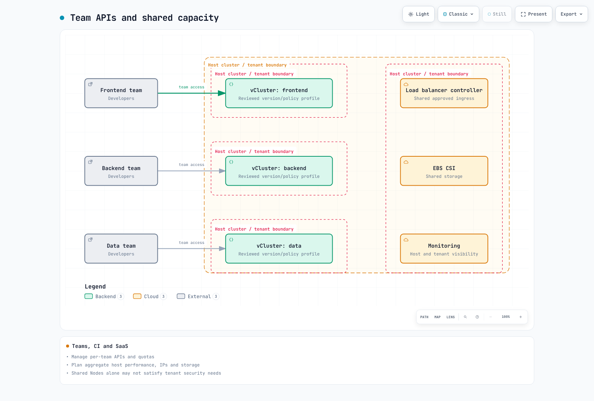

# vCluster

> **最終更新日**: 2026年10月16日 · 確認した基準バージョン: vCluster 0.37.3

## 概念と分離境界

vCluster は、テナントごとに Kubernetes API、コントローラー、データストアを分けて提供できます。この **Shared Nodes** の例では、ワークロードはホストクラスターのノード上で実行され、カーネル、CNI、CSI、容量を共有します。API/RBAC を分離しても、ハードウェア、ネットワーク、性能が完全に分離されるわけではありません。

| モード | 評価する境界 |
| --- | --- |
| Namespace | API サーバー、クラスターリソース、ノードを共有します。RBAC、クォータ、ネットワークポリシーが必要です。 |
| Shared Nodes vCluster | テナントの API を分離しつつ、ワークロードノード、CNI、CSI を共有します。 |
| Dedicated/Private Nodes | ノード配置と、実際の Private Nodes の CNI/CSI 境界を確認してください。 |
| Standalone | ホストのコントロールプレーンクラスターがないインフラストラクチャ上に展開する別のモードです。 |
| 独立した Kubernetes クラスター | アカウント、VPC、管理者、ハードウェアを共有する場合、分離はそれらにも依存します。 |

公開リポジトリは Apache 2.0 ライセンスです。配布イメージ、Platform の機能、サポート、利用権は個別に確認してください。以前の「2024 年 11 月から CNCF Sandbox」という主張は公式プロジェクトページで確認できなかったため削除しました。Kubernetes 適合性と CNCF プロジェクトへの所属は別のものです。

作成が 30 秒未満、オーバーヘッドが 100～200 MiB、数百クラスターを運用可能、または 60～70% のコスト削減になるとは約束しないでください。実際のプロファイル、ホスト API の負荷、PVC、イメージ取得、ワークロード、課金モデルを測定してください。


[インタラクティブな図](https://www.atomai.click/kubernetes-docs/archmaps/en-platform-engineering-08-vcluster-10.html)

## 現在のバージョンと基準構成

2026 年 10 月 16 日時点で、GitHub の latest エンドポイントが返す安定版は 0.37.3 で、2026 年 10 月 5 日に公開されています。この例では CLI/chart 0.37.3 と、確認済みの `ghcr.io/loft-sh/kubernetes:v1.36.3` イメージを対象にします。イメージが実行できることと、ランタイム全体との互換性は別途確認が必要です。

現在のスキーマには、古い k3s/k0s ディストリビューション設定はありません。k8s の構成、バッキングストア、正確なバージョンを区別してください。chart の既定イメージは vcluster-pro です。名称だけでソースコードのライセンスや無償利用の権利が決まるわけではありません。

この Shared Nodes プロファイルでは、レプリカ 1 台、組み込みデータベース、PVC を使用します。運用者は gp3 ストレージ/CSI、クォータ、ID、ホスト側ポリシーを準備する必要があります。

```yaml
controlPlane:
  distro:
    k8s:
      enabled: true
      image:
        tag: v1.36.3
  backingStore:
    database:
      embedded:
        enabled: true
  statefulSet:
    highAvailability:
      replicas: 1
    resources:
      requests:
        cpu: 200m
        memory: 512Mi
        ephemeral-storage: 1Gi
      limits:
        cpu: "2"
        memory: 4Gi
        ephemeral-storage: 10Gi
    persistence:
      volumeClaim:
        enabled: true
        storageClass: gp3
        size: 10Gi
        retentionPolicy: Retain
  service:
    spec:
      type: ClusterIP
  ingress:
    enabled: false
sync:
  fromHost:
    nodes:
      enabled: false
    storageClasses:
      enabled: true
  toHost:
    pods:
      enabled: true
    services:
      enabled: true
    configMaps:
      enabled: true
      all: false
    secrets:
      enabled: true
      all: false
    persistentVolumeClaims:
      enabled: true
    ingresses:
      enabled: false
    serviceAccounts:
      enabled: false
    networkPolicies:
      enabled: false
privateNodes:
  enabled: false
policies:
  podSecurityStandard: restricted
telemetry:
  enabled: false
```

このプロファイルは実際のスキーマ検証と Helm の検証に合格しました。ただし Helm は、ランタイムのソースコードでは拒否される「組み込みデータベースと 3 レプリカ」の組み合わせもレンダリングします。高可用性には、サポートされるストア、クォーラム、ストレージ、復旧の検証が必要です。レプリカを増やすだけでは不十分です。

`configMaps`、`serviceAccounts`、`persistentVolumeClaims` などのキーは大文字と小文字を区別します。StorageClass/CSI の自動既定値は展開モードによって異なるため、常に同期されるわけではありません。このプロファイルでは Ingress、ServiceAccount、NetworkPolicy の同期を明示的に無効にします。


[インタラクティブな図](https://www.atomai.click/kubernetes-docs/archmaps/en-platform-engineering-08-vcluster-11.html)

仮想 Deployment/ReplicaSet コントローラーと、実際のホスト Pod を区別してください。Syncer の名前やラベルの変換は、モード、長さ、バージョンによって異なります。IRSA の信頼ポリシーや運用スクリプトで名前を推測しないでください。`fromHost.nodes` の可視性だけでは、ワークロードのノード分離は強制されません。

## インストールとアクセス

OS/アーキテクチャに合った CLI を選び、公式チェックサムを検証してください。次の例のコマンドは実際のクラスターに影響する可能性があるため、先に `HOST_CONTEXT` と namespace を確認してください。この監査では作成、削除、スナップショット操作を実行していません。

```bash
helm repo add loft-sh https://charts.loft.sh
helm repo update
helm template team-alpha loft-sh/vcluster   --version 0.37.3 --namespace vcluster-team-alpha   -f examples/platform/vcluster/vcluster.yaml

# After the reviewed host prerequisites are ready:
vcluster create team-alpha --driver helm --context HOST_CONTEXT   --namespace vcluster-team-alpha --chart-version 0.37.3   --values examples/platform/vcluster/vcluster.yaml --connect=false

# Keep the forwarding lifetime tied to the child command:
vcluster connect team-alpha --driver helm --context HOST_CONTEXT   --namespace vcluster-team-alpha --background-proxy=false --   kubectl get namespaces
```

`connect` はアクセス経路と kubeconfig を管理します。古い `--update-current`/`--kube-config` オプションは削除されたのではなく、非推奨の別名です。`--print` は認証情報を出力する場合があります。チャット、ログ、PR ではなく、アクセスを制限したファイルに保存してください。

再利用する外部 kubeconfig には、到達可能な API エンドポイント、一致する証明書の SAN/CA、適切な認証情報の有効期限が必要です。localhost のポートフォワード先を保存しても、転送停止後のアクセスは維持されません。バックグラウンドプロキシでは Docker と別のイメージが必要になる場合があります。管理者の認証情報を共有せず、ユーザーごとの最小権限 ServiceAccount を使い、`--token-expiration` を確認してください。

ホスト側の操作には `--context HOST_CONTEXT` を使い、namespace の削除やバックアップが誤ってテナントのコンテキストを対象にしないようにしてください。研修環境を並列に作成する場合、すべての終了ステータスを収集し、失敗があったのに一律で準備完了と報告しないでください。

## EKS ストレージ、Ingress、IAM

Shared Nodes では PVC がホストに同期され、ホストの CSI がボリュームを処理します。StorageClass、volumeBindingMode、トポロジー、回収ポリシー、保持動作をまとめて確認してください。現在のプロファイルでは `statefulSet.persistence.volumeClaim.storageClass/size` を使います。

Ingress の同期には、実際にホスト側で稼働する LBC/IngressClass、Service 参照、TLS、セキュリティグループ、承認済みのアクセス経路が必要です。ホストの LBC webhook Service をテナントに複製しても、ALB 連携は実現しません。Service のアノテーションは `controlPlane.service.annotations` に設定してください。`service.spec.annotations` は Kubernetes の ServiceSpec に存在するフィールドではありません。

ServiceAccount の同期が無効なら、ホスト側のワークロード ServiceAccount の動作が適用されます。有効なら、実際の変換と同期を検証してください。仮想 Pod のアノテーションをコピーするだけでは IRSA は構成されません。ホストの ServiceAccount、トークンの issuer/subject/audience、ロールの信頼ポリシー、注入動作を確認してください。テナントが制御できる IAM ロール用アノテーションは制限してください。

## 分離とガバナンス

```yaml
apiVersion: v1
kind: Namespace
metadata:
  name: vcluster-team-alpha
  labels:
    platform.example.com/tenant: team-alpha
    pod-security.kubernetes.io/enforce: baseline
    pod-security.kubernetes.io/enforce-version: v1.36
---
apiVersion: v1
kind: ResourceQuota
metadata:
  name: vcluster-budget
  namespace: vcluster-team-alpha
spec:
  hard:
    requests.cpu: "8"
    requests.memory: 16Gi
    limits.cpu: "16"
    limits.memory: 32Gi
    requests.ephemeral-storage: 20Gi
    limits.ephemeral-storage: 80Gi
    pods: "50"
    services: "20"
    services.loadbalancers: "0"
    services.nodeports: "0"
    persistentvolumeclaims: "10"
    requests.storage: 100Gi
---
apiVersion: v1
kind: LimitRange
metadata:
  name: workload-defaults
  namespace: vcluster-team-alpha
spec:
  limits:
    - type: Container
      defaultRequest:
        cpu: 100m
        memory: 128Mi
        ephemeral-storage: 128Mi
      default:
        cpu: "1"
        memory: 512Mi
        ephemeral-storage: 1Gi
```

LimitRange は、ephemeral-storage の requests/limits を指定していない通常コンテナと init コンテナにも既定値を設定します。この制限がない Pod は ephemeral-storage クォータの適用をすり抜ける可能性があるため、変換後のテナント Pod とコントロールプレーンの init コンテナを確認してください。これらの値はクォータ計算を支援するもので、容量予約や性能保証ではありません。

chart はコントロールプレーンの Syncer を UID 0 としてレンダリングします。ホスト namespace に restricted を無条件で適用すると、コントロールプレーンが拒否される場合があります。ホストの baseline admission とプロファイルの `policies.podSecurityStandard: restricted` は、ホスト Pod と仮想ワークロードの検証という異なる層を対象にします。変換後の Pod を実際のホストポリシーに照らして確認してください。

クォータの予算にはコントロールプレーン、CoreDNS、テナントワークロード、ストレージが含まれます。クォータはノード容量を予約せず、性能も保証しません。生成された Role/ClusterRole と Secret へのアクセスを調べ、テナントにホスト Secret/Role の任意変更を許可しないでください。

必要に応じて、次の値で chart のネットワークポリシーをレンダリングしてください。

```yaml
policies:
  networkPolicy:
    enabled: true
    workload:
      publicEgress:
        enabled: false
```

実際のレンダリングではワークロードからのパブリックな egress は無効になりましたが、コントロールプレーンには 443/8443/6443 などのポートで広い egress が残りました。これをホスト API へのアクセスを完全に遮断する設定として示してはいません。NetworkPolicy の Allow は加算的です。別の「deny」ポリシーを追加しても、既存の許可を取り消すことはできません。

Syncer にはホスト API へのアクセスが必要です。コントロールプレーンにも同じ egress deny を適用すると、同期が停止する可能性があります。DNS、エンドポイント IP/DNAT、必要なアプリケーション/データベース/レジストリへの経路、CNI の動作を確認してください。デフォルト拒否と例外には、信頼できるコントロールプレーン/ワークロードの分類を使ってください。



[インタラクティブな図](https://www.atomai.click/kubernetes-docs/archmaps/en-platform-engineering-08-vcluster-12.html)

## Pause、Sleep、削除、スナップショット

現在の CLI で pause すると、仮想コントロールプレーンが縮小され、ワークロードは削除されます。resume 時にワークロードは再作成されます。PVC と Service には別の保持動作が適用されます。これは Pod のメモリを保持する suspend 操作でも、データバックアップでもありません。手動 pause と、自動 sleep/wake の条件を区別してください。

これらのライフサイクル設定は任意です。先に製品の利用権、コントローラー、ワークロードの動作を確認してください。ここでは自動削除を有効にしていません。

```yaml
# Optional configuration: verify product entitlement and workload behavior first.
sleep:
  auto:
    afterInactivity: 30m
    schedule: "0 20 * * 1-5"
    timezone: Etc/UTC
    wakeup:
      schedule: "0 8 * * 1-5"
# No automatic deletion is enabled by this example.
deletion:
  prevent: true
```

現在の設定には `sleep.auto` や `deletion.auto` などのパスを使います。以前の架空の `management.loft.sh/VirtualCluster` フィールドは、現在の構成仕様ではありません。TTL ラベル/アノテーションを付けただけでは削除は実行されません。実際のコントローラーポリシーを使い、所有者、稼働中ワークロード、バックアップを確認してください。

namespace の削除によって PVC や残存ワークロードが削除される場合があります。PVC の保持、PV の回収、外部リソースも含めて、`vcluster delete`、Helm のアンインストール、ArgoCD Application の削除を区別してください。削除防止設定があっても、ホスト管理者による namespace の直接削除を必ず防げるとは限りません。

`snapshot create` は非同期リクエストを送信します。リクエストの成功は、スナップショットの準備完了や復元成功を意味しません。PV 名は EBS ボリューム ID ではありません。EBS では `spec.csi.driver` と `volumeHandle` を確認してください。稼働中データベースのスナップショットには、一貫性の確保、書き込み静止、復元テストが必要です。

chart 0.37 は `deploy.volumeSnapshotController` を拒否しますが、`volumeSnapshots`/`volumeSnapshotContents` の対となる同期を再びサポートしています。古いスキーマコメントを根拠に、すべてのスナップショット同期が削除されたとは判断していません。CSI snapshot controller/class と両方のオプションを準備し、復元は別途テストしてください。Secret の平文エクスポートは完全なバックアップ戦略ではありません。


[インタラクティブな図](https://www.atomai.click/kubernetes-docs/archmaps/en-platform-engineering-08-vcluster-14.html)

## Backstage、ArgoCD、一時環境

チーム開発、CI、プレビュー、研修、SaaS では、信頼境界、性能、ライフサイクルの要件が異なります。開発ワークロードがすべての Spot 中断に耐える、あるいは SaaS の各テナントが互いに影響しないと想定しないでください。

CI ではホスト側の ID、信頼するイベント/ブランチ、OIDC 権限を構成してください。信頼されていない fork のコードにホストの認証情報を公開しないでください。作成、接続、テスト、クリーンアップでは namespace/context を明示し、ポートフォワードの有効期間をテストに合わせてください。独立したクリーンアップジョブにもツールと ID が必要です。すべての終了ステータスを確認してください。

この ApplicationSet には、以前欠けていた `$values` の sourceRef が含まれています。`gitops-config.yaml` は `vclusters/team-alpha/config.yaml` に、レビュー済みの `vcluster.yaml` はその隣に保存してください。リポジトリと AppProject/destination の権限は、承認済みの値に置き換えてください。

```yaml
apiVersion: argoproj.io/v1alpha1
kind: ApplicationSet
metadata:
  name: reviewed-vclusters
  namespace: argocd
spec:
  goTemplate: true
  goTemplateOptions: ["missingkey=error"]
  generators:
    - git:
        repoURL: https://github.com/REPLACE_APPROVED_ORG/platform-config
        revision: main
        files:
          - path: vclusters/*/config.yaml
  syncPolicy:
    preserveResourcesOnDeletion: true
  template:
    metadata:
      name: "vcluster-{{ .name }}"
    spec:
      project: vcluster-tenants
      sources:
        - repoURL: https://charts.loft.sh
          chart: vcluster
          targetRevision: "0.37.3"
          helm:
            releaseName: "{{ .name }}"
            valueFiles:
              - "$values/vclusters/{{ .name }}/vcluster.yaml"
        - repoURL: https://github.com/REPLACE_APPROVED_ORG/platform-config
          targetRevision: main
          ref: values
      destination:
        server: https://kubernetes.default.svc
        namespace: "{{ .namespace }}"
      syncPolicy:
        automated:
          selfHeal: true
          prune: false
        syncOptions: [CreateNamespace=true]
```

`preserveResourcesOnDeletion` と `prune: false` は、構成を削除しただけでデータを直ちに削除しないための意図的な選択です。保持されたリソースの所有権と費用を追跡し、別途廃止手順を用意してください。Backstage の `debug:log` アクションは、承認やデプロイ完了待ちを実装するものではありません。


[インタラクティブな図](https://www.atomai.click/kubernetes-docs/archmaps/en-platform-engineering-08-vcluster-13.html)

## 可観測性、リソース、コスト

意図的に pause して desired レプリカ数が 0 の StatefulSet に、自動でアラートを出さないでください。集約した `absent()` だけでは、別のクラスターが正常なときに 1 つの障害クラスターを見逃す可能性があります。実際の job/namespace/pod/container ラベル、メトリクスのエンドポイント、期待する状態の一覧を使ってください。chart のコンテナ名は `syncer` です。存在しない `vcluster_syncer_*` メトリクスを作らないでください。

requests は使用率でも請求額でもありません。CPU の `1` と `250m`、メモリの `1Gi` と `512Mi` を、単位を無視して数値文字列として足し合わせることはできません。`examples/platform/vcluster/usage` は Kubernetes PodRequests を使い、単位、init コンテナ、overhead、Pod レベルの requests を扱います。

```bash
# Run inside examples/platform/vcluster/usage with the pinned Go dependencies:
kubectl --context HOST_CONTEXT get pods -n vcluster-team-alpha -o json | go run .
```

このツールが合計するのは、終了状態ではない Pod の spec に基づく requests です。実際の RSS/CPU、resize の状態、PVC の費用は集計しません。合成した 3 ケースをテストしており、実クラスターへの問い合わせは実施していません。

稼働時間を 168 時間から 50 時間に減らしても、ノード、EBS、ロードバランサー、ライセンスの費用が比例して下がるわけではありません。実際のノード縮退、保持ストレージ、契約上のコミットメント、最小容量を請求額と比較してください。Kubernetes ラベルは AWS のコスト配分タグに自動変換されません。

EKS の利用者に、管理対象の API サーバー/etcd のレプリカ数やインスタンスを直接変更するよう案内しないでください。サポートされる管理プレーン設定/クォータとリクエスト負荷を確認してください。chart/CLI/Kubernetes/ストアの組み合わせを固定し、バックアップとステージングで検証してください。namespace が異なっても Helm release 名が同じになる場合を考慮してください。

## 実施した確認

韓国語 1,998 行、英語 2,171 行のガイド、143 行のクイズ 2 件、一意のコードブロック 106 件を確認しました。バージョン 0.37.0 のスキーマ、Helm プロファイル、ライフサイクル/ネットワークポリシーのレンダリング、公式チェックサム/イメージインデックス、Kubernetes のリソース計算を検証しました。スキーマ検証とランタイム検証の違いを記録しました。

非推奨の接続フラグを調べるため、0.36.1 で 2 回試行しました。既存クラスターへの読み取り専用問い合わせでしたが、Unauthorized エラーになりました。リソースの変更はありません。その後の 0.37 の確認は、バージョン/help/ソースコードとオフライン chart に限定しました。vCluster の作成、イメージ実行、sleep/削除/スナップショット/復元、ネットワーク分離、IAM 認証、負荷、コスト削減は検証していません。

- [vCluster 0.37.3](https://github.com/loft-sh/vcluster/releases/tag/v0.37.3)
- [バージョン固定の構成](https://github.com/loft-sh/vcluster/blob/v0.37.3/config/values.yaml)
- [バージョン固定のスキーマ](https://github.com/loft-sh/vcluster/blob/v0.37.3/chart/values.schema.json)
- [アーキテクチャ](https://www.vcluster.com/docs/vcluster/introduction/architecture)
- [Sleep の構成](https://www.vcluster.com/docs/vcluster/configure/vcluster-yaml/sleep)

[Backstage](06-backstage-idp.md) · [Crossplane](07-crossplane.md)

[vCluster クイズ](../quizzes/platform-engineering/08-vcluster-quiz.md)
