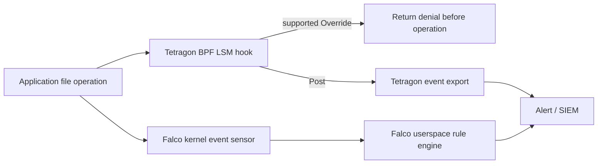

# eBPFの基礎クイズ

> **対応バージョン**: カーネル、BTF、ヘルパー関数の要件は機能によって異なります。使用するツールとKubernetesの互換性表を確認してください。
> **最終更新**: 2026年9月11日

このクイズでは、eBPF（extended Berkeley Packet Filter）の基本概念からKubernetes環境での応用まで、全般的な理解を確認します。

## 選択問題

1. eBPF verifierが検証しない項目はどれですか？
   - A) 無限ループがないこと
   - B) 範囲外のメモリアクセスがないこと
   - C) プログラムの実行速度
   - D) 初期化されていない変数を使用しないこと

<details>
<summary>解答を見る</summary>

**解答: C) プログラムの実行速度**

**解説:**
eBPF verifierは、安全性を確保するために、制御フローに上限がありプログラムが終了すること（サポートされる範囲付きループを含む）、範囲外のメモリアクセスがないこと、初期化されていない変数を使用しないこと、ヘルパー関数の呼び出しが正しいことを検証します。プログラムの実行速度は検証項目ではありません。

</details>

2. XDP（eXpress Data Path）プログラムがパケットを同じNICへ送り返す戻り値はどれですか？
   - A) XDP_DROP
   - B) XDP_PASS
   - C) XDP_TX
   - D) XDP_REDIRECT

<details>
<summary>解答を見る</summary>

**解答: C) XDP_TX**

**解説:**
XDPプログラムの戻り値は次の意味を持ちます。
- `XDP_DROP`: パケットを破棄する
- `XDP_PASS`: カーネルのネットワークスタックへ渡す
- `XDP_TX`: パケットを同じNICへ送り返す
- `XDP_REDIRECT`: 別のインターフェイスへ転送する
- `XDP_ABORTED`: エラー処理を行う

受信したネットワークインターフェイスへパケットを送り返す場合は、XDP_TXを使用します。

</details>

3. eBPF mapの主な役割ではないものはどれですか？
   - A) カーネル空間とユーザー空間の間でデータを共有する
   - B) 状態を保存する
   - C) eBPFプログラムをコンパイルする
   - D) イベントデータを送信する

<details>
<summary>解答を見る</summary>

**解答: C) eBPFプログラムをコンパイルする**

**解説:**
eBPF mapは、カーネル空間とユーザー空間の間でデータを共有したり、状態を保存したりするデータ構造です。イベントデータの送信（`PERF_EVENT_ARRAY`、`RINGBUF`）、キーと値の保存（`HASH`）、統計収集（`PERCPU_ARRAY`）などに使われます。eBPFプログラムのコンパイルはClang/LLVMが担当し、mapの役割ではありません。

</details>

4. Ciliumがkube-proxyを置き換えるとき、eBPFがもたらす主な利点は何ですか？
   - A) Service数に比例するO(n)の処理性能
   - B) iptablesルールの評価が必要
   - C) 平均して定数時間で行われるハッシュmap検索により、Serviceルールの線形走査を避けられる
   - D) Netfilterを使用する

<details>
<summary>解答を見る</summary>

**解答: C) 平均して定数時間で行われるハッシュmap検索により、Serviceルールの線形走査を避けられる**

**解説:**
新しいフローでは、iptablesのServiceルールを線形走査するため、ルール数が増えると処理量も増える場合があります。確立済みのフローにはconntrackが使われることがあります。Ciliumはmapを使ってこの走査を避けますが、計算量はmapの種類によって異なります。ハッシュmapの検索は平均的には定数時間です。エンドツーエンドのレイテンシー、CPU使用率、スループットは、ワークロード、mapの種類、競合、設定にも左右されます。

</details>

5. bpftraceの主な用途は何ですか？
   - A) eBPFプログラムをCにコンパイルする
   - B) カーネルモジュールをロードする
   - C) DTrace形式の高水準トレーシング
   - D) コンテナイメージをビルドする

<details>
<summary>解答を見る</summary>

**解答: C) DTrace形式の高水準トレーシング**

**解説:**
bpftraceは、簡潔なワンライナーでシステムをトレースできるDTrace形式の高水準トレーシング言語です。システムコールの回数を数える、プロセスごとの読み取りバイト数を追跡する、ファイルオープンをトレースする、TCP接続を追跡する、といった作業を簡単に行えます。

</details>

6. TetragonのTracingPolicyで、悪意のあるファイルアクセスを検出したときにプロセスを直ちに終了させるactionはどれですか？
   - A) action: Block
   - B) action: Sigkill
   - C) action: Deny
   - D) action: Terminate

<details>
<summary>解答を見る</summary>

**解答: B) action: Sigkill**

**解説:**
TetragonのTracingPolicyでは、一致するイベントが発生すると、`matchActions`内の`action: Sigkill`によってSIGKILLシグナルがプロセスに送られ、プロセスが終了します。ただし、強制制御のガイドが警告しているとおり、SIGKILLが実行中の操作を必ず阻止するとは限りません。操作自体を拒否する必要がある場合は、サポートされるOverride/LSMの仕組みを使用してください。

</details>

7. Hubbleの主な機能ではないものはどれですか？
   - A) ネットワークフローの可視化
   - B) DNSクエリの追跡
   - C) eBPFプログラムのコンパイル
   - D) ポリシー判定の監視

<details>
<summary>解答を見る</summary>

**解答: C) eBPFプログラムのコンパイル**

**解説:**
HubbleはCiliumに組み込まれたネットワーク可観測性プラットフォームで、ネットワークフロー、DNSクエリ、HTTPリクエスト、ポリシー判定などを収集・監視します。Hubbleは可観測性ツールであり、eBPFプログラムをコンパイルする機能はありません。

</details>

8. CO-RE（Compile Once, Run Everywhere）はどのような問題を解決しますか？
   - A) eBPFプログラムの実行速度を高める
   - B) 異なるカーネルバージョン間の移植性を高める
   - C) メモリ使用量を減らす
   - D) ネットワークレイテンシーを減らす

<details>
<summary>解答を見る</summary>

**解答: B) 異なるカーネルバージョン間の移植性を高める**

**解説:**
CO-REはlibbpfとBTF（BPF Type Format）を使い、一度コンパイルしたeBPFプログラムを複数のカーネルバージョンで実行できるようにします。カーネルヘッダーへの依存が減り、構造体の再配置も自動的に処理されるため、互換性のあるカーネル向けの再ビルドを減らせます。ただし、CO-REが存在しないヘルパーやフックを追加したり、カーネル間の動作互換性を保証したりするわけではありません。

</details>

9. FalcoはeBPFを使って何を検出しますか？
   - A) ネットワーク帯域幅の使用量
   - B) ランタイムの異常な挙動
   - C) ディスク容量
   - D) CPU温度

<details>
<summary>解答を見る</summary>

**解答: B) ランタイムの異常な挙動**

**解説:**
FalcoはeBPFを使ってランタイムの異常な挙動を検出するCNCFプロジェクトです。ルールに基づき、機密ファイルの読み取り、コンテナ内でのシェル実行、権限昇格の試みなどのセキュリティ上の脅威を検出してアラートを出します。

</details>

10. eBPFプログラムのスタックサイズ上限はいくつですか？
    - A) 128バイト
    - B) 256バイト
    - C) 512バイト
    - D) 1024バイト

<details>
<summary>解答を見る</summary>

**解答: C) 512バイト**

**解説:**
eBPFプログラムのスタックサイズ上限は512バイトです。この上限を超えるデータ領域が必要な場合は、`PERCPU_ARRAY`などのmapを使って、より大きなバッファを割り当てる方法があります。この上限はカーネルの安全性を確保するために設けられています。

</details>

## 短答問題

11. eBPFバイトコードをネイティブの機械語へ変換するコンパイラーの名称は何ですか？

<details>
<summary>解答を見る</summary>

**解答: JIT compiler（Just-In-Time compiler）**

**解説:**
JITコンパイラーはeBPFバイトコードをネイティブの機械語に変換し、アーキテクチャ固有の最適化を適用します。このガイドにある従来の「4～5倍」という値は、実測値でも一律に保証される値でもありません。設定可能な場合は`bpf_jit_enable=1`で有効にできますが、`CONFIG_BPF_JIT_ALWAYS_ON`が設定されたカーネルでは常に有効なことがあります。

</details>

12. カーネル関数の呼び出しを動的にトレースするeBPFプログラム種別は何ですか？

<details>
<summary>解答を見る</summary>

**解答: Kprobes（またはKprobe）**

**解説:**
Kprobesはカーネル関数の呼び出しを動的にトレースするeBPFプログラム種別です。ユーザー空間の関数をトレースするUprobesとは異なり、Kprobesはカーネル内の関数を対象にします。たとえば、`tcp_connect`関数をトレースしてTCP接続の情報を収集できます。

</details>

13. Ciliumに組み込まれたネットワーク可観測性プラットフォームの名称は何ですか？

<details>
<summary>解答を見る</summary>

**解答: Hubble**

**解説:**
HubbleはCiliumに組み込まれたネットワーク可観測性プラットフォームです。eBPFデータプレーンからネットワークフロー、DNSクエリ、HTTPリクエスト、ポリシー判定などのデータを収集します。Hubble CLI、Hubble UI、Hubble Relayを使って、クラスターのネットワークトラフィックをリアルタイムに観測できます。

</details>

14. Linux 5.8で、特権を要するBPF操作のために導入された専用のケイパビリティは何ですか？

<details>
<summary>解答を見る</summary>

**解答: CAP_BPF**

**解説:**
`CAP_BPF`は特権を要するBPF操作を許可します。一方、互換性のため`CAP_SYS_ADMIN`が引き続き使われる場合があり、新しいカーネルでは委譲されたBPF tokenをサポートすることもあります。プログラムやフックごとのチェック、ホスト側のセキュリティポリシーも適用されます。古いバージョンでは`CAP_SYS_ADMIN`が必要でした。さらに、パフォーマンス監視イベントへのアタッチには`CAP_PERFMON`、XDP/TCプログラムのアタッチには`CAP_NET_ADMIN`が必要です。

</details>

15. 過去にeBPFを使い、0.10.0でホストの/procおよび/sysのリソース／電力データを使う方式に書き換えられたCNCFのエネルギーexporterは何ですか？

<details>
<summary>解答を見る</summary>

**解答: Kepler（Kubernetes-based Efficient Power Level Exporter）**

**解説:**
Kepler 0.10以降では`CAP_BPF`は不要です。ホストのリソースデータとハードウェアセンサーを使って、ノードの電力／エネルギーを帰属させます。現在の例には`kepler_container_cpu_joules_total`や`kepler_pod_cpu_watts`があります。ハードウェアの違いに加え、GPU対応は実験的な範囲を含みます。従来の0.9系とはメトリクスやデプロイ手順が異なります。

</details>

## 実習問題

16. bpftoolで、システムに現在ロードされているeBPFプログラムを一覧表示し、特定のプログラムの詳細を照会するコマンドを書いてください。

<details>
<summary>解答を見る</summary>

**解答:**
```bash
# List loaded eBPF programs
sudo bpftool prog list

# Query detailed information for a specific program (ID: 123)
sudo bpftool prog show id 123

# Dump program bytecode
sudo bpftool prog dump xlated id 123

# Dump JIT compiled code
sudo bpftool prog dump jited id 123
```

**解説:**
`bpftool prog list`は、現在ロードされているeBPFプログラムの一覧を表示します。各プログラムのID、種類、名前、アタッチ先などを確認できます。特定のプログラムの詳細を調べるには`bpftool prog show id <ID>`を使います。`dump xlated`と`dump jited`では、変換後のバイトコードとJITコンパイル済みのネイティブコードを表示できます。

</details>

17. システム上のすべてのプロセスからのTCP接続をリアルタイムにトレースするbpftraceのワンライナーを書いてください。

<details>
<summary>解答を見る</summary>

**解答:**
```bash
# TCP connection tracing (Method 1: using kprobe)
sudo bpftrace -e 'kprobe:tcp_connect { printf("%s (PID: %d) connecting...\n", comm, pid); }'

# TCP connection tracing (Method 2: using tracepoint, more detailed info)
sudo bpftrace -e '
tracepoint:sock:inet_sock_set_state /args.protocol == 6 && args.newstate == 1/ {
    if (args.family == 2) {
        printf("IPv4 %s:%d -> %s:%d established\n", ntop(args.saddr), args.sport, ntop(args.daddr), args.dport);
    } else if (args.family == 10) {
        printf("IPv6 %s:%d -> %s:%d established\n", ntop(args.saddr_v6), args.sport, ntop(args.daddr_v6), args.dport);
    }
}'

# Count TCP connections by process
sudo bpftrace -e 'kprobe:tcp_connect { @[comm] = count(); }'
```

**解説:**
bpftraceは、短いワンライナーでシステムをトレースできるDTrace形式の高水準トレーシング言語です。`kprobe:tcp_connect`はカーネルの`tcp_connect`関数が呼び出されたときに動作します。`comm`はプロセス名、`pid`はプロセスIDを表します。`sock:inet_sock_set_state`の例は、受動接続を含む確立済み接続を観測しますが、その実行コンテキストから接続を開始したプロセスを確実に特定することはできません。kprobeの例が数えるのは接続の試行であり、ハンドシェイクの成功を保証するものではありません。

</details>

18. 特定のnamespaceでドロップされたパケットだけを観測するHubble CLIコマンドを書いてください。

<details>
<summary>解答を見る</summary>

**解答:**
```bash
# Observe dropped packets in a specific namespace
hubble observe --namespace production --verdict DROPPED

# Observe dropped packets with real-time streaming
hubble observe --namespace production --verdict DROPPED -f

# Output detailed information of dropped packets in JSON format
hubble observe --namespace production --verdict DROPPED -o json

# Observe dropped packets from a specific Pod
hubble observe --from-pod production/frontend --verdict DROPPED
```

**解説:**
HubbleはCiliumに組み込まれたネットワーク可観測性ツールです。`--namespace`で対象のnamespaceを指定し、`--verdict DROPPED`でドロップされたパケットだけに絞ります。`-f`はリアルタイムのストリーミング、`-o json`はJSON形式での出力を指定します。ドロップされたパケットを分析すると、ネットワークポリシーや設定の問題を診断するのに役立ちます。

</details>

## 応用問題

19. eBPFがカーネルモジュールに対して持つ主な利点を3つ挙げ、それぞれがKubernetes環境でどのようなメリットをもたらすかを説明してください。

<details>
<summary>解答を見る</summary>

**解答:**

カーネルモジュールに対するeBPFの主な利点と、Kubernetes環境でのメリットは次のとおりです。

**1. 検証器による安全性チェック（verifierの検証モデルの範囲内）**
- **利点**: eBPF verifierは、カーネルクラッシュを防ぐため、プログラムをロードする前に無限ループ、メモリアクセス違反、未初期化変数などを検査します。
- **Kubernetesでのメリット**: サポートされるバージョンと設定を検証すれば、CNIやセキュリティツールのリスクを低減できます。ただし、検証器がカーネル、ヘルパー、JITの不具合、誤ったポリシー、過剰な負荷によるホストへの影響を防ぐ保証はありません。

**2. 移植性（CO-REによる型の再配置）**
- **利点**: CO-RE（Compile Once, Run Everywhere）とBTFを使うと、一度コンパイルしたeBPFプログラムを複数のカーネルバージョンで実行できます。カーネルバージョンごとに再コンパイルする必要はありません。
- **Kubernetesでのメリット**: 異なるカーネルバージョンのノードが混在する環境でも、同じネットワーク／セキュリティソリューションを展開できます。クラスターのアップグレードやノード追加に伴う互換性の問題を減らせます。

**3. 動的なロード（再起動せずにプログラムをロード／アンロード）**
- **利点**: eBPFプログラムはシステムを再起動せずに動的にロード／アンロードでき、実行時に機能を追加または変更できます。
- **Kubernetesでのメリット**: ノードを再起動せずにネットワークポリシー、セキュリティルール、可観測性の設定を適用できます。Cilium NetworkPolicyやTetragon TracingPolicyの変更をリアルタイムに反映し、運用の中断を避けながらセキュリティを強化できます。

**その他の利点:**
- **性能**: JITコンパイルによりネイティブコード水準の性能が得られます。kube-proxyを置き換える場合、Service検索をO(1)にできます。
- **開発の難易度**: カーネルモジュールの開発に比べて比較的取り組みやすく、機能を迅速に開発・展開できます。

</details>

20. Kubernetesクラスターで、TetragonまたはFalcoを使ったeBPFベースのセキュリティソリューションにより、コンテナ内の機密ファイルへのアクセスを検出してブロックする方法を設計してください。説明にはTracingPolicyまたはFalcoルールの例を含めてください。

<details>
<summary>解答を見る</summary>

**解答:**

**eBPFによる機密ファイルアクセス対策の設計**

**1. セキュリティ要件の定義**
- 検出対象: `/etc/shadow`、`/etc/passwd`、`/etc/sudoers`、`/var/run/secrets/`（Kubernetes Secret）
- 対応方針: 検出時にアラートを出し、重大なケースではプロセスを終了する

**2. Tetragon TracingPolicyの実装**

```yaml
apiVersion: cilium.io/v1alpha1
kind: TracingPolicyNamespaced
metadata:
  name: sensitive-file-protection
  namespace: ebpf-lab
spec:
  kprobes:
  - call: security_file_open
    syscall: false
    args:
    - index: 0
      type: file
    selectors:
    - matchArgs:
      - index: 0
        operator: Prefix
        values:
        - /var/run/secrets/kubernetes.io/
      matchActions:
      - action: Post
    - matchArgs:
      - index: 0
        operator: Prefix
        values:
        - /etc/shadow
        - /etc/sudoers
      matchActions:
      - action: Post
  podSelector:
    matchLabels:
      app: ebpf-demo
```

最初のポリシーはPostのみの観測用です。まず`ebpf-lab` namespaceと、`app=ebpf-demo`ラベルを付けたテストPodを作成してください。`TracingPolicyNamespaced`はKubernetes namespaceの範囲を指定します。一方、`matchNamespaces`はLinux namespaceのinodeでフィルタリングします。

次の**任意のテスト用ポリシー**は操作を拒否します。使用するTetragonとカーネルの組み合わせがLSM Overrideをサポートすることに加え、`CONFIG_BPF_LSM`と有効なbpf LSMが必要です。適用前に許可／拒否される動作とロールバックを確認してください。これは本番環境全体で検証済みのポリシーではありません。SIGKILLだけでは、トリガーとなった操作を必ず阻止できるとは限りません。

```yaml
apiVersion: cilium.io/v1alpha1
kind: TracingPolicyNamespaced
metadata:
  name: sensitive-file-deny
  namespace: ebpf-lab
spec:
  podSelector:
    matchLabels:
      app: ebpf-demo
  lsmhooks:
  - hook: file_open
    args:
    - index: 0
      type: file
    selectors:
    - matchArgs:
      - index: 0
        operator: Equal
        values:
        - /etc/shadow
        - /etc/sudoers
      matchActions:
      - action: Override
        argError: -13
```

**3. Falcoルールの実装**

```yaml
# Save locally as ebpf-lab-rules.yaml; the Helm chart mounts it under /etc/falco/rules.d.
- rule: eBPF lab read Kubernetes secrets
  desc: Detect reading of Kubernetes secret files in containers
  condition: >
    open_read and
    container and
    (fd.name startswith /var/run/secrets/kubernetes.io/ or
     fd.name startswith /etc/shadow or
     fd.name startswith /etc/sudoers) and
    not proc.name in (kubelet, containerd)
  output: >
    Sensitive file access detected
    (file=%fd.name user=%user.name process=%proc.name
     container=%container.name namespace=%k8s.ns.name
     pod=%k8s.pod.name)
  priority: WARNING
  tags: [security, filesystem]

- rule: eBPF lab write sensitive files
  desc: Detect writing to sensitive system files
  condition: >
    open_write and
    container and
    fd.name in (/etc/passwd, /etc/shadow, /etc/sudoers)
  output: >
    Attempt to modify sensitive file
    (file=%fd.name user=%user.name process=%proc.name
     container=%container.name)
  priority: CRITICAL
  tags: [security, filesystem]
```

**4. デプロイと監視**

```bash
# Install Tetragon and apply policy
helm repo add cilium https://helm.cilium.io
: "${TETRAGON_CHART_VERSION:?Select a compatible reviewed chart version}"
helm install tetragon cilium/tetragon -n kube-system --version "$TETRAGON_CHART_VERSION"
# Apply observation first; keep optional denial in a separate reviewed file.
kubectl apply -f sensitive-file-protection.yaml

# Monitor events
kubectl logs -n kube-system -l app.kubernetes.io/name=tetragon \
  -c export-stdout -f | tetra getevents -o compact

# Install Falco (eBPF driver)
helm repo add falcosecurity https://falcosecurity.github.io/charts
# Save the following Falco rule examples as ./ebpf-lab-rules.yaml before installation.
: "${FALCO_CHART_VERSION:?Select a compatible reviewed chart version}"
helm install falco falcosecurity/falco --version "$FALCO_CHART_VERSION" \
  --namespace falco --create-namespace \
  --set driver.kind=modern_ebpf \
  --set-file 'customRules.ebpf-lab-rules\.yaml=./ebpf-lab-rules.yaml'

# Check Falco alerts
kubectl logs -n falco -l app.kubernetes.io/name=falco -f
```

**5. アーキテクチャの説明**



この設計では、eBPFによるカーネルレベルの可視性を活用し、アプリケーションを変更せずに機密ファイルへのアクセスをリアルタイムに検出して対応します。

</details>

---

[教材一覧に戻る](../../basics/05-ebpf-fundamentals.md) | [次のクイズ: コンテナ技術](./03-container-technology-quiz.md)

Falcoの例は、デフォルトのルールセットに含まれる`open_read`、`open_write`、`spawned_process`、`container`マクロに依存します。追加のルールファイルは、インストール済みチャートの`customRules`／`falco.rules_files`設定から読み込んでください。Falcoは検知とアラートを行いますが、これらのルールはアクセスを拒否しません。コンテナ／Kubernetesのメタデータが遅れて届く場合があり、正当なServiceAccount tokenの読み取りも一致するため、適切な許可条件をテストしてください。

## 検証用の参考資料

- https://www.kernel.org/doc/html/latest/admin-guide/sysctl/kernel.html
- https://www.kernel.org/doc/html/latest/admin-guide/sysctl/net.html
- https://github.com/torvalds/linux/blob/master/include/linux/bpf.h
- https://github.com/torvalds/linux/blob/master/include/linux/filter.h
- https://github.com/torvalds/linux/blob/master/include/uapi/linux/bpf.h
- https://github.com/torvalds/linux/blob/master/kernel/bpf/syscall.c
- https://docs.kernel.org/bpf/prog_lsm.html
- https://docs.kernel.org/userspace-api/seccomp_filter.html
- https://github.com/torvalds/linux/blob/master/include/trace/events/sock.h
- https://github.com/bpftrace/bpftrace/blob/v0.27.0/docs/language.md
- https://github.com/bpftrace/bpftrace/blob/v0.27.0/docs/stdlib.md
- https://packages.debian.org/trixie/arm64/bpfcc-tools/filelist
- https://github.com/iovisor/bcc/blob/master/tools/tcpconnlat.py
- https://github.com/iovisor/bcc/blob/master/tools/gethostlatency.py
- https://github.com/libbpf/bpftool/blob/main/docs/bpftool-map.rst
- https://github.com/cilium/cilium/blob/v1.20.1/Documentation/network/kubernetes/kubeproxy-free.rst
- https://github.com/cilium/cilium/blob/v1.20.1/Documentation/network/lb-ipam.rst
- https://github.com/cilium/cilium/blob/v1.20.1/install/kubernetes/cilium/values.yaml
- https://github.com/cilium/cilium/blob/v1.20.1/hubble/cmd/observe/observe.go
- https://github.com/cilium/cilium/blob/v1.20.1/hubble/pkg/printer/printer_test.go
- https://github.com/cilium/tetragon/blob/main/docs/content/en/docs/concepts/enforcement/_index.md
- https://github.com/cilium/tetragon/blob/main/docs/content/en/docs/concepts/tracing-policy/selectors.md
- https://github.com/cilium/tetragon/blob/main/pkg/k8s/apis/cilium.io/v1alpha1/tracing_policy_types.go
- https://github.com/cilium/tetragon/blob/main/cmd/tetra/getevents/getevents.go
- https://github.com/cilium/tetragon/blob/main/examples/tracingpolicy/lsm_file_open.yaml
- https://github.com/cilium/tetragon/blob/main/install/kubernetes/tetragon/crds-yaml/cilium.io_tracingpoliciesnamespaced.yaml
- https://github.com/sustainable-computing-io/kepler/blob/main/README.md
- https://github.com/sustainable-computing-io/kepler/blob/main/docs/user/metrics.md
- https://github.com/coroot/helm-charts/blob/main/charts/coroot/Chart.yaml
- https://github.com/coroot/helm-charts/blob/main/charts/operator/Chart.yaml
- https://github.com/coroot/helm-charts/blob/main/charts/coroot-ce/Chart.yaml
- https://docs.px.dev/reference/pxl/udf/quantiles/
- https://github.com/pixie-io/pixie/blob/main/src/pixie_cli/pkg/cmd/run.go
- https://github.com/pixie-io/pixie/blob/main/src/pxl_scripts/px/http_data/data.pxl
- https://falco.org/docs/reference/rules/supported-fields/
- https://github.com/falcosecurity/charts/blob/master/charts/falco/values.yaml
- https://github.com/falcosecurity/rules/blob/main/rules/falco_rules.yaml
