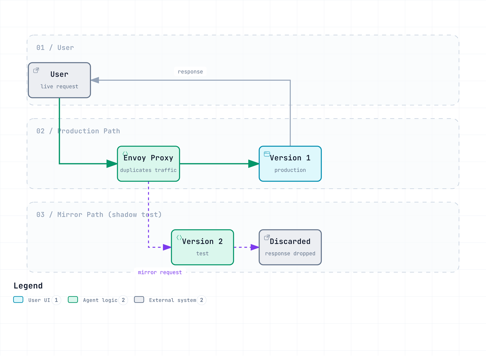

# トラフィック管理クイズ

> **レビュー対象バージョン**: Istio 1.31.0 **EKSバージョン**: 1.34–1.36 **最終更新**: 2026年9月11日

このクイズでは、Istioのトラフィック管理機能について理解度を確認します。

## 選択式問題 (1-5)

### 問題 1: VirtualServiceの役割

VirtualServiceについて正しい説明はどれですか？

A. Kubernetes Serviceを置き換えるリソースである\
B. ロードバランシングアルゴリズムだけを定義する\
C. ルーティングルールを定義し、トラフィックを制御する\
D. すべてのアプリケーション要求をistiod経由で送る

<details>

<summary>解答を表示</summary>

**解答: C**

VirtualServiceは、**ルーティングルール**を定義してトラフィックを制御するIstioの中核CRDです。

**解説:**

* A (誤): VirtualServiceはKubernetes Serviceを置き換えません。Serviceにルーティングルールを追加します。
* B (誤): ロードバランシングはDestinationRuleが担当し、VirtualServiceはルーティングルールを定義します。
* C (正): VirtualServiceでは、次の項目を定義できます。
  * HTTP/TCPルーティングルール
  * URLパスに基づくルーティング
  * headerに基づくルーティング
  * weightに基づくトラフィック分割
  * timeout/retryの設定
* D (誤): istiodはVirtualService API objectをコンパイルします。data planeではEnvoyが生成されたルーティング設定を適用します。

**例:**

```yaml
apiVersion: networking.istio.io/v1
kind: VirtualService
metadata:
  name: reviews
spec:
  hosts:
  - reviews
  http:
  - match:
    - headers:
        end-user:
          exact: jason
    route:
    - destination:
        host: reviews
        subset: v2
  - route:
    - destination:
        host: reviews
        subset: v1
```

**参照:**

* [ルーティング](../../../service-mesh/istio/traffic-management/02-routing.md)
* [VirtualServiceの概念](../../../service-mesh/istio/02-basic-concepts.md#1-virtualservice)

</details>

***

### 問題 2: DestinationRuleの機能

DestinationRuleが行う機能では**ない**ものはどれですか？

A. subsetの定義\
B. ロードバランシングアルゴリズムの設定\
C. HTTPパスに基づくルーティング\
D. connection poolの設定

<details>

<summary>解答を表示</summary>

**解答: C**

HTTPパスに基づくルーティングは**VirtualService**の役割です。

**解説:**

**DestinationRuleの主な機能:**

1. **subsetの定義 (A - 正)**

```yaml
apiVersion: networking.istio.io/v1
kind: DestinationRule
metadata:
  name: reviews
spec:
  host: reviews
  subsets:
  - name: v1
    labels:
      version: v1
  - name: v2
    labels:
      version: v2
```

2. **ロードバランシング設定 (B - 正)**

```yaml
spec:
  trafficPolicy:
    loadBalancer:
      simple: ROUND_ROBIN  # RANDOM, LEAST_REQUEST, etc.
```

3. **connection poolの設定 (D - 正)**

```yaml
spec:
  trafficPolicy:
    connectionPool:
      tcp:
        maxConnections: 100
      http:
        http1MaxPendingRequests: 50
```

4. **HTTPパスに基づくルーティング (C - 誤)**

* これはVirtualServiceの役割です。

```yaml
# Handled by VirtualService
apiVersion: networking.istio.io/v1
kind: VirtualService
metadata:
  name: path-routing-example
spec:
  hosts:
  - api-service
  http:
  - match:
    - uri:
        prefix: /api  # Path-based routing
    route:
    - destination:
        host: api-service
```

**比較表:**

| 機能 | VirtualService | DestinationRule |
| --- | --- | --- |
| ルーティングルール | はい | いいえ |
| パスマッチング | はい | いいえ |
| subsetの定義 | いいえ | はい |
| ロードバランシング | いいえ | はい |
| connection pool | いいえ | はい |

**参照:**

* [ロードバランシング](../../../service-mesh/istio/traffic-management/06-load-balancing.md)
* [connection pool](../../../service-mesh/istio/traffic-management/07-circuit-breaker.md)

</details>

***

### 問題 3: Canaryデプロイのトラフィック分割

次のVirtualService設定におけるv1とv2のトラフィック比率はどれですか？

```yaml
apiVersion: networking.istio.io/v1
kind: VirtualService
metadata:
  name: reviews
spec:
  hosts:
  - reviews
  http:
  - route:
    - destination:
        host: reviews
        subset: v1
      weight: 80
    - destination:
        host: reviews
        subset: v2
      weight: 20
```

A. v1: 50%、v2: 50%\
B. v1: 80%、v2: 20%\
C. v1: 20%、v2: 80%\
D. v1: 100%、v2: 0%

<details>

<summary>解答を表示</summary>

**解答: B**

weightの値が**v1: 80、v2: 20**のため、トラフィックは**v1へ80%**、**v2へ20**%配分されます。

**解説:**

**weightに基づくトラフィック分割:**

* `weight` fieldは相対比率を表します。
* weightの合計: 80 + 20 = 100
* v1の比率: 80/100 = 80%
* v2の比率: 20/100 = 20%

**Canaryデプロイの段階:**

```yaml
# Stage 1: 10% Canary
- weight: 90  # v1
- weight: 10  # v2

# Stage 2: 25% Canary
- weight: 75  # v1
- weight: 25  # v2

# Stage 3: 50% Canary
- weight: 50  # v1
- weight: 50  # v2

# Stage 4: 100% v2
- weight: 0   # v1
- weight: 100 # v2
```

**Argo Rolloutsによる自動Canary:**

```yaml
# Strategy fragment; merge into a complete Rollout with selector/template
strategy:
  canary:
    trafficRouting:
      istio:
        virtualService:
          name: reviews
        destinationRule:
          name: reviews
          stableSubsetName: v1
          canarySubsetName: v2
    steps:
    - setWeight: 10
    - pause: {duration: 2m}
    - setWeight: 25
    - pause: {duration: 2m}
    - setWeight: 50
    - pause: {duration: 2m}
```

**参照:**

* [トラフィック分割](../../../service-mesh/istio/traffic-management/04-traffic-splitting.md)
* [Argo Rolloutsとの統合](../../../service-mesh/istio/advanced/08-argo-rollouts.md)

</details>

***

### 問題 4: Gatewayの目的

Istio ingress Gatewayの設定が担う役割では**ない**ものはどれですか？

A. listener port、protocol、許可するhostを定義する\
B. 証明書Secretを使ってTLS終端を設定する\
C. すべてのアプリケーションPodにproxyを自動注入し、それだけでeast-west通信を保護する\
D. ingress通信をVirtualServiceのルーティングに関連付ける

<details>

<summary>解答を表示</summary>

**解答: C**

Istio Gatewayは既存のgateway proxyを設定します。ワークロードのmesh参加とサービス間meshセキュリティには、sidecarまたはambient data planeとそのpolicyが必要です。Gateway proxy自体が上流へmTLSを開始することもあるため、「GatewayはmTLSを使わない」という説明も誤りです。Gatewayは証明書を発行しません。`credentialName`は、gateway workloadのnamespaceで別途管理するSecretを参照します。

```yaml
apiVersion: networking.istio.io/v1
kind: Gateway
metadata:
  name: bookinfo-gateway
  namespace: istio-system
spec:
  selector:
    istio: ingressgateway
  servers:
  - port:
      number: 443
      name: https
      protocol: HTTPS
    hosts: [bookinfo.example.com]
    tls:
      mode: SIMPLE
      credentialName: bookinfo-secret
```

[GatewayとVirtualService](../../../service-mesh/istio/traffic-management/01-gateway-virtualservice.md)

</details>

***

### 問題 5: timeoutとretryのpolicy

次のVirtualService設定は何を意味しますか？

```yaml
apiVersion: networking.istio.io/v1
kind: VirtualService
metadata:
  name: reviews
spec:
  hosts:
  - reviews
  http:
  - route:
    - destination:
        host: reviews
    timeout: 10s
    retries:
      attempts: 3
      perTryTimeout: 2s
```

A. 元の要求の後に最大3回retryし、各配信は2秒、要求全体は10秒に制限する\
B. 合計2秒以内に最大3回retryし、各試行は10秒に制限する\
C. 合計10秒以内に無制限にretryし、各試行は2秒に制限する\
D. retryせずに10秒後に失敗する

<details>

<summary>解答を表示</summary>

**解答: A**

この設定では、**元の要求に加えて最大3回のretry**を許可します。各配信は**2秒**、要求全体は**10秒**に制限されます。そのため、上流への要求は最大4回送られる可能性があります。

**解説:**

**設定の解釈:**

```yaml
timeout: 10s           # Maximum time for entire request
retries:
  attempts: 3          # Up to 3 retries after the original request
  perTryTimeout: 2s    # Time limit for each delivery
```

以下の時間例は`retryOn`でretry対象となる失敗を想定しており、backoffや処理時間の上乗せは含みません。timeoutが発生しただけで、すべてのpolicyがretryするわけではありません。

**実行シナリオ:**

```
Scenario 1: First attempt succeeds
+- 1st attempt: 1.5s elapsed -> Success
+- Total time: 1.5s

Scenario 2: Success after 2 attempts
+- 1st attempt: 2s timeout -> Failure
+- 2nd attempt: 1.8s elapsed -> Success
+- Total time: 3.8s

Scenario 3: Original request plus all 3 retries fail
+- 1st attempt: 2s timeout -> Failure
+- 2nd attempt: 2s timeout -> Failure
+- 3rd attempt: 2s timeout -> Failure
+- 4th attempt: 2s timeout -> Failure
+- Total time: about 8s
```

**retry条件の設定:**

```yaml
retries:
  attempts: 3
  perTryTimeout: 2s
  retryOn: 5xx,connect-failure,refused-stream  # Retry conditions
```

**ベストプラクティス:**

```yaml
# Read requests: limited retry
- match:
  - method:
      regex: "^(GET|HEAD)$"
  retries:
    attempts: 2
    perTryTimeout: 2s
    retryOn: connect-failure,refused-stream

# Write requests: disable mesh retry
- match:
  - method:
      regex: "^(POST|PUT|PATCH|DELETE)$"
  retries:
    attempts: 0
```

**注意事項:**

* すべてのretryを予算に含めるには、backoffも考慮し、`timeout`をおおむね`(1 + attempts) x perTryTimeout`より長く設定します。
* retryが多すぎると障害が連鎖することがあります。
* `attempts: 0`はretryを無効にします。`attempts: 1`は元の要求の後に1回再送します。
* サーバー側で処理がcommitされ、応答だけが失われる可能性があるため、POST/PATCHではmesh retryをデフォルトで無効にしてください。
* workload mTLSやネットワーク暗号化を使っても、要求の再送が安全になるわけではありません。

**参照:**

* [timeoutとretry](../../../service-mesh/istio/traffic-management/05-retry-timeout.md)

</details>

***

## 記述式問題 (6-10)

### 問題 6: Argo Rollouts + Istio Canaryデプロイ

resource、作成順、abort条件を含め、メトリクスgateで自動判定するsubsetベースのCanary rolloutを説明してください。

<details>
<summary>解答を表示</summary>

Service、stable/canary subsetを含むDestinationRule、VirtualService route、AnalysisTemplate、完全なRolloutを使います。Argoはroute weightとsubsetのPod template hashを更新しますが、事前に参照されるIstio resourceは作成しません。host単位の統合ではstable/canary Serviceを別々に使います。名前付きrouteはRolloutの明示的route listと一致させます。単一routeならそのlistを省略できます。

sidecar injectionを有効にした新しいlab namespaceと、互換性のあるArgo Rollouts controller/CLIを使います（監査済みガイドではv1.10.0）。以下のPod scrape relabelingをPrometheusに追加し、canary通信に`rollout_hash`と`reporter="destination"` labelがあることを確認してください。このgateはstable+canary平均に薄められた値でなく、最新ReplicaSetを測定します。

```yaml
# Existing workload pod scrape job: relabel_configs fragment
- source_labels: [__meta_kubernetes_pod_label_rollouts_pod_template_hash]
  target_label: rollout_hash
```

先に前提resourceを作成します。

```yaml
apiVersion: v1
kind: Service
metadata:
  name: reviews
  namespace: default
spec:
  ports:
  - port: 9080
    name: http
  selector:
    app: reviews
---
apiVersion: networking.istio.io/v1
kind: DestinationRule
metadata:
  name: reviews-destrule
  namespace: default
spec:
  host: reviews
  subsets:
  - name: stable
    labels:
      app: reviews
  - name: canary
    labels:
      app: reviews
---
apiVersion: networking.istio.io/v1
kind: VirtualService
metadata:
  name: reviews-vsvc
  namespace: default
spec:
  hosts:
  - reviews
  http:
  - name: primary
    route:
    - destination:
        host: reviews
        subset: stable
      weight: 100
    - destination:
        host: reviews
        subset: canary
      weight: 0
---
apiVersion: argoproj.io/v1alpha1
kind: AnalysisTemplate
metadata:
  name: success-rate
  namespace: default
spec:
  args:
  - name: service-name
  - name: pod-template-hash
  metrics:
  - name: success-rate
    interval: 30s
    count: 4
    successCondition: len(result) == 1 && !isNaN(result[0]) && result[0] >= 0.95
    failureLimit: 0
    provider:
      prometheus:
        address: http://prometheus.istio-system:9090
        query: "sum(rate(\n  istio_requests_total{\n    destination_service_name=\"\
          {{args.service-name}}\",\n    reporter=\"destination\",\n    rollout_hash=\"\
          {{args.pod-template-hash}}\",\n    destination_workload_namespace=\"default\"\
          ,\n    response_code!~\"5.*\"\n  }[2m]\n))\n/\nsum(rate(\n  istio_requests_total{\n\
          \    destination_service_name=\"{{args.service-name}}\",\n    reporter=\"\
          destination\",\n    rollout_hash=\"{{args.pod-template-hash}}\",\n    destination_workload_namespace=\"\
          default\"\n  }[2m]\n))\n"
---
apiVersion: argoproj.io/v1alpha1
kind: AnalysisTemplate
metadata:
  name: latency
  namespace: default
spec:
  args:
  - name: service-name
  - name: pod-template-hash
  metrics:
  - name: latency-p95
    interval: 30s
    count: 4
    successCondition: len(result) == 1 && !isNaN(result[0]) && result[0] <= 500
    failureLimit: 0
    provider:
      prometheus:
        address: http://prometheus.istio-system:9090
        query: "histogram_quantile(0.95,\n  sum(rate(\n    istio_request_duration_milliseconds_bucket{\n\
          \      destination_service_name=\"{{args.service-name}}\",\n    reporter=\"\
          destination\",\n    rollout_hash=\"{{args.pod-template-hash}}\",\n     \
          \ destination_workload_namespace=\"default\"\n    }[2m]\n  )) by (le)\n\
          )\n"
```

続いてRolloutを作成します。

```yaml
apiVersion: argoproj.io/v1alpha1
kind: Rollout
metadata:
  name: reviews
  namespace: default
spec:
  replicas: 5
  revisionHistoryLimit: 2
  selector:
    matchLabels:
      app: reviews
  template:
    metadata:
      labels:
        app: reviews
        sidecar.istio.io/inject: 'true'
    spec:
      containers:
      - name: reviews
        image: docker.io/istio/examples-bookinfo-reviews-v2:1.20.3
        ports:
        - containerPort: 9080
        resources:
          requests:
            memory: 64Mi
            cpu: 100m
          limits:
            memory: 128Mi
            cpu: 200m
  strategy:
    canary:
      trafficRouting:
        istio:
          virtualService:
            name: reviews-vsvc
            routes:
            - primary
          destinationRule:
            name: reviews-destrule
            canarySubsetName: canary
            stableSubsetName: stable
      steps:
      - setWeight: 10
      - pause:
          duration: 2m
      - analysis:
          templates:
          - templateName: success-rate
          - templateName: latency
          args:
          - name: service-name
            value: reviews
          - name: pod-template-hash
            valueFrom:
              podTemplateHashValue: Latest
      - setWeight: 25
      - pause:
          duration: 2m
      - analysis:
          templates:
          - templateName: success-rate
          - templateName: latency
          args:
          - name: service-name
            value: reviews
          - name: pod-template-hash
            valueFrom:
              podTemplateHashValue: Latest
      - setWeight: 50
      - pause:
          duration: 2m
      - analysis:
          templates:
          - templateName: success-rate
          - templateName: latency
          args:
          - name: service-name
            value: reviews
          - name: pod-template-hash
            valueFrom:
              podTemplateHashValue: Latest
      - setWeight: 75
      - pause:
          duration: 2m
      - analysis:
          templates:
          - templateName: success-rate
          - templateName: latency
          args:
          - name: service-name
            value: reviews
          - name: pod-template-hash
            valueFrom:
              podTemplateHashValue: Latest
```

最初のデプロイでstable versionを確立し、その後imageを更新してcanary段階を試します。weight変更の各段階には、実行時間に上限のあるinline analysis gateがあります。`failureLimit`が0の場合、測定が1回失敗すると実行中のrolloutを中断します。測定値が欠落またはNaNなら成功扱いにはなりません。gateが成功すると次の段階へ進みます。所要時間は通信量、scrape/analysis間隔、reconciliationに左右され、数秒で終わる保証はありません。

```bash
kubectl argo rollouts get rollout reviews --watch
kubectl get analysisruns
kubectl argo rollouts set image reviews reviews=istio/examples-bookinfo-reviews-v3:1.20.3
# Stop a failing active rollout; undo is a separate desired-template rollback
kubectl argo rollouts abort reviews
```

実トラフィックを移す前に設定の伝播を待ち、endpointの正常性を確認してください。別のcontrollerがArgo管理下のweight/hashを上書きしないようにします。インストールと実行の前提条件は[完全なrolloutガイド](../../../service-mesh/istio/traffic-management/04-traffic-splitting.md)を参照してください。

</details>

***

### 問題 7: Blue/GreenとCanary

トラフィックの移行方法、必要なresource、rollback、適した用途を比較してください。

<details>
<summary>解答を表示</summary>

| 項目 | Blue/Green | Canary |
| --- | --- | --- |
| トラフィック | 先にpreviewし、その後active Service selectorを切り替える | routeする要求のweightを段階的に増やす |
| 検証 | promotion前後にanalysisする | 進行中にinline/background analysisする |
| 容量 | 移行中は通常2 revision分。previewの規模は異なる場合がある | replicaとscaling policy次第。stable全容量を維持すると2 revision近くになる場合がある |
| rollback | 以前のrevision/容量が利用可能な間に戻す | 実行中rolloutをstableへabortし、promotion後は必要に応じてundo/redeployする |
| 主なトレードオフ | production切替が単純だが、promotion時に広く影響する | 各段階の露出を小さくできるが、routing/analysisの調整が増える |

どちらの切替もnetwork上でatomicではありません。endpoint/proxyの伝播と既存接続の影響があります。どちらもdatabase migrationや外部副作用を巻き戻しません。両versionが共存する間、schemaとAPI contractに互換性を持たせてください。Canaryのweightは安定したユーザー群を示すものではありません。A/B testには明示的なcohort keyが必要です。

十分にpreviewでき、一時容量を確保できるreleaseにはBlue/Greenが適します。代表的なトラフィックと信頼できるmetricがある場合、本番環境で段階的に検証する用途にはCanaryが適します。想定だけの「1倍に少し足した程度」の費用を根拠にCanaryを選ばないでください。optionalな`dynamicStableScale`も含め、scaling設定を確認します。

```yaml
# Alternative strategy fragment for a complete Rollout
strategy:
  blueGreen:
    activeService: myapp-active
    previewService: myapp-preview
    autoPromotionEnabled: false
    scaleDownDelaySeconds: 600
    prePromotionAnalysis:
      templates:
      - templateName: smoke-tests
    postPromotionAnalysis:
      templates:
      - templateName: post-promotion-tests
```

利用前にServiceと、必須argumentを定義したAnalysisTemplateを作成してください。promotion後のanalysisとrollbackを確認できるだけの期間、artifact等を保持します。Blue/GreenとCanaryを組み合わせる場合は、意図してworkflowを設計します。rolloutの途中でstrategy fieldを変えても、自動的にCanaryからBlue/Greenへ変換されるわけではありません。

[デプロイ戦略と例](../../../service-mesh/istio/traffic-management/04-traffic-splitting.md)

</details>

***

### 問題 8: トラフィックミラーリング（Shadow Testing）

Traffic Mirroringを使って新versionを安全にテストする方法を説明してください。**用途**、**設定方法**、**注意点**を含めてください。

<details>

<summary>解答を表示</summary>

**解答:**

**トラフィックミラーリングの概要:**

トラフィックミラーリングは本番トラフィックを複製して新versionへ送り、その**応答は利用しない**手法です。「shadow testing」とも呼ばれます。

***

**1. 仕組み**



[🔍 インタラクティブ図を表示](https://www.atomai.click/kubernetes-docs/archmaps/en-quizzes-service-mesh-istio-traffic-management-0.html)

**主な特性:**

* ユーザーに返すのはv1の応答だけです。
* v2の応答はEnvoyが破棄します。
* v2の応答はclientへ返りませんが、共有resourceの競合やwrite副作用はユーザーにも影響し得ます。

***

**2. 設定方法**

**基本のmirror (100%):**

```yaml
apiVersion: networking.istio.io/v1
kind: VirtualService
metadata:
  name: reviews
spec:
  hosts:
  - reviews
  http:
  - route:
    - destination:
        host: reviews
        subset: v1
      weight: 100  # Primary traffic
    mirror:
      host: reviews
      subset: v2  # Mirror target
    mirrorPercentage:
      value: 100  # 100% mirroring
```

**部分mirror (50%):**

```yaml
spec:
  http:
  - route:
    - destination:
        host: reviews
        subset: v1
      weight: 100
    mirror:
      host: reviews
      subset: v2
    mirrorPercentage:
      value: 50  # Only 50% mirroring (reduce traffic load)
```

**mirrorとCanaryの組み合わせ:**

```yaml
spec:
  http:
  - route:
    # Primary traffic: 90% v1, 10% v2
    - destination:
        host: reviews
        subset: v1
      weight: 90
    - destination:
        host: reviews
        subset: v2
      weight: 10

    # Mirroring: Mirror all traffic to v3 (test)
    mirror:
      host: reviews
      subset: v3
    mirrorPercentage:
      value: 100
```

***

**3. 用途**

**ケース1: 新versionの性能テスト**

```
Purpose: Verify if v2's performance is better than v1

1. Run v1 (production) + v2 (mirror) simultaneously
2. Monitor v2's latency, CPU, memory
3. If v2 is faster than v1 -> Proceed with Canary deployment
4. If v2 is slower than v1 -> Optimize and retest
```

**ケース2: Database migrationの検証**

```
Purpose: Verify new database schema

1. v1 -> Existing DB
2. v2 -> New DB (mirroring)
3. Verify v2's query performance and error rate
4. If no issues -> Switch to v2
```

**ケース3: bug修正の検証**

```
Purpose: Verify that bug fix actually works

1. Run v1 (with bug) + v2 (fixed version, mirror)
2. Test v2 with production traffic
3. If v2's error rate decreases -> Deploy
```

**ケース4: cache warm-up**

```
Purpose: Pre-populate new version's cache

1. Deploy v2, then warm its cache with mirror traffic before cutover
2. Once v2's cache is sufficiently populated
3. Warmup can reduce cache misses; it does not guarantee no cold start
```

***

**4. 監視設定**

**Prometheus queryでmirror通信を監視:**

```promql
# v2 (mirror) error rate
sum(rate(
  istio_requests_total{
    destination_version="v2",
    response_code=~"5.."
  }[5m]
))
/
sum(rate(
  istio_requests_total{
    destination_version="v2"
  }[5m]
))

# v1 vs v2 latency comparison
histogram_quantile(0.95,
  sum(rate(
    istio_request_duration_milliseconds_bucket[5m]
  )) by (destination_version, le)
)
```

**Grafana dashboard:**

```yaml
# Panel 1: Error rate comparison (v1 vs v2)
# Panel 2: Latency comparison (P50, P95, P99)
# Panel 3: CPU/Memory usage
# Panel 4: Request count (v1: actual, v2: mirror)
```

***

**5. 注意点**

**警告 - 負荷の増加:**

```
Mirroring increases service load.

Example:
- v1: 1000 RPS
- v2: 1000 RPS (mirror)
- Total load: 2000 RPS

Choose the percentage from shadow capacity and the test hypothesis; 50% is not a universal safe limit
```

**警告 - 副作用を確認する:**

```text
# Don't mirror write operations!

# Bad example
POST /api/orders  # Both v1 and v2 create orders -> Duplicates!

# Good example
GET /api/orders   # Mirror only read-only operations
```

**警告 - コスト:**

```
Mirroring increases resources and costs.

- 100% mirroring duplicates request volume on that route
- CPU, response traffic, and database cost depend on workload behavior

Solution: Mirror only for short periods (1-2 days)
```

**警告 - 応答内容は検証できない:**

```
Mirror traffic responses are discarded, so
Istio does not compare response content. Application instrumentation or a dedicated shadow comparison system can validate correctness separately.

Can validate:
- Error rate
- Latency
- Resource usage

Cannot validate:
- Response/business correctness requires additional validation tooling
```

***

**6. ベストプラクティス**

```text
# Good examples
1. Mirror only read-only APIs
2. mirrorPercentage: 50% (reduce load)
3. Short-term testing (1-2 days)
4. Automatic validation based on metrics

# Bad examples
1. Mirroring write operations (duplicate data)
2. mirrorPercentage: 100% without capacity planning
3. Long-term mirroring (cost increase)
4. Manual validation (slow)
```

**参照:**

* [トラフィックミラーリング](../../../service-mesh/istio/traffic-management/09-traffic-mirror.md)

</details>

***

### 問題 9: localityとAZ間コスト

EKSでlocalityに基づくroutingを行う方法、failoverの要件、実測通信量を用いた削減額の見積もり方を説明してください。

<details>
<summary>解答を表示</summary>

istiodはnode topologyからlocalityを導きます。Podがnode labelを自動的に継承するわけではありません。Nodeとproxy endpointのlocalityを確認します。

```bash
kubectl get pods -o wide
kubectl get nodes -L topology.kubernetes.io/region,topology.kubernetes.io/zone
istioctl proxy-config endpoints <pod-name> -o json
```

weighted distributionの例を示します。

```yaml
apiVersion: networking.istio.io/v1
kind: DestinationRule
metadata:
  name: reviews-locality
spec:
  host: reviews
  trafficPolicy:
    loadBalancer:
      localityLbSetting:
        enabled: true
        distribute:
        - from: us-east-1/us-east-1a/*
          to:
            "us-east-1/us-east-1a/*": 80
            "us-east-1/us-east-1b/*": 20
        - from: us-east-1/us-east-1b/*
          to:
            "us-east-1/us-east-1b/*": 80
            "us-east-1/us-east-1a/*": 20
    outlierDetection:
      consecutive5xxErrors: 5
      interval: 10s
      baseEjectionTime: 30s
```

remote側へ送る20%は実際の通信であり、待機failover用の容量ではありません。明示的な`failover`は`distribute`の代替です。`from`/`to`にはregion（例: us-east-1からus-west-2）を指定し、region/zoneの経路を指定するものではありません。zone failoverにはendpointのlocality/healthを使います。他AZに正常な容量を用意し、ejection/panic動作を確認してください。PDBが制限するのは自発的なdisruptionであり、replicaを作成したりAZ障害を防いだりはしません。

**仮定上の計算であり、AWSの価格見積もりではありません:** 課金対象が月間200,000 GB、cross-AZ比率が70%から20%へ減少し、実測した経路の有効料金が課金対象GBあたり$0.01だと仮定します。

| | 変更前 | 変更後 |
| --- | ---: | ---: |
| Cross-AZ通信量 | 140,000 GB | 40,000 GB |
| モデル上の月額 | $1,400 | $400 |

モデル上の削減額は月$1,000 (71.4%)、年間$12,000です。実際の課金経路の料金、方向、load balancer/NAT/serviceの料金、実測byteを使ってください。service数をそれ自体に掛けて通信量を計算してはいけません。現行料金はregionとservice/経路によって異なり、同一AZ通信ならあらゆる処理料金が常に無料というわけでもありません。

`source_cluster`/`destination_cluster`はcluster IDであり、AZではありません。標準Istio metricは、送信元/宛先それぞれのAZ labelを自動で提供するわけではありません。明示的に構成したtopology telemetry、または時刻に対応するendpoint/AZ対応表と課金データを組み合わせたVPC Flow Logsを使います。管理された通信条件でlatencyを測定してください。30～60%の一定の改善が保証されるわけではありません。

- [AWS EC2のデータ転送料金](https://aws.amazon.com/ec2/pricing/on-demand/)
- [VPC Flow Logのfield](https://docs.aws.amazon.com/vpc/latest/userguide/flow-log-records.html)
- [localityガイド](../../../service-mesh/istio/traffic-management/06-load-balancing.md)

</details>

***

### 問題 10: GatewayのTLS設定

IstioでTLS終端する設計と、NLBでACM TLS終端する設計を比較し、HTTP redirectと証明書更新を含めて説明してください。

<details>
<summary>解答を表示</summary>

終端方式を1つ選びます。gateway workloadが`istio-system`にあり、`istio=ingressgateway` label、対応するService port、インストール済みAWS Load Balancer Controllerを使うものとします。Serviceの変更は、そのownerであるinstallerを通じて反映します。NLB証明書ARNとIstioの`credentialName`は別のobjectです。

**1. IstioでTLS終端する**

NLBではTCP passthroughを使います。ローカルテストではDNS SAN付き証明書を作成し、clientで明示的に信頼してください。例のhostnameは自分が管理するdomainに置き換えます。

```bash
openssl req -x509 -nodes -days 365 -newkey rsa:2048 \
  -keyout bookinfo.key -out bookinfo.crt \
  -subj "/CN=bookinfo.example.com" \
  -addext "subjectAltName=DNS:bookinfo.example.com"
kubectl create secret tls bookinfo-secret -n istio-system \
  --key=bookinfo.key --cert=bookinfo.crt
```

```yaml
apiVersion: networking.istio.io/v1
kind: Gateway
metadata:
  name: bookinfo-gateway
  namespace: istio-system
spec:
  selector:
    istio: ingressgateway
  servers:
  - port:
      number: 443
      name: https
      protocol: HTTPS
    hosts: [bookinfo.example.com]
    tls:
      mode: SIMPLE
      credentialName: bookinfo-secret
  - port:
      number: 80
      name: http
      protocol: HTTP
    hosts: [bookinfo.example.com]
    tls:
      httpsRedirect: true
---
apiVersion: networking.istio.io/v1
kind: VirtualService
metadata:
  name: bookinfo-vs
  namespace: default
spec:
  hosts: [bookinfo.example.com]
  gateways: [istio-system/bookinfo-gateway]
  http:
  - route:
    - destination:
        host: productpage
        port:
          number: 9080
```

```bash
# INGRESS_HOST is the actual LB hostname; preserve the certificate hostname/SNI
curl --cacert bookinfo.crt \
  --connect-to "bookinfo.example.com:443:${INGRESS_HOST}:443" \
  https://bookinfo.example.com/productpage
curl -I --connect-to "bookinfo.example.com:80:${INGRESS_HOST}:80" \
  http://bookinfo.example.com/productpage
```

**2. NLBでACM終端する**

NLBのregion内にあり、DNS検証済みでstatusが`ISSUED`のACM証明書を使います。証明書のrequestだけでは検証が完了しません。NLBはtransport layerのload balancerで、HTTP redirectは行いません。SSL negotiation policyはTLS version/cipherを選ぶだけです。redirect loopを避けるため、復号後のport 443通信は、HTTP redirect listenerとは別のportを持つgateway targetへ転送してください。

```yaml
apiVersion: v1
kind: Service
metadata:
  name: istio-ingressgateway
  namespace: istio-system
  annotations:
    service.beta.kubernetes.io/aws-load-balancer-type: external
    service.beta.kubernetes.io/aws-load-balancer-nlb-target-type: ip
    service.beta.kubernetes.io/aws-load-balancer-scheme: internet-facing
    service.beta.kubernetes.io/aws-load-balancer-ssl-cert: arn:aws:acm:us-east-1:123456789012:certificate/replace-with-issued-certificate
    service.beta.kubernetes.io/aws-load-balancer-ssl-ports: "443"
    service.beta.kubernetes.io/aws-load-balancer-backend-protocol: tcp
    service.beta.kubernetes.io/aws-load-balancer-ssl-negotiation-policy: ELBSecurityPolicy-TLS13-1-2-2021-06
    service.beta.kubernetes.io/aws-load-balancer-attributes: load_balancing.cross_zone.enabled=true
spec:
  type: LoadBalancer
  selector:
    istio: ingressgateway
    app: istio-ingressgateway
  ports:
  - name: http
    port: 80
    targetPort: 8080
  - name: https
    port: 443
    targetPort: 8081
---
apiVersion: networking.istio.io/v1
kind: Gateway
metadata:
  name: bookinfo-gateway
  namespace: istio-system
spec:
  selector:
    istio: ingressgateway
  servers:
  - port:
      number: 80
      name: http-redirect
      protocol: HTTP
    hosts: [bookinfo.example.com]
    tls:
      httpsRedirect: true
  - port:
      number: 443
      name: http-after-nlb
      protocol: HTTP
    hosts: [bookinfo.example.com]
```

この方法は前述のTLS Gatewayを置き換え、同じVirtualService bindingを使います。この例ではNLBからgatewayまでの区間は平文です。その区間も暗号化するには、`SIMPLE`/passthrough listenerの不整合を作るのでなく、別のTLS backend設計を構成してください。

**3. Istioでclient証明書認証する**

Istioの`MUTUAL` listenerでは、server credentialと信頼するclient CAを含むSecretを使います。`credentialName`と別のCA file pathを混在させないでください。

```bash
kubectl create secret generic server-cert-secret -n istio-system \
  --from-file=tls.crt=server.crt --from-file=tls.key=server.key \
  --from-file=ca.crt=client-ca.crt
```

```yaml
apiVersion: networking.istio.io/v1
kind: Gateway
metadata:
  name: mutual-gateway
  namespace: istio-system
spec:
  selector:
    istio: ingressgateway
  servers:
  - port:
      number: 443
      name: https-mutual
      protocol: HTTPS
    hosts: [secure.example.com]
    tls:
      mode: MUTUAL
      credentialName: server-cert-secret
      minProtocolVersion: TLSV1_2
```

```bash
curl --cacert server-ca.crt --cert client.crt --key client.key \
  https://secure.example.com/api
```

対象hostに一致するVirtualService/DNSを設定します。`*.example.com`などのwildcard SANは左端のlabelを1つだけ対象とします（`api.example.com`）。`example.com`や`x.api.example.com`には一致しません。SANを明示してください。`cipherSuites` fieldが設定するのはTLS 1.3より前のsuiteであり、TLS 1.3のcipher suite選択には使いません。

**4. 証明書の更新**

cert-manager 1.21はKubernetes 1.33–1.36をサポートします。インストール/upgrade前にリリース対応表を再確認してください。クラスターでまだ管理されていない場合、監査したreleaseはv1.21.1です。

```bash
kubectl apply -f https://github.com/cert-manager/cert-manager/releases/download/v1.21.1/cert-manager.yaml
```

実際のingress/Gateway API/DNS設定に適したchallenge solverを使う、Ready状態のIssuer/ClusterIssuerを設定します。ingress class名だけではACME challengeに到達できるとは限りません。続いてgateway workloadのnamespaceにCertificateを作成します。

```yaml
apiVersion: cert-manager.io/v1
kind: Certificate
metadata:
  name: bookinfo-cert
  namespace: istio-system
spec:
  secretName: bookinfo-secret
  issuerRef:
    name: configured-issuer
    kind: ClusterIssuer
  dnsNames: [bookinfo.example.com]
```

```bash
kubectl wait --for=condition=Ready certificate/bookinfo-cert -n istio-system --timeout=120s
```

Istioは生成されたSecretを監視し、更新はcert-managerが行います。Secretを手動で管理する別ownerを競合させないでください。外部公開するingressにはclientが信頼する証明書が必要です。上記の自己署名例はlabで信頼を設定する例であり、内部PKIには意図したtrust配布とライフサイクル管理が必要です。

- [Istioとcert-managerの統合](https://istio.io/latest/docs/ops/integrations/certmanager/)
- [cert-managerがサポートするrelease](https://cert-manager.io/docs/releases/)
- [AWS統合例](../../../service-mesh/istio/04-aws-integration.md)

</details>

***

## スコア計算

* 選択式問題 1-5: 各10点 (合計50点)
* 記述式問題 6-10: 各10点 (合計50点)
* **合計: 100点**

**評価基準:**

* 90-100点: 優秀 (Istioトラフィック管理のエキスパート)
* 80-89点: 良好 (本番運用の準備ができている)
* 70-79点: 平均 (追加学習を推奨)
* 60-69点: 平均未満 (基本概念の復習が必要)
* 0-59点: 再学習が必要

## 学習リソース

* [トラフィック管理のドキュメント](../../../service-mesh/istio/traffic-management/README.md)
* [VirtualService](../../../service-mesh/istio/traffic-management/02-routing.md)
* [Gateway](../../../service-mesh/istio/traffic-management/01-gateway-virtualservice.md)
* [トラフィック分割](../../../service-mesh/istio/traffic-management/04-traffic-splitting.md)
* [Argo Rollouts](../../../service-mesh/istio/advanced/08-argo-rollouts.md)

* [一次資料1](https://istio.io/latest/docs/reference/config/networking/virtual-service/)
* [一次資料2](https://istio.io/latest/docs/reference/config/networking/gateway/)
* [一次資料3](https://istio.io/latest/docs/reference/config/networking/destination-rule/)
* [一次資料4](https://raw.githubusercontent.com/argoproj/argo-rollouts/v1.10.0/docs/features/traffic-management/istio.md)
* [一次資料5](https://raw.githubusercontent.com/argoproj/argo-rollouts/v1.10.0/docs/analysis/prometheus.md)
* [一次資料6](https://raw.githubusercontent.com/argoproj/argo-rollouts/v1.10.0/docs/features/bluegreen.md)
* [一次資料7](https://aws.amazon.com/ec2/pricing/on-demand/)
* [一次資料8](https://docs.aws.amazon.com/vpc/latest/userguide/flow-log-records.html)
* [一次資料9](https://docs.aws.amazon.com/elasticloadbalancing/latest/network/load-balancer-listeners.html)
* [一次資料10](https://kubernetes-sigs.github.io/aws-load-balancer-controller/latest/guide/service/annotations/)
* [一次資料11](https://cert-manager.io/docs/releases/)
* [一次資料12](https://istio.io/latest/docs/ops/integrations/certmanager/)
* [一次資料13](https://cert-manager.io/docs/usage/certificate/)
* [一次資料14](https://www.rfc-editor.org/rfc/rfc9525.html)
