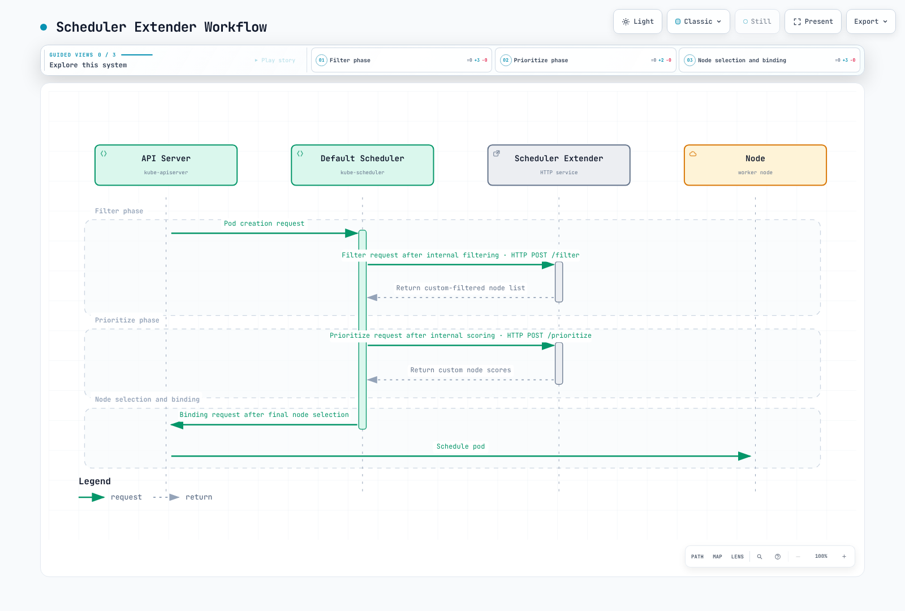

# パート 2: 実装

> **例の基準環境**: Kubernetes 1.35.8、Go 1.27.2
> **最終更新**: 2026年10月16日

[パート1のモジュール構成と、セカンダリスケジューラー用RBAC/Deployment一式](01-custom-scheduler-part1.md)を使用します。このスケジューラーを拡張する方法を2つ紹介します。例はローカルで確認しましたが、EKSへのデプロイ、GPU実行、TLS切り替え、本番フェイルオーバーはテストしていません。他のKubernetesマイナーバージョンでもGoインターフェイスとの互換性を仮定せず、再検証してください。

## Scheduler Extender方式

Scheduler Extender方式は、デフォルトスケジューラーの機能を拡張する方法です。この方式では、デフォルトスケジューラーがHTTPリクエストで外部サービス（Scheduler Extender）を呼び出し、追加のフィルタリングや優先度付けを行います。

### Scheduler Extenderのアーキテクチャ

Extenderは、スケジューラーから呼び出される独立したサービスとして動作します。EKSでは、パート1で作成したセカンダリスケジューラーを設定します。

### Scheduler Extenderのワークフロー

Scheduler Extenderの処理順序を示します。



[🔍 インタラクティブ図を表示](https://www.atomai.click/kubernetes-docs/archmaps/en-scheduling-02-custom-scheduler-part2-0.html)

### Scheduler Extenderの実装

Extenderは、設定した **filter**、**prioritize**、**preempt**、**bind** HTTPコールバックの一部を実装します。この例で使うのはfilterとpriorityのみです。Extenderには`PreFilter`や`PreScore`のHTTPフックはありません。これらはプロセス内で動くframework拡張ポイントです。デフォルトのbinderを使うには、`bindVerb`を設定しないでください。

Extenderのpriorityは **0–10**、frameworkのscoreは正規化後に **0–100** です。必須制約はFilterに置きます。この固定バージョンのスケジューラーでは、priority要求の失敗はログに記録され、scoreは無視されます。したがって、必須制約を適用する場所としては信頼できません。

スケジューラーはAPIを監視し、自身のqueue/cacheを管理します。組み込みfilterを実行してからExtenderによるfilterを適用し、Extenderの選好をframeworkのscoreと組み合わせます。APIサーバーがPodを共有queueへpushするわけではありません。

この例では上流のresource-fitチェックを保ったまま、**GPUごとに宣言されたメモリー条件**を追加します。GPUの検出、空きVRAMの測定、device memoryの予約は行いません。

共通ポリシーは、APIのデフォルト値が設定されたPod、インストール済みdevice plugin、MIG/time-slicingを使わない均質なGPU、各対象GPUの最小メモリー量を示す管理者保守の`training.example.com/gpu-memory-mib` Node labelを前提とします。これらは**このラボ固有のキー**であり、標準NVIDIA検出labelではありません。labelを設定する前に構成情報を検証してください。異種GPUや共有GPUにはdevice-awareな割り当て機構を使います。Node labelだけでは、後から割り当てられるdeviceの特性を保証できません。

以下のファイルをパート1のmoduleに保存します。

**`gpupolicy/policy.go`**

```go
package gpupolicy

import (
	"fmt"
	"strconv"

	v1 "k8s.io/api/core/v1"
	resourcehelper "k8s.io/component-helpers/resource"
)

const (
	MinMemoryAnnotation = "training.example.com/min-gpu-memory-mib"
	NodeMemoryLabel     = "training.example.com/gpu-memory-mib"
	ScoreCeilingMiB     = int64(80 * 1024)
)

// These are lab policy keys, not automatically populated NVIDIA labels.
// NodeMemoryLabel must describe the minimum memory per eligible GPU on a
// homogeneous, non-shared GPU node, not total or currently free VRAM.
type Requirement struct {
	HasGPU       bool
	MinMemoryMiB int64
}

func FromPod(pod *v1.Pod) (Requirement, error) {
	if pod == nil {
		return Requirement{}, fmt.Errorf("missing pod")
	}
	requests := resourcehelper.PodRequests(pod, resourcehelper.PodResourcesOptions{})
	gpu := requests[v1.ResourceName("nvidia.com/gpu")]
	req := Requirement{HasGPU: gpu.Sign() > 0}
	if raw, exists := pod.Annotations[MinMemoryAnnotation]; exists {
		value, err := strconv.ParseInt(raw, 10, 64)
		if err != nil || value <= 0 || value > 1024*1024 {
			return req, fmt.Errorf("minimum GPU memory must be 1..1048576 MiB")
		}
		if !req.HasGPU {
			return req, fmt.Errorf("minimum GPU memory requires a positive GPU request")
		}
		req.MinMemoryMiB = value
	}
	return req, nil
}

func nodeMemory(node *v1.Node) (int64, error) {
	if node == nil {
		return 0, fmt.Errorf("missing node")
	}
	value, err := strconv.ParseInt(node.Labels[NodeMemoryLabel], 10, 64)
	if err != nil || value <= 0 || value > 1024*1024 {
		return 0, fmt.Errorf("missing or invalid administrator GPU-memory label")
	}
	return value, nil
}

// FitsMemory checks only the declared memory label. The default scheduler
// filters must still check free GPU counts, taints, affinity, volumes, etc.
func FitsMemory(req Requirement, node *v1.Node) (bool, string) {
	if req.MinMemoryMiB == 0 {
		return true, ""
	}
	memory, err := nodeMemory(node)
	if err != nil {
		return false, err.Error()
	}
	if memory < req.MinMemoryMiB {
		return false, "GPU memory label is below the required minimum"
	}
	return true, ""
}

// The 80-GiB ceiling is a chosen scoring scale, not a hardware maximum.
func Score100(req Requirement, node *v1.Node) int64 {
	if !req.HasGPU {
		return 0
	}
	memory, err := nodeMemory(node)
	if err != nil {
		return 0
	}
	if memory >= ScoreCeilingMiB {
		return 100
	}
	return memory * 100 / ScoreCeilingMiB
}
```

**`extenderserver/handler.go`**

handlerは`nodeCacheCapable: false`の契約を受け入れ、ラボの要求サイズを4 MiB/512 Nodesに制限し、不正または不足した入力を拒否し、渡された候補Nodeの一部だけを返します。実クラスターではこれらの上限を適切に見積もってください。不正な必須メモリーlabelがあるNodeは除外されます。preempt対象Podを変更してもlabelの問題は修正できません。

```go
package extenderserver

import (
	"encoding/json"
	"errors"
	"io"
	"net/http"

	"example.com/custom-scheduler/gpupolicy"
	v1 "k8s.io/api/core/v1"
	extender "k8s.io/kube-scheduler/extender/v1"
)

const maxBodyBytes = 4 << 20

func NewHandler() http.Handler {
	mux := http.NewServeMux()
	mux.HandleFunc("POST /filter", filter)
	mux.HandleFunc("POST /prioritize", prioritize)
	return mux
}

func readArgs(w http.ResponseWriter, r *http.Request) (extender.ExtenderArgs, gpupolicy.Requirement, bool) {
	var args extender.ExtenderArgs
	body := http.MaxBytesReader(w, r.Body, maxBodyBytes)
	defer body.Close()
	decoder := json.NewDecoder(body)
	if err := decoder.Decode(&args); err != nil {
		var large *http.MaxBytesError
		status := http.StatusBadRequest
		if errors.As(err, &large) {
			status = http.StatusRequestEntityTooLarge
		}
		http.Error(w, "invalid or oversized extender request", status)
		return args, gpupolicy.Requirement{}, false
	}
	if err := decoder.Decode(new(any)); err != io.EOF {
		http.Error(w, "expected exactly one JSON object", http.StatusBadRequest)
		return args, gpupolicy.Requirement{}, false
	}
	if args.Pod == nil || args.Nodes == nil || args.NodeNames != nil {
		http.Error(w, "Pod and Nodes required; nodeCacheCapable must be false", http.StatusBadRequest)
		return args, gpupolicy.Requirement{}, false
	}
	if len(args.Nodes.Items) > 512 {
		http.Error(w, "lab candidate-node limit exceeded", http.StatusRequestEntityTooLarge)
		return args, gpupolicy.Requirement{}, false
	}
	seen := make(map[string]bool, len(args.Nodes.Items))
	for _, node := range args.Nodes.Items {
		if node.Name == "" || seen[node.Name] {
			http.Error(w, "missing or duplicate node name", http.StatusBadRequest)
			return args, gpupolicy.Requirement{}, false
		}
		seen[node.Name] = true
	}
	req, err := gpupolicy.FromPod(args.Pod)
	if err != nil {
		http.Error(w, err.Error(), http.StatusBadRequest)
		return args, req, false
	}
	return args, req, true
}

func writeJSON(w http.ResponseWriter, value any) {
	data, err := json.Marshal(value)
	if err != nil {
		http.Error(w, "response encoding failed", http.StatusInternalServerError)
		return
	}
	w.Header().Set("Content-Type", "application/json")
	_, _ = w.Write(data)
}

func filter(w http.ResponseWriter, r *http.Request) {
	args, req, ok := readArgs(w, r)
	if !ok {
		return
	}
	result := extender.ExtenderFilterResult{
		Nodes:                      &v1.NodeList{Items: []v1.Node{}},
		FailedAndUnresolvableNodes: extender.FailedNodesMap{},
	}
	for _, node := range args.Nodes.Items {
		if fits, reason := gpupolicy.FitsMemory(req, &node); fits {
			result.Nodes.Items = append(result.Nodes.Items, node)
		} else {
			// Preempting other Pods cannot change a hardware inventory label.
			result.FailedAndUnresolvableNodes[node.Name] = reason
		}
	}
	writeJSON(w, result)
}

func prioritize(w http.ResponseWriter, r *http.Request) {
	args, req, ok := readArgs(w, r)
	if !ok {
		return
	}
	result := make(extender.HostPriorityList, 0, len(args.Nodes.Items))
	for _, node := range args.Nodes.Items {
		result = append(result, extender.HostPriority{
			Host: node.Name, Score: gpupolicy.Score100(req, &node) / 10,
		})
	}
	// The wire response is an array, not a hostPriorities wrapper object.
	writeJSON(w, result)
}
```

**`cmd/extender/main.go`**

サーバーは、設定済みclient CAが署名したclient certificateを要求します。そのCAをスケジューラーclientに限定し、通常のSecret管理手順で証明書をローテーションしてください。

```go
package main

import (
	"crypto/tls"
	"crypto/x509"
	"flag"
	"log"
	"net/http"
	"os"
	"time"

	"example.com/custom-scheduler/extenderserver"
)

func main() {
	certFile := flag.String("tls-cert", "/etc/extender-tls/tls.crt", "server certificate")
	keyFile := flag.String("tls-key", "/etc/extender-tls/tls.key", "server private key")
	caFile := flag.String("client-ca", "/etc/extender-tls/client-ca.crt", "trusted scheduler client CA")
	flag.Parse()
	caPEM, err := os.ReadFile(*caFile)
	if err != nil {
		log.Fatal(err)
	}
	roots := x509.NewCertPool()
	if !roots.AppendCertsFromPEM(caPEM) {
		log.Fatal("client CA contains no certificates")
	}
	server := &http.Server{
		Addr:              ":8443",
		Handler:           extenderserver.NewHandler(),
		ReadHeaderTimeout: 2 * time.Second,
		ReadTimeout:       5 * time.Second,
		WriteTimeout:      5 * time.Second,
		IdleTimeout:       30 * time.Second,
		TLSConfig: &tls.Config{
			MinVersion: tls.VersionTLS12,
			ClientAuth: tls.RequireAndVerifyClientCert,
			ClientCAs:  roots,
		},
	}
	log.Fatal(server.ListenAndServeTLS(*certFile, *keyFile))
}
```

### Scheduler Extenderのデプロイ

パート1と同じ固定moduleおよびGoバージョンで`./cmd/extender`をビルドし、static binaryをnon-root imageに含めます。以下のimage欄にあるregistry placeholderは、生成したimage/digestに置き換えてください。Podは各要求からすべてのスケジューリング情報を読み取るため、Kubernetes API tokenは不要です。

以下を`Dockerfile.extender`として保存し、ローカルでbuildします。承認済みregistryを選び、Deploymentのimageを公開済みimageに置き換えてください。

```dockerfile
FROM gcr.io/distroless/static-debian12:nonroot
COPY scheduler-extender /scheduler-extender
ENTRYPOINT ["/scheduler-extender"]
```

```bash
go mod tidy
CGO_ENABLED=0 go build -buildvcs=false -trimpath -o scheduler-extender ./cmd/extender
: "${REGISTRY:?Set the approved registry/repository prefix}"
docker build -f Dockerfile.extender -t "$REGISTRY/scheduler-extender:v1.35.8-1" .
```

`scheduler-lab`の前提条件: `tls.crt`、`tls.key`、`client-ca.crt`を含む`extender-server-tls` Secretと、スケジューラーclientの`tls.crt`、`tls.key`およびサーバー側`ca.crt`を含む`extender-client-tls` Secretを用意します。サーバー証明書には`scheduler-extender.scheduler-lab.svc`が含まれている必要があります。このドキュメントでは証明書やSecretを作成しません。NetworkPolicyを有効にするには、NetworkPolicyを適用するCNIが必要です。TCP readiness probeが確認するのはlisten portだけであり、相互TLSやスケジューリング動作の成功ではありません。

```yaml
apiVersion: apps/v1
kind: Deployment
metadata:
  name: scheduler-extender
  namespace: scheduler-lab
spec:
  replicas: 2
  selector:
    matchLabels:
      app: scheduler-extender
  template:
    metadata:
      labels:
        app: scheduler-extender
    spec:
      automountServiceAccountToken: false
      securityContext:
        runAsNonRoot: true
        runAsUser: 65532
        runAsGroup: 65532
        fsGroup: 65532
      nodeSelector:
        kubernetes.io/os: linux
      containers:
      - name: extender
        image: registry.example.com/training/scheduler-extender:v1.35.8-1
        ports:
        - name: https
          containerPort: 8443
        readinessProbe:
          tcpSocket:
            port: https
        securityContext:
          allowPrivilegeEscalation: false
          readOnlyRootFilesystem: true
          capabilities:
            drop: ["ALL"]
          seccompProfile:
            type: RuntimeDefault
        resources:
          requests:
            cpu: 100m
            memory: 64Mi
          limits:
            memory: 128Mi
        volumeMounts:
        - name: tls
          mountPath: /etc/extender-tls
          readOnly: true
      volumes:
      - name: tls
        secret:
          secretName: extender-server-tls
          defaultMode: 0440
---
apiVersion: v1
kind: Service
metadata:
  name: scheduler-extender
  namespace: scheduler-lab
spec:
  selector:
    app: scheduler-extender
  ports:
  - name: https
    port: 8443
    targetPort: https
---
apiVersion: networking.k8s.io/v1
kind: NetworkPolicy
metadata:
  name: scheduler-extender
  namespace: scheduler-lab
spec:
  podSelector:
    matchLabels:
      app: scheduler-extender
  policyTypes: [Ingress, Egress]
  ingress:
  - from:
    - namespaceSelector:
        matchLabels:
          kubernetes.io/metadata.name: scheduler-lab
      podSelector:
        matchLabels:
          app: custom-scheduler
    ports:
    - protocol: TCP
      port: 8443
  egress: []
```

### Schedulerの設定

EKSを含め、**自分が管理するセカンダリスケジューラー**を設定します。EKSでは管理対象のデフォルトスケジューラーの設定ファイルを参照できません。また、`/etc/kubernetes/scheduler.conf`はEC2 workerからmountするcontrol-plane credentialではありません。

1. この設定を保存します。パート1のprofileと個別のleader-election Leaseを維持し、組み込みfilterを有効にしたまま、Extenderのサーバー証明書を検証します。`ignorable: false`にするとfilterの失敗でそのスケジューリング試行が止まりますが、前述のpriorityエラー時の動作は変わりません。ExtenderはGPUの利用可能数を計算しないため、GPU resourceには`ignoredByScheduler: true`を設定しないでください。

```yaml
apiVersion: kubescheduler.config.k8s.io/v1
kind: KubeSchedulerConfiguration
leaderElection:
  leaderElect: true
  resourceLock: leases
  resourceName: custom-scheduler
  resourceNamespace: scheduler-lab
  leaseDuration: 15s
  renewDeadline: 10s
  retryPeriod: 2s
profiles:
- schedulerName: custom-scheduler
extenders:
- urlPrefix: https://scheduler-extender.scheduler-lab.svc:8443
  filterVerb: filter
  prioritizeVerb: prioritize
  weight: 1
  enableHTTPS: true
  tlsConfig:
    caFile: /etc/extender-client/ca.crt
    certFile: /etc/extender-client/tls.crt
    keyFile: /etc/extender-client/tls.key
  httpTimeout: 2s
  nodeCacheCapable: false
  ignorable: false
```

2. 対応するConfigMapを`extender-scheduler-config.yaml`として保存します。

```yaml
apiVersion: v1
kind: ConfigMap
metadata:
  name: extender-scheduler-config
  namespace: scheduler-lab
data:
  config.yaml: |
    apiVersion: kubescheduler.config.k8s.io/v1
    kind: KubeSchedulerConfiguration
    leaderElection:
      leaderElect: true
      resourceLock: leases
      resourceName: custom-scheduler
      resourceNamespace: scheduler-lab
      leaseDuration: 15s
      renewDeadline: 10s
      retryPeriod: 2s
    profiles:
    - schedulerName: custom-scheduler
    extenders:
    - urlPrefix: https://scheduler-extender.scheduler-lab.svc:8443
      filterVerb: filter
      prioritizeVerb: prioritize
      weight: 1
      enableHTTPS: true
      tlsConfig:
        caFile: /etc/extender-client/ca.crt
        certFile: /etc/extender-client/tls.crt
        keyFile: /etc/extender-client/tls.key
      httpTimeout: 2s
      nodeCacheCapable: false
      ignorable: false
```

3. これを単独のDeploymentでなく、**strategic merge patch**として`extender-scheduler-patch.yaml`に保存します。パート1の既存Deploymentのconfig volumeを変更し、ServiceAccount、probe、resource、commandを維持したままclient証明書を追加します。

```yaml
apiVersion: apps/v1
kind: Deployment
metadata:
  name: custom-scheduler
  namespace: scheduler-lab
spec:
  template:
    spec:
      volumes:
      - name: config
        configMap:
          name: extender-scheduler-config
      - name: extender-client
        secret:
          secretName: extender-client-tls
          defaultMode: 288
      containers:
      - name: custom-scheduler
        volumeMounts:
        - name: extender-client
          mountPath: /etc/extender-client
          readOnly: true
```

Extenderをデプロイしてimage placeholderを置き換えた後、使い捨てのラボ環境にのみ次の設定を適用します。

```bash
kubectl -n scheduler-lab apply -f extender-scheduler-config.yaml
kubectl -n scheduler-lab patch deployment custom-scheduler --type=strategic --patch-file=extender-scheduler-patch.yaml
kubectl -n scheduler-lab rollout restart deployment/custom-scheduler
kubectl -n scheduler-lab rollout status deployment/custom-scheduler
```

スケジューラーは起動時に設定を読み込みます。ConfigMapをprojectionしただけでは再読み込みされません。`subPath` mountを使う場合も、通常のprojected file更新を受け取れません。

## Scheduler Framework Plugin

Kubernetes 1.15で導入されたscheduler frameworkはpluginベースのアーキテクチャを提供します。この方式では、スケジューリングpipelineのさまざまな段階にpluginを実装できます。

### Scheduler Frameworkのアーキテクチャ

pluginは設定されたextension pointでscheduler process内で実行されます。queue、cache、bindingの処理は引き続きスケジューラーが担います。

### Scheduler Framework Pluginの設定

各profileは、自身のscheduler nameに登録されたpluginを有効にします。同一process内のすべてのprofileはスケジューリングqueueを共有するため、同じQueueSort設定を使う必要があります。

### Scheduling Frameworkの拡張ポイント

frameworkには、`PreEnqueue`、`QueueSort`、`PreFilter`、`Filter`、`PostFilter`、`PreScore`、任意の`NormalizeScore`を伴う`Score`、`Reserve`/`Unreserve`、`Permit`、`PreBind`、`Bind`、`PostBind`があります。

scheduling cycleはNodeを順番に選びますが、binding cycleは並行して進む場合があります。ReserveはPodの仮予約状態を記録し、失敗時にUnreserveがその状態を取り消します。PostFilterは適合するNodeがない場合にpreemptionを試みることがあります。PostBindはbinding成功後に実行され、bindingを拒否できません。固定Go interfaceでは一部のextension pointに追加methodが必要な場合があります。対象バージョンでcompileしてください。

### Scheduler Pluginの実装

これを`gpuplugin/plugin.go`として保存します。上記のpolicyを再利用し、`framework.NodeInfo`を直接受け取ります。CycleStateから読み取る組み込みの`NodeInfoKey`はありません。このpluginが扱うのは宣言済みmemory labelだけです。GPU数、taint、affinity、volumeは引き続きデフォルトfilterが処理します。

```go
package gpuplugin

import (
	"context"

	"example.com/custom-scheduler/gpupolicy"
	v1 "k8s.io/api/core/v1"
	"k8s.io/apimachinery/pkg/runtime"
	fwk "k8s.io/kube-scheduler/framework"
)

const Name = "GPUScheduler"

type Plugin struct{}

var _ fwk.FilterPlugin = &Plugin{}
var _ fwk.ScorePlugin = &Plugin{}

func (*Plugin) Name() string { return Name }

func (*Plugin) Filter(_ context.Context, _ fwk.CycleState, pod *v1.Pod, info fwk.NodeInfo) *fwk.Status {
	if info == nil || info.Node() == nil {
		return fwk.NewStatus(fwk.Error, "missing node")
	}
	req, err := gpupolicy.FromPod(pod)
	if err != nil {
		return fwk.NewStatus(fwk.UnschedulableAndUnresolvable, err.Error())
	}
	if ok, reason := gpupolicy.FitsMemory(req, info.Node()); !ok {
		return fwk.NewStatus(fwk.UnschedulableAndUnresolvable, reason)
	}
	return nil
}

func (*Plugin) Score(_ context.Context, _ fwk.CycleState, pod *v1.Pod, info fwk.NodeInfo) (int64, *fwk.Status) {
	if info == nil || info.Node() == nil {
		return 0, fwk.NewStatus(fwk.Error, "missing node")
	}
	req, err := gpupolicy.FromPod(pod)
	if err != nil {
		return 0, fwk.AsStatus(err)
	}
	return gpupolicy.Score100(req, info.Node()), nil
}

func (*Plugin) ScoreExtensions() fwk.ScoreExtensions { return nil }

func New(_ context.Context, _ runtime.Object, _ fwk.Handle) (fwk.Plugin, error) {
	return &Plugin{}, nil
}
```

### Scheduler Pluginの登録

pluginを登録するには、下のcommandが示すようにscheduler binaryへcompileして含める必要があります。この設定は登録済みpluginを**有効化**します。YAMLだけではGo codeは読み込まれません。実装していない`PreFilter`/`PreScore`を有効にしないでください。

```yaml
apiVersion: kubescheduler.config.k8s.io/v1
kind: KubeSchedulerConfiguration
leaderElection:
  leaderElect: true
  resourceLock: leases
  resourceName: custom-scheduler
  resourceNamespace: scheduler-lab
  leaseDuration: 15s
  renewDeadline: 10s
  retryPeriod: 2s
profiles:
- schedulerName: custom-scheduler
  plugins:
    filter:
      enabled:
      - name: GPUScheduler
    score:
      enabled:
      - name: GPUScheduler
        weight: 10
```

## EKSでのScheduler Framework実装

EKSでは、パート1のServiceAccount/RBACを使い、独自のprofile/Leaseを持つcustom schedulerをEC2 worker node上で実行します。クラスター内のAPIアクセスにはKubernetes credentialを使います。ECRへの公開や任意のAWS API呼び出しには、別途適切なIAM権限が必要です。EKS FargateのスケジューリングはAWSが管理しており、GPUは利用できません。Fargate profileの対象ではないラボnamespaceを使ってください。

managed control planeに別のplugin imageを注入するのではなく、pluginを組み込んだ**scheduler binary**をbuildします。Node labelはdevice pluginのresourceを補足するだけで、GPU capacityを作るものではありません。

### EKS Scheduler Frameworkのアーキテクチャ

セカンダリスケジューラーはAPI経由でPod/Nodeの状態を監視し、登録済みpluginをローカルで実行します。imageはECRから取得します。CloudWatch統合は任意です。この例で実装するのは`GPUScheduler`だけです。図にあるSpot/AZ pluginを登録または有効にするには、それぞれ別途codeとtestが必要です。

### EKS Scheduler Frameworkの実装手順

1. **custom pluginを登録**します（`cmd/gpu-scheduler/main.go`）。upstream commandは組み込みpluginをすでに登録しています。再登録すると同名エラーになります。

```go
package main

import (
	"os"

	"example.com/custom-scheduler/gpuplugin"
	"k8s.io/component-base/cli"
	"k8s.io/kubernetes/cmd/kube-scheduler/app"
)

func main() {
	// Upstream already registers all built-in plugins. Register only our addition.
	command := app.NewSchedulerCommand(app.WithPlugin(gpuplugin.Name, gpuplugin.New))
	os.Exit(cli.Run(command))
}
```

2. 共通policyとpluginを保存し、`go mod tidy`を実行してから**imageをbuild**します。image architectureをschedulerを実行するLinux workerに合わせます。release workflowではregistryのbase imageをdigestで固定してください。

```dockerfile
FROM golang:1.27.2 AS builder
WORKDIR /src
COPY go.mod go.sum ./
RUN go mod download
COPY . .
RUN CGO_ENABLED=0 go build -buildvcs=false -trimpath -o /out/gpu-scheduler ./cmd/gpu-scheduler

FROM gcr.io/distroless/static-debian12:nonroot
COPY --from=builder /out/gpu-scheduler /gpu-scheduler
ENTRYPOINT ["/gpu-scheduler"]
```

3. **自分のregistry workflowで公開**します。以下のcommandはregistryを明示的に選ぶ必要があるため、この監査では実行していません。

```bash
: "${REGISTRY:?Set the approved registry/repository prefix}"
docker build -t "$REGISTRY/gpu-scheduler:v1.35.8-1" .
docker push "$REGISTRY/gpu-scheduler:v1.35.8-1"
```

4. `gpu-scheduler-config.yaml`を保存します。pluginが実装するinterfaceだけを有効にし、upstreamのデフォルトを維持します。

```yaml
apiVersion: v1
kind: ConfigMap
metadata:
  name: gpu-scheduler-config
  namespace: scheduler-lab
data:
  config.yaml: |
    apiVersion: kubescheduler.config.k8s.io/v1
    kind: KubeSchedulerConfiguration
    leaderElection:
      leaderElect: true
      resourceLock: leases
      resourceName: custom-scheduler
      resourceNamespace: scheduler-lab
      leaseDuration: 15s
      renewDeadline: 10s
      retryPeriod: 2s
    profiles:
    - schedulerName: custom-scheduler
      plugins:
        filter:
          enabled:
          - name: GPUScheduler
        score:
          enabled:
          - name: GPUScheduler
            weight: 10
```

5. このstrategic merge patchを使ってパート1のDeploymentを**更新**し、`gpu-scheduler-patch.yaml`として保存します。先にimage placeholderを置き換えてください。これはExtender設定に代わる方式です。両方の例があるだけで、両方のpolicyが同時に有効になると思わないでください。

```yaml
apiVersion: apps/v1
kind: Deployment
metadata:
  name: custom-scheduler
  namespace: scheduler-lab
spec:
  template:
    spec:
      volumes:
      - name: config
        configMap:
          name: gpu-scheduler-config
      containers:
      - name: custom-scheduler
        image: registry.example.com/training/gpu-scheduler:v1.35.8-1
```

```bash
kubectl -n scheduler-lab apply -f gpu-scheduler-config.yaml
kubectl -n scheduler-lab patch deployment custom-scheduler --type=strategic --patch-file=gpu-scheduler-patch.yaml
kubectl -n scheduler-lab rollout restart deployment/custom-scheduler
kubectl -n scheduler-lab rollout status deployment/custom-scheduler
```

6. **schedulerとGPUを要求**します。以下のBusyBox Podを準備済みラボで実行すると、予約/配置だけを確認します。CUDAは実行しません。実GPUのsmoke testには、検証済みCUDA application image、互換性のあるdriver、実deviceの確認が必要です。GPU Nodeにtaintがある場合は適切なtolerationを加えます。

```yaml
apiVersion: v1
kind: Pod
metadata:
  name: gpu-pod
  annotations:
    training.example.com/min-gpu-memory-mib: "16384"
spec:
  schedulerName: custom-scheduler
  restartPolicy: Never
  containers:
  - name: gpu-reservation-smoke
    image: busybox:1.38.0
    command: ["sh", "-c", "sleep 60"]
    resources:
      requests:
        cpu: 100m
        memory: 64Mi
        nvidia.com/gpu: 1
      limits:
        memory: 128Mi
        nvidia.com/gpu: 1
```

## まとめ

この章では、Scheduler Extender方式とScheduler Framework pluginを使ったcustom schedulerの実装を扱いました。また、EKSクラスターでScheduler Frameworkを実装する方法も確認しました。

次の章では、EKSでのcustom schedulerの実装例と監視方法を見ていきます。

## 参考資料と検証上の制限

* [スケジューラー設定とExtenderフィールド](https://kubernetes.io/docs/reference/scheduling/config/)
* [Kubernetes 1.35.8のExtender wire型](https://github.com/kubernetes/kubernetes/blob/v1.35.8/staging/src/k8s.io/kube-scheduler/extender/v1/types.go)
* [固定バージョンのScheduling Framework interface](https://github.com/kubernetes/kubernetes/blob/v1.35.8/staging/src/k8s.io/kube-scheduler/framework/interface.go)
* [GPUスケジューリング](https://kubernetes.io/docs/tasks/manage-gpus/scheduling-gpus/)
* [EKS Fargateのスケジューリングと制限](https://docs.aws.amazon.com/eks/latest/userguide/fargate.html)

ローカルでのcode/configuration確認では、実際のhardware label、driver互換性、証明書の準備、クラスター内のスケジューリング、capacity、本番可用性は検証できません。

## クイズ

この章で学んだことを確認するには、[トピッククイズ](../quizzes/scheduling/02-custom-scheduler-part2-quiz.md)を試してください。
