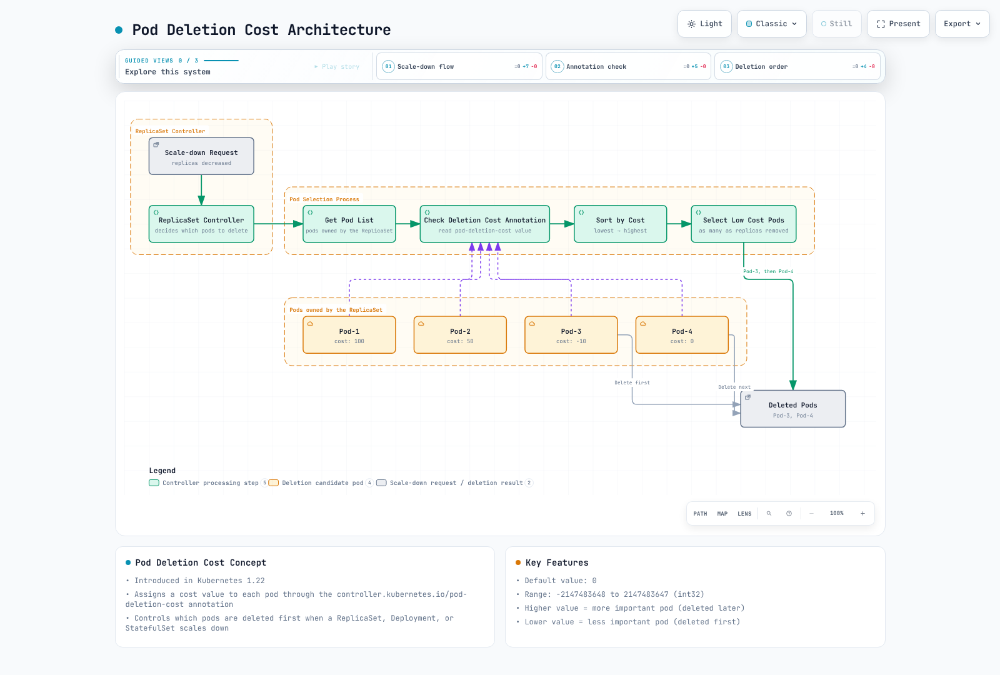

# パート3：高度な機能

> **サンプルの基準環境**：Kubernetes 1.35.8、Go 1.27.2、Python client API 35.0.0
> **最終更新日**：2026年10月16日

ここで示すのは、[Part 1 のセカンダリスケジューラー](01-custom-scheduler-part1.md)と[Part 2 の framework interface](02-custom-scheduler-part2.md)を使った実装パターンの例です。本番環境へのデプロイ報告でも、最適化の実測結果でもありません。ローカルでのコード/schema 検査だけでは、GPU の実行、アプリケーションの Ready 状態、証明書の発行、本番可用性は確認できません。

## EKS におけるカスタムスケジューラーの実装例

ここでは EKS のスケジューリングポリシー例を示します。実際のクラスターで、容量、デバイス構成、トラフィックパターン、障害時の動作を検証してください。

### 例1：GPU ワークロード最適化スケジューラー

AI/ML ワークロードを実行する EKS クラスターでは、GPU リソースを効率的に使うことが重要です。以下は GPU ワークロードを最適化するカスタムスケジューラーの実装例です。

#### GPU ワークロード最適化スケジューラーのアーキテクチャ

この設計では、配置ポリシーと任意のテレメトリを組み合わせられます。以下の実装例が使うのはキャッシュ済みの要求値です。図は、実際に動作する利用率 collector の存在を示すものではありません。

#### GPU ワークロードのスケジューリングフロー

スケジューラーは API を介して Pod の状態を監視します。フローに示すメトリクスベースの拡張には、別途検証済みの collector が必要です。

#### 要件

1. 検証済みノードラベルと required node affinity を使って、GPU メモリ/モデル要件を適用します。
2. 実効 GPU 要求と、すでに割り当て済み/割り当て見込みの要求を扱うために `NodeResourcesFit` を維持します。
3. scheduler snapshot を使って適切なノードへの集約配置を優先します。live utilization による重み付けは、ここでは別途実装が必要な連携機能です。
4. GPU 共有には、適切な device-plugin/MIG/time-slicing または DRA の割り当てポリシーが必要です。ノードの score 関数だけではデバイスを分割できず、プロセス単位の GPU メモリも制限できません。

#### 実装方法

この例では scheduler framework plugin を使います。

1. **ラベルを付ける前にインベントリを確認します**。以下の `training.example.com` キーは管理者が定義するラボ用ラベルであり、NVIDIA が検出するラベルではありません。メモリ値は、共有されていない同種 GPU ノードで、対象デバイス1台あたりの最小メモリを表す必要があります。GPU リソース数は `status.allocatable` から読み取ってください。台数ラベルは残容量を表しません。

```bash
kubectl get nodes -o custom-columns='NAME:.metadata.name,GPUS:.status.allocatable.nvidia\.com/gpu'

# Set only after verifying the actual node and per-device inventory.
: "${NODE_NAME:?Select a verified GPU node}"
: "${GPU_MODEL:?Set the observed model label value}"
: "${GPU_MEMORY_MIB:?Set verified minimum memory per GPU in MiB}"
kubectl label node "$NODE_NAME" \
  "training.example.com/gpu-model=$GPU_MODEL" \
  "training.example.com/gpu-memory-mib=$GPU_MEMORY_MIB" --overwrite
```

2. **既定の filter を置き換えずに scoring plugin を追加します**。以下を `packing/plugin.go` として保存します。計算には総インベントリラベルや live utilization ではなく、allocatable GPU リソースから既存/割り当て見込みの要求と今回の要求を差し引いた値を使います。score が0でもノードを除外しません。

```go
package packing

import (
	"context"

	v1 "k8s.io/api/core/v1"
	"k8s.io/apimachinery/pkg/runtime"
	resourcehelper "k8s.io/component-helpers/resource"
	fwk "k8s.io/kube-scheduler/framework"
)

const Name = "GPUPacking"
const gpu v1.ResourceName = "nvidia.com/gpu"

type Plugin struct{}

var _ fwk.ScorePlugin = &Plugin{}

func (*Plugin) Name() string { return Name }

func (*Plugin) Score(_ context.Context, _ fwk.CycleState, pod *v1.Pod, info fwk.NodeInfo) (int64, *fwk.Status) {
	if pod == nil || info == nil || info.Node() == nil {
		return 0, fwk.NewStatus(fwk.Error, "missing node")
	}
	requests := resourcehelper.PodRequests(pod, resourcehelper.PodResourcesOptions{})
	request := requests[gpu]
	needed, exact := request.AsInt64()
	if !exact || needed < 0 {
		return 0, fwk.NewStatus(fwk.Error, "GPU request must be a non-negative integer")
	}
	if needed == 0 {
		return 0, nil
	}
	allocatable := info.GetAllocatable().GetScalarResources()[gpu]
	requested := info.GetRequested().GetScalarResources()[gpu]
	remaining := allocatable - requested - needed
	if remaining < 0 {
		// Score cannot exclude a node. NodeResourcesFit must remain enabled.
		return 0, nil
	}
	if remaining >= 10 {
		return 0, nil
	}
	return 100 - remaining*10, nil
}

func (*Plugin) ScoreExtensions() fwk.ScoreExtensions { return nil }

func New(_ context.Context, _ runtime.Object, _ fwk.Handle) (fwk.Plugin, error) {
	return &Plugin{}, nil
}
```

`cmd/gpu-packing-scheduler/main.go` に登録し、Part 1 のイメージ作成手順で `CGO_ENABLED=0 go build -buildvcs=false -o custom-scheduler ./cmd/gpu-packing-scheduler` を実行します。

```go
package main

import (
	"os"

	"example.com/custom-scheduler/packing"
	"k8s.io/component-base/cli"
	"k8s.io/kubernetes/cmd/kube-scheduler/app"
)

func main() {
	command := app.NewSchedulerCommand(app.WithPlugin(packing.Name, packing.New))
	os.Exit(cli.Run(command))
}
```

元の「packing/utilization を70:30で組み合わせる」案は、参考式 `(packingScore * 7 + utilizationScore * 3) / 10` と `utilizationScore = (1 - utilization) * 100` で表せます。これは**このバイナリには組み込まれていません**。実装するには、一貫性があり最新のデバイス単位 snapshot、0～1の有限値、収集レイテンシの上限、欠損データの明示的な扱いが必要です。テレメトリの欠損は利用率0を意味しません。利用率は未割り当て GPU 容量でもありません。

3. **スケジューラーを設定します。**

```yaml
apiVersion: kubescheduler.config.k8s.io/v1
kind: KubeSchedulerConfiguration
leaderElection:
  leaderElect: true
  resourceLock: leases
  resourceName: custom-scheduler
  resourceNamespace: scheduler-lab
  leaseDuration: 15s
  renewDeadline: 10s
  retryPeriod: 2s
profiles:
- schedulerName: custom-scheduler
  plugins:
    score:
      enabled:
      - name: GPUPacking
        weight: 10
```

4. **Pod に必須の配置条件を指定します**。例の model/memory は検証済みインベントリに置き換えてください。`Gt: "40959"` は40960 MiB 以上の整数ラベルを意味します。以下の BusyBox image は、準備済みラボ内で GPU リソースを予約するだけです。CUDA を実行したり GPU を検証したりはしません。

```yaml
apiVersion: v1
kind: Pod
metadata:
  name: gpu-reservation-demo
  namespace: scheduler-lab
spec:
  schedulerName: custom-scheduler
  automountServiceAccountToken: false
  restartPolicy: Never
  affinity:
    nodeAffinity:
      requiredDuringSchedulingIgnoredDuringExecution:
        nodeSelectorTerms:
        - matchExpressions:
          - key: training.example.com/gpu-model
            operator: In
            values:
            - A100
          - key: training.example.com/gpu-memory-mib
            operator: Gt
            values:
            - '40959'
  containers:
  - name: reservation
    image: busybox:1.38.0
    command:
    - sh
    - -c
    - sleep 60
    resources:
      requests:
        cpu: 100m
        memory: 64Mi
        nvidia.com/gpu: 2
      limits:
        memory: 128Mi
        nvidia.com/gpu: 2
```

### 例2：ネットワーク局所性を最適化するスケジューラー

EKS では、ネットワーク局所性を考慮するカスタムスケジューラーを実装してネットワークコストを最適化できます。

#### ネットワーク局所性スケジューラーのアーキテクチャ

ネットワーク局所性の設計では、トポロジーと測定済みの依存関係情報を組み合わせる場合があります。ここで示す連携は例示です。

#### ネットワーク局所性のワークフロー

任意の局所性 score を検討する前に、必須の配置条件を評価します。トレードオフは実際のトラフィックと障害ドメインの要件で決まります。

別のスケジューラーを作る前に、required/preferred Pod affinity、topology spread、ストレージトポロジーを確認してください。実際のサービス依存関係と配置可能な AZ をモデル化します。同じ AZ への配置は一部の AZ 間トラフィックを減らせますが、障害の集中や競合を増やす可能性があります。配置ラベルもスケジューリング score も、レイテンシやコスト削減の証明にはなりません。

図は連携例を示すもので、完全な network policy、service mesh、CloudWatch の実装ではありません。ノード単位の scoring 呼び出しの外でメトリクスを収集し、データの古さと timeout に上限を設けてください。実トラフィックでコスト/可用性のトレードオフを再評価します。この章には、デプロイ済みのネットワーク局所性スケジューラーは含まれていません。

## Pod Deletion Cost による scale-down の最適化

Pod Deletion Cost は、ReplicaSet の scale-down 時に Pod の削除順を決める**ベストエフォートの優先度**です。Deployment の ReplicaSet が所有する Pod にも適用されます。1.21 で alpha として登場し、1.22 で既定有効の beta になりました。参照ドキュメント上でも beta です。StatefulSet の ordinal による削除、Pod の直接削除、eviction、ノード障害の削除順は制御しません。

### Pod Deletion Cost の考え方

各 Pod に `controller.kubernetes.io/pod-deletion-cost` annotation を設定します。コストを比較するのは**同じ ReplicaSet 内**であり、Deployment やノードをまたいだ全体比較ではありません。より高いコストが保持を優先するのは、優先度の高い他の条件に反しない場合に限ります。

**主な特性：**

* annotation がない場合は0です。有効な10進値の範囲は符号付き int32 全体で、負数も使えます。機能が有効な場合、不正な値は拒否されます。
* 固定した controller では、割り当て、Pod の phase、Ready 状態がコストより先に評価されます。レプリカ配置など他の tie-breaker はコストより後です。
* 削除順は保証されません。template 上のコストが同じでも replica は区別されません。
* メトリクスに応じて頻繁に更新しないでください。大まかなアプリケーション状態の遷移時、またはアプリケーションが管理する scale-down の直前に1回更新する方法を優先します。

### Pod Deletion Cost のアーキテクチャ

図のコスト順が適用されるのは、割り当て、phase、Ready 状態、その他の関連条件が**同等の場合に限られます**。保証された削除順ではありません。



[🔍 インタラクティブな図を見る](https://www.atomai.click/kubernetes-docs/archmaps/en-scheduling-03-custom-scheduler-part3-0.html)

### ユースケース

#### 1. ウォームアップ済みキャッシュ Pod の保護

この Deployment は各 Pod のコストを0で開始します。これは**アプリケーション側で実装する契約**です。image を置き換え、実際のウォームアップ状態を反映するように port 8080 の `/readyz` を実装してください。この監査ではアプリケーションを build も実行もしていません。sleep の時間が経過しただけで高いコストを割り当てないでください。

```yaml
apiVersion: v1
kind: Namespace
metadata:
  name: deletion-cost-lab
---
apiVersion: apps/v1
kind: Deployment
metadata:
  name: cache-app
  namespace: deletion-cost-lab
spec:
  replicas: 5
  selector:
    matchLabels:
      app: cache-app
  template:
    metadata:
      labels:
        app: cache-app
      annotations:
        controller.kubernetes.io/pod-deletion-cost: '0'
    spec:
      automountServiceAccountToken: false
      containers:
      - name: app
        image: registry.example.com/training/cache-app:validated
        ports:
        - name: http
          containerPort: 8080
        readinessProbe:
          httpGet:
            path: /readyz
            port: http
          periodSeconds: 5
        resources:
          requests:
            cpu: 100m
            memory: 128Mi
          limits:
            memory: 256Mi
        env:
        - name: POD_NAME
          valueFrom:
            fieldRef:
              fieldPath: metadata.name
        - name: POD_NAMESPACE
          valueFrom:
            fieldRef:
              fieldPath: metadata.namespace
        - name: POD_UID
          valueFrom:
            fieldRef:
              fieldPath: metadata.uid
```

特定の replica が実際にウォームアップした後、権限を持つ operator/controller がその Pod の annotation を更新できます。Deployment template を更新すると rollout が発生し、別の ReplicaSet が作られます。

```bash
: "${POD_NAME:?Select a verified warm replica of cache-app}"
kubectl -n deletion-cost-lab annotate pod "$POD_NAME" \
  controller.kubernetes.io/pod-deletion-cost=100 --overwrite
```

このサンプル Deployment は API token を mount しません。以下の任意の動的 helper には、別途設定され認可された Kubernetes client が必要です。namespace RBAC の `patch pods` 権限は、呼び出し元 Pod のみに自動制限されるものではありません。信頼された controller、または適切に制約された identity/admission policy を使ってください。この例では、そのような本番ポリシーはインストールされません。

#### 2. アクティブな接続を持つ Pod の保護

アクティブな接続数は保持判断のヒントの1つにできますが、cost は削除を防がないため、正常な shutdown と drain も必要です。この library は更新を直列化し、大まかな bucket を使い、Pod UID を検査し、annotation だけを patch し、変更のないヒントは更新しません。同じ annotation を書き込む主体が1つであり、Pod template に既存の annotations object があることを前提とします。

設定済み `client-go` client と、admission 済みの Pod 名/namespace/UID を渡してください。Pod 内から連携する場合、それらの識別子は Downward API から取得できますが、取得しても API 権限は付与されません。接続ごとではなく、管理された状態遷移時、または自身が管理する scale-down の前に `UpdateDeletionCost(ctx)` を呼び出します。

```go
package deletioncost

import (
	"context"
	"encoding/json"
	"fmt"
	"strconv"
	"sync"
	"time"

	metav1 "k8s.io/apimachinery/pkg/apis/meta/v1"
	"k8s.io/apimachinery/pkg/types"
	"k8s.io/client-go/kubernetes"
)

const Annotation = "controller.kubernetes.io/pod-deletion-cost"

type ConnectionTracker struct {
	client                  kubernetes.Interface
	namespace, podName      string
	uid                     types.UID
	connectionsMu, updateMu sync.Mutex
	activeConnections       int64
	lastCost                int32
	lastCostSet             bool
}

func NewConnectionTracker(client kubernetes.Interface, namespace, podName string, uid types.UID) (*ConnectionTracker, error) {
	if client == nil || namespace == "" || podName == "" || uid == "" {
		return nil, fmt.Errorf("client and admitted Pod namespace/name/UID are required")
	}
	return &ConnectionTracker{client: client, namespace: namespace, podName: podName, uid: uid}, nil
}

func (t *ConnectionTracker) OnConnectionOpen() {
	t.connectionsMu.Lock()
	defer t.connectionsMu.Unlock()
	t.activeConnections++
}

func (t *ConnectionTracker) OnConnectionClose() {
	t.connectionsMu.Lock()
	defer t.connectionsMu.Unlock()
	if t.activeConnections > 0 {
		t.activeConnections--
	}
}

// Illustrative coarse policy, not a benchmark or an availability guarantee.
func CostForConnections(count int64) int32 {
	switch {
	case count <= 0:
		return 0
	case count < 10:
		return 100
	case count < 100:
		return 500
	default:
		return 1000
	}
}

// Call at an application-controlled transition or before a controlled scale-down,
// not for every request. Assumes a single owner of this Pod's cost annotation.
func (t *ConnectionTracker) UpdateDeletionCost(parent context.Context) (bool, error) {
	t.updateMu.Lock()
	defer t.updateMu.Unlock()
	if err := parent.Err(); err != nil {
		return false, err
	}
	t.connectionsMu.Lock()
	cost := CostForConnections(t.activeConnections)
	t.connectionsMu.Unlock()
	if t.lastCostSet && t.lastCost == cost {
		return false, nil
	}

	// The Deployment template must already contain an annotations object.
	// JSON Pointer escapes the slash in the annotation key as ~1.
	patch, err := json.Marshal([]map[string]any{
		{"op": "test", "path": "/metadata/uid", "value": string(t.uid)},
		{"op": "add", "path": "/metadata/annotations/controller.kubernetes.io~1pod-deletion-cost", "value": strconv.FormatInt(int64(cost), 10)},
	})
	if err != nil {
		return false, err
	}
	ctx, cancel := context.WithTimeout(parent, 3*time.Second)
	defer cancel()
	_, err = t.client.CoreV1().Pods(t.namespace).Patch(ctx, t.podName, types.JSONPatchType, patch, metav1.PatchOptions{})
	if err != nil {
		return false, err
	}
	t.lastCost, t.lastCostSet = cost, true
	return true, nil
}
```

#### 3. データ局所性を使った Pod の保護

局所性ヒントを使うと、有用なキャッシュ済みデータを持つ replica を優先できます。以下の manifest では全 replica が50で開始するため、信頼された controller が個々の Pod を更新するまでは cost による差がありません。cost はデータを mount、保持、復元しません。ストレージ制約とアプリケーションの復旧は別途扱います。

```yaml
apiVersion: apps/v1
kind: Deployment
metadata:
  name: data-processor
spec:
  replicas: 5
  selector:
    matchLabels:
      app: data-processor
  template:
    metadata:
      labels:
        app: data-processor
      annotations:
        # Set high cost for pods with high data locality
        controller.kubernetes.io/pod-deletion-cost: "50"
    spec:
      affinity:
        podAntiAffinity:
          preferredDuringSchedulingIgnoredDuringExecution:
          - weight: 100
            podAffinityTerm:
              labelSelector:
                matchExpressions:
                - key: app
                  operator: In
                  values:
                  - data-processor
              topologyKey: kubernetes.io/hostname
      containers:
      - name: processor
        image: registry.example.com/training/data-processor:validated
        env:
        - name: POD_NAME
          valueFrom:
            fieldRef:
              fieldPath: metadata.name
        - name: POD_NAMESPACE
          valueFrom:
            fieldRef:
              fieldPath: metadata.namespace
```

#### 4. 起動直後の Pod を優先して削除する

初期 cost に負の値を指定すると、他の controller 条件が同等の場合に起動直後の replica を優先して削除できます。初回デプロイの**前に**template で設定し、実際の Ready/状態遷移の後で個別 Pod を更新してください。固定時間 sleep の postStart はキャッシュの Ready 状態を示す証拠ではありません。既存 Deployment の template を変更すると rollout が発生します。

```yaml
# Deployment Pod-template fragment, chosen before initial deployment.
spec:
  template:
    metadata:
      annotations:
        controller.kubernetes.io/pod-deletion-cost: "-50"
```

### Horizontal Pod Autoscaler との統合

HPA は希望 replica 数を調整します。削除対象の Pod を選ぶのは Deployment/ReplicaSet controller です。Deletion cost はその選択に使うヒントであり、HPA の signal でも保持保証でもありません。この HPA は上記 `cache-app` Deployment を対象とし、動作する CPU resource metrics と CPU requests が必要です。`selectPolicy: Min` は scale-down policy のうち、より制限の強い方を選びます。

```yaml
apiVersion: autoscaling/v2
kind: HorizontalPodAutoscaler
metadata:
  name: cache-app
  namespace: deletion-cost-lab
spec:
  scaleTargetRef:
    apiVersion: apps/v1
    kind: Deployment
    name: cache-app
  minReplicas: 3
  maxReplicas: 10
  metrics:
  - type: Resource
    resource:
      name: cpu
      target:
        type: Utilization
        averageUtilization: 70
  behavior:
    scaleDown:
      stabilizationWindowSeconds: 300
      policies:
      - type: Percent
        value: 50
        periodSeconds: 60
      - type: Pods
        value: 2
        periodSeconds: 60
      selectPolicy: Min
```

### Pod Deletion Cost を動的に更新するパターン

この代替ポリシーでは、最新の Pod/request/cache/latency 入力を大まかな100点刻みのヒントにまとめます。重みは説明用で、性能測定の結果ではありません。偽の collector やバックグラウンドの polling loop はありません。Pod UID と offset 付き `observed_at` timestamp を持つ実データを渡します。データ欠損、不正、古いデータ、別 Pod のデータの場合は error を返し、annotation を変更しません。

設定済みの Kubernetes Python `ApiClient` を渡してください。呼び出し signature は client 35.0.0 に照らして確認済みです。JSON Patch を明示して使い、UID を検査し、接続/read timeout に上限を設けます。同一 Pod に対して両方の例を同時に実行せず、この annotation の所有者/ポリシーを1つにしてください。

```python
from datetime import datetime, timezone
import math
import threading

ANNOTATION_PATH = (
    "/metadata/annotations/controller.kubernetes.io~1pod-deletion-cost"
)


def calculate_cost(metrics, now):
    """Illustrative coarse hint from a real, fresh per-Pod sample."""
    observed = datetime.fromisoformat(metrics["observed_at"].replace("Z", "+00:00"))
    if observed.tzinfo is None or now.tzinfo is None:
        raise ValueError("timestamps must include a timezone")
    age = (now - observed).total_seconds()
    if age < -5 or age > 60:
        raise ValueError("metrics timestamp is in the future or stale")

    active = metrics["active_requests"]
    if isinstance(active, bool) or not isinstance(active, int) or active < 0:
        raise ValueError("active_requests must be a non-negative integer")
    hit_rate = metrics["cache_hit_rate"]
    latency = metrics["avg_response_time_ms"]
    for value in (hit_rate, latency):
        if isinstance(value, bool) or not isinstance(value, (int, float)) or not math.isfinite(value):
            raise ValueError("metrics must be finite numbers")
    if not 0 <= hit_rate <= 1 or latency < 0:
        raise ValueError("invalid hit rate or latency")

    raw_cost = active * 5 + int(hit_rate * 100)
    raw_cost += 50 if latency < 100 else 20 if latency < 500 else 0
    # Coarse buckets reduce annotation churn. Weights are an example policy.
    return min(1000, (raw_cost // 100) * 100)


class DeletionCostManager:
    """Uses a configured Kubernetes Python ApiClient; starts no background loop."""

    def __init__(self, api_client, namespace, pod_name, pod_uid):
        if api_client is None or not all((namespace, pod_name, pod_uid)):
            raise ValueError("API client and admitted Pod namespace/name/UID required")
        self.api_client = api_client
        self.namespace = namespace
        self.pod_name = pod_name
        self.pod_uid = pod_uid
        self._last_cost = None
        self._lock = threading.Lock()

    def update_from_metrics(self, metrics, now=None):
        # A single writer should own this annotation. The Pod template must
        # already create the annotations object with an initial deletion cost.
        if metrics["pod_uid"] != self.pod_uid:
            raise ValueError("metrics belong to a different Pod UID")
        now = now or datetime.now(timezone.utc)
        cost = calculate_cost(metrics, now)
        with self._lock:
            if cost == self._last_cost:
                return False
            patch = [
                {"op": "test", "path": "/metadata/uid", "value": self.pod_uid},
                {"op": "add", "path": ANNOTATION_PATH, "value": str(cost)},
            ]
            # Explicit JSON Patch media type; preserve unrelated Pod fields.
            self.api_client.call_api(
                "/api/v1/namespaces/{namespace}/pods/{name}",
                "PATCH",
                path_params={"namespace": self.namespace, "name": self.pod_name},
                header_params={
                    "Accept": "application/json",
                    "Content-Type": "application/json-patch+json",
                },
                body=patch,
                response_type="V1Pod",
                auth_settings=["BearerToken"],
                _return_http_data_only=True,
                _request_timeout=(3, 5),
            )
            self._last_cost = cost
            return True
```

### モニタリングとデバッグ

次のコマンドは annotation を確認し、replica 数を変えずに scale リクエストを検証します。server dry run で ReplicaSet が選ぶ削除対象は**シミュレーションされません**。実際の scale-down を試す場合は、自身で管理する分離済み workload を使い、HPA が replica 数を上書きする可能性を考慮してください。前後の Pod UID と所有 ReplicaSet を比較します。kubelet の `Killing` event だけでは、deletion cost に従って削除された証拠になりません。

```bash
kubectl -n deletion-cost-lab get pods -l app=cache-app \
  -o custom-columns='NAME:.metadata.name,UID:.metadata.uid,COST:.metadata.annotations.controller\.kubernetes\.io/pod-deletion-cost'

kubectl -n deletion-cost-lab get pods -l app=cache-app -o json | \
  jq -r '.items[] | [.metadata.name, .metadata.uid, (.metadata.annotations["controller.kubernetes.io/pod-deletion-cost"] // "0")] | @tsv'

# Server-side dry run changes no replicas and does not predict victim selection.
kubectl -n deletion-cost-lab scale deployment/cache-app --replicas=3 --dry-run=server
kubectl -n deletion-cost-lab get replicasets,pods -l app=cache-app
```

### Prometheus のメトリクス収集

`kube_pod_annotations` はアプリケーションではなく **kube-state-metrics** が提供します。既存 exporter の特定 annotation allowlist を有効化し、その他の既存 flag/許可済み key は維持してください。既存の Prometheus scrape target が正常である必要があります。以下は引数の断片であり、新しい Deployment ではありません。

```yaml
# Fragment to merge into the existing kube-state-metrics container arguments.
# Preserve its other arguments and allowlisted keys.
args:
- --metric-annotations-allowlist=pods=[controller.kubernetes.io/pod-deletion-cost]
```

出力されるメトリクスは値が1の gauge で、`annotation_controller_kubernetes_io_pod_deletion_cost` は **label** です。annotation を relabel しても、数値のメトリクス値になるわけではありません。series がない場合、収集漏れの可能性があります。cost 0 とみなしてはいけません。

### Grafana ダッシュボード

これは import 用の dashboard JSON object であり、HTTP API が要求する `{"dashboard": ...}` request wrapper ではありません。`PROMETHEUS_UID` を実際の datasource UID に置き換えてください。panel は負数を含む明示的な annotation label ごとに Pod を数えます。gauge の値1を deletion cost として表示するものではありません。結果を解釈する前に kube-state-metrics の allowlist を確認してください。

```json
{
  "id": null,
  "uid": "pod-deletion-cost-hints",
  "title": "Pod Deletion Cost Hints",
  "schemaVersion": 39,
  "version": 1,
  "refresh": "30s",
  "time": {
    "from": "now-1h",
    "to": "now"
  },
  "panels": [
    {
      "id": 1,
      "title": "Pods by explicit deletion cost",
      "type": "piechart",
      "gridPos": {
        "h": 8,
        "w": 12,
        "x": 0,
        "y": 0
      },
      "datasource": {
        "type": "prometheus",
        "uid": "PROMETHEUS_UID"
      },
      "targets": [
        {
          "refId": "A",
          "expr": "count by (annotation_controller_kubernetes_io_pod_deletion_cost) (kube_pod_annotations{namespace=\"deletion-cost-lab\",annotation_controller_kubernetes_io_pod_deletion_cost=~\"-?[0-9]+\"})",
          "legendFormat": "{{annotation_controller_kubernetes_io_pod_deletion_cost}}",
          "instant": true
        }
      ],
      "fieldConfig": {
        "defaults": {
          "unit": "short"
        },
        "overrides": []
      },
      "options": {}
    },
    {
      "id": 2,
      "title": "Pods with an explicit cost",
      "type": "stat",
      "gridPos": {
        "h": 8,
        "w": 12,
        "x": 12,
        "y": 0
      },
      "datasource": {
        "type": "prometheus",
        "uid": "PROMETHEUS_UID"
      },
      "targets": [
        {
          "refId": "A",
          "expr": "count(kube_pod_annotations{namespace=\"deletion-cost-lab\",annotation_controller_kubernetes_io_pod_deletion_cost!=\"\"})",
          "legendFormat": "",
          "instant": true
        }
      ],
      "fieldConfig": {
        "defaults": {
          "unit": "short"
        },
        "overrides": []
      },
      "options": {}
    }
  ]
}
```

### ベストプラクティス

1. **一貫した cost 範囲を使います**。チーム内で一貫した範囲を定義してください。
   * `-100 to -1`：先に削除（新規 Pod、ウォームアップ中の Pod）
   * `0`：既定値（通常の Pod）
   * `1 to 100`：中程度の重要度（アクティブな接続がある Pod）
   * `100 to 1000`：高い重要度（ウォームアップ済み cache がある Pod、多数の接続がある Pod）
2. **更新に上限を設けます**。粗い状態遷移時、または管理する scale-down の前に更新し、リクエスト/メトリクスサンプルごとの書き込みを避けます。
3. **上限値を設定します**。過度に大きな値による問題を防ぐため、deletion cost に上限を設定してください。
4. **監視します**。deletion cost の分布が期待どおりか確認してください。
5. **試験します**。本番適用前に staging 環境で scale-down の動作を試します。
6. **文書化します**。各 cost 範囲の意味を記録してください。

### 制約

* **PDB の適用範囲**：通常の ReplicaSet/Deployment scale-down は Pod を直接削除し、PDB によってブロックされません。PDB が扱うのは eviction API 経由の要求です。いずれの仕組みも障害時の Pod 維持は保証しません。
* **バージョン/feature**：1.21 で alpha、1.22 以降 beta/既定有効です。参照した 1.35.8 基準環境では PodDeletionCost が有効です。非対応の古い minor をデプロイする理由として扱わないでください。
* **workload/所有者**：優先度が適用されるのは同じ ReplicaSet 内です。単独 Pod、StatefulSet の ordinal 選択、workload 全体の削除は別の経路です。
* **非同期性**：同時更新、Ready 状態の変化、他の選択条件により、想定した優先度が上書きされる場合があります。新しい Pod には個別の annotation が必要です。このヒントは永続的なアプリケーション状態ではありません。

## カスタムスケジューラーのモニタリングとデバッグ

カスタムスケジューラーを実装した後は、モニタリングとデバッグが重要です。このセクションでは、その方法を説明します。

### モニタリングアーキテクチャ

以下はモニタリング連携の構成例です。具体的な設定では、スケジューラー自身の HTTPS endpoint と Prometheus Operator を使います。

### 主なモニタリングメトリクス

試行レイテンシ、試行結果、queue depth はそれぞれ異なる signal として扱います。名前と単位は以下で検証されています。

### ログ

カスタムスケジューラーのログを調べると、スケジューリング判断を理解できます。

```bash
kubectl logs -n scheduler-lab -l app=custom-scheduler --prefix --tail=100
```

### Event の確認

Pod のスケジューリングに関連する event を確認できます。

```bash
kubectl -n scheduler-lab get events --field-selector involvedObject.name=<pod-name>
```

### メトリクス収集

次の例で監視するのは**セカンダリスケジューラー**です。10259 の HTTPS メトリクスをそれ自体が公開するため、metrics sidecar は不要です。図にある AMP、CloudWatch、ログ収集、アラート配信には、別途設定済みの連携が必要です。

前提条件：discovery 権限を持つ既存の Prometheus Operator stack、`custom-scheduler.scheduler-lab.svc` 用の serving certificate、`scheduler-lab` に `custom-scheduler-serving-tls` Secret として保存された秘密鍵が必要です。公開 CA は `monitoring/custom-scheduler-ca` の `ca.crt` に置きます。`monitoring/scheduler-scrape-token` Secret には、Prometheus ServiceAccount 用の有効で**短期間かつローテーションされる** token が必要です。ここでは発行もローテーションも実装していません。

PKI を準備してから、以下の**strategic merge patch** を Part 1 の完全な Deployment に適用します。既存の image/config/ServiceAccount を維持したまま serving key を mount します。管理された rollout 手順を使ってください。この監査では TLS rollout を実行していません。

```yaml
apiVersion: apps/v1
kind: Deployment
metadata:
  name: custom-scheduler
  namespace: scheduler-lab
spec:
  template:
    spec:
      containers:
      - name: custom-scheduler
        args:
        - --config=/etc/scheduler/config.yaml
        - --tls-cert-file=/etc/scheduler-serving/tls.crt
        - --tls-private-key-file=/etc/scheduler-serving/tls.key
        volumeMounts:
        - name: serving-tls
          mountPath: /etc/scheduler-serving
          readOnly: true
      volumes:
      - name: serving-tls
        secret:
          secretName: custom-scheduler-serving-tls
          defaultMode: 288
```

Service は名前付き HTTPS port を公開します。例の `monitoring/prometheus` ServiceAccount は実際の scraper identity に置き換えてください。追加の ClusterRole が許可するのは non-resource `/metrics` への GET だけであり、discovery 権限は付与しません。Prometheus resource が、この ServiceMonitor の label/namespace を選択するようにしてください。

```yaml
apiVersion: v1
kind: Service
metadata:
  name: custom-scheduler
  namespace: scheduler-lab
  labels:
    app: custom-scheduler
spec:
  selector:
    app: custom-scheduler
  ports:
  - name: https
    port: 10259
    targetPort: https
---
apiVersion: rbac.authorization.k8s.io/v1
kind: ClusterRole
metadata:
  name: custom-scheduler-metrics
rules:
- nonResourceURLs:
  - /metrics
  verbs:
  - get
---
apiVersion: rbac.authorization.k8s.io/v1
kind: ClusterRoleBinding
metadata:
  name: custom-scheduler-metrics
subjects:
- kind: ServiceAccount
  name: prometheus
  namespace: monitoring
roleRef:
  apiGroup: rbac.authorization.k8s.io
  kind: ClusterRole
  name: custom-scheduler-metrics
---
apiVersion: monitoring.coreos.com/v1
kind: ServiceMonitor
metadata:
  name: custom-scheduler
  namespace: monitoring
  labels:
    app: custom-scheduler
spec:
  namespaceSelector:
    matchNames:
    - scheduler-lab
  selector:
    matchLabels:
      app: custom-scheduler
  endpoints:
  - port: https
    path: /metrics
    scheme: https
    interval: 15s
    tlsConfig:
      serverName: custom-scheduler.scheduler-lab.svc
      ca:
        configMap:
          name: custom-scheduler-ca
          key: ca.crt
    authorization:
      type: Bearer
      credentials:
        name: scheduler-scrape-token
        key: token
```

### ダッシュボードの設定

安定したメトリクス `scheduler_scheduling_attempt_duration_seconds` は `result` と `profile` label を持ち、その histogram から試行レイテンシを推定できます。`scheduler_schedule_attempts_total` は counter なので、throughput には rate を使います。生の `_count` は時間ではありません。セカンダリスケジューラーのメトリクスと、API server のメトリクスを返す `kubectl get --raw /metrics` は別物です。

`PROMETHEUS_UID` を置き換えて埋め込み JSON を import するか、Grafana dashboard provider/sidecar がこの ConfigMap を読み取るよう設定してください。ConfigMap の作成だけでは Grafana に読み込まれません。`grafana_dashboard: "1"` label は一般的な provider の慣例ですが、実際の設定に合わせる必要があります。実際の import や query は実行していません。

```yaml
apiVersion: v1
kind: ConfigMap
metadata:
  name: custom-scheduler-dashboard
  namespace: monitoring
  labels:
    grafana_dashboard: '1'
data:
  custom-scheduler-dashboard.json: |
    {
      "id": null,
      "uid": "custom-scheduler",
      "title": "Custom Scheduler",
      "schemaVersion": 39,
      "version": 1,
      "refresh": "30s",
      "time": {
        "from": "now-1h",
        "to": "now"
      },
      "panels": [
        {
          "id": 1,
          "title": "Successful scheduling attempt p95",
          "type": "timeseries",
          "gridPos": {
            "h": 8,
            "w": 12,
            "x": 0,
            "y": 0
          },
          "datasource": {
            "type": "prometheus",
            "uid": "PROMETHEUS_UID"
          },
          "targets": [
            {
              "refId": "A",
              "expr": "histogram_quantile(0.95, sum by (le, profile) (rate(scheduler_scheduling_attempt_duration_seconds_bucket{profile=\"custom-scheduler\",result=\"scheduled\"}[5m])))",
              "legendFormat": "{{profile}}",
              "instant": false
            }
          ],
          "fieldConfig": {
            "defaults": {
              "unit": "s"
            },
            "overrides": []
          },
          "options": {}
        },
        {
          "id": 2,
          "title": "Scheduling attempts per second",
          "type": "timeseries",
          "gridPos": {
            "h": 8,
            "w": 12,
            "x": 12,
            "y": 0
          },
          "datasource": {
            "type": "prometheus",
            "uid": "PROMETHEUS_UID"
          },
          "targets": [
            {
              "refId": "A",
              "expr": "sum by (result) (rate(scheduler_schedule_attempts_total{profile=\"custom-scheduler\"}[5m]))",
              "legendFormat": "{{result}}",
              "instant": false
            }
          ],
          "fieldConfig": {
            "defaults": {
              "unit": "ops"
            },
            "overrides": []
          },
          "options": {}
        }
      ]
    }
```

## まとめ

カスタムスケジューラーを使うと、固有の要件に合わせて Kubernetes のスケジューリング動作を変更できます。EKS では、複数スケジューラー方式、scheduler extender 方式、scheduler framework plugin 方式などで実装できます。

GPU ワークロードの最適化やネットワーク局所性の最適化などに利用できます。実装時には、モニタリングとデバッグの手段も設定してください。

## 参考資料と検証範囲

* [ReplicaSet の deletion cost と制約](https://kubernetes.io/docs/concepts/workloads/controllers/replicaset/#pod-deletion-cost)
* [Pod disruption budget](https://kubernetes.io/docs/concepts/workloads/pods/disruptions/)
* [固定した ReplicaSet の削除経路](https://github.com/kubernetes/kubernetes/blob/v1.35.8/pkg/controller/replicaset/replica_set.go)
* [固定した削除順序](https://github.com/kubernetes/kubernetes/blob/v1.35.8/pkg/controller/controller_utils.go)
* [Scheduler メトリクス](https://github.com/kubernetes/kubernetes/blob/v1.35.8/pkg/scheduler/metrics/metrics.go)
* [kube-state-metrics Pod メトリクス](https://github.com/kubernetes/kube-state-metrics/blob/main/docs/metrics/workload/pod-metrics.md)
* [Kubernetes Python client API](https://github.com/kubernetes-client/python/blob/v35.0.0/kubernetes/client/api_client.py)

ローカルテストでは合成 Pod、fake API client、計算用 fixture を使います。ベンチマークの再実行、実 GPU 利用率、live Pod の削除、アプリケーションのウォームアップ、証明書/token のローテーション、本番可用性を示すものではありません。

## クイズ

この章の学習内容を確認するには、[トピック別クイズ](../quizzes/scheduling/02-custom-scheduler-part3-quiz.md)に挑戦してください。
