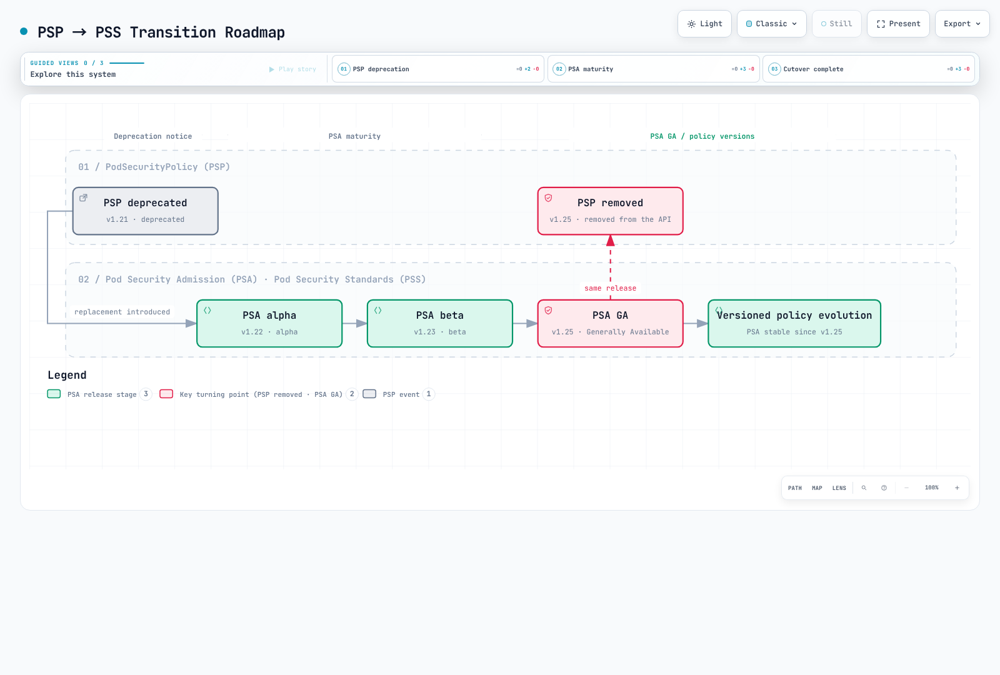
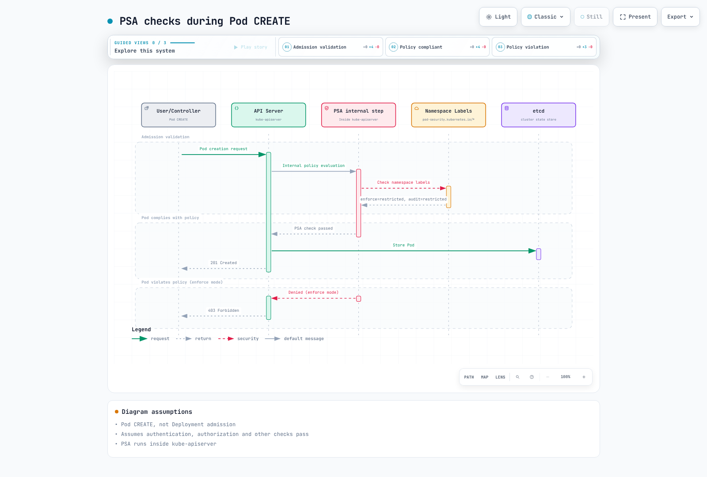
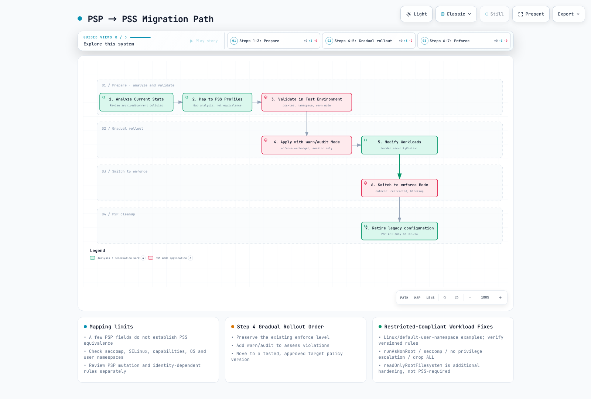

# Pod Security Standards (PSS)

> **検証ベースライン**: Kubernetes PSA ライブラリ `k8s.io/pod-security-admission` v0.36.2、PSS ポリシーの例 v1.35
> **最終更新日**: 2026年11月16日

Pod Security Standards (PSS) は、Kubernetes における Pod セキュリティの標準ポリシーフレームワークです。このドキュメントでは、PSS の概念、設定方法、EKS 環境での実装について説明します。

PSS はポリシーを定義し、PSA はそれらを適用する組み込みの Admission 実装です。特に記載がない限り、このガイドでは**ユーザー名前空間を使用しない通常の Linux Pod**を前提とします。ローカルでの上流ポリシー評価、スキーマ確認、コマンド確認は、デプロイとは別のものです。稼働中のクラスター、EKS、コンテナの実行はテストしていません。例の `v1.35` は固定されたポリシー定義であり、最新の Kubernetes/EKS サポートバージョンを示すものではありません。API サーバーのアップグレードによって、`latest` が指す内容は変わります。

## 目次

1. [PSP から PSS への移行](#evolution-from-psp-to-pss)
2. [Pod Security Admission (PSA) コントローラー](#pod-security-admission-psa-controller)
3. [セキュリティレベル](#security-levels)
4. [適用モード](#enforcement-modes)
5. [Namespace レベルの設定](#namespace-level-configuration)
6. [PSP から PSS への移行](#migration-from-psp-to-pss)
7. [EKS のデフォルト設定と構成](#eks-defaults-and-configuration)
8. [セキュリティプロファイルの詳細](#security-profile-details)
9. [例外の設定](#exemptions-configuration)
10. [段階的な導入のベストプラクティス](#best-practices-for-gradual-adoption)

---

## PSP から PSS への移行 {#evolution-from-psp-to-pss}

### PodSecurityPolicy (PSP) の歴史

PodSecurityPolicy (PSP) は、Pod のセキュリティ機構として Kubernetes 1.3 で初めて導入されました。しかし、次の問題があったため、Kubernetes 1.21 で非推奨となり、1.25 で完全に削除されました。

```
┌─────────────────────────────────────────────────────────────────┐
│                    Key Issues with PSP                           │
├─────────────────────────────────────────────────────────────────┤
│ 1. Complex RBAC binding requirements                             │
│ 2. Implicit policy application (unclear which policy applies)    │
│ 3. User vs workload permission confusion                         │
│ 4. No warn/audit rollout modes                                               │
│ 5. Limited audit capabilities                                    │
└─────────────────────────────────────────────────────────────────┘
```

### PSS の導入

Pod Security Standards (PSS) と Pod Security Admission (PSA) は、Kubernetes 1.22 でアルファ版として導入され、1.23 でベータ版となり、1.25 で GA (Generally Available) に達しました。



[🔍 インタラクティブな図を表示](https://www.atomai.click/kubernetes-docs/archmaps/en-security-03-pod-security-standards-0.html)

> 図の解釈: PSA は 1.25 で GA に達しました。1.28 は独立した安定化の節目ではありません。

### PSP と PSS の比較

| 機能 | PodSecurityPolicy (PSP) | Pod Security Standards (PSS) |
|---------|------------------------|------------------------------|
| **有効化** | 以前の Admission プラグイン | 組み込み PSA プラグインによって PSS 定義を適用 |
| **ポリシー定義** | カスタム PSP リソース | 定義済みの 3 つのプロファイル |
| **ポリシーのバインド** | 複雑な RBAC バインド | シンプルな Namespace ラベル |
| **スコープ** | クラスター全体または Namespace | Namespace レベル |
| **ポリシーのプレビュー** | PSA 形式の warn/audit モードはない。API の dry-run は別機能 | warn/audit モードに加え、API の dry-run |
| **監査** | 限定的 | 監査機能を組み込みでサポート |
| **柔軟性** | 高い（きめ細かな制御） | 中程度（標準化されたプロファイル） |
| **複雑さ** | 高い | 低い |

---

## Pod Security Admission (PSA) コントローラー {#pod-security-admission-psa-controller}

### PSA のアーキテクチャ

PSA は、mutating admission の後、**API サーバー内の validating admission 処理中に**実行されます。認証、認可、スキーマ検証、その他の Admission チェックも適用されます。これは外部 Webhook ではありません。また、この図は PSA と他のすべてのバリデーターとの間に普遍的な実行順序があるかのように示してはなりません。

```text
Request → authentication / authorization → mutating admission
        → validating admission (PSA + other checks) → persistence if accepted
```

### PSA の動作



[🔍 インタラクティブな図を表示](https://www.atomai.click/kubernetes-docs/archmaps/en-security-03-pod-security-standards-1.html)

> 図の範囲: PSA は API サーバー内で実行されます。Pod CREATE が成功して永続化されるのは、適用されるすべてのチェックに合格した後だけです。PSA の承認だけでは 201 Created は保証されません。

### PSA の状態を確認する

PSA は Kubernetes 1.23 でベータ版となり、デフォルトで有効化され、1.25 で GA に達しました。`--enable-admission-plugins=PodSecurity` フラグが明示されていないからといって、無効であるとは限りません。セルフマネージド API サーバーでは、明示的な無効化設定がないか確認してください。EKS ではその設定を参照できません。メトリクスから分かるのは評価の実行状況であり、機能ゲートの設定ではありません。`/metrics` へのアクセスには認可が必要であり、未使用の時系列は存在しない場合があります。

```bash
kubectl --context "$PSS_CONTEXT" get namespace "$PSS_NAMESPACE" -o yaml
kubectl --context "$PSS_CONTEXT" get --raw /metrics
```

以下の Pod の肯定・否定 dry-run 制御を使用して、実際の Admission 経路をテストしてください。Deployment の dry-run が成功しただけで準拠していると判断してはなりません。

---

## セキュリティレベル {#security-levels}

PSS は 3 つのセキュリティレベル（プロファイル）を定義します。各レベルでは、段階的に厳しくなるセキュリティ制約が適用されます。

### 1. Privileged

このプロファイルは PSS による制限を追加しません。コンテナの権限を自動的に有効にするわけではなく、RBAC、API 検証、その他の Admission ポリシーを回避するものでもありません。

```yaml
# Privileged profile: PSS imposes no controls; API/RBAC/other policies still apply
# Use cases: System daemons, CNI plugins, monitoring agents

apiVersion: v1
kind: Pod
metadata:
  name: privileged-pod
  namespace: pss-privileged-lab
spec:
  hostNetwork: true      # Allowed
  hostPID: true          # Allowed
  hostIPC: true          # Allowed
  containers:
  - name: privileged-container
    image: nginx
    securityContext:
      privileged: true   # Allowed
      runAsUser: 0    # Allowed
```

**Privileged レベルで許可されるもの:**
- Host ネットワーク、PID、IPC 名前空間
- 特権コンテナ
- すべての capability
- HostPath マウント
- 任意のユーザー ID／グループ ID

### 2. Baseline

既知の権限昇格を防ぐため、最小限の制限を適用します。一般的なワークロードの多くに適しています。

```yaml
# Baseline level: Prevents known privilege escalations
# Use cases: General applications, web servers, API servers

apiVersion: v1
kind: Pod
metadata:
  name: baseline-pod
spec:
  containers:
  - name: app
    image: nginx
    securityContext:
      # The following are prohibited in Baseline:
      # privileged: true        ❌
      # allowPrivilegeEscalation is not constrained by Baseline

      # The following are allowed in Baseline:
      runAsNonRoot: false      # ✓ (allowed but not recommended)
      readOnlyRootFilesystem: false  # ✓ (allowed)
    ports:
    - containerPort: 80
```

**Baseline レベルの制限:**

| フィールド | 制限 |
|-------|------------|
| HostProcess | Windows の HostProcess コンテナは禁止 |
| Host 名前空間 | hostNetwork、hostPID、hostIPC は禁止 |
| 特権コンテナ | privileged: true は禁止 |
| Capabilities | 明示的に追加できるのは、列挙された Baseline の許可リストに含まれるものに限られる。`NET_RAW` は含まれない |
| HostPath ボリューム | hostPath ボリュームは禁止 |
| Host ポート | 組み込み PSA では未設定または 0 が許可される。カスタムのポート許可リストはない |
| AppArmor | 未設定、または RuntimeDefault/Localhost。旧式のアノテーションでは runtime/default または localhost/* |
| SELinux | 制限された type 値のみ。user/role の設定は禁止 |
| /proc マウントタイプ | デフォルト値のみ許可 |
| Seccomp | 未設定でも許可。指定する場合は RuntimeDefault または Localhost（Unconfined は不可） |
| Sysctls | PSS バージョンで明示された sysctl 許可リストのみ。kubelet で安全な sysctl がすべて許可されるわけではない |

### 3. Restricted

Pod のセキュリティ強化に関するベストプラクティスを適用する、最も制限の厳しいポリシーです。セキュリティ要件の厳しいワークロードに適しています。

```yaml
apiVersion: v1
kind: Pod
metadata:
  name: restricted-pod
spec:
  automountServiceAccountToken: false
  securityContext:
    runAsNonRoot: true
    runAsUser: 101
    runAsGroup: 101
    fsGroup: 101
    seccompProfile:
      type: RuntimeDefault
  containers:
  - name: app
    image: ghcr.io/nginx/nginx-unprivileged@sha256:442753882674b49ae2c1de83ed67896131c0777f56df5005e356e62bc3f7e7ce
    securityContext:
      allowPrivilegeEscalation: false
      readOnlyRootFilesystem: true
      capabilities:
        drop: [ALL]
    ports:
    - containerPort: 8080
    resources:
      requests:
        cpu: 50m
        memory: 64Mi
      limits:
        cpu: 500m
        memory: 128Mi
    volumeMounts:
    - name: tmp
      mountPath: /tmp
  volumes:
  - name: tmp
    emptyDir: {}
```

**Restricted レベルで追加される制限:**

| フィールド | 制限 |
|-------|------------|
| ボリュームタイプ | configMap、csi、downwardAPI、emptyDir、ephemeral、persistentVolumeClaim、projected、secret のみ許可 |
| 権限昇格 | allowPrivilegeEscalation: false が必須 |
| 非 root での実行 | runAsNonRoot: true が必須 |
| 非 root ユーザーでの実行 | 明示的な runAsUser: 0 は禁止（v1.23 以降）。フィールドは省略可能 |
| Seccomp | RuntimeDefault または Localhost が必須 |
| Capabilities | すべての capability を drop する必要があり、追加できるのは NET_BIND_SERVICE のみ |


これらの制御は、該当する通常コンテナ、init コンテナ、ephemeral コンテナに適用されます。Pod レベルの非 root/seccomp 値は継承できますが、コンテナ側で競合する値を上書きすると準拠しません。ポリシー v1.34 以降では、HTTP/TCP probe とライフサイクルフックで空でない `host` も禁止されます。v1.35 では、`hostUsers: false` によって非 root のチェックが緩和されます。Baseline でも `procMount` が緩和されますが、Restricted では引き続き `Unmasked` が禁止されます。これには実際のユーザー名前空間サポートが必要であり、ラベルを付けるだけでは不十分です。権限昇格、seccomp、Linux capability に関する Windows 固有の緩和策は、この Linux の例とは別です。

#### 2026年11月の更新: EKS 上の AWS Batch におけるセキュリティコンテキストのサポート

2026年11月13日、AWS は、Linux capabilities、seccomp プロファイル、Pod レベルの設定など、Kubernetes の追加セキュリティコンテキスト設定を Amazon EKS のジョブ定義で AWS Batch がサポートすることを発表しました。これにより、Pod Security Standards の **restricted** プロファイルを適用する EKS クラスターで、AWS Batch のジョブを必要最小限の権限だけで実行できるようになりました。詳細は[発表](https://aws.amazon.com/about-aws/whats-new/2026/11/aws-batch-eks-security-context/)を参照してください。

### セキュリティレベルの比較図

```
┌──────────────────────────────────────────────────────────────────────────┐
│                     Security Level Comparison                             │
├──────────────────────────────────────────────────────────────────────────┤
│                                                                          │
│  Restriction  ━━━━━━━━━━━━━━━━━━━━━━━━━━━━━━━━━━━━━━━━━━━━━━━━━━━▶       │
│               Low                                           High          │
│                                                                          │
│  ┌──────────────┐    ┌──────────────┐    ┌──────────────┐               │
│  │  Privileged  │    │   Baseline   │    │  Restricted  │               │
│  │              │    │              │    │              │               │
│  │ No           │    │ Prevent      │    │ Security     │               │
│  │ restrictions │    │ known        │    │ best         │               │
│  │              │    │ escalations  │    │ practices    │               │
│  │              │    │              │    │              │               │
│  │ Use cases:   │    │ Use cases:   │    │ Use cases:   │               │
│  │ - CNI        │    │ - General    │    │ - Financial  │               │
│  │ - CSI        │    │   apps       │    │   apps       │               │
│  │ - Monitoring │    │ - Web        │    │ - Healthcare │               │
│  │              │    │   servers    │    │ - Multi-     │               │
│  │              │    │ - API        │    │   tenant     │               │
│  └──────────────┘    └──────────────┘    └──────────────┘               │
│                                                                          │
└──────────────────────────────────────────────────────────────────────────┘
```

---

## 適用モード {#enforcement-modes}

PSA には 3 つの適用モードがあります。これらのモードは個別に、または組み合わせて使用できます。

### 1. enforce

違反する Pod の作成と、該当する Pod の更新を拒否します。ワークロードテンプレートには warn/audit チェックが適用され、enforce は生成された Pod に対して実行されます。Namespace のラベルを変更しても、すでに実行中の Pod は退避されません。

```yaml
# enforce mode: Block Pod creation on violation
apiVersion: v1
kind: Namespace
metadata:
  name: production
  labels:
    pod-security.kubernetes.io/enforce: restricted
    pod-security.kubernetes.io/enforce-version: v1.35
```

**応答の例（クラスターで記録された実行結果ではありません）:**
```text
# Attempting to create a policy-violating Pod
$ kubectl apply --dry-run=server -f privileged-pod.yaml -n production
Error from server (Forbidden): error when creating "privileged-pod.yaml":
pods "privileged-pod" is forbidden: violates PodSecurity "restricted:v1.35":
privileged (container "app" must not set securityContext.privileged=true),
allowPrivilegeEscalation != false (container "app" must set
securityContext.allowPrivilegeEscalation=false)
```

### 2. audit

監査イベントに違反アノテーションを追加します。このモード自体はリクエストを拒否しません。監査ポリシーやログ配信の設定によって、イベントが保持されるかどうかが決まります。他のモードや Admission チェックによって拒否される場合はあります。

```yaml
# audit mode: Record violations in audit logs
apiVersion: v1
kind: Namespace
metadata:
  name: staging
  labels:
    pod-security.kubernetes.io/audit: restricted
    pod-security.kubernetes.io/audit-version: v1.35
```

**合成した監査イベントの抜粋（完全な記録済みイベントではありません）:**
```json
{
  "kind": "Event",
  "apiVersion": "audit.k8s.io/v1",
  "level": "Metadata",
  "auditID": "00000000-0000-4000-8000-000000000001",
  "stage": "ResponseComplete",
  "requestURI": "/api/v1/namespaces/staging/pods",
  "verb": "create",
  "user": {
    "username": "developer@example.com"
  },
  "objectRef": {
    "resource": "pods",
    "namespace": "staging",
    "name": "my-pod"
  },
  "annotations": {
    "pod-security.kubernetes.io/audit-violations": "privileged (container \"app\" must not set securityContext.privileged=true)"
  }
}
```

### 3. warn

クライアントから見える警告を返しますが、このモード自体はリクエストを拒否しません。enforce や他の Admission チェックによって拒否される場合はあります。

```yaml
# warn mode: Display warning messages on violation
apiVersion: v1
kind: Namespace
metadata:
  name: development
  labels:
    pod-security.kubernetes.io/warn: restricted
    pod-security.kubernetes.io/warn-version: v1.35
```

**警告の例（記録された実行結果ではありません）:**
```text
$ kubectl apply --dry-run=server -f non-compliant-pod.yaml -n development
Warning: would violate PodSecurity "restricted:v1.35":
allowPrivilegeEscalation != false (container "app" must set
securityContext.allowPrivilegeEscalation=false),
unrestricted capabilities (container "app" must set
securityContext.capabilities.drop=["ALL"])
pod/my-pod created (server dry run)
```

### モードの組み合わせ方針

最初の Privileged 段階は、より強い既存ポリシーが適用されていない Namespace に限ります。この図に従うために、既存の Baseline/Restricted の enforce を弱めてはなりません。

本番環境では、複数のモードを組み合わせることを推奨します。

```yaml
# Recommended configuration: Use mode combinations
apiVersion: v1
kind: Namespace
metadata:
  name: app-namespace
  labels:
    # Current enforcement level
    pod-security.kubernetes.io/enforce: baseline
    pod-security.kubernetes.io/enforce-version: v1.35
    # Audit next level
    pod-security.kubernetes.io/audit: restricted
    pod-security.kubernetes.io/audit-version: v1.35
    # Warn next level
    pod-security.kubernetes.io/warn: restricted
    pod-security.kubernetes.io/warn-version: v1.35
```

```
┌─────────────────────────────────────────────────────────────────┐
│                    Mode Combination Strategy                      │
├─────────────────────────────────────────────────────────────────┤
│                                                                 │
│  Phase 1: Assess Current State                                   │
│  ┌─────────────────────────────────────────────────────────┐   │
│  │ enforce: privileged                                      │   │
│  │ audit: baseline                                          │   │
│  │ warn: baseline                                           │   │
│  └─────────────────────────────────────────────────────────┘   │
│                           │                                     │
│                           ▼                                     │
│  Phase 2: Gradual Hardening                                      │
│  ┌─────────────────────────────────────────────────────────┐   │
│  │ enforce: baseline                                        │   │
│  │ audit: restricted                                        │   │
│  │ warn: restricted                                         │   │
│  └─────────────────────────────────────────────────────────┘   │
│                           │                                     │
│                           ▼                                     │
│  Phase 3: Final Goal                                             │
│  ┌─────────────────────────────────────────────────────────┐   │
│  │ enforce: restricted                                      │   │
│  │ audit: restricted                                        │   │
│  │ warn: restricted                                         │   │
│  └─────────────────────────────────────────────────────────┘   │
│                                                                 │
└─────────────────────────────────────────────────────────────────┘
```

---

## Namespace レベルの設定 {#namespace-level-configuration}

### 基本的なラベル設定

PSS は Namespace のラベルで設定します。

```yaml
apiVersion: v1
kind: Namespace
metadata:
  name: secure-namespace
  labels:
    # Format: pod-security.kubernetes.io/<MODE>: <LEVEL>
    pod-security.kubernetes.io/enforce: restricted
    pod-security.kubernetes.io/enforce-version: v1.35
    pod-security.kubernetes.io/audit: restricted
    pod-security.kubernetes.io/audit-version: v1.35
    pod-security.kubernetes.io/warn: restricted
    pod-security.kubernetes.io/warn-version: v1.35
```

### バージョンの指定

特定の Kubernetes バージョンの PSS 定義を使用できます。

```yaml
apiVersion: v1
kind: Namespace
metadata:
  name: versioned-namespace
  labels:
    # Use PSS definitions from a specific version
    pod-security.kubernetes.io/enforce: restricted
    pod-security.kubernetes.io/enforce-version: v1.35  # Specific version

    # Using 'latest' applies PSS from current cluster version
    # pod-security.kubernetes.io/enforce-version: latest
```

### 環境別の設定例

```yaml
---
# Development environment: Relaxed policy
apiVersion: v1
kind: Namespace
metadata:
  name: development
  labels:
    environment: development
    pod-security.kubernetes.io/enforce: baseline
    pod-security.kubernetes.io/warn: restricted
---
# Staging environment: Intermediate policy
apiVersion: v1
kind: Namespace
metadata:
  name: staging
  labels:
    environment: staging
    pod-security.kubernetes.io/enforce: baseline
    pod-security.kubernetes.io/audit: restricted
    pod-security.kubernetes.io/warn: restricted
---
# Production environment: Strict policy
apiVersion: v1
kind: Namespace
metadata:
  name: production
  labels:
    environment: production
    pod-security.kubernetes.io/enforce: restricted
    pod-security.kubernetes.io/audit: restricted
    pod-security.kubernetes.io/warn: restricted
```

### 既存の Namespace へのラベル追加

```bash
# Add labels using kubectl
kubectl label namespace my-namespace \
  pod-security.kubernetes.io/enforce=restricted \
  pod-security.kubernetes.io/enforce-version=v1.35 \
  pod-security.kubernetes.io/audit=restricted \
  pod-security.kubernetes.io/warn=restricted

# Verify labels
kubectl get namespace my-namespace -o yaml | grep pod-security
```

---

## PSP から PSS への移行 {#migration-from-psp-to-pss}

### 移行の概要

PSP から PSS への移行は、慎重に計画し、段階的に実施する必要があります。



[🔍 インタラクティブな図を表示](https://www.atomai.click/kubernetes-docs/archmaps/en-security-03-pod-security-standards-2.html)

> 図の範囲: PSP の分析と削除は過去の手順です。状況把握のために、既存のより強い enforce ポリシーを弱めてはなりません。readOnlyRootFilesystem は推奨事項であり、Restricted の必須要件ではありません。

### ステップ 1: 現在の PSP を分析する

**過去の環境に限る手順:** 以下の PSP コマンド／リソースは、`policy/v1beta1` がまだ提供されていた古いクラスター（Kubernetes 1.24 まで）または保存済みマニフェストに適用されます。現在のクラスターにはこの PSP を適用しないでください。また、以前 PSP によってデフォルト設定または変更されていたフィールドも棚卸ししてください。PSA はそれらを補完しません。

```bash
# List current PSPs
kubectl get psp

# Get PSP details
kubectl get psp <psp-name> -o yaml

# Check Pods with PSP applied
kubectl get pods --all-namespaces -o jsonpath='{range .items[*]}{.metadata.namespace}/{.metadata.name}: {.metadata.annotations.kubernetes\.io/psp}{"\n"}{end}'
```

### ステップ 2: PSP を PSS プロファイルに対応付ける

```yaml
# Example: Existing PSP
apiVersion: policy/v1beta1
kind: PodSecurityPolicy
metadata:
  name: restricted-psp
spec:
  privileged: false
  allowPrivilegeEscalation: false
  requiredDropCapabilities:
    - ALL
  volumes:
    - 'configMap'
    - 'emptyDir'
    - 'projected'
    - 'secret'
    - 'downwardAPI'
    - 'persistentVolumeClaim'
  hostNetwork: false
  hostIPC: false
  hostPID: false
  runAsUser:
    rule: MustRunAsNonRoot
  seLinux:
    rule: RunAsAny
  fsGroup:
    rule: RunAsAny
  supplementalGroups:
    rule: RunAsAny
```

**対応付けの結果:** Restricted は移行先の候補ですが、同等のポリシーではありません。この PSP には必須の seccomp 制御がなく、PSS が拒否する可能性のある SELinux 設定を許可しています。すべての制御と、その結果生成されるすべての Pod を比較してください。選択した 3 つのフィールドだけでは同等性を確認できません。

### PSP から PSS への対応付け表

| ワークロード要件 | PSS プロファイルの候補 | 必要な確認 |
|---|---|---|
| Host 名前空間、特権コンテナ、または hostPath | Privileged | 例外を分離し、追加の制御を適用する |
| Host へのアクセスは不要だが、root プロセスが必要 | Baseline | capability や seccomp を含む Baseline のすべての制御を確認する |
| 非 root、権限昇格なし、ALL を drop | Restricted | ボリューム、seccomp、上書き設定、バージョン固有の制御も確認する |

### ステップ 3: テスト環境で検証する

```bash
# Create test namespace
kubectl create namespace pss-test

# Apply restricted in warn mode
kubectl label namespace pss-test \
  pod-security.kubernetes.io/warn=restricted \
  pod-security.kubernetes.io/warn-version=v1.35

# Test existing workload deployment
kubectl apply -f my-deployment.yaml -n pss-test

# Check warnings and modify workloads
```

### ステップ 4: 段階的に適用する

```yaml
# Staged migration namespace configuration
apiVersion: v1
kind: Namespace
metadata:
  name: migrating-namespace
  labels:
    # Phase 1: New namespace without a previous stronger enforce policy
    pod-security.kubernetes.io/enforce: privileged
    pod-security.kubernetes.io/audit: baseline
    pod-security.kubernetes.io/warn: baseline

    # Phase 2: Apply baseline, monitor restricted
    # pod-security.kubernetes.io/enforce: baseline
    # pod-security.kubernetes.io/audit: restricted
    # pod-security.kubernetes.io/warn: restricted

    # Phase 3: Final restricted enforcement
    # pod-security.kubernetes.io/enforce: restricted
```

### ステップ 5: ワークロードを変更する

変更前: セキュリティコンテキストがない通常の `nginx` Pod は Restricted のチェックに失敗します。`runAsNonRoot` を追加するだけでは不十分です。イメージのユーザー、リスナー、書き込み可能なパスにも互換性が必要です。修正済みの Pod では、上流の非特権イメージ（UID/GID 101）、ポート 8080、読み取り専用のルートファイルシステムと書き込み可能な `/tmp` を使用します。

```yaml
apiVersion: v1
kind: Pod
metadata:
  name: new-pod
spec:
  automountServiceAccountToken: false
  securityContext:
    runAsNonRoot: true
    runAsUser: 101
    runAsGroup: 101
    fsGroup: 101
    seccompProfile:
      type: RuntimeDefault
  containers:
  - name: app
    image: ghcr.io/nginx/nginx-unprivileged@sha256:442753882674b49ae2c1de83ed67896131c0777f56df5005e356e62bc3f7e7ce
    securityContext:
      allowPrivilegeEscalation: false
      readOnlyRootFilesystem: true
      capabilities:
        drop: [ALL]
    ports:
    - containerPort: 8080
    resources:
      requests:
        cpu: 50m
        memory: 64Mi
      limits:
        cpu: 500m
        memory: 128Mi
    volumeMounts:
    - name: tmp
      mountPath: /tmp
  volumes:
  - name: tmp
    emptyDir: {}
```

### 移行自動化スクリプト

このスクリプトは、**レビュー済みの単一 Namespace**のみを対象とし、以前の warn/audit ラベルが存在しない場合に限って追加します。enforce は維持し、取得時のリソースバージョンを使って同時編集を拒否します。実行すると Namespace が実際に変更されるため、事前に対象を確認してください。既存のラベルがある場合は、自動的に設定を弱めるのではなく、手動で比較するために失敗します。警告は後続のリクエストで表示され、実行中のすべての Pod を遡ってスキャンするものではありません。

```python
#!/usr/bin/env python3
# add-pss-observation.py CONTEXT NAMESPACE
import json, subprocess, sys

if len(sys.argv) != 3:
    raise SystemExit("Usage: add-pss-observation.py CONTEXT NAMESPACE")
context, namespace = sys.argv[1:]
if namespace in {"kube-system", "kube-public", "kube-node-lease"}:
    raise SystemExit("Refusing system namespace; review its workload requirements separately")
base = ["kubectl", "--context", context, "--request-timeout=30s"]
obj = json.loads(subprocess.run(
    base + ["get", "namespace", namespace, "-o", "json"],
    check=True, text=True, capture_output=True).stdout)
labels = obj["metadata"].get("labels", {})
new = {
    "pod-security.kubernetes.io/warn": "restricted",
    "pod-security.kubernetes.io/warn-version": "v1.35",
    "pod-security.kubernetes.io/audit": "restricted",
    "pod-security.kubernetes.io/audit-version": "v1.35",
}
if any(key in labels for key in new):
    raise SystemExit("Existing observation policy: review it; do not overwrite automatically")
subprocess.run(base + [
    "label", "namespace", namespace,
    "--resource-version=" + obj["metadata"]["resourceVersion"],
] + [key + "=" + value for key, value in new.items()], check=True)
```

---

## EKS のデフォルト設定と構成 {#eks-defaults-and-configuration}

### EKS における PSA のデフォルト設定

AWS のドキュメントによると、EKS では 1.23 以降 PSA がデフォルトで有効になっており、すべてのモードでクラスターのデフォルトが `privileged/latest`、静的な例外はありません。こうした制限の緩いデフォルト設定は、ワークロードを強化するためのポリシーではありません。プラットフォームツールや管理者が作成した Namespace ラベルによってデフォルトが上書きされる場合があるため、すべての Namespace にラベルが付いていないと決めつけず、実際の Namespace を確認してください。

```bash
kubectl --context "$PSS_CONTEXT" get namespace "$PSS_NAMESPACE" -o yaml
```

### EKS での PSS 設定

```yaml
# Apply PSS to EKS namespace
apiVersion: v1
kind: Namespace
metadata:
  name: eks-app-namespace
  labels:
    # Example rollout choice, not a universal AWS requirement
    pod-security.kubernetes.io/enforce: baseline
    pod-security.kubernetes.io/enforce-version: v1.35
    pod-security.kubernetes.io/audit: restricted
    pod-security.kubernetes.io/warn: restricted

    # EKS-related labels
    app.kubernetes.io/managed-by: eks
```

### EKS のシステム Namespace に関する注意点

Host アクセスを必要とするエージェントは Baseline に準拠できませんが、だからといって `kube-system` 内のすべての Pod に完全な権限が必要というわけではありません。アドオンの正確なバージョンとレンダリング後の Pod spec を確認してください。システム Namespace 全体の warn/audit を無効にする一律の上書きは避けてください。可能であれば、承認済みの Host エージェントを通常のアプリケーションから分離し、そこでのデプロイ権限を制限してください。以下は専用 Namespace の例であり、既存のシステム Namespace のラベル変更を指示するものではありません。

```yaml
apiVersion: v1
kind: Namespace
metadata:
  name: host-agents
  labels:
    pod-security.kubernetes.io/enforce: privileged
    pod-security.kubernetes.io/audit: restricted
    pod-security.kubernetes.io/audit-version: v1.35
    pod-security.kubernetes.io/warn: restricted
    pod-security.kubernetes.io/warn-version: v1.35
```

### EKS アドオンと PSS の互換性

| コンポーネント／一般的なデプロイ | PSS の確認ポイント |
|---|---|
| VPC CNI `aws-node`、kube-proxy | Host ネットワークまたは特権を必要とするノード操作は Baseline の制限を超える場合がある |
| EBS/EFS CSI ノード DaemonSet | Host マウントは Baseline の制限を超える場合がある。コントローラー Pod の要件は異なる |
| ノードレベルの CloudWatch Agent / Fluent Bit | Host のログ／ファイルシステムへのアクセスは実際の設定による |
| CoreDNS、AWS Load Balancer Controller、Cluster Autoscaler | レンダリング後の spec を Baseline/Restricted に照らして評価する。コンポーネント名だけでは準拠しているとは判断できない |

EKS Auto Mode の組み込みノードコンポーネントは、セルフマネージドのアドオンとは異なります。この表は確認の手引きであり、検証済みの互換性マトリクスでも、列挙されたすべてのアドオンをインストールする要件でもありません。

### EKS Terraform の例

この断片は、1 つのアプリケーション Namespace を管理します。Kubernetes provider とその対象コンテキストは別途設定・確認してください。provider の初期化、plan、apply は実行していません。既存の Namespace は競合する Terraform/GitOps の所有関係を作らず、所有者を通じて採用または import してください。ポリシーは意図的にバージョンを固定しており、システム Namespace のラベルは変更しません。

```hcl
# Provider authentication/context and ownership must be configured separately.
resource "kubernetes_namespace_v1" "app" {
  metadata {
    name = "my-app"
    labels = {
      "pod-security.kubernetes.io/enforce"         = "restricted"
      "pod-security.kubernetes.io/enforce-version" = "v1.35"
      "pod-security.kubernetes.io/audit"           = "restricted"
      "pod-security.kubernetes.io/audit-version"   = "v1.35"
      "pod-security.kubernetes.io/warn"            = "restricted"
      "pod-security.kubernetes.io/warn-version"    = "v1.35"
      "environment"                              = "production"
    }
  }
}
```

---

## セキュリティプロファイルの詳細 {#security-profile-details}

### Privileged プロファイルの詳細

Privileged プロファイルは PSS による制限を適用しません。API 検証、RBAC、その他の Admission チェックは引き続き有効です。以下の Host root の例はポリシー分析専用であり、デプロイを推奨するワークロードではありません。

```yaml
# All options allowed in Privileged profile
apiVersion: v1
kind: Pod
metadata:
  name: privileged-example
spec:
  hostNetwork: true
  hostPID: true
  hostIPC: true
  containers:
  - name: privileged-container
    image: nginx
    securityContext:
      privileged: true
      allowPrivilegeEscalation: true
      runAsUser: 0
      capabilities:
        add:
          - ALL
    volumeMounts:
    - name: host-root
      mountPath: /host
  volumes:
  - name: host-root
    hostPath:
      path: /
      type: Directory
```

### Baseline プロファイルの詳細

```yaml
# Baseline profile restrictions (v1.35)
#
# Prohibited fields and values:
#
# spec.hostNetwork: true prohibited
# spec.hostPID: true prohibited
# spec.hostIPC: true prohibited
#
# spec.containers[*].securityContext.privileged: true prohibited
# spec.initContainers[*].securityContext.privileged: true prohibited
# spec.ephemeralContainers[*].securityContext.privileged: true prohibited
#
# spec.containers[*].securityContext.capabilities.add restricted
#   - Allowed: NET_BIND_SERVICE (only this in Restricted)
#   - Additionally allowed in Baseline: AUDIT_WRITE, CHOWN, DAC_OVERRIDE,
#     FOWNER, FSETID, KILL, MKNOD, NET_BIND_SERVICE,
#     SETFCAP, SETGID, SETPCAP, SETUID, SYS_CHROOT
#
# spec.volumes[*].hostPath prohibited
#
# spec.containers[*].ports[*].hostPort prohibited (except 0)
#
# spec.securityContext.appArmorProfile.type restricted
#   - Allowed: profile omitted, or type RuntimeDefault/Localhost
#   - Prohibited: Unconfined
#
# spec.securityContext.seLinuxOptions.type restricted
#   - Prohibited: Custom types (container_t etc. allowed)
#
# spec.securityContext.seccompProfile.type restricted
#   - Prohibited: Unconfined
#
# spec.securityContext.sysctls restricted
#   - Only the explicit versioned PSS sysctl allowlist

apiVersion: v1
kind: Pod
metadata:
  name: baseline-compliant
spec:
  automountServiceAccountToken: false
  containers:
  - name: app
    image: ghcr.io/nginx/nginx-unprivileged@sha256:442753882674b49ae2c1de83ed67896131c0777f56df5005e356e62bc3f7e7ce
    ports:
    - containerPort: 8080
    securityContext:
      capabilities:
        drop: [ALL]
```

### Restricted プロファイルの詳細

Restricted は、Baseline にボリュームの許可リスト、非 root での実行、明示的な seccomp、権限昇格の禁止、すべての capability の drop を追加します。追加が許可されるのは `NET_BIND_SERVICE` のみですが、このポート 8080 のリスナーでは必要ありません。`readOnlyRootFilesystem` は強化策として推奨されますが、PSS の要件ではありません。`containerPort` の設定はメタデータにすぎず、Nginx の設定は変更しません。

```yaml
apiVersion: v1
kind: Pod
metadata:
  name: restricted-compliant
spec:
  automountServiceAccountToken: false
  securityContext:
    runAsNonRoot: true
    runAsUser: 101
    runAsGroup: 101
    fsGroup: 101
    seccompProfile:
      type: RuntimeDefault
  containers:
  - name: app
    image: ghcr.io/nginx/nginx-unprivileged@sha256:442753882674b49ae2c1de83ed67896131c0777f56df5005e356e62bc3f7e7ce
    securityContext:
      allowPrivilegeEscalation: false
      readOnlyRootFilesystem: true
      capabilities:
        drop: [ALL]
    ports:
    - containerPort: 8080
    resources:
      requests:
        cpu: 50m
        memory: 64Mi
      limits:
        cpu: 500m
        memory: 128Mi
    volumeMounts:
    - name: tmp
      mountPath: /tmp
  volumes:
  - name: tmp
    emptyDir: {}
```

### Restricted に完全準拠した Nginx の例

このダイジェストは、Linux amd64/arm64 向けの上流 OCI メタデータ（Nginx 1.30.4、ユーザー 101）と照合しました。イメージレイヤーの取得やコンテナの実行は行っていません。上流のドキュメントでは、ポート 8080、`/tmp/nginx.pid`、`/tmp` 配下の一時パスが示されています。以下の ConfigMap は、それに対応するリスナーとヘルスエンドポイントを指定します。Deployment より先に、同じ Namespace に作成してください。ロールアウトの前に、承認済みの環境で起動と readiness を検証してください。

```yaml
apiVersion: apps/v1
kind: Deployment
metadata:
  name: nginx-restricted
  namespace: production
spec:
  replicas: 3
  selector:
    matchLabels:
      app: nginx
  template:
    metadata:
      labels:
        app: nginx
    spec:
      automountServiceAccountToken: false
      securityContext:
        runAsNonRoot: true
        runAsUser: 101  # nginx user
        runAsGroup: 101
        fsGroup: 101
        seccompProfile:
          type: RuntimeDefault
      containers:
      - name: nginx
        image: ghcr.io/nginx/nginx-unprivileged@sha256:442753882674b49ae2c1de83ed67896131c0777f56df5005e356e62bc3f7e7ce
        securityContext:
          allowPrivilegeEscalation: false
          readOnlyRootFilesystem: true
          runAsNonRoot: true
          runAsUser: 101
          capabilities:
            drop:
              - ALL
        ports:
        - containerPort: 8080
        resources:
          limits:
            cpu: 100m
            memory: 128Mi
          requests:
            cpu: 50m
            memory: 64Mi
        volumeMounts:
        - name: tmp
          mountPath: /tmp
        - name: config
          mountPath: /etc/nginx/conf.d
          readOnly: true
        livenessProbe:
          httpGet:
            path: /healthz
            port: 8080
          initialDelaySeconds: 5
          periodSeconds: 10
        readinessProbe:
          httpGet:
            path: /healthz
            port: 8080
          initialDelaySeconds: 5
          periodSeconds: 5
      volumes:
      - name: tmp
        emptyDir: {}
      - name: config
        configMap:
          name: nginx-config
---
apiVersion: v1
kind: ConfigMap
metadata:
  name: nginx-config
  namespace: production
data:
  default.conf: |
    server {
        listen 8080;
        server_name localhost;

        location / {
            root /usr/share/nginx/html;
            index index.html;
        }

        location /healthz {
            return 200 'OK';
            add_header Content-Type text/plain;
        }
    }
```

---

## 例外の設定 {#exemptions-configuration}

### クラスター レベルの例外設定

セルフマネージド API サーバーでは、`--admission-control-config-file` を使ってこの設定を読み込めます。この例ではすべての例外リストを空にしています。例外を設定すると、**PSA のすべてのモードがスキップされます**。`usernames` は、グループ、ワイルドカード、将来作成される Pod の ServiceAccount ではなく、認証済みリクエストのユーザー名と完全一致で照合されます。コントローラーのアカウントを例外にすると、多数のユーザーに代わって作成される Pod に対するチェックを回避してしまいます。Namespace 名と RuntimeClass 名も完全一致で照合されます。例外を設定するのは、それを利用できる対象を別途制限してからにしてください。

```yaml
# Self-managed API server configuration; not an EKS control-plane setting
apiVersion: apiserver.config.k8s.io/v1
kind: AdmissionConfiguration
plugins:
- name: PodSecurity
  configuration:
    apiVersion: pod-security.admission.config.k8s.io/v1
    kind: PodSecurityConfiguration
    defaults:
      enforce: baseline
      enforce-version: v1.35
      audit: restricted
      audit-version: v1.35
      warn: restricted
      warn-version: v1.35
    exemptions:
      usernames: []
      runtimeClasses: []
      namespaces: []
```

### EKS での例外設定

EKS では、マネージド API サーバーの AdmissionConfiguration を編集できません。Namespace の `enforce: privileged` は制限の緩いプロファイルであり、**静的な例外ではありません**。warn/audit は引き続きリクエストを評価できます。Namespace の変更／デプロイ権限を制限し、Host エージェントを通常のアプリケーションから分離してください。たとえば、hostNetwork/hostPID/hostPath を設定した node-exporter は Baseline に準拠できません。Baseline を設定しても、それらの Host アクセスが安全または許可されたものになるわけではありません。

```yaml
apiVersion: v1
kind: Namespace
metadata:
  name: host-agents
  labels:
    pod-security.kubernetes.io/enforce: privileged
    pod-security.kubernetes.io/audit: restricted
    pod-security.kubernetes.io/audit-version: v1.35
    pod-security.kubernetes.io/warn: restricted
    pod-security.kubernetes.io/warn-version: v1.35
```

### RuntimeClass に基づく例外

RuntimeClass は、設定済みの CRI ランタイムハンドラーを選択します。このリソースを作成しても gVisor/Kata がインストールされるわけではなく、PSA の例外が付与されるわけでもありません。対象となるすべてのノードがハンドラーをサポートしている必要があります（または適切なスケジューリング制約を使用してください）。この定義だけでは、PSA は完全に適用されます。

```yaml
apiVersion: node.k8s.io/v1
kind: RuntimeClass
metadata:
  name: gvisor
handler: runsc
```

セルフマネージド API サーバーに `runtimeClasses: ["gvisor"]` という別途設定された例外がある場合に限り、PSA がスキップされます。そのクラスを選択できるリクエストは、PSA を回避できるようになります。ランタイム分離は Admission による認可の代わりにはなりません。このマネージドコントロールプレーンの設定は EKS では利用できません。

### Kyverno によるきめ細かな例外

Kyverno は、PSA による拒否を許可に変えることはできません。Host エージェントに例外が必要な場合は、まず Namespace の PSA プロファイルとデプロイ権限を設計し、その後、対象を狭く限定した独立したポリシーを追加してください。HostPath だけを除外しても hostNetwork/hostPID のチェックは除外されません。また、イメージタグや変更可能な Pod ラベルだけで照合しても、認可にはなりません。

レビュー済みのポリシー API とバージョン／非推奨化の制限については、[Kyverno のポリシー管理](./01-kyverno-policy-management.md)を参照してください。小文字の `validationFailureAction: enforce` を含む旧式の `ClusterPolicy` をコピーしないでください。これは有効な値ではなく、ClusterPolicy は Kyverno 1.19 で非推奨です。置き換え後のポリシーは、通常のワークロードと例外対象のワークロードの両方でテストする必要があります。

---

## 段階的な導入のベストプラクティス {#best-practices-for-gradual-adoption}

### ステップ 1: 現状を分析する

warn ではなく **enforce** の変更をプレビューしてください。既存 Pod のチェックを起動するのは、enforce のレベル／バージョンの変更だけです。このサーバー dry-run ではラベルは保存されず、Pod も退避されません。有効な enforce ポリシーに変更がなければ、新たなスキャンは起動されません。スキャンはベストエフォートで、警告が制限または重複排除される場合があります。警告がないからといって、ワークロードがすべて監査済みとは限りません。コマンドや認証の失敗は引き続き失敗として扱われます。

```bash
#!/usr/bin/env bash
# preview-pss.sh: no namespace mutation
set -euo pipefail
: "${PSS_CONTEXT:?Set the approved test context}"
: "${PSS_NAMESPACE:?Set one namespace to inspect}"
kubectl --context "$PSS_CONTEXT" --request-timeout=30s \
  get namespace "$PSS_NAMESPACE" -o yaml
kubectl --context "$PSS_CONTEXT" --request-timeout=30s \
  label namespace "$PSS_NAMESPACE" \
  pod-security.kubernetes.io/enforce=restricted \
  pod-security.kubernetes.io/enforce-version=v1.35 \
  --overwrite --dry-run=server
```

### ステップ 2: 段階的なロールアウト戦略

日数の範囲は計画用の例であり、移行に要する実測期間ではありません。Namespace を明示的に棚卸しし、既存のより強いポリシーを決して弱めず、置き換え用 Pod とロールバック能力をテストしてから次の段階に進んでください。

```yaml
# Gradual rollout using GitOps

# Phase 1: Monitoring (Day 1-7)
# - Apply warn: baseline to all namespaces
# - Collect and analyze violations

# Phase 2: Development Environment (Day 8-14)
# - Apply enforce: baseline to development namespaces
# - Apply warn: baseline to staging namespaces

# Phase 3: Staging Environment (Day 15-21)
# - Apply enforce: baseline to staging namespaces
# - Apply warn: baseline to production namespaces

# Phase 4: Production Environment (Day 22-28)
# - Apply enforce: baseline to production namespaces
# - Apply warn: restricted to all environments

# Phase 5: Restricted Hardening (Day 29+)
# - Apply enforce: restricted as default for new namespaces
# - Gradually migrate existing namespaces
```

### ステップ 3: モニタリングとアラートを設定する

これらのルールを使うには、Prometheus Operator の CRD、この PrometheusRule を含むセレクター、`pod_security_evaluations_total` を公開する認可済み API サーバーのスクレイプ設定が必要です。組み込み PSA は `pod-security-webhook` という名前の Webhook ではありません。評価ラベルには decision、policy_level、policy_version、mode、request_operation、resource、subresource が含まれます。**namespace ラベルはありません**。Namespace やリクエストの詳細を確認するには、保持された監査イベントと関連付けてください。メトリクスがないことは、違反がゼロである証拠ではありません。audit モードの deny は違反評価を意味しますが、必ずしも API リクエストが拒否されたことを意味しません。

```yaml
apiVersion: monitoring.coreos.com/v1
kind: PrometheusRule
metadata:
  name: pss-violations
  namespace: monitoring
spec:
  groups:
  - name: pod-security-standards
    rules:
    - alert: PSSViolationDetected
      expr: |
        sum by (policy_level, policy_version, mode) (
          increase(pod_security_evaluations_total{mode="enforce",decision="deny"}[5m])
        ) > 0
      labels:
        severity: warning
      annotations:
        summary: "PSA denied a Pod request"
        description: "Policy {{ $labels.policy_level }}:{{ $labels.policy_version }}. Correlate audit logs for namespace and request identity."
    - alert: PSSAuditViolation
      expr: |
        sum by (policy_level, policy_version, mode) (
          increase(pod_security_evaluations_total{mode="audit",decision="deny"}[5m])
        ) > 10
      for: 5m
      labels:
        severity: info
      annotations:
        summary: "PSA audit violations increasing"
        description: "{{ $value }} violating evaluations over five minutes; not a count of unique Pods."
```

### ステップ 4: コンプライアンスチェックを自動化する

ワークロードを所有するプロジェクト内に `check-pss.py` として保存してください。前提条件は、PyYAML をインストールした Python 3、互換性のある kubectl、承認済みのクラスター認証情報、ポリシー v1.35 をサポートする Kubernetes API サーバー、そして `restricted:v1.35` を明示的に enforce している既存のテスト Namespace です。サーバー dry-run の場合も、呼び出し元には Namespace の読み取りと Pod 作成の認可が必要です。信頼できないプルリクエストのコードにクラスター認証情報を公開しないでください。

```python
#!/usr/bin/env python3
# check-pss.py CONTEXT NAMESPACE pod.yaml [pod2.yaml ...]
# Requires Python 3 + PyYAML and a preconfigured, authorized kubectl.
import copy, json, subprocess, sys
from pathlib import Path
import yaml

if len(sys.argv) < 4:
    raise SystemExit("Usage: check-pss.py CONTEXT NAMESPACE pod.yaml [...]")
context, namespace, *files = sys.argv[1:]
pods = []
for filename in files:
    docs = list(yaml.safe_load_all(Path(filename).read_text()))
    if not docs or any(not isinstance(p, dict) for p in docs):
        raise SystemExit(f"{filename}: empty/non-object YAML")
    for pod in docs:
        if (pod.get("apiVersion"), pod.get("kind")) != ("v1", "Pod"):
            raise SystemExit(f"{filename}: only explicit v1 Pod test inputs are supported")
        meta = pod.setdefault("metadata", {})
        if meta.get("namespace", namespace) != namespace:
            raise SystemExit(f"{filename}: namespace mismatch")
        meta["namespace"] = namespace
        pods.append(pod)
base = ["kubectl", "--context", context, "--request-timeout=30s"]
ns = json.loads(subprocess.run(
    base + ["get", "namespace", namespace, "-o", "json"],
    check=True, text=True, capture_output=True).stdout)
labels = ns["metadata"].get("labels", {})
if (labels.get("pod-security.kubernetes.io/enforce"),
    labels.get("pod-security.kubernetes.io/enforce-version")) != ("restricted", "v1.35"):
    raise SystemExit("Test namespace must explicitly enforce restricted:v1.35")

def dry_run(pod):
    return subprocess.run(
        base + ["create", "--dry-run=server", "--validate=strict",
                "--namespace", namespace, "-f", "-"],
        input=json.dumps(pod), text=True, capture_output=True)

control = {
    "apiVersion": "v1", "kind": "Pod",
    "metadata": {"generateName": "pss-control-", "namespace": namespace},
    "spec": {
        "automountServiceAccountToken": False,
        "securityContext": {"runAsNonRoot": True, "runAsUser": 65532,
                            "seccompProfile": {"type": "RuntimeDefault"}},
        "containers": [{"name": "probe", "image": "registry.k8s.io/pause:3.10",
                        "securityContext": {"allowPrivilegeEscalation": False,
                                            "capabilities": {"drop": ["ALL"]}}}],
    },
}
good = dry_run(control)
if good.returncode:
    raise SystemExit("Positive control failed; no compliance result:\n" + good.stderr)
bad = copy.deepcopy(control)
bad["spec"]["hostPID"] = True
denied = dry_run(bad)
if denied.returncode == 0 or 'violates PodSecurity "restricted:v1.35"' not in denied.stderr:
    raise SystemExit("Negative control did not confirm PSA rejection:\n" + denied.stderr)
for pod in pods:
    result = dry_run(pod)
    if result.returncode:
        raise SystemExit("Pod dry-run failed:\n" + result.stderr)
print(f"{len(pods)} explicit Pod inputs passed server dry-run in {namespace}")
```

```bash
python3 check-pss.py "$PSS_CONTEXT" "$PSS_NAMESPACE" ./pss-inputs/web-pod.yaml
```

明示的な入力リストでは、init コンテナを含め、各ワークロードの Pod テンプレートを網羅する必要があります。この例では、Deployment、空のファイル、Namespace の不一致、クエリの失敗、enforce の設定漏れ、例外または無効な否定コントロールの経路を拒否します。テンプレートの抽出、mutating webhook、スケジューリング、イメージの起動、将来のランタイム動作は、別途確認する必要があります。否定コントロールは PSA に拒否されなければなりません。それ以外のエラーは判定不能であり、チェックは失敗します。候補 Pod が別の例外（たとえば例外対象の RuntimeClass）を選択できる場合、その利用も禁止するか、テストクラスターの管理者が別途テストする必要があります。

### ステップ 5: ドキュメントとトレーニング

```markdown
# Pod Security Standards Guidelines

## Checklist for Developers

### When Writing Restricted-Level Pods:

- [ ] Set `spec.securityContext.runAsNonRoot: true`
- [ ] Set `spec.securityContext.seccompProfile.type: RuntimeDefault`
- [ ] Set `allowPrivilegeEscalation: false` on all containers
- [ ] Set `capabilities.drop: ["ALL"]` on all containers
- [ ] Set `readOnlyRootFilesystem: true` (recommended)
- [ ] Use unprivileged images (e.g., nginxinc/nginx-unprivileged)
- [ ] Mount emptyDir for writable paths

### Common Problem Solutions:

1. **nginx fails to bind port 80**
   → Add `NET_BIND_SERVICE` capability or use port 8080

2. **File write failures**
   → Mount emptyDir volumes to required paths

3. **Process runs as root**
   → Use unprivileged base image or add USER directive in Dockerfile
```

---

## トラブルシューティング

### よくあるエラーと解決策

#### 1. "allowPrivilegeEscalation != false" エラー

エラーの例です。YAML は**Pod spec の一部を修正したもの**であり、単独で使えるマニフェストではありません。既存のコンテナイメージ／設定は維持してください。該当するコンテナごとの制御は、init コンテナと ephemeral コンテナにも適用してください。

```text
allowPrivilegeEscalation != false
```

```yaml
spec:
  containers:
  - name: app
    securityContext:
      allowPrivilegeEscalation: false
```

#### 2. "unrestricted capabilities" エラー

エラーの例です。YAML は**Pod spec の一部を修正したもの**であり、単独で使えるマニフェストではありません。既存のコンテナイメージ／設定は維持してください。該当するコンテナごとの制御は、init コンテナと ephemeral コンテナにも適用してください。

```text
unrestricted capabilities
```

```yaml
spec:
  containers:
  - name: app
    securityContext:
      capabilities:
        drop: [ALL]
```

#### 3. "runAsNonRoot != true" エラー

エラーの例です。YAML は**Pod spec の一部を修正したもの**であり、単独で使えるマニフェストではありません。既存のコンテナイメージ／設定は維持してください。該当するコンテナごとの制御は、init コンテナと ephemeral コンテナにも適用してください。

```text
runAsNonRoot != true
```

```yaml
spec:
  securityContext:
    runAsNonRoot: true
    runAsUser: 101
```

#### 4. "seccompProfile" エラー

エラーの例です。YAML は**Pod spec の一部を修正したもの**であり、単独で使えるマニフェストではありません。既存のコンテナイメージ／設定は維持してください。該当するコンテナごとの制御は、init コンテナと ephemeral コンテナにも適用してください。

```text
seccompProfile must be RuntimeDefault or Localhost
```

```yaml
spec:
  securityContext:
    seccompProfile:
      type: RuntimeDefault
```

### PSS 違反チェックツール

Polaris、kube-score、Trivy は追加の静的チェックを提供しますが、クラスターのバージョン付き PSA ポリシー、例外、変更処理を厳密に代替するものではありません。レビュー済みのバージョンをインストールし、CLI のヘルプを確認してください。サーバー dry-run の成功が示すのは、そのリクエスト、ID、Namespace、実行時点に限った結果です。上記の明示的な Pod コントロールを使用してください。

```bash
# Dry-run check with kubectl
kubectl apply -f my-pod.yaml --dry-run=server

# Check with Polaris
polaris audit --audit-path ./k8s/ --format pretty

# Check with kube-score
kube-score score my-deployment.yaml

# Configuration check with Trivy
trivy config ./k8s/
```

---

## まとめ

Pod Security Standards (PSS) は、Kubernetes における Pod セキュリティを管理するための標準化されたアプローチを提供します。

1. **3 つのセキュリティレベル**: Privileged（すべての権限）、Baseline（既知の権限昇格を防止）、Restricted（最小権限）
2. **3 つの適用モード**: enforce（ブロック）、audit（記録）、warn（警告）
3. **Namespace ラベル**: PSP のようなユーザーとのバインドはありませんが、RBAC で Namespace ラベルの変更とワークロード作成を引き続き制限する必要があります
4. **段階的な導入をサポート**: warn/audit モードを使って安全に移行できます

### 推奨事項

- 新しいクラスターでは、最初から PSS を有効にする
- 既存クラスターでは warn モードから始め、段階的に強化する
- 本番環境では、少なくとも Baseline レベルを適用する
- 機密性の高いワークロードには Restricted レベルを適用する

---

## 参考資料

- [Kubernetes Pod Security Standards 公式ドキュメント](https://kubernetes.io/docs/concepts/security/pod-security-standards/)
- [Pod Security Admission 公式ドキュメント](https://kubernetes.io/docs/concepts/security/pod-security-admission/)
- [EKS ベストプラクティスガイド - Pod セキュリティ](https://docs.aws.amazon.com/eks/latest/best-practices/pod-security.html)
- [PSP から PSS への移行ガイド](https://kubernetes.io/docs/tasks/configure-pod-container/migrate-from-psp/)

- [PSA の Namespace ラベルによるプレビューと既存 Pod のチェック](https://kubernetes.io/docs/tasks/configure-pod-container/enforce-standards-namespace-labels/)
- [PSA の設定と例外](https://kubernetes.io/docs/tasks/configure-pod-container/enforce-standards-admission-controller/)
- [Nginx 非特権イメージと書き込み可能なパス](https://github.com/nginx/docker-nginx-unprivileged)
