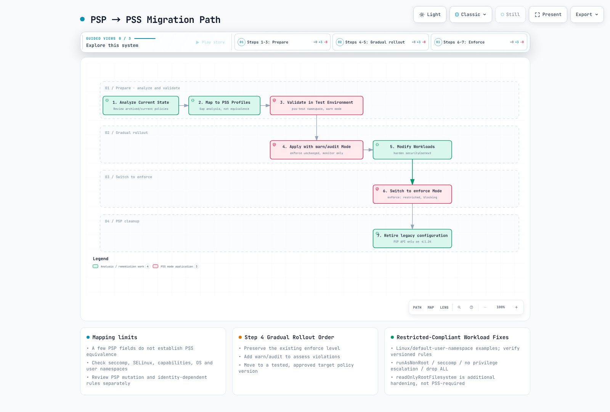

# Pod Security Standards (PSS)

> **検証ベースライン**: Kubernetes PSA ライブラリ `k8s.io/pod-security-admission` v0.36.2; 例の PSS ポリシー v1.35
> **最終更新日**: 2026年10月12日

Pod Security Standards (PSS) は、Kubernetes における Pod セキュリティのための標準化されたポリシーフレームワークです。このドキュメントでは、PSS の概念、設定方法、および EKS 環境での実装について説明します。

PSS はポリシーを定義し、PSA はそれらを適用する組み込みの admission 実装です。特に断りがない限り、このガイドでは**ユーザー名前空間を使用しない一般的な Linux Pod**を対象とします。ローカルのアップストリームポリシー評価とスキーマ/コマンドチェックはデプロイとは別であり、実際の cluster、EKS、またはコンテナ実行はテストしていません。例の `v1.35` は固定されたポリシー定義であり、Kubernetes/EKS がサポートする最新バージョンに関する主張ではありません。API server がアップグレードされると、`latest` の意味は変わります。

## 目次

1. [PSP から PSS への進化](#evolution-from-psp-to-pss)
2. [Pod Security Admission (PSA) Controller](#pod-security-admission-psa-controller)
3. [セキュリティレベル](#security-levels)
4. [適用モード](#enforcement-modes)
5. [Namespace レベルの設定](#namespace-level-configuration)
6. [PSP から PSS への移行](#migration-from-psp-to-pss)
7. [EKS のデフォルトと設定](#eks-defaults-and-configuration)
8. [セキュリティプロファイルの詳細](#security-profile-details)
9. [例外設定](#exemptions-configuration)
10. [段階的導入のベストプラクティス](#best-practices-for-gradual-adoption)

---

## PSP から PSS への進化 {#evolution-from-psp-to-pss}

### PodSecurityPolicy (PSP) の歴史

PodSecurityPolicy (PSP) は Pod セキュリティメカニズムとして Kubernetes 1.3 で初めて導入されました。しかし、以下の問題により Kubernetes 1.21 で非推奨となり、1.25 で完全に削除されました。

```
┌─────────────────────────────────────────────────────────────────┐
│                    Key Issues with PSP                           │
├─────────────────────────────────────────────────────────────────┤
│ 1. Complex RBAC binding requirements                             │
│ 2. Implicit policy application (unclear which policy applies)    │
│ 3. User vs workload permission confusion                         │
│ 4. No warn/audit rollout modes                                               │
│ 5. Limited audit capabilities                                    │
└─────────────────────────────────────────────────────────────────┘
```

### PSS の導入

Pod Security Standards (PSS) と Pod Security Admission (PSA) は Kubernetes 1.22 で alpha として導入され、1.23 で beta になり、1.25 で GA (Generally Available) に到達しました。


[🔍 インタラクティブな図を表示](https://www.atomai.click/kubernetes-docs/archmaps/en-security-03-pod-security-standards-0.html)

> 図の解釈: PSA は 1.25 で GA に到達しました。1.28 は別個の安定化マイルストーンではありません。

### PSP と PSS の比較

| 機能 | PodSecurityPolicy (PSP) | Pod Security Standards (PSS) |
|---------|------------------------|------------------------------|
| **有効化** | 以前の admission plugin | 組み込み PSA plugin によって強制される PSS 定義 |
| **ポリシー定義** | カスタム PSP リソース | 3 つの事前定義済みプロファイル |
| **ポリシーバインディング** | 複雑な RBAC バインディング | シンプルな namespace label |
| **スコープ** | Cluster 全体または namespace | Namespace レベル |
| **ポリシープレビュー** | PSA 形式の warn/audit モードなし。API dry-run は別 | warn/audit モードに API dry-run を追加 |
| **監査** | 制限あり | 組み込みの監査サポート |
| **柔軟性** | 高い（細かな制御） | 中程度（標準化プロファイル） |
| **複雑性** | 高い | 低い |

---

## Pod Security Admission (PSA) Controller

### PSA アーキテクチャ

PSA は、mutating admission の後、validating admission 中に**API server 内部**で実行されます。認証、認可、スキーマ検証、およびその他の admission チェックも適用されます。これは外部 webhook ではなく、図は PSA と他のすべての validator との普遍的な順序を示唆してはなりません。

```text
Request → authentication / authorization → mutating admission
        → validating admission (PSA + other checks) → persistence if accepted
```

### PSA の動作


[🔍 インタラクティブな図を表示](https://www.atomai.click/kubernetes-docs/archmaps/en-security-03-pod-security-standards-1.html)

> 図の範囲: PSA は API server 内部にあります。成功した Pod CREATE は、適用されるすべてのチェックに合格した後にのみ永続化されます。PSA の承認だけでは 201 Created は保証されません。

### PSA ステータスの検証

PSA は Kubernetes 1.23 で beta となりデフォルトで有効化され、その後 1.25 で GA に到達しました。明示的な `--enable-admission-plugins=PodSecurity` flag がないことは、無効であることを意味しません。セルフマネージド API server の設定で明示的な無効化を確認してください。EKS はその設定を公開していません。metrics は評価を示すものであり、feature-gate 設定を示すものではありません。`/metrics` へのアクセスには認可が必要で、使用されていない series は存在しない場合があります。

```bash
kubectl --context "$PSS_CONTEXT" get namespace "$PSS_NAMESPACE" -o yaml
kubectl --context "$PSS_CONTEXT" get --raw /metrics
```

実際のアドミッション経路をテストするには、以下の許可／拒否ケースの Pod dry-run 検証を使用してください。Deployment の dry-run が成功しただけで準拠していると判断してはいけません。

---

## セキュリティレベル {#security-levels}

PSS は 3 つのセキュリティレベル（プロファイル）を定義します。各レベルは段階的により厳しいセキュリティ制約を適用します。

### 1. Privileged

このプロファイルは PSS の制限を追加しません。コンテナ権限を自動的に有効化することも、RBAC、API 検証、その他の admission ポリシーをバイパスすることもありません。

```yaml
# Privileged profile: PSS imposes no controls; API/RBAC/other policies still apply
# Use cases: System daemons, CNI plugins, monitoring agents

apiVersion: v1
kind: Pod
metadata:
  name: privileged-pod
  namespace: pss-privileged-lab
spec:
  hostNetwork: true      # Allowed
  hostPID: true          # Allowed
  hostIPC: true          # Allowed
  containers:
  - name: privileged-container
    image: nginx
    securityContext:
      privileged: true   # Allowed
      runAsUser: 0    # Allowed
```

**Privileged レベルで許可されるもの:**
- Host network、PID、IPC namespace
- Privileged コンテナ
- すべての capability
- HostPath mount
- 任意の user/group ID

### 2. Baseline

既知の権限昇格を防ぐための最小限の制限を適用します。ほとんどの一般的な workload に適しています。

```yaml
# Baseline level: Prevents known privilege escalations
# Use cases: General applications, web servers, API servers

apiVersion: v1
kind: Pod
metadata:
  name: baseline-pod
spec:
  containers:
  - name: app
    image: nginx
    securityContext:
      # The following are prohibited in Baseline:
      # privileged: true        ❌
      # allowPrivilegeEscalation is not constrained by Baseline

      # The following are allowed in Baseline:
      runAsNonRoot: false      # ✓ (allowed but not recommended)
      readOnlyRootFilesystem: false  # ✓ (allowed)
    ports:
    - containerPort: 80
```

**Baseline レベルの制限:**

| フィールド | 制限 |
|-------|------------|
| HostProcess | Windows HostProcess コンテナは禁止 |
| Host Namespaces | hostNetwork、hostPID、hostIPC は禁止 |
| Privileged Containers | privileged: true は禁止 |
| Capabilities | 明示的な追加は、一覧にある Baseline allowlist に限定。`NET_RAW` は含まれない |
| HostPath Volumes | hostPath volume は禁止 |
| Host Ports | 組み込み PSA は未設定/0 を許可。カスタム port allowlist はない |
| AppArmor | 未設定または RuntimeDefault/Localhost。レガシー annotation は runtime/default または localhost/* を使用 |
| SELinux | 制限された type 値のみ。user/role の設定は禁止 |
| /proc Mount Type | デフォルト値のみ許可 |
| Seccomp | 未設定は許可。指定する場合は RuntimeDefault または Localhost（Unconfined は不可） |
| Sysctls | PSS バージョンの明示的な sysctl allowlist のみ。すべての kubelet-safe sysctl ではない |

### 3. Restricted

Pod セキュリティ強化のベストプラクティスを適用する、最も制限の厳しいポリシーです。セキュリティ要件の厳しいワークロードに適しています。

```yaml
apiVersion: v1
kind: Pod
metadata:
  name: restricted-pod
spec:
  automountServiceAccountToken: false
  securityContext:
    runAsNonRoot: true
    runAsUser: 101
    runAsGroup: 101
    fsGroup: 101
    seccompProfile:
      type: RuntimeDefault
  containers:
  - name: app
    image: ghcr.io/nginx/nginx-unprivileged@sha256:442753882674b49ae2c1de83ed67896131c0777f56df5005e356e62bc3f7e7ce
    securityContext:
      allowPrivilegeEscalation: false
      readOnlyRootFilesystem: true
      capabilities:
        drop: [ALL]
    ports:
    - containerPort: 8080
    resources:
      requests:
        cpu: 50m
        memory: 64Mi
      limits:
        cpu: 500m
        memory: 128Mi
    volumeMounts:
    - name: tmp
      mountPath: /tmp
  volumes:
  - name: tmp
    emptyDir: {}
```

**Restricted レベルの追加制限:**

| フィールド | 制限 |
|-------|------------|
| Volume Types | configMap、csi、downwardAPI、emptyDir、ephemeral、persistentVolumeClaim、projected、secret のみ許可 |
| Privilege Escalation | allowPrivilegeEscalation: false が必須 |
| Running as Non-root | runAsNonRoot: true が必須 |
| Running as Non-root user | 明示的な runAsUser: 0 は禁止（v1.23+）。フィールドは省略可能 |
| Seccomp | RuntimeDefault または Localhost が必須 |
| Capabilities | すべての capability を drop する必要があり、追加できるのは NET_BIND_SERVICE のみ |


このコントロールは、該当する通常の container、init container、ephemeral container に適用されます。Pod レベルの non-root/seccomp 値は継承できますが、競合する container override は準拠しません。ポリシー v1.34+ では、HTTP/TCP probe と lifecycle hook の空でない `host` も禁止されます。v1.35 では、`hostUsers: false` によって non-root チェックが緩和されます。Baseline でも `procMount` が緩和されますが、Restricted では依然として `Unmasked` が禁止されます。これには label だけでなく、実際の user-namespace サポートが必要です。権限昇格、seccomp、Linux capability に対する Windows 固有の緩和は、この Linux の例とは別です。

### セキュリティレベル比較表

```
┌──────────────────────────────────────────────────────────────────────────┐
│                     Security Level Comparison                             │
├──────────────────────────────────────────────────────────────────────────┤
│                                                                          │
│  Restriction  ━━━━━━━━━━━━━━━━━━━━━━━━━━━━━━━━━━━━━━━━━━━━━━━━━━━▶       │
│               Low                                           High          │
│                                                                          │
│  ┌──────────────┐    ┌──────────────┐    ┌──────────────┐               │
│  │  Privileged  │    │   Baseline   │    │  Restricted  │               │
│  │              │    │              │    │              │               │
│  │ No           │    │ Prevent      │    │ Security     │               │
│  │ restrictions │    │ known        │    │ best         │               │
│  │              │    │ escalations  │    │ practices    │               │
│  │              │    │              │    │              │               │
│  │ Use cases:   │    │ Use cases:   │    │ Use cases:   │               │
│  │ - CNI        │    │ - General    │    │ - Financial  │               │
│  │ - CSI        │    │   apps       │    │   apps       │               │
│  │ - Monitoring │    │ - Web        │    │ - Healthcare │               │
│  │              │    │   servers    │    │ - Multi-     │               │
│  │              │    │ - API        │    │   tenant     │               │
│  └──────────────┘    └──────────────┘    └──────────────┘               │
│                                                                          │
└──────────────────────────────────────────────────────────────────────────┘
```

---

## 適用モード {#enforcement-modes}

PSA には 3 つの適用モードがあります。これらのモードは、個別にも組み合わせても使用できます。

### 1. enforce

違反する Pod の作成と関連する Pod 更新を拒否します。workload template は warn/audit チェックを受け、強制は結果として作成される Pod に対して行われます。namespace の再ラベル付けは、すでに実行中の Pod を退避させません。

```yaml
# enforce mode: Block Pod creation on violation
apiVersion: v1
kind: Namespace
metadata:
  name: production
  labels:
    pod-security.kubernetes.io/enforce: restricted
    pod-security.kubernetes.io/enforce-version: v1.35
```

**説明用のレスポンス抜粋（記録済みの cluster 実行ではありません）:**
```text
# Attempting to create a policy-violating Pod
$ kubectl apply --dry-run=server -f privileged-pod.yaml -n production
Error from server (Forbidden): error when creating "privileged-pod.yaml":
pods "privileged-pod" is forbidden: violates PodSecurity "restricted:v1.35":
privileged (container "app" must not set securityContext.privileged=true),
allowPrivilegeEscalation != false (container "app" must set
securityContext.allowPrivilegeEscalation=false)
```

### 2. audit

監査イベントに違反 annotation を追加します。このモード自体はリクエストを拒否しません。これらのイベントが保持されるかどうかは、audit-policy/log-delivery 設定によって決まります。その他のモードおよび admission チェックによって、引き続き拒否される場合があります。

```yaml
# audit mode: Record violations in audit logs
apiVersion: v1
kind: Namespace
metadata:
  name: staging
  labels:
    pod-security.kubernetes.io/audit: restricted
    pod-security.kubernetes.io/audit-version: v1.35
```

**合成された audit-event 抜粋（完全なキャプチャ済みイベントではありません）:**
```json
{
  "kind": "Event",
  "apiVersion": "audit.k8s.io/v1",
  "level": "Metadata",
  "auditID": "00000000-0000-4000-8000-000000000001",
  "stage": "ResponseComplete",
  "requestURI": "/api/v1/namespaces/staging/pods",
  "verb": "create",
  "user": {
    "username": "developer@example.com"
  },
  "objectRef": {
    "resource": "pods",
    "namespace": "staging",
    "name": "my-pod"
  },
  "annotations": {
    "pod-security.kubernetes.io/audit-violations": "privileged (container \"app\" must not set securityContext.privileged=true)"
  }
}
```

### 3. warn

リクエスト自体を拒否せずに、client から見える warning を返します。enforce または他の admission チェックによって、引き続き拒否される場合があります。

```yaml
# warn mode: Display warning messages on violation
apiVersion: v1
kind: Namespace
metadata:
  name: development
  labels:
    pod-security.kubernetes.io/warn: restricted
    pod-security.kubernetes.io/warn-version: v1.35
```

**説明用の warning 抜粋（記録済みの実行ではありません）:**
```text
$ kubectl apply --dry-run=server -f non-compliant-pod.yaml -n development
Warning: would violate PodSecurity "restricted:v1.35":
allowPrivilegeEscalation != false (container "app" must set
securityContext.allowPrivilegeEscalation=false),
unrestricted capabilities (container "app" must set
securityContext.capabilities.drop=["ALL"])
pod/my-pod created (server dry run)
```

### モードの組み合わせ戦略

最初の Privileged 段階は、より強力な既存ポリシーがない namespace 専用です。この図に従うために Baseline/Restricted の強制を下げてはいけません。

本番環境では、複数モードを組み合わせることを推奨します。

```yaml
# Recommended configuration: Use mode combinations
apiVersion: v1
kind: Namespace
metadata:
  name: app-namespace
  labels:
    # Current enforcement level
    pod-security.kubernetes.io/enforce: baseline
    pod-security.kubernetes.io/enforce-version: v1.35
    # Audit next level
    pod-security.kubernetes.io/audit: restricted
    pod-security.kubernetes.io/audit-version: v1.35
    # Warn next level
    pod-security.kubernetes.io/warn: restricted
    pod-security.kubernetes.io/warn-version: v1.35
```

```
┌─────────────────────────────────────────────────────────────────┐
│                    Mode Combination Strategy                      │
├─────────────────────────────────────────────────────────────────┤
│                                                                 │
│  Phase 1: Assess Current State                                   │
│  ┌─────────────────────────────────────────────────────────┐   │
│  │ enforce: privileged                                      │   │
│  │ audit: baseline                                          │   │
│  │ warn: baseline                                           │   │
│  └─────────────────────────────────────────────────────────┘   │
│                           │                                     │
│                           ▼                                     │
│  Phase 2: Gradual Hardening                                      │
│  ┌─────────────────────────────────────────────────────────┐   │
│  │ enforce: baseline                                        │   │
│  │ audit: restricted                                        │   │
│  │ warn: restricted                                         │   │
│  └─────────────────────────────────────────────────────────┘   │
│                           │                                     │
│                           ▼                                     │
│  Phase 3: Final Goal                                             │
│  ┌─────────────────────────────────────────────────────────┐   │
│  │ enforce: restricted                                      │   │
│  │ audit: restricted                                        │   │
│  │ warn: restricted                                         │   │
│  └─────────────────────────────────────────────────────────┘   │
│                                                                 │
└─────────────────────────────────────────────────────────────────┘
```

---

## Namespace レベルの設定 {#namespace-level-configuration}

### 基本的な Label 設定

PSS は namespace label を通じて設定します。

```yaml
apiVersion: v1
kind: Namespace
metadata:
  name: secure-namespace
  labels:
    # Format: pod-security.kubernetes.io/<MODE>: <LEVEL>
    pod-security.kubernetes.io/enforce: restricted
    pod-security.kubernetes.io/enforce-version: v1.35
    pod-security.kubernetes.io/audit: restricted
    pod-security.kubernetes.io/audit-version: v1.35
    pod-security.kubernetes.io/warn: restricted
    pod-security.kubernetes.io/warn-version: v1.35
```

### バージョンの指定

特定の Kubernetes バージョンの PSS 定義を使用できます。

```yaml
apiVersion: v1
kind: Namespace
metadata:
  name: versioned-namespace
  labels:
    # Use PSS definitions from a specific version
    pod-security.kubernetes.io/enforce: restricted
    pod-security.kubernetes.io/enforce-version: v1.35  # Specific version

    # Using 'latest' applies PSS from current cluster version
    # pod-security.kubernetes.io/enforce-version: latest
```

### 環境別の設定例

```yaml
---
# Development environment: Relaxed policy
apiVersion: v1
kind: Namespace
metadata:
  name: development
  labels:
    environment: development
    pod-security.kubernetes.io/enforce: baseline
    pod-security.kubernetes.io/warn: restricted
---
# Staging environment: Intermediate policy
apiVersion: v1
kind: Namespace
metadata:
  name: staging
  labels:
    environment: staging
    pod-security.kubernetes.io/enforce: baseline
    pod-security.kubernetes.io/audit: restricted
    pod-security.kubernetes.io/warn: restricted
---
# Production environment: Strict policy
apiVersion: v1
kind: Namespace
metadata:
  name: production
  labels:
    environment: production
    pod-security.kubernetes.io/enforce: restricted
    pod-security.kubernetes.io/audit: restricted
    pod-security.kubernetes.io/warn: restricted
```

### 既存 Namespace への Label 追加

```bash
# Add labels using kubectl
kubectl label namespace my-namespace \
  pod-security.kubernetes.io/enforce=restricted \
  pod-security.kubernetes.io/enforce-version=v1.35 \
  pod-security.kubernetes.io/audit=restricted \
  pod-security.kubernetes.io/warn=restricted

# Verify labels
kubectl get namespace my-namespace -o yaml | grep pod-security
```

---

## PSP から PSS への移行 {#migration-from-psp-to-pss}

### 移行の概要

PSP から PSS への移行は、慎重に計画し、段階的に実施する必要があります。



[🔍 インタラクティブな図を表示](https://www.atomai.click/kubernetes-docs/archmaps/en-security-03-pod-security-standards-2.html)

> 図の範囲: PSP の分析/削除は履歴上のものです。観察のために既存のより強い enforce ポリシーを下げてはいけません。readOnlyRootFilesystem は推奨であり、Restricted の必須要件ではありません。

### ステップ 1: 現在の PSP を分析する

**履歴上の手順のみ:** 以下の PSP コマンド/リソースは、まだ `policy/v1beta1` を提供していた古い cluster（Kubernetes 1.24 まで）、または保存済み manifest に適用されます。この PSP を現在の cluster に適用しないでください。また、PSP により以前デフォルト化/変更されていたフィールドもインベントリ化してください。PSA はそれらを補完しません。

```bash
# List current PSPs
kubectl get psp

# Get PSP details
kubectl get psp <psp-name> -o yaml

# Check Pods with PSP applied
kubectl get pods --all-namespaces -o jsonpath='{range .items[*]}{.metadata.namespace}/{.metadata.name}: {.metadata.annotations.kubernetes\.io/psp}{"\n"}{end}'
```

### ステップ 2: PSP を PSS プロファイルにマッピングする

```yaml
# Example: Existing PSP
apiVersion: policy/v1beta1
kind: PodSecurityPolicy
metadata:
  name: restricted-psp
spec:
  privileged: false
  allowPrivilegeEscalation: false
  requiredDropCapabilities:
    - ALL
  volumes:
    - 'configMap'
    - 'emptyDir'
    - 'projected'
    - 'secret'
    - 'downwardAPI'
    - 'persistentVolumeClaim'
  hostNetwork: false
  hostIPC: false
  hostPID: false
  runAsUser:
    rule: MustRunAsNonRoot
  seLinux:
    rule: RunAsAny
  fsGroup:
    rule: RunAsAny
  supplementalGroups:
    rule: RunAsAny
```

**マッピング結果:** Restricted は候補となる対象であり、等価なポリシーではありません。この PSP には必須の seccomp コントロールがなく、PSS が拒否する可能性がある SELinux 設定を許可しています。すべてのコントロールと結果として生成されるすべての Pod を比較してください。選択した 3 つのフィールドだけでは等価性を確立できません。

### PSP から PSS へのマッピング表

| Workload 要件 | 候補 PSS プロファイル | 必要なレビュー |
|---|---|---|
| Host namespace、privileged container、または hostPath | Privileged | 例外を分離し、追加コントロールを適用する |
| Host access は不要だが root process が必要 | Baseline | capability と seccomp を含む、すべての Baseline コントロールを確認する |
| Non-root、権限昇格なし、ALL を drop | Restricted | volume、seccomp、override、バージョン固有のコントロールも確認する |

### ステップ 3: テスト環境で検証する

```bash
# Create test namespace
kubectl create namespace pss-test

# Apply restricted in warn mode
kubectl label namespace pss-test \
  pod-security.kubernetes.io/warn=restricted \
  pod-security.kubernetes.io/warn-version=v1.35

# Test existing workload deployment
kubectl apply -f my-deployment.yaml -n pss-test

# Check warnings and modify workloads
```

### ステップ 4: 段階的な適用

```yaml
# Staged migration namespace configuration
apiVersion: v1
kind: Namespace
metadata:
  name: migrating-namespace
  labels:
    # Phase 1: New namespace without a previous stronger enforce policy
    pod-security.kubernetes.io/enforce: privileged
    pod-security.kubernetes.io/audit: baseline
    pod-security.kubernetes.io/warn: baseline

    # Phase 2: Apply baseline, monitor restricted
    # pod-security.kubernetes.io/enforce: baseline
    # pod-security.kubernetes.io/audit: restricted
    # pod-security.kubernetes.io/warn: restricted

    # Phase 3: Final restricted enforcement
    # pod-security.kubernetes.io/enforce: restricted
```

### ステップ 5: Workload を変更する

変更前: security context を持たないプレーンな `nginx` Pod は Restricted チェックに失敗します。`runAsNonRoot` だけを追加しても不十分です。image user、listener、書き込み可能な path も互換性がなければなりません。修正後の Pod では、アップストリームの unprivileged image（UID/GID 101）、port 8080、および read-only root filesystem で書き込み可能な `/tmp` を使用します。

```yaml
apiVersion: v1
kind: Pod
metadata:
  name: new-pod
spec:
  automountServiceAccountToken: false
  securityContext:
    runAsNonRoot: true
    runAsUser: 101
    runAsGroup: 101
    fsGroup: 101
    seccompProfile:
      type: RuntimeDefault
  containers:
  - name: app
    image: ghcr.io/nginx/nginx-unprivileged@sha256:442753882674b49ae2c1de83ed67896131c0777f56df5005e356e62bc3f7e7ce
    securityContext:
      allowPrivilegeEscalation: false
      readOnlyRootFilesystem: true
      capabilities:
        drop: [ALL]
    ports:
    - containerPort: 8080
    resources:
      requests:
        cpu: 50m
        memory: 64Mi
      limits:
        cpu: 500m
        memory: 128Mi
    volumeMounts:
    - name: tmp
      mountPath: /tmp
  volumes:
  - name: tmp
    emptyDir: {}
```

### 移行自動化スクリプト

これは意図的に**レビュー済みの 1 つの namespace**を対象にし、以前存在しなかった warn/audit label のみを追加し、enforce を維持し、確認された resource version を使用して並行編集を拒否します。実行すると実際に namespace を変更するため、まず対象を確認してください。既存 label がある場合は自動的なダウングレードではなく、手動比較のために失敗します。warning は、その後のリクエストで表示され、実行中のすべての Pod を遡及的にスキャンするものではありません。

```python
#!/usr/bin/env python3
# add-pss-observation.py CONTEXT NAMESPACE
import json, subprocess, sys

if len(sys.argv) != 3:
    raise SystemExit("Usage: add-pss-observation.py CONTEXT NAMESPACE")
context, namespace = sys.argv[1:]
if namespace in {"kube-system", "kube-public", "kube-node-lease"}:
    raise SystemExit("Refusing system namespace; review its workload requirements separately")
base = ["kubectl", "--context", context, "--request-timeout=30s"]
obj = json.loads(subprocess.run(
    base + ["get", "namespace", namespace, "-o", "json"],
    check=True, text=True, capture_output=True).stdout)
labels = obj["metadata"].get("labels", {})
new = {
    "pod-security.kubernetes.io/warn": "restricted",
    "pod-security.kubernetes.io/warn-version": "v1.35",
    "pod-security.kubernetes.io/audit": "restricted",
    "pod-security.kubernetes.io/audit-version": "v1.35",
}
if any(key in labels for key in new):
    raise SystemExit("Existing observation policy: review it; do not overwrite automatically")
subprocess.run(base + [
    "label", "namespace", namespace,
    "--resource-version=" + obj["metadata"]["resourceVersion"],
] + [key + "=" + value for key, value in new.items()], check=True)
```

---

## EKS のデフォルトと設定 {#eks-defaults-and-configuration}

### EKS における PSA のデフォルト設定

AWS は、EKS 1.23 から PSA がデフォルトで有効であり、すべてのモードに対して cluster のデフォルトが `privileged/latest`、静的な例外がないことを文書化しています。これらの寛容なデフォルトは workload 強化ポリシーではありません。platform tool または administrator によって作成された namespace label はデフォルトを上書きできます。すべての namespace に label がないと想定するのではなく、実際の namespace を検査してください。

```bash
kubectl --context "$PSS_CONTEXT" get namespace "$PSS_NAMESPACE" -o yaml
```

### EKS での PSS 設定

```yaml
# Apply PSS to EKS namespace
apiVersion: v1
kind: Namespace
metadata:
  name: eks-app-namespace
  labels:
    # Example rollout choice, not a universal AWS requirement
    pod-security.kubernetes.io/enforce: baseline
    pod-security.kubernetes.io/enforce-version: v1.35
    pod-security.kubernetes.io/audit: restricted
    pod-security.kubernetes.io/warn: restricted

    # EKS-related labels
    app.kubernetes.io/managed-by: eks
```

### EKS System Namespace に関する考慮事項

host-access agent は Baseline を満たせませんが、`kube-system` のすべての Pod に完全な権限が必要という意味ではありません。正確な add-on バージョンとレンダリングされた Pod spec をレビューしてください。system namespace 全体の warn/audit を無効化する包括的な上書きは避けてください。可能な限り、承認された host agent を通常の application から分離し、そこにデプロイできるユーザーを制限してください。以下は専用の例 namespace であり、既存の system namespace を再ラベル付けする指示ではありません。

```yaml
apiVersion: v1
kind: Namespace
metadata:
  name: host-agents
  labels:
    pod-security.kubernetes.io/enforce: privileged
    pod-security.kubernetes.io/audit: restricted
    pod-security.kubernetes.io/audit-version: v1.35
    pod-security.kubernetes.io/warn: restricted
    pod-security.kubernetes.io/warn-version: v1.35
```

### EKS Add-on と PSS の互換性

| コンポーネント / 典型的なデプロイ | PSS レビュー観点 |
|---|---|
| VPC CNI `aws-node`、kube-proxy | Host networking または privileged node 操作は Baseline を超える可能性がある |
| EBS/EFS CSI node DaemonSet | Host mount は Baseline を超える可能性がある。controller Pod の要件は異なる |
| Node レベルの CloudWatch Agent / Fluent Bit | Host log/filesystem access は実際の設定に依存する |
| CoreDNS、AWS Load Balancer Controller、Cluster Autoscaler | レンダリングされた spec を Baseline/Restricted に対して評価する。コンポーネント名だけでは準拠の証明にならない |

EKS Auto Mode の組み込み node component は、セルフマネージド add-on とは異なります。この表はレビュー支援であり、テスト済みの互換性マトリックスや、一覧のすべての add-on をインストールする要件ではありません。

### EKS Terraform の例

この fragment は 1 つの application namespace を管理します。Kubernetes provider とその対象 context は個別に設定およびレビューしてください。provider の初期化、plan、apply は実行していません。既存の namespace は、競合する Terraform/GitOps の所有権を作成するのではなく、その owner を通して adopt/import してください。ポリシーは意図的に固定されており、system-namespace label は変更されません。

```hcl
# Provider authentication/context and ownership must be configured separately.
resource "kubernetes_namespace_v1" "app" {
  metadata {
    name = "my-app"
    labels = {
      "pod-security.kubernetes.io/enforce"         = "restricted"
      "pod-security.kubernetes.io/enforce-version" = "v1.35"
      "pod-security.kubernetes.io/audit"           = "restricted"
      "pod-security.kubernetes.io/audit-version"   = "v1.35"
      "pod-security.kubernetes.io/warn"            = "restricted"
      "pod-security.kubernetes.io/warn-version"    = "v1.35"
      "environment"                              = "production"
    }
  }
}
```

---

## セキュリティプロファイルの詳細 {#security-profile-details}

### Privileged プロファイルの詳細

Privileged プロファイルは PSS の制限を課しません。API 検証、RBAC、その他の admission チェックは引き続き有効です。以下の host-root の例は、ポリシー分析のみを目的としており、デプロイを推奨する workload ではありません。

```yaml
# All options allowed in Privileged profile
apiVersion: v1
kind: Pod
metadata:
  name: privileged-example
spec:
  hostNetwork: true
  hostPID: true
  hostIPC: true
  containers:
  - name: privileged-container
    image: nginx
    securityContext:
      privileged: true
      allowPrivilegeEscalation: true
      runAsUser: 0
      capabilities:
        add:
          - ALL
    volumeMounts:
    - name: host-root
      mountPath: /host
  volumes:
  - name: host-root
    hostPath:
      path: /
      type: Directory
```

### Baseline プロファイルの詳細

```yaml
# Baseline profile restrictions (v1.35)
#
# Prohibited fields and values:
#
# spec.hostNetwork: true prohibited
# spec.hostPID: true prohibited
# spec.hostIPC: true prohibited
#
# spec.containers[*].securityContext.privileged: true prohibited
# spec.initContainers[*].securityContext.privileged: true prohibited
# spec.ephemeralContainers[*].securityContext.privileged: true prohibited
#
# spec.containers[*].securityContext.capabilities.add restricted
#   - Allowed: NET_BIND_SERVICE (only this in Restricted)
#   - Additionally allowed in Baseline: AUDIT_WRITE, CHOWN, DAC_OVERRIDE,
#     FOWNER, FSETID, KILL, MKNOD, NET_BIND_SERVICE,
#     SETFCAP, SETGID, SETPCAP, SETUID, SYS_CHROOT
#
# spec.volumes[*].hostPath prohibited
#
# spec.containers[*].ports[*].hostPort prohibited (except 0)
#
# spec.securityContext.appArmorProfile.type restricted
#   - Allowed: profile omitted, or type RuntimeDefault/Localhost
#   - Prohibited: Unconfined
#
# spec.securityContext.seLinuxOptions.type restricted
#   - Prohibited: Custom types (container_t etc. allowed)
#
# spec.securityContext.seccompProfile.type restricted
#   - Prohibited: Unconfined
#
# spec.securityContext.sysctls restricted
#   - Only the explicit versioned PSS sysctl allowlist

apiVersion: v1
kind: Pod
metadata:
  name: baseline-compliant
spec:
  automountServiceAccountToken: false
  containers:
  - name: app
    image: ghcr.io/nginx/nginx-unprivileged@sha256:442753882674b49ae2c1de83ed67896131c0777f56df5005e356e62bc3f7e7ce
    ports:
    - containerPort: 8080
    securityContext:
      capabilities:
        drop: [ALL]
```

### Restricted プロファイルの詳細

Restricted は、volume allowlist、non-root 実行、明示的な seccomp、権限昇格なし、すべての capability の drop を Baseline に追加します。`NET_BIND_SERVICE` は唯一許可される追加ですが、この 8080 listener には不要です。`readOnlyRootFilesystem` は推奨される強化であり、PSS の要件ではありません。`containerPort` の設定は metadata であり、Nginx を再設定するものではありません。

```yaml
apiVersion: v1
kind: Pod
metadata:
  name: restricted-compliant
spec:
  automountServiceAccountToken: false
  securityContext:
    runAsNonRoot: true
    runAsUser: 101
    runAsGroup: 101
    fsGroup: 101
    seccompProfile:
      type: RuntimeDefault
  containers:
  - name: app
    image: ghcr.io/nginx/nginx-unprivileged@sha256:442753882674b49ae2c1de83ed67896131c0777f56df5005e356e62bc3f7e7ce
    securityContext:
      allowPrivilegeEscalation: false
      readOnlyRootFilesystem: true
      capabilities:
        drop: [ALL]
    ports:
    - containerPort: 8080
    resources:
      requests:
        cpu: 50m
        memory: 64Mi
      limits:
        cpu: 500m
        memory: 128Mi
    volumeMounts:
    - name: tmp
      mountPath: /tmp
  volumes:
  - name: tmp
    emptyDir: {}
```

### Restricted 準拠の完全な Nginx 例

digest は、Linux amd64/arm64（Nginx 1.30.4、user 101）のアップストリーム OCI metadata と照合しました。image layer は pull しておらず、コンテナも実行していません。アップストリームでは port 8080、`/tmp/nginx.pid`、および `/tmp` 配下の一時 path が文書化されています。以下の ConfigMap は一致する listener と health endpoint を提供します。Deployment より先に、同じ namespace で作成してください。rollout の前に、承認済み環境で startup/readiness を検証してください。

```yaml
apiVersion: apps/v1
kind: Deployment
metadata:
  name: nginx-restricted
  namespace: production
spec:
  replicas: 3
  selector:
    matchLabels:
      app: nginx
  template:
    metadata:
      labels:
        app: nginx
    spec:
      automountServiceAccountToken: false
      securityContext:
        runAsNonRoot: true
        runAsUser: 101  # nginx user
        runAsGroup: 101
        fsGroup: 101
        seccompProfile:
          type: RuntimeDefault
      containers:
      - name: nginx
        image: ghcr.io/nginx/nginx-unprivileged@sha256:442753882674b49ae2c1de83ed67896131c0777f56df5005e356e62bc3f7e7ce
        securityContext:
          allowPrivilegeEscalation: false
          readOnlyRootFilesystem: true
          runAsNonRoot: true
          runAsUser: 101
          capabilities:
            drop:
              - ALL
        ports:
        - containerPort: 8080
        resources:
          limits:
            cpu: 100m
            memory: 128Mi
          requests:
            cpu: 50m
            memory: 64Mi
        volumeMounts:
        - name: tmp
          mountPath: /tmp
        - name: config
          mountPath: /etc/nginx/conf.d
          readOnly: true
        livenessProbe:
          httpGet:
            path: /healthz
            port: 8080
          initialDelaySeconds: 5
          periodSeconds: 10
        readinessProbe:
          httpGet:
            path: /healthz
            port: 8080
          initialDelaySeconds: 5
          periodSeconds: 5
      volumes:
      - name: tmp
        emptyDir: {}
      - name: config
        configMap:
          name: nginx-config
---
apiVersion: v1
kind: ConfigMap
metadata:
  name: nginx-config
  namespace: production
data:
  default.conf: |
    server {
        listen 8080;
        server_name localhost;

        location / {
            root /usr/share/nginx/html;
            index index.html;
        }

        location /healthz {
            return 200 'OK';
            add_header Content-Type text/plain;
        }
    }
```

---

## 例外設定 {#exemptions-configuration}

### Cluster レベルの例外設定

セルフマネージド API server では、`--admission-control-config-file` を使用してこの設定を読み込めます。この例では、すべての例外リストを空に保ちます。例外は**すべての PSA モード**をスキップします。`usernames` は group、wildcard、将来の Pod の ServiceAccount ではなく、認証済みリクエストの正確な username と一致します。controller account を例外にすると、多くの user に代わって作成する Pod のチェックがバイパスされます。Namespace および RuntimeClass 名も完全一致です。誰が使用できるかを別途制限した後にのみ、例外を設定してください。

```yaml
# Self-managed API server configuration; not an EKS control-plane setting
apiVersion: apiserver.config.k8s.io/v1
kind: AdmissionConfiguration
plugins:
- name: PodSecurity
  configuration:
    apiVersion: pod-security.admission.config.k8s.io/v1
    kind: PodSecurityConfiguration
    defaults:
      enforce: baseline
      enforce-version: v1.35
      audit: restricted
      audit-version: v1.35
      warn: restricted
      warn-version: v1.35
    exemptions:
      usernames: []
      runtimeClasses: []
      namespaces: []
```

### EKS における例外設定

EKS では、管理対象 API server の AdmissionConfiguration を編集できません。Namespace の `enforce: privileged` は寛容なプロファイルであり、**静的な例外ではありません**。warn/audit は引き続きリクエストを評価できます。namespace の書き込み/デプロイ権限を制限し、host agent を通常の application から分離してください。たとえば hostNetwork/hostPID/hostPath を設定した node-exporter は Baseline を通過できません。Baseline を設定しても、それらの host access が安全または許可済みになるわけではありません。

```yaml
apiVersion: v1
kind: Namespace
metadata:
  name: host-agents
  labels:
    pod-security.kubernetes.io/enforce: privileged
    pod-security.kubernetes.io/audit: restricted
    pod-security.kubernetes.io/audit-version: v1.35
    pod-security.kubernetes.io/warn: restricted
    pod-security.kubernetes.io/warn-version: v1.35
```

### RuntimeClass ベースの例外

RuntimeClass は、設定済み CRI runtime handler を選択します。リソースを作成しても gVisor/Kata はインストールされず、PSA の例外も付与されません。対象となるすべての node は handler をサポートする必要があります（または適切な scheduling constraint を使用します）。この定義だけでは PSA は完全に適用されたままです。

```yaml
apiVersion: node.k8s.io/v1
kind: RuntimeClass
metadata:
  name: gvisor
handler: runsc
```

セルフマネージド API server 上で別途設定された `runtimeClasses: ["gvisor"]` 例外のみが PSA をスキップします。その class を選択できるリクエストは PSA をバイパスできるため、runtime isolation は admission authorization の代替にはなりません。この managed-control-plane 設定は EKS では利用できません。

### Kyverno による細粒度の例外

Kyverno は PSA の拒否を許可に変更できません。host agent に例外が必要な場合は、まず namespace の PSA プロファイルとデプロイ権限を設計し、次に範囲を狭めた例外を持つ独立して強制されるポリシーを追加してください。HostPath のみの除外では hostNetwork/hostPID チェックは除外されません。image tag または変更可能な Pod label だけに一致させることは authorization ではありません。

レビュー済みのポリシー API とバージョン/非推奨の制限については、[Kyverno policy management](./01-kyverno-policy-management.md) を参照してください。レガシーな `ClusterPolicy` に `validationFailureAction: enforce`（小文字の値）が含まれている場合はコピーしないでください。これは有効な値ではなく、ClusterPolicy は Kyverno 1.19 で非推奨になりました。置き換えは、通常の workload と例外 workload の両方でテストする必要があります。

---

## 段階的導入のベストプラクティス {#best-practices-for-gradual-adoption}

### ステップ 1: 現在の状態を分析する

warn ではなく **enforce** への変更をプレビューしてください。既存 Pod チェックをトリガーするのは enforce-level/version の変更のみです。この server dry-run は label を保存せず、Pod を退避させません。有効な enforce ポリシーに変更がなければ、新しいスキャンはトリガーされません。スキャンはベストエフォートであり、warning を制限/重複排除する場合があります。無音は完全な workload 監査を意味しません。コマンド/認証の失敗は引き続き失敗です。

```bash
#!/usr/bin/env bash
# preview-pss.sh: no namespace mutation
set -euo pipefail
: "${PSS_CONTEXT:?Set the approved test context}"
: "${PSS_NAMESPACE:?Set one namespace to inspect}"
kubectl --context "$PSS_CONTEXT" --request-timeout=30s \
  get namespace "$PSS_NAMESPACE" -o yaml
kubectl --context "$PSS_CONTEXT" --request-timeout=30s \
  label namespace "$PSS_NAMESPACE" \
  pod-security.kubernetes.io/enforce=restricted \
  pod-security.kubernetes.io/enforce-version=v1.35 \
  --overwrite --dry-run=server
```

### ステップ 2: 段階的ロールアウト戦略

日数の範囲は説明用の計画スケジュールであり、測定された移行期間ではありません。namespace の一覧を明示的に作成し、既存のより強いポリシーをダウングレードせず、置き換え後の Pod とロールバック手段をテストしてから次の段階へ進んでください。

```yaml
# Gradual rollout using GitOps

# Phase 1: Monitoring (Day 1-7)
# - Apply warn: baseline to all namespaces
# - Collect and analyze violations

# Phase 2: Development Environment (Day 8-14)
# - Apply enforce: baseline to development namespaces
# - Apply warn: baseline to staging namespaces

# Phase 3: Staging Environment (Day 15-21)
# - Apply enforce: baseline to staging namespaces
# - Apply warn: baseline to production namespaces

# Phase 4: Production Environment (Day 22-28)
# - Apply enforce: baseline to production namespaces
# - Apply warn: restricted to all environments

# Phase 5: Restricted Hardening (Day 29+)
# - Apply enforce: restricted as default for new namespaces
# - Gradually migrate existing namespaces
```

### ステップ 3: Monitoring と Alert を設定する

これらの rule には、Prometheus Operator CRD、この PrometheusRule を含む selector、および `pod_security_evaluations_total` を公開する認可済み API-server scrape が必要です。組み込み PSA は `pod-security-webhook` という webhook ではありません。評価 label には decision、policy_level、policy_version、mode、request_operation、resource、subresource が含まれます。**namespace label はありません**。namespace/request の詳細については、保持された audit event を関連付けてください。metrics の欠落は違反ゼロの証拠ではありません。audit-mode の denial は違反した評価を意味し、必ずしも拒否された API リクエストを意味しません。

```yaml
apiVersion: monitoring.coreos.com/v1
kind: PrometheusRule
metadata:
  name: pss-violations
  namespace: monitoring
spec:
  groups:
  - name: pod-security-standards
    rules:
    - alert: PSSViolationDetected
      expr: |
        sum by (policy_level, policy_version, mode) (
          increase(pod_security_evaluations_total{mode="enforce",decision="deny"}[5m])
        ) > 0
      labels:
        severity: warning
      annotations:
        summary: "PSA denied a Pod request"
        description: "Policy {{ $labels.policy_level }}:{{ $labels.policy_version }}. Correlate audit logs for namespace and request identity."
    - alert: PSSAuditViolation
      expr: |
        sum by (policy_level, policy_version, mode) (
          increase(pod_security_evaluations_total{mode="audit",decision="deny"}[5m])
        ) > 10
      for: 5m
      labels:
        severity: info
      annotations:
        summary: "PSA audit violations increasing"
        description: "{{ $value }} violating evaluations over five minutes; not a count of unique Pods."
```

### ステップ 4: 自動コンプライアンスチェック

これを workload を所有するプロジェクトで `check-pss.py` として保存してください。前提条件: PyYAML を備えた Python 3、互換性のある kubectl、承認済みの cluster credential、ポリシー v1.35 をサポートする Kubernetes API server、および `restricted:v1.35` を明示的に強制する既存の test namespace。server dry-run であっても、呼び出し元には namespace 読み取りと Pod 作成の authorization が必要です。信頼できない pull request code に cluster credential を公開しないでください。

```python
#!/usr/bin/env python3
# check-pss.py CONTEXT NAMESPACE pod.yaml [pod2.yaml ...]
# Requires Python 3 + PyYAML and a preconfigured, authorized kubectl.
import copy, json, subprocess, sys
from pathlib import Path
import yaml

if len(sys.argv) < 4:
    raise SystemExit("Usage: check-pss.py CONTEXT NAMESPACE pod.yaml [...]")
context, namespace, *files = sys.argv[1:]
pods = []
for filename in files:
    docs = list(yaml.safe_load_all(Path(filename).read_text()))
    if not docs or any(not isinstance(p, dict) for p in docs):
        raise SystemExit(f"{filename}: empty/non-object YAML")
    for pod in docs:
        if (pod.get("apiVersion"), pod.get("kind")) != ("v1", "Pod"):
            raise SystemExit(f"{filename}: only explicit v1 Pod test inputs are supported")
        meta = pod.setdefault("metadata", {})
        if meta.get("namespace", namespace) != namespace:
            raise SystemExit(f"{filename}: namespace mismatch")
        meta["namespace"] = namespace
        pods.append(pod)
base = ["kubectl", "--context", context, "--request-timeout=30s"]
ns = json.loads(subprocess.run(
    base + ["get", "namespace", namespace, "-o", "json"],
    check=True, text=True, capture_output=True).stdout)
labels = ns["metadata"].get("labels", {})
if (labels.get("pod-security.kubernetes.io/enforce"),
    labels.get("pod-security.kubernetes.io/enforce-version")) != ("restricted", "v1.35"):
    raise SystemExit("Test namespace must explicitly enforce restricted:v1.35")

def dry_run(pod):
    return subprocess.run(
        base + ["create", "--dry-run=server", "--validate=strict",
                "--namespace", namespace, "-f", "-"],
        input=json.dumps(pod), text=True, capture_output=True)

control = {
    "apiVersion": "v1", "kind": "Pod",
    "metadata": {"generateName": "pss-control-", "namespace": namespace},
    "spec": {
        "automountServiceAccountToken": False,
        "securityContext": {"runAsNonRoot": True, "runAsUser": 65532,
                            "seccompProfile": {"type": "RuntimeDefault"}},
        "containers": [{"name": "probe", "image": "registry.k8s.io/pause:3.10",
                        "securityContext": {"allowPrivilegeEscalation": False,
                                            "capabilities": {"drop": ["ALL"]}}}],
    },
}
good = dry_run(control)
if good.returncode:
    raise SystemExit("Positive control failed; no compliance result:\n" + good.stderr)
bad = copy.deepcopy(control)
bad["spec"]["hostPID"] = True
denied = dry_run(bad)
if denied.returncode == 0 or 'violates PodSecurity "restricted:v1.35"' not in denied.stderr:
    raise SystemExit("Negative control did not confirm PSA rejection:\n" + denied.stderr)
for pod in pods:
    result = dry_run(pod)
    if result.returncode:
        raise SystemExit("Pod dry-run failed:\n" + result.stderr)
print(f"{len(pods)} explicit Pod inputs passed server dry-run in {namespace}")
```

```bash
python3 check-pss.py "$PSS_CONTEXT" "$PSS_NAMESPACE" ./pss-inputs/web-pod.yaml
```

明示的な input list は、init container を含め、各 workload の Pod template を網羅する必要があります。この例では、Deployment、空の file、誤った namespace、query failure、強制の欠落、および exempt/inactive の negative-control path を拒否します。template extraction、mutating webhook、scheduling、image startup、将来の runtime behavior には、別途チェックが必要です。negative control は PSA によって拒否される必要があります。その他のエラーは結論が出ず、チェックは失敗します。候補 Pod によって選択される別の例外（たとえば exempt RuntimeClass）も、test-cluster owner が禁止するか、別途テストする必要があります。

### ステップ 5: ドキュメントとトレーニング

```markdown
# Pod Security Standards Guidelines

## Checklist for Developers

### When Writing Restricted-Level Pods:

- [ ] Set `spec.securityContext.runAsNonRoot: true`
- [ ] Set `spec.securityContext.seccompProfile.type: RuntimeDefault`
- [ ] Set `allowPrivilegeEscalation: false` on all containers
- [ ] Set `capabilities.drop: ["ALL"]` on all containers
- [ ] Set `readOnlyRootFilesystem: true` (recommended)
- [ ] Use unprivileged images (e.g., nginxinc/nginx-unprivileged)
- [ ] Mount emptyDir for writable paths

### Common Problem Solutions:

1. **nginx fails to bind port 80**
   → Add `NET_BIND_SERVICE` capability or use port 8080

2. **File write failures**
   → Mount emptyDir volumes to required paths

3. **Process runs as root**
   → Use unprivileged base image or add USER directive in Dockerfile
```

---

## トラブルシューティング

### よくあるエラーと解決策

#### 1. "allowPrivilegeEscalation != false" エラー

説明用のエラー抜粋です。YAML は**部分的な Pod-spec の修正**であり、スタンドアロンの manifest ではありません。既存の container image/configuration を保持してください。該当する container ごとのコントロールを init container と ephemeral container にも適用してください。

```text
allowPrivilegeEscalation != false
```

```yaml
spec:
  containers:
  - name: app
    securityContext:
      allowPrivilegeEscalation: false
```

#### 2. "unrestricted capabilities" エラー

説明用のエラー抜粋です。YAML は**部分的な Pod-spec の修正**であり、スタンドアロンの manifest ではありません。既存の container image/configuration を保持してください。該当する container ごとのコントロールを init container と ephemeral container にも適用してください。

```text
unrestricted capabilities
```

```yaml
spec:
  containers:
  - name: app
    securityContext:
      capabilities:
        drop: [ALL]
```

#### 3. "runAsNonRoot != true" エラー

説明用のエラー抜粋です。YAML は**部分的な Pod-spec の修正**であり、スタンドアロンの manifest ではありません。既存の container image/configuration を保持してください。該当する container ごとのコントロールを init container と ephemeral container にも適用してください。

```text
runAsNonRoot != true
```

```yaml
spec:
  securityContext:
    runAsNonRoot: true
    runAsUser: 101
```

#### 4. "seccompProfile" エラー

説明用のエラー抜粋です。YAML は**部分的な Pod-spec の修正**であり、スタンドアロンの manifest ではありません。既存の container image/configuration を保持してください。該当する container ごとのコントロールを init container と ephemeral container にも適用してください。

```text
seccompProfile must be RuntimeDefault or Localhost
```

```yaml
spec:
  securityContext:
    seccompProfile:
      type: RuntimeDefault
```

### PSS 違反確認ツール

Polaris、kube-score、Trivy は追加の静的チェックを提供しますが、cluster のバージョン化された PSA ポリシー、例外、mutation を正確に代替するものではありません。レビュー済みのバージョンをインストールし、CLI のヘルプを確認してください。server dry-run の成功が示すのは、そのリクエスト、ID、namespace、実行時点における結果だけです。上記の明示的な Pod 検証ケースを使用してください。

```bash
# Dry-run check with kubectl
kubectl apply -f my-pod.yaml --dry-run=server

# Check with Polaris
polaris audit --audit-path ./k8s/ --format pretty

# Check with kube-score
kube-score score my-deployment.yaml

# Configuration check with Trivy
trivy config ./k8s/
```

---

## まとめ

Pod Security Standards (PSS) は、Kubernetes における Pod セキュリティ管理への標準化されたアプローチを提供します。

1. **3 つのセキュリティレベル**: Privileged（すべての権限）、Baseline（既知の昇格を防止）、Restricted（最小権限）
2. **3 つの適用モード**: enforce（ブロック）、audit（ログ）、warn（警告）
3. **Namespace Label**: PSP 形式の use binding はない。RBAC は引き続き namespace label と workload 作成を制限する必要がある
4. **段階的導入のサポート**: warn/audit モードによる安全な移行

### 推奨事項

- 新しい cluster では最初から PSS を有効にする
- 既存 cluster では warn モードから開始し、段階的に強化する
- 本番環境では少なくとも Baseline レベルを適用する
- 機密性の高い workload には Restricted レベルを適用する

---

## 参考資料

- [Kubernetes Pod Security Standards 公式ドキュメント](https://kubernetes.io/docs/concepts/security/pod-security-standards/)
- [Pod Security Admission 公式ドキュメント](https://kubernetes.io/docs/concepts/security/pod-security-admission/)
- [EKS ベストプラクティスガイド - Pod Security](https://docs.aws.amazon.com/eks/latest/best-practices/pod-security.html)
- [PSP から PSS への移行ガイド](https://kubernetes.io/docs/tasks/configure-pod-container/migrate-from-psp/)

- [PSA namespace-label プレビューと既存 Pod チェック](https://kubernetes.io/docs/tasks/configure-pod-container/enforce-standards-namespace-labels/)
- [PSA 設定と例外](https://kubernetes.io/docs/tasks/configure-pod-container/enforce-standards-admission-controller/)
- [Nginx unprivileged image と書き込み可能な path](https://github.com/nginx/docker-nginx-unprivileged)
