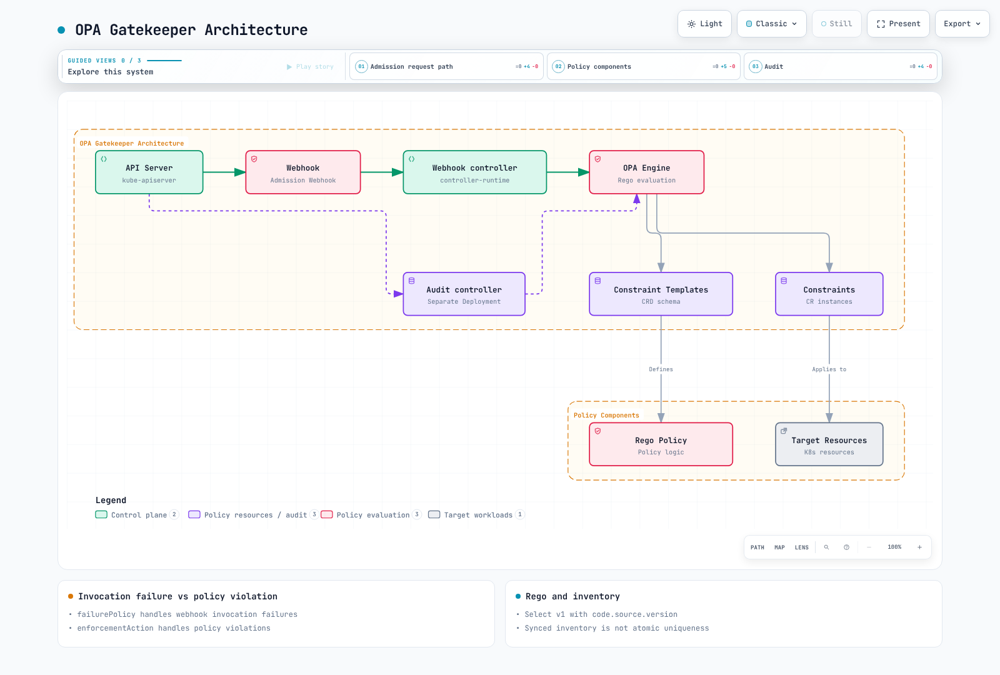

# OPA Gatekeeper

> **検証ベースライン**: Gatekeeper/Gator 3.23.1 · Helm chart 3.23.1

> **最終更新**: 2026年9月13日

## 概要

Gatekeeper は Kubernetes admission 時および定期 audit 時にポリシーを評価します。ConstraintTemplate はロジックとパラメータスキーマを定義し、Constraint はスコープ、値、enforcementAction を定義します。[完全な例](https://github.com/Atom-oh/kubernetes-docs/tree/main/examples/security/gatekeeper)では、専用の `policy-lab` namespace とローカルテストを使用します。すべてのテストフィクスチャを本番クラスターに適用しないでください。



[🔍 インタラクティブ図を表示](https://www.atomai.click/kubernetes-docs/archmaps/en-security-09-opa-gatekeeper-0.html)

<span id="gatekeeper-vs-kyverno-comparison"></span>

## Gatekeeper と Kyverno の選択

要件、テスト、運用モデルに基づいて、Gatekeeper の Rego/Constraint モデルと Kyverno の Kubernetes 指向ポリシーモデルを選択してください。Gatekeeper はオプションで CEL ベースの Kubernetes native validation もサポートします。サポートされていない固定的なリソース使用量の順位付けや、別のエンジンでは複雑なロジックを表現できないという主張は避けてください。OPA の CNCF 卒業は、Gatekeeper が別個に卒業したプロジェクトであることを示すものではありません。

<span id="installation-with-helm"></span>

<span id="installation-with-manifests"></span>

<span id="verify-installation"></span>

## Gatekeeper のインストール

サンプルディレクトリの固定された chart とサポートされる値を使用してください。`auditInterval` と `logLevel` はトップレベルの chart フィールドです。任意の `audit.replicas` または `audit.logLevel` の値が有効になると想定しないでください。このプロファイルは 3 つの webhook replica と 1 つの audit Deployment をレンダリングします。EKS control plane から webhook へのネットワークパス、証明書、配置、および利用可能なリソースを確認してください。

```bash
helm repo add gatekeeper https://open-policy-agent.github.io/gatekeeper/charts
helm repo update gatekeeper
helm upgrade --install gatekeeper gatekeeper/gatekeeper --version 3.23.1 \
  --namespace gatekeeper-system --create-namespace --values values.yaml --wait
kubectl -n gatekeeper-system rollout status deployment/gatekeeper-controller-manager
kubectl -n gatekeeper-system rollout status deployment/gatekeeper-audit
```

段階的ロールアウトでは、`values.yaml` は webhook の `failurePolicy: Ignore` を明示的に維持しています。そのため、Constraint が `deny` を指定していても、webhook 呼び出しの失敗によりリクエストが許可される可能性があります。`Fail` は、API の可用性、復旧、および除外 namespace と合わせて評価してください。webhook のスコープは、個々の Constraint のスコープより広い場合があります。

### Template と Constraint の順序

Template は対応する Constraint CRD を生成します。Constraint を適用する前に、Established CRD を待機し、template Pod のステータスを確認してください。すべてのサンプル Constraint は `dryrun` で開始します。対象環境に合わせて image prefix、パラメータ、namespace を確認してください。

```bash
kubectl create namespace policy-lab --dry-run=client -o yaml | kubectl apply -f -
kubectl apply -f templates/
kubectl wait --for=condition=Established --timeout=90s \
  crd/docsrequiredlabels.constraints.gatekeeper.sh \
  crd/docsnoprivileged.constraints.gatekeeper.sh \
  crd/docsapprovedimages.constraints.gatekeeper.sh \
  crd/k8scontainerlimits.constraints.gatekeeper.sh \
  crd/docsuniqueingress.constraints.gatekeeper.sh
kubectl apply -f constraints/
```

<span id="rego-language-basics"></span>

<span id="rego-syntax-overview"></span>

<span id="rego-data-types"></span>

<span id="rego-operators-and-built-in-functions"></span>

## Rego と入力契約

Gatekeeper ポリシーは、汎用 OPA AdmissionReview の `input.request` ではなく `input.review` を使用します。`input.parameters` は Constraint の値を提供し、`data.inventory` は同期された Kubernetes オブジェクトを提供します。既存の `targets[].rego` は、デフォルトでサポート対象の Rego v0 を使用します。Rego v1 は `code[].source.version: v1` で明示的に選択されます。古い v0 Template が自動的に無効になることはありません。

```yaml
apiVersion: templates.gatekeeper.sh/v1
kind: ConstraintTemplate
metadata:
  name: docsrequiredlabels
spec:
  crd:
    spec:
      names:
        kind: DocsRequiredLabels
      validation:
        openAPIV3Schema:
          type: object
          properties:
            labels:
              type: array
              minItems: 1
              items:
                type: string
                minLength: 1
          required:
          - labels
  targets:
  - target: admission.k8s.gatekeeper.sh
    code:
    - engine: Rego
      source:
        version: v1
        rego: "package docsrequiredlabels\nvalid_label(key) if {\n  value := input.review.object.metadata.labels[key]\n\
          \  is_string(value)\n  value != \"\"\n}\nviolation contains {\"msg\": sprintf(\"\
          required nonempty label: %v\", [key])} if {\n  some key in input.parameters.labels\n\
          \  not valid_label(key)\n}\n"
```

`violation contains ... if` は v1 の部分集合ルールです。複数の定義がその集合に寄与しますが、これは競合する完全ドキュメントルールが常に OR として結合されることを意味しません。ルール本文内の条件はすべて満たされる必要があります。再帰的なユーザー定義ルールと、`walk` のような JSON 走査 built-in を区別してください。

```rego
package examples
items := [x | some x in input.items; x > 10]
keys := object.keys(object.get(input, "labels", {}))
missing := {"app", "team"} - keys
```

`obj[_]` はオブジェクトの値を選択します。label key が必要な場合は、`object.keys` を使用するか、key を明示的にバインドしてください。集合差 `-`、積集合 `&`、和集合 `|` は有用なポリシー操作です。

<span id="writing-constraint-templates"></span>

<span id="basic-structure"></span>

<span id="preventing-privileged-containers"></span>

<span id="enforcing-resource-limits"></span>

<span id="restricting-image-registries"></span>

<span id="defining-constraints"></span>

<span id="basic-constraint-writing"></span>

<span id="using-namespace-selectors"></span>

<span id="resource-limits-constraint"></span>

<span id="image-registry-constraint"></span>

## ポリシーとスコープ

| Template | チェック | スコープと制限 |
|---|---|---|
| DocsRequiredLabels | 必須の空でない label | Pod metadata。Deployment metadata は Pod template label と異なる |
| DocsNoPrivileged | privileged=true を拒否 | 通常、init、および ephemeral container。完全な PSS スイートではない |
| DocsApprovedImages | 承認済み registry/path prefix | 3 種類すべての container。スキーマでは末尾の `/` 境界が必須 |
| K8sContainerLimits | CPU/memory limit の存在と最大値 | 固定された upstream ポリシー。ephemeral container は resource フィールドを設定できないため、通常/init container が対象 |
| DocsUniqueIngress | 同期された inventory 内の完全一致 host 競合 | 同一オブジェクトの更新を除外。wildcard またはアトミックな同時作成の保証はない |

### Image 境界と例外

`registry.example.com/team/` は `registry.example.com/team-evil/` や `registry.example.com.evil/` とは異なります。prefix マッチングには区切り境界と完全修飾された image 名の契約が必要です。この例では、`skip-privileged-check=true` のような workload によって制御可能なバイパス label は提供しません。namespace の例外には、label 変更に対する制御された RBAC、認可、有効期限、および audit 記録が必要です。

### Resource Quantity

Gi/Mi/Ki のみのパーサーは、`9G` またはプレーンバイトに対して undefined を返し、違反を見逃す可能性があります。この例では、サポートされない文字列を違反として報告する upstream の `K8sContainerLimits` ポリシーを固定しています。これは Kubernetes が許可するすべての quantity 表現を受け入れるわけではありません。その形式上の制限を文書化してください。native テストでは、millicore、10 進数/2 進数 memory、プレーンバイト、数値入力、および明示的に引用した指数表記文字列を区別します。YAML パーサーが数値に変換しないよう、`8e9` のような文字列フィクスチャは引用してください。

### PSS と Controller Resource

いくつかの privileged/runAsNonRoot チェックを完全な Baseline/Restricted enforcement としてラベル付けしないでください。バージョン付き PSS は、host namespace、seccomp、capability、OS の区別、Pod レベルの継承、および ephemeral container も対象とします。[Pod Security Standards ガイド](./03-pod-security-standards.md)を使用してください。これらの例は Pod admission をチェックします。controller Pod template をより早期に評価するには、個別の template または ExpansionTemplate テストを設定してください。

<span id="advanced-policy-patterns"></span>

<span id="external-data-reference"></span>

<span id="cross-namespace-policies"></span>

<span id="complex-condition-policies"></span>

## 同期データと参照ポリシー

`sync.yaml` は `networking.k8s.io/v1` Ingress オブジェクトを inventory に同期します。これは外部 HTTP provider や任意の OPA bundle に接続することとは異なります。必要なオブジェクトだけを同期し、RBAC、memory、および機微なデータを確認してください。

```yaml
apiVersion: config.gatekeeper.sh/v1alpha1
kind: Config
metadata:
  name: config
  namespace: gatekeeper-system
spec:
  sync:
    syncOnly:
    - group: networking.k8s.io
      version: v1
      kind: Ingress
```

同じ namespace 内の異なる名前、または別の namespace 内の同じ名前でも、競合する可能性があります。namespace と名前の両方が異なることを要求すると、そのようなケースを見逃します。この例では、自己更新として同じ namespace/名前のみを除外します。inventory は結果整合性を持つため、同時作成における一意性をアトミックに保証できません。

<span id="mutation-features"></span>

<span id="using-assignmetadata"></span>

<span id="using-assign"></span>

<span id="conditional-mutation"></span>

<span id="using-modifyset"></span>

## Mutation

AssignMetadata はサポートされている metadata label/annotation を追加します。これは汎用的な上書き機構ではありません。Assign はフィールドを設定します。toleration リスト全体を割り当てると既存エントリが破棄される可能性があるため、この例では ModifySet merge を使用します。この toleration は専用 lab taint を許可しますが、Spot node を選択するものではありません。

```yaml
apiVersion: mutations.gatekeeper.sh/v1
kind: ModifySet
metadata:
  name: docs-dedicated-toleration
spec:
  applyTo:
  - groups:
    - ''
    versions:
    - v1
    kinds:
    - Pod
  match:
    scope: Namespaced
    namespaces:
    - policy-lab
  location: spec.tolerations
  parameters:
    operation: merge
    values:
      fromList:
      - key: dedicated
        operator: Equal
        value: policy-lab
        effect: NoSchedule
```

mutation/defaulting を validation から分離してください。CREATE/UPDATE のスコープ、繰り返し適用、他の mutator との収束、および既存オブジェクトへの影響を確認してください。mutator を作成しても、既存のすべてのオブジェクトが自動的に書き換えられるわけではありません。

<span id="audit-configuration"></span>

<span id="checking-constraint-violations"></span>

<span id="prometheus-metrics"></span>

<span id="grafana-dashboard"></span>

## Audit と Monitoring

chart の `auditInterval` で audit 頻度を設定します。Config の `validation.traces` は、audit のスケジューリングではなく、選択した admission 評価をデバッグするためのものです。admission input と Rego print には機微なオブジェクトデータが含まれることがあります。必要なスコープに対してのみ有効にしてください。`constraintViolationsLimit` はステータス詳細リストを制限します。これは totalViolations と異なる場合があります。

```bash
kubectl get constraints
kubectl describe docsrequiredlabels required-labels
kubectl get constrainttemplatepodstatuses -n gatekeeper-system
kubectl get constraintpodstatuses -n gatekeeper-system
```

chart の webhook Service は metrics ではなく HTTPS webhook トラフィックのみを公開します。`podmonitor.yaml` は、audit と webhook の両方の Deployment で実際に名前付けされた metrics:8888 container port を選択します。最初に Prometheus Operator CRD をインストールし、PodMonitor の label/namespace selector を整合させてください。

| Metric | 解釈 |
|---|---|
| gatekeeper_validation_request_count | 実際の admission_status label を含む validation request |
| gatekeeper_validation_request_duration_seconds | validation latency histogram |
| gatekeeper_violations | enforcement_action ごとの audit 済み違反。デフォルトの constraint_name label を想定しない |
| gatekeeper_audit_last_run_end_time | 最後に完了した audit の timestamp |
| gatekeeper_constraint_templates | Template status count |

```promql
sum by (enforcement_action) (gatekeeper_violations)
histogram_quantile(0.99, sum by (le) (rate(gatekeeper_validation_request_duration_seconds_bucket[5m])))
```

<span id="testing-and-ci-cd-integration"></span>

<span id="gator-cli-testing"></span>

<span id="test-suite-definition"></span>

<span id="test-fixtures"></span>

<span id="github-actions-integration"></span>

## Gator テストと CI

公式の 3.23.1 release asset をインストールし、公開されている checksum を検証してください。ARM64 binary は GitVersion に +dirty を報告します。この audit では、そのテキストがローカル変更を意味すると想定するのではなく、公開 archive hash を検証しました。バージョンが固定された証拠を、固定されていない @latest CLI 実行で置き換えないでください。

```bash
gator version
gator verify tests/suite.yaml --verbose
gator test -f templates/docsnoprivileged.yaml \
  -f constraints/no-privileged.yaml \
  -f tests/fixtures/tenant-skip-label-no-bypass.yaml --output=json
```

`verify` は Suite 内の期待される違反をチェックします。`test -f` は Template/Constraint に対して manifest を評価します。Suite のない directory は verify が無視する場合があるため、exit status だけを信用せず、5 つすべてのテストと 33 件の case が実行されたことを確認してください。fixture image はポリシー input であり、pull 可能な workload ではありません。CI は credential なしでローカル suite を実行します。cluster dry-run は、認可されたアクセスを持つ別の信頼できる環境に属します。

<span id="best-practices"></span>

<span id="policy-organization"></span>

<span id="gradual-policy-rollout"></span>

<span id="policy-exception-management"></span>

<span id="troubleshooting"></span>

<span id="common-issues"></span>

<span id="debugging-tips"></span>

## ロールアウトとトラブルシューティング

同じ値が設定済みの Constraint を dryrun→warn→deny と移行させ、audit/admission の結果と例外を確認してください。ロールアウト機構として、パラメータのない Constraint を 3 つ作成しないでください。Dryrun/warn は Gator テストの exit status がゼロでも違反を返すことがあり、deny の違反では 1 が返ります。webhook の可用性障害は、ポリシー違反とは別に監視してください。

```bash
kubectl get validatingwebhookconfiguration gatekeeper-validating-webhook-configuration -o yaml
kubectl -n gatekeeper-system logs deployment/gatekeeper-controller-manager --tail=100
kubectl -n gatekeeper-system logs deployment/gatekeeper-audit --tail=100
```

ポリシー input、match スコープ、CRD/template エラー、webhook の証明書/ネットワーク、audit timestamp、および inventory の鮮度を確認してください。webhook enforcement を変更したり namespace 例外を広げたりする前に、原因を診断してください。

<span id="summary"></span>

<span id="related-documentation"></span>

## 検証スコープと関連資料

Gator 3.23.1 は、33 のポリシー case と 3 つの enforcement mode を実行しました。チェック対象は、固定された Helm render、8 個の Gatekeeper CRD オブジェクト、および audit/webhook PodMonitor binding でした。Kubernetes admission、EKS networking、live audit-cache synchronization、または API failover は実行していません。個別の native mutation validation はレビュー報告書に記録されています。

- [Gatekeeper クイズ](../quizzes/security/09-opa-gatekeeper-quiz.md)
- [Kyverno](./01-kyverno-policy-management.md)
- [Pod Security Standards](./03-pod-security-standards.md)
- [EKS セキュリティプラクティス](./06-eks-security-best-practices.md)

## 参考資料

- [Gatekeeper v3.23.1](https://github.com/open-policy-agent/gatekeeper/tree/v3.23.1)
- [ConstraintTemplate と Rego バージョン](https://github.com/open-policy-agent/gatekeeper/blob/v3.23.1/website/docs/constrainttemplates.md)
- [Gator](https://github.com/open-policy-agent/gatekeeper/blob/v3.23.1/website/docs/gator.md)
- [Mutation](https://github.com/open-policy-agent/gatekeeper/blob/v3.23.1/website/docs/mutation.md)
- [Audit](https://github.com/open-policy-agent/gatekeeper/blob/v3.23.1/website/docs/audit.md)
- [Metrics](https://github.com/open-policy-agent/gatekeeper/blob/v3.23.1/website/docs/metrics.md)
- [固定された resource-limits ポリシー](https://github.com/open-policy-agent/gatekeeper-library/blob/bd333d4704647b1000cef5a92017257ee46fe2c8/library/general/containerlimits/template.yaml)
