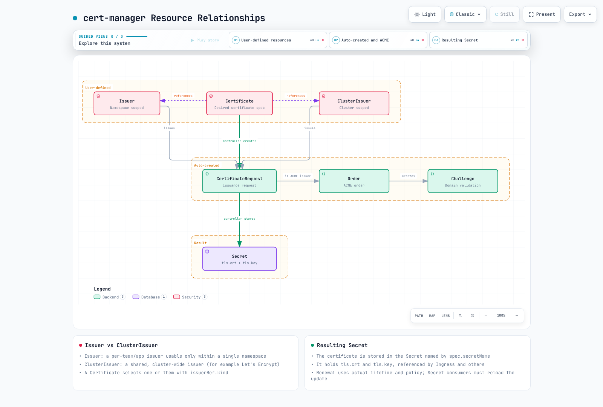
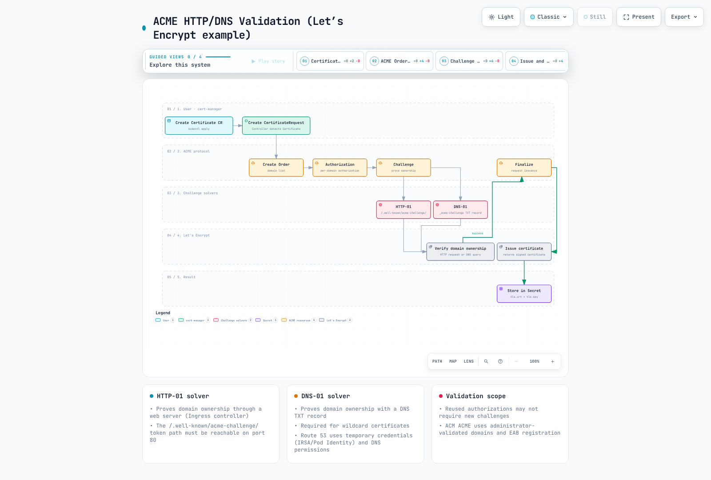

# cert-manager による Certificate 管理

> **最終更新**: October 12, 2026
> **検証ベースライン**: cert-manager 1.21.2、cmctl 2.5.0、trust-manager 0.25.0、istio-csr 0.17.0、aws-privateca-issuer 1.9.2、ACK ACM 1.8.1。cert-manager 1.21 で公開されているサポート/テスト対象の Kubernetes 範囲は 1.33–1.36 です。Kubernetes 1.37 はこの範囲外であるため、本ガイドではその互換性を保証しません。

cert-manager は Certificate の発行と更新を Kubernetes リソースとして管理します。**CA 信頼の配布、アプリケーションの再読み込み、失効、および CRL/OCSP 操作は、引き続き別個の責務です。** 例はローカルのスキーマ、設定、ライブラリで確認しています。これらは外部 CA の発行や AWS/Kubernetes デプロイメントの証拠ではありません。別途、一時的なローカル Vault 2.1.0 テストでは、合成 CA を使用して 16 件の発行/CSR 署名の受け入れ/拒否ケースを検証しました。

<span id="what-cert-manager-solves"></span>
<span id="project-status"></span>
<span id="why-certificate-lifecycle-automation-matters"></span>
<span id="overview-1"></span>

## 概要

cert-manager は 2020 年 11 月 10 日に CNCF に参加し、2022 年 9 月 19 日に Incubating となり、**2024 年 9 月 29 日に Graduated しました**。Graduation は、特定のデプロイメントのセキュリティや可用性を保証するものではありません。

| ライフサイクル上の懸念事項 | 責務 |
|---|---|
| 発行 | Issuer 認証、リクエスター承認、SAN/用途/有効期間ポリシー |
| 更新 | 実際に発行された有効期間、ARI/renewBefore、再試行とアラート |
| キーローテーション | Secret アクセス、コンシューマーの再読み込み、CA ロールオーバーの順序 |
| 信頼 | 各 namespace/プロセスが信頼するルート/中間 CA |
| 失効 | CA の失効手順と CRL/OCSP の公開/利用 |

古い 1.16.2 のインストールおよび互換性表を、現行サポートのガイダンスとして使用しないでください。バージョン 1.16 は 2025 年 6 月に EOL に達しました。中間リリースのリリースノートと CRD の変更を使用してアップグレードを計画してください。

<span id="component-overview"></span>
<span id="component-responsibilities"></span>
<span id="certificate-issuance-flow"></span>

## アーキテクチャ


[インタラクティブ図を表示](https://www.atomai.click/kubernetes-docs/archmaps/en-security-10-cert-manager-0.html)

controller は Certificate を reconcile して CertificateRequest を作成し、issuer controller が発行を処理します。webhook はカスタムリソースを検証、デフォルト設定、変換し、cainjector はサポート対象の API/webhook 設定で CA bundle を管理します。CA/SelfSigned Issuer は、必ずしも外部サービスではありません。

<span id="prerequisites"></span>
<span id="installation-with-helm-recommended"></span>
<span id="production-helm-values"></span>
<span id="installation-with-kubectl"></span>
<span id="verify-installation"></span>

## インストール

サポート対象の Kubernetes バージョン、Helm/cluster 権限、Gateway API CRD と実際の Gateway controller、任意の Prometheus Operator CRD を確認してください。Gateway API CRD を controller 起動後にインストールする場合は、再起動/検出の要件を確認してください。

```bash
helm repo add jetstack https://charts.jetstack.io
helm repo update jetstack
helm upgrade --install cert-manager jetstack/cert-manager \
  --version v1.21.2 --namespace cert-manager --create-namespace \
  --values cert-manager-values.yaml
kubectl get pods -n cert-manager
cmctl check api
```

```yaml
crds:
  enabled: true
  keep: true
replicaCount: 2
podDisruptionBudget:
  enabled: true
  minAvailable: 1
config:
  apiVersion: controller.config.cert-manager.io/v1alpha1
  kind: ControllerConfiguration
  gatewayAPI:
    enabled: true
prometheus:
  enabled: true
  servicemonitor:
    enabled: true
webhook:
  replicaCount: 2
  timeoutSeconds: 10
  podDisruptionBudget:
    enabled: true
    minAvailable: 1
cainjector:
  replicaCount: 2
  podDisruptionBudget:
    enabled: true
    minAvailable: 1
```

このプロファイルは ServiceMonitor と Gateway API を有効にするため、それらの CRD/controller はあらかじめ存在している必要があります。これらの依存関係を含まない最小限のインストールでは、それらのオプションを無効にしてください。replica/PDB は、node/AZ の分散や API 接続性の代替にはなりません。現在の設定では config.gatewayAPI.enabled を使用します。古い enableGatewayAPI フィールドも引き続き受け入れられますが、1.21.2 の decoder では非推奨です。

CRD の保持と実際のアンインストール所有権を確認してください。CRD を削除すると、そのカスタムリソースが削除される可能性があります。これは通常のアップグレードトラブルシューティング手順ではありません。

<span id="custom-resource-definitions-crds"></span>
<span id="certificate-resource"></span>
<span id="issuer-vs-clusterissuer"></span>
<span id="certificaterequest-resource"></span>

## コアコンセプト



[インタラクティブ図を表示](https://www.atomai.click/kubernetes-docs/archmaps/en-security-10-cert-manager-1.html)

| リソース | スコープと目的 |
|---|---|
| Certificate | namespace 内の目的の Certificate と出力 Secret |
| Issuer | その namespace 内から参照する発行設定 |
| ClusterIssuer | namespace をまたいで参照する発行設定 |
| CertificateRequest | CSR、issuerRef、および承認/拒否ステータス |
| Order/Challenge | ACME パスで使用する注文/検証リソース |

ClusterIssuer の認証情報/CA Secret は controller の cluster-resource namespace に配置され、デフォルトは cert-manager です。Issuer Secret は Issuer namespace に配置されます。Certificate を作成する権限だけでは、SAN や issuerRef は制限されません。

### Certificate と更新

```yaml
apiVersion: cert-manager.io/v1
kind: Certificate
metadata:
  name: app-tls
  namespace: demo-app
spec:
  secretName: app-tls
  dnsNames: [app.example.com]
  duration: 2160h
  renewBeforePercentage: 33
  privateKey:
    algorithm: ECDSA
    size: 256
    encoding: PKCS8
    rotationPolicy: Always
  usages: [server auth]
  issuerRef:
    name: lab-ca
    kind: ClusterIssuer
    group: cert-manager.io
```

要求した有効期間は、CA が発行する有効期間と異なる場合があります。デフォルトの更新は、有効期限の 15/30 日前という固定値ではなく、**実際の X.509 有効期間の 3 分の 2 が経過した時点**で実行されます。renewBeforePercentage は、実際の有効期間からバッファーを導出します。renewBefore または percentage のどちらかを選択してください。両方は使用しません。duration は少なくとも 1 時間で、有効な更新バッファーは少なくとも 5 分かつ duration より短い必要があります。

バージョン 1.21.2 の更新ポリシー/ウィンドウとサポートされる ARI パスは、タイミングに影響を及ぼす可能性があります。renewal.policy:Disabled は自動更新を無効にします。status.renewalTime、実際の notBefore/notAfter、および失敗アラートを確認してください。1.18 以降、privateKey.rotationPolicy のデフォルトは Always です。key/certificate Secret を更新しても、アプリケーションが再読み込みされる保証はありません。

### CertificateRequest と秘密鍵

直接リクエストには実際の PEM CSR が必要です。切り詰められた base64 の例を適用しないでください。cmctl create certificaterequest は**cluster 内にリクエストを作成する**ものであり、オフライン検証コマンドではありません。cmctl approve/deny 権限は別途制限してください。この監査では、cert-manager PKI library を使用して、合成ローカル key/CSR のみを生成および検証しました。

<span id="selfsigned-issuer-development-testing"></span>
<span id="ca-issuer-internal-pki"></span>
<span id="acme-let-s-encrypt"></span>
<span id="acme-challenge-types"></span>
<span id="http-01-solver"></span>
<span id="dns-01-solver-with-route53-and-irsa"></span>
<span id="aws-private-ca-issuer"></span>
<span id="hashicorp-vault-pki"></span>

## Issuer タイプ

### SelfSigned と CA bootstrap

[完全な bootstrap の例](https://github.com/Atom-oh/kubernetes-docs/blob/main/examples/security/cert-manager/bootstrap.yaml)は、専用のラボ用 root と leaf を作成します。root は、**計画外の trust anchor 置き換え**を避けるため、更新を明示的に Disabled、キーローテーションを Never に設定しています。本番 root の保管、オフライン CA、中間 CA の分離、監査、失効には、個別の設計が必要です。

```yaml
apiVersion: v1
kind: Namespace
metadata:
  name: cert-manager
  labels:
    trust-bundle: enabled
---
apiVersion: v1
kind: Namespace
metadata:
  name: demo-app
  labels:
    trust-bundle: enabled
    cert-manager-http01: enabled
---
apiVersion: cert-manager.io/v1
kind: Issuer
metadata:
  name: bootstrap
  namespace: cert-manager
spec:
  selfSigned: {}
---
apiVersion: cert-manager.io/v1
kind: Certificate
metadata:
  name: lab-root
  namespace: cert-manager
spec:
  secretName: lab-root
  isCA: true
  commonName: Documentation Lab Root
  subject:
    organizations: [Documentation Lab]
  duration: 8760h
  renewal:
    policy: Disabled
  privateKey:
    algorithm: ECDSA
    size: 256
    encoding: PKCS8
    rotationPolicy: Never
  usages: [cert sign, crl sign]
  issuerRef:
    name: bootstrap
    kind: Issuer
    group: cert-manager.io
---
apiVersion: cert-manager.io/v1
kind: ClusterIssuer
metadata:
  name: lab-ca
spec:
  ca:
    secretName: lab-root
---
apiVersion: cert-manager.io/v1
kind: Certificate
metadata:
  name: app-tls
  namespace: demo-app
spec:
  secretName: app-tls
  dnsNames: [app.example.com]
  duration: 2160h
  renewBeforePercentage: 33
  privateKey:
    algorithm: ECDSA
    size: 256
    encoding: PKCS8
    rotationPolicy: Always
  usages: [server auth]
  issuerRef:
    name: lab-ca
    kind: ClusterIssuer
    group: cert-manager.io
```

CA issuer は、CA certificate/private key を含む Secret を使用します。その Secret を置き換えても、すべての leaf が直ちに再発行されるわけでも、すべてのクライアント trust store が更新されるわけでもありません。CA issuer には CRL/OCSP URL を含められますが、CRL/OCSP response を生成または維持することはありません。leaf の有効期間が CA を超えないようにするポリシーを適用してください。

### ACME: HTTP-01 と DNS-01



[インタラクティブ図を表示](https://www.atomai.click/kubernetes-docs/archmaps/en-security-10-cert-manager-2.html)

HTTP-01 ではポート 80 で hostname にアクセスできる必要があり、wildcard はサポートしません。DNS-01 は wildcard 検証のために DNS TXT 権限を使用します。再利用される authorization と ACM の事前検証フローにより、リクエストごとに新しい challenge が必ず作成されるわけではありません。

2026 年 3 月にメンテナンスが終了した community ingress-nginx を、新規インストールのデフォルトとして推奨しないでください。[HTTP-01 Gateway の例](https://github.com/Atom-oh/kubernetes-docs/blob/main/examples/security/cert-manager/public-staging.yaml)は、Envoy Gateway とその envoy-gateway GatewayClass がインストール済みであることを前提としています。実際の class を確認し、solver namespace の cert-manager-http01:enabled label を allowedRoutes に合わせてください。Gateway certificate shimming は、Gateway controller のインストールや TLS 再読み込みの実装を行いません。

[Route53 issuer](https://github.com/Atom-oh/kubernetes-docs/blob/main/examples/security/cert-manager/route53-issuer.yaml)と[IAM policy](https://github.com/Atom-oh/kubernetes-docs/blob/main/examples/security/cert-manager/route53-policy.json)は、hostedZoneID を指定し、変更を challenge TXT 名に限定します。zone を指定することで、グローバルな ListHostedZonesByName アクセスを要求せずに済みます。IRSA またはサポートされる Pod Identity、およびクロスアカウントの role chain を通じて controller 認証情報を確認してください。namespace 選択と dnsZones は IAM 認可の代替ではありません。

```yaml
apiVersion: cert-manager.io/v1
kind: ClusterIssuer
metadata:
  name: public-dns01
spec:
  acme:
    server: https://acme-staging-v02.api.letsencrypt.org/directory
    email: pki-admin@example.com
    privateKeySecretRef:
      name: public-dns01-account
    solvers:
      - selector:
          dnsZones: [example.com]
        dns01:
          route53:
            region: ap-northeast-2
            hostedZoneID: Z1234567890ABC
```

Let’s Encrypt staging には rate limit があり、その root は本番 browser から信頼されません。ACME account は environment 固有です。有効期限通知メールは 2025 年に終了しました。email フィールドは有効期限監視の代わりにはなりません。429 response では、常に 1 時間後に再試行するのではなく、Retry-After と該当する refill policy に従ってください。ARI 更新と新規発行では rate limit の扱いが異なります。

### AWS Private CA

外部 aws-privateca-issuer controller には、CA-ARN スコープの発行/読み取り権限と EKS workload identity が必要です。文書化されている action は acm-pca:DescribeCertificateAuthority、acm-pca:GetCertificate、acm-pca:IssueCertificate です。Resource を対象 CA ARN に制限してください。[例](https://github.com/Atom-oh/kubernetes-docs/blob/main/examples/security/cert-manager/pca-issuer.yaml)の実際の CA ARN を置き換え、CA mode、template、algorithm、usages、要求した有効期間を検証してください。short-lived-CA の制限と料金は別途確認してください。disableApprovedCheck で承認チェックを回避しないでください。

```bash
helm repo add awspca https://cert-manager.github.io/aws-privateca-issuer
helm upgrade --install aws-pca-issuer awspca/aws-privateca-issuer \
  --version v1.9.2 --namespace cert-manager
```

### Vault PKI

[Issuer/token RBAC の例](https://github.com/Atom-oh/kubernetes-docs/blob/main/examples/security/cert-manager/vault-issuer.yaml)は、token 作成を demo-app/vault-issuer に制限しています。Vault server の TLS CA Secret は別途指定してください。[PKI role/policy script](https://github.com/Atom-oh/kubernetes-docs/blob/main/examples/security/cert-manager/vault-setup.sh)は、既存の PKI/Kubernetes-auth mount、承認済みの Vault identity、設定済みの TokenReview アクセスを前提としています。

Vault role で SAN を制限し、audience vault://demo-app/vault-pki をこの Issuer にバインドしてください。Reviewer JWT、Kubernetes API audience、OIDC アクセスは、Vault の実行場所に依存します。tls-skip-verify や広範なデフォルト Vault policy で接続問題を回避しないでください。

<span id="tls-termination-comparison"></span>
<span id="alb-ingress-with-acm-vs-cert-manager"></span>
<span id="nlb-with-tls-termination-at-ingress-controller"></span>
<span id="gateway-api-integration"></span>

DNS role は allow_ip_sans=false と allow_localhost=false を明示的に設定しています。allowed_domains は IP SAN を制限せず、localhost には別個の許容的なデフォルトがあります。vault write POST は省略した role field をデフォルトにリセットします。完全な role を読み戻し、適用後に許可された DNS と拒否される IP/localhost リクエストをテストしてください。

## EKS 統合パターン

| パス | TLS termination と key の場所 |
|---|---|
| ACM を使用する ALB/NLB TLS listener | AWS load balancer が ACM ARN を使用 |
| Gateway/Pod を使用する NLB TCP | Backend が Kubernetes Secret を使用して TLS を terminate |
| Gateway HTTPS listener | Gateway controller が同一 namespace の TLS Secret を参照 |
| ACM exportable public certificate | 顧客管理 workload が明示的に export した key/certificate を使用 |

ALB は cert-manager Kubernetes Secret を listener certificate として直接読み取りません。import/export と ACM ARN の関係は別個の手順です。[ALB の例](https://github.com/Atom-oh/kubernetes-docs/blob/main/examples/security/cert-manager/alb-acm-ingress.yaml)には、実際の ACM ARN と backend Service が必要です。[NLB TCP の例](https://github.com/Atom-oh/kubernetes-docs/blob/main/examples/security/cert-manager/nlb-tcp-service.yaml)は TLS を backend port 8443 に渡します。この port は実際に TLS を提供する必要があります。

```yaml
apiVersion: gateway.networking.k8s.io/v1
kind: Gateway
metadata:
  name: app-gateway
  namespace: demo-app
  annotations:
    cert-manager.io/cluster-issuer: lab-ca
spec:
  gatewayClassName: envoy-gateway
  listeners:
    - name: https
      hostname: app.example.com
      protocol: HTTPS
      port: 443
      tls:
        mode: Terminate
        certificateRefs:
          - group: ""
            kind: Secret
            name: app-gateway-tls
      allowedRoutes:
        namespaces:
          from: Same
---
apiVersion: gateway.networking.k8s.io/v1
kind: HTTPRoute
metadata:
  name: app
  namespace: demo-app
spec:
  parentRefs:
    - name: app-gateway
  hostnames: [app.example.com]
  rules:
    - backendRefs:
        - name: app
          port: 8080
```

この Gateway は lab-ca を使用しており、通常の browser は信頼しません。実際の public 発行には、承認済みの issuer/domain-validation パスと controller が必要です。GatewayClass 名と certificateRefs の scope/type を確認してください。同じ Secret を 2 つの controller が所有することは避けてください。

<span id="july-2026-update-acm-now-supports-the-acme-protocol"></span>
<span id="supported-certificate-types"></span>
<span id="applicable-scenarios"></span>
<span id="example-defining-a-certificate-via-ack"></span>
<span id="comparison-with-cert-manager"></span>

<span id="aws-native-alternative-acm--ack"></span>

## AWS ネイティブの代替: ACM + ACK

### ACM RequestCertificate と ACK export

ACK ACM は、それ自体がインストールおよび運用するオープンソース controller です。1.8.1 の[例](https://github.com/Atom-oh/kubernetes-docs/blob/main/examples/security/cert-manager/ack-acm.yaml)では、options.export:ENABLED、exportTo、出力 Secret を明示的に設定しています。発行リクエストを定義するだけでは TLS Secret は作成されません。1.8.1 CRD（v1.10.0 でも変更なし）では、validationMethod は読み取り専用 status domainValidations field にのみ存在し、spec には存在しません。古い例からリクエストへコピーしないでください。

```yaml
apiVersion: v1
kind: Secret
metadata:
  name: exported-public-tls
  namespace: demo-app
type: kubernetes.io/tls
data:
  tls.crt: ""
  tls.key: ""
---
apiVersion: acm.services.k8s.aws/v1alpha1
kind: Certificate
metadata:
  name: exportable-public-tls
  namespace: demo-app
spec:
  domainName: app.example.com
  keyAlgorithm: RSA_2048
  options:
    export: ENABLED
  exportTo:
    namespace: demo-app
    name: exported-public-tls
    key: tls.crt
```

Domain validation は別個です。Route53 ACK は ACM が提供する CNAME を管理できますが、ACM controller をインストールしても、すべての DNS provider を自動で検証するわけではありません。exportable-certificate の料金、controller の IAM/RBAC/namespace 境界、private-key Secret アクセスを評価してください。Private-CA/SPIFFE mTLS identity には独自の issuer/trust 設計が必要です。

### ACM ACME: EAB と事前検証済み domain

2026 年 7 月 6 日に発表された ACM ACME は、45 日間の public certificate を発行します。PKI administrator は IAM role に関連付けられた endpoint/domain validation と EAB 認証情報を準備してから、client を登録します。**server URL だけを変更しても不十分です。** HMAC key を安全に保存し、cert-manager の cluster-resource namespace に acm-eab Secret/hmac entry を指定してください。

```yaml
apiVersion: cert-manager.io/v1
kind: ClusterIssuer
metadata:
  name: acm-acme
spec:
  acme:
    server: https://acm-acme-enroll.ap-northeast-2.api.aws/REPLACE_ENDPOINT_ID/directory
    email: pki-admin@example.com
    privateKeySecretRef:
      name: acm-acme-account
    externalAccountBinding:
      keyID: REPLACE_EAB_KEY_ID
      keySecretRef:
        name: acm-eab
        key: hmac
```

externalAccountBinding が参照する Secret 値には、base64url エンコードされた HMAC key を含める必要があります。Kubernetes Secret data encoding は別のレイヤーです。provider のすでにエンコード済みの値は、二重にエンコードするのではなく保持してください。[ACME EAB 設定](https://cert-manager.io/docs/configuration/acme/)を参照してください。

Endpoint ID と EAB keyID は placeholder です。domain は endpoint で事前検証されている必要があります。ACME client が private key を生成/保持し、更新を管理します。ACM inventory に ARN が表示されても、この certificate が管理対象の ALB/CloudFront/API Gateway 統合で直接使用できるようにはなりません。ExportCertificate、RenewCertificate、RevokeCertificate はこの発行パスには適用されません。ACME client がライフサイクルを所有します。AWS 統合サービス向けの RequestCertificate と区別してください。

<span id="istio-with-istio-csr"></span>
<span id="installing-istio-csr"></span>
<span id="configuring-istio-to-use-istio-csr"></span>
<span id="linkerd-trust-anchor-management"></span>

## Service Mesh 統合


[インタラクティブ図を表示](https://www.atomai.click/kubernetes-docs/archmaps/en-security-10-cert-manager-3.html)

### Istio と istio-csr

sidecar フローでは、istio-agent が CSR を作成し、istio-csr が CertificateRequest を送信します。agent は SDS を通じて key/certificate material を Envoy に配信し、workload proxy が mTLS を確立します。同じ Pod 内のアプリケーション hop は、自動的には mTLS になりません。

[istio-csr values](https://github.com/Atom-oh/kubernetes-docs/blob/main/examples/security/cert-manager/istio-csr-values.yaml)は、rootCAFile 用の実際の ConfigMap volume/mount を設定します。まず cert-manager に application-trust bundle を作成し、issuer の準備完了を待ってください。file path だけ、または meshConfig 内の空の PEM だけでは不十分です。現在の Istio Helm/istioctl external-CA 設定を使用してください。istio-csr パスと Kubernetes CSR RA mode を混在させないでください。Ambient のサポートは別途評価してください。

```bash
helm upgrade --install cert-manager-istio-csr jetstack/cert-manager-istio-csr \
  --version v0.17.0 --namespace cert-manager --values istio-csr-values.yaml
```

### Linkerd と trust-manager

[Linkerd identity の例](https://github.com/Atom-oh/kubernetes-docs/blob/main/examples/security/cert-manager/linkerd-identity.yaml)は、issuer Secret と root-bundle ConfigMap を準備します。固定された control-plane chart 2026.9.1 は linkerd-identity-issuer と linkerd-identity-trust-roots を参照します。

```yaml
identity:
  externalCA: true
  issuer:
    scheme: kubernetes.io/tls
```

これは、インストール時に key を一度コピーするのではなく、control plane を外部から更新される issuer Secret に接続します。root のロールオーバーには、old/new root の重複、workload の更新、trust の再読み込みが必要です。例の lab root は、自動更新を無効にして手動管理されています。

<span id="installing-trust-manager"></span>
<span id="bundle-resource"></span>
<span id="using-trust-bundles-in-applications"></span>

## trust-manager

デフォルトの trust-manager 0.25.0 chart は trust.cert-manager.io/v1alpha1 Bundle を render します。repository 内の追加 CRD は、それだけでデフォルトでインストールされる API を変更するものではありません。source Secret/ConfigMap は、設定された trust namespace から読み取られます。

```yaml
apiVersion: trust.cert-manager.io/v1alpha1
kind: Bundle
metadata:
  name: application-trust
spec:
  sources:
    - secret:
        name: lab-root
        key: tls.crt
  target:
    configMap:
      key: ca-bundle.pem
    namespaceSelector:
      matchLabels:
        trust-bundle: enabled
```

inline PEM field は inlineString ではなく inLine です。public/private trust root を最小限にし、宛先 namespace を明示的に選択してください。Secret target には別個の有効化/RBAC が必要です。この例では ConfigMap を使用します。trust bundle は trust anchor を配布するものであり、private key を配布するものではありません。

[consumer Deployment](https://github.com/Atom-oh/kubernetes-docs/blob/main/examples/security/cert-manager/trust-consumer.yaml)は directory を mount します。ConfigMap の変更は subPath file mount を通じて伝播しません。directory projection であっても、process のキャッシュ済み TLS context は再読み込みされません。アプリケーションが実際に SSL_CERT_FILE または設定済みの trust store を使用しているかテストしてください。

<span id="prometheus-metrics"></span>
<span id="key-metrics"></span>
<span id="prometheusrule-for-alerting"></span>
<span id="certificate-readiness-check"></span>
<span id="common-errors-and-solutions"></span>
<span id="cmctl-cli-tool"></span>

## モニタリングとトラブルシューティング

インストール済み chart の ServiceMonitor で selector と port/targetPort 値を確認してください。1.21.2 プロファイルは controller/cainjector/webhook に対して http-metrics を対象にします。tcp-prometheus-servicemonitor という port 名を作り出さないでください。

```yaml
groups:
  - name: cert-manager
    rules:
      - alert: CertificateNotReady
        expr: certmanager_certificate_ready_status{condition="True"} == 0
        for: 10m
        labels:
          severity: critical
      - alert: CertificateExpiringSoon
        expr: (certmanager_certificate_expiration_timestamp_seconds - time() < 604800) and (certmanager_certificate_expiration_timestamp_seconds - time() > 86400)
        for: 30m
        labels:
          severity: warning
      - alert: CertificateExpiryCritical
        expr: (certmanager_certificate_expiration_timestamp_seconds - time() <= 86400) and (certmanager_certificate_expiration_timestamp_seconds - time() > 0)
        for: 10m
        labels:
          severity: critical
      - alert: CertificateExpired
        expr: (certmanager_certificate_expiration_timestamp_seconds > 0) and (certmanager_certificate_expiration_timestamp_seconds <= time())
        for: 5m
        labels:
          severity: critical
```

準備完了 metric には True/False/Unknown series が含まれます。filter なしの ==0 は正常な Certificate に対して発火する可能性があります。これらの rule は、正常、NotReady、warning 有効期限、critical 有効期限、期限切れの Certificate をカバーする 5 ケース / 20 assertion を通過しました。scrape/metric の欠落には別個のアラートが必要です。

```bash
kubectl get certificates,certificaterequests -A
kubectl get orders,challenges -A
kubectl describe certificate app-tls -n demo-app
cmctl status certificate app-tls -n demo-app
# These change resources; check permissions and impact first.
cmctl renew app-tls -n demo-app
```

再帰 DNS resolver を選択することは、propagation wait time を増やすことではありません。split-horizon DNS、CAA、TXT 認可、CNAME、HTTP path、Challenge reason を確認してください。chart の timeoutSeconds（1～30 秒）を調整する前に、webhook の接続性/認証/routing を調査してください。無差別に適用できる一般的な webhook-timeout flag はありません。

<span id="renewal-buffer-configuration"></span>
<span id="backup-ca-strategy"></span>
<span id="multi-tenant-issuer-strategy"></span>
<span id="rbac-configuration"></span>
<span id="private-key-rotation"></span>

## ベストプラクティス

- [namespace Role](https://github.com/Atom-oh/kubernetes-docs/blob/main/examples/security/cert-manager/certificate-requester-rbac.yaml)は、developer に cluster 全体の Secret 読み取りを付与せずに Certificate を管理します。SAN/issuerRef/secretName の制限には、別個の admission/approval policy が必要です。
- CertificateRequest の承認を CA 認証情報アクセスから分離してください。デフォルトの approval-controller 動作を確認し、必要に応じて approver-policy などの発行ポリシーを設定してください。
- CA key の backup には、暗号化、アクセス制御、restore test が必要です。平文の Secret YAML を通常の directory にダンプしないでください。Base64 は暗号化ではありません。
- private CA は public CA の自動的な fallback ではありません。client trust、name、usage、key access、recovery time を検証してください。
- secretTemplate annotation/label は metadata です。それ自体で external-secret 同期を有効にするものではありません。
- 更新、CA ロールオーバー、consumer の再読み込み、失効を個別にテストしてください。schema/Helm の成功は、発行成功の証明にはなりません。

<span id="table-of-contents"></span>
<span id="key-concepts-summary"></span>
<span id="issuer-selection-guide"></span>
<span id="official-references"></span>
<span id="version-compatibility-matrix"></span>

## まとめと参考資料

ローカル検証には、固定された Helm/CRD schema、controller-config decoding、6 件の更新ケース、実際の CSR 生成/署名検査、5 件の Prometheus ケース / 20 assertion、24 件の diagram browser ケース、および一時的なローカル Vault での 16 件の合成発行/CSR 署名ケースが含まれます。外部 CA/ACME 発行、AWS resource 作成、デプロイ済み Vault login、mesh インストール、runtime mTLS は実行していません。

- [cert-manager リリース](https://cert-manager.io/docs/releases/)
- [cert-manager 1.21.2 リリース](https://github.com/cert-manager/cert-manager/releases/tag/v1.21.2)
- [CNCF プロジェクトの歴史](https://www.cncf.io/projects/cert-manager/)
- [Certificate の更新とローテーション](https://cert-manager.io/docs/usage/certificate/)
- [CA issuer の制限事項](https://cert-manager.io/docs/configuration/ca/)
- [Vault issuer](https://cert-manager.io/docs/configuration/vault/)
- [Gateway API issuer 統合](https://cert-manager.io/docs/usage/gateway/)
- [trust-manager](https://cert-manager.io/docs/trust/trust-manager/)
- [istio-csr](https://cert-manager.io/docs/usage/istio-csr/)
- [Linkerd の自動 Certificate ローテーション](https://linkerd.io/2-edge/tasks/automatically-rotating-control-plane-tls-credentials/)
- [ACM Kubernetes export](https://docs.aws.amazon.com/acm/latest/userguide/exportable-certificates-kubernetes.html)
- [ACM ACME](https://docs.aws.amazon.com/acm/latest/userguide/acm-acme.html)
- [ACM ACME の発表](https://aws.amazon.com/about-aws/whats-new/2026/07/aws-certificate-manager-acme/)
- [AWS Private CA issuer](https://github.com/cert-manager/aws-privateca-issuer/tree/v1.9.2)
- [Let’s Encrypt rate limit](https://letsencrypt.org/docs/rate-limits/)
- [Staging environment](https://letsencrypt.org/docs/staging-environment/)
- [有効期限メールの終了](https://letsencrypt.org/2025/01/22/ending-expiration-emails/)
- [Ingress NGINX の終了](https://kubernetes.io/blog/2025/11/11/ingress-nginx-retirement/)