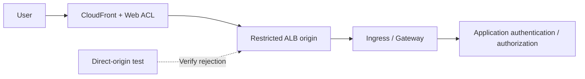

# オリジン保護による WAF、エッジおよび API セキュリティ

> **レビューの根拠**: AWS WAF、CloudFront、ALB の公式ドキュメント。機能と検査上限は、関連付けるリソースごとに区別しています。
> **最終更新日**: 2026年10月19日

目的は、保護対象のリクエストが WAF を通過すること、検査上限と例外が理解されていること、そしてアプリケーションがリクエストを安全に処理することを示すことです。以下に示すアプリケーション、オリジン、運用上の基準は設計案です。

## 1. WAF、NGFW、アプリケーション認可を分ける

AWS WAF は、CloudFront、ALB、API Gateway **REST API** など、関連付けがサポートされているリソースへのリクエストを検査します。同じ直接関連付けが API Gateway HTTP/WebSocket API や NLB でも機能すると想定しないでください。CloudFront ACL では `CLOUDFRONT` スコープと `us-east-1` API エンドポイントを使用します。ALB やその他のリージョンリソースでは、リソースのリージョンで `REGIONAL` スコープを使用します。[S09]

VM-Series/FortiGate の NGFW 機能と、Palo Alto/Fortinet の別製品である WAF を区別してください。アプリケーション認可はさらに別のレイヤーです。顧客間のオブジェクトアクセス、ビジネス上の制限、決済の重複処理、LLM ツールの権限をアプリケーションで確認してください。

| フロー | 主な制御 | 残る検証項目 |
|---|---|---|
| パブリック HTTP(S) | CloudFront/ALB に関連付けた WAF | オリジンへの直接アクセス、ボディサイズ上限、例外、アプリケーション認可 |
| TLS を維持する IP セッション | NGFW 経路と選択した復号 | 実際のペイロードの可視性と除外 |
| 内部の Admission Webhook | アクセス制限、Admission、RBAC | Pod の到達可能性とコントローラーの権限 |
| アップロード/gRPC/WebSocket | サポートされる経路とアプリケーション固有の処理 | 初回リクエスト以降のカバレッジとファイル処理 |

ingress-nginx の Admission に関する CVE は、Pod ネットワークから到達可能な Webhook に関係します。パブリック URL の WAF カバレッジとは別にテストしてください。[S01]

## 2. リクエスト経路に沿ってオリジン保護を設計する



これは論理設計です。CloudFront WAF のみを使用するのか、ALB にもリージョン ACL を設定するのかを文書化してください。二重検査を選択する前に、ログ記録、誤検知、コストを評価してください。

### オプション A: パブリック ALB オリジン

AWS の CloudFront から ALB へのアクセス制限の例に基づいて、複数の制御を組み合わせてください。[S16]

1. ALB セキュリティグループで、CloudFront のオリジン向けマネージドプレフィックスリストを確認します。
2. CloudFront オリジンのカスタムヘッダーと、ALB リスナーのヘッダー条件を組み合わせます。
3. 承認された経路以外のリクエストを拒否するよう、デフォルトのリスナーアクションを設計します。
4. オリジンの HTTPS、ヘッダーシークレットのローテーション、設定の読み取り権限を管理します。
5. ALB の DNS 名、代替ドメイン、アドレス、リスナー、他のロードバランサー、NodePort をテストします。

**CloudFront のアドレス範囲だけでは、対象のディストリビューションを特定できません。** ヘッダーを追加すると、他の CloudFront 経路と区別できますが、その値は共有シークレットであり、漏えいすれば有効性が失われます。実際の値をソースコード、スクリーンショット、通常のログに含めないでください。転送ヘッダーを信頼するアプリケーションと、オリジンアクセスを制限するリスナーは別のものです。[S16]

### オプション B: CloudFront VPC オリジン

CloudFront VPC オリジンを使用すると、プライベート VPC サブネット内のサポート対象オリジンに配信できます。Internet Gateway のアタッチ要件があっても、オリジンにパブリック IP が必要という意味ではありません。現在のリージョン、リソース、プロトコル上の制限、サブネットのアドレス、サービス管理のセキュリティグループ設定を確認してください。NLB オリジンのサポートと、WAF から NLB への直接関連付けは別のものです。[S17]

#### 2026年10月の更新: VPC オリジンのデュアルスタックサポート

[2026年10月15日の発表](https://aws.amazon.com/about-aws/whats-new/2026/10/cloudfront-vpc-origin-dualstack/)によると、CloudFront VPC オリジンでデュアルスタックがサポートされるようになりました。これまでは VPC オリジンへの接続が IPv4 のみだったため、IPv6 で配信するにはオリジンをパブリックサブネットに移す必要がありました。現在はオリジンをプライベートサブネットに維持したまま、IPv6 で配信するよう設定できます。VPC オリジンがサポートされている商用リージョンで利用でき、デュアルスタックへの移行後も、上記のオリジン迂回チェックは引き続き適用されます。

いずれのオプションでも、同じアプリケーションを公開する追加のパブリック Service、NodePort、管理エンドポイントを確認してください。オリジンがプライベートであるというだけでは、入口経路の棚卸しは完了しません。

## 3. ルールの順序と終了アクション

AWS WAF は、数値の小さい優先度から評価します。`Allow` と `Block` は評価を終了します。`Count` は評価を継続します。有効なトークンがある場合、`CAPTCHA` と `Challenge` は評価を継続し、受け入れ可能なトークンがない場合は評価を終了します。どのルールでもリクエストへの判定が終了しなかった場合、ACL のデフォルトアクションが適用されます。[S10]

| 落とし穴 | 影響 | 設計案 |
|---|---|---|
| 早い段階での広範な `Allow` | 後続のマネージドルールやレートルールが評価されない | 許可範囲を絞り、順序を確認する |
| グループ全体の除外 | 他の保護も無効になる可能性がある | 個別のルール、パス、メソッド、担当者、有効期限を記録する |
| `Count` をブロックとして扱う | リクエストは監視されるだけ | アクション、オーバーライド、実際の結果を確認する |
| すべての API に Challenge を適用する | 自動化クライアントとの互換性に問題が生じる | ブラウザー向け API と機械向け API を分けてテストする |

マネージドルールの選択と更新には変更管理が必要です。関連するベースライン、既知の不正入力、SQLi の各グループを正当なトラフィックに対して評価し、サポートされているバージョン固定や変更通知を確認してください。グループ名だけでは、攻撃を完全に検出できることの根拠にはなりません。

## 4. リクエストボディとサイズ超過の上限

| 関連付けられたリソース | AWS WAF のボディ検査サイズ |
|---|---|
| ALB、AppSync | 固定で 8 KB |
| CloudFront、API Gateway、Cognito、App Runner、Verified Access、Bedrock AgentCore Gateway | デフォルトは 16 KB。サポートされる場合は最大 64 KB まで設定可能 |
| gRPC リクエスト | AWS のドキュメントでは、ボディ検査ルールは適用されないとされています |

これらは検査上限であり、アップロード許容量やリクエスト全体のサイズ上限ではありません。上限を引き上げる場合は、サポート状況とコストを確認してください。マネージドルール固有のサイズ条件は、ACL の検査サイズ設定とは別のものです。[S11]

ボディ、ヘッダー、Cookie が検査上限を超える場合、ステートメントのサイズ超過時の処理が重要になります。[S12]

- `CONTINUE`: 検査できた部分を評価します。
- `MATCH`: そのステートメントでは、サイズ超過を一致として扱います。
- `NO_MATCH`: そのステートメントでは、サイズ超過を不一致として扱います。

**`MATCH` は Block コマンドではありません。** 最終的な挙動は、アクションや `NOT` など周囲のステートメントによって決まります。先に評価された終了アクションの許可ルールによって、後続のサイズ超過をブロックするルールが実行されないこともあります。[S10] [S12]

アプリケーションで、ボディ全体のサイズ、スキーマ、コンテンツタイプ、展開処理、ファイル処理、認可を検証してください。大容量アップロード向けに別の経路を設けることや、ストレージに基づく後続検査も検討してください。しきい値前後の正常な JSON/multipart リクエストと、検査対象の先頭部分より後にあるデータを比較してください。上限や経路を確認するのに、攻撃ペイロードは必要ありません。

## 5. クライアント IP とレートベースルール

CloudFront→ALB→Ingress→アプリケーションの経路では、接続元のピアアドレスと転送されたクライアントアドレスが異なる場合があります。転送 IP 設定を使用する前に、信頼するプロキシとオリジン経路を定義してください。Geo match、ASN match、レートベースステートメントでは、最初のアドレスが使用されます。IP set match では、設定された `FIRST`、`LAST`、`ANY` の位置が使用されます。`ANY` は最大10個のアドレスを調べ、10個を超える場合は最後の10個を使用します。[S13]

ヘッダーがない場合、直接のステートメントでは不一致となり、不正値に対するフォールバックは呼び出されません。外側の `NOT` によって不一致が一致に反転することがあるため、転送 IP 設定だけでなく、ステートメント全体のツリーもテストしてください。[S13]

API の不正利用に対する制御案:

| リクエスト | 集計/アプリケーション側の確認 | テストケース |
|---|---|---|
| ログイン/パスワードリセット | クライアント IP、アプリケーションのアカウントポリシー、パス/メソッドの範囲 | 共有 NAT、正当な再試行、存在しないアカウント |
| 検索/高負荷 API | サポートされているカスタム集計とアプリケーションのクォータ | クエリコスト、トークンの発行/ローテーション、クライアントの種類 |
| クローリング/ボット | ブラウザートークン、サポートされているボットルール、アプリケーション側の確認 | SDK、モバイル、アクセシビリティ対応クライアント |
| アップロード/決済 | 認可、サイズ、冪等性、ビジネス上の制限 | 重複送信、失敗後の再試行 |

レートルールの追跡は概算であり、1秒あたりのリクエスト数を厳密に制限するクォータではありません。サポートされる評価期間は 60、120、300、600 秒です。しきい値、期間、集計、範囲を変更するとカウンターがリセットされ、適用が最大1分間中断される場合があります。トークンや任意のヘッダーをキーとして使用する場合は、攻撃者が制御するキーの変化と、値がない場合をテストしてください。[S14] [S37] [S43]

## 6. ログ記録と障害時ポリシーを検証する

`terminatingRuleId`、`action`、`nonTerminatingMatchingRules`、内部のマネージドルールの結果、ラベル、`ruleMatchDetails`、`oversizeFields`、パス、メソッド、リクエスト ID を確認してください。Count の一致は、終了ルールだけを見ても把握できません。[公式のフィールド定義][S36]を参照してください。

個人データ、トークン、認証ヘッダーを最小限に抑えてください。**ログのマスキングだけでは、リクエストサンプリングや Security Lake の収集は自動的に保護されません。** サンプリング/データ保護を別途確認し、収集されたデータを調べてください。アプリケーションログとあわせて、監視の遅延やイベント欠落を確認することは運用上の提案です。[S15]

ALB の `waf.fail_open.enabled` は、リクエストを WAF に送信できない場合にターゲットへ転送するかどうかを制御します。デフォルトは `false` です。有効な属性値を読み取り、想定される許可/拒否動作を文書化してください。関連付けただけでは、WAF の障害時にすべてのリクエストがブロックされるとは限りません。提案する他の障害時設定についても、まずリソースの最新の公式属性を確認してください。[S18]

## 7. 安全な検証と展開

この JSON は **Web ACL 内の1つの Rule** であり、ACL 全体、関連付け、デプロイコマンドではありません。承認済みのテストリクエストで一意のヘッダーをカウントし、経路とログ記録を確認します。

```json
{
  "Name": "DocumentedCanaryCount",
  "Priority": 0,
  "Statement": {
    "ByteMatchStatement": {
      "SearchString": "security-review",
      "FieldToMatch": { "SingleHeader": { "Name": "x-doc-waf-canary" } },
      "TextTransformations": [{ "Priority": 0, "Type": "NONE" }],
      "PositionalConstraint": "EXACTLY"
    }
  },
  "Action": { "Count": {} },
  "VisibilityConfig": {
    "SampledRequestsEnabled": false,
    "CloudWatchMetricsEnabled": true,
    "MetricName": "DocumentedCanaryCount"
  }
}
```

優先度とメトリクス名を既存の ACL と調整してください。これだけでは、悪意のあるリクエストの検出や誤検知は検証できません。ステージングでは、続けて適用範囲を絞った正常な Block canary を実行し、アプリケーションに到達しないことを確認してください。実際のビジネストラフィックを再生して、本番の保護ルールを評価します。Count から Block への変更、例外の有効期限、ロールバックの担当者を記録してください。

| 検証項目 | 期待される結果と保存する証跡 |
|---|---|
| 正当なビジネス向け/自動化 API クライアント | 成功、エラー率、p95、トークン/Challenge の結果 |
| Count/Block canary | 評価継続と評価終了の結果、WAF/アプリケーションの相関 |
| オリジンへの直接アクセス/別のディストリビューション | 設定済みのオリジン境界で拒否される |
| ボディしきい値前後のリクエスト/大容量アップロード | サイズ超過時の挙動、アプリケーションによる入力全体の検証 |
| 転送ヘッダーの欠落/偽装 | 信頼境界とルールの適用範囲 |
| 共有 NAT/分散キー/レートルールの更新 | 正当なユーザーへの影響、概算の上限、リセット |
| ACL の削除/例外/WAF 障害 | 変更の検出と文書化された障害時の挙動 |

このドキュメントの更新では、WAF/アプライアンスのデプロイ、攻撃の再現、トラフィック性能の測定は行っていません。

## 続けて学ぶ

- [多層防御とインシデント対応](./13-defense-in-depth-incident-response.md)
- [Palo Alto と Fortinet の NGFW](./15-ngfw-paloalto-fortinet.md)
- [GWLB と GENEVE](./16-gwlb-geneve-inspection.md)
- [章末クイズ](../quizzes/security/14-waf-edge-api-security-quiz.md)

## 参考資料と調査の根拠

一次資料は 2026-10-15 に参照しました。変更を加える前に、選択した製品/ブランチのアドバイザリーと制約を再確認してください。

- [S01: Kubernetes: CVE-2025-1974][S01]
- [S09: AWS WAF: Web ACL の関連付け][S09]
- [S10: AWS WAF: ルールアクション][S10]
- [S11: AWS WAF: ボディ検査サイズ][S11]
- [S12: AWS WAF: サイズ超過のリクエストコンポーネント][S12]
- [S13: AWS WAF: 転送 IP アドレス][S13]
- [S14: AWS WAF: レートベースルール][S14]
- [S15: AWS WAF: ログ記録][S15]
- [S16: CloudFront: ALB オリジンへのアクセス制限][S16]
- [S17: CloudFront: VPC オリジン][S17]
- [S18: ALB: 属性][S18]
- [S36: AWS WAF: ログフィールド][S36]
- [S37: AWS WAF: レート評価期間][S37]
- [S43: AWS WAF: レートルールの注意点][S43]

[S01]: https://kubernetes.io/blog/2025/03/24/ingress-nginx-cve-2025-1974/
[S09]: https://docs.aws.amazon.com/waf/latest/developerguide/web-acl-associating-aws-resource.html
[S10]: https://docs.aws.amazon.com/waf/latest/developerguide/waf-rule-action.html
[S11]: https://docs.aws.amazon.com/waf/latest/developerguide/web-acl-setting-body-inspection-limit.html
[S12]: https://docs.aws.amazon.com/waf/latest/developerguide/waf-oversize-request-components.html
[S13]: https://docs.aws.amazon.com/waf/latest/developerguide/waf-rule-statement-forwarded-ip-address.html
[S14]: https://docs.aws.amazon.com/waf/latest/developerguide/waf-rule-statement-type-rate-based.html
[S15]: https://docs.aws.amazon.com/waf/latest/developerguide/logging.html
[S16]: https://docs.aws.amazon.com/AmazonCloudFront/latest/DeveloperGuide/restrict-access-to-load-balancer.html
[S17]: https://docs.aws.amazon.com/AmazonCloudFront/latest/DeveloperGuide/private-content-vpc-origins.html
[S18]: https://docs.aws.amazon.com/elasticloadbalancing/latest/application/application-load-balancers.html
[S36]: https://docs.aws.amazon.com/waf/latest/developerguide/logging-fields.html
[S37]: https://docs.aws.amazon.com/waf/latest/developerguide/waf-rule-statement-type-rate-based-high-level-settings.html
[S43]: https://docs.aws.amazon.com/waf/latest/developerguide/waf-rule-statement-type-rate-based-caveats.html
