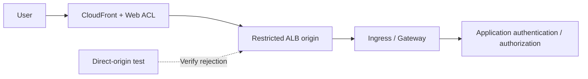

# オリジン保護を伴う WAF、エッジ、API セキュリティ

> **レビューの根拠**: AWS WAF、CloudFront、ALB の公式ドキュメント。機能と検査上の制限は、関連するリソースごとに区別しています。
> **最終更新日**: 2026年10月15日

目的は、保護対象のリクエストが WAF を経由すること、検査上の制限と例外が理解されていること、アプリケーションがリクエストを安全に処理することを実証することです。以下のアプリケーション、オリジン、運用に関する基準は設計案です。

## 1. WAF、NGFW、アプリケーション認可を分ける

AWS WAF は CloudFront、ALB、API Gateway **REST API** など、関連付けがサポートされるリソースへのリクエストを検査します。同じ直接関連付けが API Gateway HTTP／WebSocket API や NLB でも機能すると想定しないでください。CloudFront ACL は `CLOUDFRONT` スコープと `us-east-1` API エンドポイントを使い、ALB などのリージョナルリソースは対象リージョン内の `REGIONAL` スコープを使います。[S09]

VM-Series／FortiGate の NGFW 機能と、別製品である Palo Alto／Fortinet の WAF 製品を区別してください。アプリケーション認可も別の層です。顧客間のオブジェクトアクセス、ビジネス上限、決済処理の重複、LLM ツール権限をアプリケーションで確認してください。

| フロー | 主な制御 | 追加で検証する内容 |
|---|---|---|
| パブリック HTTP(S) | CloudFront／ALB に関連付けた WAF | オリジンへの直接アクセス、本文サイズ上限、例外、アプリケーション認可 |
| TLS を維持する IP セッション | NGFW 経路と選択した復号 | 実際にペイロードが見えるか、例外 |
| 内部 admission webhook | アクセス制限、admission、RBAC | Pod からの到達性とコントローラー権限 |
| アップロード／gRPC／WebSocket | サポートされる経路とアプリケーション固有の処理 | 最初のリクエスト以降とファイル処理までのカバレッジ |

ingress-nginx の admission に関する CVE は、Pod ネットワークから到達できる webhook が関係します。パブリック URL に対する WAF のカバレッジとは分けてテストしてください。[S01]

## 2. リクエスト経路に基づいてオリジン保護を設計する



これは論理設計です。CloudFront WAF のみを使うか、ALB にもリージョナル ACL を適用するかを文書化してください。二重に検査するか選ぶ前に、ログ、誤検知、コストを評価します。

### オプション A: パブリック ALB オリジン

AWS の CloudFront から ALB へのアクセス制限例に基づいて、制御を組み合わせます。[S16]

1. ALB セキュリティグループに CloudFront のオリジン向けマネージドプレフィックスリストを設定する方法を確認します。
2. CloudFront のオリジンカスタムヘッダーと、ALB リスナーのヘッダー条件を組み合わせます。
3. 承認された経路以外のリクエストを拒否するデフォルトのリスナーアクションを設計します。
4. オリジンの HTTPS、ヘッダーシークレットのローテーション、設定の読み取り権限を管理します。
5. ALB の DNS 名、代替ドメイン、アドレス、リスナー、他のロードバランサー、NodePort をテストします。

**CloudFront の IP アドレス範囲だけでは、自分のディストリビューションを識別できません。** ヘッダーを使うと他の CloudFront 経路と区別できますが、値が共有シークレットであるため、漏えいすると有効性が失われます。実際の値をソース、スクリーンショット、通常のログに残さないでください。転送ヘッダーを信頼するアプリケーションと、オリジンアクセスを制限するリスナーは別の仕組みです。[S16]

### オプション B: CloudFront VPC オリジン

CloudFront VPC オリジンは、プライベート VPC サブネット内のサポート対象オリジンへ配信できます。Internet Gateway のアタッチメント要件は、オリジンにパブリック IP を必要とするものではありません。現在のリージョン、リソース、プロトコルの制約、サブネットのアドレス、サービス管理セキュリティグループの設定を確認してください。NLB オリジンのサポートは、WAF と NLB を直接関連付けられるかどうかとは別です。[S17]

どちらの方法でも、同じアプリケーションを公開する他のパブリック Service、NodePort、管理エンドポイントを確認してください。オリジンがプライベートであると示すだけでは、入口経路の棚卸しは完了しません。

## 3. ルールの順序と終了アクション

AWS WAF は、数値の小さい優先順位から評価します。`Allow` と `Block` は評価を終了し、`Count` は続行します。有効なトークンがあれば `CAPTCHA` と `Challenge` は評価を継続し、受け入れ可能なトークンがなければ終了します。終了ルールでリクエストが判定されなかった場合は、ACL のデフォルトアクションが適用されます。[S10]

| 落とし穴 | 影響 | 設計案 |
|---|---|---|
| 優先順位の早い広範な `Allow` | 後続のマネージドルール／レートルールが評価されない | 許可範囲を狭め、順序をレビューする |
| グループ全体の例外化 | 他の保護まで削除される可能性がある | 個別ルール、パス、メソッド、所有者、有効期限を記録する |
| `Count` をブロックとして扱う | リクエストは監視されるだけ | アクション、上書き、有効な結果を調べる |
| すべての API に Challenge を適用 | 自動クライアントに互換性の問題が生じる | ブラウザーと機械向け API を分けてテストする |

マネージドルールの選択と更新には変更管理が必要です。正当なトラフィックに対して、関連するベースライン、既知の不正入力、SQLi グループを評価し、バージョン固定／変更通知のサポートを確認してください。グループ名だけで、攻撃をすべて検知できることは保証されません。

## 4. リクエスト本文とサイズ超過の上限

| 関連付け先のリソース | AWS WAF が検査する本文サイズ |
|---|---|
| ALB、AppSync | 固定で8 KB |
| CloudFront、API Gateway、Cognito、App Runner、Verified Access、Bedrock AgentCore Gateway | デフォルト16 KB、サポート対象では最大64 KBに設定可能 |
| gRPC リクエスト | AWS の説明では、本文を検査するルールは適用されない |

これらは検査上限であり、アップロード許容量やリクエスト全体の上限ではありません。上限を引き上げる前に、サポート状況とコストを確認してください。マネージドルール自体のサイズ条件は、ACL の検査サイズ設定とは別です。[S11]

本文、ヘッダー、Cookie が検査上限を超える場合、そのステートメントのサイズ超過時の処理が重要です。[S12]

- `CONTINUE`: 検査できる範囲を評価する。
- `MATCH`: そのステートメントではサイズ超過を一致として扱う。
- `NO_MATCH`: そのステートメントではサイズ超過を不一致として扱う。

**`MATCH` は Block アクションではありません。** 最終動作は、アクションと `NOT` など周囲のステートメントに依存します。また、先に評価された終了許可によって、後続のサイズ超過ブロックルールが実行されないこともあります。[S10] [S12]

全本文サイズ、スキーマ、コンテンツタイプ、展開処理、ファイル処理、認可はアプリケーションで検証してください。大きなアップロードには別の経路を設け、ストレージに置いた後の検査も検討します。しきい値の前後で通常の JSON／multipart リクエストを比較し、検査対象プレフィックスの後ろにあるデータも確認してください。上限と経路の確認に攻撃用ペイロードは必要ありません。

## 5. クライアント IP とレートベースルール

CloudFront → ALB → Ingress → アプリケーションの各段階で、接続相手のアドレスと転送されたクライアントアドレスは異なる場合があります。転送 IP 設定を使う前に、信頼するプロキシとオリジン経路を定義してください。Geo match、ASN match、レートベースのステートメントは最初のアドレスを使います。IP set match では `FIRST`、`LAST`、`ANY` を設定します。`ANY` は最大10個のアドレスを調べ、11個以上ある場合は最後の10個を使います。[S13]

ヘッダーがない場合、直接のステートメントでは不一致になり、不正な値に対するフォールバックは実行されません。外側の `NOT` が不一致を一致に反転させる場合があるため、転送 IP 設定だけでなく、ステートメント全体のツリーをテストしてください。[S13]

API 不正利用への制御案:

| リクエスト | 集約／アプリケーション側のチェック | テストケース |
|---|---|---|
| ログイン／パスワードリセット | クライアント IP、アプリケーションのアカウントポリシー、パス／メソッド範囲 | 共有 NAT、正当な再試行、不明なアカウント |
| 検索／高コスト API | サポート対象のカスタム集約とアプリケーションクォータ | クエリコスト、トークンの発行／ローテーション、クライアントの種類 |
| クローラー／ボット | ブラウザートークン、サポートされる bot ルール、アプリケーション側のチェック | SDK、モバイル、アクセシビリティ対応クライアント |
| アップロード／決済 | 認可、サイズ、冪等性、ビジネス上限 | 重複送信、失敗後の再試行 |

レートルールは近似的な追跡を行うもので、厳密な1秒あたりリクエスト数のクォータではありません。サポートされる評価ウィンドウは60、120、300、600秒です。制限、ウィンドウ、集約方法、範囲を変更するとカウンターがリセットされ、適用が最大1分間停止する場合があります。トークンや任意のヘッダーをキーに使う場合は、攻撃者が制御するキーの変化や欠落値をテストしてください。[S14] [S37] [S43]

## 6. ログと障害時のポリシーを検証する

`terminatingRuleId`、`action`、`nonTerminatingMatchingRules`、内部のマネージドルール結果、ラベル、`ruleMatchDetails`、`oversizeFields`、パス、メソッド、リクエスト ID を確認します。Count の一致は、終了ルールだけを見ても分かりません。[公式のフィールド定義][S36]を使ってください。

個人情報、トークン、認証ヘッダーを制限します。**ログの編集機能だけでは、リクエストサンプリングや Security Lake への収集は自動的に保護されません。** サンプリング／データ保護は別途確認し、収集されたデータを検査してください。アプリケーションログとあわせて、監視の遅延／イベント欠落も調べることを運用案に含めます。[S15]

ALB の `waf.fail_open.enabled` は、リクエストを WAF に送信できない場合にターゲットへ転送するかを制御します。デフォルトは `false` です。有効な属性を読み取り、想定する許可／拒否動作を文書化してください。関連付けただけでは、すべての WAF 障害時にリクエストがブロックされるとは限りません。他に提案する障害時設定は、まず対象リソースの最新の公式属性で確認してください。[S18]

## 7. 安全な検証とロールアウト

この JSON は Web ACL 内の**1つの Rule**であり、ACL 全体、関連付け、デプロイコマンドではありません。承認済みのテストリクエストで一意なヘッダーを数え、経路とログを確認します。

```json
{
  "Name": "DocumentedCanaryCount",
  "Priority": 0,
  "Statement": {
    "ByteMatchStatement": {
      "SearchString": "security-review",
      "FieldToMatch": { "SingleHeader": { "Name": "x-doc-waf-canary" } },
      "TextTransformations": [{ "Priority": 0, "Type": "NONE" }],
      "PositionalConstraint": "EXACTLY"
    }
  },
  "Action": { "Count": {} },
  "VisibilityConfig": {
    "SampledRequestsEnabled": false,
    "CloudWatchMetricsEnabled": true,
    "MetricName": "DocumentedCanaryCount"
  }
}
```

既存 ACL の優先順位とメトリクス名を合わせます。これは、悪意あるリクエストの検知や誤検知を検証するものではありません。ステージングでは、範囲を限定した通常の Block canary を追加し、アプリケーションまで到達しないことを確認します。実際の保護ルールは、業務トラフィックのリプレイで評価してください。Count から Block へ変更する条件、例外の有効期限、ロールバックの責任者を記録します。

| 検証 | 期待される結果と保持する根拠 |
|---|---|
| 正当な業務／自動 API クライアント | 成功、エラー率、p95、トークン／Challenge の結果 |
| Count／Block canary | 非終了と終了の結果、WAF／アプリケーションの相関 |
| オリジンへ直接アクセス／別のディストリビューション | 設定されたオリジン境界で拒否される |
| 本文上限前後のリクエスト／大容量アップロード | サイズ超過時の動作と、アプリケーションによる全入力の検証 |
| 転送ヘッダーの欠落／偽装 | 信頼境界とルールの適用可否 |
| 共有 NAT／分散キー／レートルール更新 | 正規ユーザーへの影響、近似上限、リセット |
| ACL 削除／例外／WAF 障害 | 変更検出と文書化された障害時動作 |

このドキュメント更新では、WAF／アプライアンスのデプロイ、攻撃の再現、トラフィック性能の測定は行っていません。

## 学習を続ける

- [多層防御とインシデント対応](./13-defense-in-depth-incident-response.md)
- [Palo Alto と Fortinet の NGFW](./15-ngfw-paloalto-fortinet.md)
- [GWLB と GENEVE](./16-gwlb-geneve-inspection.md)
- [章のクイズ](../quizzes/security/14-waf-edge-api-security-quiz.md)

## 参考資料と調査の根拠

一次資料は2026年10月15日に確認しました。変更前に、選択した製品／ブランチのアドバイザリと制約を再確認してください。

- [S01: Kubernetes: CVE-2025-1974][S01]
- [S09: AWS WAF: Web ACL の関連付け][S09]
- [S10: AWS WAF: ルールアクション][S10]
- [S11: AWS WAF: 本文検査サイズ][S11]
- [S12: AWS WAF: サイズ超過リクエストコンポーネント][S12]
- [S13: AWS WAF: 転送 IP アドレス][S13]
- [S14: AWS WAF: レートベースルール][S14]
- [S15: AWS WAF: ログ記録][S15]
- [S16: CloudFront: ALB オリジンへのアクセス制限][S16]
- [S17: CloudFront: VPC オリジン][S17]
- [S18: ALB: 属性][S18]
- [S36: AWS WAF: ログフィールド][S36]
- [S37: AWS WAF: レート評価ウィンドウ][S37]
- [S43: AWS WAF: レートルールの注意事項][S43]

[S01]: https://kubernetes.io/blog/2025/03/24/ingress-nginx-cve-2025-1974/
[S09]: https://docs.aws.amazon.com/waf/latest/developerguide/web-acl-associating-aws-resource.html
[S10]: https://docs.aws.amazon.com/waf/latest/developerguide/waf-rule-action.html
[S11]: https://docs.aws.amazon.com/waf/latest/developerguide/web-acl-setting-body-inspection-limit.html
[S12]: https://docs.aws.amazon.com/waf/latest/developerguide/waf-oversize-request-components.html
[S13]: https://docs.aws.amazon.com/waf/latest/developerguide/waf-rule-statement-forwarded-ip-address.html
[S14]: https://docs.aws.amazon.com/waf/latest/developerguide/waf-rule-statement-type-rate-based.html
[S15]: https://docs.aws.amazon.com/waf/latest/developerguide/logging.html
[S16]: https://docs.aws.amazon.com/AmazonCloudFront/latest/DeveloperGuide/restrict-access-to-load-balancer.html
[S17]: https://docs.aws.amazon.com/AmazonCloudFront/latest/DeveloperGuide/private-content-vpc-origins.html
[S18]: https://docs.aws.amazon.com/elasticloadbalancing/latest/application/application-load-balancers.html
[S36]: https://docs.aws.amazon.com/waf/latest/developerguide/logging-fields.html
[S37]: https://docs.aws.amazon.com/waf/latest/developerguide/waf-rule-statement-type-rate-based-high-level-settings.html
[S43]: https://docs.aws.amazon.com/waf/latest/developerguide/waf-rule-statement-type-rate-based-caveats.html
