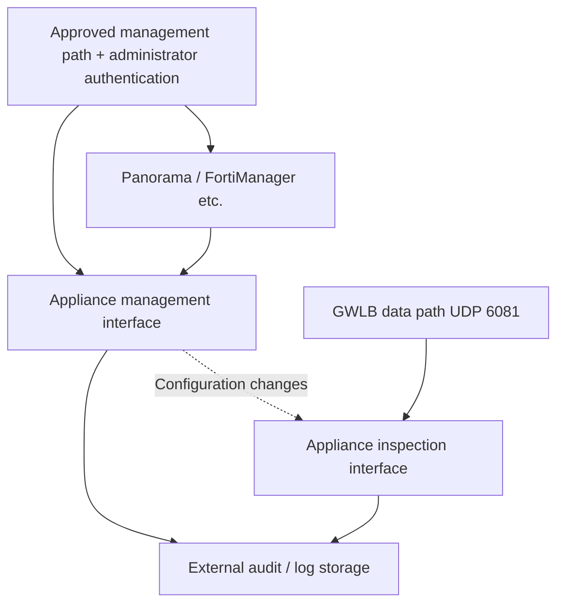

# AWS／EKS 上の Palo Alto と Fortinet NGFW の設計・運用

> **レビュー根拠**: VM-Series／FortiGate-VM の公式 AWS GWLB 連携ガイドとベンダーのセキュリティ advisory。選択したサポート対象 branch／deployment mode に合わせて例を確認してください。
> **最終更新**: 2026年10月15日

NGFW は、通過する session に設定済み policy を適用します。Appliance を追加しただけでは、すべての VPC／Pod flow が検査されるとは限りません。この章では、連携要件、管理、TLS、session、capacity を比較し、[GWLB 経路の検証](./16-gwlb-geneve-inspection.md)につなげます。

## 1. Deployment model を選ぶ

| Model | 構成 | PoC で確認すること |
|---|---|---|
| 分散検査 | Workload VPC 内に経路と appliance を配置 | Local 経路、AZ 分離、fleet 間の policy 一貫性 |
| 中央検査 | 選択した複数 VPC の traffic を TGW／inspection VPC 経由にする | 対称性、TGW appliance mode、NAT、例外 |
| GWLB 挿入 | GWLBE から GENEVE 対応 fleet に送る | Encapsulation、health、flow の再割り当て、appliance policy |
| Vendor-managed service | 対応するマネージド NGFW deployment | 製品固有の routing、policy、logging、account の責任 |

中央検査が対象とするのは TGW に routing された traffic です。VPC 内、node 内、その他の接続は個別に確認してください。Appliance がなければ GWLB endpoint や TGW appliance mode だけで検査は行われません。[S24] [S29] [S30]

VM-Series と Palo Alto Cloud NGFW、FortiGate-VM と FortiWeb は、それぞれ異なる製品です。実際に使う製品の support、機能、advisory を確認してください。CVE-2026-0322 の Cloud NGFW 除外は、その advisory に対するものです。[S03]

## 2. Vendor ごとの GWLB 連携

| レビュー項目 | Palo Alto VM-Series | Fortinet FortiGate-VM |
|---|---|---|
| 連携 | PAN-OS GWLB 連携、vendor template、または手動設定 | GENEVE interface と single／multi-AZ の deployment guide |
| Data path | Decapsulation 後に interface／zone／security policy を適用 | Decapsulation 後に interface／policy を処理 |
| Encapsulation | UDP 6081 と対応 release／mode | UDP 6081、GWLB node の GENEVE 設定、AWS TLV 処理 [S42] |
| Policy の前提 | Interface、zone、許可設定、security profile | GENEVE interface、firewall policy、UTM／security profile |
| 管理 | 該当する Panorama／管理構成と変更監査 | 該当する FortiManager／FortiAnalyzer 構成と変更監査 |
| 障害／scale | GWLB の登録／解除と appliance の session／設定処理 | GWLB の登録／解除と appliance の session／設定処理 |

参照資料: [VM-Series の概要][S19]、[手動設定][S20]、[連携の有効化][S21]、[Fortinet interface 設定][S22]、[FortiGate deployment guide][S23]。AWS は GWLB GENEVE TLV format と Option Class `0x0108` を[別の target group ドキュメント][S42]で定義しています。参照する Fortinet 7.0.0 guide は deployment 方法を説明するものです。**本番向け version の推奨ではありません。** 実際に選ぶサポート対象 branch の guide、PSIRT、image を確認してください。

### Palo Alto: 連携、interface、既定 zone policy

GWLB 連携の対応状況を、実際の interface、zone、health check、policy に照らして確認してください。有効化ガイドは management／data interface の入れ替えと GWLB inspection の有効化を説明しています。機能サポートの最小 version は、現在安全な patch や本番 version の推奨とは異なります。[S21]

手動設定ガイドでは HTTP health check が使えないとして HTTPS／TCP を推奨していますが、後半の management profile の手順には HTTP を有効にする記述もあります。**この曖昧さを根拠に、自動的に設定を決めないでください。** 選択した version／template で対応する protocol と response を確認し、必要なら vendor に確認します。Health check の成功は、signature、license、inspection policy が正しく動作する証明ではありません。[S20]

AWS は TLS 1.3 だけに対応する target で HTTPS health check が失敗することも案内しています。Health endpoint は TLS 1.2 など、より古い version に対応する必要があります。この health 要件は、検査対象 application の TLS 対応とは別です。[S26]

同じガイドでは、GWLB traffic は intrazone として扱われ、既定の intrazone rule はすべての traffic を許可すると説明されています。意図した policy の範囲外を deny するよう、default action と適用 profile を確認してください。Interface を有効にするだけでは block policy は完成しません。[S20]

### Fortinet: interface と policy を一緒に検証する

Fortinet の導入後ガイドでは、同一 AZ の GWLB interface IPv4 address を GENEVE peer として使い、受信した GENEVE interface 経由で egress が戻るよう設定します。Management／application address を代わりに使わないでください。必要な encapsulation metadata と、選択した mode の対応状況を deployment documentation で確認してください。[S22] [S23]

意図した allow／deny policy と inspection profile のない GENEVE interface では不十分です。別途設計する FGCP HA と、独立した GWLB target も異なる構成要素です。Vendor が対応する HA／session-sharing mode を選び、検証してください。

## 3. Appliance の管理 plane を保護する

これは論理的な責任分担です。実際の ENI／subnet 数は選択した vendor template によります。

提案する管理基準:

- Appliance／manager の HTTPS、SSH、API を、承認済み管理経路と送信元だけに制限する。
- 個人別 account、最小権限、対応する MFA、独立した recovery account を管理する。
- Automation token、SSO、中央管理に関わる管理者／設定変更を監査する。
- Public IP、EIP、listener、代替 port、その他の ENI で実際に公開されている箇所を確認する。
- Log／設定 revision を外部に保持し、時刻同期を検証する。
- 対応 branch、hotfix、signature、manager の互換性を棚卸しする。

PAN-OS advisory は、management access を信頼された内部 address に制限するよう推奨しています。2026年の RCE は認証済み attacker も対象に含むため、送信元制限と管理者認証の両方を確認してください。[S03] [S04]

手動 deployment guide では management ENI に EIP を割り当てます。これはサンプル手順であり、既定で公開が必要という意味ではありません。本番導入前に、実際の access を advisory の「信頼された内部送信元に限定する」という要件に合わせてください。[S20] [S03] [S04]

FortiCloud SSO の incident では、account 間の login と管理者／VPN の変更がありました。公式の訂正では third-party SAML IdP と FortiAuthenticator はその問題の対象外です。すべての SSO 方式に一般化しないでください。[S05] [S06]

## 4. TLS の可視性

| 検査箇所 | 既定で見える情報 | Payload 検査時の確認 |
|---|---|---|
| HTTPS termination 前の NGFW | Packet、connection、公開された TLS metadata | 対応する復号、key／certificate、client 互換性 |
| WAF を関連付けた CloudFront／ALB | Resource から WAF に渡される request の範囲 | Body／gRPC／oversize の上限 |
| 再暗号化された ALB→Pod 経路上の NGFW | その segment の TLS connection | 別途復号するか endpoint 層で検査 |
| Mesh mTLS segment | 観測可能な peer／transport metadata | Mesh の trust、認可、対応する検査位置 |

GWLB は TLS を終端せず、GENEVE で encapsulate します。GENEVE 自体は暗号化ではありません。Network Firewall の TLS inspection にも個別の policy／certificate 設定が必要です。Appliance を通過することと復号が成功することは別の事実です。[S24] [S31] [S35]

復号の PoC では TLS version／cipher、HTTP/2、gRPC、WebSocket、mTLS、certificate pinning、client CA trust、規制上の例外を扱ってください。例外に対する代替制御を記録します。「SSL inspection」という名前の設定だけでは、暗号化 payload がすべて検査されたと証明できません。

HTTPS の ALB target group を使っても、backend certificate の trust 検証が行われるとは限りません。AWS は ALB が target certificate を検証しないと説明しています。Server identity の確認が必要なら、別途設計してください。[S38]

## 5. NAT、元の address、Pod の識別

各 session について、次の観測情報を相関させます。

| Segment | 記録する情報 |
|---|---|
| Application／Pod | Workload／namespace、request ID、Pod／node address、時刻 |
| Node／CNI | SNAT の挙動／mode、実効 NetworkPolicy |
| Appliance | 観測した5-tuple、policy／profile、action、復号結果 |
| NAT／外部 | 変換後 address、宛先、response、retry |
| TGW／GWLBE | Attachment、AZ、route table、endpoint identity |

Node SNAT 後は、appliance が Pod address ではなく node address を見る場合があります。既定の VPC CNI で VPC CIDR 外へ IPv4 egress する場合、EKS は node の primary address に変換すると説明しています。これを普遍的な挙動とせず、実際の external-SNAT、OS、routing 設定を確認してください。[S44]

Pod address が維持されていても、Pod 交換時に変わる場合があります。IP policy と Kubernetes label／identity policy を区別し、CNI／IPAM の観測情報と相関させてください。[S33]

Request と response が異なる appliance に到達したり、tuple が一致しなかったりすると stateful inspection が壊れることがあります。Stickiness、NAT の位置、TGW appliance mode、選択した deployment mode を合わせて検証してください。TGW appliance mode が必要とするのは5-tuple stickiness です。2-tuple／3-tuple mode は非対応です。透過型 GWLB の設計に根拠のない SNAT を追加しないでください。[S25] [S29] [S30]

## 6. Session、scale、license、capacity

GWLB は target 選択、health、flow failover を提供しますが、独立した appliance 間で state を自動複製するわけではありません。Target の追加／削除、`rebalance`、reboot、AZ 喪失時に**既存 session と新規 session の両方**をテストしてください。HA／session sharing が必要なら、対応する vendor mode と障害条件を確認します。[S25]

提案する測定計画:

| 測定項目 | 固定する条件 |
|---|---|
| Throughput／packet rate | Packet size、双方向比、小さい packet、大きい body |
| Connection rate／同時 session 数 | TCP／UDP、keepalive、長時間の gRPC／WebSocket |
| Inspection 有効時の throughput | 実際の IPS、malware、URL、logging、TLS 復号 profile |
| p50／p95／p99／error | Application／appliance／TGW／AZ 経路と baseline |
| N-1／AZ 喪失 | 残存 instance／license capacity、CPU／memory、policy 準備状況 |
| Maintenance／scaling | 登録準備、drain、policy／signature 配布、session 中断 |

Datasheet の数値は、条件を揃えた vendor 間の比較ではありません。Port、CPU、暗号処理、license／subscription の上限を記録してください。総費用には appliance EC2／EBS／license、GWLB／GWLBE、TGW、NAT、AZ 間転送、log、運用が含まれます。実際の Region の価格で個別に算出してください。この調査では価格の提示も性能測定もしていません。

## 7. Patch 適用と侵害除去を区別する

| 状態 | 必要な確認 |
|---|---|
| 影響の有無を確認 | Product、branch、hotfix、feature、公開状況、advisory revision |
| Patch 完了 | 修正済み release の実際の deploy、manager／template／signature との互換性 |
| 侵害を除去 | 管理者／VPN／system／設定の変更と、関連する credential の使用状況 |
| 復旧を実証 | Inspection／業務機能、制限された管理経路、既存／新規 session、外部 log |

Fortinet の2025年の分析では、以前の SSL-VPN patch 後も access が残るケースを説明しています。2026年の SSO 分析は、侵害が確認された際に設定の監査／復旧と credential の rotation を推奨しています。現在の version を使うだけでは侵害除去は完了しません。[S07] [S05]

その過去の symlink 問題について Fortinet は、upgrade 時に link を除去する release として7.6.2、7.4.7、7.2.11、7.0.17、6.4.16を示しましたが、設定レビューも引き続き必要です。これは過去の対処に関する参照であり、2026年の version 推奨ではありません。[S07]

PAN-OS の修正 release／提供予定日一覧は branch ごとに変わることがあります。この章の固定 version を deploy 指示として使わず、変更時に advisory を再確認してください。[S03]

## 8. PoC の受け入れ基準

以下は共通の提案基準です。必須確認を通過してから、使いやすさ、運用費、性能を比較します。

1. 対応 image、license、branch、公式連携の組み合わせが整合している。
2. 制限された管理 access と、管理者／設定変更を観測できる。
3. 許可／拒否された session の request／response tuple と適用 profile を相関できる。
4. 復号範囲／例外と、正当な client との互換性を説明できる。
5. 全 target unhealthy、単一 target failure、AZ 喪失、scale-in、upgrade を既存／新規 session で試験する。
6. N-1 capacity と application latency／error SLO を測定する。
7. Advisory review、patch、侵害除去、rollback に担当者と証拠を用意する。

## 続けて学ぶ

- [GWLB と GENEVE の検査](./16-gwlb-geneve-inspection.md)
- [WAF と Origin の保護](./14-waf-edge-api-security.md)
- [インシデント対応](./13-defense-in-depth-incident-response.md)
- [章のクイズ](../quizzes/security/15-ngfw-paloalto-fortinet-quiz.md)

## 参考資料と調査根拠

一次資料は2026年10月15日に確認しました。変更前に、選択した製品／branch の advisory と制約を再確認してください。

- [S03: Palo Alto: CVE-2026-0322][S03]
- [S04: Palo Alto: CVE-2025-0108][S04]
- [S05: Fortinet: FortiOS における SSO 悪用の分析][S05]
- [S06: CISA: Known Exploited Vulnerabilities Catalog][S06]
- [S07: Fortinet: 脅威アクターの活動分析][S07]
- [S19: VM-Series: GWLB 連携][S19]
- [S20: VM-Series: GWLB 手動連携][S20]
- [S21: VM-Series: GWLB 連携の有効化][S21]
- [S22: FortiGate: GWLB 導入後の設定][S22]
- [S23: FortiGate: GWLB 連携による security inspection][S23]
- [S24: AWS: Gateway Load Balancer][S24]
- [S25: AWS GWLB: Target group attribute][S25]
- [S26: AWS GWLB: Health check][S26]
- [S29: AWS: GWLB と TGW による集中検査][S29]
- [S30: AWS: NAT Gateway のシナリオ][S30]
- [S31: RFC 8926: GENEVE][S31]
- [S33: EKS: Network security][S33]
- [S35: AWS Network Firewall: TLS inspection 設定][S35]
- [S38: ALB: Target group][S38]
- [S42: AWS GWLB: Target group][S42]
- [S44: EKS: 外部 internet access と SNAT][S44]

[S03]: https://security.paloaltonetworks.com/CVE-2026-0322
[S04]: https://security.paloaltonetworks.com/CVE-2025-0108
[S05]: https://www.fortinet.com/blog/psirt-blogs/analysis-of-sso-abuse-on-fortios
[S06]: https://www.cisa.gov/sites/default/files/feeds/known_exploited_vulnerabilities.json
[S07]: https://www.fortinet.com/blog/psirt-blogs/analysis-of-threat-actor-activity
[S19]: https://docs.paloaltonetworks.com/vm-series/deployment/public-cloud/set-up-the-vm-series-firewall-on-aws/vm-series-integration-with-gateway-load-balancer
[S20]: https://docs.paloaltonetworks.com/vm-series/deployment/public-cloud/set-up-the-vm-series-firewall-on-aws/vm-series-integration-with-gateway-load-balancer/manually-integrate-the-vm-series-with-a-gateway-load-balancer
[S21]: https://docs.paloaltonetworks.com/vm-series/deployment/public-cloud/set-up-the-vm-series-firewall-on-aws/vm-series-integration-with-gateway-load-balancer/enabling-vm-series-integration-with-a-gwlb
[S22]: https://docs.fortinet.com/document/fortigate-public-cloud/7.0.0/aws-administration-guide/337773/post-deployment-configuration
[S23]: https://docs.fortinet.com/document/fortigate-public-cloud/7.0.0/aws-administration-guide/571235/security-inspection-with-gateway-load-balancer-integration
[S24]: https://docs.aws.amazon.com/elasticloadbalancing/latest/gateway/gateway-load-balancers.html
[S25]: https://docs.aws.amazon.com/elasticloadbalancing/latest/gateway/edit-target-group-attributes.html
[S26]: https://docs.aws.amazon.com/elasticloadbalancing/latest/gateway/health-checks.html
[S29]: https://aws.amazon.com/blogs/networking-and-content-delivery/centralized-inspection-architecture-with-aws-gateway-load-balancer-and-aws-transit-gateway/
[S30]: https://docs.aws.amazon.com/vpc/latest/userguide/nat-gateway-scenarios.html
[S31]: https://www.rfc-editor.org/info/rfc8926/
[S33]: https://docs.aws.amazon.com/eks/latest/best-practices/network-security.html
[S35]: https://docs.aws.amazon.com/network-firewall/latest/developerguide/tls-inspection-configurations.html
[S38]: https://docs.aws.amazon.com/elasticloadbalancing/latest/application/load-balancer-target-groups.html
[S42]: https://docs.aws.amazon.com/elasticloadbalancing/latest/gateway/target-groups.html
[S44]: https://docs.aws.amazon.com/eks/latest/userguide/external-snat.html
