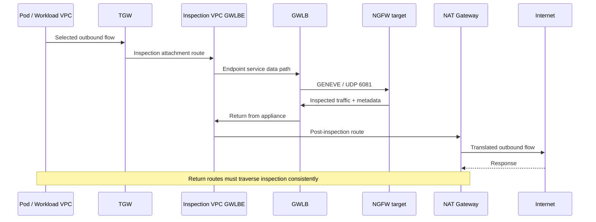

# GWLB と GENEVE: 対称な検査経路と障害検証

> **レビュー根拠**: AWS Gateway Load Balancer、PrivateLink、TGW、NAT の公式ドキュメント、RFC 8926、vendor 連携ガイド。
> **最終更新**: 2026年10月15日

GWLB は、元の IP flow を GENEVE 対応の security appliance に分配します。GWLBE は利用者 VPC の route target であり、検査 policy は appliance にあります。このガイドでは[Palo Alto／Fortinet の選択](./15-ngfw-paloalto-fortinet.md)を受け、経路、session、障害を検証します。Route table と受け入れ基準は設計例であり、完全な IaC やデプロイ結果ではありません。[S24] [S27]

## 1. Component と責任

| Component | 役割 | 確認項目 |
|---|---|---|
| GWLB | IP flow を target に転送 | AZ、target group、stickiness、failover |
| GENEVE target group | Appliance の登録、health、attribute | GENEVE port 6081、対応する IP／instance target |
| Appliance | Decapsulate、検査、再 encapsulate | Policy、session、license、metadata、MTU |
| Endpoint service | Provider の GWLB を consumer VPC に公開 | 許可された principal、承認、所有権 |
| GWLBE | Consumer VPC 内の AZ ごとの route target | Subnet、AZ、state、route |
| TGW appliance mode | Flow ごとに検査 attachment の ENI／AZ を選び、双方向に使う | 検査用 VPC attachment の実効設定 |

Endpoint service の permission／承認は接続確立を制御します。Application authorization や appliance policy を制御するものではありません。Account 間で物理 zone を比較するときは、Account 固有の AZ 名ではなく **AZ ID** を使ってください。[PrivateLink 要件][S27]を確認します。

GWLB には ALB のような Security Group がありません。**GWLBE も SG に対応しません。** ELB API の security-group parameter は ALB／NLB に適用され、endpoint の SG parameter は interface endpoint に適用されます。Appliance／workload ENI、NACL、route、policy を確認してください。[S39] [S40]

## 2. GENEVE は検査用 transport であり暗号化ではない

```text
Outer IP
  └─ UDP destination port 6081
      └─ GENEVE header + options / AWS metadata
          └─ Original encapsulated traffic
```

RFC 8926 は GENEVE header、VNI、可変 option、UDP transport を定義しています。AWS GWLB は Option Class `0x0108` の TLV metadata を使います。Appliance は TLV pair を処理し、GWLB はその metadata で戻り先 GWLBE を選択します。対応する連携方式で必要な metadata を維持してください。一般的な GENEVE 対応だけでは、GWLB との互換性は証明されません。[S31] [S42] [S29]

GENEVE は TLS／IPsec のように payload を暗号化しません。Cilium overlay と GWLB encapsulation は同じ port を使う場合でも、目的と経路が異なります。TLS payload を検査するには、appliance による復号、または TLS termination point の制御が必要です。[S31] [S24]

## 3. 論理的な AZ 単位の egress 経路

この順序は、中央 egress の**片方向**を示します。実際の TGW、GWLBE、appliance、NAT 経路は AZ に応じて選択されます。Session を維持するため、response も一貫した検査経路を通る必要があります。



TGW attachment、endpoint、NAT subnet の route table はそれぞれ役割が異なります。すべての subnet の default route を GWLBE に向けると、検査済み traffic が検査経路へ戻る loop が起きる場合があります。AWS の TGW 検査と NAT の連携をあわせて確認してください。[S29] [S30]

## 4. 中央検査の route をレビューする

以下は IPv4 の中央 egress と VPC 間検査の pattern です。実際の CIDR、AZ、endpoint／attachment ID、prefix 優先順位、既存 route を確認してください。Consumer VPC の接続性だけでは、全方向が検査されるとは限りません。

| 場所 | 選択される宛先 | 次の hop／目的の例 |
|---|---|---|
| Spoke workload subnet | 他の spoke CIDR／external default | TGW |
| Spoke に関連付けられた TGW table | 検査対象の spoke／external traffic | Inspection VPC attachment |
| Inspection VPC の TGW-attachment subnet | 検査対象宛先 | 選択 AZ 内の GWLBE |
| GWLBE subnet | Spoke CIDR | TGW |
| GWLBE subnet | External `0.0.0.0/0` | その AZ の NAT Gateway |
| NAT subnet | External `0.0.0.0/0` | Internet Gateway |
| NAT subnet | 戻り先の spoke CIDR | Inspection GWLBE |
| Inspection attachment に関連付けられた TGW table | Spoke CIDR | Inspection attachment ではなく、適切な spoke attachment |

Request は NAT より前に検査されます。Response は逆変換の後に検査を通り、TGW 経由で戻ります。NAT subnet の戻り route が欠けると、一方向だけが検査されたり stateful session が壊れたりします。NAT を移動する場合は tuple と route を再確認してください。[S29] [S30]

中央 inspection attachment で TGW appliance mode を検証します。この mode は flow の両方向で検査 attachment の ENI／AZ を一貫して選択します。TGW 既定の送信元 AZ 優先を置き換え、AZ 間 routing を可能にします。Firewall session を複製するわけではありません。GWLB target 選択とは別に検証してください。[S29] [S25] [S32]

### Internet ingress には別の設計が必要

Ingress 挿入では、IGW edge-associated route、保護対象 subnet の route、GWLBE subnet の route、戻り経路を一緒に確認してください。ALB／IGW／GWLBE を順不同に並べた図では不十分です。AWS は IGW／VGW の gateway route table に制約を定めています。ALB proxy の frontend／backend 接続も別々の flow として追跡してください。[S28]

## 5. 中央検査を通らない経路

| 経路 | 個別に検証する理由 | 補完する制御の案 |
|---|---|---|
| 同一 node の Pod traffic | VPC／TGW まで届かない場合がある | CNI、NetworkPolicy、service authorization |
| VPC 内／別 subnet | Local prefix は default より具体的 | 対応する local-route 設計、または CNI／SG 制御 |
| Peering／別 TGW attachment | 別 route を通る場合がある | 実効 route と接続の棚卸し |
| PrivateLink／gateway endpoint | Public default egress とは別経路 | IAM、endpoint／resource policy、application authorization |
| IPv6／NAT64／proxy | IPv4 の `0.0.0.0/0` だけでは対象外 | Service／appliance の対応と `::/0` 経路 |
| Management／health | 検査対象 data とは目的が異なる | 送信元の制限と記録 |

所定の条件下では VPC local route を appliance に向けられます。「不可能」とも「自動的に中央集約される」とも言えません。Route type、対応 target、CIDR 制約を確認してください。[S28]

EKS Pod／node address、CNI SNAT、Security Groups for Pods の mode は可視性と経路に影響します。Pod policy と VPC 検査 route は別の設定です。[S33] [S34] [S44]

## 6. Stickiness と idle timeout

既定の stickiness は **5-tuple**（送信元／宛先 address、送信元／宛先 port、protocol）です。代替の対応方式は、address pair／protocol の **3-tuple**、または address pair の **2-tuple** ですが、**TGW appliance mode が有効な場合はこれらを使えません。** この中央構成では5-tuple stickiness を使います。Tuple を減らす方式では負荷が偏ることがあるため、deployment 制約と capacity を確認してください。[S25]

TCP idle timeout の既定値は350秒で、5-tuple stickiness の場合は60～6,000秒に変更できます。UDP timeout は120秒で固定です。2／3-tuple mode で TCP の変更が利用できると考えないでください。Appliance、NAT、application、TGW、target ENI の `TcpEstablishedTimeout` を個別に確認します。ENI の tracking timeout が短いと、GWLB が接続を active とみなしている間に drop が起きることがあります。[S24]

TCP idle timeout が切れた後、SYN は新しい flow を開始しますが、古い接続の data packet は drop されます。UDP は timeout 後の packet で新しい flow になり得ます。Timeout の延長は appliance 間の state sharing とは異なります。Keepalive、idle 後の再開、長時間の gRPC／WebSocket、UDP を試験してください。[S24]

## 7. Health、failover、fail open

| State／設定 | AWS に記載された挙動 | 運用時の確認 |
|---|---|---|
| Unhealthy target が1つ | 新 flow は利用可能な healthy target を使う | 既存 flow の設定済み挙動 |
| `target_failover.on_unhealthy=no_rebalance` | 既存 flow は割り当て先に残る | Unhealthy target で blackhole になる可能性 |
| `target_failover.on_unhealthy=rebalance` | 既存 flow を再配分する | 独立 appliance 間の session loss |
| Deregistration | `on_deregistration` に従う | Drain、scale-in、upgrade |
| 全 target が unhealthy | GWLB は flow ごとに unhealthy target をランダム選択し、reset／timeout まで維持する。AWS は healthy に戻るまで drop が起こると説明 | 記載された結果を確認する。Health のみの障害でも転送されるという見込みは PoC の仮説に過ぎない |
| 登録済み target がない | 新 flow の target がなく、drop を確認する | Fleet が空の場合の復旧。既存の drain 中 flow と区別する |

`target_failover.on_unhealthy` と `target_failover.on_deregistration` は同じ値でなければなりません。既定値は `no_rebalance` です。Health check は TCP、HTTP、HTTPS に対応します。Protocol、port、path を appliance に合わせてください。[S25] [S26]

現在のドキュメントでは `send_tcp_reset.on_unhealthy.enabled` と `send_tcp_reset.on_deregistration.enabled` も提供されます。既定値は `false` で、TCP のみ対象です。5-tuple stickiness（`stickiness.enabled=false`）と `no_rebalance` が必要です。`rebalance` や reduced-tuple stickiness と併用できません。RST 後の再接続、retry、業務処理の重複をテストしてください。これは session が途切れず移行する機能ではありません。Deregistration の drain 時間も確認します。[S25]

**すべての target が unhealthy になっても、GWLB が appliance を直接 bypass するわけではありません。** AWS は flow ごとに target をランダム選択し、その target が healthy になるまで traffic drop が起きると説明しています。Zone ごとに選択は独立します。Cross-zone が無効なら、各 AZ の選択対象を確認してください。Cross-zone を有効にすると選択可能な target が広がりますが、既存／新規 flow の挙動は引き続き考慮が必要です。[S26]

古い deployment blog は、既存 flow が障害 target に残る挙動を「fail-open mode」と呼んでいます。この用語は可用性保証でも直接 bypass 機能でもありません。Appliance 内部の fail-open 設定とも区別してください。Health のみの障害で traffic が転送されるかは、AWS が説明する復旧時の期待値ではなく、実験で調べる項目です。[S32] [S25] [S26]

Cross-zone balancing は別 AZ の healthy target を利用できますが、state を複製したり AZ 障害時に zonal endpoint を修復したりはしません。Cross-AZ cost、capacity、session 中断を確認してください。GWLBE／AZ の喪失と target の喪失は分けて試験します。GWLB は RST を送らないとする古い deployment blog より、現在の target-group attribute を優先してください。[S24] [S25] [S27] [S32]

## 8. MTU、fragment、NACL、health 経路

AWS が示す最大 packet size は8,500 byte、GENEVE overhead は68 byte です。GWLB は経路に代わって fragmentation や Path MTU Discovery を行いません。大きな workload MTU を設定しても、TGW、NAT、appliance 経由で同じように使えるとは限りません。[S24] [S32]

確認項目:

- 経路全体の MTU、appliance GENEVE interface の余裕、TCP MSS の扱い。
- 大きな packet、UDP datagram、TLS／HTTP2、upload、fragment。
- SG、NACL、appliance policy における外側 UDP 6081 と内側 payload protocol。
- Health port の到達性／応答と、実際の検査 canary。
- Stateless NACL を通る request／response port と外側 tuple。
- 製品ごとの現行 IPv6、encapsulation、ICMP／ICMPv6 要件。

Open port や healthy target だけでは検査の証拠になりません。[S26] [S32]

## 9. 承認済み環境での読み取り専用確認

次の AWS CLI 例は読み取り専用です。自分が管理する resource と明示的な Region を指定して、用途別の変数を設定してください。この調査では実行していません。

```bash
aws elbv2 describe-load-balancer-attributes \
  --region "$INSPECTION_REGION" --load-balancer-arn "$INSPECTION_GWLB_ARN"

aws elbv2 describe-target-group-attributes \
  --region "$INSPECTION_REGION" --target-group-arn "$INSPECTION_TARGET_GROUP_ARN"

aws elbv2 describe-target-health \
  --region "$INSPECTION_REGION" --target-group-arn "$INSPECTION_TARGET_GROUP_ARN"

aws ec2 describe-vpc-endpoints \
  --region "$INSPECTION_REGION" --vpc-endpoint-ids "$INSPECTION_ENDPOINT_ID"

aws ec2 describe-route-tables \
  --region "$INSPECTION_REGION" --route-table-ids "$INSPECTION_ROUTE_TABLE_ID"

aws ec2 describe-transit-gateway-vpc-attachments \
  --region "$INSPECTION_REGION" \
  --transit-gateway-attachment-ids "$INSPECTION_TGW_ATTACHMENT_ID"
```

Cross-zone attribute、target stickiness／failover、health、endpoint state／AZ、route／association、attachment の `ApplianceModeSupport` を比較します。TGW route table の association、propagation、実効 route には追加 query が必要です。この6つの command だけでは対称性を証明できません。

## 10. 障害試験と受け入れ基準

隔離され、承認された環境で次の計画を実行してください。

| 実験 | 必要な観測 |
|---|---|
| 許可／拒否する無害な canary | Request／response の5-tuple、target、policy／profile、application の結果 |
| 単一 target の health failure | `no_rebalance`／`rebalance` 時の既存／新規 session |
| 全 target unhealthy | Unhealthy target への送達、検査／error。直接 bypass を仮定しない |
| Fleet が空 | 新 flow の drop と既存 drain の違い、検知、復旧 |
| TCP RST feature | 5-tuple／no-rebalance 制約、再接続、retry |
| AZ／endpoint 経路の喪失 | Endpoint failure と target failure の違い、failover、復旧 |
| Scale-in／rolling upgrade | Drain、中断、readiness、policy の一貫性 |
| NAT／route 変更 | 変換前後、戻り経路、loop |
| MTU／idle／IPv6 | 大きな packet、長時間 session、対応経路 |
| 中央検査外の経路 | Local、endpoint、peering、Pod 経路と補完制御 |

受け入れ判断には、**業務 SLO、観測した検査／blocking、既存／新規 session の挙動、N-1 capacity、文書化した bypass 経路、rollback／復旧の担当者**を組み合わせます。この更新では基盤を deploy せず、障害注入や性能測定もしていません。

## 続けて学ぶ

- [Palo Alto と Fortinet の NGFW](./15-ngfw-paloalto-fortinet.md)
- [WAF と Origin の保護](./14-waf-edge-api-security.md)
- [Incident に基づく多層防御](./13-defense-in-depth-incident-response.md)
- [章のクイズ](../quizzes/security/16-gwlb-geneve-inspection-quiz.md)

## 参考資料と調査根拠

一次資料は2026年10月15日に確認しました。変更前に、選択した製品／branch の advisory と制約を再確認してください。

- [S24: AWS: Gateway Load Balancer][S24]
- [S25: AWS GWLB: Target group attribute][S25]
- [S26: AWS GWLB: Health check][S26]
- [S27: AWS PrivateLink: Gateway Load Balancer endpoint][S27]
- [S28: AWS VPC: Route table option][S28]
- [S29: AWS: GWLB と TGW による集中検査][S29]
- [S30: AWS: NAT Gateway のシナリオ][S30]
- [S31: RFC 8926: GENEVE][S31]
- [S32: AWS: GWLB deployment の best practice][S32]
- [S33: EKS: Network security][S33]
- [S34: Kubernetes: Network Policy][S34]
- [S39: AWS ELB API: CreateLoadBalancer parameter][S39]
- [S40: AWS EC2 API: CreateVpcEndpoint parameter][S40]
- [S42: AWS GWLB: Target group][S42]
- [S44: EKS: 外部 internet access と SNAT][S44]

[S24]: https://docs.aws.amazon.com/elasticloadbalancing/latest/gateway/gateway-load-balancers.html
[S25]: https://docs.aws.amazon.com/elasticloadbalancing/latest/gateway/edit-target-group-attributes.html
[S26]: https://docs.aws.amazon.com/elasticloadbalancing/latest/gateway/health-checks.html
[S27]: https://docs.aws.amazon.com/vpc/latest/privatelink/gateway-load-balancer-endpoints.html
[S28]: https://docs.aws.amazon.com/vpc/latest/userguide/route-table-options.html
[S29]: https://aws.amazon.com/blogs/networking-and-content-delivery/centralized-inspection-architecture-with-aws-gateway-load-balancer-and-aws-transit-gateway/
[S30]: https://docs.aws.amazon.com/vpc/latest/userguide/nat-gateway-scenarios.html
[S31]: https://www.rfc-editor.org/info/rfc8926/
[S32]: https://aws.amazon.com/blogs/networking-and-content-delivery/best-practices-for-deploying-gateway-load-balancer/
[S33]: https://docs.aws.amazon.com/eks/latest/best-practices/network-security.html
[S34]: https://kubernetes.io/docs/concepts/services-networking/network-policies/
[S39]: https://docs.aws.amazon.com/elasticloadbalancing/latest/APIReference/API_CreateLoadBalancer.html
[S40]: https://docs.aws.amazon.com/AWSEC2/latest/APIReference/API_CreateVpcEndpoint.html
[S42]: https://docs.aws.amazon.com/elasticloadbalancing/latest/gateway/target-groups.html
[S44]: https://docs.aws.amazon.com/eks/latest/userguide/external-snat.html
