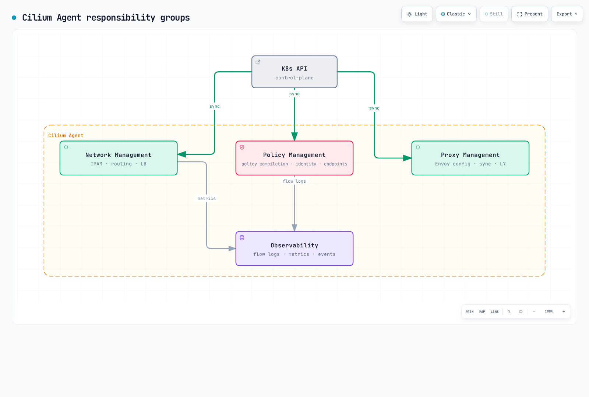

# Cilium Service Meshのアーキテクチャ

> **確認対象の基準**: Cilium 1.20.3、2026年10月16日。Kubernetesの一般的なテストマトリクスは1.33～1.36、リリース済みEKSのCIマトリクスは1.33～1.35です。プラットフォーム、kernel、インストール方式の要件はそれぞれ異なります。[概要](./README.md)を参照してください。

## 概要

CiliumはeBPFによるL3/L4データパスと、HTTPなど対応するL7処理を担うEnvoyを組み合わせます。Envoyはagentが管理するプロセスとして実行する方法と、独立した`cilium-envoy` DaemonSetで実行する方法があります。proxyを共有するとデプロイと障害の境界は変わりますが、メモリ削減量や遅延が一定になるわけではありません。

## 全体アーキテクチャ


[🔍 インタラクティブな図を見る](https://www.atomai.click/kubernetes-docs/archmaps/en-service-mesh-cilium-service-mesh-01-architecture-0.html)

図の上部はコントロールプレーンの機能をまとめたものです。**Kubernetes API serverとCilium Operatorは別のコンポーネント**です。Operatorはクラスター全体の処理を担うDeploymentであり、ノードごとのagentでもAPI serverの代替でもありません。

| コンポーネント | 役割 |
|---|---|
| Cilium Agent | ローカルendpoint、eBPFプログラム／map、policy、Envoy設定を管理します |
| Cilium Operator | IDのガベージコレクション、CRD登録、該当するIPAM方式でのIP割り当てなど、クラスター全体の処理を行います |
| Envoy | リダイレクトされたL7 trafficを処理します。独立したDaemonSetにするとproxyのライフサイクルを別々に管理できます |
| Kubernetes API | 望ましい状態のresourceを保存し、controllerへworkloadやServiceの状態を通知します |
| Hubble | 対応するデータパスとproxyのeventを観測します。有効にした場合、Relay/UIも追加コンポーネントになります |

## eBPFデータパス

### プログラムとhook

eBPFプログラムは検証を通過した後、定義済みのkernel hookで実行されます。すべてのL3/L4 packetにuserspace proxyのhopを追加することなく、packet filtering、redirect、Service変換を実装できます。


[🔍 インタラクティブな図を見る](https://www.atomai.click/kubernetes-docs/archmaps/en-service-mesh-cilium-service-mesh-01-architecture-1.html)

迂回を示す矢印は最適化の可能性を表すもので、CiliumがLinuxのネットワーク層をすべて迂回する保証ではありません。Pod自体のsocket stack、routing方式、kernel機能、連携要件も引き続き関係します。

| hookまたは経路 | Ciliumでの用途と条件 |
|---|---|
| TC/TCXとendpointデータパス | packet単位のpolicy、forwarding、Service処理。attachment方式はkernelとデータパスのmodeによって異なります |
| cgroup socket hook | たとえばTCPの`connect()`時に行うsocket単位のService変換。packet単位のTC load balancingとは異なります |
| XDP | 対応デバイス上でのNodePort/LoadBalancer accelerationなど、早期処理の選択肢です。Ciliumをインストールすれば全経路で有効になるわけではありません |
| veth/netkit | それぞれに固有の要件を持つendpoint device／データパスの選択肢です。共通のhook順序を意味しません |

### connection trackingとpolicy

CiliumはBPF mapにconnection stateを保存します。これにより、statefulな処理、応答packetの認識、NAT/proxyの管理が可能になります。ただし、**最初のpacketで許可された判断が、その後のすべてのpacketに恒久的にcacheされるわけではありません**。リリース済みendpointデータパスは、明示的な例外を除き、開始方向の`CT_NEW`と`CT_ESTABLISHED`の両方でpolicyを確認します。認識済みの応答／関連trafficはstatefulなreturn処理に従います。実際の設定では、policy更新、proxy redirect、最適化経路を確認してください。

次の表は概念図であり、Cの構造体やmap ABIを示すものではありません。

| map内の情報 | 目的 |
|---|---|
| CT tuple keyとconnection stateの値 | flowと方向を識別し、state、存続期間、変換metadataを管理します |
| Service frontend mapとbackend map | Serviceのaddress／port／protocol情報をbackend entryに対応づけます |
| policy map | compile済みのidentity／方向／port／protocol policyと、関連するproxy／authentication metadataを表します |
| IP cache | address／prefixをsecurity identityやrouting情報に対応づけます |

raw mapを調べる場合は、リリース済みのBPF定義を参照してください。IPv4/IPv6ではkey、value、byte order、layoutが異なります。tupleとstateの両方を持つ架空の`ct_entry`を、安全なdecode仕様として使わないでください。

### kube-proxyの置き換え {#kube-proxy-replacement}

以下は**インストール方式の設定断片**であり、移行手順ではありません。Service変換が利用できるようになる前に到達できるendpointを指定し、API hostとportを置き換えてください。port 6443は例示です。EKS API endpointは通常HTTPS port 443を使います。選択したプラットフォームのIPAM、routing、CNI設定を維持してください。

```yaml
kubeProxyReplacement: true
k8sServiceHost: <reachable-api-server-host>
k8sServicePort: 6443
loadBalancer:
  algorithm: maglev
```

`loadBalancer.algorithm: maglev`は、該当する外部north-south trafficでbackendを一貫して選択します。このmodeでCiliumのsocket単位のeast-west Service接続にMaglevは適用されません。Kubernetesの`Service.spec.sessionAffinity: ClientIP`は別の機能です。Maglevはcookieによるsession persistenceではなく、削除済みbackendへの接続維持を保証するものでもありません。

| 項目 | アーキテクチャ上の違い |
|---|---|
| Service変換 | kube-proxyにはiptablesとnftablesの実装があります。CiliumはBPFを使い、有効化した場合はsocket単位の変換も行います |
| connection state | Linux conntrackとCiliumのBPF CT mapは別の仕組みです |
| DSR | `loadBalancer.mode: dsr`では、対応するdispatch/routingの組み合わせ、MTU、cloud networkingを確認すれば、backendがService addressを使って直接応答できます |
| performance | algorithmのlookup特性だけでは、リクエスト全体の遅延、throughput、CPU使用量は判断できません |

Cilium 1.20.3では、DSRのoption dispatchにnative routingが必要です。Geneve dispatchはnative routingまたはGeneve tunnel routingに対応しますが、VXLAN tunnel routingと組み合わせたDSRはサポートされません。AWSのsource/destination checkもDSRに影響する場合があります。mode固有の[要件](https://github.com/cilium/cilium/blob/v1.20.3/Documentation/network/kubernetes/kubeproxy-free.rst)を確認せず、任意のEKSインストールに`mode: dsr`を追加しないでください。

## 共有Envoy proxy

### デプロイとresource設定

以下のHelm overlayは、導入計画済みのCiliumで独立したEnvoy DaemonSetとCECの直接管理を有効にします。レビュー済みのインストール値にmergeしてください。resourceの数値はrequests/limitsの例であり、benchmark測定値でも共通の推奨値でもありません。

```yaml
l7Proxy: true
envoyConfig:
  enabled: true
envoy:
  enabled: true
  resources:
    requests:
      cpu: 100m
      memory: 256Mi
    limits:
      cpu: 2000m
      memory: 2Gi
```

```bash
kubectl -n kube-system get daemonset cilium cilium-envoy
kubectl -n kube-system get deployment cilium-operator
kubectl -n kube-system get pods -l k8s-app=cilium -o wide
```

desired/readyの数は対象となるNodeに依存します。Envoyを組み込むmodeではprocessのライフサイクルが異なり、この独立DaemonSetは不要です。

### L7処理の流れ

HTTP L7 network policyは対象trafficをenforcement proxyへredirectします。CECによるService load balancing、Ingress、Gateway APIによってもEnvoyが経路に入ることがあります。そのため、「L7 network policyがあるtrafficだけがEnvoyを使う」という説明では不十分です。


[🔍 インタラクティブな図を見る](https://www.atomai.click/kubernetes-docs/archmaps/en-service-mesh-cilium-service-mesh-01-architecture-12.html)

この図は**egress** policyの例です。ingress policyは受信側で適用され、両方を設定できます。proxy経由のHTTP応答は確立済みproxy connectionを通ります。応答ごとに個別判断してredirectまたはbypassするわけではありません。TLSで暗号化されたapplication payloadのHTTP fieldを調べるには、対応するTLS/L7設定が必要です。

### 設定の管理主体

Helmが生成するagent設定は、インストール時のvaluesを通じて管理してください。`cilium-config`を手書きの短いConfigMapで置き換えると、プラットフォームに必要な設定が欠落する場合があります。

次のcommandは既存releaseとagentを調べます。identityの節にある手順で、先に`CILIUM_POD`を設定してください。

```bash
helm get values cilium -n kube-system -a
kubectl -n kube-system get configmap cilium-config -o yaml
kubectl -n kube-system logs "$CILIUM_POD" -c cilium-agent --since=10m
```

Chart 1.20.3で使うkeyは`envoy.connectTimeoutSeconds`、`envoy.clusterMaxConnections`、`envoy.clusterMaxPendingRequests`、`envoy.clusterMaxRequests`です。`envoy.connectTimeout`、`maxConnectionsPerHost`、`envoy.cluster.*`、`envoy.proxy.protocol.*`のようなkeyでは該当する制御は行われません。HTTP/2とTLSの設定には、独自のHelm switchではなく、対応するcontroller/Envoy APIを使ってください。

## CRDモデル

| resource | scopeと役割 |
|---|---|
| `CiliumNetworkPolicy` | 対応するL7 ruleを含む、namespace scopeのendpoint policy |
| `CiliumClusterwideNetworkPolicy` | cluster scopeのendpoint policy。影響を受けるendpointはselectorで決まります |
| `CiliumEnvoyConfig`（CEC） | namespace scopeの低レベルEnvoy resourceとService redirect |
| `CiliumClusterwideEnvoyConfig`（CCEC） | cluster scopeのEnvoy設定。個々のServiceは明示的に指定します |
| `CiliumEndpoint` | Ciliumが管理するnamespace scopeのendpoint status |
| `CiliumIdentity` | label setに割り当てるcluster scopeのsecurity identity |

これらのresourceすべてが「CiliumEndpointへ解決される」わけではありません。一般的なIngress/routingには対応するGateway API resourceを使えます。CEC/CCECを直接管理する方法は低レベルな選択肢で、Envoyの知識が必要です。

### CiliumEnvoyConfig

この例は、**`default/my-service`に、frontend port 8080とreadyなHTTP backendを持つCilium管理Serviceがすでにあること**を前提とします。このfrontendをListenerへredirectし、RDS RouteConfigurationを使い、参照されるEDS Clusterを定義します。参照先のworkloadとServiceは前提条件であり、この例では作成しません。

```yaml
apiVersion: cilium.io/v2
kind: CiliumEnvoyConfig
metadata:
  name: http-filter
  namespace: default
spec:
  services:
  - name: my-service
    namespace: default
    ports:
    - 8080
    listener: http-listener
  resources:
  - '@type': type.googleapis.com/envoy.config.listener.v3.Listener
    name: http-listener
    filter_chains:
    - filters:
      - name: envoy.filters.network.http_connection_manager
        typed_config:
          '@type': type.googleapis.com/envoy.extensions.filters.network.http_connection_manager.v3.HttpConnectionManager
          stat_prefix: my-service
          rds:
            route_config_name: http-route
          http_filters:
          - name: envoy.filters.http.router
            typed_config:
              '@type': type.googleapis.com/envoy.extensions.filters.http.router.v3.Router
  - '@type': type.googleapis.com/envoy.config.route.v3.RouteConfiguration
    name: http-route
    virtual_hosts:
    - name: my-service
      domains:
      - '*'
      routes:
      - match:
          prefix: /
        route:
          cluster: default/my-service
  - '@type': type.googleapis.com/envoy.config.cluster.v3.Cluster
    name: default/my-service
    connect_timeout: 5s
    type: EDS
    lb_policy: ROUND_ROBIN
```

`services` entryはEDSを通じてbackendを同期する設定も行います。`backendServices`は、それ自身のfrontend trafficをredirectしない追加backend Serviceを指定する場合に使えます。CEC frontend ServiceのnamespaceはCECと同じnamespaceに限られます。Listenerでaddressを省略しているのは意図的です。Ciliumがproxy portを割り当て、xDS sourceを設定します。これはCilium resourceであり、単独のEnvoy bootstrap fileではありません。

### CiliumClusterwideEnvoyConfig

この独立した例は、**既存の`default/rate-limited-service:8080`を対象とします**。初期burst 1,000 request、毎秒100 token補充のlocal token bucketを適用します。filterを明示的に有効化し、requestの100%に適用します。

```yaml
apiVersion: cilium.io/v2
kind: CiliumClusterwideEnvoyConfig
metadata:
  name: local-rate-limit
spec:
  services:
  - name: rate-limited-service
    namespace: default
    ports:
    - 8080
    listener: http-listener
  resources:
  - '@type': type.googleapis.com/envoy.config.listener.v3.Listener
    name: http-listener
    filter_chains:
    - filters:
      - name: envoy.filters.network.http_connection_manager
        typed_config:
          '@type': type.googleapis.com/envoy.extensions.filters.network.http_connection_manager.v3.HttpConnectionManager
          stat_prefix: rate-limited-service
          rds:
            route_config_name: http-route
          http_filters:
          - name: envoy.filters.http.local_ratelimit
            typed_config:
              '@type': type.googleapis.com/envoy.extensions.filters.http.local_ratelimit.v3.LocalRateLimit
              stat_prefix: http_local_rate_limiter
              token_bucket:
                max_tokens: 1000
                tokens_per_fill: 100
                fill_interval: 1s
              filter_enabled:
                default_value:
                  numerator: 100
                  denominator: HUNDRED
              filter_enforced:
                default_value:
                  numerator: 100
                  denominator: HUNDRED
              local_rate_limit_per_downstream_connection: false
          - name: envoy.filters.http.router
            typed_config:
              '@type': type.googleapis.com/envoy.extensions.filters.http.router.v3.Router
  - '@type': type.googleapis.com/envoy.config.route.v3.RouteConfiguration
    name: http-route
    virtual_hosts:
    - name: rate-limited-service
      domains:
      - '*'
      routes:
      - match:
          prefix: /
        route:
          cluster: default/rate-limited-service
  - '@type': type.googleapis.com/envoy.config.cluster.v3.Cluster
    name: default/rate-limited-service
    connect_timeout: 5s
    type: EDS
    lb_policy: ROUND_ROBIN
```

CCECがcluster scopeであることは、`"*"`がServiceやnamespaceのwildcardを意味するということではありません。`nodeSelector`を省略すると、該当するすべてのNodeへこの設定が配布されますが、すべてのServiceを選択するわけではありません。

token bucketはクラスター内の全proxy間ではなく、**各Envoy process内のworker thread間で共有**されます。集計された許容量はtrafficの分散と参加するprocess数によって変わります。cluster全体のglobal quotaではありません。`filter_enabled`と`filter_enforced`はいずれもデフォルトで0%です。bucketを追加するだけでは不十分です。

Kubernetesは`spec.resources`内の未知のfieldを保持するため、`kubectl apply`が成功してもEnvoyがresourceを受け入れた証明にはなりません。agentのwarning/error、xDSの受け入れ状態、実際のrequestを確認してください。直接管理するCEC resourceとIngress/Gateway controllerが管理する設定を競合させないでください。

### HTTP ruleを使うCiliumNetworkPolicy

このpolicyは`default` namespace内の`app=backend`を選択し、同じnamespaceの`app=frontend`から記載したHTTP operationを許可するとともに、database向けのegress trafficとDNSを許可します。`kube-system`内で`k8s-app=kube-dns`のlabelを持つCoreDNS endpointを前提とします。NodeLocal DNSなど別のresolver構成には、検証済みの個別egress ruleが必要です。

```yaml
apiVersion: cilium.io/v2
kind: CiliumNetworkPolicy
metadata:
  name: l7-policy
  namespace: default
spec:
  endpointSelector:
    matchLabels:
      k8s:app: backend
  ingress:
  - fromEndpoints:
    - matchLabels:
        k8s:app: frontend
        k8s:io.kubernetes.pod.namespace: default
    toPorts:
    - ports:
      - port: '8080'
        protocol: TCP
      rules:
        http:
        - method: ^GET$
          path: ^/api/v1/.*$
          headers:
          - X-Request-ID
        - method: ^POST$
          path: ^/api/v1/users$
        - method: ^DELETE$
          path: ^/api/v1/users/[0-9]+$
  egress:
  - toEndpoints:
    - matchLabels:
        k8s:app: database
        k8s:io.kubernetes.pod.namespace: default
    toPorts:
    - ports:
      - port: '5432'
        protocol: TCP
  - toEndpoints:
    - matchLabels:
        k8s:k8s-app: kube-dns
        k8s:io.kubernetes.pod.namespace: kube-system
    toPorts:
    - ports:
      - port: '53'
        protocol: UDP
      - port: '53'
        protocol: TCP
```

`headers`は文字列のlistです。`"X-Request-ID"`はheaderの存在を要求しますが、identityや認可の証明ではありません。特定の値やsecretには別の構造化APIである`headerMatches`を使います。HTTP ruleは選択肢として評価されるため、上記のheader要件はGETだけに適用されます。write操作には、引き続きアプリケーション側のauthenticationとauthorizationが必要です。

ingressとegressのsectionは、選択したendpointに対して対応するdefault-deny動作を有効にします。ただし、他の該当policyによる許可も適用されます。これはアプリケーション依存関係の完全なpolicyではありません。health check、外部service、追加clientは別にモデル化してください。

## Agent、identity、SPIFFE

### Agentの役割



[🔍 インタラクティブな図を見る](https://www.atomai.click/kubernetes-docs/archmaps/en-service-mesh-cilium-service-mesh-01-architecture-7.html)

各グループは担当領域を表し、event処理の排他的な経路を示すものではありません。observabilityは複数のデータパス／proxy componentからeventを公開できます。クラスター全体のOperatorの役割はagentとは別です。

### Security identity

Ciliumはidentityに関係するlabel setへ数値のsecurity identityを割り当てます。同じlabel setを持つPodはidentityを共有できます。namespaceやServiceAccountのlabelもidentityに含まれることがありますが、その数値はユーザーが計算するhashでも、Podごとに永久に固定されるIDでもありません。endpointの変更に応じて、Ciliumはaddressとidentityの関係を管理します。

割り当て済みのidentityを調べてください。IDを指定するために、推測した`CiliumIdentity` objectを作成しないでください。

```bash
kubectl -n default get ciliumendpoints
kubectl get ciliumidentities
CILIUM_POD='<agent-pod-on-the-node-being-inspected>'
kubectl -n kube-system exec "$CILIUM_POD" -c cilium-agent -- cilium-dbg identity list
kubectl -n kube-system exec "$CILIUM_POD" -c cilium-agent -- cilium-dbg status --verbose
```

たとえば、reserved IDの1、2、3、4はそれぞれ`host`、`world`、`unmanaged`、`health`を表します。dual-stack環境には、familyごとに異なるworld identityもあります。workloadへ割り当てられるIDは環境によって異なるため、固定のpolicy定数としてコピーしないでください。

### SPIRE統合とsecurity境界

Ciliumのbeta版out-of-band mutual authenticationでは、Cilium agentがCilium security identityに代わってidentityを取得し、検証します。デフォルトのtrust domainでは、IDは次の形式です。

```text
spiffe://spiffe.cilium/identity/<numeric-security-identity>
```

これはIstioのnamespace/ServiceAccountを使うpathとは異なります。`authentication.mutual.spire.trustDomain`を変更すると、trust domain部分が変わります。

```yaml
authentication:
  enabled: true
  mutual:
    spire:
      enabled: true
      trustDomain: spiffe.cilium
      agentSocketPath: /run/spire/sockets/agent/agent.sock
      install:
        enabled: true
        server:
          dataStorage:
            enabled: true
            size: 1Gi
```

この任意のoverlayには、SPIREの永続storageに適したStorageClass/PVと、対象trafficに対する明示的なauthentication policyが必要です。SPIREを有効化しただけで、すべてのconnectionにmutual authenticationが必須になるわけではありません。

authentication handshakeはout-of-bandで行われます。**アプリケーションtrafficの暗号化は、WireGuard/IPsecの別設定が必要**であり、独自のプラットフォーム／経路上の制約があります。Ciliumはこのmutual authentication機能をbeta／未完成と位置づけており、ClusterMeshや外部mTLSとの相互運用性にも制限があります。すべてに適用されるsidecar mTLSと同等に説明しないでください。

### ztunnelによる別のbeta暗号化

Cilium 1.20.3には、別の[ztunnel透過暗号化beta](https://github.com/cilium/cilium/blob/v1.20.3/Documentation/security/network/encryption-ztunnel.rst)もあり、`encryption.type: ztunnel`で選択します。これはnamespaceへの登録を使うTCP workload mTLSであり、両endpointの登録が必要です。ClusterMeshとhost-networkを使うPodは対象外です。リリース済みの説明では、HBONE port 15008を対象とする場合を除き、通常のL4 policyはこの経路では動作しないとされています。CA/bootstrap要件を持つ、別個の導入方式です。

上記の数値SPIFFE identity例はout-of-band authentication用です。ztunnel連携ではnamespace/ServiceAccountを使う別のworkload identity方式があり、デフォルトはCilium内蔵CAです。このデフォルトでSPIREは不要です。

## シナリオごとのpacket flow

### 同一Node上のPod


[🔍 インタラクティブな図を見る](https://www.atomai.click/kubernetes-docs/archmaps/en-service-mesh-cilium-service-mesh-01-architecture-10.html)

これは簡略化したveth fast pathです。要件を満たす場合、BPF host routingは**host側**の上位network stackとnetfilter hookを迂回できますが、Pod自身のprotocol stackは引き続き存在します。legacy host routing、netkit、proxy redirect、各種連携によって経路は変わります。host netfilter hookに依存する機能には特に注意してください。この図は常に0.1msの遅延になることを保証しません。

### 異なるNode上のPod

tunnel routingでは、送信NodeがtrafficをVXLANまたはGeneveでencapsulateし、受信Nodeがdecapsulateします。native routingではoverlayによるencapsulationなしで、underlay routeを使ってPod addressへ到達します。Node到達性、PodCIDR routing、MTU、firewall rule、任意の暗号化が、経路の成否を左右します。

### HTTP policyまたはService proxy経由

該当するegress／ingress policyまたはService frontendにより、trafficをEnvoyへredirectできます。proxyは対応protocolを解析し、許可された／routeされたrequestを転送します。responseは確立済みのconnectionを通って戻ります。すべてのflowがclient側とserver側の両方のEnvoyを通るわけではありません。

## Istioとの比較

| 観点 | Cilium Service Mesh | Istio sidecar mode |
|---|---|---|
| proxyの配置 | 該当するL7 trafficに対し、agent管理または独立した共有Node Envoy | meshへ参加するworkloadごとにEnvoy |
| L3/L4データパス | eBPF networking/policy。kernel内の経路はmodeによって異なります | mesh対象のworkload trafficを捕捉し、Envoyで処理します |
| L7設定 | CNP、対応するGateway API/controller、または直接管理するCEC/CCEC | Gateway APIとIstioのtraffic/security API |
| authenticationと暗号化 | out-of-band mutual authenticationとWireGuard/IPsec、別方式のztunnel mTLS beta | Envoy workload mTLS |
| resourceの計上 | agent、BPF map、Envoy、Operator、任意のHubble/SPIREを含めます | sidecar、control plane、任意のgateway/telemetryを含めます |

Istioにはztunnelと任意のwaypoint proxyを使うambient modeもあります。sidecarのみの比較ではIstioの全アーキテクチャを網羅しません。同等のworkload、traffic、security、observability設定を比較し、version、Node数、request rate、遅延percentileを記録してください。従来記載されていた50MB/Pod、100MB/Node、固定のミリ秒値には再現可能なbenchmarkの根拠がなかったため、sizingの指針として扱いません。

## スケーラビリティに関する考慮事項

### BPF mapの容量

mapの容量はクラスターのNode数だけでなく、同時flow数、identity数、Service/backend数、Node memoryに依存します。次の明示的なHelm値はmap制御の例であり、すべての1,000 Nodeクラスターに推奨する値ではありません。

```yaml
bpf:
  ctTcpMax: 524288
  ctAnyMax: 262144
  natMax: 524288
  policyMapMax: 16384
```

CT/NATの容量を明示的に設定するとき、NAT容量はTCPとnon-TCPのCT容量合計の3分の2を超えてはいけません。この例はその上限を満たしています。一方、`bpf.mapDynamicSizeRatio`はNode memoryを基に複数のmap容量を算出します。`0.0025`は対象mapに対する0.25%であり、Cilium stack全体に対する値ではありません。policy mapはendpointごとに存在するため、別途考慮する必要があります。

overheadや割り当て失敗を観測してから調整してください。mapの拡大／再作成には大きなmemoryを使い、既存trafficを中断することがあります。`cluster.id`はcluster identity／ClusterMesh設計に属するもので、汎用的な性能switchではありません。廃止された`sockops-enable`や存在しない`hubble-disable`の例をコピーしないでください。

### Envoyの容量

chartで実際に使うkeyを用いたoverlay例です。

```yaml
envoy:
  resources:
    requests:
      cpu: 500m
      memory: 512Mi
    limits:
      cpu: 4000m
      memory: 4Gi
  extraArgs:
  - --concurrency 4
  connectTimeoutSeconds: 5
  clusterMaxConnections: 10000
  clusterMaxPendingRequests: 10000
  clusterMaxRequests: 10000
```

requests/limitsと4 workerは例示値です。Nodeの容量と計測したloadに合わせてください。`envoy.extraArgs`は独立Envoy processにworker optionを渡します。`envoy.concurrency`はchart 1.20.3の設定ではありません。agent管理のEnvoyはライフサイクルが異なります。clusterのconnection/pending request limitはcircuit breaker制御であり、mesh全体のglobal request quotaではありません。listener単位のbufferingは対応するEnvoy resourceに設定します。`envoy.perConnectionBufferLimitBytes`では設定しません。

## 次のステップ

- [Traffic Management](./02-traffic-management.md)
- [Security](./03-security.md)
- [Observability](./04-observability.md)
- [Architecture Quiz](../../quizzes/service-mesh/cilium-service-mesh/architecture.md)

## 参考資料

- [Cilium 1.20.3のアーキテクチャとEnvoy](https://github.com/cilium/cilium/blob/v1.20.3/Documentation/security/network/proxy/envoy.rst)
- [kube-proxy置き換え、Maglev、DSR、socket LB](https://github.com/cilium/cilium/blob/v1.20.3/Documentation/network/kubernetes/kubeproxy-free.rst)
- [リリース済みデータパスのpolicy確認](https://github.com/cilium/cilium/blob/v1.20.3/bpf/bpf_lxc.c)
- [routingとencapsulation](https://github.com/cilium/cilium/blob/v1.20.3/Documentation/network/concepts/routing.rst)
- [eBPFの性能設定と制約](https://github.com/cilium/cilium/blob/v1.20.3/Documentation/operations/performance/tuning.rst)
- [BPF mapの容量](https://github.com/cilium/cilium/blob/v1.20.3/Documentation/network/ebpf/maps.rst)
- [Cilium Operator](https://github.com/cilium/cilium/blob/v1.20.3/Documentation/internals/cilium_operator.rst)
- [Envoy traffic-managementの例](https://github.com/cilium/cilium/blob/v1.20.3/examples/kubernetes/servicemesh/envoy/envoy-traffic-management-test.yaml)
- [CEC resource parser](https://github.com/cilium/cilium/blob/v1.20.3/pkg/ciliumenvoyconfig/cec_resource_parser.go)
- [CEC schema](https://github.com/cilium/cilium/blob/v1.20.3/pkg/k8s/apis/cilium.io/client/crds/v2/ciliumenvoyconfigs.yaml)
- [CNP schema](https://github.com/cilium/cilium/blob/v1.20.3/pkg/k8s/apis/cilium.io/client/crds/v2/ciliumnetworkpolicies.yaml)
- [Helm 1.20.3 values](https://github.com/cilium/cilium/blob/v1.20.3/install/kubernetes/cilium/values.yaml)
- [identityに基づくsecurity](https://github.com/cilium/cilium/blob/v1.20.3/Documentation/security/network/identity.rst)
- [SPIFFE IDの構築](https://github.com/cilium/cilium/blob/v1.20.3/pkg/auth/spire/certificate_provider.go)
- [mutual authenticationの状況と制限](https://github.com/cilium/cilium/blob/v1.20.3/Documentation/network/servicemesh/mutual-authentication/mutual-authentication.rst)
- [Envoy 1.38.6 local rate-limit API](https://github.com/envoyproxy/envoy/blob/v1.38.6/api/envoy/extensions/filters/http/local_ratelimit/v3/local_rate_limit.proto)
