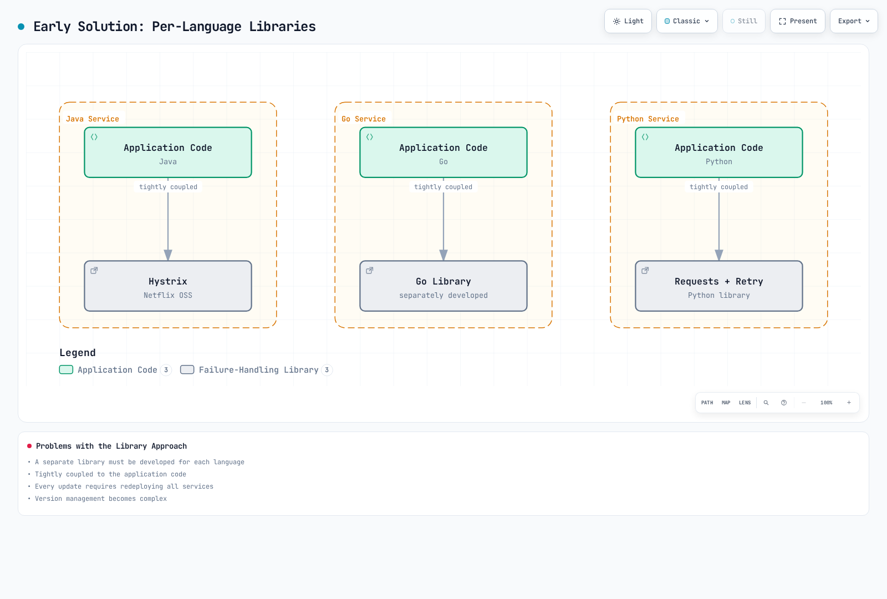
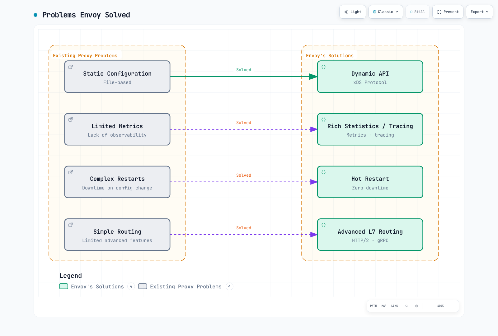
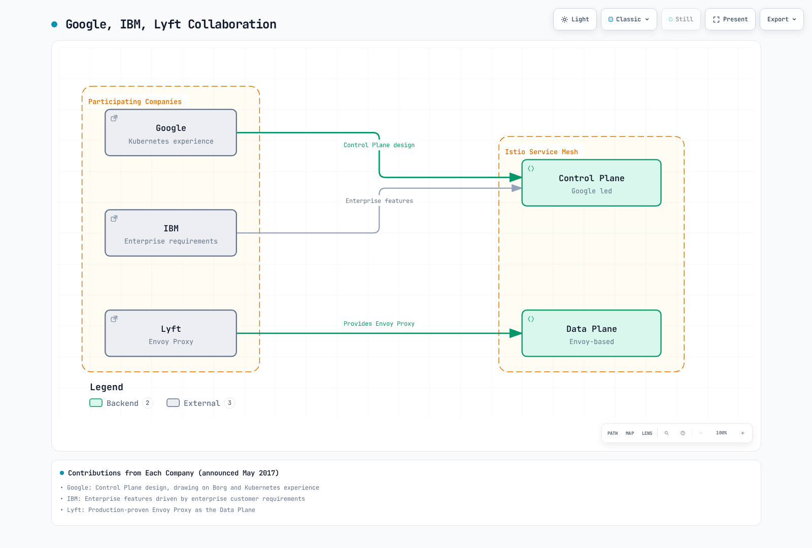
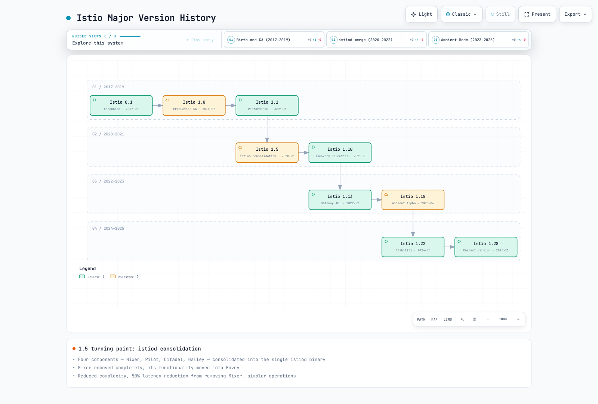
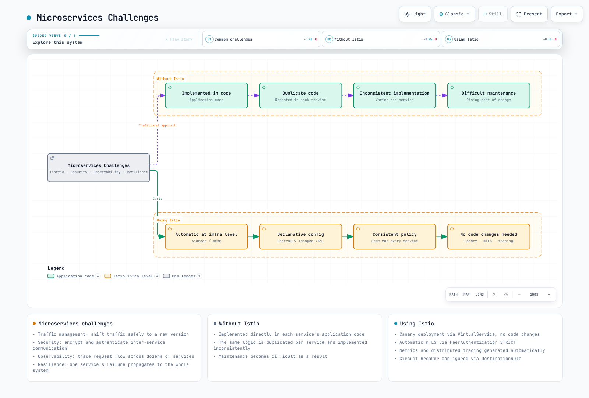
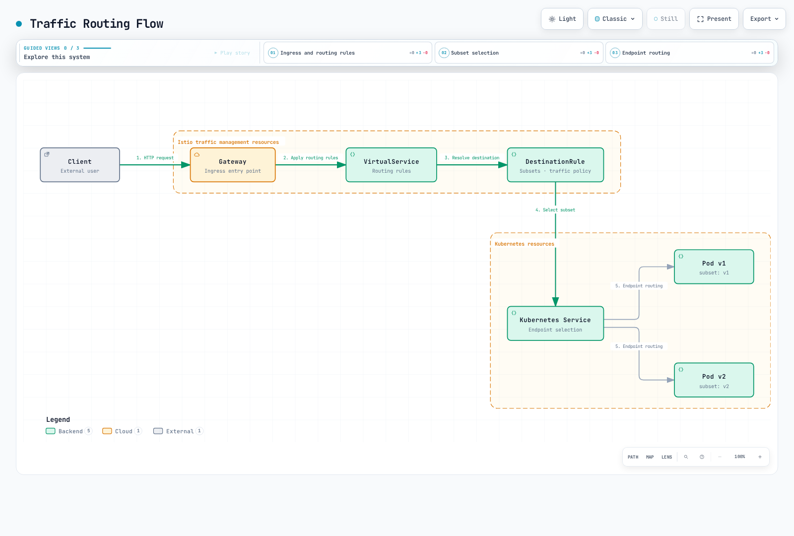
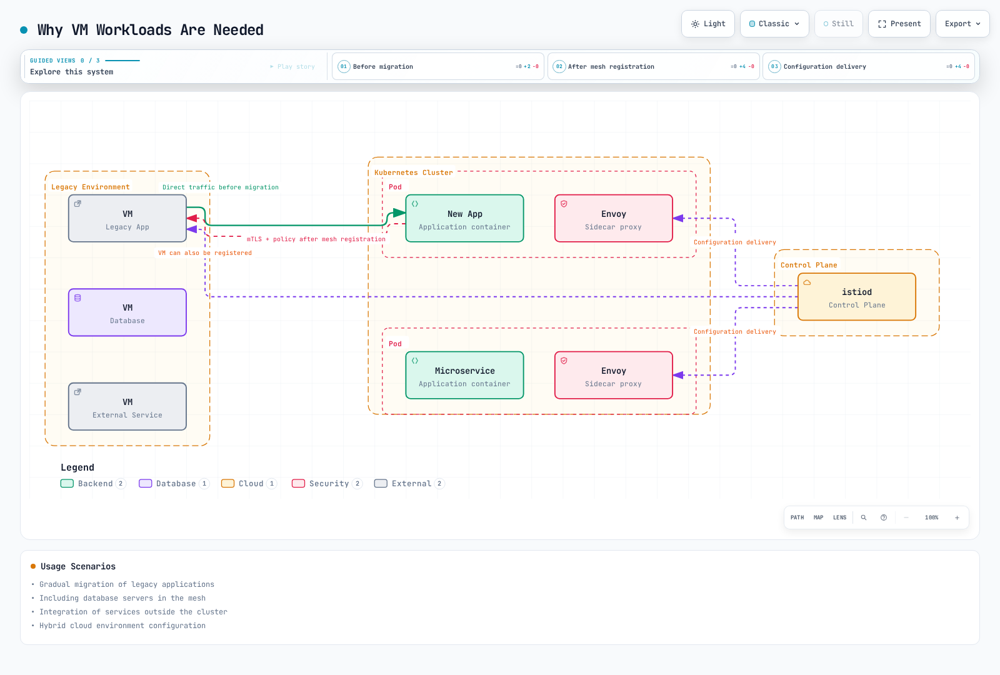
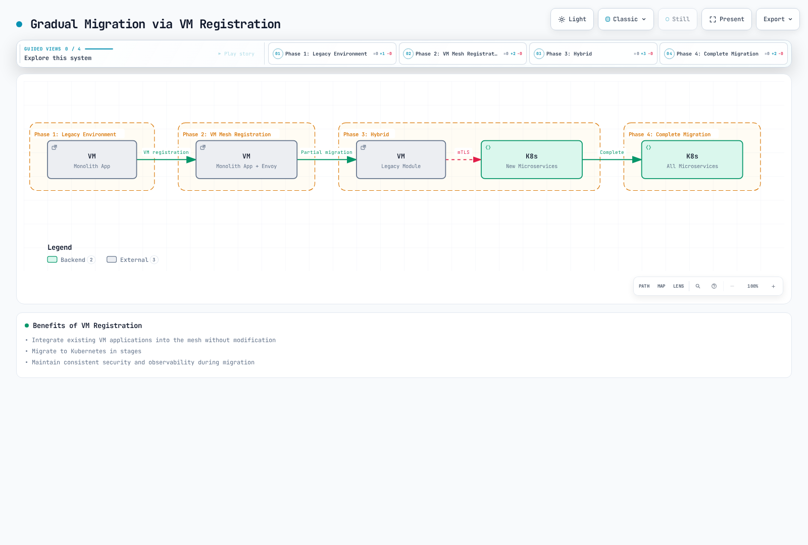
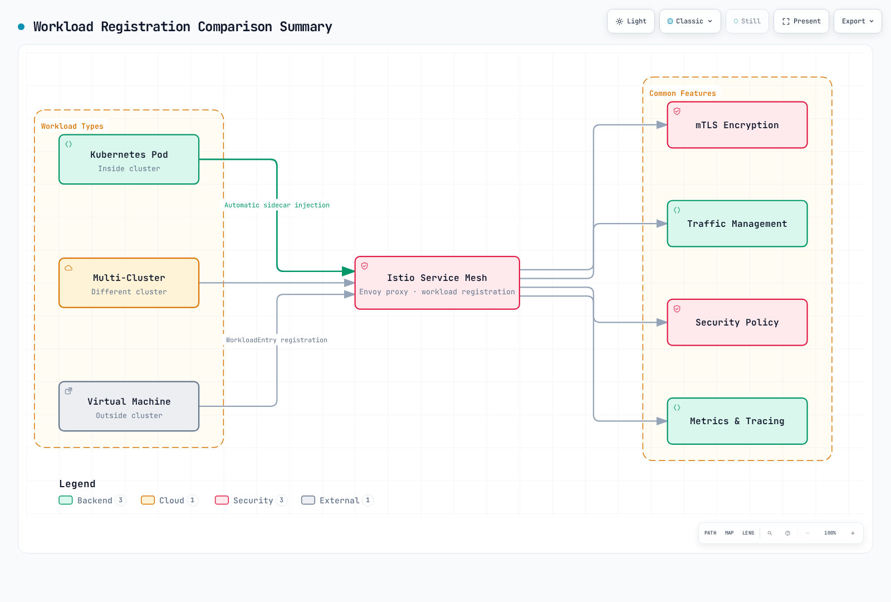

# 基本概念

このドキュメントでは、Istio の中核となる概念とアーキテクチャを説明します。Istio を効果的に利用するには、これらの基本概念を理解することが重要です。

## 目次

1. [背景と歴史](02-basic-concepts.md#background-and-history)
2. [Istio を使う理由](02-basic-concepts.md#why-istio)
3. [Istio アーキテクチャ](02-basic-concepts.md#istio-architecture)
4. [デプロイモード: Sidecar と Ambient](02-basic-concepts.md#deployment-modes-sidecar-vs-ambient)
5. [コアリソース](02-basic-concepts.md#core-resources)
6. [トラフィック管理の概念](02-basic-concepts.md#traffic-management-concepts)
7. [セキュリティの概念](02-basic-concepts.md#security-concepts)
8. [オブザーバビリティの概念](02-basic-concepts.md#observability-concepts)
9. [Namespace と Service Mesh](02-basic-concepts.md#namespaces-and-service-mesh)
10. [次のステップ](02-basic-concepts.md#next-steps)

## 背景と歴史 {#background-and-history}

### Service Mesh の誕生

#### Microservices の課題

2010 年代初頭、企業はモノリシックなアプリケーションを Microservices に分割し始めました。


[🔍 インタラクティブな図を見る](https://www.atomai.click/kubernetes-docs/archmaps/en-service-mesh-istio-02-basic-concepts-0.html)

**新たに生じた問題**:

| 問題 | 説明 | 影響 |
| ------------------------------- | -------------------------------------------- | ------------------------------ |
| **サービス間通信** | ネットワーク呼び出しの増加 | レイテンシ、障害の連鎖 |
| **オブザーバビリティ** | 分散トレーシングの必要性 | デバッグが困難 |
| **セキュリティ** | サービス間の認証と暗号化 | mTLS 実装の複雑さ |
| **トラフィック制御** | Canary デプロイ、A/B テスト | アプリケーションコードの変更 |
| **障害対応** | Circuit Breaker、Retry | サービスごとの実装が必要 |

#### 初期の解決策: ライブラリ

**問題点**:

* 言語ごとにライブラリを開発する必要がある（Java の Hystrix、Go 用の別ライブラリなど）
* アプリケーションコードと密結合する
* 更新のたびにすべてのサービスを再デプロイする必要がある
* バージョン管理が複雑になる



[🔍 インタラクティブな図を見る](https://www.atomai.click/kubernetes-docs/archmaps/en-service-mesh-istio-02-basic-concepts-1.html)

**Service Mesh の考え方**: ネットワーク処理をアプリケーションからインフラストラクチャ層へ移す

### Envoy Proxy の誕生

#### Lyft の課題

**2015 年、Lyft** は次の問題に直面していました。

* 200 を超える Microservices を運用
* Python、Go、Java など、言語やフレームワークが多様
* 既存の Proxy（HAProxy、NGINX）では不十分
  * 動的な設定変更が難しい
  * オブザーバビリティが不足
  * 高度なルーティング機能が限られている

#### Matt Klein と Envoy

Lyft のエンジニア **Matt Klein** は、2016 年に Envoy をオープンソース化しました。

**Envoy が解決した問題**:



[🔍 インタラクティブな図を見る](https://www.atomai.click/kubernetes-docs/archmaps/en-service-mesh-istio-02-basic-concepts-2.html)

**Envoy の主な機能**:

1. **プロセス外アーキテクチャ**: アプリケーションとは別プロセスで動作
2. **xDS API**: 設定を動的に更新
3. **L7 Proxy**: HTTP/2、gRPC、WebSocket をサポート
4. **オブザーバビリティ**: 詳細なメトリクス、トレーシング、ログ
5. **パフォーマンス**: C++ で実装され、高い性能を発揮

#### CNCF への参加

**タイムライン**:

* **2016 年 9 月**: Envoy をオープンソース化
* **2017 年 9 月**: CNCF プロジェクト（Incubating）として採択
* **2018 年 11 月**: CNCF Graduated プロジェクトへ昇格

### Istio の誕生と歴史

#### Google、IBM、Lyft の協業

**2017 年 5 月**、Google、IBM、Lyft が協力して Istio を発表しました。



[🔍 インタラクティブな図を見る](https://www.atomai.click/kubernetes-docs/archmaps/en-service-mesh-istio-02-basic-concepts-3.html)

**各社の主な貢献**:

| 企業 | 主な貢献 | 理由 |
| ---------- | -------------------- | -------------------------------- |
| **Google** | Control Plane の設計 | Borg、Kubernetes で培った経験 |
| **IBM** | エンタープライズ機能 | 企業顧客の要件 |
| **Lyft** | Envoy Proxy | 本番環境で実績のある Proxy |

#### Istio のバージョン履歴

**主なマイルストーン**:



[🔍 インタラクティブな図を見る](https://www.atomai.click/kubernetes-docs/archmaps/en-service-mesh-istio-02-basic-concepts-4.html)

**バージョン 1.5（2020 年 3 月）— 重要な転換点**:

以前のアーキテクチャ（Istio 1.4 以前）:

```
Separated into individual components:
- Mixer (policy/telemetry)
- Pilot (traffic management)
- Citadel (certificate management)
- Galley (configuration validation)
```

新しいアーキテクチャ（Istio 1.5 以降）:

```
Istiod (consolidated into single binary)
├── Pilot functionality (Service Discovery, Traffic Management)
├── Citadel functionality (Certificate Authority, Identity)
└── Galley functionality (Configuration Validation)

Mixer was deprecated during this transition; telemetry moved into the proxies
```

**変更の理由**:

* 複雑さを軽減（4 コンポーネントから 1 つへ）
* テレメトリ経路のオーバーヘッドを削減（実際の改善度はワークロードによって異なる）
* 運用を簡素化（単一プロセスを管理）
* メモリと CPU の使用量を減らし、リソース効率を向上

## Istio を使う理由 {#why-istio}

Kubernetes はコンテナオーケストレーションを提供しますが、Microservices 間の複雑な通信管理には限界があります。Istio はこれらの課題に対処する Service Mesh ソリューションです。

### Microservices の課題



[🔍 インタラクティブな図を見る](https://www.atomai.click/kubernetes-docs/archmaps/en-service-mesh-istio-02-basic-concepts-5.html)

### Istio が提供する中核的な価値

#### 1. トラフィック管理

**課題**: 新しいバージョンをデプロイするときに、トラフィックを安全に移行したい。

**Istio による解決**:

```yaml
# Canary deployment without code changes
apiVersion: networking.istio.io/v1
kind: VirtualService
metadata:
  name: reviews
spec:
  hosts:
  - reviews
  http:
  - route:
    - destination:
        host: reviews
        subset: v1
      weight: 90  # Existing version 90%
    - destination:
        host: reviews
        subset: v2
      weight: 10  # New version 10%
```

**利点**:

* アプリケーションコードを変更せずに済む
* トラフィックの分割比率をリアルタイムに調整できる
* ロールアウトコントローラーがロールバックを自動化でき、Istio は指定されたルーティング比率を適用する
* A/B テストと Blue/Green デプロイをサポート

#### 2. セキュリティ

**課題**: サービス間通信を暗号化し、相手を認証したい。

**Istio による解決**:

```yaml
# Automatic mTLS enablement
apiVersion: security.istio.io/v1
kind: PeerAuthentication
metadata:
  name: default
  namespace: istio-system
spec:
  mtls:
    mode: STRICT  # Require mTLS on enrolled inbound workloads
```

**利点**:

* 証明書を自動で発行・更新
* サービスの ID を自動で検証
* きめ細かなアクセス許可を設定
* Zero Trust ネットワークを実現

#### 3. オブザーバビリティ

**課題**: 数十の Microservices をまたぐリクエストの流れを追跡しにくい。

**Istio による解決**:

* メトリクスを自動生成（Latency、Traffic、Errors、Saturation）
* 分散トレーシング
* サービスのトポロジーを可視化

**利点**:

* ボトルネックを自動で特定
* エラーの根本原因をすばやく特定
* サービスの状態をリアルタイムに監視

#### 4. レジリエンス

**課題**: あるサービスの障害がシステム全体へ波及する。

**Istio による解決**:

```yaml
# Automatic Circuit Breaker configuration
apiVersion: networking.istio.io/v1
kind: DestinationRule
metadata:
  name: reviews
spec:
  host: reviews
  trafficPolicy:
    outlierDetection:
      consecutive5xxErrors: 5
      interval: 30s
      baseEjectionTime: 30s
```

**利点**:

* Circuit Breaker による障害の分離
* Retry と Timeout の自動適用
* 健全でないインスタンスを自動的に除外
* Rate Limiting によるトラフィック制限

### Istio が適している場合

ここに示すサービス数は目安です。Istio が適切かどうかは、セキュリティ要件と運用要件を基準に判断してください。

**✅ Istio が適しているケース**:

1. **Microservices アーキテクチャ**
   * サービスが 10 個以上ある
   * サービス間の依存関係が複雑
   * デプロイの頻度が高い
2. **高度なトラフィック管理が必要**
   * Canary デプロイ、A/B テスト
   * きめ細かなルーティング制御
   * トラフィックミラーリング
3. **強いセキュリティ要件がある**
   * サービス間の暗号化が必須
   * きめ細かなアクセス制御
   * 規制への準拠
4. **オブザーバビリティとデバッグが必要**
   * 複雑なサービス間の問題を追跡
   * パフォーマンスのボトルネックを特定
   * SLO/SLA を監視

**❌ Istio が過剰となる可能性があるケース**:

1. **シンプルなアプリケーション**
   * サービス数が少ない（5 個未満）
   * 要件がシンプル
   * Kubernetes Ingress で十分
2. **リソースに制約がある**
   * クラスターが小規模
   * リソースのオーバーヘッドを許容できない
   * Sidecar のメモリコストが負担になる
3. **運用体制が不十分**
   * 学習にかけられる時間がない
   * 専任のプラットフォームチームがいない
   * よりシンプルなソリューションを優先したい

### 代替ソリューションとの比較

#### Kubernetes Ingress と Istio

| 機能 | Kubernetes Ingress | Istio |
| ----------------- | ------------------ | --------------------------------- |
| **対象範囲** | 外部からクラスター | 外部通信とサービス間通信 |
| **ルーティング** | 基本（Path、Host） | 高度（Header、Cookie など） |
| **mTLS** | 手動で設定 | 自動 |
| **オブザーバビリティ** | 限定的 | 豊富 |
| **複雑さ** | 低い | 高い |
| **用途** | シンプルなアプリ | Microservices |

#### AWS VPC Lattice と Istio

詳しい比較については、[AWS 統合](04-aws-integration.md#istio-vs-other-solutions-comparison)ドキュメントを参照してください。

**概要**:

* **VPC Lattice**: AWS マネージドでシンプル。VPC 間、アカウント間の通信に適する
* **Istio**: オープンソースで機能が豊富。Kubernetes と VM のワークロードに対応し、きめ細かな制御が可能

#### Linkerd と Istio

| 特性 | Istio | Linkerd |
| ------------------ | --------- | ------------------ |
| **複雑さ** | 高い | 低い |
| **機能** | 非常に豊富 | コア機能が中心 |
| **リソース** | 多く必要 | 少なくて済む |
| **学習曲線** | 急 | 緩やか |
| **コミュニティ** | 大きい | 小さい |

**選択の目安**:

* 高度な機能と柔軟性が必要なら → **Istio**
* シンプルで軽量な Mesh が必要なら → **Linkerd**

## デプロイモード: Sidecar と Ambient {#deployment-modes-sidecar-vs-ambient}

Istio は **Sidecar Mode** と **Ambient Mode** の 2 つのデプロイモードをサポートします。

### Sidecar Mode（デフォルト）

各アプリケーション Pod に Envoy Proxy を Sidecar コンテナとして注入します。


[🔍 インタラクティブな図を見る](https://www.atomai.click/kubernetes-docs/archmaps/en-service-mesh-istio-02-basic-concepts-6.html)

**利点**:

* 成熟しており安定している
* L4/L7 機能が成熟している（対応状況はデータプレーンモードによって異なる）
* Pod ごとにきめ細かく制御できる

**欠点**:

* Pod ごとに Envoy が必要となり、リソースを消費する
* 起動時間が長くなる（Init Container）
* 権限設定（iptables）が複雑

### Ambient Mode（Istio 1.24 から GA）

Sidecar を使わず、ノード単位でトラフィックを処理します。


[🔍 インタラクティブな図を見る](https://www.atomai.click/kubernetes-docs/archmaps/en-service-mesh-istio-02-basic-concepts-7.html)

**利点**:

* リソース使用量が少ない（ノードごとに 1 つ）
* Pod の起動が速い
* 運用がシンプル
* L7 機能を段階的に適用できる

**欠点**:

* 選択したリリースとトポロジーで機能が同等か確認する必要がある
* 一部の高度な機能には制限がある
* Pod ごとのきめ細かな制御が難しい

### 比較表

| 特性 | Sidecar Mode | Ambient Mode |
| -------------------------- | --------------------------- | ------------------------------ |
| **リソース使用量** | 多い（Pod ごと） | 少ない（ノードごと） |
| **起動時間** | 遅い（Init Container） | 速い |
| **運用の複雑さ** | 高い | 低い |
| **L4 機能** | サポート | サポート |
| **L7 機能** | 全機能をサポート | オプション（Waypoint） |
| **成熟度** | 安定 | 1.24 以降、コア機能が GA |
| **移行** | - | 既存の Sidecar から移行可能 |
| **推奨される用途** | 高度な L7 機能が必要 | リソース効率を優先 |

### 選択の目安

**Sidecar Mode を選ぶケース**:

* VM 統合など、Sidecar 固有の機能が必要
* Pod ごとにきめ細かなポリシー制御が必要
* 本番環境で実績のある安定性が必要

**Ambient Mode を選ぶケース**:

* リソース効率を重視する
* シンプルな L4 機能だけが必要
* L7 機能を段階的に追加する予定がある

詳しくは、[Advanced: Ambient Mode](advanced/01-ambient-mode.md) ドキュメントを参照してください。

## Istio アーキテクチャ {#istio-architecture}

Istio は **Control Plane** と **Data Plane** の 2 つの主要コンポーネントで構成されます。

| コンポーネント | 説明 |
| ---------------------------- | ------------------------------------------------------------------------------------------------------------ |
| **Control Plane (istiod)** | Service Discovery、設定配布、証明書管理を担う中央制御システム |
| **Data Plane (Envoy Proxy)** | Envoy Sidecar、または Ambient の ztunnel とオプションの Waypoint で構成され、Mesh 内トラフィックを処理 |

詳しいアーキテクチャの構成、内部動作、トラフィックのインターセプト方法については、[アーキテクチャのドキュメント](03-architecture.md)を参照してください。

## コアリソース {#core-resources}

以下の例では Sidecar API を使用します。相互に重なるルーティングやポリシーの例をすべて同時に適用しないでください。Gateway を使うには、対応する Gateway Pod と、その Pod の Namespace 内の TLS Secret が必要です。Ambient では Gateway API によるルーティングと Waypoint を対象とする L7 ポリシーを使用します。Sidecar リソースは ztunnel を設定しません。

Istio は Kubernetes Custom Resource Definition（CRD）を使って設定を管理します。

<span id="1-virtualservice"></span>

### 1. VirtualService

VirtualService は、リクエストをサービスへルーティングする方法を定義します。

```yaml
apiVersion: networking.istio.io/v1
kind: VirtualService
metadata:
  name: reviews-route
spec:
  hosts:
  - reviews  # Target service
  http:
  - match:
    - headers:
        end-user:
          exact: jason
    route:
    - destination:
        host: reviews
        subset: v2  # Route specific user to v2
  - route:
    - destination:
        host: reviews
        subset: v1  # Route to v1 by default
```

**主な機能**:

* Path、Header、Query Parameter に基づくルーティング
* トラフィック分割（Canary、A/B テスト）
* Retry、Timeout、Fault Injection
* URL Rewrite、Header 操作

### 2. DestinationRule

DestinationRule は、サービスのサブセット（バージョン）を定義し、トラフィックポリシーを適用します。

```yaml
apiVersion: networking.istio.io/v1
kind: DestinationRule
metadata:
  name: reviews-destination
spec:
  host: reviews
  trafficPolicy:
    loadBalancer:
      simple: LEAST_REQUEST  # Load balancing algorithm
    connectionPool:
      tcp:
        maxConnections: 100
      http:
        http1MaxPendingRequests: 50
        maxRequestsPerConnection: 2
    outlierDetection:
      consecutive5xxErrors: 5
      interval: 30s
      baseEjectionTime: 30s
  subsets:
  - name: v1
    labels:
      version: v1
  - name: v2
    labels:
      version: v2
  - name: v3
    labels:
      version: v3
```

**主な機能**:

* サービスのバージョン（subset）を定義
* 負荷分散アルゴリズム
* Connection Pool の設定
* Connection Pool による Circuit Breaking と Outlier Detection
* TLS の設定

### 3. Gateway

Gateway は、Mesh に入る外部トラフィックを管理します。

```yaml
apiVersion: networking.istio.io/v1
kind: Gateway
metadata:
  name: bookinfo-gateway
spec:
  selector:
    istio: ingressgateway  # Select Ingress Gateway pod
  servers:
  - port:
      number: 80
      name: http
      protocol: HTTP
    hosts:
    - "bookinfo.example.com"
  - port:
      number: 443
      name: https
      protocol: HTTPS
    tls:
      mode: SIMPLE
      credentialName: bookinfo-credential  # TLS certificate
    hosts:
    - "bookinfo.example.com"
```

**主な機能**:

* 外部トラフィックの入口を定義
* Host、ポート、プロトコルを設定
* TLS 終端
* SNI ルーティング

### 4. ServiceEntry

ServiceEntry を使うと、Mesh 外部のサービスを内部サービスのように利用できます。

```yaml
apiVersion: networking.istio.io/v1
kind: ServiceEntry
metadata:
  name: external-api
spec:
  hosts:
  - api.external.com
  ports:
  - number: 443
    name: https
    protocol: HTTPS
  location: MESH_EXTERNAL
  resolution: DNS
```

**主な機能**:

* 外部サービスを登録
* 外部サービスのトラフィックを制御
* Egress トラフィックを管理

### 5. PeerAuthentication

PeerAuthentication は、サービス間の認証ポリシーを定義します。

```yaml
apiVersion: security.istio.io/v1
kind: PeerAuthentication
metadata:
  name: default
  namespace: default
spec:
  mtls:
    mode: STRICT  # STRICT, PERMISSIVE, DISABLE
```

### 6. AuthorizationPolicy

AuthorizationPolicy は、サービスへのアクセス許可を定義します。

```yaml
apiVersion: security.istio.io/v1
kind: AuthorizationPolicy
metadata:
  name: allow-ratings
  namespace: default
spec:
  selector:
    matchLabels:
      app: ratings
  action: ALLOW
  rules:
  - from:
    - source:
        principals: ["cluster.local/ns/default/sa/reviews"]
    to:
    - operation:
        methods: ["GET"]
```

## トラフィック管理の概念 {#traffic-management-concepts}

### トラフィックのルーティングフロー

この図は設定オブジェクト間の関係を示しています。Gateway、VirtualService、DestinationRule は API オブジェクトであり、順に通過するネットワークホップではありません。通常、Envoy は EDS から Pod のエンドポイントを選択します。



[🔍 インタラクティブな図を見る](https://www.atomai.click/kubernetes-docs/archmaps/en-service-mesh-istio-02-basic-concepts-8.html)

### トラフィック分割（Canary デプロイ）

```yaml
apiVersion: networking.istio.io/v1
kind: VirtualService
metadata:
  name: reviews-canary
spec:
  hosts:
  - reviews
  http:
  - route:
    - destination:
        host: reviews
        subset: v1
      weight: 90  # 90% of traffic
    - destination:
        host: reviews
        subset: v2
      weight: 10  # 10% of traffic (canary)
```

### Circuit Breaker

```yaml
apiVersion: networking.istio.io/v1
kind: DestinationRule
metadata:
  name: reviews-circuit-breaker
spec:
  host: reviews
  trafficPolicy:
    connectionPool:
      tcp:
        maxConnections: 100
      http:
        http1MaxPendingRequests: 10
        maxRequestsPerConnection: 2
    outlierDetection:
      consecutive5xxErrors: 5
      interval: 30s
      baseEjectionTime: 30s
      maxEjectionPercent: 50
```

## セキュリティの概念 {#security-concepts}

### mTLS（相互 TLS）

Auto mTLS は Mesh に参加しているワークロード間の通信を暗号化します。STRICT を強制すると、受信する平文通信を拒否します。Mesh の外部の通信は自動的には保護されません。


[🔍 インタラクティブな図を見る](https://www.atomai.click/kubernetes-docs/archmaps/en-service-mesh-istio-02-basic-concepts-9.html)

**mTLS のモード**:

* **STRICT**: mTLS のみを許可
* **PERMISSIVE**: mTLS と平文の両方を許可（移行時に使用）
* **DISABLE**: mTLS を無効化

Ambient は PeerAuthentication の `DISABLE` をサポートしません。また STRICT は Mesh を迂回するトラフィックも遮断します。

### 認証と認可

```yaml
# JWT Authentication
apiVersion: security.istio.io/v1
kind: RequestAuthentication
metadata:
  name: jwt-auth
spec:
  jwtRules:
  - issuer: "https://accounts.google.com"
    jwksUri: "https://www.googleapis.com/oauth2/v3/certs"
---
# Authorization Policy
apiVersion: security.istio.io/v1
kind: AuthorizationPolicy
metadata:
  name: require-jwt
spec:
  action: DENY
  rules:
  - from:
    - source:
        notRequestPrincipals: ["*"]
```

## オブザーバビリティの概念 {#observability-concepts}

Istio は Proxy のメトリクスを公開します。アクセスログ、トレーシングプロバイダー、Collector は別途設定が必要です。アプリケーション側で Trace Context を伝播させる必要があります。Ambient で L7 メトリクスとトレーシングを利用するには Waypoint が必要です。

### 自動生成されるメトリクス


[🔍 インタラクティブな図を見る](https://www.atomai.click/kubernetes-docs/archmaps/en-service-mesh-istio-02-basic-concepts-10.html)

### 主なメトリクス

| メトリクス | 説明 |
| ------------------------------------- | -------------------- |
| `istio_requests_total` | リクエストの合計数 |
| `istio_request_duration_milliseconds` | リクエストのレイテンシ |
| `istio_request_bytes` | リクエストのサイズ |
| `istio_response_bytes` | レスポンスのサイズ |
| `istio_tcp_connections_opened_total` | TCP 接続数 |

### 分散トレーシング

```yaml
# tracing-install.yaml: merge into the existing istioctl installation file
apiVersion: install.istio.io/v1alpha1
kind: IstioOperator
spec:
  meshConfig:
    enableTracing: true
    extensionProviders:
    - name: otel-tracing
      opentelemetry:
        service: opentelemetry-collector.observability.svc.cluster.local
        port: 4317
```

`istioctl install -f <merged-install-file>` または同等の Helm values でインストール設定を適用します。記載した OTLP Collector は別途デプロイしてください。次の Telemetry リソースは kubectl で適用します。1% は例示値であり、実環境に合わせて調整してください。

```yaml
apiVersion: telemetry.istio.io/v1
kind: Telemetry
metadata:
  name: mesh-tracing
  namespace: istio-system
spec:
  tracing:
  - providers:
    - name: otel-tracing
    randomSamplingPercentage: 1
```

## Namespace と Service Mesh {#namespaces-and-service-mesh}

### Namespace の分離

この DENY-all ポリシーは意図的にすべての通信を遮断します。選択した ALLOW 例外を設けるデフォルト拒否の基盤には、ルールのない ALLOW ポリシーを使用してください。DENY はすべての ALLOW より優先されます。

```yaml
# Per-namespace mTLS policy
apiVersion: security.istio.io/v1
kind: PeerAuthentication
metadata:
  name: default
  namespace: production
spec:
  mtls:
    mode: STRICT
---
# Per-namespace authorization policy
apiVersion: security.istio.io/v1
kind: AuthorizationPolicy
metadata:
  name: deny-all
  namespace: production
spec:
  action: DENY
  rules:
  - {}
```

### Service Mesh の範囲

```bash
# Include only specific namespaces in the mesh
kubectl label namespace default istio-injection=enabled
kubectl label namespace staging istio-injection=enabled

# Exclude specific namespace
kubectl label namespace kube-system istio-injection=disabled
```

### マルチテナンシー

`Sidecar.egress.hosts` が制限するのは Proxy に取り込む設定であり、ネットワークアクセスではありません。テナントを分離するには AuthorizationPolicy と、強制適用される NetworkPolicy 実装を使用してください。

```yaml
# Restrict mesh scope with Sidecar resource
apiVersion: networking.istio.io/v1
kind: Sidecar
metadata:
  name: default
  namespace: production
spec:
  egress:
  - hosts:
    - "production/*"  # Import production configuration; not an access-control boundary
    - "istio-system/*"
```

## VM ワークロードの登録 {#vm-workload-registration}

Istio には Kubernetes Pod だけでなく、**仮想マシン（VM）のワークロード**も Service Mesh に登録できます。これにより、レガシーアプリケーションやクラスター外のサービスでも Istio のトラフィック管理、セキュリティ、オブザーバビリティ機能を利用できます。

### VM ワークロードが必要な理由



[🔍 インタラクティブな図を見る](https://www.atomai.click/kubernetes-docs/archmaps/en-service-mesh-istio-02-basic-concepts-11.html)

**利用シナリオ**:

* レガシーアプリケーションを段階的に移行
* データベースサーバーを Mesh に含める
* クラスター外のサービスを統合
* ハイブリッドクラウド環境を構成

### VM 登録のアーキテクチャ


[🔍 インタラクティブな図を見る](https://www.atomai.click/kubernetes-docs/archmaps/en-service-mesh-istio-02-basic-concepts-12.html)

### WorkloadEntry リソース

以下は登録設定の抜粋です。WorkloadEntry だけでは Proxy はインストールされず、mTLS も有効になりません。まず [VM インストールガイド](https://istio.io/latest/docs/setup/install/virtual-machine/)に従って、WorkloadGroup、Service Account、Bootstrap Token/CA、Agent、ネットワーク到達性を準備してください。ServiceEntry のホスト名には DNS Capture または DNS レコードを設定してください。ServiceEntry は CoreDNS のレコードを作成しません。

VM ワークロードは **WorkloadEntry** リソースで登録します。

```yaml
apiVersion: networking.istio.io/v1
kind: WorkloadEntry
metadata:
  name: legacy-database
  namespace: default
spec:
  address: 192.168.1.100  # VM IP address
  labels:
    app: mysql
    version: v5.7
  serviceAccount: database-sa
  ports:
    mysql: 3306
```

**WorkloadEntry の主なフィールド**:

* `address`: VM の IP アドレス
* `labels`: Service Selector と照合するラベル
* `serviceAccount`: mTLS 認証に使用する Service Account
* `ports`: 公開ポートの定義

### ServiceEntry との連携

WorkloadEntry は ServiceEntry と組み合わせて、VM のサービスを Mesh に登録します。

```yaml
# Define service with ServiceEntry
apiVersion: networking.istio.io/v1
kind: ServiceEntry
metadata:
  name: legacy-database
spec:
  hosts:
  - database.legacy.com
  ports:
  - number: 3306
    name: mysql
    protocol: TCP
  location: MESH_INTERNAL  # Register as internal mesh service
  resolution: STATIC
  workloadSelector:
    labels:
      app: mysql
---
# Register VM instance with WorkloadEntry
apiVersion: networking.istio.io/v1
kind: WorkloadEntry
metadata:
  name: mysql-vm-1
  namespace: default
spec:
  address: 192.168.1.100
  labels:
    app: mysql
    version: v5.7
  serviceAccount: mysql-sa
```

### VM 登録と Multi-Cluster の比較

| 機能 | VM ワークロード登録 | Multi-Cluster | Kubernetes Pod |
| -------------------------- | ------------------------ | ------------------------------ | ------------------- |
| **ワークロードの場所** | クラスター外の VM | 別の Kubernetes クラスター | クラスター内 |
| **Envoy のインストール** | 手動でインストール | 自動（Sidecar） | 自動（Sidecar） |
| **登録方法** | WorkloadEntry | リモート Kubernetes Service Discovery | Service と Pod |
| **mTLS** | サポート | サポート | サポート |
| **Service Discovery** | 手動（IP を指定） | 自動 | 自動 |
| **利用シナリオ** | レガシーアプリ、DB | マルチクラウド、災害復旧 | クラウドネイティブアプリ |
| **運用の複雑さ** | 高い | 中程度 | 低い |

### VM 登録の利点

#### 1. 段階的な移行



[🔍 インタラクティブな図を見る](https://www.atomai.click/kubernetes-docs/archmaps/en-service-mesh-istio-02-basic-concepts-13.html)

**利点**:

* 既存の VM アプリケーションを変更せずに Mesh へ統合
* Kubernetes へ段階的に移行
* 移行中も一貫したセキュリティとオブザーバビリティを維持

#### 2. 統一されたセキュリティポリシー

```yaml
# mTLS policy applied to both VMs and pods
apiVersion: security.istio.io/v1
kind: PeerAuthentication
metadata:
  name: default
  namespace: default
spec:
  mtls:
    mode: STRICT  # Enforce mTLS for both VMs and pods
---
# VM database access control
apiVersion: security.istio.io/v1
kind: AuthorizationPolicy
metadata:
  name: database-access
  namespace: default
spec:
  selector:
    matchLabels:
      app: mysql  # WorkloadEntry label
  action: ALLOW
  rules:
  - from:
    - source:
        principals: ["cluster.local/ns/default/sa/app-sa"]
    to:
    - operation:
        ports: ["3306"]
```

#### 3. 一貫したオブザーバビリティ

VM のテレメトリは Pod と同様、使用するプロトコルに依存します。MySQL の例は TCP 通信のため、HTTP レスポンスコードや HTTP リクエストの Span はありません。

```promql
# TCP bytes received per second; verify the actual workload label in your metrics
sum(rate(istio_tcp_received_bytes_total{destination_workload="mysql-vm-1"}[5m]))

# TCP connections opened per second
sum(rate(istio_tcp_connections_opened_total{destination_workload="mysql-vm-1"}[5m]))
```

### VM 登録の制約

1. **Envoy の手動インストール**: VM に Envoy Proxy を手動でインストールし、設定する必要がある
2. **ネットワーク接続性**: VM と Kubernetes クラスター間のネットワーク接続が必要
3. **Bootstrap Identity**: Root CA と Service Account Token を安全に配布する必要がある。Workload Certificate の取得とローテーションは Istio Agent が行う
4. **運用負荷**: VM 上の Envoy のバージョン管理と更新が必要
5. **自動スケーリングの制約**: Kubernetes HPA のような自動スケーリング機能はない

### 実践例

#### シナリオ: レガシーデータベースの統合

```yaml
# 1. Define database service with ServiceEntry
apiVersion: networking.istio.io/v1
kind: ServiceEntry
metadata:
  name: legacy-postgres
  namespace: production
spec:
  hosts:
  - postgres.production.svc.cluster.local
  addresses:
  - 240.240.1.10  # Virtual IP
  ports:
  - number: 5432
    name: postgresql
    protocol: TCP
  location: MESH_INTERNAL
  resolution: STATIC
  workloadSelector:
    labels:
      app: postgres
      tier: database
---
# 2. Register VM instance with WorkloadEntry
apiVersion: networking.istio.io/v1
kind: WorkloadEntry
metadata:
  name: postgres-vm-1
  namespace: production
spec:
  address: 10.0.1.100  # Actual VM IP
  labels:
    app: postgres
    tier: database
    version: v13
  serviceAccount: postgres-sa
  ports:
    postgresql: 5432
---
# 3. Access control policy
apiVersion: security.istio.io/v1
kind: AuthorizationPolicy
metadata:
  name: postgres-access-control
  namespace: production
spec:
  selector:
    matchLabels:
      app: postgres
  action: ALLOW
  rules:
  - from:
    - source:
        namespaces: ["production"]
        principals: ["cluster.local/ns/production/sa/api-service"]
    to:
    - operation:
        ports: ["5432"]
```

**結果**:

* Kubernetes Pod は `postgres.production.svc.cluster.local` を使ってデータベースへアクセスする
* VM と Pod 間の通信は mTLS で自動的に暗号化される
* アクセス制御ポリシーが適用される
* このデータベースでは TCP メトリクスを利用できる。HTTP トレーシングには HTTP ワークロードと Trace Context の伝播が必要

### ワークロード登録の比較まとめ



[🔍 インタラクティブな図を見る](https://www.atomai.click/kubernetes-docs/archmaps/en-service-mesh-istio-02-basic-concepts-14.html)

Istio の柔軟なワークロード登録機能により、次のワークロードを Mesh に参加させられます。

* **Kubernetes Pod**: クラウドネイティブアプリケーション
* **Multi-Cluster**: マルチクラウド、リージョン分散、災害復旧
* **仮想マシン**: レガシーアプリケーション、データベース、ハイブリッド環境

すべてのワークロードで、一貫したセキュリティ、トラフィック管理、オブザーバビリティ機能を利用できます。

## 次のステップ {#next-steps}

Istio の基本概念を理解したところで、次のドキュメントを読み、実際の使い方を学びましょう。

### コア機能

1. [**トラフィック管理**](traffic-management/README.md)
   * Gateway と VirtualService の使い方
   * DestinationRule とサブセットの定義
   * ServiceEntry と WorkloadEntry（VM 登録）
   * 高度なルーティングパターン（Canary、A/B テスト）
   * トラフィックミラーリングと Shadowing
2. [**セキュリティ**](security/README.md)
   * mTLS と PeerAuthentication の設定
   * 認証（RequestAuthentication、JWT）
   * 認可（AuthorizationPolicy）
   * セキュリティポリシーの管理
   * 外部認証との連携
3. [**オブザーバビリティ**](observability/README.md)
   * メトリクスの収集（Prometheus）
   * 分散トレーシング（Jaeger、Zipkin）
   * ログの設定
   * Kiali による Service Mesh の可視化
   * Grafana ダッシュボード
4. [**レジリエンス**](resilience/README.md)
   * Circuit Breaker パターン
   * Retry と Timeout の設定
   * Rate Limiting
   * Outlier Detection
   * Fault Injection テスト

### 高度なトピック

5. [**高度なトピック**](advanced/README.md)
   * Ambient Mode（Sidecar を使わない Mesh）
   * Multi-Cluster の設定
   * EnvoyFilter のカスタマイズ
   * DNS Proxy と Caching
   * VM ワークロードの詳細設定
   * WASM プラグインの開発

## 参考資料

* [Istio 公式ドキュメント - 概念](https://istio.io/latest/docs/concepts/)
* [Istio 公式ドキュメント - トラフィック管理](https://istio.io/latest/docs/concepts/traffic-management/)
* [Istio 公式ドキュメント - セキュリティ](https://istio.io/latest/docs/concepts/security/)
* [Istio 公式ドキュメント - オブザーバビリティ](https://istio.io/latest/docs/concepts/observability/)
* [Envoy Proxy 公式ドキュメント](https://www.envoyproxy.io/docs/envoy/latest/)

* [Destination Rule](https://istio.io/latest/docs/reference/config/networking/destination-rule/)
* [Sidecar](https://istio.io/latest/docs/reference/config/networking/sidecar/)
* [Authorization Policy](https://istio.io/latest/docs/reference/config/security/authorization-policy/)
* [PeerAuthentication](https://istio.io/latest/docs/reference/config/security/peer_authentication/)
* [Virtual Machine Installation](https://istio.io/latest/docs/setup/install/virtual-machine/)
* [OpenTelemetry](https://istio.io/latest/docs/tasks/observability/distributed-tracing/opentelemetry/)
* [Sidecar or ambient?](https://istio.io/latest/docs/overview/dataplane-modes/)
* [Introducing istiod: simplifying the control plane](https://istio.io/latest/blog/2020/istiod/)
* [Cloud-native high-performance edge/middle/service proxy](https://www.cncf.io/projects/envoy/)
