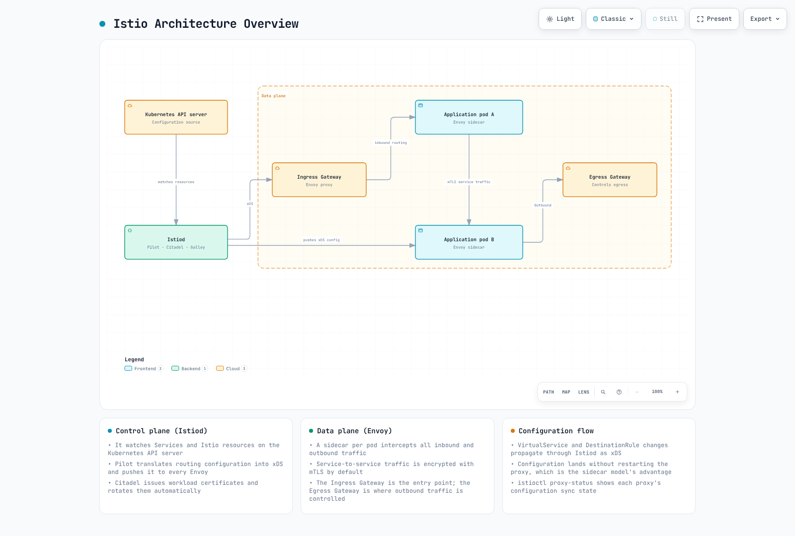
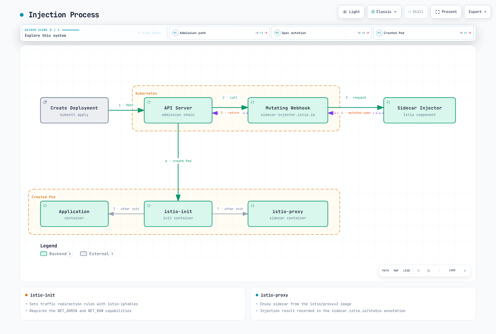
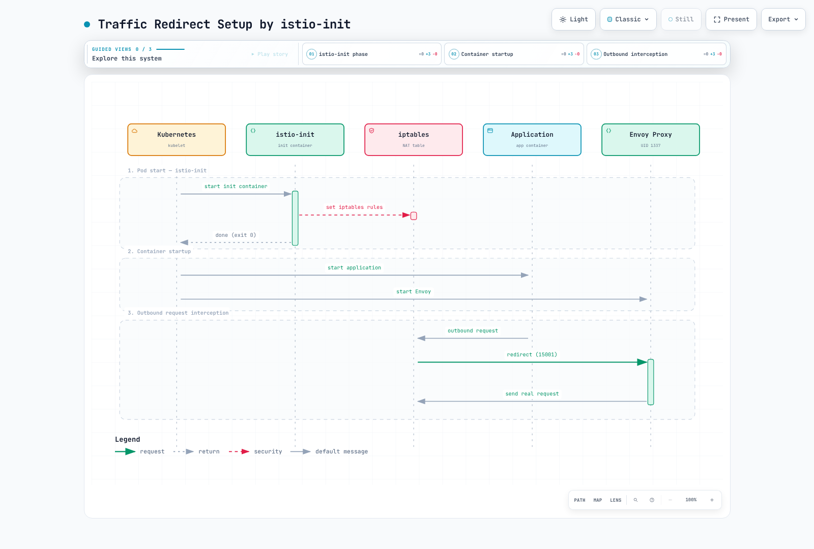

# アーキテクチャ

> **レビュー対象バージョン**: Istio 1.31.0 **API バージョン**: `networking.istio.io/v1`、`security.istio.io/v1` **最終更新**: 2026年9月11日

このドキュメントでは、Istioの内部アーキテクチャとネットワークの仕組みを詳しく解説します。

**背景と歴史**については、[基本概念](02-basic-concepts.md#background-and-history)を参照してください。

**重要な変更点（Istio 1.5以降）**:

* Pilot、Citadel、Galleyは**独立したコンポーネントではなくなりました**。
* これらはIstiod（`pilot-discovery`）という**単一バイナリ**に統合されています。
* Pilot/Citadel/Galleyという用語は、機能を説明する**歴史的な名称**です。

## 目次

この章では主にサイドカーモードを説明します。Ambientモードでは、ノードごとにRust製のztunnelを使い、必要に応じてL7 waypointプロキシも配置します。トラフィックの捕捉方法やDNS経路はサイドカーモードとは異なります。Mixerは廃止され、そのテレメトリ機能はistiodに統合されたのではなく、プロキシ側へ移されました。以下のJSONと注入後Podの抜粋は模式例であり、そのままデプロイできる完全なマニフェストではありません。

1. [Istioアーキテクチャの概要](03-architecture.md#istio-architecture-overview)
2. [コントロールプレーン: Istiod](03-architecture.md#control-plane-istiod)
3. [データプレーン: Envoy Proxy](03-architecture.md#data-plane-envoy-proxy)
4. [サイドカー注入の仕組み](03-architecture.md#sidecar-injection-mechanism)
5. [iptablesとトラフィックの捕捉](03-architecture.md#iptables-and-traffic-interception)
6. [DNS処理の仕組み](03-architecture.md#dns-processing-mechanism)
7. [xDS API通信](03-architecture.md#xds-api-communication)
8. [Sidecarリソースによる最適化](03-architecture.md#optimization-with-sidecar-resource)

## Istioアーキテクチャの概要 {#istio-architecture-overview}

### 全体構成



[🔍 インタラクティブ図を表示](https://www.atomai.click/kubernetes-docs/archmaps/en-service-mesh-istio-03-architecture-0.html)

### コントロールプレーンとデータプレーン

| 分類 | コントロールプレーン（Istiod） | データプレーン（Envoy） |
| --- | --- | --- |
| **役割** | ポリシー管理、設定の配布 | 実際のトラフィック処理 |
| **配置場所** | 独立したPod（通常1～3個） | すべてのアプリケーションPod |
| **実装言語** | Go | C++ |
| **負荷** | 低い | 高い（全トラフィックを処理） |
| **スケーラビリティ** | 水平スケーリング（HA） | 自動（Podごとに1つ） |

## コントロールプレーン: Istiod {#control-plane-istiod}

### Istiodの内部構造

**重要**: Istio 1.5以降、Pilot、Citadel、Galleyは独立したコンポーネントではなく、**Istiodの内部機能**です。


[🔍 インタラクティブ図を表示](https://www.atomai.click/kubernetes-docs/archmaps/en-service-mesh-istio-03-architecture-10.html)

### Istiodの主な機能

**注記**: 以下の機能はIstio 1.31ではIstiodに統合されています。Pilot、Citadel、Galleyという歴史的な名称は、それぞれの機能を説明するために使います。

#### 1. サービスディスカバリー（Pilotの機能）

```yaml
# Kubernetes Service detection
apiVersion: v1
kind: Service
metadata:
  name: reviews
spec:
  selector:
    app: reviews
  ports:
  - port: 9080
```

Istiodは次の情報を追跡します。

* Kubernetes Service
* EndpointSlice（Pod IP）
* Podの状態変更
* 外部サービス（ServiceEntry）

#### 2. トラフィック管理（Pilotの機能）

Istio CRDをEnvoy設定に変換します。

```yaml
# VirtualService (user-defined)
apiVersion: networking.istio.io/v1
kind: VirtualService
metadata:
  name: reviews
spec:
  hosts:
  - reviews
  http:
  - route:
    - destination:
        host: reviews
        subset: v1
      weight: 90
    - destination:
        host: reviews
        subset: v2
      weight: 10
```

↓ IstiodがEnvoy設定に変換 ↓

```json
{
  "match": {"prefix": "/"},
  "route": {
    "weighted_clusters": {
      "clusters": [
        {"name": "outbound|9080|v1|reviews.default.svc.cluster.local", "weight": 90},
        {"name": "outbound|9080|v2|reviews.default.svc.cluster.local", "weight": 10}
      ]
    }
  }
}
```

<span id="3-certificate-management-citadel-functionality"></span>

#### 3. 証明書管理（Citadelの機能）

Istio agentが秘密鍵とCSRを作成し、istiodに対して認証を行って、署名済み証明書を受け取ります。EnvoyはローカルagentからSDS経由でその証明書と鍵を取得します。証明書の有効期間は設定でき、有効期限より前にローテーションされます。

**SPIFFE IDの形式**:

```
spiffe://cluster.local/ns/default/sa/reviews
```

#### 4. 設定検証（Galleyの機能）

Admission時の検証では、スキーマとローカル設定の制約を確認します。リソース間の参照先が存在するかどうかは`istioctl analyze`で確認してください。宛先が存在しなくても、Admission webhookが必ず拒否するとは限りません。以下の例では存在しないGatewayを参照します。

```yaml
# invalid-vs.yaml
apiVersion: networking.istio.io/v1
kind: VirtualService
metadata:
  name: invalid
spec:
  hosts:
  - reviews
  gateways:
  - missing-gateway
  http:
  - route:
    - destination:
        host: reviews
```

```bash
istioctl analyze invalid-vs.yaml --use-kube=false
# IST0101: Referenced gateway not found: "missing-gateway"
```

### Istiodのプロセス構造

**Istio 1.31での実装**:

```bash
# Inspect the configured binary arguments; no shell in the image is required
kubectl get deployment istiod -n istio-system   -o jsonpath='{.spec.template.spec.containers[?(@.name=="discovery")].args}'
# The discovery container runs pilot-discovery discovery.
```

**要点**:

* Istiodは`pilot-discovery`という**単一のGoバイナリ**として動作します。
* Pilot、Citadel、Galleyは機能上の歴史的な役割名であり、現在のパッケージ名を保証するものではありません。
* すべての機能は単一プロセス内のgoroutineとして動作します。

**Istiodが提供する主なポート**:

| ポート | プロトコル | 用途 | 機能 |
| --- | --- | --- | --- |
| **15010** | gRPC | xDS（旧方式） | 後方互換性 |
| **15012** | gRPC | TLS経由のxDS | 主なxDS APIエンドポイント |
| **15014** | HTTP | コントロールプレーン監視 | メトリクスとヘルスチェック |
| **15017** | HTTPS | Webhook | 注入と検証 |
| **8080** | HTTP | デバッグ | デバッグ用インターフェイス |

### Istiodのデプロイ

**高可用性の設定**:

```yaml
# Merge into the existing istioctl install file; do not replace a managed Deployment
apiVersion: install.istio.io/v1alpha1
kind: IstioOperator
spec:
  components:
    pilot:
      k8s:
        hpaSpec:
          minReplicas: 3
          maxReplicas: 5
        resources:
          requests:
            cpu: 500m
            memory: 2Gi
```

**一般的なリソース使用量**:

* CPU: 0.5～2コア
* メモリ: 2～4 GB
* 数千のServiceとPodを処理可能

## データプレーン: Envoy Proxy {#data-plane-envoy-proxy}

### Envoyのアーキテクチャ


[🔍 インタラクティブ図を表示](https://www.atomai.click/kubernetes-docs/archmaps/en-service-mesh-istio-03-architecture-2.html)

### Envoyの主なコンポーネント

#### 1. Listener

**ポートで接続を受け付けます**:

```json
{
  "name": "0.0.0.0_15001",
  "address": {
    "socket_address": {
      "address": "0.0.0.0",
      "port_value": 15001
    }
  },
  "filter_chains": [...]
}
```

**Istioの既定Listener**:

* `0.0.0.0:15001`: すべての送信TCPトラフィック
* `0.0.0.0:15006`: すべての受信TCPトラフィック
* `0.0.0.0:15021`: ヘルスチェック
* `0.0.0.0:15090`: Prometheusメトリクス

#### 2. Filter

**リクエスト/レスポンスを処理するプラグイン**:


[🔍 インタラクティブ図を表示](https://www.atomai.click/kubernetes-docs/archmaps/en-service-mesh-istio-03-architecture-3.html)

#### 3. Cluster

**upstream serviceの論理グループ**:

```json
{
  "name": "outbound|9080|v1|reviews.default.svc.cluster.local",
  "type": "EDS",
  "eds_cluster_config": {
    "service_name": "outbound|9080|v1|reviews.default.svc.cluster.local"
  },
  "circuit_breakers": {...},
  "outlier_detection": {...}
}
```

#### 4. Endpoint

**実際のPod IP一覧**:

```json
{
  "cluster_name": "outbound|9080|v1|reviews",
  "endpoints": [
    {
      "lb_endpoints": [
        {"endpoint": {"address": {"socket_address": {"address": "10.244.1.5", "port_value": 9080}}}},
        {"endpoint": {"address": {"socket_address": {"address": "10.244.2.8", "port_value": 9080}}}}
      ]
    }
  ]
}
```

### Envoyのパフォーマンス

実際のトラフィックパターン、設定サイズ、テレメトリ設定を測定してください。[公式ベンチマーク](https://istio.io/latest/docs/ops/deployment/performance-and-scalability/)はIstio 1.24を対象としています。RPS/コア数、サブミリ秒のP99、メモリ使用量について、あらゆる環境に当てはまる保証はありません。istiodの規模もService/プロキシ数と設定変更頻度に基づいて決めてください。

## サイドカー注入の仕組み {#sidecar-injection-mechanism}

### 注入の流れ



[🔍 インタラクティブ図を表示](https://www.atomai.click/kubernetes-docs/archmaps/en-service-mesh-istio-03-architecture-4.html)

Webhookが変更するのはPodの作成リクエストであり、Deployment自体ではありません。注入を有効にした後は既存Podを再作成する必要があります。Istio CNIを使うと、ネットワーク設定はPodごとの特権initコンテナの外に移されます。Native sidecarを使う場合も、生成されるPodの構成が変わることがあります。

### 注入前と注入後

**注入前のDeployment**:

```yaml
apiVersion: apps/v1
kind: Deployment
metadata:
  name: reviews
spec:
  selector:
    matchLabels:
      app: reviews
  template:
    metadata:
      labels:
        app: reviews
    spec:
      containers:
      - name: reviews
        image: reviews:v1
        ports:
        - containerPort: 9080
```

**注入後**:

```yaml
apiVersion: v1
kind: Pod
metadata:
  annotations:
    sidecar.istio.io/status: '{"initContainers":["istio-init"],"containers":["istio-proxy"]}'
spec:
  initContainers:
  - name: istio-init
    image: istio/proxyv2:1.31.0
    command: ['istio-iptables', ...]
    securityContext:
      capabilities:
        add: [NET_ADMIN, NET_RAW]
  containers:
  - name: reviews
    image: reviews:v1
    ports:
    - containerPort: 9080
  - name: istio-proxy
    image: istio/proxyv2:1.31.0
    args: ['proxy', 'sidecar', ...]
```

### サイドカー注入の有効化

#### 自動注入（推奨）

**Namespaceレベル**:

```bash
# Add label to namespace
kubectl label namespace default istio-injection=enabled

# All pods deployed to this namespace will automatically have sidecar injected
kubectl apply -f deployment.yaml
```

**Podレベル（ラベル）**:

```yaml
apiVersion: v1
kind: Pod
metadata:
  name: example-app
  labels:
    sidecar.istio.io/inject: "true"  # Enable injection per pod
spec:
  containers:
  - name: app
    image: myapp:v1
```

#### 手動注入

`istioctl kube-inject`コマンドを使用して、YAMLファイルにサイドカーを直接注入します。

```bash
# Inject sidecar into YAML file and deploy
istioctl kube-inject -f deployment.yaml | kubectl apply -f -

# Or save to file
istioctl kube-inject -f deployment.yaml -o deployment-injected.yaml
kubectl apply -f deployment-injected.yaml
```

**手動注入を使う場面**:

* 自動注入を使用できない環境
* CI/CDパイプラインで明示的に制御する必要がある場合
* デバッグ用に注入後のYAMLを確認する場合

## iptablesとトラフィックの捕捉 {#iptables-and-traffic-interception}

### istio-initコンテナ

**役割**: PodのネットワークトラフィックをEnvoy Proxyへリダイレクトするiptablesルールを設定します。



[🔍 インタラクティブ図を表示](https://www.atomai.click/kubernetes-docs/archmaps/en-service-mesh-istio-03-architecture-5.html)

### iptablesルールの詳細

**実行用スクリプトではなく、簡略化したルールの例です**:

```bash
#!/bin/bash
# istio-iptables script (simplified)

# 1. OUTPUT chain: Application outbound traffic
iptables -t nat -A OUTPUT -p tcp \
  -m owner ! --uid-owner 1337 \
  -j REDIRECT --to-port 15001     # Envoy outbound port

# 2. PREROUTING chain: Inbound traffic to pod
iptables -t nat -A PREROUTING -p tcp \
  -j REDIRECT --to-port 15006     # Envoy inbound port

# 3. Exclusion rules
# - localhost traffic
iptables -t nat -I OUTPUT -d 127.0.0.1/32 -j RETURN

# - Istiod communication (15012)
iptables -t nat -I OUTPUT -p tcp --dport 15012 -j RETURN

# - DNS (53)
iptables -t nat -I OUTPUT -p udp --dport 53 -j RETURN
```

### iptables適用後のトラフィックフロー


[🔍 インタラクティブ図を表示](https://www.atomai.click/kubernetes-docs/archmaps/en-service-mesh-istio-03-architecture-6.html)

### iptablesルールの確認

**Pod内から確認する場合**:

通常のistio-proxyコンテナはdistrolessで、NET_ADMINを持たないことがあります。ルールの調査には、必要なツールと権限を備えた承認済みのノードまたはPodネットワーク名前空間のデバッグセッションを使用してください。以下は`iptables -t nat -L -n -v`の出力例です。

```text
# OUTPUT chain
Chain OUTPUT (policy ACCEPT)
target     prot opt source     destination
ISTIO_OUTPUT  tcp  --  0.0.0.0/0  0.0.0.0/0

# ISTIO_OUTPUT detail
Chain ISTIO_OUTPUT (1 references)
RETURN     all  --  0.0.0.0/0  127.0.0.1           # Exclude localhost
RETURN     all  --  0.0.0.0/0  0.0.0.0/0           owner UID match 1337  # Exclude Envoy
REDIRECT   tcp  --  0.0.0.0/0  0.0.0.0/0           redir ports 15001  # Redirect rest

# PREROUTING chain
Chain PREROUTING (policy ACCEPT)
ISTIO_INBOUND  tcp  --  0.0.0.0/0  0.0.0.0/0

# ISTIO_INBOUND detail
Chain ISTIO_INBOUND (1 references)
REDIRECT   tcp  --  0.0.0.0/0  0.0.0.0/0           redir ports 15006
```

### initコンテナとIstio CNI

どちらの方式もトラフィックのリダイレクトを設定します。Istio CNIはAWS VPC CNIなどのプライマリCNIに連結される、特権を持つノードDaemonSetです。プライマリCNIを置き換えるeBPF実装ではありません。サイドカーモードでは任意ですが、Ambientモードでは必要です。

## DNS処理の仕組み {#dns-processing-mechanism}

### Kubernetes DNSの基本動作


[🔍 インタラクティブ図を表示](https://www.atomai.click/kubernetes-docs/archmaps/en-service-mesh-istio-03-architecture-7.html)

**Pod内の/etc/resolv.conf**:

```bash
nameserver 10.96.0.10  # kube-dns ClusterIP
search default.svc.cluster.local svc.cluster.local cluster.local
options ndots:5
```

### EnvoyのDNS処理

**アプリケーションのDNS名前解決とEnvoyのエンドポイント検出は別の処理です**。

最初にアプリケーションがService名を解決します。その後Envoyはルーティング設定とEDSのエンドポイント情報を使ってupstreamを選びます。EDSはアプリケーションのDNS名前解決を置き換えません。

**利点**:

* EDSはエンドポイントをEnvoyへ配布します。DNS captureがローカルで応答する場合を除き、アプリケーションのDNSは設定済みリゾルバーを引き続き使います。
* Endpointを動的に更新できます。
* 高度なルーティング（バージョン、重みなど）を利用できます。

### DNS Proxy（サイドカーモードでは任意）

**Istio 1.8以降で追加されたDNS Proxy機能**:

サイドカーのDNS proxyはIstio agent内で動作し、istiodから提供されるローカルキャッシュ済みの名前テーブルに基づいて応答します。DNSリクエストごとにistiodへ問い合わせるわけではありません。未知の名前は`/etc/resolv.conf`に設定されたリゾルバーへ送ります。Istio 1.25以降、AmbientのDNS captureは既定で有効です。以下をインストール用ファイルにマージし、影響を受けるサイドカーワークロードを再起動してください。

```yaml
apiVersion: install.istio.io/v1alpha1
kind: IstioOperator
spec:
  meshConfig:
    defaultConfig:
      proxyMetadata:
        ISTIO_META_DNS_CAPTURE: "true"  # Enable DNS Proxy
```

**動作**:

DNS captureを有効にすると、アプリケーションの問い合わせはIstio agentのDNS proxyに送られ、ローカル名テーブルで応答するか、名前が不明な場合は上流リゾルバーへ転送されます。

**DNS Proxyのiptablesルール**:

```bash
# Redirect UDP port 53 to Istio agent DNS proxy
iptables -t nat -A OUTPUT -p udp --dport 53 \
  -m owner ! --uid-owner 1337 \
  -j REDIRECT --to-port 15053
```

## xDS API通信 {#xds-api-communication}

### xDSプロトコルの概要

**xDS**はDiscovery Serviceの略で、Envoyの動的設定プロトコルです。

LDS、RDS、CDS、EDSは論理リソース種別で、通常はAggregated Discovery Service（ADS）の集約ストリーム上で多重化されます。サイドカー向けSDSはistiodへの5本目の直接ストリームではなく、ローカルIstio agentから提供されます。

### xDS APIの種類

| API | 名称 | 役割 | 例 |
| --- | --- | --- | --- |
| **LDS** | Listener Discovery | ポート設定を受信 | 15001、15006 |
| **RDS** | Route Discovery | HTTPルーティングルール | VirtualService |
| **CDS** | Cluster Discovery | upstream service | DestinationRule |
| **EDS** | Endpoint Discovery | Pod IP一覧 | Service Endpoint |
| **SDS** | Secret Discovery | TLS証明書 | mTLS証明書 |

### xDS通信フロー

起動時、agentはアイデンティティを初期化し、istiodへのディスカバリー接続をプロキシします。Envoyは受け入れた設定を確認応答します。設定やエンドポイントが変わると、istiodは更新を配信します。SDSはローカルagentを通じて別途証明書を提供します。

### xDS通信の検証

**Envoy Admin APIで確認**:

```bash
# Export via istioctl; no curl or shell is required inside the proxy image
istioctl proxy-config all <pod-name> -n default -o json > config-dump.json
jq '.configs[] | select(."@type" | endswith("ListenersConfigDump")) | .dynamic_listeners' config-dump.json
jq '.configs[] | select(."@type" | endswith("ClustersConfigDump")) | .dynamic_active_clusters' config-dump.json
jq '.configs[] | select(."@type" | endswith("RoutesConfigDump")) | .dynamic_route_configs' config-dump.json
```

**istioctlで確認**:

```bash
# Listener configuration
istioctl proxy-config listeners <pod-name> -n default

# Cluster configuration
istioctl proxy-config clusters <pod-name> -n default

# Endpoint configuration
istioctl proxy-config endpoints <pod-name> -n default

# Route configuration
istioctl proxy-config routes <pod-name> -n default
```

## Sidecarリソースによる最適化 {#optimization-with-sidecar-resource}

### 問題: すべてのService情報を受信する

既定では、各Envoyは**メッシュ全体のすべてのService情報**を受け取ります。


[🔍 インタラクティブ図を表示](https://www.atomai.click/kubernetes-docs/archmaps/en-service-mesh-istio-03-architecture-13.html)

**問題点**:

* メモリ使用量の増加
* 設定処理によるCPU使用量の増加
* ネットワーク帯域の浪費
* Istiodの負荷増加

### 解決策: Sidecarリソース

**Sidecarリソース**を使うと、必要なServiceだけを受け取るように範囲を制限できます。

```yaml
apiVersion: networking.istio.io/v1
kind: Sidecar
metadata:
  name: default
  namespace: default
spec:
  egress:
  - hosts:
    - "./*"  # All services in same namespace
    - "istio-system/*"  # All services in istio-system
    - "production/reviews.production.svc.cluster.local"  # Only reviews in production namespace
```

設定スコープや`REGISTRY_ONLY`は送信トラフィックを遮断するファイアウォールではありません。通信を隔離するにはAuthorizationPolicyとネットワーク制御を使用してください。SidecarリソースはAmbientプロキシを設定するものではありません。

### Sidecarリソースの例

#### 1. Namespace単位の設定スコープ

```yaml
apiVersion: networking.istio.io/v1
kind: Sidecar
metadata:
  name: default
  namespace: team-a
spec:
  egress:
  - hosts:
    - "team-a/*"  # Own namespace only
    - "istio-system/*"  # System services
    - "shared/*"  # Shared services
```

#### 2. 特定のServiceをインポート

```yaml
apiVersion: networking.istio.io/v1
kind: Sidecar
metadata:
  name: frontend
  namespace: default
spec:
  workloadSelector:
    labels:
      app: frontend
  egress:
  - port:
      number: 443
      name: https
      protocol: HTTPS
    hosts:
    - "external/*"
  - hosts:
    - "default/reviews.default.svc.cluster.local"
    - "default/ratings.default.svc.cluster.local"
    - "default/details.default.svc.cluster.local"
```

#### 3. 未登録の宛先を検出

```yaml
apiVersion: networking.istio.io/v1
kind: Sidecar
metadata:
  name: external-only
  namespace: default
spec:
  workloadSelector:
    labels:
      app: batch-job
  egress:
  - hosts:
    - "./*"  # Same namespace
  outboundTrafficPolicy:
    mode: REGISTRY_ONLY  # Known Kubernetes services and ServiceEntry destinations
```

### Sidecarリソースの効果

インポートするServiceを減らすと設定サイズが小さくなり、プロキシのメモリ使用量や設定配信の処理量を抑えられる場合があります。Cluster数はポートやsubsetにも左右されるため、Serviceが1つならEnvoy Clusterも必ず1つとは限りません。実際に測定してください。メモリ使用量や配信時間の削減量は保証されません。

### DNSとSidecarの連携

```yaml
apiVersion: networking.istio.io/v1
kind: Sidecar
metadata:
  name: dns-optimized
  namespace: default
spec:
  egress:
  - hosts:
    - "default/reviews.default.svc.cluster.local"
    - "default/ratings.default.svc.cluster.local"
  # Scope imported service configuration
  # DNS capture is configured separately
```

**結果**:

* プロキシがインポートするのは選択したService設定です。DNSの許可リストではありません。
* `google.com`などの外部ドメインはCoreDNSへ転送されます。
* メモリとCPUの節約につながります。

## 参考資料

### 公式ドキュメント

* [Istioアーキテクチャ](https://istio.io/latest/docs/ops/deployment/architecture/)
* [Envoy Proxy](https://www.envoyproxy.io/docs/envoy/latest/intro/intro)
* [xDSプロトコル](https://www.envoyproxy.io/docs/envoy/latest/api-docs/xds_protocol)
* [SPIFFE](https://spiffe.io/)

### 歴史と背景

* [Envoyプロジェクトの節目（CNCF）](https://www.cncf.io/projects/envoy/)
* [Istioの発表（Google Cloud Blog）](https://cloud.google.com/blog/products/gcp/istio-service-mesh-for-microservices)
* [サービスメッシュの歴史](https://www.nginx.com/blog/what-is-a-service-mesh/)

### さらに学ぶ

* [Envoyアーキテクチャの概要](https://www.envoyproxy.io/docs/envoy/latest/intro/arch_overview/arch_overview)
* [Istioのパフォーマンスとスケーラビリティ](https://istio.io/latest/docs/ops/deployment/performance-and-scalability/)
* [iptablesチュートリアル](https://www.frozentux.net/iptables-tutorial/iptables-tutorial.html)

* [アーキテクチャ](https://istio.io/latest/docs/ops/deployment/architecture/)
* [DNS Proxy](https://istio.io/latest/docs/ops/configuration/traffic-management/dns-proxy/)
* [Istio CNIノードエージェントのインストール](https://istio.io/latest/docs/setup/additional-setup/cni/)
* [セキュリティ](https://istio.io/latest/docs/concepts/security/)
* [ReferencedResourceNotFound](https://istio.io/latest/docs/reference/config/analysis/ist0101/)
* [サイドカーのインストール](https://istio.io/latest/docs/setup/additional-setup/sidecar-injection/)
* [Sidecar](https://istio.io/latest/docs/reference/config/networking/sidecar/)
* [設定スコープ](https://istio.io/latest/docs/ops/configuration/mesh/configuration-scoping/)
* [パフォーマンスとスケーラビリティ](https://istio.io/latest/docs/ops/deployment/performance-and-scalability/)
