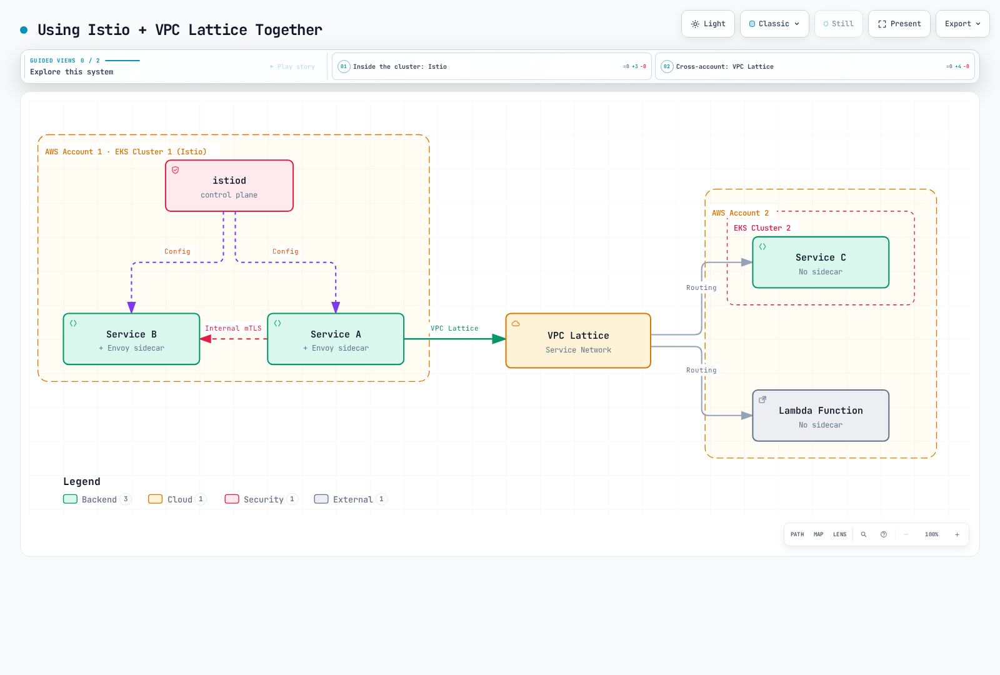

# AWS 統合

このドキュメントでは、Amazon EKS 環境で Istio を AWS サービスと統合する方法を説明します。

## 目次

2026年9月11日に、Linux EC2 ベースの EKS ノードと AWS Load Balancer Controller を対象に確認しました。以下の NLB passthrough、ALB 終端、NLB 終端は互いに代替となる設計です。重複する Service/Gateway リソースを同時に適用しないでください。[インストール](01-installation.md)の設定に合わせて gateway Pod のラベルと target port を指定します。Service の変更は、管理元の Helm/istioctl 設定にマージしてください。EKS Auto Mode は独自のロードバランサー連携とサポート対象 annotation を使用します。Fargate では Istio CNI/ztunnel を実行できません。

1. [AWS Load Balancer 統合](04-aws-integration.md#aws-load-balancer-integration)
2. [Istio と他のソリューションの比較](04-aws-integration.md#istio-vs-other-solutions-comparison)
3. [EKS 固有の最適化](04-aws-integration.md#eks-specific-optimization)
4. [ベストプラクティス](04-aws-integration.md#best-practices)

## AWS Load Balancer 統合 {#aws-load-balancer-integration}

Istio Ingress Gateway は AWS Load Balancer と統合し、外部トラフィックを処理できます。

### Network Load Balancer (NLB) 統合

NLB は Layer 4（TCP/UDP）のロードバランサーで、高性能と低レイテンシーが必要な場合に適しています。

#### NLB アーキテクチャ


[🔍 インタラクティブな図を表示](https://www.atomai.click/kubernetes-docs/archmaps/en-service-mesh-istio-04-aws-integration-0.html)

#### NLB の設定

**1. AWS Load Balancer Controller をインストールする**

```bash
# Create IAM policy
curl -fsSL -o iam_policy.json https://raw.githubusercontent.com/kubernetes-sigs/aws-load-balancer-controller/v3.5.0/docs/install/iam_policy.json

aws iam create-policy \
    --policy-name AWSLoadBalancerControllerIAMPolicy \
    --policy-document file://iam_policy.json

# Associate the cluster OIDC provider once before creating IRSA
eksctl utils associate-iam-oidc-provider --cluster my-cluster --approve

# IRSA setup
eksctl create iamserviceaccount \
  --cluster=my-cluster \
  --namespace=kube-system \
  --name=aws-load-balancer-controller \
  --attach-policy-arn="arn:aws:iam::<AWS_ACCOUNT_ID>:policy/AWSLoadBalancerControllerIAMPolicy" \
  --override-existing-serviceaccounts \
  --approve

# Install controller with Helm
helm repo add eks https://aws.github.io/eks-charts
helm repo update

helm install aws-load-balancer-controller eks/aws-load-balancer-controller \
  -n kube-system \
  --version 3.5.0 \
  --set clusterName=my-cluster \
  --set region=us-west-2 \
  --set vpcId="<VPC_ID>" \
  --set serviceAccount.create=false \
  --set serviceAccount.name=aws-load-balancer-controller
```

**2. NLB を使った Istio Ingress Gateway の設定**

```yaml
# istio-ingress-nlb.yaml
apiVersion: v1
kind: Service
metadata:
  name: istio-ingressgateway
  namespace: istio-system
  annotations:
    # NLB configuration
    service.beta.kubernetes.io/aws-load-balancer-type: "external"
    service.beta.kubernetes.io/aws-load-balancer-nlb-target-type: "ip"
    service.beta.kubernetes.io/aws-load-balancer-scheme: "internet-facing"

    # TCP passthrough: TLS terminates at Istio; no ACM TLS listener here

    # Health check configuration
    service.beta.kubernetes.io/aws-load-balancer-healthcheck-protocol: "http"
    service.beta.kubernetes.io/aws-load-balancer-healthcheck-port: "15021"
    service.beta.kubernetes.io/aws-load-balancer-healthcheck-path: "/healthz/ready"

    # Additional configuration
    service.beta.kubernetes.io/aws-load-balancer-attributes: "load_balancing.cross_zone.enabled=true"
spec:
  type: LoadBalancer
  selector:
    app: istio-ingressgateway
    istio: ingressgateway
  ports:
  - name: http2
    port: 80
    protocol: TCP
    targetPort: 8080
  - name: https
    port: 443
    protocol: TCP
    targetPort: 8443
```

**3. Gateway リソースの設定**

```yaml
apiVersion: networking.istio.io/v1
kind: Gateway
metadata:
  name: my-gateway
  namespace: istio-system
spec:
  selector:
    istio: ingressgateway
  servers:
  - port:
      number: 443
      name: https
      protocol: HTTPS
    tls:
      mode: SIMPLE
      credentialName: my-tls-secret
    hosts:
    - "myapp.example.com"
  - port:
      number: 80
      name: http
      protocol: HTTP
    hosts:
    - "myapp.example.com"
    tls:
      httpsRedirect: true
```

#### NLB の利点

* **高性能**: 1 秒あたり数百万件のリクエストを処理できます。
* **低レイテンシー**: Layer 4 で動作し、高速に応答します。
* **静的 IP**: Elastic IP を割り当てられます。
* **プロトコルサポート**: TCP、UDP、TLS に対応します。
* **容量計画**: 接続数/転送バイトを測定し、リージョンごとの料金と比較してください。

#### NLB のユースケース

* WebSocket、gRPC などの長時間接続
* 1 秒あたり数百万件のリクエストの処理
* 静的 IP が必要な場合
* TLS 終端を Istio で行う場合

### Application Load Balancer (ALB) 統合

ALB は Layer 7（HTTP/HTTPS）のロードバランサーで、高度なルーティング機能が必要な場合に適しています。

#### ALB アーキテクチャ

この例では、クライアントの HTTPS リクエストを ALB が受け取り、ACM 証明書で TLS を終端して、HTTP/1.1 で Istio gateway に転送します。その後 Envoy がアプリケーションにルーティングします。

#### ALB の設定

**1. Ingress リソースで ALB を作成する**

```yaml
# istio-ingress-alb.yaml
apiVersion: networking.k8s.io/v1
kind: Ingress
metadata:
  name: istio-ingress
  namespace: istio-system
  annotations:
    # ALB configuration
    alb.ingress.kubernetes.io/scheme: internet-facing
    alb.ingress.kubernetes.io/target-type: ip
    alb.ingress.kubernetes.io/listen-ports: '[{"HTTP": 80}, {"HTTPS": 443}]'
    alb.ingress.kubernetes.io/ssl-redirect: '443'

    # ACM certificate
    alb.ingress.kubernetes.io/certificate-arn: arn:aws:acm:region:account:certificate/cert-id

    # Health check
    alb.ingress.kubernetes.io/healthcheck-protocol: HTTP
    alb.ingress.kubernetes.io/healthcheck-port: '15021'
    alb.ingress.kubernetes.io/healthcheck-path: /healthz/ready
    alb.ingress.kubernetes.io/healthcheck-interval-seconds: '15'
    alb.ingress.kubernetes.io/healthcheck-timeout-seconds: '5'
    alb.ingress.kubernetes.io/success-codes: '200'
    alb.ingress.kubernetes.io/healthy-threshold-count: '2'
    alb.ingress.kubernetes.io/unhealthy-threshold-count: '2'

    # Additional configuration
    alb.ingress.kubernetes.io/load-balancer-attributes: idle_timeout.timeout_seconds=60
    alb.ingress.kubernetes.io/target-group-attributes: deregistration_delay.timeout_seconds=30
spec:
  ingressClassName: alb
  rules:
  - host: "myapp.example.com"
    http:
      paths:
      - path: /
        pathType: Prefix
        backend:
          service:
            name: istio-ingressgateway
            port:
              number: 80
```

この ALB 設計では、gateway Service を ClusterIP に設定し、NLB も重複して作成されないようにします。ALB は TLS を終端し、既定では HTTP/1.1 で転送します。この HTTP gateway には HTTPS redirect を設定しないでください。アプリケーションの route 用に `my-alb-gateway` に bind した VirtualService を追加します。

```yaml
apiVersion: networking.istio.io/v1
kind: Gateway
metadata:
  name: my-alb-gateway
  namespace: istio-system
spec:
  selector:
    istio: ingressgateway
  servers:
  - port:
      number: 80
      name: http
      protocol: HTTP
    hosts:
    - "myapp.example.com"
```

**2. パスベースのルーティング**

```yaml
apiVersion: networking.k8s.io/v1
kind: Ingress
metadata:
  name: istio-ingress-path-based
  namespace: istio-system
  annotations:
    alb.ingress.kubernetes.io/scheme: internet-facing
    alb.ingress.kubernetes.io/target-type: ip
spec:
  ingressClassName: alb
  rules:
  - host: "api.example.com"
    http:
      paths:
      - path: /v1
        pathType: Prefix
        backend:
          service:
            name: istio-ingressgateway
            port:
              number: 80
  - host: "admin.example.com"
    http:
      paths:
      - path: /
        pathType: Prefix
        backend:
          service:
            name: istio-ingressgateway
            port:
              number: 80
```

#### ALB の利点

* **高度なルーティング**: Path、Header、Query String に基づくルーティング
* **WAF 統合**: AWS WAF によるセキュリティ強化
* **認証統合**: Cognito、OIDC との統合
* **ACM 統合**: 証明書の自動管理
* **コンテナ向けに最適化**: ECS、EKS 向けの最適化

#### ALB のユースケース

* HTTP/HTTPS のみのトラフィック
* パスベースのルーティングが必要な場合
* WAF セキュリティが必要な場合
* 1 つのロードバランサーで複数ドメインを扱う場合

### NLB と ALB の比較

| 項目 | NLB | ALB |
| --- | --- | --- |
| **OSI レイヤー** | Layer 4（TCP/UDP） | Layer 7（HTTP/HTTPS） |
| **容量** | トラフィックと容量設定による | トラフィックと容量設定による |
| **レイテンシー** | 非常に低い | 低い |
| **静的 IP** | 対応（Elastic IP） | 非対応 |
| **TLS 終端** | TCP passthrough または NLB の TLS listener | ALB で終端可能 |
| **ルーティング** | IP/port ベース | Path、Host、Header ベース |
| **WAF 統合** | 非対応 | 対応 |
| **コスト** | NLCU 使用量とリージョン料金 | LCU 使用量とリージョン料金 |
| **WebSocket** | ネイティブ対応 | 対応 |
| **gRPC** | ネイティブ対応 | HTTP/2 が必要 |
| **推奨用途** | 高性能、WebSocket、gRPC | HTTP ルーティング、WAF、認証 |

## Istio と他のソリューションの比較 {#istio-vs-other-solutions-comparison}

### Istio と VPC Lattice

VPC Lattice は AWS のマネージドアプリケーションネットワーキングサービスです。

#### アーキテクチャの比較


[🔍 インタラクティブな図を表示](https://www.atomai.click/kubernetes-docs/archmaps/en-service-mesh-istio-04-aws-integration-2.html)

#### 機能比較

| 項目 | Istio | VPC Lattice |
| --- | --- | --- |
| **管理** | 自己管理 | AWS 管理（フルマネージド） |
| **Sidecar** | sidecar mode では使用し、ambient では不要 | 不要 |
| **リソースオーバーヘッド** | sidecar/ambient の構成により異なる | 低い（sidecar なし） |
| **複雑さ** | 高い | 低い |
| **学習曲線** | 急 | 緩やか |
| **トラフィック管理** | 高度（きめ細かな制御） | 基本機能（必要十分な機能） |
| **mTLS** | 管理された workload identity/certificate | TLS passthrough を使ったアプリケーション管理 |
| **可観測性** | 豊富なメトリクスと trace | 基本的なメトリクス |
| **Fault Injection** | 対応 | 非対応 |
| **Circuit Breaker** | きめ細かな制御 | 同等の Istio policy API はありません。service quota とは別の機能です。 |
| **Rate Limiting** | Local + Global | 同等の Istio policy API はありません。service quota とは別の機能です。 |
| **Multi-cluster** | 強力なサポート | VPC 間接続 |
| **クロスアカウント** | 複雑 | シンプル（ネイティブ対応） |
| **コスト** | EC2 の計算コスト | サービス利用料 |
| **ベンダーロックイン** | なし（オープンソース） | AWS にロックイン |
| **Kubernetes 専用** | いいえ（VM にも対応） | いいえ（EC2、Lambda などにも対応） |

VPC Lattice の TLS passthrough はアプリケーションの TLS/mTLS を維持しますが、その listener では IAM identity ベースの認証を強制できず、Lambda target も利用できません。HTTPS listener と TLS passthrough では、実現できるセキュリティ機能が異なります。

#### Istio を選ぶ場合

**Istio が適しているケース:**

1. **きめ細かなトラフィック制御が必要**
   * Canary deployment、A/B test、Traffic Mirroring
   * Header、Cookie などに基づく複雑なルーティングルール
   * Chaos Engineering 用の Fault Injection
2. **強いセキュリティ要件がある**
   * サービス間の自動 mTLS 暗号化
   * きめ細かな認可ポリシー
   * JWT 検証、RBAC
3. **高度な可観測性が必要**
   * P50/P95/P99 latency などの詳細なメトリクス
   * Jaeger、Zipkin などによる分散 tracing
   * Kiali によるサービス topology の可視化
4. **Multi-cluster mesh が必要**
   * 複数 EKS クラスター間の通信
   * クラスター間の failover
   * グローバルな負荷分散
5. **ベンダーに依存しない構成が必要**
   * 他のクラウドやオンプレミスへ移行できる可能性
   * Kubernetes 標準の利用

**例: Istio の高度なトラフィック管理**

```yaml
apiVersion: networking.istio.io/v1
kind: VirtualService
metadata:
  name: reviews
spec:
  hosts:
  - reviews
  http:
  # Header-based routing
  - match:
    - headers:
        user-agent:
          regex: ".*Mobile.*"
    route:
    - destination:
        host: reviews
        subset: mobile-v2
  # Canary deployment (10%)
  - match:
    - headers:
        x-canary:
          exact: "true"
    route:
    - destination:
        host: reviews
        subset: v3
      weight: 10
    - destination:
        host: reviews
        subset: v2
      weight: 90
  # Traffic Mirroring
  - route:
    - destination:
        host: reviews
        subset: v2
    mirror:
      host: reviews
      subset: v3
    mirrorPercentage:
      value: 100
```

#### VPC Lattice を選ぶ場合

**VPC Lattice が適しているケース:**

1. **シンプルなサービス接続**
   * 基本的なロードバランシングとルーティングだけが必要
   * 迅速な導入を重視
2. **運用オーバーヘッドを抑えたい**
   * AWS マネージドサービスを優先
   * sidecar 管理の負担を避けたい
3. **VPC/アカウントをまたいだ通信**
   * 複数 AWS アカウントのサービスを接続
   * VPC peering なしで通信
4. **混在環境**
   * EKS + EC2 + Lambda の混在環境
   * Kubernetes 以外のコンピューティングも利用
5. **コストを最適化したい**
   * sidecar のリソースコストを削減
   * 小規模サービス

#### Istio と VPC Lattice の併用

2 つのソリューションは相互排他的ではなく、併用できます。



[🔍 インタラクティブな図を表示](https://www.atomai.click/kubernetes-docs/archmaps/en-service-mesh-istio-04-aws-integration-3.html)

**ユースケース:**

* **クラスター内**: きめ細かなトラフィック管理とセキュリティに Istio を使用
* **クラスター間/アカウント間**: シンプルな接続に VPC Lattice を使用
* **混在環境**: Istio クラスターと Lambda/EC2 の接続に VPC Lattice を使用

### Istio と Cilium（eBPF ベース）の比較

Cilium は eBPF を使う Kubernetes のネットワークおよびセキュリティソリューションです。

#### アーキテクチャの比較

| 項目 | Istio | Cilium |
| --- | --- | --- |
| **技術スタック** | Envoy Proxy（sidecar） | eBPF（kernel level） |
| **主な目的** | Service Mesh | CNI + Service Mesh |
| **ネットワーク** | Kubernetes CNI の上で動作 | CNI 自体を提供 |
| **性能** | 良好 | 高い（kernel level） |
| **リソース使用量** | 高い（sidecar） | 低い（kernel level） |
| **L7 機能** | 非常に強力 | 基本的 |
| **可観測性** | 豊富 | Hubble（基本的） |
| **学習曲線** | 急 | 急 |
| **成熟度** | 高い | 中程度（Service Mesh 機能） |

#### 機能比較

| 機能 | Istio | Cilium |
| --- | --- | --- |
| **NetworkPolicy** | Kubernetes + Istio | Kubernetes + Cilium（より強力） |
| **L7 Load Balancing** | きめ細かく制御 | 基本的 |
| **mTLS** | workload 間の自動 mTLS | 相互認証と WireGuard/IPsec 暗号化は別の機能 |
| **トラフィック管理** | 非常に高度 | 基本的 |
| **可観測性** | Prometheus、Jaeger、Kiali | Hubble |
| **性能** | 良好 | 高い |
| **Multi-cluster** | 強力 | Cluster Mesh |

#### どちらを選ぶか

**Istio を選ぶ場合:**

* L7 トラフィック管理が中核要件
* 強力な service mesh 機能が必要
* 豊富な可観測性とデバッグツールが必要

**Cilium を選ぶ場合:**

* CNI の置き換えを検討中
* ネットワークセキュリティが主な関心事
* 性能最適化が重要
* eBPF を活用したい

**併用する場合:**

* Cilium を CNI、Istio を Service Mesh として利用できます。
* ただし、機能の重複と複雑さの増加を考慮してください。

## EKS 固有の最適化 {#eks-specific-optimization}

VPC CNI Pod ENI trunking と SecurityGroupPolicy を使う ambient workload では、[EKS ambient の前提条件](https://istio.io/latest/docs/ambient/install/platform-prerequisites/#amazon-elastic-kubernetes-service-eks)を確認してください。厳格な pod security group 強制は link-local health probe を壊す可能性があります。文書化されている選択肢には標準の enforcing mode と exec probe があります。CNI mode を変更する前に、ポリシーへの影響を評価してください。

### IAM Roles for Service Accounts (IRSA) 統合

EC2 ベースのノードでは、AWS API credential に EKS Pod Identity も使用できます。Pod Identity Agent と互換性のある AWS SDK が必要で、IRSA role annotation は使いません。どちらの方式も Istio SPIFFE workload identity の代わりにはなりません。

Istio workload が AWS service に安全にアクセスできるよう IRSA を設定します。

#### IRSA の設定

```bash
# 1. Create OIDC provider
eksctl utils associate-iam-oidc-provider \
    --cluster my-cluster \
    --approve

# 2. Create IAM policy
cat <<EOF > app-policy.json
{
    "Version": "2012-10-17",
    "Statement": [
        {
            "Effect": "Allow",
            "Action": [
                "s3:GetObject",
                "s3:ListBucket"
            ],
            "Resource": [
                "arn:aws:s3:::my-bucket",
                "arn:aws:s3:::my-bucket/*"
            ]
        }
    ]
}
EOF

aws iam create-policy \
    --policy-name MyAppS3Policy \
    --policy-document file://app-policy.json

# 3. Link IAM Role to Service Account
eksctl create iamserviceaccount \
    --cluster my-cluster \
    --namespace default \
    --name my-app-sa \
    --role-name my-app-role \
    --attach-policy-arn "arn:aws:iam::<ACCOUNT_ID>:policy/MyAppS3Policy" \
    --approve
```

#### Istio と IRSA の使用

```yaml
apiVersion: v1
kind: ServiceAccount
metadata:
  name: my-app-sa
  namespace: default
  annotations:
    eks.amazonaws.com/role-arn: arn:aws:iam::<ACCOUNT_ID>:role/my-app-role
---
apiVersion: apps/v1
kind: Deployment
metadata:
  name: my-app
  namespace: default
spec:
  selector:
    matchLabels:
      app: my-app
  template:
    metadata:
      labels:
        app: my-app
    spec:
      serviceAccountName: my-app-sa  # Using IRSA
      containers:
      - name: app
        image: my-app:latest
        env:
        - name: AWS_REGION
          value: us-west-2
```

### AWS Certificate Manager (ACM) 統合

ACM certificate を Istio Gateway で使用する方法を説明します。

#### NLB で TLS を終端する

```yaml
apiVersion: v1
kind: Service
metadata:
  name: istio-ingressgateway
  namespace: istio-system
  annotations:
    service.beta.kubernetes.io/aws-load-balancer-type: "external"
    service.beta.kubernetes.io/aws-load-balancer-nlb-target-type: "ip"
    service.beta.kubernetes.io/aws-load-balancer-ssl-cert: "arn:aws:acm:region:account:certificate/cert-id"
    service.beta.kubernetes.io/aws-load-balancer-ssl-ports: "443"
    service.beta.kubernetes.io/aws-load-balancer-backend-protocol: "tcp"
spec:
  type: LoadBalancer
  selector:
    istio: ingressgateway
  ports:
  - name: https
    port: 443
    targetPort: 8080
```

これは別の構成です。ACM の TLS は NLB で終端し、target には平文 HTTP が届きます。TLS Gateway を Service port 443 の HTTP listener に置き換えてください。この backend には SIMPLE TLS や HTTPS redirect を使わないでください。

```yaml
apiVersion: networking.istio.io/v1
kind: Gateway
metadata:
  name: nlb-terminated-gateway
  namespace: istio-system
spec:
  selector:
    istio: ingressgateway
  servers:
  - port:
      number: 443
      name: http-after-nlb
      protocol: HTTP
    hosts:
    - "myapp.example.com"
```

#### Istio で TLS を終端する（ACM Private CA）

```bash
# Generate a private key and CSR locally; clients must trust this private CA
openssl req -new -newkey rsa:2048 -nodes \
  -keyout private-key.pem -out csr.pem \
  -subj '/CN=myapp.example.com' -addext 'subjectAltName=DNS:myapp.example.com'

CA_ARN='arn:aws:acm-pca:region:account:certificate-authority/ca-id'
CERT_ARN=$(aws acm-pca issue-certificate \
  --certificate-authority-arn "$CA_ARN" \
  --csr fileb://csr.pem \
  --signing-algorithm SHA256WITHRSA \
  --validity Value=365,Type=DAYS \
  --query CertificateArn --output text)
aws acm-pca wait certificate-issued \
  --certificate-authority-arn "$CA_ARN" --certificate-arn "$CERT_ARN"
aws acm-pca get-certificate \
  --certificate-authority-arn "$CA_ARN" --certificate-arn "$CERT_ARN" \
  --output json > issued-certificate.json
jq -r '.Certificate + "\n" + .CertificateChain' issued-certificate.json > certificate-chain.pem
kubectl create secret tls my-tls-secret \
  --cert=certificate-chain.pem --key=private-key.pem -n istio-system
```

```yaml
apiVersion: networking.istio.io/v1
kind: Gateway
metadata:
  name: my-gateway
  namespace: istio-system
spec:
  selector:
    istio: ingressgateway
  servers:
  - port:
      number: 443
      name: https
      protocol: HTTPS
    tls:
      mode: SIMPLE
      credentialName: my-tls-secret  # ACM certificate
    hosts:
    - "myapp.example.com"
```

証明書を発行しただけでは Secret の作成や更新は行われません。更新と Secret の変更を自動化してください。ACM ARN を Istio の `credentialName` に直接指定することはできません。

### CloudWatch Container Insights 統合

Istio のメトリクスを CloudWatch に送信し、統合モニタリングを構成します。

#### CloudWatch Agent の設定

```bash
# For EC2-backed EKS; OIDC association is required for this IRSA path
kubectl create namespace amazon-cloudwatch --dry-run=client -o yaml | kubectl apply -f -
eksctl create iamserviceaccount \
  --cluster my-cluster --namespace amazon-cloudwatch --name cwagent-prometheus \
  --attach-policy-arn arn:aws:iam::aws:policy/CloudWatchAgentServerPolicy --approve
curl -fsSL -o prometheus-eks.yaml \
  https://raw.githubusercontent.com/aws-samples/amazon-cloudwatch-container-insights/latest/k8s-deployment-manifest-templates/deployment-mode/service/cwagent-prometheus/prometheus-eks.yaml
# Review/pin this manifest; merge the Istio scrape jobs and EMF declarations below before applying
kubectl apply -f prometheus-eks.yaml
kubectl rollout status deployment/cwagent-prometheus -n amazon-cloudwatch
```

namespace と ServiceAccount だけでは agent はデプロイされません。公式 manifest が Deployment、RBAC、mount する ConfigMap を提供します。デプロイツールが ServiceAccount を置き換える場合は IRSA annotation を維持してください。既存環境では collector を重複デプロイせず、管理元の設定を更新します。

#### Prometheus のメトリクススクレイピング

```yaml
# prometheus-config.yaml
apiVersion: v1
kind: ConfigMap
metadata:
  name: prometheus-config
  namespace: amazon-cloudwatch
data:
  prometheus.yaml: |
    global:
      scrape_interval: 1m
      scrape_timeout: 10s

    scrape_configs:
    # Istio Control Plane metrics
    - job_name: 'istiod'
      kubernetes_sd_configs:
      - role: pod
        namespaces:
          names:
          - istio-system
      relabel_configs:
      - source_labels: [__meta_kubernetes_pod_label_app, __meta_kubernetes_pod_container_port_name]
        action: keep
        regex: istiod;http-monitoring

    # Envoy sidecar metrics
    - job_name: 'envoy-stats'
      metrics_path: /stats/prometheus
      kubernetes_sd_configs:
      - role: pod
      relabel_configs:
      - source_labels: [__meta_kubernetes_pod_container_port_name]
        action: keep
        regex: '.*-envoy-prom'
```

custom CloudWatch metrics を公開するには、`prometheus-cwagentconfig` の `logs.metrics_collected.prometheus.emf_processor.metric_declaration` に宣言をマージします。scrape 用 ConfigMap だけでは custom CloudWatch metric は公開されません。manifest の `prometheus_config_path` と他の設定を保持し、agent を再デプロイ/再起動してください。例:

```json
{
  "source_labels": ["job"],
  "label_matcher": "^envoy-stats$",
  "dimensions": [["ClusterName", "job"]],
  "metric_selectors": ["^istio_requests_total$", "^istio_tcp_received_bytes_total$"]
}
```

#### CloudWatch Logs Insights クエリ

以下は別々の query として実行します。log collector が取り込んだ proxy log が必要です。Prometheus collection では access log は収集されません。レイテンシー query は数値の `request_duration_ms` field を含む構造化 JSON を前提とします（Envoy の `%DURATION%` から設定するか、使用形式を先に parse してください）。

```text
# Istio error log analysis
fields @timestamp, @message
| filter @logStream like /istio-proxy/
| filter @message like /error/
| sort @timestamp desc
| limit 100

```

```text
# Request latency analysis
fields @timestamp, request_duration_ms
| filter @logStream like /istio-proxy/
| stats avg(request_duration_ms), max(request_duration_ms), pct(request_duration_ms, 95) by bin(5m)
```

### EKS の最適化設定

#### 1. Pod リソースの最適化

```yaml
# Envoy sidecar resource optimization
apiVersion: install.istio.io/v1alpha1
kind: IstioOperator
spec:
  meshConfig:
    defaultConfig:
      concurrency: 2  # Envoy worker threads, not a connection-pool limit
      proxyMetadata:
        # EKS optimization
        ISTIO_META_DNS_CAPTURE: "true"
  values:
    global:
      proxy:
        resources:
          requests:
            cpu: 100m
            memory: 128Mi
          limits:
            cpu: 2000m
            memory: 1024Mi
```

#### 2. Cluster Autoscaler の考慮事項

HPA は replica 数を調整し、Metrics Server と resource request が必要です。Cluster Autoscaler/Karpenter はノード数を調整します。競合する HPA を追加せず、既存の chart 管理下の HPA を構成してください。

```yaml
# Istio Gateway Autoscaling
apiVersion: autoscaling/v2
kind: HorizontalPodAutoscaler
metadata:
  name: istio-ingressgateway
  namespace: istio-system
spec:
  scaleTargetRef:
    apiVersion: apps/v1
    kind: Deployment
    name: istio-ingressgateway
  minReplicas: 2
  maxReplicas: 10
  metrics:
  - type: Resource
    resource:
      name: cpu
      target:
        type: Utilization
        averageUtilization: 80
  - type: Resource
    resource:
      name: memory
      target:
        type: Utilization
        averageUtilization: 80
```

#### 3. Pod Disruption Budget

```yaml
apiVersion: policy/v1
kind: PodDisruptionBudget
metadata:
  name: istio-ingressgateway
  namespace: istio-system
spec:
  minAvailable: 1
  selector:
    matchLabels:
      app: istio-ingressgateway
```

## ベストプラクティス {#best-practices}

### 1. Load Balancer の選択ガイド

**NLB を使う場合:**

* gRPC、WebSocket などの長時間接続
* 1 秒あたり数百万件のリクエストの処理
* 静的 IP が必要
* Istio で TLS を終端

**ALB を使う場合:**

* HTTP/HTTPS のみ
* パスベースのルーティング
* WAF によるセキュリティが必要
* Cognito 認証の統合

### 2. TLS 終端の場所

**Load Balancer で終端する場合:**

* ACM certificate の自動更新
* 管理が簡単
* Istio の負荷を軽減

**Istio で終端する場合:**

* エンドツーエンド暗号化が必要
* きめ細かな TLS policy 制御が必要
* mTLS を使用

### 3. コスト最適化

* **Spot Instances**: Istio Gateway workload に使用
* **Graviton Instances**: ARM ベースのインスタンスでコストを削減
* **Resource Limits**: 適切な sidecar resource limit を設定
* **Ambient Mode**: sidecar のオーバーヘッドをなくす選択肢として検討

### 4. セキュリティ

* **IRSA**: IAM role で AWS service にアクセス
* **Security Groups**: 最小権限の原則を適用
* **mTLS**: service 間の暗号化を有効化
* **NetworkPolicy**: Amazon VPC CNI、Cilium、Calico で強制します。プラットフォームの対応状況を確認してください。

### 5. モニタリング

* **CloudWatch**: ログとメトリクスを一元化
* **X-Ray**: 分散 tracing
* **Prometheus + Grafana**: 詳細なメトリクス
* **Kiali**: Service Mesh の可視化

## 次のステップ

AWS 統合が完了したら、次のドキュメントを参照してください。

1. [**Traffic Management**](traffic-management/README.md): 高度なトラフィック管理機能
2. [**Security**](security/README.md): mTLS と認証/認可
3. [**Observability**](observability/README.md): メトリクス、ログ、trace の収集

## 参考資料

* [AWS Load Balancer Controller](https://kubernetes-sigs.github.io/aws-load-balancer-controller/)
* [EKS ベストプラクティス - ネットワーキング](https://docs.aws.amazon.com/eks/latest/best-practices/networking.html)
* [VPC Lattice のドキュメント](https://docs.aws.amazon.com/vpc-lattice/)
* [Cilium のドキュメント](https://docs.cilium.io/)
* [AWS Container Insights](https://docs.aws.amazon.com/AmazonCloudWatch/latest/monitoring/ContainerInsights.html)

* [Annotations](https://kubernetes-sigs.github.io/aws-load-balancer-controller/latest/guide/service/annotations/)
* [Ingress annotations](https://kubernetes-sigs.github.io/aws-load-balancer-controller/latest/guide/ingress/annotations/)
* [v3.5.0](https://github.com/kubernetes-sigs/aws-load-balancer-controller/releases/tag/v3.5.0)
* [AWS Load Balancer Controller chart metadata](https://raw.githubusercontent.com/aws/eks-charts/master/stable/aws-load-balancer-controller/Chart.yaml)
* [Helm での AWS Load Balancer Controller のインストール - Amazon EKS](https://docs.aws.amazon.com/eks/latest/userguide/lbc-helm.html)
* [VPC Lattice service の TLS listener - Amazon VPC Lattice](https://docs.aws.amazon.com/vpc-lattice/latest/ug/tls-listeners.html)
* [issue-certificate](https://docs.aws.amazon.com/cli/latest/reference/acm-pca/issue-certificate.html)
* [get-certificate](https://docs.aws.amazon.com/cli/latest/reference/acm-pca/get-certificate.html)
* [ContainerInsights Prometheus Setup](https://docs.aws.amazon.com/AmazonCloudWatch/latest/monitoring/ContainerInsights-Prometheus-Setup.html)
* [追加 Prometheus source のスクレイピングとメトリクスのインポート - Amazon CloudWatch](https://docs.aws.amazon.com/AmazonCloudWatch/latest/monitoring/ContainerInsights-Prometheus-Setup-configure.html)
* [EKS Pod Identity による Pod から AWS service へのアクセス](https://docs.aws.amazon.com/eks/latest/userguide/pod-identities.html)
* [Kubernetes network policy で Pod traffic を制限する - Amazon EKS](https://docs.aws.amazon.com/eks/latest/userguide/cni-network-policy.html)
* [DNS Proxying](https://istio.io/latest/docs/ops/configuration/traffic-management/dns-proxy/)
