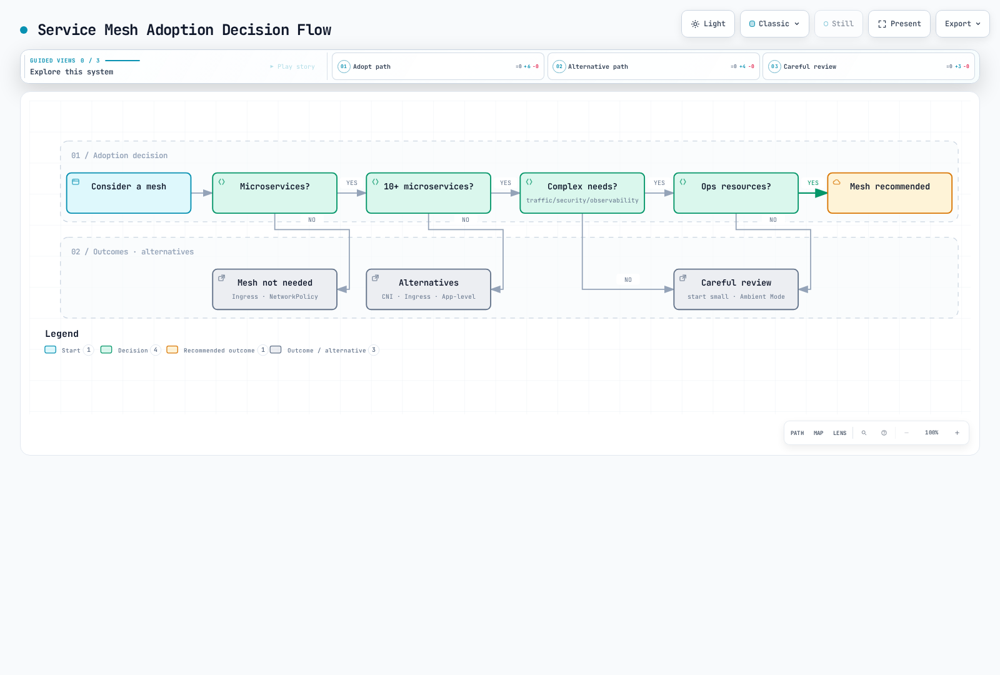
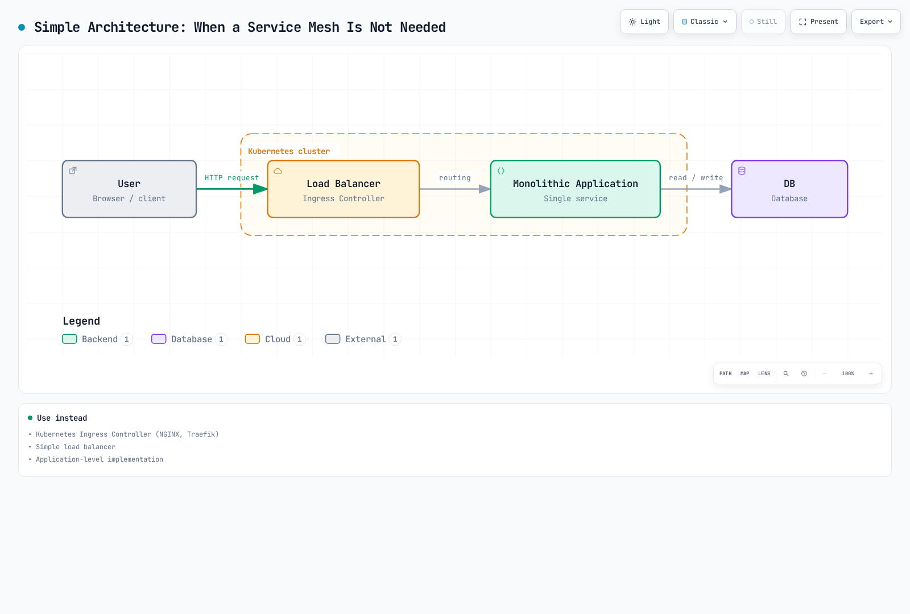
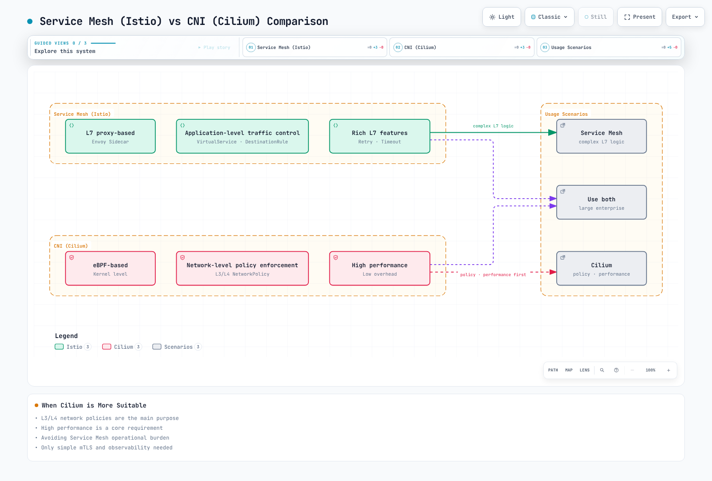
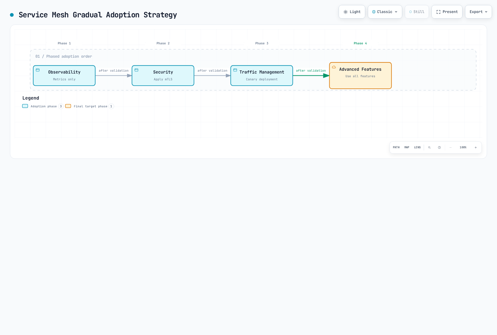

# Istio

> **最終更新**: October 12, 2026

Amazon EKS で Istio Service Mesh を活用するための実践ガイド。

### 2026年10月レビュー: サポート対象リリース

Istio 1.31.0 は GA です。その[リリース発表](https://istio.io/latest/news/releases/1.31.x/announcing-1.31/)は2026年8月31日に公開されました。現在のパッチは **1.31.1** で、9月21日に公開されています。その[リリース発表](https://istio.io/latest/news/releases/1.31.x/announcing-1.31.1/)には、未解決の `BackendTLSPolicy` CA 参照が plaintext のバックエンド接続へフォールバックするのを防ぐ修正が記載されています。

このガイドの新規インストールコマンドでは 1.31.1 を使用します。Istio 1.31 が公開している Kubernetes サポート範囲は 1.32–1.37 です。EKS の標準サポートは現在 1.34–1.37 を対象としています。標準サポートの重複範囲は 1.34–1.37 です。EKS 拡張サポート対象バージョン (1.31–1.33) のうち、1.32 と 1.33 も Istio 1.31 の範囲内です。インストール前に [Istio サポートマトリクス](https://istio.io/latest/docs/releases/supported-releases/)と [EKS バージョンライフサイクル](https://docs.aws.amazon.com/eks/latest/userguide/kubernetes-versions.html)を再確認してください。

このレビュー時点で、Istio 1.30 および 1.29 はマトリクス上で引き続きサポート対象として記載されています。1.29 の予定サポート終了日は本日、2026年10月12日です。インストールまたはアップグレードの前に状態を確認してください。これらのブランチを使用する既存のインストールには、Envoy の脆弱性、BackendTLSPolicy の fail-open、および EnvoyFilter control-plane のサービス拒否を対象とする [ISTIO-SECURITY-2026-006](https://istio.io/latest/news/security/istio-security-2026-006/) に対応するため、少なくとも 1.30.4 または 1.29.7 が必要です。Istio 1.28 はサポート対象外です。Istio 1.31 の chart は `https://blob.istio.io/istio-release/charts` を使用します。以前の Google ホストのリポジトリには、新しいリリースは提供されません。

## 目次

1. [Service Mesh は本当に必要ですか？](#do-you-really-need-a-service-mesh)
2. [インストールと初期設定](01-installation.md)
3. [基本概念](02-basic-concepts.md)
4. [アーキテクチャ](03-architecture.md)
5. [AWS 統合](04-aws-integration.md)
6. [用語集](glossary.md)
7. [トラフィック管理](traffic-management/README.md)
8. [セキュリティ](security/README.md)
9. [可観測性](observability/README.md)
10. [レジリエンス](resilience/README.md)
11. [高度なトピック](advanced/README.md)
12. [トラブルシューティング](troubleshooting/common-errors.md)
13. [ベストプラクティス](best-practices.md)
14. [代替手段の比較](comparison/README.md)

## Istio とは？

Istio は、マイクロサービスを接続、保護、制御、監視するためのオープンソース Service Mesh プラットフォームです。複雑なマイクロサービスアーキテクチャにおけるサービス間通信を管理し、トラフィック制御、セキュリティ、可観測性を提供します。

### Service Mesh の概念

<div align="center"></div>

Service Mesh は、マイクロサービス間の通信を管理するインフラストラクチャレイヤーです。Istio は Envoy Sidecar と ambient mode（ノードレベルの ztunnel と任意の L7 waypoint）をサポートします。Proxy は Mesh に参加しているトラフィックを処理し、除外されたトラフィックとサポートされていないプロトコルはこの対象外です。これにより、アプリケーションコードを変更することなく、次の機能を提供します。

* **トラフィックルーティング**: インテリジェントルーティング、ロードバランシング、Canary Deployment
* **セキュリティ**: 自動 mTLS、認証、認可
* **可観測性**: メトリクス、ログ、分散トレーシング
* **レジリエンス**: Circuit Breaking、Retry、Timeout

### 実践的な使用例

<p align="center"><br><em>Istio なしのアプリケーション</em></p>

<p align="center"><br><em>Istio を使用するアプリケーション - 各サービスに Sidecar としてデプロイされた Envoy Proxy</em></p>

これらの Bookinfo 図は Sidecar mode を示しています。自動インジェクションでは、opt in した namespace または workload 内で新規作成された Pod にのみ Envoy が追加されます。ambient mode では Sidecar はインジェクトされません。

## Service Mesh は本当に必要ですか？

以下のサービス数のしきい値とチェックリストのスコアは、Istio の要件ではなく、検討を促すためのものです。小規模な Mesh でもセキュリティ要件によって正当化される場合があります。判断図では同じ例示的なしきい値を使用しています。

Service Mesh は強力なツールですが、すべての状況に適しているわけではありません。導入前に慎重な検討が必要です。

### 判断フロー



[🔍 インタラクティブ図を表示](https://www.atomai.click/kubernetes-docs/archmaps/en-service-mesh-istio-overview-0.html)

### Service Mesh が必要な場合 ✅

#### 1. 複雑なマイクロサービス環境


[🔍 インタラクティブ図を表示](https://www.atomai.click/kubernetes-docs/archmaps/en-service-mesh-istio-overview-1.html)

**推奨基準**:

* ✅ 10個以上のマイクロサービス
* ✅ 頻繁なサービス間通信（East-West トラフィック）
* ✅ 複数のプログラミング言語を使用（Polyglot）
* ✅ 複数チームがサービスを独立して開発

#### 2. Zero Trust セキュリティ要件

**Service Mesh が提供するもの**:

* サービス間の自動 mTLS 暗号化
* SPIFFE ベースの Identity 管理
* きめ細かな認証／認可ポリシー
* mTLS が強制される場合の暗号化された Mesh トラフィック。自動 mTLS だけでは plaintext クライアントを拒否しません

**代替手段なしでは達成が困難なこと**:

* 各サービスでのセキュリティロジック実装の重複
* 手動証明書管理の複雑さ
* 一貫性のないセキュリティポリシー

#### 3. 高度なトラフィック管理

```yaml
# Canary Deployment (Traffic Distribution)
apiVersion: networking.istio.io/v1
kind: VirtualService
metadata:
  name: reviews
spec:
  hosts:
  - reviews
  http:
  - route:
    - destination:
        host: reviews
        subset: v1
      weight: 90
    - destination:
        host: reviews
        subset: v2
      weight: 10  # Only 10% to new version
```

**必要な場合**:

* Canary Deployment、A/B テスト
* Header／path ベースのルーティング
* Traffic Mirroring（Shadow Testing）
* Fault Injection（Chaos Engineering）
* Circuit Breaking、Retry、Timeout

#### 4. 統合された可観測性

**Service Mesh の利点**:

* アプリケーションコードを変更せずに自動メトリクス収集
* Proxy が生成する trace span。リクエストを関連付けるには、アプリケーションが trace header を伝播する必要があります
* 統一されたログ形式
* サービストポロジーの可視化（Kiali）

### Service Mesh が不要な場合 ❌

#### 1. シンプルなアーキテクチャ



[🔍 インタラクティブ図を表示](https://www.atomai.click/kubernetes-docs/archmaps/en-service-mesh-istio-overview-2.html)

**代わりに使用するもの**:

* 保守されている Kubernetes Gateway API または Ingress Controller
* シンプルなロードバランサー
* アプリケーションレベルの実装

#### 2. 少数のマイクロサービス（10未満）

**オーバーヘッドが利点を上回る場合**:

* Service Mesh の運用複雑性 > 得られる利点
* 5〜10のサービスは手動で管理可能
* CNI が強制する場合、NetworkPolicy は L3/L4 分離を提供できます。mTLS や HTTP 認可は提供しません

**代替手段**:

```yaml
# L3/L4 ingress isolation; requires a NetworkPolicy-capable CNI
apiVersion: networking.k8s.io/v1
kind: NetworkPolicy
metadata:
  name: allow-frontend-to-backend
spec:
  podSelector:
    matchLabels:
      app: backend
  ingress:
  - from:
    - podSelector:
        matchLabels:
          app: frontend
```

#### 3. 不十分な運用リソース

**Service Mesh の運用要件**:

* Istio／Envoy の専門知識
* Control Plane の監視と管理
* アップグレードおよびパッチ管理
* トラブルシューティング能力（デバッグの複雑さが増加）

**必要なチーム準備**:

* 少なくとも1〜2人の Service Mesh 専門家
* 継続的な学習とアップデートの追跡
* 十分なテスト環境

#### 4. パフォーマンスが極めて重要な場合

**Service Mesh のオーバーヘッド**:

代表的なトラフィック、Proxy 設定、telemetry 設定で latency、CPU、メモリを測定してください。[公式パフォーマンスページ](https://istio.io/latest/docs/ops/deployment/performance-and-scalability/)には Istio 1.24 のベンチマークが記録されています。これらの過去の結果は、他のバージョンや workload を保証するものではありません。

**代替手段を検討**:

* Ambient mode（共有 L4 Proxy。削減効果はトラフィックと waypoint のデプロイに依存します）
* CNI ベースのソリューション（Cilium）
* アプリケーションレベルの最適化

### 代替ソリューションの比較

| 機能                    | Service Mesh                                 | CNI (Cilium)    | Ingress Controller | アプリレベル                |
| -------------------------- | -------------------------------------------- | --------------- | ------------------ | ------------------------ |
| **L7 トラフィック管理**  | ✅ 完全サポート                               | ⚠️ 限定的      | ⚠️ Ingress のみ    | ✅ 可能               |
| **mTLS 自動化**        | ✅ 完全サポート                               | ⚠️ 相互認証と暗号化は別個      | ❌ 未サポート    | ❌ 手動実装  |
| **分散トレーシング**    | ⚠️ trace-context の伝播が必要                                  | ❌ 未サポート | ❌ 未サポート    | ⚠️ 手動実装 |
| **L3/L4 ポリシー**         | ✅ サポート済み                                  | ✅ 完全サポート  | ❌ 未サポート    | ❌ 未サポート          |
| **運用複雑性** | 🔴 高                                      | 🟡 中       | 🟢 低             | 🟡 中                |
| **リソースオーバーヘッド**      | <p>🔴 高（Sidecar）<br>🟢 低（Ambient）</p> | 🟢 低          | 🟢 低             | 🟢 なし                  |
| **適した規模**         | 要件に依存                                 | すべての規模      | 小規模        | 小規模              |

### CNI ベースのソリューション（Cilium）

Cilium は eBPF に基づき、**ネットワークレベル**で多くの機能を提供します。



[🔍 インタラクティブ図を表示](https://www.atomai.click/kubernetes-docs/archmaps/en-service-mesh-istio-overview-3.html)

**Cilium がより適している場合**:

* L3/L4 network policy が主な目的
* 必要な policy／暗号化設定で測定したパフォーマンスが workload のニーズを満たす
* サポート対象機能が要件を満たす既存の Cilium デプロイを再利用する
* network policy と可観測性が主なニーズ。Cilium の out-of-band 相互認証には、payload の機密性のために別途 WireGuard/IPsec 暗号化が必要です

Cilium 1.20.1 は、`encryption.type: ztunnel` で選択する別個の [ztunnel transparent-encryption beta](https://github.com/cilium/cilium/blob/v1.20.1/Documentation/security/network/encryption-ztunnel.rst) も提供します。これは namespace の参加登録による TCP workload mTLS を提供し、両方の endpoint が参加登録されている必要があります。ClusterMesh と host-networked Pod は対象外であり、公開ガイドでは、HBONE port 15008 を対象とする場合を除き、通常の L4 policy はこのパスで機能しないと警告しています。これは独自の CA/bootstrap 要件を持つ別のデプロイ選択肢です。

図は CNI の役割を強調しています。Cilium には L7 Envoy 機能もあります。コンポーネント数と運用コストは、選択する mode に依存します。

**参照**: [Cilium ドキュメント](../../networking/cilium/README.md)

### 判断チェックリスト

導入前に次の質問に答えてください。

**アーキテクチャ**:

* [ ] 10個以上のマイクロサービスがありますか？
* [ ] サービス間通信は複雑ですか？
* [ ] 複数のプログラミング言語を使用していますか？

**セキュリティ**:

* [ ] Zero Trust セキュリティモデルが必要ですか？
* [ ] サービス間の mTLS 暗号化は必須ですか？
* [ ] きめ細かなアクセス制御が必要ですか？

**トラフィック管理**:

* [ ] Canary Deployment、A/B テストが必要ですか？
* [ ] 高度なルーティングルールが必要ですか？
* [ ] 多数のサービスに Circuit Breaking、Retry が必要ですか？

**可観測性**:

* [ ] 分散トレーシングは必須ですか？
* [ ] 統一されたメトリクス収集が必要ですか？
* [ ] サービストポロジーの可視化が必要ですか？

**運用**:

* [ ] Service Mesh の専門家がいますか？
* [ ] 運用の複雑さに対応できますか？
* [ ] リソースオーバーヘッドを許容できますか？

**結果**:

* ✅ 10個以上チェック: Service Mesh を強く推奨
* 🟡 5〜9個チェック: 慎重な評価が必要。小さく始める（Ambient Mode を推奨）
* ❌ 4個以下チェック: 代替ソリューションを検討（CNI、Ingress、アプリレベル）

### 段階的な導入戦略

Service Mesh が必要だと判断した場合は、段階的に導入してください。



[🔍 インタラクティブ図を表示](https://www.atomai.click/kubernetes-docs/archmaps/en-service-mesh-istio-overview-4.html)

**推奨順序**:

1. **パイロットプロジェクト**（1〜2 namespace）
2. **可観測性を優先**（メトリクス、ログ、trace）
3. **セキュリティを適用**（mTLS PERMISSIVE → STRICT）
4. **トラフィック管理**（VirtualService、DestinationRule）
5. **全社展開**

### 主な機能

1.  **トラフィック管理**

    VirtualService は route を選択し、DestinationRule は subset と destination traffic policy を定義します。

    * インテリジェントルーティングとロードバランシング
    * A/B テスト、Canary Deployment、Blue/Green Deployment
    * Circuit Breaking、Retry、Timeout 制御
    * Traffic Mirroring と Fault Injection
2.  **セキュリティ**

    <div align="center"></div>

    * サービス間の自動 mTLS 暗号化
    * 強力な認証と認可
    * きめ細かなアクセス制御ポリシー
    * ネットワーク分離とセキュリティポリシー
3.  **可観測性**

    <div align="center"></div>

    * Proxy メトリクスと設定可能な access log および tracing
    * Prometheus、Grafana、Jaeger、Kiali 統合
    * サービストポロジーの可視化
    * リアルタイムトラフィック監視
4. **レジリエンス**
   * Circuit Breaker パターン
   * Rate Limiting
   * Outlier Detection
   * Zone Aware Routing

### Istio アーキテクチャ

<div align="center"></div>

Istio は Control Plane と Data Plane で構成されます。


[🔍 インタラクティブ図を表示](https://www.atomai.click/kubernetes-docs/archmaps/en-service-mesh-istio-overview-5.html)

**Control Plane (istiod)**:

* Service discovery と Proxy configuration（以前の Pilot）
* Certificate authority と Identity 管理（以前の Citadel）
* Configuration validation。Galley は廃止されたスタンドアロンコンポーネントであり、現在は別サービスではありません

**Data Plane**:

* **Sidecar mode**: 参加登録済み Pod ごとに Envoy
* **Ambient mode**: L4 セキュリティ用に node ごとに ztunnel、L7 処理用に任意の waypoint Proxy

### Amazon EKS で Istio を使用する利点

1. **容易なマイクロサービス管理**
   * アプリケーションコードを変更しないトラフィック管理
   * 宣言的設定による一貫したポリシー適用
   * Kubernetes Native API を使用
2. **強化されたセキュリティ**
   * サービス間の自動暗号化
   * EKS Pod Identity または IRSA を通じた AWS API アクセス。Istio workload identity は引き続き service account ベースです
   * きめ細かな権限制御
3. **改善された可観測性**
   * Amazon CloudWatch との統合
   * AWS X-Ray による分散トレーシング
   * 詳細なメトリクスとログ
4. **AWS サービスとの統合**
   * Application Load Balancer (ALB) 統合
   * AWS Certificate Manager (ACM) 統合
   * Amazon EBS CSI Driver と互換

### はじめに

[Gateway API ガイド](https://istio.io/latest/docs/tasks/traffic-management/ingress/gateway-api/)

Istio を初めて使用する場合は、次の順序でドキュメントを読んでください。

1. [**インストールと初期設定**](01-installation.md): EKS cluster に Istio をインストール
2. [**基本概念**](02-basic-concepts.md): Istio のコア概念を理解
3. [**トラフィック管理**](traffic-management/README.md): Gateway、VirtualService、DestinationRule を学ぶ
4. [**セキュリティ**](security/README.md): mTLS、認証、認可を設定
5. [**可観測性**](observability/README.md): メトリクス、ログ、trace を収集
6. [**ベストプラクティス**](best-practices.md): 本番環境向けの推奨事項

### ハンズオン例

これらの routing 抜粋には、対応する Service と DestinationRule subset（`v1`／`v2`）が必要です。traffic-management の章を参照してください。

各セクションには動作する YAML の例が含まれています。すべての例はクリックしてコピーできるように構成されています。

```yaml
# Example VirtualService
apiVersion: networking.istio.io/v1
kind: VirtualService
metadata:
  name: reviews
spec:
  hosts:
  - reviews
  http:
  - route:
    - destination:
        host: reviews
        subset: v1
```

### 参考資料

* [Istio 公式ドキュメント](https://istio.io/latest/docs/)
* [Istio GitHub](https://github.com/istio/istio)
* [Istio EKS プラットフォームガイダンス](https://istio.io/latest/docs/setup/platform-setup/amazon-eks/)
* [Istio コミュニティ](https://istio.io/latest/get-involved/)


* [Tracing とアプリケーション header の伝播](https://istio.io/latest/docs/tasks/observability/distributed-tracing/overview/)
* [Kubernetes NetworkPolicy の機能](https://kubernetes.io/docs/concepts/services-networking/network-policies/)
* [Cilium 相互認証](https://docs.cilium.io/en/stable/network/servicemesh/mutual-authentication/mutual-authentication/)

### クイズ

この章で学んだ内容をテストするには、次のクイズに挑戦してください。

* [トラフィック管理クイズ](../../quizzes/service-mesh/istio/traffic-management.md)
* [セキュリティクイズ](../../quizzes/service-mesh/istio/security.md)
* [可観測性クイズ](../../quizzes/service-mesh/istio/observability.md)
* [レジリエンスクイズ](../../quizzes/service-mesh/istio/resilience.md)
* [高度なトピッククイズ](../../quizzes/service-mesh/istio/advanced.md)
