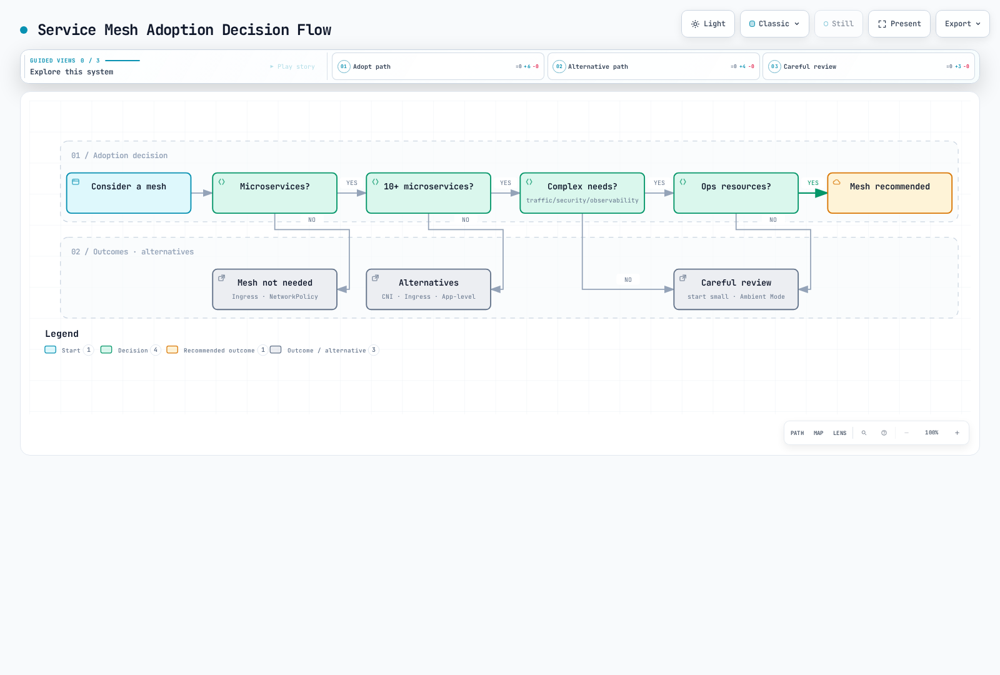
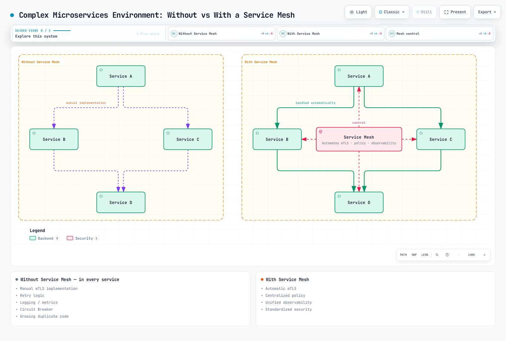
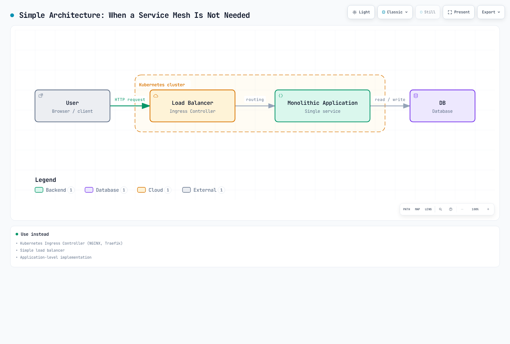
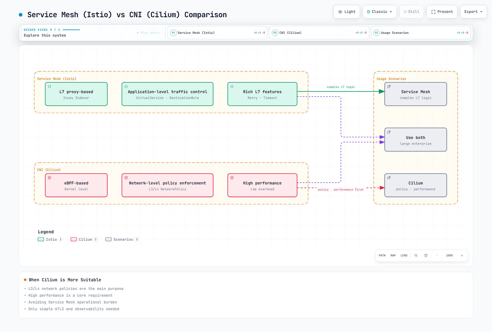
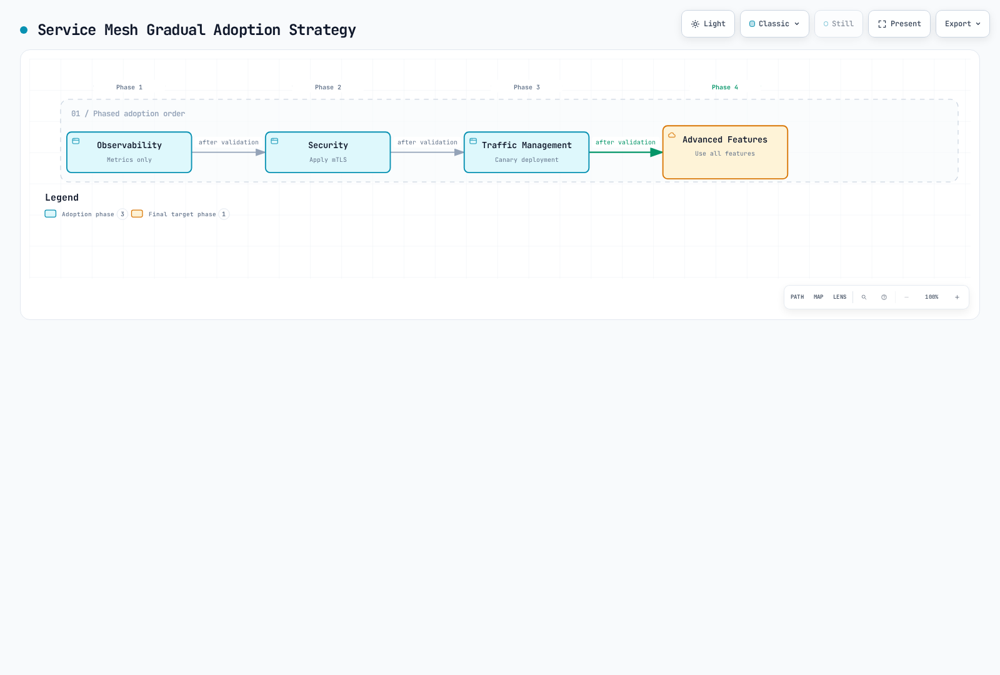
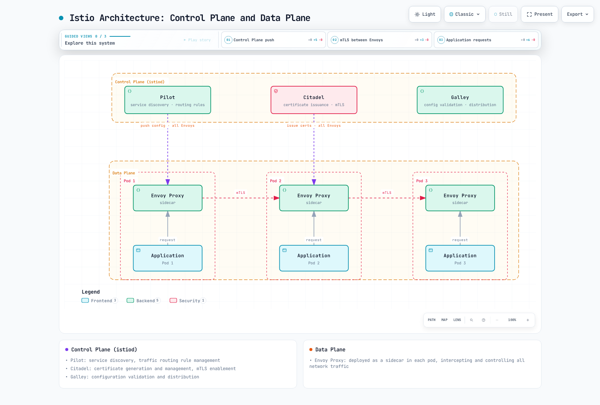

# Istio

> **最終更新日**: 2026年11月16日

Amazon EKSでIstio Service Meshを活用するための実践ガイドです。

### 2026年11月の更新: Istio 1.32.0がリリース

**Istio 1.32.0**は2026年11月9日にGAになりました（[リリースノート](https://istio.io/latest/news/releases/1.32.x/announcing-1.32/)、[GitHubリリース](https://github.com/istio/istio/releases/tag/1.32.0)）。これに先立ち、10月22日に1.32.0-beta.0、10月28日から11月6日の間にrc.0からrc.2がリリースされました。同じ週の11月6日には、サポート対象ブランチ向けにパッチリリース[1.31.4](https://istio.io/news/releases/1.31.x/announcing-1.31.4/)と1.30.8も公開されました。新しいマイナーバージョンがGAになると、Istioのサポートポリシーでは旧ブランチのサポート終了が近づきます。そのため、インストールまたはアップグレードの前に、[サポートマトリクス](https://istio.io/latest/docs/releases/supported-releases/)で1.32がサポートするKubernetesの範囲と各ブランチのステータスを確認してください。このガイドの新規インストール用コマンドと例は、引き続き1.31を対象としています。

### 2026年10月のセキュリティ更新: 1.31.3、1.30.7、1.29.10

2026年10月22日、[ISTIO-SECURITY-2026-008](https://istio.io/latest/news/security/istio-security-2026-008/)（CVE-2026-111943）に対するセキュリティパッチリリースとして、**1.31.3**、**1.30.7**、**1.29.10**が公開されました。1.29は2026年10月15日にサポート終了となったため、1.29.10は例外的なリリースです。2026年10月20日、eMudhraの中間CA証明書8件の秘密鍵が漏えいし、侵害されたことが公表されました。Envoy、Go、ztunnelはCertificate Transparencyを強制しないため、これらの鍵を所持する者は、Istioイメージに同梱された公開CAバンドルを通じて信頼される任意のドメインの証明書を発行できる可能性がありました。パッチでは、イメージのCAバンドルから侵害された中間証明書を削除し、1.30/1.31のistiod、`istioctl`、`pilot-agent`を、侵害された鍵を含む証明書チェーンを拒否するGo 1.26.10でビルドし、ztunnelの`rustls-webpki`を更新しています。システムのCAバンドルを信頼する構成は影響を受ける可能性があります。たとえば、`caCertificates`を指定しない`tls.mode: SIMPLE`の`DestinationRule`や、`RequestAuthentication`の`jwksUri`による取得などが該当します。Istio独自のメッシュmTLS証明書は影響を受けません。Istio 1.32.0-beta.0も同日に公開されました。

### 2026年10月のレビュー: サポート対象リリース

Istio 1.31.0はGAで、[リリース告知](https://istio.io/latest/news/releases/1.31.x/announcing-1.31/)は2026年8月31日に公開されました。現在のパッチは**1.31.3**で、10月22日に公開されました（上記の「2026年10月のセキュリティ更新」を参照）。10月15日に公開された1.31.2パッチには、セキュリティ修正[ISTIO-SECURITY-2026-007](https://istio.io/latest/news/security/istio-security-2026-007/)が含まれています（[リリース告知](https://istio.io/latest/news/releases/1.31.x/announcing-1.31.2/)）。その前に公開された1.31.1のリリース日は9月21日です。[リリース告知](https://istio.io/latest/news/releases/1.31.x/announcing-1.31.1/)には、未解決の`BackendTLSPolicy` CA参照がバックエンドへの平文接続にフォールバックするのを防ぐ修正が記載されています。

このガイドの新規インストール用コマンドでは1.31.2を使用します。Istio 1.31が公開しているKubernetesのサポート範囲は1.32～1.37です。EKSの標準サポート対象は現在1.34～1.37です。両者の標準サポート対象が重なるのは1.34～1.37です。EKSの延長サポート対象バージョン（1.31～1.33）のうち、1.32と1.33もIstio 1.31の範囲内です。インストール前に、[Istioサポートマトリクス](https://istio.io/latest/docs/releases/supported-releases/)と[EKSバージョンのライフサイクル](https://docs.aws.amazon.com/eks/latest/userguide/kubernetes-versions.html)を再確認してください。

このレビュー時点では、Istio 1.30と1.29は引き続きマトリクス上のサポート対象です。1.29のサポート終了日は2026年10月12日（予定）と記載されています。インストールまたはアップグレードの前に、ステータスを確認してください。これらのブランチを使用している既存のインストールでは、Envoyの脆弱性、BackendTLSPolicyのフェイルオープン、EnvoyFilterによるコントロールプレーンのサービス拒否を対象とする[ISTIO-SECURITY-2026-006](https://istio.io/latest/news/security/istio-security-2026-006/)への対応として、少なくとも1.30.4または1.29.7が必要です。10月15日に公開された[ISTIO-SECURITY-2026-007](https://istio.io/latest/news/security/istio-security-2026-007/)は、1.31.0～1.31.1、1.30.0～1.30.5、1.29.0～1.29.8に影響します。既知のCVEがないバージョンとしてマトリクスに記載されている最初のバージョンは、1.31.2、1.30.6、1.29.9です。Istio 1.28はサポート対象外です。Istio 1.31のチャートでは`https://blob.istio.io/istio-release/charts`を使用します。以前のGoogleホストのリポジトリには、新しいリリースは追加されません。

### 2026年9月の更新: 1.31.1、1.30.5、1.29.8のパッチリリース

2026年9月21日、サポート対象の3つのブランチすべてにパッチリリースが公開されました。[1.31.1](https://istio.io/latest/news/releases/1.31.x/announcing-1.31.1/)、1.30.5、1.29.8です。1.31.1には、セキュリティ修正[GHSA-qm8v-g4f9-qhjx](https://github.com/istio/istio/security/advisories/GHSA-qm8v-g4f9-qhjx)（CVSS 6.8、Moderate）が含まれています。CA参照が解決できない場合、`BackendTLSPolicy`がサイドカープロキシ上で平文にフォールバックする問題です。そのほか、ambientモードのCNIノードエージェントで自動検出されたiptablesバックエンド（legacyまたはnft）がエージェントの再起動間で切り替わる問題、`AuthorizationPolicies`の数に応じてistiodのCPU使用量が増加する問題、リモートクラスターの認証情報のローテーション時にambientマルチクラスター構成でメモリリークが発生する問題も修正されています。新規インストールおよび既存の1.31インストールは、1.31.1に更新してください。

## 目次

1. [本当にService Meshが必要ですか？](#do-you-really-need-a-service-mesh)
2. [インストールと初期設定](01-installation.md)
3. [基本概念](02-basic-concepts.md)
4. [アーキテクチャ](03-architecture.md)
5. [AWSとの統合](04-aws-integration.md)
6. [用語集](glossary.md)
7. [トラフィック管理](traffic-management/README.md)
8. [セキュリティ](security/README.md)
9. [可観測性](observability/README.md)
10. [レジリエンス](resilience/README.md)
11. [応用](advanced/README.md)
12. [トラブルシューティング](troubleshooting/common-errors.md)
13. [ベストプラクティス](best-practices.md)
14. [代替手段の比較](comparison/README.md)

## Istioとは？

Istioは、マイクロサービスの接続、保護、制御、可観測性を実現するオープンソースのサービスメッシュプラットフォームです。複雑なマイクロサービスアーキテクチャにおけるサービス間通信を管理し、トラフィック制御、セキュリティ、可観測性を提供します。

### サービスメッシュの概念

<div align="center"></div>

サービスメッシュは、マイクロサービス間の通信を管理するインフラストラクチャ層です。IstioはEnvoyサイドカーとambientモード（ノードレベルのztunnelと、オプションのL7 waypoint）をサポートしています。プロキシはメッシュに参加しているトラフィックを処理します。対象外のトラフィックやサポートされていないプロトコルは、その対象に含まれません。これにより、アプリケーションコードを変更せずに次の機能を利用できます。

* **トラフィックルーティング**: インテリジェントルーティング、負荷分散、カナリアデプロイ
* **セキュリティ**: mTLSの自動化、認証、認可
* **可観測性**: メトリクス、ログ、分散トレーシング
* **レジリエンス**: サーキットブレーカー、再試行、タイムアウト

### 実践的な使用例

<p align="center"><br><em>Application without Istio</em></p>

<p align="center"><br><em>Application with Istio - Envoy Proxy deployed as Sidecar to each service</em></p>

これらのBookinfo図はサイドカーモードを示しています。自動インジェクションでEnvoyが追加されるのは、オプトインしたnamespaceまたはワークロードで新たに作成されたPodだけです。ambientモードではサイドカーをインジェクションしません。

## 本当にService Meshが必要ですか？ {#do-you-really-need-a-service-mesh}

以下に示すサービス数のしきい値とチェックリストのスコアは、検討のための目安であり、Istioの要件ではありません。セキュリティ上のニーズがあれば、小規模なメッシュでも導入する理由になり得ます。判断フロー図でも、同じ例示的なしきい値を使用しています。

サービスメッシュは強力なツールですが、どの状況にも適しているわけではありません。導入前に慎重に検討する必要があります。

### 判断フロー



[🔍 インタラクティブな図を表示](https://www.atomai.click/kubernetes-docs/archmaps/en-service-mesh-istio-overview-0.html)

### Service Meshが必要な場合 ✅

#### 1. 複雑なマイクロサービス環境



[🔍 インタラクティブな図を表示](https://www.atomai.click/kubernetes-docs/archmaps/en-service-mesh-istio-overview-1.html)

**推奨基準**:

* ✅ マイクロサービスが10個以上ある
* ✅ サービス間通信（East-Westトラフィック）が頻繁に発生する
* ✅ 複数のプログラミング言語を使用している（ポリグロット）
* ✅ 複数のチームがそれぞれ独立してサービスを開発している

#### 2. ゼロトラストセキュリティ要件

**Service Meshが提供する機能**:

* サービス間のmTLS暗号化の自動化
* SPIFFEベースのID管理
* きめ細かな認証・認可ポリシー
* mTLSが強制されている場合のメッシュトラフィックの暗号化。mTLSの自動化だけでは平文クライアントを拒否しません

**代替手段なしでは実現が難しいこと**:

* 各サービスでセキュリティロジックを重複して実装すること
* 証明書を手動管理する複雑さ
* セキュリティポリシーの不整合

#### 3. 高度なトラフィック管理

```yaml
# Canary Deployment (Traffic Distribution)
apiVersion: networking.istio.io/v1
kind: VirtualService
metadata:
  name: reviews
spec:
  hosts:
  - reviews
  http:
  - route:
    - destination:
        host: reviews
        subset: v1
      weight: 90
    - destination:
        host: reviews
        subset: v2
      weight: 10  # Only 10% to new version
```

**必要となる状況**:

* カナリアデプロイ、A/Bテスト
* ヘッダーまたはパスに基づくルーティング
* トラフィックミラーリング（シャドーテスト）
* フォールトインジェクション（カオスエンジニアリング）
* サーキットブレーカー、再試行、タイムアウト

#### 4. 可観測性の統一

**Service Meshの利点**:

* アプリケーションコードを変更せずにメトリクスを自動収集
* プロキシがトレーススパンを生成。リクエストを関連付けるには、アプリケーションがトレースヘッダーを伝播する必要があります
* ログ形式を統一
* サービストポロジーを可視化（Kiali）

### Service Meshが不要な場合 ❌

#### 1. シンプルなアーキテクチャ



[🔍 インタラクティブな図を表示](https://www.atomai.click/kubernetes-docs/archmaps/en-service-mesh-istio-overview-2.html)

**代わりに利用するもの**:

* 保守されているKubernetes Gateway APIまたはIngressコントローラー
* シンプルなロードバランサー
* アプリケーションレベルでの実装

#### 2. マイクロサービスが少ない（10未満）

**運用負荷のほうが大きい場合**:

* Service Meshの運用の複雑さが、得られるメリットを上回る
* サービスが5～10個であれば、手動で管理できる
* CNIが適用を強制する場合、NetworkPolicyでL3/L4の分離を実現できます。ただし、mTLSやHTTP認可は提供しません

**代替案**:

```yaml
# L3/L4 ingress isolation; requires a NetworkPolicy-capable CNI
apiVersion: networking.k8s.io/v1
kind: NetworkPolicy
metadata:
  name: allow-frontend-to-backend
spec:
  podSelector:
    matchLabels:
      app: backend
  ingress:
  - from:
    - podSelector:
        matchLabels:
          app: frontend
```

#### 3. 運用リソースが不足している

**Service Meshの運用に必要なもの**:

* Istio/Envoyの専門知識
* Control Planeの監視と管理
* アップグレードとパッチの管理
* トラブルシューティング能力（デバッグの複雑さが増します）

**チームに必要な準備**:

* Service Meshの専門家が少なくとも1～2人いる
* 継続的に学習し、更新情報を追跡する
* 十分なテスト環境を用意する

#### 4. パフォーマンスが極めて重要な場合

**Service Meshのオーバーヘッド**:

実際の利用を代表するトラフィック、プロキシ設定、テレメトリー設定でレイテンシー、CPU、メモリを測定してください。[公式パフォーマンスページ](https://istio.io/latest/docs/ops/deployment/performance-and-scalability/)にはIstio 1.24のベンチマークが記録されていますが、これらの過去の結果は、他のバージョンやワークロードでの性能を保証するものではありません。

**代替案を検討する**:

* Ambientモード（共有L4プロキシ。削減効果はトラフィックとwaypointのデプロイ方法によって異なります）
* CNIベースのソリューション（Cilium）
* アプリケーションレベルの最適化

### 代替ソリューションの比較

| 機能                       | Service Mesh                                 | CNI (Cilium)    | Ingress Controller | アプリケーションレベル    |
| -------------------------- | -------------------------------------------- | --------------- | ------------------ | ------------------------ |
| **L7トラフィック管理**     | ✅ フルサポート                               | ⚠️ 限定的       | ⚠️ Ingressのみ     | ✅ 可能                   |
| **mTLSの自動化**           | ✅ フルサポート                               | ⚠️ 相互認証と暗号化は別々      | ❌ 非対応           | ❌ 手動で実装             |
| **分散トレーシング**       | ⚠️ トレースコンテキストの伝播が必要                                  | ❌ 非対応        | ❌ 非対応           | ⚠️ 手動で実装             |
| **L3/L4ポリシー**          | ✅ 対応                                       | ✅ フルサポート  | ❌ 非対応           | ❌ 非対応                 |
| **運用の複雑さ**           | 🔴 高い                                       | 🟡 中程度        | 🟢 低い            | 🟡 中程度                |
| **リソースのオーバーヘッド** | <p>🔴 高い (Sidecar)<br>🟢 低い (Ambient)</p> | 🟢 低い          | 🟢 低い            | 🟢 なし                  |
| **適した規模**             | 要件による                                     | あらゆる規模     | 小規模             | 小規模                   |

### CNIベースのソリューション（Cilium）

Ciliumは、eBPFを基盤とした**ネットワークレベル**の多くの機能を提供します。



[🔍 インタラクティブな図を表示](https://www.atomai.click/kubernetes-docs/archmaps/en-service-mesh-istio-overview-3.html)

**Ciliumのほうが適している場合**:

* 主な目的がL3/L4ネットワークポリシーである
* 必要なポリシーや暗号化設定で測定したパフォーマンスが、ワークロードのニーズを満たす
* 既存のCiliumデプロイでサポートされる機能が要件を満たしており、それを再利用できる
* ネットワークポリシーと可観測性が主なニーズである。Ciliumの帯域外相互認証でペイロードの機密性を確保するには、別途WireGuard/IPsecによる暗号化が必要です

Cilium 1.20.1は、独立した[ztunnel透過的暗号化のベータ版](https://github.com/cilium/cilium/blob/v1.20.1/Documentation/security/network/encryption-ztunnel.rst)も提供しています。これは`encryption.type: ztunnel`で選択します。namespaceへの参加登録により、TCPワークロードでmTLSを提供します。両方のエンドポイントが参加登録されている必要があります。ClusterMeshとホストネットワークを使用するPodは対象外です。また、公開されたガイドでは、HBONEポート15008を対象とする場合を除き、通常のL4ポリシーはこの経路では機能しないと警告しています。これは、独自のCAとブートストラップ要件を持つ、別個のデプロイ方式です。

この図はCNIの役割に焦点を当てていますが、CiliumにはL7のEnvoy機能もあります。コンポーネント数と運用コストは、選択するモードによって異なります。

**参考資料**: [Ciliumドキュメント](../../networking/cilium/README.md)

### 判断チェックリスト

導入前に、次の質問に答えてください。

**アーキテクチャ**:

* [ ] マイクロサービスが10個以上ありますか？
* [ ] サービス間通信は複雑ですか？
* [ ] 複数のプログラミング言語を使用していますか？

**セキュリティ**:

* [ ] ゼロトラストセキュリティモデルが必要ですか？
* [ ] サービス間のmTLS暗号化は必須ですか？
* [ ] きめ細かなアクセス制御が必要ですか？

**トラフィック管理**:

* [ ] カナリアデプロイやA/Bテストが必要ですか？
* [ ] 高度なルーティングルールが必要ですか？
* [ ] 多くのサービスでサーキットブレーカーや再試行が必要ですか？

**可観測性**:

* [ ] 分散トレーシングは必須ですか？
* [ ] メトリクスの一元収集が必要ですか？
* [ ] サービストポロジーの可視化が必要ですか？

**運用**:

* [ ] Service Meshの専門家がいますか？
* [ ] 運用の複雑さに対応できますか？
* [ ] リソースのオーバーヘッドを許容できますか？

**判定**:

* ✅ 10個以上にチェック: Service Meshを強く推奨
* 🟡 5～9個にチェック: 慎重な評価が必要。小さく始める（Ambientモードを推奨）
* ❌ 4個以下にチェック: 代替ソリューション（CNI、Ingress、アプリケーションレベル）を検討

### 段階的な導入戦略

Service Meshが必要だと判断した場合は、段階的に導入してください。



[🔍 インタラクティブな図を表示](https://www.atomai.click/kubernetes-docs/archmaps/en-service-mesh-istio-overview-4.html)

**推奨する順序**:

1. **パイロットプロジェクト**（1～2個のnamespace）
2. **まず可観測性から**（メトリクス、ログ、トレース）
3. **セキュリティを適用**（mTLS PERMISSIVE → STRICT）
4. **トラフィック管理**（VirtualService、DestinationRule）
5. **全社規模に拡大**

### 主な機能

1.  **トラフィック管理**

    VirtualServiceでルートを選択し、DestinationRuleでsubsetと宛先トラフィックポリシーを定義します。

    * インテリジェントルーティングと負荷分散
    * A/Bテスト、カナリアデプロイ、Blue/Greenデプロイ
    * サーキットブレーカー、再試行、タイムアウト制御
    * トラフィックミラーリングとフォールトインジェクション
2.  **セキュリティ**

    <div align="center"></div>

    * サービス間のmTLS暗号化の自動化
    * 強力な認証と認可
    * きめ細かなアクセス制御ポリシー
    * ネットワークの分離とセキュリティポリシー
3.  **可観測性**

    <div align="center"></div>

    * プロキシメトリクスと、設定可能なアクセスログおよびトレーシング
    * Prometheus、Grafana、Jaeger、Kialiとの統合
    * サービストポロジーの可視化
    * リアルタイムのトラフィック監視
4. **レジリエンス**
   * サーキットブレーカーパターン
   * レート制限
   * アウトライアー検出
   * ゾーンを考慮したルーティング

### Istioのアーキテクチャ

<div align="center"></div>

IstioはControl PlaneとData Planeで構成されます。



[🔍 インタラクティブな図を表示](https://www.atomai.click/kubernetes-docs/archmaps/en-service-mesh-istio-overview-5.html)

**Control Plane（istiod）**:

* サービスディスカバリーとプロキシ設定（旧Pilot）
* 認証局とID管理（旧Citadel）
* 設定の検証。Galleyは独立したコンポーネントとしては廃止されており、現在の独立したサービスではありません

**Data Plane**:

* **サイドカーモード**: 参加登録された各PodにEnvoyを配置
* **Ambientモード**: L4セキュリティ用のztunnelを各ノードに配置し、L7処理用のwaypointプロキシをオプションで配置

### Amazon EKSでIstioを使うメリット

1. **マイクロサービスの管理が容易**
   * アプリケーションコードを変更せずにトラフィックを管理
   * 宣言的な設定で一貫したポリシーを適用
   * Kubernetes Native APIを使用
2. **セキュリティの強化**
   * サービス間の暗号化を自動化
   * EKS Pod IdentityまたはIRSAを通じてAWS APIにアクセス。IstioのワークロードIDは引き続きサービスアカウントに基づきます
   * きめ細かな権限制御
3. **可観測性の向上**
   * Amazon CloudWatchとの統合
   * AWS X-Rayによる分散トレーシング
   * 詳細なメトリクスとログ
4. **AWSサービスとの統合**
   * Application Load Balancer（ALB）との統合
   * AWS Certificate Manager（ACM）との統合
   * Amazon EBS CSI Driverとの互換性

### はじめに

[Gateway APIガイド](https://istio.io/latest/docs/tasks/traffic-management/ingress/gateway-api/)

Istioを初めて利用する場合は、次の順序でドキュメントを読んでください。

1. [**インストールと初期設定**](01-installation.md): EKSクラスターにIstioをインストールする
2. [**基本概念**](02-basic-concepts.md): Istioの主要な概念を理解する
3. [**トラフィック管理**](traffic-management/README.md): Gateway、VirtualService、DestinationRuleについて学ぶ
4. [**セキュリティ**](security/README.md): mTLS、認証、認可を設定する
5. [**可観測性**](observability/README.md): メトリクス、ログ、トレースを収集する
6. [**ベストプラクティス**](best-practices.md): 本番環境向けの推奨事項を確認する

### ハンズオンの例

これらのルーティング例を使用するには、対応するServicesとDestinationRuleのsubset（`v1`/`v2`）が必要です。トラフィック管理の各章を参照してください。

各セクションには、動作するYAMLの例が含まれています。すべての例は、クリックしてコピーできる形式で記載されています。

```yaml
# Example VirtualService
apiVersion: networking.istio.io/v1
kind: VirtualService
metadata:
  name: reviews
spec:
  hosts:
  - reviews
  http:
  - route:
    - destination:
        host: reviews
        subset: v1
```

### 参考資料

* [Istio公式ドキュメント](https://istio.io/latest/docs/)
* [Istio GitHub](https://github.com/istio/istio)
* [Istio EKSプラットフォームガイド](https://istio.io/latest/docs/setup/platform-setup/amazon-eks/)
* [Istioコミュニティ](https://istio.io/latest/get-involved/)


* [トレーシングとアプリケーションでのヘッダー伝播](https://istio.io/latest/docs/tasks/observability/distributed-tracing/overview/)
* [Kubernetes NetworkPolicyの機能](https://kubernetes.io/docs/concepts/services-networking/network-policies/)
* [Ciliumの相互認証](https://docs.cilium.io/en/stable/network/servicemesh/mutual-authentication/mutual-authentication/)

### クイズ

この章で学んだことを確認するため、次のクイズに挑戦してください。

* [トラフィック管理のクイズ](../../quizzes/service-mesh/istio/traffic-management.md)
* [セキュリティのクイズ](../../quizzes/service-mesh/istio/security.md)
* [可観測性のクイズ](../../quizzes/service-mesh/istio/observability.md)
* [レジリエンスのクイズ](../../quizzes/service-mesh/istio/resilience.md)
* [応用編のクイズ](../../quizzes/service-mesh/istio/advanced.md)
