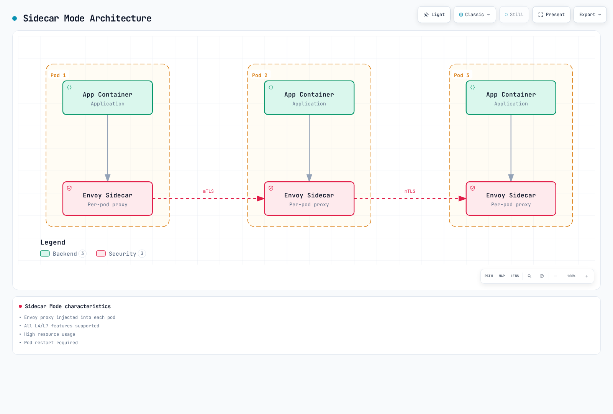
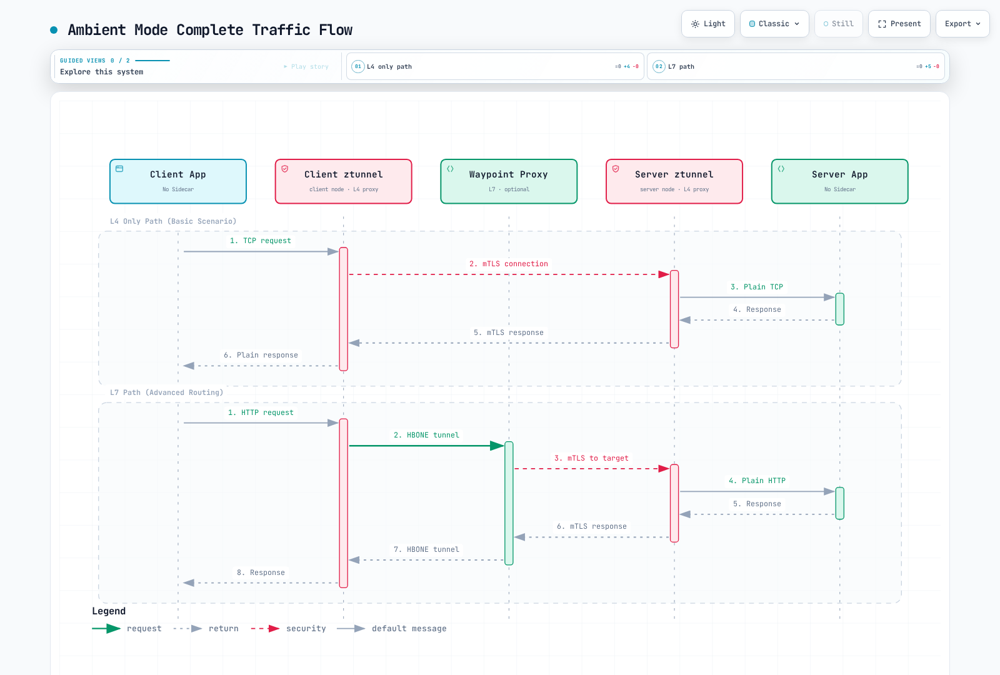

# Ambient Mode

> **最終更新**: October 12, 2026 · Istio 1.31。このラボでは、互換性のある Linux ノード、node-agent/CNI の権限、および新しいデモ namespace を前提としています。この監査ではデプロイコマンドは実行されていません。

Ambient は 2022 年に実験的プレビューとして導入され、Istio 1.18 で初めて Alpha として提供され、1.22 で Beta に到達し、1.24 でコア GA となりました。このプレビューは、メインの 1.15 リリースで一般提供された機能ではありませんでした。リソース削減と移行の安全性は、実際のトポロジー、ポリシー、トラフィックに依存します。

## 目次

1. [概要](#overview)
2. [Sidecar Mode と Ambient Mode](#sidecar-mode-vs-ambient-mode)
3. [アーキテクチャ](#architecture)
4. [インストールと設定](#installation-and-configuration)
5. [移行](#migration)
6. [パフォーマンス比較](#performance-comparison)
7. [ユースケース](#use-cases)
8. [トラブルシューティング](#troubleshooting)

## 概要 {#overview}


Ambient Mode は、アプリケーション Pod に Sidecar proxy を注入せずに Service Mesh 機能を提供する新しいアプローチです。Ambient Mode は、**階層型アーキテクチャ**で構成されます。

1. **セキュアオーバーレイ層（L4）**: ztunnel による mTLS と基本的なテレメトリ
2. **L7 処理層**: Waypoint Proxy による高度なトラフィック管理

### Ambient Mode が必要な理由

従来の Sidecar モデルの制約:
- **高いリソースオーバーヘッド**: 各 Pod に Envoy proxy が必要（実際の proxy のフットプリントを測定する）
- **運用の複雑さ**: Pod の再起動、バージョン管理、ローリングアップデートが複雑
- **起動時の調整**: Proxy とアプリケーションの readiness を調整する必要がある
- **過剰な機能**: 一部のワークロードには L4 mesh 機能だけが必要

Ambient Mode の解決策:
- 共有 node proxy と必要な waypoint: 総リソース使用量を測定する
- 登録時に mesh 未参加の Pod の再起動を回避できる。sidecar の削除とポリシー変更には管理されたロールアウトが必要
- 段階的な導入: 必要に応じて L4 から L7 へ拡張
- L4 トランスポートは透過的にできるが、トレーシングコンテキストおよびアプリケーションの timeout/idempotency 契約は依然として重要

### コアコンセプト

これらの図における任意の waypoint は、設定または登録によって選択されます。Ztunnel は各 HTTP リクエストを解析し、L7 への迂回が必要かどうかを決定するわけではありません。既存の接続、readiness、ポリシー遷移も引き続き検証が必要です。


[🔍 インタラクティブな図を表示](https://www.atomai.click/kubernetes-docs/archmaps/en-service-mesh-istio-advanced-01-ambient-mode-0.html)

### Ambient Mode の利点

1. **共有リソースモデル**: Node proxy と必要な waypoint replica
2. **シンプルなデプロイ**: mesh 未参加 Pod の登録では Pod の再起動が不要な場合がある。一方、sidecar の削除では必要
3. **透過的な L4 トランスポート**: アプリケーションのトレーシング、deadline、idempotency の要件は残る
4. **柔軟な L7 機能**: 必要な場合にのみ waypoint を使用

## Sidecar Mode と Ambient Mode {#sidecar-mode-vs-ambient-mode}

### アーキテクチャの比較

#### Sidecar Mode



[🔍 インタラクティブな図を表示](https://www.atomai.click/kubernetes-docs/archmaps/en-service-mesh-istio-advanced-01-ambient-mode-1.html)

**特徴**:
- 各 Pod に Envoy proxy を注入
- 成熟した L4/L7 機能。選択したリリースを確認する
- 高いリソース使用量
- Pod の再起動が必要

#### Ambient Mode


[🔍 インタラクティブな図を表示](https://www.atomai.click/kubernetes-docs/archmaps/en-service-mesh-istio-advanced-01-ambient-mode-2.html)

**特徴**:
- node ごとに 1 つの ztunnel
- L4 機能をデフォルトで提供
- L7 機能には waypoint が必要
- mesh 未参加 Pod の登録では Pod の再起動が不要な場合がある。一方、sidecar の削除では必要

### 詳細比較表

| 項目 | Sidecar Mode | Ambient Mode |
|------|-------------|--------------|
| **デプロイ方法** | Pod への Sidecar 注入 | Node レベルの ztunnel + 任意の waypoint |
| **リソース計上** | Pod ごとの Envoy + control plane | Node ztunnel + すべての waypoint replica + control plane。負荷時に測定する |
| **Pod の再作成** | 注入済み proxy の追加/削除に必要 | mesh 未参加の登録では通常不要。sidecar の削除には必要 |
| **起動時の調整** | Proxy/アプリケーションのライフサイクルと readiness | CNI capture と ztunnel readiness |
| **L4 機能** | サポート | サポート |
| **L7 機能** | リリース固有のサポート | Waypoint とサポート対象 API が必要。すべての拡張が GA ではない |
| **mTLS** | 自動 | 自動 |
| **テレメトリ** | 詳細 | 基本（L4）、詳細（waypoint を使用する L7） |
| **Circuit Breaker** | サポート | Waypoint が必要 |
| **Retry/Timeout** | サポート | Waypoint が必要 |
| **Header manipulation** | サポート | Waypoint が必要 |
| **パフォーマンスオーバーヘッド** | ワークロード/設定に依存 | パス/identity/waypoint/負荷に依存。同等のポリシーを比較する |
| **運用範囲** | ワークロードごとの proxy ライフサイクル | Node/CNI と共有 waypoint のライフサイクル |
| **本番環境への対応状況** | 成熟 | GA（Istio 1.24 以降） |

### リソース使用量の比較 {#resource-usage-comparison}

以下の 100-Pod の計算は、公式ベンチマークではなく仮説的な計画例です。リソースまたは請求額の削減を見積もる前に、すべての node/waypoint replica を数え、同等のセキュリティ、テレメトリ、ルーティング要件を比較してください。

## アーキテクチャ {#architecture}


Ambient Mode のデータプレーンは、**ztunnel** と **Waypoint Proxy** という 2 つのコアコンポーネントで構成されます。

### ztunnel（Zero Trust Tunnel）


ztunnel は Ambient Mode のコアコンポーネントであり、**node レベルで実行される軽量な L4 proxy** です。対象の Linux node 上で DaemonSet として実行され、登録済みワークロードのサポート対象トラフィックを処理します。これはすべての Pod のすべてのトラフィックではありません。host-network/除外対象のワークロードおよび TCP 以外のアプリケーションプロトコルでは、現在のサポート状況を確認する必要があります。

#### ztunnel の仕組み

1. **トラフィックの capture**: Istio CNI の Pod 内 netfilter/iptables ルールと network-namespace handoff を通じて、Pod のネットワークトラフィックを透過的にインターセプト
2. **mTLS の適用**: SPIFFE ベースの Identity を使用して mTLS 暗号化を自動的に適用
3. **ロードバランシング**: endpoint 間で L4 ロードバランシングを実行
4. **テレメトリの収集**: 接続メトリクスとログを収集
5. **転送**: トラフィックを宛先 ztunnel または Waypoint に転送

**ztunnel のテクノロジースタック**:
- **言語**: Rust（高パフォーマンス、低メモリ使用量）
- **プロトコル**: HBONE（HTTP-Based Overlay Network Environment）
- **Identity**: SPIFFE workload identity。デフォルトでは Istiod CA、SPIRE 用には別途統合
- **CNI**: Istio CNI plugin との緊密な統合

#### ztunnel の役割


[🔍 インタラクティブな図を表示](https://www.atomai.click/kubernetes-docs/archmaps/en-service-mesh-istio-advanced-01-ambient-mode-3.html)

**ztunnel の特徴**:
- Rust で記述（パフォーマンス最適化）
- DaemonSet としてデプロイ
- CNI plugin と統合
- Pod 内 netfilter/iptables リダイレクトを Istio CNI と協調して実行

#### ztunnel のデプロイ

リリース済みの ambient インストール/charts を使用してください。元の最小限の DaemonSet には token/CA/socket mount がなく、hostNetwork/privileged の設定も誤っていました。1.31 chart は特定の capability と Pod 内 namespace へのアクセスを提供しますが、`hostNetwork: true` または `privileged: true` は設定しません。完全な chart/platform のコンテキストなしに権限をコピーまたは縮小しないでください。

```bash
# Offline inspection; use the same reviewed values as the actual installation
istioctl manifest generate --set profile=ambient > ambient-rendered.yaml
# Inspect a deployed resource if a mesh already exists
kubectl get daemonset ztunnel -n istio-system -o yaml
```

### Waypoint Proxy


Waypoint は、**L7 機能が必要な場合に使用する任意の proxy** です。設定済みの waypoint は、登録済みリソースのトラフィックパスに配置され、高度なトラフィック管理機能を提供します。

#### Waypoint の主な特徴

1. **選択的なデプロイ**: すべての Service ではなく、L7 機能を必要とする Service にのみ使用
2. **共有 proxy**: 複数のワークロードが 1 つの Waypoint を共有（namespace/Service/Pod の登録に応じて）
3. **Envoy ベース**: 従来の Sidecar と同じ Envoy proxy を使用し、リリース固有の L7 API サポートを提供
4. **オンデマンド**: 実行時に動的に追加/削除可能

#### Waypoint のデプロイ単位

ServiceAccount は workload identity を提供しますが、ラベルを付けても waypoint は選択されません。Namespace、Service、または Pod に `istio.io/use-waypoint` を使用し、`istio.io/waypoint-for` のトラフィックタイプが意図したトラフィックと一致する Gateway を使用してください。

| 登録 | スコープ |
|---|---|
|Namespace|その namespace 内の対象リソースに対するデフォルトの waypoint 選択|
|Service|その Service 宛てのトラフィック。デフォルトの waypoint タイプは `service`|
|Pod|`workload` または `all` waypoint を用いた直接の workload/Pod-IP トラフィック|

Deployment ラベルだけでは既存の Pod にラベルは付与されません。ワークロードを登録するには Pod-template ラベルを使用してください。`service` waypoint は、直接の Pod-IP トラフィックを自動的には対象にしません。

#### Waypoint の役割


**Waypoint の特徴**:
- Gateway としてデプロイされ、その後サポート対象リソースの登録によって選択される
- Envoy proxy に基づく
- API ごとのサポートを確認する。任意の EnvoyFilter patch はサポート対象の waypoint API ではない
- 必要な Service にのみ選択的に使用

#### Waypoint のデプロイ

```yaml
apiVersion: gateway.networking.k8s.io/v1
kind: Gateway
metadata:
  name: reviews-waypoint
  namespace: ambient-demo
  labels:
    istio.io/waypoint-for: service
spec:
  gatewayClassName: istio-waypoint
  listeners:
  - name: mesh
    port: 15008
    protocol: HBONE
```

デフォルトの `istio-waypoint` class は Envoy を使用します。コア ambient GA はすべての API を GA にするわけではありません。現在のドキュメントでは ambient VirtualService は Alpha とされ、Gateway API route との混在は禁止されています。ここでは HTTPRoute を使用してください。EnvoyFilter はサポート対象の waypoint 拡張ではありません。L7 ポリシーは waypoint に到達するトラフィックを保護します。必須の経由には、文書化された ztunnel authorization guard と正しい登録/readiness も必要です。

### 完全なトラフィックフロー

以下は、**Sidecar なし**の Ambient Mode でトラフィックがどのように流れるかを示す包括的な図です。



[🔍 インタラクティブな図を表示](https://www.atomai.click/kubernetes-docs/archmaps/en-service-mesh-istio-advanced-01-ambient-mode-6.html)

**トラフィックフローの分析**:

1. **L4 のみのパス**（ztunnel のみを使用）:
   - 代表的な負荷の下でパスのレイテンシを測定
   - mTLS を自動的に適用
   - 基本的なテレメトリ
   - 実際の要件が L4 のみの場合に適切

2. **L7 パス**（ztunnel + Waypoint）:
   - Header ベースのルーティング
   - Circuit Breaking
   - Retry/Timeout
   - 複雑なトラフィックポリシーが必要な場合

### HBONE プロトコル


**HBONE（HTTP-Based Overlay Network Environment）** は、Ambient Mode で使用されるトンネリングプロトコルです。

- **HTTP/2 ベース**: 既存のインフラストラクチャとの互換性
- **組み込み mTLS**: セキュアな通信
- **多重化**: 同じ送信元/宛先 identity ペアの TCP stream が tunnel を共有
- **ネットワークポリシー**: HBONE は慣例的に TCP15008 を使用。必要な mesh パスを明示的に許可する


[🔍 インタラクティブな図を表示](https://www.atomai.click/kubernetes-docs/archmaps/en-service-mesh-istio-advanced-01-ambient-mode-7.html)

このガイドの HBONE は TCP stream を転送します。アプリケーション UDP はこの tunnel では転送されません。DNS capture/proxying は別の機能です。ローカルのアプリケーション stream はプレーンテキストのままにできる一方、proxy 間の mesh トランスポートは暗号化されます。

## インストールと設定 {#installation-and-configuration}

このラボには、互換性のある Linux node と必要な Istio CNI/ztunnel DaemonSet が必要です。EKS Fargate ではこれらの node DaemonSet を実行できません。サポート対象の EC2 ベース配置を使用し、実際の node/CNI platform を確認してください。[プラットフォームの前提条件](https://istio.io/latest/docs/ambient/install/platform-prerequisites/)には、CNI パス、権限、health probe が記載されています。SecurityGroupPolicy を使用する VPC CNI Pod ENI trunking では、standard enforcing mode または適切な exec probe が必要になる場合があります。ポリシーへの影響を評価してください。GKE、OpenShift、k3s、その他の platform では異なる設定が必要になる場合があります。

Istio 1.31 は Kubernetes 1.32–1.37 をサポートします。EKS との互換性については[インストールガイド](../01-installation.md)を参照してください。以下の Gateway API 1.6.0 は Istio 1.31 の依存関係および公式 ambient tutorial に一致します。既存 bundle の互換性を確認してください。例をコピーするためだけに、新しい互換性のある bundle をダウングレードしないでください。

### 1. Istio のインストール（Ambient Mode）

このインストールコマンドは、installer と platform 設定を確認した後の新しいラボ mesh にのみ使用してください。既存 mesh のインストール方法/values は、移行手順を使用して維持してください。

```bash
curl -fsSL https://istio.io/downloadIstio -o download-istio.sh
ISTIO_VERSION=1.31.0 sh download-istio.sh
cd istio-1.31.0
export PATH="$PWD/bin:$PATH"

# Fresh cluster without Gateway API; review an existing bundle separately
if ! kubectl get crd gateways.gateway.networking.k8s.io >/dev/null 2>&1; then
  kubectl apply --server-side -f https://github.com/kubernetes-sigs/gateway-api/releases/download/v1.6.0/experimental-install.yaml
fi
kubectl wait --for=condition=Established crd/gateways.gateway.networking.k8s.io --timeout=60s
kubectl get crd httproutes.gateway.networking.k8s.io

# Fresh lab mesh only; include required platform-specific values
istioctl install --set profile=ambient -y
kubectl get pods,daemonsets -n istio-system
```

### 2. Ambient Mode を有効にしてアプリケーションをデプロイ

sidecar-injection/revision override のない、新しく使い捨て可能な namespace を使用してください。既存の sidecar Pod は、ambient ラベルを追加しても変換されません。1.31 distribution の完全な Bookinfo manifest は、古い単一 Deployment の例にはない reviews Service、version ラベル、ServiceAccount、ratings dependency を提供します。これは Bookinfo 1.20.3 image を使用します。

```bash
kubectl create namespace ambient-demo
kubectl label namespace ambient-demo istio.io/dataplane-mode=ambient
kubectl get namespace ambient-demo -L istio-injection,istio.io/rev,istio.io/dataplane-mode
kubectl apply -n ambient-demo -f samples/bookinfo/platform/kube/bookinfo.yaml
kubectl apply -n ambient-demo -f samples/curl/curl.yaml
for deployment in reviews-v1 reviews-v2 ratings-v1 curl; do
  kubectl rollout status "deployment/$deployment" -n ambient-demo --timeout=120s
done
istioctl ztunnel-config workloads --workload-namespace ambient-demo
```

### 3. Waypoint をデプロイして選択

現在の CLI は ServiceAccount 登録フラグではなく、waypoint 名とトラフィックタイプを取ります。readiness を待機し、Service を明示的に登録してください。

```bash
istioctl waypoint apply --name reviews-waypoint --for service -n ambient-demo --wait
kubectl label service reviews -n ambient-demo istio.io/use-waypoint=reviews-waypoint --overwrite
kubectl get gateways.gateway.networking.k8s.io reviews-waypoint -n ambient-demo
kubectl get service reviews -n ambient-demo --show-labels
```

### 4. L7 機能を使用

version 固有の backend Service を作成し、登録済みの reviews Service に HTTPRoute をアタッチします。これは GET/header ルーティングを示します。header は認証済み identity ではありません。この Gateway API route を古い VirtualService と組み合わせないでください。別の Service/Pod IP への直接呼び出しは別のパスです。

```yaml
apiVersion: v1
kind: Service
metadata:
  name: reviews-v1
  namespace: ambient-demo
spec:
  selector:
    app: reviews
    version: v1
  ports:
  - name: http
    port: 9080
    targetPort: 9080
---
apiVersion: v1
kind: Service
metadata:
  name: reviews-v2
  namespace: ambient-demo
spec:
  selector:
    app: reviews
    version: v2
  ports:
  - name: http
    port: 9080
    targetPort: 9080
---
apiVersion: gateway.networking.k8s.io/v1
kind: HTTPRoute
metadata:
  name: reviews
  namespace: ambient-demo
spec:
  parentRefs:
  - group: ''
    kind: Service
    name: reviews
    port: 9080
  rules:
  - matches:
    - method: GET
      headers:
      - name: end-user
        type: Exact
        value: jason
    backendRefs:
    - name: reviews-v2
      port: 9080
  - matches:
    - method: GET
    backendRefs:
    - name: reviews-v1
      port: 9080
```

```bash
kubectl describe httproutes.gateway.networking.k8s.io reviews -n ambient-demo
kubectl exec -n ambient-demo deploy/curl -c curl -- \
  curl -sS --max-time 5 -H "end-user: jason" http://reviews:9080/reviews/0
```

Accepted/ResolvedRefs condition と、ログ/テレメトリを通じて選択された backend を確認してください。HTTP の成功だけでは、mTLS も必須 waypoint 経由も証明されません。L7 authorization には適切な `targetRefs` が必要です。必須の経由には文書化された ztunnel authorization guard も必要です。[waypoint ポリシーのアタッチ](https://istio.io/latest/docs/ambient/usage/l7-features/)を参照してください。

## 移行 {#migration}

### Sidecar Mode から Ambient Mode へ

移行はポリシー/ワークロードのロールアウトであり、ラベルのみの変更ではありません。インストール済みの revision、CA/trust、gateway、CNI option、宣言的ワークロード設定を維持してください。既存 sidecar は ambient 登録より優先されます。L7 ルーティング/authorization に対応し、そうしたポリシーを必要とするワークロードから sidecar を削除する前に waypoint の readiness を確保してください。

#### ステップ 1: Ambient コンポーネントをインストール

既存のインストール方法と確認済み values を使用して、互換性のあるバージョンで ambient サポートを追加します。Helm 管理の mesh を、無関係な素の `istioctl install --set profile=ambient` コマンドで上書きしないでください。意図した設定を render/diff し、CNI/ztunnel node agent を確認してください。

#### ステップ 2: テスト namespace に適用

この独立した ambient テストでは、1.31 distribution から client と server の両方をデプロイします。httpbin Service は 8000 を公開し、8080 を target にします。

```bash
kubectl create namespace test-ambient
kubectl label namespace test-ambient istio.io/dataplane-mode=ambient
kubectl apply -n test-ambient -f samples/curl/curl.yaml
kubectl apply -n test-ambient -f samples/httpbin/httpbin.yaml
kubectl rollout status deployment/curl -n test-ambient --timeout=120s
kubectl rollout status deployment/httpbin -n test-ambient --timeout=120s
kubectl exec -n test-ambient deploy/curl -c curl -- \
  curl -sS --max-time 5 http://httpbin:8000/headers
```

#### ステップ 3: 検証

HBONE workload column は意図したトランスポートを示します。実際のトラフィックについては、正しい node の ztunnel log で想定される送信元/宛先 identity を確認するか、`connection_security_policy="mutual_tls"` を持つ TCP metric を確認してください。HTTP の成功だけでは mTLS の証明になりません。HBONE 登録はすべてのプレーンテキスト caller を拒否するわけではありません。必要な場合は PeerAuthentication STRICT を使用してください。[mTLS 検証](https://istio.io/latest/docs/ambient/usage/verify-mtls-enabled/)を参照してください。

```bash
istioctl ztunnel-config workloads --workload-namespace test-ambient
source_pod=$(kubectl get pod -n test-ambient -l app=curl -o jsonpath='{.items[0].metadata.name}')
source_node=$(kubectl get pod "$source_pod" -n test-ambient -o jsonpath='{.spec.nodeName}')
ztunnel_pod=$(kubectl get pod -n istio-system -l app=ztunnel \
  --field-selector "spec.nodeName=$source_node" -o jsonpath='{.items[0].metadata.name}')
kubectl logs "$ztunnel_pod" -n istio-system --since=5m
```

#### ステップ 4: 選択したワークロードを切り替え

次の例では、別の既存 `migration-demo` namespace に、L4 のみを必要とする確認済みの namespace 注入済み curl/httpbin Deployment だけがあるものとします。Pod テンプレートの injection override や手動で注入された proxy がないか確認してください。以下のコマンドでは、それらを削除しません。L7 ワークロードでは、まず waypoint の登録とポリシー変換を検証し、`targetRefs` と、経由を必須にするための guard を確認してください。移行中にポリシーが共存する状態を想定してください。selector ベースの L7 ポリシーを ztunnel で適用すると、通信が遮断される可能性があります。

```bash
# Reference snapshots, not manifests to blindly reapply with stale server metadata
kubectl get namespace migration-demo -o json > migration-namespace-before.json
kubectl get deployment curl httpbin -n migration-demo -o yaml > migration-workloads-before.yaml

kubectl label namespace migration-demo istio.io/dataplane-mode=ambient --overwrite
kubectl label namespace migration-demo istio-injection- istio.io/rev-
kubectl get namespace migration-demo -L istio-injection,istio.io/rev,istio.io/dataplane-mode
for deployment in curl httpbin; do
  kubectl rollout restart "deployment/$deployment" -n migration-demo
  kubectl rollout status "deployment/$deployment" -n migration-demo --timeout=120s
done

# Check both classic containers and native-sidecar initContainers
kubectl get pods -n migration-demo -o json | jq -r '
  .items[] | [.metadata.name,
    any((.spec.containers + (.spec.initContainers // []))[]; .name == "istio-proxy")] | @tsv'
istioctl ztunnel-config workloads --workload-namespace migration-demo
```

#### ステップ 5: 選択したデータパスを検証

対象ワークロードについて readiness、connectivity、identity、ポリシーのテストを繰り返してください。L7 cohort については、実際の Namespace/Service/Pod の登録、Gateway のトラフィックタイプ/readiness、および route/policy のアタッチを確認してください。ServiceAccount ごとに 1 つの waypoint を作成しないでください。ワークロード固有の停止/rollback 基準を使用してください。このラボ手順は本番環境でのゼロダウンタイムを保証するものではありません。

### Rollback 戦略

記録した injection mode と元の Pod-template/policy 設定を復元してください。以下のコードは上記の namespace-injection のケースのみを扱います。古い revision は引き続き存在し、正常でなければなりません。waypoint を含む cohort では、確認済み rollback の一環として登録/ルーティングポリシーも復元する必要があります。その cohort 用に作成された、特定済みかつ未参照の waypoint だけを削除してください。namespace 内のすべての Gateway を削除してはいけません。

```bash
original_revision=$(jq -r '.metadata.labels["istio.io/rev"] // ""' migration-namespace-before.json)
original_injection=$(jq -r '.metadata.labels["istio-injection"] // ""' migration-namespace-before.json)

# Restore the recorded namespace-injection mode; do not invent a revision
if [ "$original_injection" = "enabled" ]; then
  kubectl label namespace migration-demo istio-injection=enabled --overwrite
elif [ -n "$original_revision" ]; then
  kubectl label namespace migration-demo "istio.io/rev=$original_revision" --overwrite
else
  echo "No supported namespace-injection mode recorded; restore the original workload configuration." >&2
  exit 1
fi
kubectl label namespace migration-demo istio.io/dataplane-mode-
for deployment in curl httpbin; do
  kubectl rollout restart "deployment/$deployment" -n migration-demo
  kubectl rollout status "deployment/$deployment" -n migration-demo --timeout=120s
done
```

## パフォーマンス比較 {#performance-comparison}

### ベンチマーク結果

削除された `perf.png` URL は 404 を返し、以前の「公式ベンチマーク」表を裏付けていませんでした。その Pod ごとの CPU/メモリ、レイテンシ、または throughput の割合を確立するソースはありません。元のリリース、負荷、payload、hardware、ポリシー条件を含む[公開済みパフォーマンス結果](https://istio.io/latest/docs/ops/deployment/performance-and-scalability/)を使用してください。過去の測定値を現行リリースのテストとして再ラベル付けしないでください。

| 測定項目 | 比較可能に保つもの |
|---|---|
|Memory/CPU|アプリケーション数、identity/connection、node 数、すべての waypoint replica、および同等のポリシー|
|P50/P99 レイテンシ|リクエストサイズ/レート、connection reuse、mTLS、L7 ポリシー、テレメトリ、overload 条件|
|Throughput|同じアプリケーション/backend capacity とエラー定義|
|コスト|実際にプロビジョニングした capacity、utilization、請求額。request/使用量の削減だけでは請求額の削減ではない|

### リソース削減の計算

元の 100-Pod の算術は、**仮定に基づく予算モデル**としてのみ以下に保持されています。50MB/0.1CPU および waypoint の値は、推奨 request/limit や測定済みコストではなく、仮定した入力値です。実際の比較には、すべての waypoint/ztunnel replica、HA 配置、control-plane リソースを含めてください。追加の waypoint replica は結果を変えます。

```python
# Hypothetical planning inputs, not measured resource consumption or billing
sidecar_memory = 100 * 50       # MB, decimal
sidecar_cpu = 100 * 0.1        # vCPU
ambient_memory = 10 * 50 + 200  # 10 ztunnels + one assumed waypoint budget
ambient_cpu = 10 * 0.1 + 0.5

memory_saved = sidecar_memory - ambient_memory  # 4300 MB, 86% of assumed baseline
cpu_saved = sidecar_cpu - ambient_cpu           # 8.5 vCPU, 85% of assumed baseline
```

## ユースケース {#use-cases}

### Ambient Mode を選ぶべき場合


**Ambient Mode を推奨するシナリオ**:
- 数百以上の microservice
- リソースコストの最適化が重要
- ほとんどの Service にはシンプルな通信だけが必要
- 高度なルーティングを必要とする Service は一部のみ
- 運用の複雑さを最小化

**Sidecar Mode を推奨するシナリオ**:
- 必要な API/extension または platform の動作が、選択した sidecar setup でのみサポートされる
- 実証済みで成熟したソリューションが必要
- Service ごとのきめ細かな制御が必要
- Pod ごとに独立した proxy バージョン管理が必要

### 1. L4 機能だけが必要な場合

互換性のある既存 TCP ワークロードでは、platform、ポリシー、capture の前提条件を確認した後に namespace を登録します。この Namespace は完全なデータベースデプロイメントではありません。データベースの replication/storage/HA は別途設計する必要があります。

```yaml
apiVersion: v1
kind: Namespace
metadata:
  name: backend
  labels:
    istio.io/dataplane-mode: ambient
```

### 2. 選択的な L7 機能の使用

デモでは、Service レベルで準備完了した reviews waypoint を選択します。Namespace と直接 workload の登録は、別個のサポート対象スコープです。ServiceAccount ラベルは selector ではありません。

```bash
kubectl label service reviews -n ambient-demo istio.io/use-waypoint=reviews-waypoint --overwrite
```

L7 の要件によって sidecar が自動的に必要になるわけではありません。サポート対象の waypoint API および extension を、アプリケーションの実際のニーズと比較してください。逆に、コア GA であっても、すべての高度な API との機能同等性を意味するわけではありません。

### 3. 段階的な移行

まず injection と登録を棚卸しし、その後に明示的な readiness/security/rollback 基準を備えた確認済み cohort を移行してください。すべての dev/staging/production namespace に無差別にラベルを付けたり、変更によって既存 sidecar が変換されると想定したりしないでください。

```bash
kubectl get namespaces -L istio-injection,istio.io/rev,istio.io/dataplane-mode,istio.io/use-waypoint
```

## トラブルシューティング {#troubleshooting}

### ztunnel が動作しない

```bash
# Check ztunnel status
kubectl get daemonset -n istio-system ztunnel
kubectl logs -n istio-system -l app=ztunnel

# Check CNI
kubectl get daemonset -n istio-system istio-cni-node
kubectl logs -n istio-system -l k8s-app=istio-cni-node
```

### トラフィックが Waypoint に到達しない

```bash
# Check Waypoint status
kubectl get gateways.gateway.networking.k8s.io -n <namespace>

# Check supported enrollment scopes and Gateway readiness
kubectl get namespace <namespace> -L istio.io/use-waypoint
kubectl get services -n <namespace> -L istio.io/use-waypoint
istioctl waypoint list -n <namespace>
istioctl ztunnel-config services

# Check Envoy configuration
istioctl proxy-config clusters <waypoint-pod> -n <namespace>
```

## 参考資料

### 現在の公式ドキュメント

- [Ambient の概要](https://istio.io/latest/docs/ambient/overview/)
- [はじめに](https://istio.io/latest/docs/ambient/getting-started/)
- [Pod 内トラフィックのリダイレクト](https://istio.io/latest/docs/ambient/architecture/traffic-redirection/)
- [HBONE](https://istio.io/latest/docs/ambient/architecture/hbone/)
- [Waypoint の登録](https://istio.io/latest/docs/ambient/usage/waypoint/)
- [L7 API サポートとポリシーのアタッチ](https://istio.io/latest/docs/ambient/usage/l7-features/)
- [パフォーマンスの方法論/結果](https://istio.io/latest/docs/ops/deployment/performance-and-scalability/)
- [ztunnel ソース](https://github.com/istio/ztunnel)
- [Istio コミュニティと Slack へのアクセス](https://istio.io/latest/get-involved/)

### 過去の紹介資料

これらの 2022 年のページは、現在のインストールや ServiceAccount-waypoint コマンドではなく、実験的プレビューについて説明しています。

- [ambient mesh の紹介（2022）](https://istio.io/latest/blog/2022/introducing-ambient-mesh/)
- [実験的セキュリティアーキテクチャ（2022）](https://istio.io/latest/blog/2022/ambient-security/)
- [実験的はじめに（2022）](https://istio.io/latest/blog/2022/get-started-ambient/)

### 検証済みのマイルストーンと現在の制限

| マイルストーン | エビデンス |
|---|---|
|2022 プレビュー|実験的実装が発表された。メインの 1.15 機能リリースではない|
|1.18 Alpha（2023）|ambient を提供した最初の Istio リリース|
|1.22 Beta（2024）|Beta マイルストーン|
|1.24 コア GA（2024）|コア ztunnel/waypoint/API のマイルストーン。個々の機能にはそれぞれのステータスがある|

現在の[ambient multicluster ドキュメント](https://istio.io/latest/docs/ambient/install/multicluster/)では、**Beta の multi-primary、multi-network** サポートについて説明しています。Primary/remote はサポートされず、single-network デプロイメントは未検証です。waypoint の命名/設定と Service スコープは cluster 間で調整する必要があります。古い 1.26/1.27 の roadmap や出典のないエンタープライズ向け削減額は、サポートされる動作や保証されたコスト削減の根拠にはなりません。

## まとめ

Ambient は共有 L4 トランスポートを、選択した L7 waypoint 処理から分離します。mesh 未参加ワークロードの登録と proxy ライフサイクル管理を簡素化できる一方、リソース削減、ポリシーの維持、可用性には、同等ポリシーでの測定と検証済み移行計画が必要です。Linux/CNI/platform の制約、TCP 15008 の接続性、各 API の機能ステータスを考慮してください。
