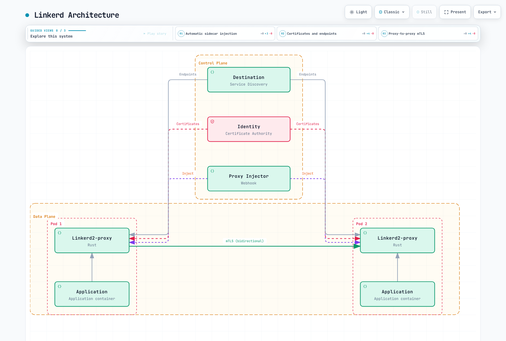

# Service Mesh ソリューション比較

> **最終更新**: September 11, 2026
> **API/artifact チェック**: Istio 1.31.0; Linkerd edge-26.9.1; Kong Mesh/Kuma 2.14.4; Consul/chart 2.0.4

artifact バージョンは、例を確認するために使用したソースを示します。これらは**共通の Kubernetes 互換性マトリクス**でも、デプロイ済みの本番システムの証拠でもありません。元の Istio 1.24/Linkerd 2.15/Kong Mesh 2.8/Consul 1.19 のパフォーマンス数値は、歴史的で未検証のステータスのまま以下に保持されています。

## 目次

1. [アーキテクチャ](#architecture)
2. [パフォーマンスの根拠](#performance-evidence)
3. [トラフィック管理](#traffic-management)
4. [セキュリティ](#security)
5. [可観測性](#observability)
6. [マルチクラスター](#multicluster)
7. [インストールと運用](#installation-and-operations)
8. [コストとライセンス](#cost-and-licensing)
9. [選定と検証](#selection-and-validation)

## アーキテクチャ {#architecture}

Service Mesh は、選択された通信機能をインフラストラクチャコンポーネントへ移します。トラフィックのインターセプトはアプリケーションコードに対して透過的に行えますが、プロトコル選択、トラフィックの所有権、workload identity、ポリシーには引き続き設定が必要です。分散トレーシングにもコンテキスト伝播および instrumentation が必要です。Mesh によって任意のアプリケーション再試行が安全になるわけではありません。


[インタラクティブな図を表示](https://www.atomai.click/kubernetes-docs/archmaps/en-service-mesh-istio-comparison-01-service-mesh-comparison-0.html)

この図は設定済みの sidecar デプロイメントを示しています。すべての機能がデフォルトで有効であること、または ambient/Cilium が同じ Pod ごとのトポロジーを使用することを主張するものではありません。

### Istio


[インタラクティブな図を表示](https://www.atomai.click/kubernetes-docs/archmaps/en-service-mesh-istio-comparison-01-service-mesh-comparison-2.html)

Istiod は、歴史的に Pilot、Citadel、Galley に関連付けられていた設定/検出および identity-management 機能を統合しています。これらの名前は、現在追加で 3 つの Deployment があることを示すものではありません。Sidecar data plane は Envoy を使用します。Ambient は L4 にノードごとの ztunnel を、対応する L7 処理に別個の Envoy waypoint を使用します。Ingress/egress gateway は、明示的に選択された境界パスを実装します。

Kubernetes と文書化された VM 統合は、ネットワークおよび trust の前提条件とともにサポートされています。Ambient core GA は sidecar との機能同等性を意味しません。waypoint ポリシーのアタッチ、EnvoyFilter サポート、マルチクラスターの成熟度は異なります。リソースや複雑さを見積もる前に、モードと必要な API 動作を選択してください。

### Linkerd



[インタラクティブな図を表示](https://www.atomai.click/kubernetes-docs/archmaps/en-service-mesh-istio-comparison-01-service-mesh-comparison-3.html)

Linkerd は専用の Rust proxy と Kubernetes resource、annotation、CRD を使用します。現在の機能には、Gateway API request routing、timeout/retry、route ごとの authorization、ローカル rate limiting が含まれます。これを annotation のみ、または「基本機能のみ」の Mesh と呼ぶのは不正確です。

非 Kubernetes の Mesh 拡張は、ExternalWorkload、外部マシン上の proxy、互換性のある SPIFFE/SPIRE identity、DNS、ネットワークアクセスを用いて文書化されています。これは「VM サポートなし」ではなく、外部 IP を登録しても proxy が自動的にインストールまたは認証されるわけではありません。

### Kong Mesh と Kuma


[インタラクティブな図を表示](https://www.atomai.click/kubernetes-docs/archmaps/en-service-mesh-istio-comparison-01-service-mesh-comparison-4.html)

Kong Mesh は Kuma を基盤としています。Kubernetes モードは Kubernetes resource/storage を使用します。Universal モードは VM/bare-metal 環境をサポートし、設定されたデータベースを使用します。Kong は self-hosted および managed-global-control-plane の選択肢を提供します。edition の機能とサポート条件は、upstream Kuma とは別に確認する必要があります。

マルチゾーンデプロイメントでは、global と zone control plane が KDS を介して resource を交換し、各 zone はローカル proxy に xDS を提供します。ゾーン間のデータトラフィックは、宛先 zone の ingress と、設定時にはローカル zone の egress を使用します。global control plane は Prometheus/tracing の自動集約バックエンドではありません。

Service の discovery だけでは、80% のローカル/20% のリモート分割は指定されません。legacy endpoint weighting と現在の MeshLoadBalancingStrategy locality 設定ではデフォルトが異なります。図の重みを固有の動作として扱うのではなく、選択したポリシー、対象となる endpoint、cross-zone/failover 設定を調べてください。

必要に応じて、MeshHTTPRoute、MeshTrafficPermission、MeshRetry、MeshTimeout、MeshMetric、MeshTrace、MeshAccessLog などの現在のポリシーを使用してください。TrafficRoute と TrafficPermission は legacy/deprecated インターフェースであり、確認したリリースで必ずしも削除済みの API ではありません。依存するポリシーをまとめて移行し、古い TrafficPermission と MeshTrafficPermission を組み合わせないでください。ポリシー型だけでは、「global」と「zone-only」の所有権または伝播は確立されません。

global-control-plane の障害では、既存のデータトラフィックは動作を継続できる一方、ポリシーおよびリモート Service の変更は伝播しなくなる可能性があります。zone-control-plane の障害では、新しい proxy、設定更新、証明書更新が妨げられる可能性があります。保持された設定は無期限の可用性保証ではありません。実際の障害条件で、登録、更新、draining、expiry を検証してください。

### Consul Service Mesh

Consul は、first-class の Envoy サポートとともに Service discovery、設定、identity 機能を提供します。現在の Kubernetes 統合では通常、consul-dataplane が sidecar を管理します。古い node ごとの client-agent の構図は、唯一の Kubernetes アーキテクチャでもデフォルトのアーキテクチャでもありません。

公式の proxy 概要では、開発/テスト向けの組み込み L4 proxy も説明され、本番での使用は推奨されていません。これを Envoy の本番 L7 機能セットと同等として示したり、リリースの根拠なしに削除済みと誤って説明したりしてはなりません。Consul は Kubernetes に加えて、文書化された VM およびその他の runtime 統合もサポートします。

### 同じ選定における Cilium

Cilium は eBPF network datapath と、L7 parsing/policy 向けの Envoy などの proxy を組み合わせます。完全に proxy 不要な L7 networking ではありません。Cilium 1.20.1 の out-of-band mutual authentication は Beta であり、out-of-band handshake を使用します。WireGuard/IPsec encryption は別途必要です。実際の機能および Cluster Mesh の制約については、[Cilium mesh guide](../../cilium-service-mesh/README.md) を参照してください。

Cilium 1.20.1 は、`encryption.type: ztunnel` で選択される別個の [ztunnel transparent-encryption beta](https://github.com/cilium/cilium/blob/v1.20.1/Documentation/security/network/encryption-ztunnel.rst) も提供します。これは namespace enrollment による TCP workload mTLS を提供し、両方の endpoint が enrollment されている必要があります。ClusterMesh および host-networked Pod は対象外で、リリース済みガイドでは、HBONE port 15008 を対象とする場合を除き、通常の L4 ポリシーはこのパスで機能しないと警告されています。これは独自の CA/bootstrap 要件を持つ別個のデプロイメント選択です。

## パフォーマンスの根拠 {#performance-evidence}

### 元の数値: 歴史的かつ未検証

以前の本文では、**3-node EKS 1.28、m5.xlarge、100-Service、1,000-RPS** のテストを説明し、Istio 1.24、Linkerd 2.15、Kong Mesh 2.8、Consul 1.19 を挙げていました。raw sample、再現可能な harness、正確な patch/proxy バージョン、出典 benchmark は提供されていません。これらの数値は現在の製品ランキングを確立できません。

| 元の項目 | p50 | p95 | p99 | CPU の主張 | メモリの主張 |
|---|---:|---:|---:|---:|---:|
| Baseline |0.1 ms|0.2 ms|0.3 ms|—|—|
| Linkerd |+0.5 ms|+0.8 ms|+1.2 ms|+3–8%|+20–50 MB|
| Istio |+1.0 ms|+2.5 ms|+3.5 ms|+5–15%|+50–150 MB|
| Kong Mesh |+0.8 ms|+2.0 ms|+3.0 ms|+5–12%|+40–120 MB|
| Consul |+1.0 ms|+2.5 ms|+3.5 ms|+6–14%|+50–140 MB|

元の control-plane 見積もりは、Istio が 0.5–1 CPU/1–2 GB、Linkerd が 0.1–0.3 CPU/200–500 MB、Kong が 0.2–0.5 CPU/500 MB–1 GB、Consul が 0.5–1 CPU/1–2 GB でした。proxy ごとの CPU 見積もりは Linkerd の 20–100m から Istio/Consul の 100–500m の範囲でした。これらは未検証の入力であり、デフォルト、測定値、容量推奨ではありません。Linkerd の異なるコンポーネントを数えることも、単一コンポーネントの replica を数えることと同等ではありません。

削除された throughput 図は、裏付けデータなしに、Linkerd が baseline throughput の 95–98%、Kong が 90–95%、Istio/Consul が 85–92% を維持したと主張していました。これは「Linkerd が最速」、固定リソース比率、最小 fleet サイズを正当化できません。

### 再現可能な比較

実際の製品/proxy/Kubernetes バージョン、hardware、完全な設定を結果に添付してください。トラフィックの protocol/payload/concurrency、TLS/authentication、ポリシー、telemetry、リソース制限を一致させます。absolute baseline と Mesh 適用後の latency distribution、定義された error/SLO limit での throughput、コンポーネントごとの CPU/memory、反復実行のばらつきを報告してください。

rollout、draining、connection reuse、欠落した telemetry、control-plane 喪失を含め、同等の HA と障害動作を比較します。raw error は、retry 後の client-visible outcome と分けて測定してください。実験を再実行して保持せずに、歴史的なバージョンラベルを更新してはいけません。

## トラフィック管理 {#traffic-management}

| 機能 | 具体的な比較項目 |
|---|---|
| Weighted/header routing | Istio VirtualService、Linkerd HTTPRoute、Kong MeshHTTPRoute、Consul router/splitter/resolver の動作 |
| Blue/Green または canary | route は一部にすぎません。rollout controller または deployment workflow が revision、analysis、reversal を管理する必要があります |
| Retry/timeout | サポートされる request/protocol 範囲、デフォルトポリシー、budget、アプリケーションの idempotency |
| Rate limiting | ローカルと共有 counter、identity、failure policy、実際の replica 範囲 |
| Fault/mirroring | サポートされる API/filter と観測された生成済み設定。mirrored write には副作用があり得ます |

Linkerd は、identity ごとの制限や request property による dynamic routing を含む、HTTPLocalRateLimitPolicy によるローカル rate limiting をサポートしています。proxy ごとのローカル制限は、グローバルな Service quota ではありません。Consul と Kong の機能は、選択した edition/API に依存する場合があります。大まかな「basic/enterprise/no」表では不十分です。

### 独立した読み取り専用ルーティング例

これらは 1 つの workload 上で controller を重複させるものではなく、**適切な Mesh における代替案**として使用してください。これらは、`mesh-demo` に既存の `reviews` Pod、実際の version label、9080 の HTTP listener、一致する Mesh enrollment があることを前提としています。この Service 形状は明示的な port を提供しますが、アプリケーションを作成するものではありません。

```yaml
apiVersion: v1
kind: Service
metadata:
  name: reviews
  namespace: mesh-demo
spec:
  selector:
    app: reviews
  ports:
  - name: http
    port: 9080
    targetPort: 9080
    appProtocol: http
---
apiVersion: v1
kind: Service
metadata:
  name: reviews-v1
  namespace: mesh-demo
spec:
  selector:
    app: reviews
    version: v1
  ports:
  - name: http
    port: 9080
    targetPort: 9080
    appProtocol: http
---
apiVersion: v1
kind: Service
metadata:
  name: reviews-v2
  namespace: mesh-demo
spec:
  selector:
    app: reviews
    version: v2
  ports:
  - name: http
    port: 9080
    targetPort: 9080
    appProtocol: http
```

以下の比較は、読み取り専用の review request に関するものです。write をルーティングする前に、継承された Mesh/client retry と idempotency を個別に監査してください。routing header は client が制御する入力であり、authentication ではありません。

#### Istio

```yaml
apiVersion: networking.istio.io/v1
kind: VirtualService
metadata:
  name: reviews
  namespace: mesh-demo
spec:
  hosts:
  - reviews
  http:
  - name: canary-header
    match:
    - headers:
        x-release:
          exact: canary
    route:
    - destination:
        host: reviews
        subset: v2
        port:
          number: 9080
      weight: 100
    retries:
      attempts: 0
  - name: weighted
    route:
    - destination:
        host: reviews
        subset: v1
        port:
          number: 9080
      weight: 90
    - destination:
        host: reviews
        subset: v2
        port:
          number: 9080
      weight: 10
    retries:
      attempts: 0
---
apiVersion: networking.istio.io/v1
kind: DestinationRule
metadata:
  name: reviews
  namespace: mesh-demo
spec:
  host: reviews
  subsets:
  - name: v1
    labels:
      version: v1
  - name: v2
    labels:
      version: v2
```

両方の route は Mesh retry を明示的に無効化しています。subset label は実際の endpoint と一致する必要があります。トラフィック重みは version を作成または scale しません。必要な場合、Gateway exposure には独自の host/TLS binding が必要です。

#### Linkerd

```yaml
apiVersion: gateway.networking.k8s.io/v1
kind: HTTPRoute
metadata:
  name: reviews-outbound
  namespace: mesh-demo
spec:
  parentRefs:
  - group: ''
    kind: Service
    name: reviews
    port: 9080
  rules:
  - matches:
    - headers:
      - name: x-release
        type: Exact
        value: canary
    backendRefs:
    - group: ''
      kind: Service
      name: reviews-v2
      port: 9080
      weight: 100
  - backendRefs:
    - group: ''
      kind: Service
      name: reviews-v1
      port: 9080
      weight: 90
    - group: ''
      kind: Service
      name: reviews-v2
      port: 9080
      weight: 10
```

この Gateway API producer route は Service にアタッチされ、Mesh 適用済みの**client**を設定します。core Service group は空文字列です。deprecated な SMI TrafficSplit extension は必要ありません。同じ Service に対して既存の ServiceProfile は outbound HTTPRoute より優先されます。この所有権を慎重に解決してください。依存する前に Accepted/ResolvedRefs と実際の routing を確認してください。

#### Kong Mesh

```yaml
apiVersion: kuma.io/v1alpha1
kind: MeshHTTPRoute
metadata:
  name: reviews-weighted
  namespace: mesh-demo
  labels:
    kuma.io/mesh: default
spec:
  targetRef:
    kind: Dataplane
    labels:
      app: productpage
  to:
  - targetRef:
      kind: MeshService
      name: reviews
      sectionName: http
    rules:
    - matches:
      - path:
          type: PathPrefix
          value: /
      default:
        backendRefs:
        - kind: MeshService
          name: reviews-v1
          port: 9080
          weight: 90
        - kind: MeshService
          name: reviews-v2
          port: 9080
          weight: 10
```

ここでの `reviews`、`reviews-v1`、`reviews-v2` は、実際の MeshService resource 名を表します。すべての生成名が Kubernetes Service 名と等しいという想定ではありません。インストール環境で名前、namespace/port section、backend readiness を解決してください。選択された呼び出し元 Dataplane は app label を持つ必要があり、HTTP Service port はサポートされる protocol を宣言する必要があります。この例は重みを変更するものであり、locality priority や capacity を変更するものではありません。

#### Consul

```yaml
apiVersion: consul.hashicorp.com/v1alpha1
kind: ServiceDefaults
metadata:
  name: reviews
  namespace: mesh-demo
spec:
  protocol: http
---
apiVersion: consul.hashicorp.com/v1alpha1
kind: ServiceResolver
metadata:
  name: reviews
  namespace: mesh-demo
spec:
  subsets:
    v1:
      filter: Service.Meta.version == v1
      onlyPassing: true
    v2:
      filter: Service.Meta.version == v2
      onlyPassing: true
---
apiVersion: consul.hashicorp.com/v1alpha1
kind: ServiceSplitter
metadata:
  name: reviews
  namespace: mesh-demo
spec:
  splits:
  - weight: 90
    service: reviews
    serviceSubset: v1
  - weight: 10
    service: reviews
    serviceSubset: v2
```

これらは Consul config entry の Kubernetes CRD 形式であり、設定済みの Consul controller/RBAC が必要です。Consul catalog 内の Service metadata には実際に `version=v1/v2` が含まれている必要があります。Kubernetes Pod label のみでは catalog metadata の証拠になりません。HTTP protocol と resolver subset が split 定義を完成させます。同じ config entry に複数の owner を適用するのではなく、Kubernetes-to-Consul namespace/Service mapping と健全な endpoint を確認してください。


## セキュリティ {#security}

暗号化、peer identity、caller authorization、アプリケーション authentication は別個の control です。enrolled proxy 間の自動 mTLS は、すべての unmeshed traffic が拒否されることや、すべての caller が認可されることを意味しません。

### Istio: Inbound mTLS と Request Authorization

```yaml
apiVersion: security.istio.io/v1
kind: PeerAuthentication
metadata:
  name: reviews-strict
  namespace: mesh-demo
spec:
  selector:
    matchLabels:
      app: reviews
  mtls:
    mode: STRICT
---
apiVersion: security.istio.io/v1
kind: AuthorizationPolicy
metadata:
  name: reviews-read
  namespace: mesh-demo
spec:
  selector:
    matchLabels:
      app: reviews
  action: ALLOW
  rules:
  - from:
    - source:
        principals:
        - cluster.local/ns/mesh-demo/sa/productpage
    to:
    - operation:
        methods:
        - GET
        paths:
        - /reviews/*
```

この sidecar 例には、実際の productpage ServiceAccount identity と reviews workload が必要です。Auto mTLS は適切な outbound transport を選択できます。包括的な `*.local` ISTIO_MUTUAL DestinationRule は必要ではなく、無関係な/plaintext destination を壊す可能性があります。STRICT は inbound enforcement であり、ALLOW policy は示された identity/method/path を制御します。

AuthorizationPolicy の文字列マッチングは、exact、prefix、suffix、presence のいずれかです。`*Mobile*` は一般的な substring-regex マッチではありません。User-Agent も workload identity ではありません。Ambient L7 attachment には、sidecar selector を変更せずにコピーするのではなく、サポートされる waypoint policy model が必要です。

### Linkerd: 明示的な Inbound Policy

```yaml
apiVersion: policy.linkerd.io/v1beta3
kind: Server
metadata:
  name: reviews-http
  namespace: mesh-demo
spec:
  podSelector:
    matchLabels:
      app: reviews
  port: 9080
  proxyProtocol: HTTP/1
  accessPolicy: deny
---
apiVersion: gateway.networking.k8s.io/v1
kind: HTTPRoute
metadata:
  name: reviews-read
  namespace: mesh-demo
spec:
  parentRefs:
  - group: policy.linkerd.io
    kind: Server
    name: reviews-http
  rules:
  - matches:
    - method: GET
      path:
        type: PathPrefix
        value: /reviews/
---
apiVersion: policy.linkerd.io/v1alpha1
kind: AuthorizationPolicy
metadata:
  name: reviews-read
  namespace: mesh-demo
spec:
  targetRef:
    group: gateway.networking.k8s.io
    kind: HTTPRoute
    name: reviews-read
  requiredAuthenticationRefs:
  - kind: ServiceAccount
    name: productpage
```

Server は実際に宣言された Pod port を選択し、ここではデフォルトで deny です。inbound HTTPRoute は `/reviews/` 配下の GET request を選択し、AuthorizationPolicy は productpage ServiceAccount を要求します。target API group は明示的です。group を省略した場合は、推論された Linkerd Server ではなく core group を意味します。欠落または誤った reference によって authorization grant が作成されることはありません。

確認した edge CRD は Server v1beta3 と v1beta1 を含む旧バージョンを提供しています。旧 API が削除されたとは主張されていません。選択した artifact でサポートされる API バージョンを使用してください。namespace/Pod のデフォルト `all-unauthenticated` policy は、Mesh 適用済み peer 間の自動暗号化とも、この明示的な Server policy とも異なります。

### Kong Mesh: 意図的な Permission による mTLS 有効化

基本インストールでは、すべての Service traffic が自動的に暗号化されるわけではありません。既存 workload で mTLS を有効にする前に permission を計画してください。一致する permission がなければ通信がブロックされる可能性があるためです。最小の Mesh 設定は次のとおりです。

```yaml
apiVersion: kuma.io/v1alpha1
kind: Mesh
metadata:
  name: default
spec:
  mtls:
    enabledBackend: ca-1
    backends:
    - name: ca-1
      type: builtin
```

制限された Service レベルの例:

```yaml
apiVersion: kuma.io/v1alpha1
kind: MeshTrafficPermission
metadata:
  name: productpage-to-reviews
  namespace: mesh-demo
  labels:
    kuma.io/mesh: default
spec:
  targetRef:
    kind: Dataplane
    labels:
      app: reviews
  from:
  - targetRef:
      kind: MeshSubset
      tags:
        kuma.io/service: productpage
    default:
      action: Allow
```

`productpage` は実際の source `kuma.io/service` identity tag に置き換え、target Dataplane label/namespace を確認してください。これは必ずしも素の Kubernetes Service 名と等しくありません。この permission は Service レベルの authorization であり、上記の Istio/Linkerd の GET/path rule と同等ではありません。legacy TrafficPermission と混在させないでください。本番 enforcement を変更する前に、必要な transport、identity、policy resource の準備が完了している必要があります。

### Consul: L7 Intentions

```yaml
apiVersion: consul.hashicorp.com/v1alpha1
kind: ServiceIntentions
metadata:
  name: reviews
  namespace: mesh-demo
spec:
  destination:
    name: reviews
  sources:
  - name: productpage
    permissions:
    - action: allow
      http:
        methods:
        - GET
        pathPrefix: /reviews/
```

Consul Service identity と HTTP protocol 設定は、catalog および実際の proxy と一致する必要があります。L7 permission は、「Consul には基本的な Service レベルの authorization しかない」が不正確である理由を示します。source の L4 action と L7 permission を、両方が個別に適用されるかのように組み合わせないでください。他の intention/default policy、namespace/partition、controller の mapping を確認してください。

Mesh config entry の TLS 最小バージョンは TLS 設定を変更します。アプリケーションを enrollment したり、proxy をインストールしたり、完全な CA/ACL 設定を作成したりするものではありません。Envoy extension と escape-hatch API にも、実際の Consul リリースの permission が必要です。2.0.4 リリースでは、code-executing extension に対する mesh:write 要件が厳格化されています。

## 可観測性 {#observability}

metric 数は有意な固定ランキングではありません。有効な stats、dimension、policy、scraping、アプリケーション instrumentation は、signal と overhead の両方に影響します。EnvoyFilter は無制限の telemetry extension API ではなく、すべての tracing backend が互換性のある protocol/exporter なしで交換可能なわけではありません。

| Mesh | 設定および検証する項目 |
|---|---|
| Istio | Telemetry API、実際の proxy/control-plane metric、access-log format、tracing provider と backend、任意の Kiali/Grafana 統合 |
| Linkerd | Proxy golden/per-route metric、選択した viz または外部 monitoring 設定、設定済みの proxy/application tracing |
| Kong Mesh | サポートされる backend を用いる MeshMetric、MeshTrace、MeshAccessLog、GUI/control-plane の可用性とアクセスは別途設定 |
| Consul | Proxy/agent metric、設定済み tracing、実際の endpoint/authentication 設定を持つ UI metric provider |

end-to-end trace では、アプリケーション呼び出しをまたいで context を伝播し、必要に応じて trace を開始/sample し、collector/backend 配信を設定してください。Linkerd はこれらの要件を明示的に文書化しています。proxy span だけでは完全な application trace ではありません。OpenTelemetry collector はサポートされる protocol を橋渡しできますが、その存在はすべての製品/backend 組み合わせの証明にはなりません。

関連コンポーネントがすでにインストールされ認可されている場合、有用な inspection command には次のものがあります。

```bash
istioctl dashboard kiali -n istio-system
linkerd viz check
linkerd viz stat deploy -n mesh-demo
linkerd viz dashboard
```

これらは dashboard や backend をインストールしません。Kiali の現在の設定と互換性は別途確認する必要があります。古い accessible_namespaces 例と legacy Istio bundled-addon 値は、現在のインストール手順ではありません。維持されている設定と検証上の制限については、[observability guide](../observability/README.md) を参照してください。Kong GUI は、空の Mesh metrics backend によって有効になるわけではなく、Consul UI metrics URL は実際の server 環境から解決できる必要があります。

## マルチクラスター {#multicluster}

| システム | Discovery/data path | 重要な境界 |
|---|---|---|
| Istio | 各 primary は認可された Kubernetes API を読み取り、cross-network traffic は設定済みの east-west gateway を使用 | remote secret は CRD をコピーせず、network/trust も確立しません。sidecar と ambient は異なるトポロジーをサポートします。 |
| Linkerd | ローカルで mirror された Service はリモート Service を記述し、hierarchical mode は**target** gateway を使用します。flat mode は直接 Pod path をサポート | mirror は source cluster にあります。source gateway が本質的に必要なわけではありません。Federated Service は flat model を使用し、headless member をサポートしません。 |
| Kong Mesh | KDS は zone/Service resource を交換し、destination zone ingress と任意の source zone egress が cross-zone traffic を担います | locality/failover 動作は適用可能なポリシーと対象 endpoint に由来します。固有の 80/20 分割や無条件の failover はありません。 |
| Consul | discovery および mesh-gateway path を伴う、サポート対象の cluster peering または WAN-federation model | 実際のトポロジーを選び、trust、export された Service、authorization、routing を設定してください。名前だけでは cluster は接続されません。 |


[インタラクティブな図を表示](https://www.atomai.click/kubernetes-docs/archmaps/en-service-mesh-istio-comparison-01-service-mesh-comparison-16.html)

元の「Linkerd は最大およそ 10 cluster」と一般的な「数十」の制限には、quota/load-test の出典がありませんでした。容量は実際の control/data-plane トポロジー、Service/endpoint 数、更新率、リソースに依存します。自動 Service discovery は、自動ポリシー複製や application/data disaster recovery ではありません。

両方向で remote API/gateway 到達可能性、certificate trust、DNS、namespace/Service identity、export された Service、障害動作を確認してください。meshID label と 1 つの secret を使った以前の 2 つの install command よりも、[maintained Istio multicluster guide](../advanced/02-multi-cluster.md) を推奨します。これらの command は完全な Mesh setup ではありませんでした。

## インストールと運用 {#installation-and-operations}

### バージョンは独立した入力

| 確認した source/artifact | 互換性の根拠と制限 |
|---|---|
| Istio 1.31.0 | Kubernetes 1.32–1.37 をサポート。実際の upgrade/skew rule と platform 要件に従ってください |
| Linkerd edge-26.9.1 CLI/CRD | Edge guidance はその artifact に属します。別途公開された **2.20** 表では Kubernetes 1.31–1.35 と Gateway API 1.2.1–1.5.1 を列挙しています。これらを後続のすべての edge/vendor build の自動的な境界として扱わないでください。 |
| Kong Mesh/chart 2.14.4 | Kuma 2.14.4 とともに September 3 にリリースされました。公開された Kubernetes validation table は現在 2.13 で止まっています。chart render から 2.14 の互換性認定は推論されません。support table には 2.13 LTS が別途記載されています。 |
| Consul/chart 2.0.4 | リリース済み application と Helm artifact を別々に確認しました。chart の Kubernetes minimum は metadata であり、完全なサポートバージョンマトリクスや upgrade 評価ではありません。 |

Gateway API CRD は controller 間で共有される cluster-wide dependency です。すべての consumer を確認せずに catalog の最新バージョンを無条件にインストールしたり、既存 bundle を downgrade したりしないでください。

### Istio Revision Handoff

インストール済みバージョンから、対応する CLI とサポートされた upgrade path を使用してください。この記事の歴史的な 1.24 label は、1.31 へ直接 jump する許可ではありません。レビュー済みの installation value、gateway/CNI 設定、revision ownership を保持してください。

例示的な default-profile input では、control-plane resource/HPA bound を設定できます。

```yaml
apiVersion: install.istio.io/v1alpha1
kind: IstioOperator
spec:
  profile: default
  components:
    pilot:
      k8s:
        hpaSpec:
          minReplicas: 3
          maxReplicas: 10
        resources:
          requests:
            cpu: 2000m
            memory: 4Gi
```

組み込みの `production` profile はありません。これらの CPU/memory/replica 数は sizing input であり、本番容量の保証ではありません。別の revision をインストールするだけでは、既存の proxy は upgrade されません。

```bash
istioctl install -f reviewed-istio.yaml --revision 1-31-0
kubectl label namespace mesh-demo istio-injection-
kubectl label namespace mesh-demo istio.io/rev=1-31-0 --overwrite
: "${DEPLOYMENT:?Set the actual staged Deployment name}"
kubectl rollout restart deployment/"$DEPLOYMENT" -n mesh-demo
kubectl rollout status deployment/"$DEPLOYMENT" -n mesh-demo
```

handoff 前に既存の namespace と Pod override を確認してください。legacy injection label は revision selection より優先される場合があります。意図した workload cohort のみを restart してください。gateway と ambient component には独自の upgrade procedure があります。canary revision は、すべての application rollout 中に error がゼロであることを保証しません。

### Linkerd のインストールと Upgrade

まず明示的な edge または vendor artifact と、それに互換性のある Gateway API を選択してください。現在の upstream CLI workflow:

```bash
linkerd check --pre
linkerd install --crds > linkerd-crds.yaml
kubectl apply -f linkerd-crds.yaml
linkerd install > linkerd-control-plane.yaml
kubectl apply -f linkerd-control-plane.yaml
linkerd check
```

これは lab 向けの CLI flow です。本番インストール guidance では、再現性とレビュー済みの identity 設定のために Helm が推奨されます。namespace に annotation を付与すると、新たに作成される Pod の injection は有効になりますが、稼働中の Pod に直ちに proxy が挿入されるわけではありません。選択したリリースの手順で CRD/control plane を upgrade し、その後 data-plane proxy を更新するために workload を意図的に roll してください。自動 workload rollout は暗黙されません。

### Kong および Consul Chart の Inspection

これらの command は、レビューのために確認済みの正確な chart を取得して render します。本番システムを deploy するものではありません。

```bash
helm repo add kong-mesh https://kong.github.io/kong-mesh-charts
helm repo add hashicorp https://helm.releases.hashicorp.com
helm repo update kong-mesh hashicorp
helm show values kong-mesh/kong-mesh --version 2.14.4 > kong-values.reference.yaml
helm show values hashicorp/consul --version 2.0.4 > consul-values.reference.yaml
helm template kong-mesh kong-mesh/kong-mesh --version 2.14.4   --namespace kong-mesh-system --include-crds --values reviewed-kong-values.yaml
helm template consul hashicorp/consul --version 2.0.4   --namespace consul --include-crds --values reviewed-consul-values.yaml
```

レビュー済みの values file は環境固有の input であり、この比較で提供される file ではありません。各製品の installation guide に従う前に、Kubernetes サポート、edition/license、CA/ACL/bootstrap identity、storage、HA、injector/controller 設定、upgrade note を確認してください。Helm render の成功は、runtime readiness も安全な in-place upgrade も証明しません。

### トラブルシューティング

```bash
istioctl proxy-status
istioctl analyze -n mesh-demo
istioctl proxy-config clusters "$POD" -n mesh-demo
linkerd check
linkerd viz stat deploy -n mesh-demo
kubectl get meshhttproutes,meshtrafficpermissions -n mesh-demo
kubectl get servicedefaults,serviceresolvers,servicesplitters -n mesh-demo
```

製品固有の command は、意図したインストール済み環境でのみ実行してください。すべての Consul sidecar に固定された歴史的 container 名があると想定せず、実際の component 名と log を調べてください。tap/debug log は request 情報を公開する可能性があります。一時的な diagnostic 設定の範囲を絞り、復元してください。すべての組織で 8 時間または 5 分の installation と主張するのではなく、実際の workflow におけるチームの作業を測定してください。


## コストとライセンス {#cost-and-licensing}

### 元のコスト入力は見積もりではない

元の 100-Pod/m5.xlarge 表では、$300 の baseline と以下の月次追加額が割り当てられていました。

| 元の製品入力 | Control-plane CPU/memory | Aggregate proxy CPU/memory | 以前の月次追加額 |
|---|---|---|---:|
| Linkerd |300m / 500 MB|2 vCPU / 5 GB|$50|
| Istio |1 vCPU / 2 GB|10 vCPU / 15 GB|$150|
| Kong Mesh |500m / 1 GB|8 vCPU / 12 GB|$120|
| Consul |1 vCPU / 2 GB|10 vCPU / 14 GB|$145|

これらの価格を裏付ける Region、node 数、稼働時間、purchase model、allocation formula、billing data はありませんでした。リソース request が自動的に fractional EC2 node を購入するわけではなく、解放された headroom が必ずしも請求額を減らすわけではありません。これらは以前の仮想的な入力としてのみ保持し、最も安価な製品を選ぶために使用しないでください。

以前の staffing 仮定は、Istio/Linkerd/Kong/Consul それぞれについて、初期 setup が 40/8/20/24 時間、月次 operation が 20/5/10/12 時間、月次 troubleshooting が 15/3/8/10 時間、四半期 upgrade が 8/2/4/5 時間でした。これらは測定されたチーム生産性ではなく、初期 setup は繰り返し発生する月次費用ではありません。

有意なコストモデルでは、実際に保持された capacity、HA と autoscaling の制約、load balancer/transfer、storage/telemetry、platform charge、support subscription、観測された engineering effort を使用します。同じ workload、security、availability 要件を比較し、すべての unit/rate/date を明記してください。ROI は裏付けられた差分と migration cost からのみ計算してください。

### Artifact と製品ライセンス

| コンポーネント | 維持すべき区別 |
|---|---|
| Istio | Apache ライセンスの upstream project。hosted/commercial distribution には独自の条件とコストがあります |
| Linkerd | Apache ライセンスの upstream project。upstream edge artifact と vendor stable distribution は異なる release/support 選択です |
| Kuma / Kong Mesh | upstream Kuma と商用 Kong Mesh 製品は別物です。選択する edition と support contract を検証してください |
| Consul | 確認した **Consul 2.0.4 application** のライセンスは、その記載された use grant および後の MPL 変更条件を持つ Business Source License 1.1 であり、単純に現在の MPL-2.0 ではありません |

Consul の Helm chart はその artifact に対して MPL ライセンスを示しますが、application binary のライセンスを上書きするものではありません。正確な artifact/version の条件を確認してください。Linkerd HA control-plane 設定は本質的に enterprise 専用機能ではありません。paid support/SLA と製品機能は upstream capability と区別する必要があります。1 つの vendor 名やドル記号のランキングから support を推論しないでください。

## 選定と検証 {#selection-and-validation}

| 状況 | 選択を決定する質問 |
|---|---|
| 大規模デプロイメント | どの正確な routing/security API、endpoint/update scale、HA 動作が必要ですか？ |
| 小規模チームまたは迅速な開始 | identity と upgrade を含め、チームが運用できる lifecycle と troubleshooting workflow はどれですか？ |
| リソース制約 | すべての proxy、waypoint、gateway、telemetry を含め、同等ポリシーの workload は実際に何を消費しますか？ |
| VM または legacy workload | 文書化された identity/network/runtime 統合は適合しますか？Istio と Linkerd にも VM 統合パスがあります。 |
| Multicloud または multicluster | どの trust、API、data-plane、policy distribution、disaster-recovery 境界が必要ですか？ |
| 強力な可観測性 | どの application/proxy signal、collector/exporter path、retention、access control が必要ですか？ |

Service ExternalName だけでは VM を Mesh に参加させず、proxy identity も作成しません。data-plane binary にはさらに、サポートされる registration、credential、network redirection、実際の control-plane connectivity が必要です。同様に、2 つの Istio installation で meshID/network string を設定しても、完全な multicluster 設計にはなりません。

実際の workload と必要なポリシーで範囲を限定した proof of concept を実施し、再現可能な測定値を保持し、障害/復旧をテストしてください。[comparison index](README.md) と [Istio versus VPC Lattice guide](02-istio-vs-lattice.md) は関連する選定基準を提供します。製品選択は Service 数、一般的な「最も多機能」という label、裏付けのない quick-ROI の主張では決まりません。

## 公式リファレンス

- [Istio architecture](https://istio.io/latest/docs/ops/deployment/architecture/) と [supported releases](https://istio.io/latest/docs/releases/supported-releases/)
- [Istio VM integration](https://istio.io/latest/docs/setup/install/virtual-machine/) と [multicluster](https://istio.io/latest/docs/setup/install/multicluster/)
- [Linkerd releases](https://linkerd.io/releases/)、[Kubernetes compatibility](https://linkerd.io/docs/reference/k8s-versions/)、[Gateway API compatibility](https://linkerd.io/docs/features/gateway-api/)
- [Linkerd request routing](https://linkerd.io/docs/features/request-routing/)、[HTTPRoute](https://linkerd.io/docs/reference/httproute/)、[authorization](https://linkerd.io/docs/reference/authorization-policy/)、[rate limiting](https://linkerd.io/docs/features/rate-limiting/)
- [Linkerd multicluster](https://linkerd.io/docs/features/multicluster/)、[VM expansion](https://linkerd.io/docs/tasks/adding-non-kubernetes-workloads/)、[tracing](https://linkerd.io/docs/features/distributed-tracing/)
- [Kong Mesh changelog](https://developer.konghq.com/mesh/changelog/)、[support](https://developer.konghq.com/mesh/support-policy/)、[validated versions](https://developer.konghq.com/mesh/version-compatibility/)
- [Kong MeshHTTPRoute](https://developer.konghq.com/mesh/policies/meshhttproute/)、[MeshTrafficPermission](https://developer.konghq.com/mesh/policies/meshtrafficpermission/)、[load-balancing policy](https://developer.konghq.com/mesh/policies/meshloadbalancingstrategy/)
- [Kong multi-zone deployment](https://developer.konghq.com/mesh/mesh-multizone-service-deployment/) と [installation](https://developer.konghq.com/mesh/deploy-mesh-self-managed/)
- [Consul proxies](https://developer.hashicorp.com/consul/docs/connect/proxy)、[service defaults](https://developer.hashicorp.com/consul/docs/reference/config-entry/service-defaults)、[resolver](https://developer.hashicorp.com/consul/docs/reference/config-entry/service-resolver)、[splitter](https://developer.hashicorp.com/consul/docs/reference/config-entry/service-splitter)、[intentions](https://developer.hashicorp.com/consul/docs/reference/config-entry/service-intentions)
- [Consul 2.0.4 application license](https://raw.githubusercontent.com/hashicorp/consul/v2.0.4/LICENSE)
- [このガイドの Istio architecture](../03-architecture.md)
