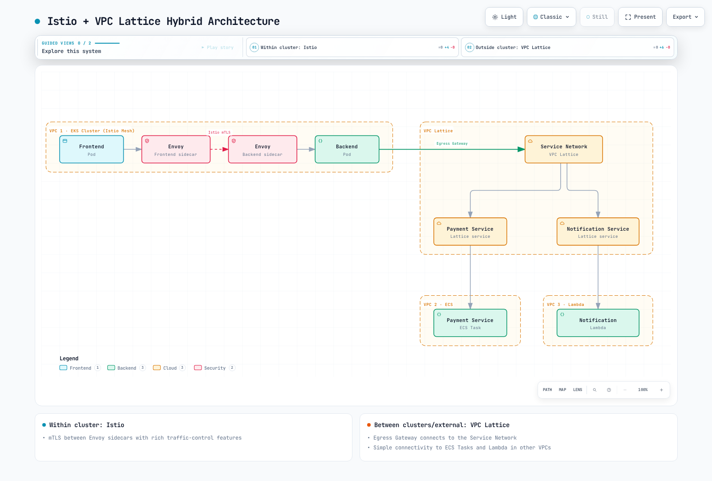

# Istio と VPC Lattice

> **最終更新**: September 11, 2026
> **Istio API ベースライン**: 1.31.0; Kubernetes 互換性は別途確認が必要です

アプリケーションの通信、identity、protocol、および運用要件を比較します。Istio と VPC Lattice は deployment と security の境界が異なります。機能比較表やサポートされない「overhead ゼロ」の主張だけでは、正しい architecture を選択できません。

設定例は、既存で認可済みの resource と実際の application endpoint を前提としています。これらは適切な環境向けの代替案であり、1 つに組み合わせた production deployment ではありません。identifier、role、namespace、identity-provider URL は意図して置き換える必要があります。監査では、AWS または cluster resource を deployment せずに、ローカルの設定/input 形式と計算を検証しました。

## 目次

1. [アーキテクチャとプラットフォーム](#architecture-and-platforms)
2. [トラフィック管理](#traffic-management)
3. [セキュリティと Identity](#security-and-identity)
4. [オブザーバビリティ](#observability)
5. [インストールと運用](#installation-and-operations)
6. [コストと履歴上の根拠](#cost-and-historical-evidence)
7. [ハイブリッドおよびマルチクラウド設計](#hybrid-and-multicloud-design)
8. [選定基準](#selection-criteria)

## アーキテクチャとプラットフォーム

### Istio

Istio は、Kubernetes と文書化された VM 統合を備えた deployment 可能な control/data plane を提供します。sidecar mode では、enroll 済み workload Pod 内の Envoy proxy を使用します。ambient では、node ごとの ztunnel に加え、サポートされる L7 処理用に別途 enroll された waypoint を使用します。sidecar を追加しても、別の application Pod ではなく **container** が追加されます。


[インタラクティブな図を表示](https://www.atomai.click/kubernetes-docs/archmaps/en-service-mesh-istio-comparison-02-istio-vs-lattice-0.html)

保持されている図は sidecar mode を示しています。その resource annotation は古い説明用の見積もりであり、計測済みの default や現在の capacity 推奨ではありません。Kiali は telemetry/backend を照会しますが、trace collector 自体ではありません。

ambient capture は、eBPF capture layer ではなく、文書化された Linux network-namespace/iptables の仕組みを使用します。ambient の core 機能は 1.24 で GA になりましたが、個々の機能と multicluster topology には別個の status があります。sidecar の削除、workload の enroll、waypoint 通過の必須化は別の操作です。namespace label だけでは、すべての workload を安全に移行したり、97–98% の節約を保証したりできません。

### VPC Lattice

VPC Lattice は、**service と resource** 向けの AWS-managed application networking です。その service model には、サポートされる IP/instance、Lambda、ALB target 向けの listener、rule、target group が含まれます。ECS/EKS integration は該当する target を管理します。resource configuration/resource gateway は、TCP connectivity を含む別の private resource-access model を提供します。

service network は論理的な association/access boundary であり、sidecar や Pod-level identity ではありません。client は service-network VPC association または service-network VPC endpoint を使用できます。endpoint path は PrivateLink によって提供されます。すべての Lattice data path や data plane 全体を単に「AWS PrivateLink」と表現するのは不正確です。

VPC association と endpoint association は address/connectivity の動作が異なります。service-network endpoint は、AWS 外の client を含め、peering、Transit Gateway、Direct Connect、VPN 経由で到着するサポート対象 traffic を受け入れられます。AWS service 自体は AWS で運用されます。これは Lattice を別の cloud に deployment することではありません。

| 観点 | Istio | VPC Lattice |
|---|---|---|
| Data plane | Sidecar または ambient component と、選択した gateway | Managed service/resource networking と設定済み target/endpoint |
| Identity | Workload mesh identity と設定済み application/JWT policy | 有効化時の Service IAM/SigV4 authorization。resource access には別個の control |
| 運用 | Control/proxy lifecycle、certificate、capacity、policy、telemetry | AWS が service を運用。ただし user は IAM、DNS、association、target、controller、quota、application を引き続き管理 |
| プラットフォーム | サポート対象 Kubernetes/VM deployment、mode 固有の要件 | サポート対象 AWS target type と文書化された client/network path |
| コスト | 実際の infrastructure、telemetry、support、engineering | 適用される service/resource/traffic charge と application infrastructure、log、engineering |

「required sidecar なし」は deployment の特性であり、latency、CPU、signing/controller 作業、または infrastructure 総コストがゼロである根拠ではありません。

## トラフィック管理

### 重み付きおよび条件付きルーティング

Istio は HTTP request property に一致させ、label 付き subset に route できます。backend Service と一致する v1/v2 workload は、`mesh-demo` にすでに存在している必要があります。

```yaml
apiVersion: networking.istio.io/v1
kind: VirtualService
metadata:
  name: backend-canary
  namespace: mesh-demo
spec:
  hosts:
  - backend
  http:
  - match:
    - headers:
        x-release:
          exact: canary
    route:
    - destination:
        host: backend
        port:
          number: 8080
        subset: v2
      weight: 100
    retries:
      attempts: 0
  - route:
    - destination:
        host: backend
        port:
          number: 8080
        subset: v1
      weight: 90
    - destination:
        host: backend
        port:
          number: 8080
        subset: v2
      weight: 10
    retries:
      attempts: 0
---
apiVersion: networking.istio.io/v1
kind: DestinationRule
metadata:
  name: backend
  namespace: mesh-demo
spec:
  host: backend
  trafficPolicy:
    loadBalancer:
      simple: LEAST_REQUEST
    connectionPool:
      tcp:
        maxConnections: 100
      http:
        http1MaxPendingRequests: 50
        http2MaxRequests: 100
        maxRequestsPerConnection: 2
    outlierDetection:
      consecutive5xxErrors: 5
      interval: 30s
      baseEjectionTime: 60s
      maxEjectionPercent: 50
      minHealthPercent: 50
  subsets:
  - name: v1
    labels:
      version: v1
  - name: v2
    labels:
      version: v2
```

route は mesh retry を明示的に無効にします。resource limit は説明用です。`maxRequestsPerConnection: 2` は意図して reuse を制限しており、一般的な performance 推奨ではありません。outlier detection は proxy が自身の upstream endpoint に対して評価します。`minHealthPercent` は panic/fail-open threshold であり、少なくともその割合が healthy のままである保証ではありません。

Lattice の HTTP/HTTPS listener rule は method、header、path matching をサポートします。この完全な **CreateRule input** は、以前の不足していた service/name と不正な pathMatch の例を置き換えます。

```json
{
  "serviceIdentifier": "svc-0123456789abcdef0",
  "listenerIdentifier": "listener-0123456789abcdef0",
  "name": "api-canary",
  "priority": 10,
  "match": {
    "httpMatch": {
      "method": "GET",
      "pathMatch": {
        "caseSensitive": true,
        "match": {
          "prefix": "/api/v1/"
        }
      }
    }
  },
  "action": {
    "forward": {
      "targetGroups": [
        {
          "targetGroupIdentifier": "tg-0123456789abcdef0",
          "weight": 90
        },
        {
          "targetGroupIdentifier": "tg-0123456789abcdef1",
          "weight": 10
        }
      ]
    }
  }
}
```

`rule.json` として保存し、identifier を既存の service/listener と 2 つの eligible target group に置き換え、作成前に rule 名と priority が未使用であることを確認します。

```bash
AWS_REGION=us-east-1
aws vpc-lattice create-rule --region "$AWS_REGION" --cli-input-json file://rule.json
```

数値 priority が小さいほど先に評価されます。ネストされた `pathMatch.match.prefix` 形式が必要です。表示した rule は `/api/v1/` 配下の GET に一致します。これはすべての Istio match や authentication policy の完全な同等物ではありません。weight は version を deployment または scale しません。AWS controller とこの CLI 例に、同じ rule/target の競合する ownership を持たせないでください。

Lattice は round-robin target selection を文書化しています。これは target group 間の weight とは別です。API は、この例で以前主張された「least connections」の選択を公開していません。

### ミラーリングと障害

隔離された read-only mirror 実験では、別の VirtualService を使用します。

```yaml
apiVersion: networking.istio.io/v1
kind: VirtualService
metadata:
  name: backend-mirror
  namespace: mesh-demo
spec:
  hosts:
  - backend
  http:
  - match:
    - method:
        exact: GET
      uri:
        prefix: /api/v1/
    route:
    - destination:
        host: backend
        port:
          number: 8080
        subset: v1
      weight: 100
    mirror:
      host: backend
      port:
        number: 8080
      subset: v2
    mirrorPercentage:
      value: 10
    retries:
      attempts: 0
  - route:
    - destination:
        host: backend
        port:
          number: 8080
        subset: v1
      weight: 100
    retries:
      attempts: 0
```

一致する GET request だけが mirror され、他の request は mirror なしで v1 に送られます。shadow response は primary client response ではありません。また endpoint が真に read-only でなければ、重複 request が side effect を作る可能性があります。destination version と capacity は存在している必要があります。

隔離された fault 実験では、意図的な request marker を使用できます。

```yaml
apiVersion: networking.istio.io/v1
kind: VirtualService
metadata:
  name: backend-fault-lab
  namespace: mesh-demo
spec:
  hosts:
  - backend
  http:
  - match:
    - method:
        exact: GET
      headers:
        x-fault-lab:
          exact: enabled
    fault:
      delay:
        percentage:
          value: 10
        fixedDelay: 5s
      abort:
        percentage:
          value: 5
        httpStatus: 503
    route:
    - destination:
        host: backend
        port:
          number: 8080
        subset: v1
      weight: 100
  - route:
    - destination:
        host: backend
        port:
          number: 8080
        subset: v1
      weight: 100
    retries:
      attempts: 0
```

marker は authorization ではありません。test workload と caller の scope を限定してください。同じ route の fault injection と retry/timeout の動作は互換な test ではありません。どの proxy が error を生成するかを観察し、生の outcome と retry 後の outcome を個別に測定します。

確認済みの Lattice RuleAction API は forwarding または fixed response を提供しますが、Istio 同等の mirror や割合 delay/abort action はありません。fixed response rule は割合 fault injection と同じではありません。application/proxy test mechanism またはサポートされる AWS FIS action には、それぞれ明示的な設計が必要です。「ALB + Lambda@Edge」は有効な built-in mirror 機能ではありません。Lambda@Edge は CloudFront event で実行されます。

### ヘルスチェックと障害処理

この **CreateTargetGroup input** は、既存の非 mesh HTTP backend と、指定 VPC 内の実際の `/health` endpoint を前提とします。security の例にある STRICT Istio backend ではありません。

```json
{
  "name": "backend-v1",
  "type": "IP",
  "config": {
    "port": 8080,
    "protocol": "HTTP",
    "protocolVersion": "HTTP1",
    "vpcIdentifier": "vpc-0123456789abcdef0",
    "ipAddressType": "IPV4",
    "healthCheck": {
      "enabled": true,
      "protocol": "HTTP",
      "protocolVersion": "HTTP1",
      "port": 8080,
      "path": "/health",
      "healthCheckIntervalSeconds": 30,
      "healthCheckTimeoutSeconds": 5,
      "healthyThresholdCount": 2,
      "unhealthyThresholdCount": 3,
      "matcher": {
        "httpCode": "200"
      }
    }
  }
}
```

```bash
aws vpc-lattice create-target-group --region "$AWS_REGION"   --cli-input-json file://target-group.json
```

file には、実際の値を含む表示済みの完全な input が必要です。health check は `healthCheckIntervalSeconds` と `healthCheckTimeoutSeconds` を伴い config 内に置きます。この operation に top-level の `--health-check` flag はありません。作成後に実際のサポート対象 target を register します。EKS Pod IP lifecycle は、恒久的な手書き Pod IP ではなく、通常は適切な AWS Gateway API Controller により管理されるべきです。

Lattice は自動的に healthy target を使用します。group 内のすべての target が unhealthy である場合、**fail open** してそれらに route します。単に手動削除を待つわけではありません。health check は application を修復しません。Lattice health routing は Istio の per-proxy connection-pool および outlier control とは異なります。

Service `idleTimeoutSeconds` は 60～600 秒で設定可能です。これは per-route request timeout や retry budget と同じ control ではありません。一般的な勝者を決めつけるのではなく、選択した HTTP、gRPC、TLS path の connection/request limit と failure behavior を test してください。

## セキュリティと Identity

### Istio: 意図する条件をまとめて要求する

```yaml
apiVersion: security.istio.io/v1
kind: PeerAuthentication
metadata:
  name: backend-strict
  namespace: mesh-demo
spec:
  selector:
    matchLabels:
      app: backend
  mtls:
    mode: STRICT
---
apiVersion: security.istio.io/v1
kind: RequestAuthentication
metadata:
  name: backend-jwt
  namespace: mesh-demo
spec:
  selector:
    matchLabels:
      app: backend
  jwtRules:
  - issuer: https://issuer.example.com
    jwksUri: https://issuer.example.com/.well-known/jwks.json
    audiences:
    - api.example.com
---
apiVersion: security.istio.io/v1
kind: AuthorizationPolicy
metadata:
  name: backend-access
  namespace: mesh-demo
spec:
  selector:
    matchLabels:
      app: backend
  action: ALLOW
  rules:
  - from:
    - source:
        principals:
        - cluster.local/ns/mesh-demo/sa/frontend
        requestPrincipals:
        - https://issuer.example.com/*
    to:
    - operation:
        methods:
        - GET
        - POST
        paths:
        - /api/v1/*
        ports:
        - '8080'
    when:
    - key: request.auth.claims[role]
      values:
      - admin
```

issuer/JWKS/audience は明示的な identity-provider placeholder であり、caller は実際の frontend ServiceAccount identity を持つ必要があります。**同一の ALLOW rule** は、mesh principal、その issuer の JWT principal、許可された method/path/port、admin claim をすべて要求します。個別の ALLOW policy は OR で結合されるため、両方の check をまとめて要求しません。RequestAuthentication 単独では JWT を要求せず、生の user-role header は認証済み identity ではありません。workload を対象とする他の ALLOW policy も確認してください。別の一致する grant が access を追加できるためです。

certificate rotation は issuer lifetime と proxy/CA 設定に従います。共通の 15 分 renewal interval はありません。external CA integration には、実際にサポートされる issuer path が必要です。port-level mTLS setting は workload port を参照し、proxy mode によって異なります。main application port 8080 を plaintext の「metrics exception」と label 付けすると、この security contract を壊す可能性があります。

### Lattice: TLS 境界と Service Authorization

この **CreateListener input** は、既存で ready な service と target group 向けに HTTPS termination を作成します。

```json
{
  "serviceIdentifier": "svc-0123456789abcdef0",
  "name": "https-main",
  "protocol": "HTTPS",
  "port": 443,
  "defaultAction": {
    "forward": {
      "targetGroups": [
        {
          "targetGroupIdentifier": "tg-0123456789abcdef0",
          "weight": 100
        }
      ]
    }
  }
}
```

```bash
aws vpc-lattice create-listener --region "$AWS_REGION" --cli-input-json file://listener.json
```

生成された service DNS name には AWS-managed certificate があります。custom domain には文書化された certificate/domain setup が必要です。front-end HTTPS は backend HTTPS や Istio SPIFFE mTLS を意味しません。target-group protocol は別の選択です。Lattice が target への HTTPS を確立する場合、文書化された動作では **target certificate を検証しません**。これを application-level peer-certificate authentication と表現しないでください。

TLS_PASSTHROUGH は、Lattice で termination せずに application 独自の TLS/mTLS を運べます。custom-domain/SNI と TCP-target 設定が必要で、default forwarding rule のみが許可され、connection は 10 分に制限され、anonymous auth-policy principal のみをサポートします。Lambda target はこの path でサポートされません。暗号化された stream に対する HTTP IAM/header policy inspection は提供しません。

### 正しい IAM Auth Policy

`vpc-lattice-svcs:Invoke`、service ARN と path、明示的に選択した role を使用します。service/network auth policy の例は次のとおりです。

```json
{
  "Version": "2012-10-17",
  "Statement": [
    {
      "Effect": "Allow",
      "Principal": {
        "AWS": "arn:aws:iam::123456789012:role/LatticeClient"
      },
      "Action": "vpc-lattice-svcs:Invoke",
      "Resource": "arn:aws:vpc-lattice:us-east-1:123456789012:service/svc-0123456789abcdef0/api/v1/*",
      "Condition": {
        "StringEquals": {
          "vpc-lattice-svcs:RequestMethod": [
            "GET",
            "POST"
          ]
        }
      }
    }
  ]
}
```

例の ARN を置き換えた後、auth policy を auth-policy.json として保存します。caller role には別途、対応する identity-based permission が必要です。

```json
{
  "Version": "2012-10-17",
  "Statement": [
    {
      "Effect": "Allow",
      "Action": "vpc-lattice-svcs:Invoke",
      "Resource": "arn:aws:vpc-lattice:us-east-1:123456789012:service/svc-0123456789abcdef0/api/v1/*",
      "Condition": {
        "StringEquals": {
          "vpc-lattice-svcs:RequestMethod": [
            "GET",
            "POST"
          ]
        }
      }
    }
  ]
}
```

例の ARN を置き換え、有効化されたすべての service-network および service auth policy が request を許可することを確認してください。どこかの explicit deny が優先されます。AWS_IAM は評価を有効化します。authType が NONE の間に attachment された policy は inactive です。Wildcard Principal と SourceVpc だけでは anonymous traffic を許可できるため、IAM authentication の証明にはなりません。

API operation は **PutAuthPolicy** です。埋め込み改行なしで complete CLI input 内の compact policy string を保持するには、次を使用します。

```bash
: "${SERVICE_ID:?Set the actual service ID}"
jq -n --arg resource "$SERVICE_ID" --slurpfile policy auth-policy.json   '{resourceIdentifier:$resource, policy:($policy[0] | tojson)}' > put-auth-policy.json
aws vpc-lattice put-auth-policy --region "$AWS_REGION"   --cli-input-json file://put-auth-policy.json
```

これは存在しない create-auth-policy/allowedPrincipals syntax を置き換えます。設定を適用する management role は、service を invoke する workload role とは異なります。application またはサポート対象 signing component は、文書化された SigV4 path と workload credential を使って実際の request に署名する必要があります。TLS setting だけでは signature は生成されません。署名済み request component への forwarding change は署名を無効にする可能性があります。保持するか、意図した transformation の後で署名してください。

Lattice authorization は L4/service name に限定されません。文書化された condition には、principal/VPC/service context に加えて method、path、header、query string が含まれます。protocol と anonymous caller の可用性は異なります。これらの service auth policy は、service network 内の resource configuration を対象にしません。

現在の WAF AssociateWebACL resource list には Lattice service/network は含まれません。サポート対象 WAF component は別途設計された path の一部になり得ますが、古い図の直接的な「Lattice WAF integration」という主張は正当化されません。IAM、WAF、network isolation、application authorization は別々の control のままです。


## オブザーバビリティ

### Istio Metrics と Trace

実際の metric family、label、1 つの reporter を使用します。example backend では、total RPS、5xx/zero-status fraction、ミリ秒単位の p95 latency を個別に query できます。

```promql
sum(rate(istio_requests_total{reporter="source",destination_service_name="backend",destination_service_namespace="mesh-demo"}[5m]))

(sum(rate(istio_requests_total{reporter="source",destination_service_name="backend",destination_service_namespace="mesh-demo",response_code=~"5..|0"}[5m])) or vector(0))
/
sum(rate(istio_requests_total{reporter="source",destination_service_name="backend",destination_service_namespace="mesh-demo"}[5m]))

histogram_quantile(0.95, sum by (le) (rate(istio_request_duration_milliseconds_bucket{reporter="source",destination_service_name="backend",destination_service_namespace="mesh-demo"}[5m])))
```

numerator fallback は、実際の traffic が存在する場合の 5xx series 不在を処理します。denominator がない場合は不在のままであり、idle traffic は health の根拠になりません。metric label と scrape scope を確認してください。proxy connection/outlier gauge と counter は別の Envoy family です。固定の「50 default metrics」数や共通の cache/retry 解釈を作り出さないでください。

現在の Telemetry configuration は metric override/tagOverrides と宣言済み tracing provider を使用します。

```yaml
apiVersion: install.istio.io/v1alpha1
kind: IstioOperator
spec:
  meshConfig:
    enableTracing: true
    extensionProviders:
    - name: otel-tracing
      opentelemetry:
        service: otel-collector.observability.svc.cluster.local
        port: 4317
---
apiVersion: telemetry.istio.io/v1
kind: Telemetry
metadata:
  name: backend-observability
  namespace: mesh-demo
spec:
  selector:
    matchLabels:
      app: backend
  metrics:
  - providers:
    - name: prometheus
    overrides:
    - match:
        metric: REQUEST_COUNT
      tagOverrides:
        request_method:
          value: request.method
  tracing:
  - providers:
    - name: otel-tracing
    randomSamplingPercentage: 10
    customTags:
      environment:
        literal:
          value: lab
```

IstioOperator object は、レビュー済みの既存 installation setting と merge する **istioctl への input** です。live Istio ConfigMap を上書きしたり、他の extension provider を破棄したりしないでください。Collector Service は 4317 で実際に OTLP gRPC を受け入れ、動作する backend/exporter pipeline を持つ必要があります。これらの object により install されるわけではありません。Telemetry の provider name は MeshConfig と一致する必要があります。

metric dimension の追加は、任意の business metric の作成と同じではありません。cardinality を制限し、必要に応じて application metric を収集し、互換性のある exemplar/tracing support を設定してください。end-to-end trace には application context propagation、sampling、collector/backend delivery が必要です。Istio の installation により「すべての backend」や automatic baggage propagation が保証されるわけではありません。

### VPC Lattice Metrics

文書化された CloudWatch namespace は、大文字小文字も含めて **AWS/VpcLattice** です。service dimension には Service と AvailabilityZone が、target-group dimension には TargetGroup と AvailabilityZone が含まれます。実際に発行された metric/dimension の組み合わせを discovery してください。

```bash
aws cloudwatch list-metrics --region "$AWS_REGION"   --namespace AWS/VpcLattice --metric-name TotalRequestCount
```

| 文書化された signal | 解釈 |
|---|---|
| TotalRequestCount | Request count。Sum が有用 |
| RequestTime | ミリ秒。文書化された service/target-group measurement boundary を伴う Average または percentile |
| HTTPCode_2XX_Count through HTTPCode_5XX_Count | 集計された HTTP response |
| HTTPCode_VpcLattice_403_Count and other documented granular codes | Lattice 生成 response。access-log reason と併せて有用 |
| Target-group connection metrics | Protocol 固有の connection count/error/byte。application request metric とは別 |

これらの metric は、resource が traffic を受け取った後に 1 分ごとに発行されます。5 分 query period は集計の選択です。この namespace に HealthyTargetCount や TargetResponseTime のような ALB metric name があると想定せず、target health には list-targets と health-check information を使用してください。

現在の 1 時間 query では、UTC timestamp を一度だけ生成します。この Bash/Python snippet は AWS を呼び出しません。

```bash
read -r START_TIME END_TIME START_EPOCH END_EPOCH < <(python3 - <<'PYTIME'
from datetime import datetime, timedelta, timezone
end = datetime.now(timezone.utc).replace(microsecond=0)
start = end - timedelta(hours=1)
print(start.strftime('%Y-%m-%dT%H:%M:%SZ'),
      end.strftime('%Y-%m-%dT%H:%M:%SZ'),
      int(start.timestamp()), int(end.timestamp()))
PYTIME
)
```

list-metrics から Service-only metric を選択し、その正確な Service dimension value を copy します。AZ 固有 metric を選択する場合は、AZ を落とすのではなく、返された完全な dimension set を含めます。

```bash
: "${SERVICE_DIMENSION:?Copy the exact Service dimension value from list-metrics}"
aws cloudwatch get-metric-statistics --region "$AWS_REGION"   --namespace AWS/VpcLattice --metric-name TotalRequestCount   --dimensions "Name=Service,Value=$SERVICE_DIMENSION"   --start-time "$START_TIME" --end-time "$END_TIME"   --period 60 --statistics Sum
```

missing metric は自動的に zero traffic や healthy service を意味しません。Lattice の AWS namespace には発行済み service metric が含まれます。application は別途 custom metric を発行したり、log metric を導出したりできます。したがって「custom metric は不可能」は有用な一般的主張ではありません。

### Access Log と Request Correlation

Lattice は access log を CloudWatch Logs、S3、Data Firehose に配信できます。delivery permission、destination policy、retention、charge を設定する必要があり、delivery latency は best effort です。これは文書化された field の**例示**であり、取得した production log ではありません。

```json
{
  "startTime": "2025-01-15T12:34:56Z",
  "serviceArn": "arn:aws:vpc-lattice:us-east-1:123456789012:service/svc-0123456789abcdef0",
  "requestMethod": "GET",
  "requestPath": "/api/v1/items",
  "protocol": "HTTP/1.1",
  "responseCode": 200,
  "duration": 12,
  "requestId": "example-request-001"
}
```

その他の文書化された field には authDeniedReason、failureReason、callerPrincipal/resolvedUser、target/source information があります。実際の log type を使用してください。resource-access log は別の TCP/resource path を示します。一般的な timestamp/requestProtocol/responseCodeDetails/requestHeaders/traceparent field を想定しないでください。

requestId は client が指定できる x-amzn-requestid と相関します。認証済み identity ではありません。application により propagate された W3C trace header は、保証された native log field や自動生成された distributed trace とは別です。application instrumentation は適切な tracing backend を使用でき、X-Ray に制限されません。

設定済み log group では、両方の time bound を使用し、query status/result を検査します。

```bash
: "${LATTICE_LOG_GROUP:?Set the configured CloudWatch log group}"
QUERY_ID=$(aws logs start-query --region "$AWS_REGION"   --log-group-name "$LATTICE_LOG_GROUP"   --start-time "$START_EPOCH" --end-time "$END_EPOCH"   --query-string 'fields @timestamp, requestId, requestMethod, requestPath, responseCode, authDeniedReason, failureReason | filter responseCode >= 500 | sort @timestamp desc | limit 20'   --query queryId --output text)
aws logs get-query-results --region "$AWS_REGION" --query-id "$QUERY_ID"
```

query は Scheduled または Running の可能性があります。直後の空の result は error が発生しなかった証明ではありません。調査対象に合わせて access と time range を絞ります。Kiali/Grafana または CloudWatch dashboard には、実際の data source と access configuration が必要です。dashboard 名は同等の可視性を証明しません。

## インストールと運用

### プラットフォームを選択して検証する

Istio 1.31 は Kubernetes 1.32–1.37 をサポートします。実際の managed platform と必要な proxy mode の共通部分を使用してください。built-in production profile はなく、古い istio.io/injection label は sidecar injection を有効にしません。現在の artifact、revision label、prerequisite については [installation guide](../01-installation.md) に従ってください。demo addon は production monitoring/HA stack ではありません。

Lattice では、service/resource model、実際の client association または endpoint path、target lifecycle、listener protocol、authentication boundary を定義します。service は Lambda function である必要はなく、mesh 化された EKS application は別途サポートされる integration を通じて Lambda を呼び出せます。Lambda 自体は Istio sidecar を host できません。これは EKS-plus-Lambda architecture すべてが Istio と互換性がないと宣言することとは異なります。

完全な service setup には、owner に適した順序で次が必要です。

1. 既存の network connectivity、DNS、security group、および認可済み management/client role。
2. service network と、意図した client VPC association または service-network endpoint。
3. service と network/service association、および意図した authentication mode。
4. target group、サポート対象 target registration、検証済み health behavior。
5. listener/rule と domain/certificate configuration。
6. 必要なすべての auth policy と caller identity permission、および authenticated request 用の動作する signer。
7. log/metric、実際の request/denial test、および resource lifecycle/cleanup plan。

上記の operation input はこの workflow の一部をカバーします。prerequisite を作成したり readiness を証明したりはしません。後続 operation の前に、asynchronous resource status と既存 ownership を確認してください。Kubernetes では、古い Pod-IP registration を維持する代わりに適切な controller を使用します。managed service update によって、controller、SDK、IAM、DNS、application compatibility の責任がなくなるわけではありません。

### Istio Upgrade と Ambient Enrollment

install 済み release からのサポート対象 upgrade path を使用し、レビュー済みの完全な values、trust、policy configuration を保持してください。古い 1.23→1.24 図は履歴上のものであり、現在の target ではありません。revision handoff は任意の minor version を飛ばす根拠にはなりません。

authoritative installation/GitOps configuration と関連 custom resource を backup します。`kubectl get all` はすべての object を含まず、完全に復元可能な backup ではありません。実際の namespace/revision/Pod override を調べ、workload cohort を段階的に導入し、readiness、traffic、certificate、telemetry を確認し、transition が受け入れられるまで rollback capacity を維持します。

すべての workload を force-restart したり、certificate error ごとに CA を再発行したり、routine cleanup として hard-coded shared webhook name を手動削除したりしないでください。すべての依存 proxy/gateway が移動したことを確認した後にのみ、release のサポート対象 retirement procedure を使用してください。control plane の削除は recovery option を変更します。rollback が永久に不可能であることの普遍的な証明ではありません。

ambient enrollment は application restart なしで sidecar-free workload を追加できますが、既存 sidecar の削除には workload replacement が必要です。ambient/CNI/ztunnel prerequisite と waypoint enrollment/security control は引き続き適用されます。Pod Ready count は常に 2/2 ではなく、native sidecar は initContainers の下に表現されることがあります。

### 実際の障害境界を診断する

| Layer | 選択した設計に関連する確認項目 |
|---|---|
| Application/target | Listening protocol/port、readiness、replica/endpoint、dependency、error |
| Mesh または Lattice routing | 実効 route、subset/target group、health/fail-open、timeout、resource status |
| Identity と policy | Certificate lifetime/trust、JWT または SigV4、適用されるすべての auth policy と IAM denial |
| Network/DNS | 正しい association/endpoint、route、security group/NetworkPolicy、実際の resolver path |
| Control/telemetry | Revision/controller state、API/config propagation、実際の metric、配信済み log |

Istio では proxy-status/config command と実際の workload log が有用です。proxy image に curl、tcpdump、shell が含まれると想定しないでください。必要な permission を持つサポート対象 debugging method を使用します。diagnostic archive を保護し、一時的な debug setting を復元してください。zero-replica backend は Deployment/endpoint の事実であり、Service.spec.replicas field ではありません。

Lattice では、次の read operation が実際の resource を調べます。

```bash
: "${SERVICE_NETWORK_ID:?Set the actual service-network ID}"
: "${TG_ID:?Set the actual target-group ID}"
aws vpc-lattice get-service --region "$AWS_REGION" --service-identifier "$SERVICE_ID"
aws vpc-lattice list-service-network-service-associations --region "$AWS_REGION"   --service-network-identifier "$SERVICE_NETWORK_ID"
aws vpc-lattice get-target-group --region "$AWS_REGION" --target-group-identifier "$TG_ID"
aws vpc-lattice list-targets --region "$AWS_REGION" --target-group-identifier "$TG_ID"
```

list-services は service-network filter を受け取りません。network analysis tool はサポート対象 network resource を調べます。Lattice service ID を EC2 network-insights destination として渡しても、完全な application/IAM diagnostic にはなりません。固定の 3-layer process、5 分 repair time、managed な「auto healing」の保証は、これらの command からは導かれません。


## コストと履歴上の根拠

### 同じコスト境界を比較する

同じ application、availability requirement、network traffic、logging/metrics retention、engineering scope を両側に含めます。Lattice は application の EC2/EKS/ECS/Lambda compute の料金を支払ったり除去したりしません。managed networking bill だけを、Istio application fleet 全体と staff を含むものと比較することはできません。

以前の例には、複数の異なる問題がありました。

- 合計 24.5 vCPU をモデル化していました: application 10 + sidecar 10 + Istiod 1 + Prometheus 2 + Jaeger 1 + Kiali 0.5。4 vCPU の m5.xlarge node 5 台では reservation 前に 20 vCPU しか提供されません。他の制約を考慮する前でも、理想的な CPU 下限は 7 node です。
- 英語の line item 合計は $850 compute + $15 storage = **$865** でしたが、韓国語テキストはサポートされない $10 の「latency/network」charge を加えて $875 としました。latency 自体は AWS billing unit ではありません。
- 元の Lattice の算術は $209 ×12 + $300 ×12 + $1,000 = **$7,108** であり、$7,608 ではありません。setup-plus-operations 額は $5,100 ではなく $4,600 でした。
- それらの古い仮定だけを使うと、$209/month の infrastructure と $300/month の operations を 5 年、setup を一度だけ含めた額は、setup を含む年額を 5 回繰り返すのではなく **$31,540** です。
- 韓国語の Istio 5 年数値は、その側だけに $50,000 の contingency を追加し、initial setup を繰り返し計上していました。これは一貫しない comparison boundary であり、製品固有の価格差の根拠ではありません。

古い $140/node-month、resource quantity、staffing estimate は、実証された quote や workload measurement のない仮説 input でした。Mi と MB も混同されていました。100 × 128 Mi は 12,800 Mi = 12.5 Gi であり、12.8 decimal GB ではありません。sidecar は Pod count を 2 倍にせず、解放された resource headroom が自動的に請求対象 node を削除するわけでもありません。

### 現在の日付付き Service Pricing 例

September 11, 2026 に確認した公式の US East (N. Virginia) service-pricing 例では、service-hour あたり $0.025、処理 GB あたり $0.025、文書化された per-service hourly allowance 後の request/connection charge が使用されています。service-network VPC association と service-network endpoint は追加料金なしと記載されています。resource configuration/resource endpoint には**異なる** pricing model があり、その $0.01/GB tier は service data-processing rate ではありません。この service-pricing model に古い別の service-network-hour charge を加えないでください。

明示的に仮説上の HTTP/HTTPS service workload については、次のとおりです。

| Input | 計算 | 月間 networking charge |
|---|---|---:|
| Five services, 730 hours each |5 ×730 ×$0.025|$91.25|
|これらの service における request/response を含む 10,000 billable GB |10,000 ×$0.025|$250.00|
|各 service が各時間で 300,000 request 以内に収まる |No requests above the hourly allowance|$0.00|
|記載 input の合計 |$91.25 +$250.00|**$341.25**|

その allowance を超える場合は、公開済みの $0.10/million rate を使用して service ごと、時間ごとに request charge を計算します。monthly-average RPS を使って burst-hour charge を消去しないでください。TLS-passthrough connection billing は別の counter です。すべての請求対象 service hop、実際の Region、application infrastructure、log、その他の関連 charge を含めます。これらは日付付きの説明用 input であり、quote、将来の価格保証、未計測の Istio fleet に対する節約の主張ではありません。

one-time setup/migration は recurring operation と分けてモデル化します。discounting、purchase commitment、予想 growth、不確実性、同等の HA/support requirement は multi-year comparison で重要です。以前の表から一般的な $42,000/year または $260,000/five-year の節約は確立されません。

### 履歴上の測定を正直に保持する

以前の performance section は Istio 1.24 context で **two-node EKS、m5.xlarge、1,000-RPS** test を主張しましたが、harness、raw sample、正確な EKS/patch/proxy version、対応する configuration は提供されませんでした。

| 元の未検証 result | Baseline | Istio 合計 | Lattice 合計 |
|---|---:|---:|---:|
| p50 |1.0 ms|2.0 ms|1.5 ms|
| p95 |2.5 ms|5.0 ms|3.7 ms|
| p99 |5.0 ms|8.5 ms|7.0 ms|
| Maximum RPS |10,000|8,500|9,200|
| CPU claim |100%|115%|102%|
| Memory claim |1 GB|1.5 GB|1.05 GB|

これらの値は、新しい 1.31 measurement ではなく、履歴上の未検証な主張です。sidecar の削除が latency/throughput 差全体を引き起こすことを証明しません。意味のある test は protocol、payload、TLS/authorization、placement、load、telemetry、failure behavior を一致させ、生の failure と retry で隠れた outcome を分離します。

元の匿名 customer story と、主張された re:Invent satisfaction survey には追跡可能な publication や methodology がありませんでした。migration、staffing、hybrid ownership に関する疑問を示唆することはできますが、測定済み success rate を示すことはできません。特定された **CNCF 2024 Annual Survey** は container challenge、project usage、service-mesh usage について尋ねています。主張された「40% Istio adoption failure」や列挙された failure-cause percentage を実証するものではありません。survey を引用する場合は、実際の question、sample、meaning を使用してください。

## ハイブリッドおよびマルチクラウド設計



[インタラクティブな図を表示](https://www.atomai.click/kubernetes-docs/archmaps/en-service-mesh-istio-comparison-02-istio-vs-lattice-17.html)

この図は高水準の option であり、完全な egress configuration ではありません。traffic が direct sidecar path を使うか、明示的に設定した egress gateway を使うかを決め、すべての TLS/identity boundary を定義してください。Lattice が STRICT backend への Istio SPIFFE mTLS を自動的に originate することはありません。意図的な ingress boundary は、意図した external path を authenticate し、downstream で mesh mTLS を使用できます。この場合 backend には元の IAM caller ではなく gateway identity が見えることがあります。

署名して HTTPS を開始する application では、payment.vpclattice.aws を作り出すのではなく、**実際の** Lattice service DNS name を discovery します。

```bash
aws vpc-lattice get-service --region "$AWS_REGION"   --service-identifier "$SERVICE_ID" > lattice-service.json
LATTICE_HOST=$(jq -er '.dnsEntry.domainName | select(type == "string" and length > 0)' lattice-service.json) || exit 1
jq -n --arg host "$LATTICE_HOST" '{
  apiVersion:"networking.istio.io/v1",kind:"ServiceEntry",
  metadata:{name:"payment-lattice",namespace:"mesh-demo"},
  spec:{hosts:[$host],location:"MESH_EXTERNAL",resolution:"DNS",
        ports:[{number:443,name:"https",protocol:"HTTPS"}]}
}' > lattice-service-entry.json
```

これは、workload の通常の configuration owner を通して review/apply する registry entry だけを作成します。Lattice を provision したり、egress-gateway traversal を強制したり、request に署名したり、IAM を bypass したりはしません。application HTTPS は sidecar には opaque であるため、HTTP VirtualService は以前の不完全な egress 例のように path を inspect できません。すでに暗号化された application stream の周囲に、別の SIMPLE TLS layer を追加しないでください。

service-network endpoint は、on-premises または他の接続済み network からサポート対象の entry path を提供できます。routing、DNS、security group、適用される service authorization が必要です。「AWS-operated」は AWS 外の client が分類上不可能であることを意味しません。また、global service network を作成したり、Region/cloud 間で application data を replicate したりするものでもありません。

migration では、API、identity、certificate trust、route、telemetry、recovery ownership を map します。namespace label の移動は、Lattice IAM から mesh identity への完全な変更ではありません。各固有の contract については、[VPC Lattice guide](../../../networking/02-vpc-lattice.md)、[AWS integration](../04-aws-integration.md)、[multicluster guide](../advanced/02-multi-cluster.md) を参照してください。

## 選定基準

| 要件 | 判断の根拠 |
|---|---|
| Kubernetes/VM workload mesh | 必要な sidecar/ambient 機能、platform support、identity lifecycle、計測済みの operating capacity |
| AWS service/resource connectivity | サポート対象 target/resource type、実際の client path、auth/TLS model、owner responsibility |
| Fine-grained traffic behavior | feature-star score ではなく、正確な rule/filter API、protocol limit、retry、health、failure behavior |
| Strong security | bypass path を含むすべての termination point にわたる end-to-end identity/encryption と application authorization |
| Small team または迅速な delivery | 作り出された最小 staffing や固定 install-time threshold ではなく、実際の team の反復可能な workflow と support plan |
| Cost と performance | 同等 scope の bill、再現可能な load/failure measurement、明示的に日付付けされた仮定 |
| Hybrid/multicloud | product 名だけでなく、test 済み network/identity boundary と application/data recovery |

実際の workload で、範囲を限定した proof of concept を評価し、根拠を保持してください。「Istio は常に高価/複雑」も「Lattice は常に安価/安全」も、architecture だけからは導かれません。

## 公式リファレンス

- [Istio supported releases](https://istio.io/latest/docs/releases/supported-releases/)、[ambient](https://istio.io/latest/docs/ambient/overview/)、[security](https://istio.io/latest/docs/concepts/security/)、[Telemetry API](https://istio.io/latest/docs/reference/config/telemetry/)
- [VPC Lattice components and responsibilities](https://docs.aws.amazon.com/vpc-lattice/latest/ug/what-is-vpc-lattice.html) と [network associations/endpoints](https://docs.aws.amazon.com/vpc-lattice/latest/ug/service-network-associations.html)
- [CreateRule](https://docs.aws.amazon.com/vpc-lattice/latest/APIReference/API_CreateRule.html)、[RuleAction](https://docs.aws.amazon.com/vpc-lattice/latest/APIReference/API_RuleAction.html)、[CreateListener](https://docs.aws.amazon.com/vpc-lattice/latest/APIReference/API_CreateListener.html)、[CreateTargetGroup](https://docs.aws.amazon.com/vpc-lattice/latest/APIReference/API_CreateTargetGroup.html)
- [Target groups](https://docs.aws.amazon.com/vpc-lattice/latest/ug/target-groups.html) と [health checks](https://docs.aws.amazon.com/vpc-lattice/latest/ug/target-group-health-checks.html)
- [HTTPS listeners](https://docs.aws.amazon.com/vpc-lattice/latest/ug/https-listeners.html) と [TLS passthrough](https://docs.aws.amazon.com/vpc-lattice/latest/ug/tls-listeners.html)
- [Auth policies](https://docs.aws.amazon.com/vpc-lattice/latest/ug/auth-policies.html)、[PutAuthPolicy](https://docs.aws.amazon.com/vpc-lattice/latest/APIReference/API_PutAuthPolicy.html)、[SigV4 requests](https://docs.aws.amazon.com/vpc-lattice/latest/ug/sigv4-authenticated-requests.html)
- [Lattice metrics](https://docs.aws.amazon.com/vpc-lattice/latest/ug/monitoring-cloudwatch.html) と [access logs](https://docs.aws.amazon.com/vpc-lattice/latest/ug/monitoring-access-logs.html)
- [Lattice pricing](https://aws.amazon.com/vpc/lattice/pricing/)、[WAF association API](https://docs.aws.amazon.com/waf/latest/APIReference/API_AssociateWebACL.html)、[Lambda@Edge](https://docs.aws.amazon.com/AmazonCloudFront/latest/DeveloperGuide/lambda-at-the-edge.html)
- [CNCF 2024 survey](https://www.cncf.io/reports/cncf-annual-survey-2024/) と [original report](https://www.cncf.io/wp-content/uploads/2025/04/cncf_annual_survey24_031225a.pdf)、特に questions 22、32、47（pages 12、16、22）
- [Service-mesh comparison](01-service-mesh-comparison.md)、[Istio architecture](../03-architecture.md)、[ambient guide](../advanced/01-ambient-mode.md)