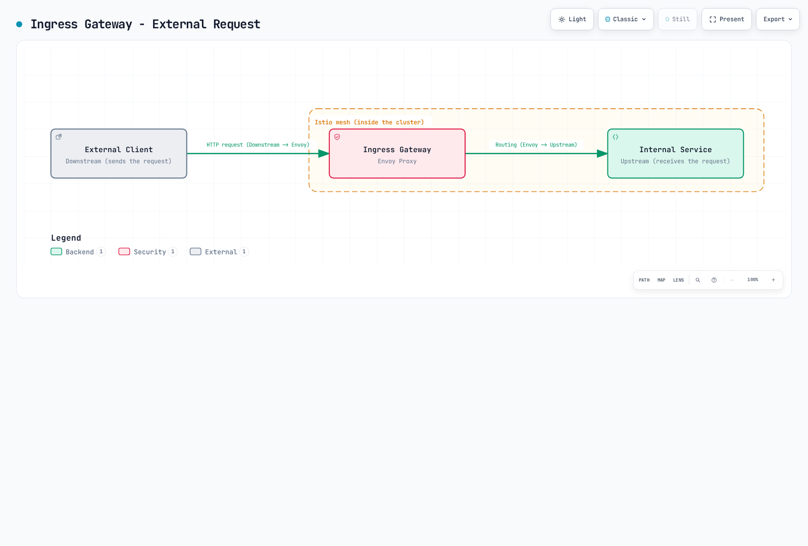
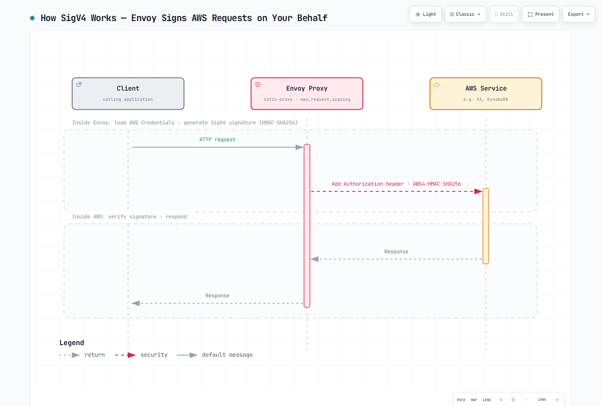

# Istio 用語集

> **レビュー済みバージョン**: Istio 1.31.0
> **最終更新**: October 12, 2026

この用語集では、Istio と Service Mesh に関連する主要な用語を、グループ化した参照セクションで整理しています。

> **参照言語:** 以下の Architecture および DestinationRule セクションのリンクでは、メンテナンスされている英語ガイドを使用しています。ロケール翻訳がまだ同期されていない場合、これらのリンクから最新の参照情報を確認できます。

## 目次

- [A-C](#a-c)
- [D-F](#d-f)
- [G-I](#g-i)
- [J-L](#j-l)
- [M-O](#m-o)
- [P-R](#p-r)
- [S-U](#s-u)
- [V-Z](#v-z)

---

## A-C

### AuthorizationPolicy

選択した workload または対象リソースに対し、ALLOW、DENY、CUSTOM、または AUDIT の動作を定義する Istio のセキュリティポリシーです。Authentication と authorization は別個のものであり、waypoint のポリシーでは targetRefs を使用します。

### Control Plane

istiod により実装される、設定、検出、アイデンティティ管理のレイヤーです。アプリケーションのペイロードは istiod ではなく Data Plane の proxy を通過します。

### Ambient Mode

Sidecar Proxy を使用せずに Service Mesh 機能を提供する Data Plane モードです。Istio 1.18 で alpha として初めて導入され、Istio 1.24 以降は一般提供されています。

**機能**:
- Sidecar container は不要
- node レベルで ztunnel を使用
- リソース効率の向上
- L4 と L7 機能の分離

**関連ドキュメント**: [Ambient Mode](advanced/01-ambient-mode.md)

---

### Certificate Authority (CA)

サービス間の mTLS 通信のために証明書を発行および管理する認証局です。

**Istio での役割**:
- Istiod の Citadel 機能が CA の役割を果たす
- SPIFFE ID に基づいて証明書を発行
- 証明書の自動更新（デフォルト TTL: 24 時間）

**関連用語**: [Citadel](#citadel), [SPIFFE](#spiffe-secure-production-identity-framework-for-everyone), [mTLS](#mtls-mutual-tls)

---

### Circuit Breaker

システム全体への障害伝播を防ぐため、障害が発生したサービスへのリクエストを遮断するパターンです。

**仕組み**:
1. **Closed**: 通常動作
2. **Open**: 連続した障害の後にリクエストを遮断
3. **Half-Open**: 一定時間後に一部のリクエストを許可

**Istio 実装**: Connection Pool の Circuit Breaker と endpoint ごとの outlier ejection では、この文字どおりの 3 状態マシンは公開されません。
```yaml
apiVersion: networking.istio.io/v1
kind: DestinationRule
metadata:
  name: glossary-example-1
spec:
  host: reviews
  trafficPolicy:
    outlierDetection:
      consecutive5xxErrors: 5
      interval: 30s
      baseEjectionTime: 30s
```

**関連ドキュメント**: [Circuit Breaker](traffic-management/07-circuit-breaker.md)

---

### Citadel

Istio 1.4 まで独立して存在していたセキュリティコンポーネントです。現在は Istiod に統合されています。

**主な機能**:
- Certificate Authority (CA) の管理
- SPIFFE ID の発行と管理
- X.509 証明書の生成と更新

**現在の状態**: Istio 1.5+ では Istiod 内の内部機能として存在

**関連用語**: [Istiod](#istiod), [Certificate Authority](#certificate-authority-ca)

---

### CDS (Cluster Discovery Service)

Envoy が upstream service（cluster）の設定を動的に受け取れるようにする xDS API の 1 つです。

**提供される情報**:
- Cluster 名とタイプ
- Load Balancing ポリシー
- Health Check 設定
- Circuit Breaker 設定
- TLS 設定

**関連用語**: [xDS](#xds-discovery-service), [Envoy](#envoy-proxy)

---

## D-F

### Data Plane

Service Mesh 内で実際のトラフィックを処理するレイヤーです。

**Istio の Data Plane**:
- Envoy Sidecar、または ambient の ztunnel と任意の L7 waypoint
- mesh に登録されたトラフィックを処理します。除外対象およびプロトコル上の制限が適用されます
- mTLS の暗号化/復号
- metric の収集

**関連用語**: [Control Plane](#control-plane), [Envoy](#envoy-proxy)

---

### DestinationRule

VirtualService によってルーティングされるトラフィックのポリシーを定義する Istio CRD です。

**主な機能**:
- Subset の定義（version、region など）
- Load Balancing ポリシー
- Connection Pool 設定
- Circuit Breaker 設定
- TLS 設定

```yaml
apiVersion: networking.istio.io/v1
kind: DestinationRule
metadata:
  name: reviews
spec:
  host: reviews
  subsets:
  - name: v1
    labels:
      version: v1
  - name: v2
    labels:
      version: v2
```

**関連ドキュメント**: [DestinationRule](traffic-management/03-destination-rule.md)

---

### eBPF (Extended Berkeley Packet Filter)

Linux kernel 内でプログラムを安全に実行できるようにする技術です。

Istio は、Cilium などの eBPF ベースの primary CNI と共存できます。Istio CNI はリダイレクトを設定する別個の chained plugin/node agent です。ambient は eBPF を必要とせず、primary CNI を置き換えません。

**利点**:
- 低オーバーヘッド
- kernel レベルの処理
- 動的なプログラミング機能

**関連用語**: [Ambient Mode](#ambient-mode), [iptables](#iptables)

---

### EDS (Endpoint Discovery Service)

cluster 内の実際の endpoint（Pod IP）を動的に提供する xDS API の 1 つです。

**提供される情報**:
- Endpoint IP アドレスと port
- Health Status
- Load Balancing の weight
- locality 情報

**例**:
```json
{
  "cluster_name": "outbound|9080||reviews",
  "endpoints": [
    {
      "lb_endpoints": [
        {"endpoint": {"address": {"socket_address": {"address": "10.244.1.5", "port_value": 9080}}}},
        {"endpoint": {"address": {"socket_address": {"address": "10.244.2.8", "port_value": 9080}}}}
      ]
    }
  ]
}
```

**関連用語**: [xDS](#xds-discovery-service), [CDS](#cds-cluster-discovery-service)

---

### Envoy Proxy

Istio の Data Plane を構成する高性能な L7 proxy です。

**沿革**:
- 2016 年に Lyft の Matt Klein が開発
- 2017 年に CNCF Incubating project へ
- 2018 年に CNCF Graduated project へ

**主な機能**:
- C++ で書かれた高性能 proxy
- xDS API による動的設定
- HTTP/1.1、HTTP/2、gRPC のサポート
- 豊富な observability

**コンポーネント**:
- Listener: Port の listen
- Filter: request/response の処理
- Router: routing の決定
- Cluster: upstream service

**関連ドキュメント**: [Architecture - Envoy Proxy](https://www.atomai.click/kubernetes-docs/en/service-mesh/istio/03-architecture#data-plane-envoy-proxy)

---

## G-I

### Galley

Istio 1.4 まで独立して存在していた設定検証コンポーネントです。現在は Istiod に統合されています。

**主な機能**:
- Istio 設定の検証
- Kubernetes resource の処理
- 設定デプロイ前のエラーチェック

**現在の状態**: Istio 1.5+ では Istiod 内の内部機能として存在

**関連用語**: [Istiod](#istiod)

---

### Gateway

Service Mesh に流入する外部トラフィックの entry point を定義する Istio CRD です。

**種類**:
1. **Ingress Gateway**: 外部から内部へのトラフィック
2. **Egress Gateway**: 内部から外部へのトラフィック

```yaml
apiVersion: networking.istio.io/v1
kind: Gateway
metadata:
  name: my-gateway
spec:
  selector:
    istio: ingressgateway
  servers:
  - port:
      number: 80
      name: http
      protocol: HTTP
    hosts:
    - "example.com"
```

**関連ドキュメント**: [Gateway and VirtualService](traffic-management/01-gateway-virtualservice.md)

---

### gRPC

Google が開発した高性能 RPC（Remote Procedure Call）framework です。

**Istio との関係**:
- xDS API は gRPC ベース
- Istiod から Envoy への通信に使用
- HTTP/2 ベース（multiplexing をサポート）

**利点**:
- 双方向 streaming
- 低レイテンシ
- Protocol Buffers を使用

**関連用語**: [xDS](#xds-discovery-service)

---

### Identity

Service Mesh 内における workload のアイデンティティを表します。

**Istio の Identity**:
- SPIFFE ID 形式を使用
- Kubernetes ServiceAccount に基づく
- X.509 証明書によって証明

**例**:
```
spiffe://cluster.local/ns/default/sa/reviews
```

**関連用語**: [SPIFFE](#spiffe-secure-production-identity-framework-for-everyone), [mTLS](#mtls-mutual-tls)

---

### iptables

Linux でネットワークトラフィックを制御する firewall tool です。

**Istio での役割**:
- istio-init または Istio CNI node agent がトラフィックのリダイレクトを設定
- すべての Pod トラフィックを Envoy にリダイレクト
- NAT table（PREROUTING、OUTPUT chain）を使用

**簡略化したルール（説明用であり、インストールスクリプトではありません）**:
```bash
# Outbound: All traffic except Envoy -> 15001
iptables -t nat -A OUTPUT -p tcp -m owner ! --uid-owner 1337 -j REDIRECT --to-port 15001

# Inbound: All traffic -> 15006
iptables -t nat -A PREROUTING -p tcp -j REDIRECT --to-port 15006
```

**セットアップの代替手段**: Istio CNI は node レベルで特権的なネットワークセットアップを実行します。

**関連ドキュメント**: [Architecture - iptables](https://www.atomai.click/kubernetes-docs/en/service-mesh/istio/03-architecture#iptables-and-traffic-interception)

---

### Istiod

Istio 1.5+ における統合された Control Plane コンポーネントです。

**統合された機能**:
- **Pilot**: Service Discovery、Traffic Management
- **Citadel**: Certificate Authority、Identity
- **Galley**: Configuration Validation

**実行方法**:
- 単一の Go binary: `pilot-discovery`
- すべての機能が単一 process 内で実行
- デフォルト port: 15012（xDS）、15017（Webhook）

**利点**:
- 複雑さの削減
- 運用の簡素化
- リソース効率

**関連ドキュメント**: [Architecture - Istiod](https://www.atomai.click/kubernetes-docs/en/service-mesh/istio/03-architecture#control-plane-istiod)

---

## J-L

### LDS (Listener Discovery Service)

Envoy が listen する port と filter chain を動的に受け取れるようにする xDS API の 1 つです。

**提供される情報**:
- Listener の address と port
- Protocol（HTTP、TCP）
- Filter chain 設定
- TLS 設定

**Istio のデフォルト Listener**:
- `0.0.0.0:15001`: outbound TCP
- `0.0.0.0:15006`: inbound TCP
- `0.0.0.0:15021`: Health Check
- `0.0.0.0:15090`: Prometheus metric

**関連用語**: [xDS](#xds-discovery-service), [Envoy](#envoy-proxy)

---

### Locality-aware Load Balancing

locality（Region、Zone）情報を考慮する Load Balancing 手法です。

**優先順位**:
1. 同じ Zone 内の endpoint
2. 同じ Region 内の異なる Zone
3. 異なる Region

**設定例**:
```yaml
apiVersion: networking.istio.io/v1
kind: DestinationRule
metadata:
  name: glossary-example-2
spec:
  host: reviews
  trafficPolicy:
    loadBalancer:
      localityLbSetting:
        enabled: true
        distribute:
        - from: us-west/zone-1a/*
          to:
            "us-west/zone-1a/*": 80
            "us-west/zone-1b/*": 20
```

**関連ドキュメント**: [Zone Aware Routing](resilience/03-zone-aware-routing.md)

---

## M-O

### Mixer

Istio 1.4 まで存在していた policy および telemetry コンポーネントです。

**主な機能**:
- policy enforcement（Rate Limiting、Access Control）
- telemetry の収集

**削除された理由**:
- パフォーマンスのオーバーヘッド（リクエストごとに Mixer 呼び出し）
- 複雑な architecture

**現在の状態**: 1.5 への移行中に非推奨となり、残っていた Mixer 機能は 1.8 で削除

**関連用語**: [Istiod](#istiod)

---

### mTLS (Mutual TLS)

client と server が相互に認証する双方向 TLS 通信方式です。

**Istio の mTLS**:
- 証明書の自動発行と更新
- SPIFFE ID ベースの authentication
- TLS cipher はネゴシエートされ、AES-256-GCM に固定されません

**モード**:
1. **STRICT**: mTLS のみ許可
2. **PERMISSIVE**: mTLS + plaintext を許可（移行用）
3. **DISABLE**: sidecar mode で Istio transport mTLS を無効化。ambient では未サポート

```yaml
apiVersion: security.istio.io/v1
kind: PeerAuthentication
metadata:
  name: default
spec:
  mtls:
    mode: STRICT
```

**関連ドキュメント**: [mTLS](security/01-mtls.md)

---

### Outlier Detection

異常な動作を示す endpoint を自動的に除外する機能です。

**検出条件**:
- 連続エラー数
- エラー率
- 接続障害/timeout。latency 単独は outlier ejection のしきい値ではありません

```yaml
apiVersion: networking.istio.io/v1
kind: DestinationRule
metadata:
  name: glossary-example-3
spec:
  host: reviews
  trafficPolicy:
    outlierDetection:
      consecutive5xxErrors: 5
      interval: 30s
      baseEjectionTime: 30s
      maxEjectionPercent: 50
```

**関連ドキュメント**: [Outlier Detection](resilience/01-outlier-detection.md)

---

## P-R

### Downstream

Envoy の観点では、**リクエストを送信する側**を指します。つまり、Envoy への接続を開始する client です。

**Envoy の Downstream**:
- Envoy に入ってくる connection（inbound）
- リクエストを送信する client
- Listener が受信する connection

**トラフィックフロー**:
```
Downstream (Client)  ->  Envoy Proxy  ->  Upstream (Backend)
```

**シナリオ例**:

#### 1. Sidecar Mode - Outbound Request


[🔍 インタラクティブな図を表示](https://www.atomai.click/kubernetes-docs/archmaps/en-service-mesh-istio-glossary-0.html)

**観点**:
- **Envoy の観点**: アプリケーションは Downstream（リクエストを送信）
- **Envoy の観点**: backend service は Upstream（リクエストを受信）

#### 2. Ingress Gateway - External Request



[🔍 インタラクティブな図を表示](https://www.atomai.click/kubernetes-docs/archmaps/en-service-mesh-istio-glossary-1.html)

**Downstream 関連の Envoy 設定**:

```yaml
# Listener - Receive Downstream connections
apiVersion: networking.istio.io/v1alpha3
kind: EnvoyFilter
metadata:
  name: downstream-config
  namespace: default
spec:
  workloadSelector:
    labels:
      app: reviews
  configPatches:
  - applyTo: LISTENER
    match:
      context: SIDECAR_INBOUND
    patch:
      operation: MERGE
      value:
        per_connection_buffer_limit_bytes: 32768  # Downstream buffer
```

**Downstream Metrics**:
```bash
# Downstream connection count
envoy_listener_downstream_cx_active

# Downstream request count
envoy_http_downstream_rq_total

# Downstream response time
envoy_http_downstream_rq_time
```

**関連用語**: [Upstream](#upstream), [Envoy](#envoy-proxy), [Listener](#lds-listener-discovery-service)

---

### Upstream

Envoy の観点では、**リクエストを受信する側**を指します。つまり、Envoy が接続を開始する backend service です。

**Envoy の Upstream**:
- Envoy から出ていく connection（outbound）
- リクエストを処理する backend service
- Cluster によって管理される endpoint

**トラフィックフロー**:
```
Downstream (Client)  ->  Envoy Proxy  ->  Upstream (Backend)
```

**Upstream コンポーネント**:

#### 1. Cluster (Upstream Group)

```yaml
# Define Upstream Cluster with DestinationRule
apiVersion: networking.istio.io/v1
kind: DestinationRule
metadata:
  name: reviews
spec:
  host: reviews  # Upstream service
  trafficPolicy:
    loadBalancer:
      simple: ROUND_ROBIN
    connectionPool:
      tcp:
        maxConnections: 100      # Upstream connection limit
      http:
        http1MaxPendingRequests: 50
        http2MaxRequests: 100
    outlierDetection:
      consecutive5xxErrors: 5        # Upstream failure detection
      interval: 30s
```

#### 2. Endpoint (Actual Upstream Instance)

```bash
# Check upstream endpoints
istioctl proxy-config endpoints <pod-name> | grep reviews

# Example output:
# ENDPOINT              STATUS      CLUSTER
# 10.244.1.5:9080       HEALTHY     outbound|9080||reviews.default.svc.cluster.local
# 10.244.2.8:9080       HEALTHY     outbound|9080||reviews.default.svc.cluster.local
# 10.244.3.12:9080      UNHEALTHY   outbound|9080||reviews.default.svc.cluster.local
```

**Upstream Traffic Policy**:

```yaml
apiVersion: networking.istio.io/v1
kind: DestinationRule
metadata:
  name: glossary-example-4
spec:
  host: reviews
  trafficPolicy:
    # Upstream load balancing
    loadBalancer:
      consistentHash:
        httpHeaderName: "x-user-id"

    # Upstream connection pool
    connectionPool:
      tcp:
        maxConnections: 100
        connectTimeout: 30s
      http:
        h2UpgradePolicy: UPGRADE

    # Upstream TLS
    tls:
      mode: ISTIO_MUTUAL

    # Upstream Circuit Breaker
    outlierDetection:
      consecutive5xxErrors: 5
      interval: 10s
      baseEjectionTime: 30s
```

**Upstream と Downstream の比較**:

| 項目 | Downstream | Upstream |
|------|-----------|----------|
| **方向** | Envoy に入る（Inbound） | Envoy から出る（Outbound） |
| **役割** | リクエストを送信（Client） | リクエストを受信（Server） |
| **Envoy 設定** | Listener、Filter Chain | Cluster、Endpoint |
| **例** | 外部ユーザー、他の service | Backend API、Database |
| **Metrics** | `downstream_cx_*`, `downstream_rq_*` | `upstream_cx_*`, `upstream_rq_*` |

**実際の使用例**:

#### シナリオ 1: Service A -> Service B Call

```
+---------------------------------------------------------+
| Service A Pod                                           |
|                                                         |
|  App --> Envoy Sidecar                                 |
|          |                                              |
|          | Downstream: App                              |
|          | Upstream: Service B                          |
+----------|-------------------------------------------------+
           |
           v
+---------------------------------------------------------+
| Service B Pod                                           |
|                                                         |
|          Envoy Sidecar --> App                          |
|          |                                              |
|          | Downstream: Service A Envoy                  |
|          | Upstream: Local App (Service B)              |
+---------------------------------------------------------+
```

**Service A の Envoy 観点**:
- Downstream: Service A の application
- Upstream: Service B

**Service B の Envoy 観点**:
- Downstream: Service A の Envoy
- Upstream: Service B の application（local）

#### シナリオ 2: Ingress Gateway

```
External Client (Downstream)
        |
Ingress Gateway (Envoy)
        |
Internal Service (Upstream)
```

**Upstream Metrics**:

```bash
# Upstream connection count
envoy_cluster_upstream_cx_active

# Upstream request counter; derive success/error rates from response-class counters
envoy_cluster_upstream_rq_total

# Upstream response time
envoy_cluster_upstream_rq_time

# Upstream health check
envoy_cluster_health_check_success

# Upstream Circuit Breaker
envoy_cluster_circuit_breakers_default_remaining_rq
```

**Passive Upstream Health Detection**: active Health Check の統計情報には別途設定が必要です。

```yaml
apiVersion: networking.istio.io/v1
kind: DestinationRule
metadata:
  name: glossary-example-5
spec:
  host: reviews
  trafficPolicy:
    outlierDetection:
      # Upstream health detection
      consecutiveGatewayErrors: 5
      consecutive5xxErrors: 5
      interval: 10s
      baseEjectionTime: 30s
      maxEjectionPercent: 50
```

**デバッグ**:

```bash
# 1. Check upstream cluster
istioctl proxy-config clusters <pod-name> --fqdn reviews.default.svc.cluster.local

# 2. Check upstream endpoint status
istioctl proxy-config endpoints <pod-name> --cluster "outbound|9080||reviews.default.svc.cluster.local"

# 3. Check upstream metrics
kubectl exec <pod-name> -c istio-proxy -- \
  curl -s localhost:15000/stats/prometheus | grep upstream

# 4. Check upstream connections
istioctl proxy-config all <pod-name> -o json | \
  jq '.configs[] | select(.["@type"] | contains("ClustersConfigDump"))'
```

**関連用語**: [Downstream](#downstream), [Envoy](#envoy-proxy), [Cluster](#cds-cluster-discovery-service), [Endpoint](#eds-endpoint-discovery-service)

---

### Pilot

Istio 1.4 まで独立して存在していた traffic management コンポーネントです。現在は Istiod に統合されています。

**主な機能**:
- Service Discovery
- Traffic Management（VirtualService、DestinationRule の処理）
- xDS Server

**現在の状態**: Istio 1.5+ では Istiod 内の内部機能として存在

**関連用語**: [Istiod](#istiod), [xDS](#xds-discovery-service)

---

### RDS (Route Discovery Service)

HTTP routing rule を動的に提供する xDS API の 1 つです。

**提供される情報**:
- Route の matching rule（path、header など）
- weight ベースの routing
- redirect および rewrite rule
- timeout および Retry 設定

**VirtualService との関係**:
- VirtualService -> Istiod により変換 -> RDS 設定

**関連用語**: [xDS](#xds-discovery-service), [VirtualService](#virtualservice)

---

### Rate Limiting

単位時間あたりに許可するリクエスト数を制限する機能です。

**実装方法**:
1. **Local Rate Limiting**: Envoy がローカルで処理
2. **Global Rate Limiting**: 外部の Rate Limit service を使用

```yaml
apiVersion: networking.istio.io/v1alpha3
kind: EnvoyFilter
metadata:
  name: filter-local-ratelimit
  namespace: default
spec:
  workloadSelector:
    labels:
      app: reviews
  configPatches:
  - applyTo: HTTP_FILTER
    match:
      context: SIDECAR_INBOUND
      listener:
        filterChain:
          filter:
            name: envoy.filters.network.http_connection_manager
            subFilter:
              name: envoy.filters.http.router
    patch:
      operation: INSERT_BEFORE
      value:
        name: envoy.filters.http.local_ratelimit
        typed_config:
          "@type": type.googleapis.com/envoy.extensions.filters.http.local_ratelimit.v3.LocalRateLimit
          stat_prefix: http_local_rate_limiter
          token_bucket:
            max_tokens: 100
            tokens_per_fill: 100
            fill_interval: 1s
          filter_enabled:
            default_value:
              numerator: 100
              denominator: HUNDRED
          filter_enforced:
            default_value:
              numerator: 100
              denominator: HUNDRED
```

**関連ドキュメント**: [Rate Limiting](resilience/02-rate-limiting.md)

---

## S-U

### SDS (Secret Discovery Service)

TLS 証明書と key を動的に提供する xDS API の 1 つです。

**提供される情報**:
- X.509 証明書
- Private Key
- CA Root Certificate

**利点**:
- file system が不要
- 証明書の自動更新
- ダウンタイムなしの更新

**関連用語**: [xDS](#xds-discovery-service), [mTLS](#mtls-mutual-tls)

---

### Service Entry

Service Mesh の外部にある service を mesh に登録する Istio CRD です。

**ユースケース**:
- 外部 API の access control
- 外部 service への Istio 機能の適用（Retry、Timeout など）
- Egress Gateway との統合

```yaml
apiVersion: networking.istio.io/v1
kind: ServiceEntry
metadata:
  name: external-api
spec:
  hosts:
  - api.external.com
  ports:
  - number: 443
    name: https
    protocol: HTTPS
  location: MESH_EXTERNAL
  resolution: DNS
```

**関連ドキュメント**: [ServiceEntry](traffic-management/12-service-entry.md)

---

### Service Mesh

microservice 間の通信を管理する infrastructure layer です。

**コア機能**:
- Traffic Management（routing、Load Balancing）
- Security（mTLS、authentication/authorization）
- Observability（metric、log、tracing）
- Resilience（Retry、Circuit Breaker）

**主な実装**:
- Istio
- Linkerd
- Consul Connect
- AWS App Mesh（[サポート終了: 2026 年 9 月 30 日](https://docs.aws.amazon.com/app-mesh/latest/userguide/what-is-app-mesh.html)）

---

### SigV4 (AWS Signature Version 4)

AWS API request を認証するための signature protocol です。

**仕組み**:



[🔍 インタラクティブな図を表示](https://www.atomai.click/kubernetes-docs/archmaps/en-service-mesh-istio-glossary-2.html)

**署名コンポーネント**:

1. **Canonical Request**: request の標準化された形式
   - HTTP method
   - URI path
   - Query string
   - Header
   - Payload hash

2. **String to Sign**: 署名対象の文字列
   - Algorithm: `AWS4-HMAC-SHA256`
   - Timestamp
   - Credential Scope
   - Canonical Request hash

3. **Signing Key**: signing key の計算
   ```
   HMAC(HMAC(HMAC(HMAC("AWS4" + SecretKey, Date), Region), Service), "aws4_request")
   ```

4. **Signature**: 最終的な署名
   ```
   HMAC(SigningKey, StringToSign)
   ```

**Istio との統合**:

AWS SDK と AWS CLI は、IRSA または EKS Pod Identity により供給される一時 credential を使用して HTTPS request に署名します。これにより、署名は workload の AWS permission と関連付けられた状態に維持されます。Istio mTLS identity と AWS IAM identity は別個です。

Envoy の `aws_request_signing` HTTP filter は高度な代替手段です。この filter には extension を含む Envoy build、**proxy container** から利用可能な credential、正しい AWS service/region、および意図した AWS destination に限定された filter match が必要です。署名に影響する header/path rewrite の後、router の前に挿入してください。application が生成した HTTPS はこの HTTP filter では暗号化された TLS 内部に署名を追加できないため、不透明です。proxy による署名の設計では、signing proxy に HTTP を提示し、upstream では検証済み TLS を開始する必要があります。二重の TLS origination や、意図した local proxy path を超えて署名されていない HTTP を公開することは避けてください。

上の図は、この明示的に設定された signing-proxy path を説明しており、デフォルトの Istio 機能ではありません。application ServiceAccount の IRSA annotation だけでは、gateway や sidecar に必要な credential environment と token mount があることは証明されません。

**Authentication は JWT validation ではありません**:

SigV4 は JWT ではなく HMAC request signature です。`https://sts.amazonaws.com/.well-known/jwks` は AWS API signature を検証する JWT issuer endpoint ではありません。Istio RequestAuthentication は実際の OIDC issuer が発行する JWT を検証します。CUSTOM AuthorizationPolicy には、external authorization を実装する設定済みの `extensionProviders` service が追加で必要です。その実装なしに SigV4 を検証することはできません。AWS API access には IAM authentication 済みの AWS endpoint または AWS SDK を優先してください。

**読み取り専用の検証例**（workload 内に AWS CLI がインストールされ、意図した IAM role が設定されている場合）:

```bash
aws sts get-caller-identity
aws s3api head-object --bucket my-bucket --key object.txt --region us-west-2
```

**運用上の考慮事項**:

- workload には必要な AWS action と resource のみを付与します。共有 node instance role への依存は避けてください。
- 選択した credential provider が temporary credential と refresh をサポートすることを確認します。session duration は設定可能であり、一律に 1 時間ではありません。
- CloudTrail management event と data event では coverage が異なります。S3 object access には適切な data-event 設定が必要です。
- proxy 設定を検査して filter の配置を確認します。config dump には個々の live request の Authorization header は表示されず、HTTPS 経由の署名なし curl は SigV4 test ではありません。
- 実際の request size に対する signing/buffering/credential-fetch のオーバーヘッドを測定します。固定のミリ秒単位のオーバーヘッドは保証されません。

**関連用語**: [AuthorizationPolicy](#authorizationpolicy), [ServiceEntry](#service-entry), [EnvoyFilter](advanced/03-envoy-filter.md)

**参考資料**:
- [AWS Signature Version 4](https://docs.aws.amazon.com/general/latest/gr/signature-version-4.html)
- [Envoy AWS Request Signing](https://www.envoyproxy.io/docs/envoy/latest/configuration/http/http_filters/aws_request_signing_filter)
- [AWS Integration](04-aws-integration.md)

---

### Sidecar

application container と並行してデプロイされる helper container のパターンです。

**Istio の Sidecar**:
- Container 名: `istio-proxy`
- Image: `istio/proxyv2`
- Envoy Proxy を実行
- init-container または Istio CNI のリダイレクトを通じて設定済みトラフィックを intercept

**Injection 方法**:
1. **自動**: Namespace label
2. **手動**: `istioctl kube-inject`

```yaml
apiVersion: v1
kind: Namespace
metadata:
  name: example-mesh
  labels:
    istio-injection: enabled  # Automatic injection
```

**関連ドキュメント**: [Sidecar Injection](advanced/07-sidecar-injection.md)

---

### Sidecar Resource

Envoy が受け取る service 情報を制限する Istio CRD です。

**目的**:
- memory 使用量の削減
- 設定 push 時間の短縮
- 設定のスコープ制限。network security boundary ではありません

```yaml
apiVersion: networking.istio.io/v1
kind: Sidecar
metadata:
  name: default
  namespace: default
spec:
  egress:
  - hosts:
    - "./*"  # Same namespace only
    - "istio-system/*"
```

**効果**:
- import する service を減らすと memory 使用量と設定処理を削減できる場合があります。実際の削減量を測定してください。

**関連ドキュメント**: [Architecture - Sidecar Resource](https://www.atomai.click/kubernetes-docs/en/service-mesh/istio/03-architecture#optimization-with-sidecar-resource)

---

### SPIFFE (Secure Production Identity Framework for Everyone)

cloud-native 環境で workload identity を証明するための標準です。

**SPIFFE ID 形式**:
```
spiffe://trust-domain/path
```

**Istio の例**:
```
spiffe://cluster.local/ns/default/sa/reviews
  |         |           |     |      |    |
  |         |           |     |      |    +- ServiceAccount name
  |         |           |     |      +----- "sa" (ServiceAccount)
  |         |           |     +------------ Namespace name
  |         |           +------------------ "ns" (Namespace)
  |         +------------------------------ Trust Domain
  +---------------------------------------- Protocol
```

**コンポーネント**:
- **SPIFFE ID**: workload identifier
- **SVID (SPIFFE Verifiable Identity Document)**: X.509-SVID または JWT-SVID。Istio mTLS は X.509-SVID を使用

**関連用語**: [Identity](#identity), [mTLS](#mtls-mutual-tls)

---

### Subset

DestinationRule で定義する service の論理グループです。

**一般的な用途**:
- version 別: `v1`、`v2`、`v3`
- deployment stage 別: `stable`、`canary`、`test`
- region 別: `us-west`、`us-east`、`eu-central`

```yaml
apiVersion: networking.istio.io/v1
kind: DestinationRule
metadata:
  name: glossary-example-6
spec:
  host: reviews
  subsets:
  - name: v1
    labels:
      version: v1
  - name: v2
    labels:
      version: v2
```

**関連ドキュメント**: [DestinationRule - Subset Concept](https://www.atomai.click/kubernetes-docs/en/service-mesh/istio/traffic-management/03-destination-rule#subset-concept)

---

## V-Z

### Waypoint Proxy

Ambient Mode で L7 機能を提供する任意の proxy です。

**役割**:
- Namespace、Service、または Pod label で選択され、ServiceAccount ごとに自動選択されるわけではありません
- Envoy Proxy に基づく
- L7 traffic management 機能専用
- ztunnel と連携

**提供される機能**:
- L7 routing（Path、Header ベース）
- Retry および Timeout
- Circuit Breaker
- Fault Injection
- Header manipulation

**デプロイ例**:
```yaml
apiVersion: gateway.networking.k8s.io/v1
kind: Gateway
metadata:
  name: reviews-waypoint
  namespace: default
spec:
  gatewayClassName: istio-waypoint
  listeners:
  - name: mesh
    port: 15008
    protocol: HBONE
```

**機能**:
- ztunnel は L4 のみを処理し、waypoint は L7 を処理
- 必要な service に対してのみ選択的に使用
- Sidecar よりリソース効率が高い（共有アプローチ）
- Namespace、Service、または Pod label で選択され、ServiceAccount ごとに自動選択されるわけではありません

**関連用語**: [Ambient Mode](#ambient-mode), [ztunnel](#ztunnel-zero-trust-tunnel)

---

waypoint の作成後、対象の service を登録します。例: `kubectl label service reviews istio.io/use-waypoint=reviews-waypoint --overwrite`。Gateway をデプロイするだけでは、トラフィックはそこを通ってルーティングされません。

### VirtualService

Service Mesh 内でトラフィックをどのようにルーティングするかを定義する Istio CRD です。

**主な機能**:
- URI、header、query parameter に基づく routing
- weight ベースのトラフィック分散
- Retry および Timeout 設定
- Fault Injection

```yaml
apiVersion: networking.istio.io/v1
kind: VirtualService
metadata:
  name: reviews
spec:
  hosts:
  - reviews
  http:
  - match:
    - uri:
        prefix: "/v2"
    route:
    - destination:
        host: reviews
        subset: v2
  - route:
    - destination:
        host: reviews
        subset: v1
```

**関連ドキュメント**: [Gateway and VirtualService](traffic-management/01-gateway-virtualservice.md)

---

### WASM (WebAssembly)

web browser で実行するために設計された binary instruction format です。Istio では、Envoy proxy の機能を拡張するために使用されます。

**Istio での使用**:
- Envoy Filter として custom logic を追加
- 再デプロイなしで機能を動的に拡張
- さまざまな言語（Rust、C++、Go など）で記述可能
- sandbox 環境で安全に実行

**主なユースケース**:
1. **Custom Authentication/Authorization**: 複雑な business logic を実装
2. **Request/Response Transformation**: Header manipulation、payload transformation
3. **Advanced Routing**: custom routing logic
4. **Metric Collection**: 特殊な telemetry

以下の registry URL、digest、credential、pluginConfig field は、独自に build した plugin 用の placeholder です。Istio はこれらの例の image を提供せず、plugin 固有の option を解釈しません。file:// module は proxy container 内に存在する必要があります。

**WASM Plugin の例**:
```yaml
apiVersion: extensions.istio.io/v1alpha1
kind: WasmPlugin
metadata:
  name: custom-auth
  namespace: istio-system
spec:
  selector:
    matchLabels:
      istio: ingressgateway
  url: oci://ghcr.io/my-org/custom-auth:v1.0.0
  phase: AUTHN
  pluginConfig:
    api_key_header: "X-API-Key"
    validate_endpoint: "https://auth.example.com/validate"
```

**デプロイ方法**:

#### 1. OCI Registry によるデプロイ（推奨）

```yaml
apiVersion: extensions.istio.io/v1alpha1
kind: WasmPlugin
metadata:
  name: rate-limiter
spec:
  url: oci://ghcr.io/my-org/rate-limit:v1.0.0
  imagePullPolicy: Always
  imagePullSecret: registry-credential
```

#### 2. HTTP URL によるデプロイ

```yaml
apiVersion: extensions.istio.io/v1alpha1
kind: WasmPlugin
metadata:
  name: custom-filter
spec:
  url: https://example.com/filters/custom-filter.wasm
  # Add sha256: with the actual 64-character module digest before deployment
```

#### 3. Local File のデプロイ

```yaml
apiVersion: extensions.istio.io/v1alpha1
kind: WasmPlugin
metadata:
  name: local-filter
spec:
  url: file:///etc/istio/filters/custom.wasm
```

**WASM 開発例（Rust）**:

```rust
use proxy_wasm::traits::*;
use proxy_wasm::types::*;

proxy_wasm::main! {{
    proxy_wasm::set_http_context(|_, _| -> Box<dyn HttpContext> {
        Box::new(CustomFilter)
    });
}}

struct CustomFilter;
impl Context for CustomFilter {}

impl HttpContext for CustomFilter {
    fn on_http_request_headers(&mut self, _: usize, _: bool) -> Action {
        // Demonstrate header mutation, not production API-key authentication.
        self.set_http_request_header("x-mesh-demo", Some("wasm"));
        Action::Continue
    }
}
```

**build とデプロイの前提条件**:

互換性のある `proxy-wasm` dependency と固定された dependency version を使う Rust `cdylib` crate を使用してください。上の callback は[公式 Rust SDK の例](https://github.com/proxy-wasm/proxy-wasm-rust-sdk/tree/main/examples/http_headers)に従っています。`wasm32-unknown-unknown` target をインストールし、module を build して、生成された `.wasm` をサポート対象の OCI Wasm image に package してから WasmPlugin で参照します。Dockerfile を指定しない汎用的な `docker build` では、その package は実行されません。

```bash
rustup target add wasm32-unknown-unknown
cargo build --target wasm32-unknown-unknown --release
```

特定の plugin について、startup time、memory、request ごとのオーバーヘッドを測定してください。Wasm は proxy process 内の runtime sandbox で実行されます。別 process ではなく、無条件の security/performance 保証でもありません。

**Ambient Mode のサポート**:

```yaml
apiVersion: extensions.istio.io/v1alpha1
kind: WasmPlugin
metadata:
  name: waypoint-filter
spec:
  targetRefs:
  - group: gateway.networking.k8s.io
    kind: Gateway
    name: reviews-waypoint
  url: oci://ghcr.io/filters/custom:latest
  phase: AUTHN
```

**デバッグ**:

```bash
# Check WASM plugin status
kubectl get wasmplugin -A

# Check WASM-related logs in Envoy logs
kubectl logs <pod-name> -c istio-proxy | grep wasm

# Check WASM module load
istioctl proxy-config all <pod-name> -o json | jq '.. | objects | select(has("@type")) | select(.["@type"] | test("wasm"; "i"))'
```

**セキュリティ上の考慮事項**:
1. **Sandbox Isolation**: Envoy 内の runtime sandbox。plugin の信頼性と resource 使用量をレビュー
2. **Resource Limits**: CPU と memory の limit を設定可能
3. **Integrity Verification**: SHA256 は content を検査しますが、publisher を認証するものではありません
4. **Least Privilege**: 必要な permission のみを付与

**利点**:
- 高性能（native code レベル）
- 安全な sandbox 実行
- 再デプロイなしで更新可能
- 複数言語のサポート
- 標準 OCI image format

**制限事項**:
- 一部の system call が制限される
- file I/O が限定的
- network call は Envoy API 経由のみ

**関連用語**: [Envoy](#envoy-proxy), [Waypoint Proxy](#waypoint-proxy), [Ambient Mode](#ambient-mode)

**参考資料**:
- [Istio WASM Plugin](https://istio.io/latest/docs/reference/config/proxy_extensions/wasm-plugin/)
- [Proxy-Wasm SDK](https://github.com/proxy-wasm)
- [WebAssembly Official Site](https://webassembly.org/)
- [Ambient Mode - WASM](https://istio.io/latest/docs/ambient/usage/extend-waypoint-wasm/)

---

### xDS (Discovery Service)

Envoy Proxy を動的に設定するための API 群です。

**「xDS」の意味**:
- `x`: さまざまな種類を表す変数
- `DS`: Discovery Service

**xDS API の種類**:

| API | 名前 | 役割 |
|-----|------|------|
| **LDS** | Listener Discovery Service | listen する port と filter chain |
| **RDS** | Route Discovery Service | HTTP routing rule |
| **CDS** | Cluster Discovery Service | upstream service 設定 |
| **EDS** | Endpoint Discovery Service | 実際の Pod IP 一覧 |
| **SDS** | Secret Discovery Service | TLS 証明書と key |

**通信方法**:
- Protocol: gRPC
- Port: 15012（Istiod）
- 双方向 streaming

**順序**:
```
Agent bootstraps identity -> Envoy subscribes to ADS resources
Istiod pushes LDS/CDS/EDS/RDS updates; local agent serves SDS certificates
```

**関連ドキュメント**: [Architecture - xDS API Communication](https://www.atomai.click/kubernetes-docs/en/service-mesh/istio/03-architecture#xds-api-communication)

---

### Zone

Kubernetes Availability Zone を表します。

**label 形式**:
```yaml
topology.kubernetes.io/zone: us-west-1a
```

**Istio での使用**:
- Locality-aware Load Balancing
- Zone Aware Routing
- 同一 Zone 優先 routing

**関連用語**: [Locality-aware Load Balancing](#locality-aware-load-balancing)

---

### ztunnel (Zero Trust Tunnel)

Ambient Mode の中核コンポーネントであり、node レベルで実行される軽量な L4 proxy です。

**役割**:
- 各 node に DaemonSet としてデプロイ
- すべての Pod の L4 トラフィックを処理
- Sidecar なしで Service Mesh 機能を提供
- CNI plugin と統合

**提供される機能**:
- **mTLS**: 自動暗号化/復号
- **L4 Telemetry**: metric の収集
- **Identity**: Service Account ベースの authentication
- **L4 Load Balancing**: 基本的な Load Balancing

**技術的特徴**:
- Rust で記述（高性能）
- Istio CNI 管理のトラフィックリダイレクト
- Init Container は不要
- 共有 L4 proxy resource。サイズは測定した node workload に基づいて決定

**デプロイ例**:
```bash
# Use the reviewed istioctl version and the complete ambient installation profile
istioctl install --set profile=ambient
kubectl rollout status daemonset/ztunnel -n istio-system
```

既存の sidecar workload では、ambient 登録前に injection/revision label を削除して Pod を再起動し、sidecar を削除します。新しい sidecar のない workload は再起動不要です。

**Namespace の有効化**:
```bash
# Enable Ambient Mode
kubectl label namespace default istio-injection- istio.io/rev-
kubectl label namespace default istio.io/dataplane-mode=ambient --overwrite
```

**利点**:
- memory 削減の可能性は node/workload と waypoint capacity に依存
- Pod の再起動は不要
- application の透過性
- 初期 latency の最小化

**制限事項**:
- L7 機能には Waypoint Proxy が必要
- サポートされる Linux Kubernetes platform、primary CNI、および Istio CNI の前提条件が必要

**関連用語**: [Ambient Mode](#ambient-mode), [Waypoint Proxy](#waypoint-proxy), [eBPF](#ebpf-extended-berkeley-packet-filter)

---

## 参考資料

### 公式ドキュメント
- [Istio Glossary](https://istio.io/latest/docs/reference/glossary/)
- [Envoy Terminology](https://www.envoyproxy.io/docs/envoy/latest/intro/arch_overview/intro/terminology)
- [SPIFFE Specification](https://github.com/spiffe/spiffe/tree/main/standards)

### 関連ドキュメント
- [Istio Architecture](03-architecture.md)
- [Traffic Management](traffic-management/README.md)
- [Security](security/README.md)
- [Observability](observability/README.md)

---

**最終更新**: September 13, 2026

- [Destination Rule](https://istio.io/latest/docs/reference/config/networking/destination-rule/)
- [Install the Istio CNI node agent](https://istio.io/latest/docs/setup/additional-setup/cni/)
- [Ztunnel traffic redirection](https://istio.io/latest/docs/ambient/architecture/traffic-redirection/)
- [Install with istioctl](https://istio.io/latest/docs/ambient/install/istioctl/)
- [Configure waypoint proxies](https://istio.io/latest/docs/ambient/usage/waypoint/)
- [Enabling Rate Limits using Envoy](https://istio.io/latest/docs/tasks/policy-enforcement/rate-limit/)
- [Wasm Plugin](https://istio.io/latest/docs/reference/config/proxy_extensions/wasm-plugin/)
- [Proxy-Wasm Rust SDK HTTP example](https://raw.githubusercontent.com/proxy-wasm/proxy-wasm-rust-sdk/main/examples/http_headers/src/lib.rs)
- [AWS Signature Version 4 for API requests - AWS Identity and Access Management](https://docs.aws.amazon.com/IAM/latest/UserGuide/reference_sigv.html)
- [AWS Request Signing](https://www.envoyproxy.io/docs/envoy/latest/configuration/http/http_filters/aws_request_signing_filter)
- [Statistics](https://www.envoyproxy.io/docs/envoy/latest/configuration/upstream/cluster_manager/cluster_stats)
- [Istio 1.8 Change Notes](https://istio.io/latest/news/releases/1.8.x/announcing-1.8/change-notes/)
- [What Is AWS App Mesh? - AWS App Mesh](https://docs.aws.amazon.com/app-mesh/latest/userguide/what-is-app-mesh.html)

- [CloudTrail data event coverage](https://docs.aws.amazon.com/awscloudtrail/latest/userguide/logging-data-events-with-cloudtrail.html)
