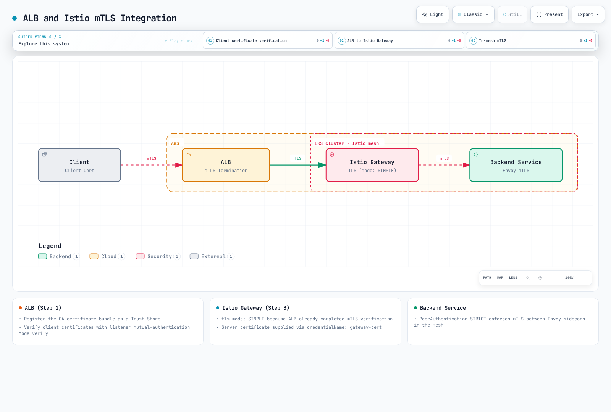

# mTLS

相互TLS（mTLS）は、サービス間通信を自動的に暗号化して認証する Istio の中核的なセキュリティ機能です。

## 目次

1. [mTLS の概要](#mtls-overview)
2. [mTLS のモード](#mtls-modes)
3. [証明書管理](#certificate-management)
4. [PeerAuthentication の設定](#peerauthentication-configuration)
5. [AWS サービスとの mTLS 統合](#mtls-integration-with-aws-services)
6. [外部サービスとの mTLS](#mtls-with-external-services)
7. [移行戦略](#migration-strategy)
8. [よくある問題と解決策](#common-issues-and-solutions)
9. [パフォーマンスと監視](#performance-and-monitoring)

## mTLS の概要 {#mtls-overview}

<p align="center">
  
</p>

自動 mTLS は、互換性のあるメッシュ内のピアに対して TLS を選択します。サイドカーモードでは、受信側プロキシで平文通信を拒否する `STRICT` と、ID に基づいてアクセスを制限する AuthorizationPolicy を使います。自動 mTLS だけでは完全なゼロトラストポリシーにはなりません。以下の ID フローはサイドカーを説明しています。ambient モードでは ztunnel と、必要に応じて waypoint を使います。

### ID に基づくセキュリティ

Istio は **SPIFFE（Secure Production Identity Framework for Everyone）** 標準を使い、各ワークロードに強固な ID を割り当てます。

```
spiffe://cluster.local/ns/default/sa/productpage
  |         |           |     |      |    |
  |         |           |     |      |    +- ServiceAccount name
  |         |           |     |      +----- "sa" (ServiceAccount)
  |         |           |     +------------ Namespace name
  |         |           +------------------ "ns" (Namespace)
  |         +------------------------------ Trust Domain
  +---------------------------------------- Protocol
```

**ID のプロビジョニング手順**:
1. Kubernetes が Pod を作成し、ServiceAccount を割り当てる
2. Istio Agent が Pod 内で起動する
3. Agent が CSR（Certificate Signing Request）を Istiod に送信する
4. Istiod が SPIFFE ID に基づいて X.509 証明書を発行する
5. Agent が証明書を Envoy に配布する（SDS プロトコル）
6. 証明書は自動更新される（デフォルト TTL: 24 時間）


[🔍 インタラクティブ図を表示](https://www.atomai.click/kubernetes-docs/archmaps/en-service-mesh-istio-security-01-mtls-0.html)

## mTLS のモード {#mtls-modes}

以下の例はそれぞれ別の選択肢です。メッシュルート名前空間（通常は `istio-system`）にセレクターなしのポリシーを置くと、メッシュ全体に適用されます。ambient は捕捉したメッシュトラフィックを HBONE で暗号化します。ambient では `DISABLE` はサポートされず、`STRICT` は迂回したトラフィックを拒否します。

### STRICT モード（推奨）

```yaml
apiVersion: security.istio.io/v1
kind: PeerAuthentication
metadata:
  name: default
  namespace: istio-system
spec:
  mtls:
    mode: STRICT  # Only mTLS allowed
```

### PERMISSIVE モード（移行用）

```yaml
apiVersion: security.istio.io/v1
kind: PeerAuthentication
metadata:
  name: default
  namespace: default
spec:
  mtls:
    mode: PERMISSIVE  # Both mTLS and plaintext allowed
```

### DISABLE モード

```yaml
apiVersion: security.istio.io/v1
kind: PeerAuthentication
metadata:
  name: disable-mtls
  namespace: default
spec:
  mtls:
    mode: DISABLE  # mTLS disabled
```

## 証明書管理 {#certificate-management}

### Istio のデフォルト CA 証明書

デフォルトでは istiod が自己署名ルート CA を作成し、それを使ってワークロード証明書に直接署名します。オフラインのルート CA と別の中間署名 CA を使う構成は、本番環境で選べる方式であり、デフォルトで自動作成される階層ではありません。

Agent はデフォルトで有効期間 **24 時間**のワークロード証明書を要求し、有効期間のおよそ半分を目安にジッターを加えて更新を予定します。CA は要求された有効期間を短縮することがあります。ルート証明書と中間証明書のライフサイクルは別々です。発行済み証明書を調べ、実際のアルゴリズムと有効期間を確認してください。

### 証明書の確認

```bash
# 1. Check CA certificate
kubectl get secret istio-ca-secret -n istio-system -o jsonpath='{.data.ca-cert\.pem}' | \
  base64 -d | openssl x509 -noout -issuer -subject -dates

# 2. Check workload certificate
istioctl proxy-config secret <pod-name> -n <namespace>

# 3. Certificate details
istioctl proxy-config secret <pod-name> -n <namespace> -o json | \
  jq -r '.dynamicActiveSecrets[] | select(.secret.name == "default") | .secret.tlsCertificate.certificateChain.inlineBytes' | \
  base64 -d | openssl x509 -text -noout

# 4. Check certificate expiration date
istioctl proxy-config secret <pod-name> -n <namespace> -o json | \
  jq -r '.dynamicActiveSecrets[] | select(.secret.name == "default") | .secret.tlsCertificate.certificateChain.inlineBytes' | \
  base64 -d | openssl x509 -noout -dates
```

### カスタム CA 証明書を使う

SPIFFE URI SAN を発行できるプライベート PKI を使います。公開 ACME 証明書はワークロード ID には適しません。この OpenSSL 例は新しいテスト用メッシュを初期化します。istiod をインストールする前に `istio-system` と `cacerts` を作成してください。本番環境ではルート鍵をオフラインで保護します。

#### 手順 1: CA 証明書と鍵を生成する

```bash
# 1. Generate Root CA
umask 077
openssl genrsa -out root-key.pem 4096

openssl req -new -x509 -days 3650 -key root-key.pem \
  -out root-cert.pem -addext "basicConstraints=critical,CA:TRUE" \
  -subj "/C=US/ST=California/L=San Francisco/O=MyOrg/OU=IT/CN=Root CA"

# 2. Generate Intermediate CA
openssl genrsa -out ca-key.pem 4096

openssl req -new -key ca-key.pem -out ca-cert.csr \
  -subj "/C=US/ST=California/L=San Francisco/O=MyOrg/OU=IT/CN=Intermediate CA"

# 3. Sign Intermediate CA with Root CA
cat > ca-extensions.txt <<EOF
basicConstraints=critical,CA:TRUE,pathlen:0
keyUsage=critical,keyCertSign,cRLSign
EOF

openssl x509 -req -days 1825 -in ca-cert.csr \
  -CA root-cert.pem -CAkey root-key.pem -CAcreateserial \
  -out ca-cert.pem -extfile ca-extensions.txt

# 4. Create Certificate Chain
cat ca-cert.pem root-cert.pem > cert-chain.pem
```

#### 手順 2: Kubernetes Secret を作成する

```bash
kubectl create secret generic cacerts -n istio-system \
  --from-file=ca-cert.pem=ca-cert.pem \
  --from-file=ca-key.pem=ca-key.pem \
  --from-file=root-cert.pem=root-cert.pem \
  --from-file=cert-chain.pem=cert-chain.pem
```

#### 手順 3: 新しいメッシュをインストールする

`cacerts` を作成した後、[インストールガイド](../01-installation.md)に従って、互換性を確認した固定バージョンの Istio をインストールします。稼働中のメッシュのルート CA を、この初回インストール手順で置き換えないでください。

#### 手順 4: 検証する

```bash
# Verify CA certificate is loaded correctly
kubectl logs -l app=istiod -n istio-system | grep "Use plugged-in cert"

# Verify workload certificates are issued by new CA
istioctl proxy-config secret <pod-name> -n <namespace> -o json | \
  jq -r '.dynamicActiveSecrets[] | select(.secret.name == "default") | .secret.tlsCertificate.certificateChain.inlineBytes' | \
  base64 -d | openssl x509 -noout -issuer
```

### AWS Private CA との統合

ワークロード証明書の署名には **cert-manager → AWS Private CA issuer → istio-csr** を使います。Istio をまだ導入していない新しいクラスター、稼働中の Private CA、issuer の ServiceAccount にその CA だけを対象とする IAM 権限（`DescribeCertificateAuthority`、`GetCertificate`、`IssueCertificate`）を用意します。EKS Pod Identity または IRSA を使います。CA は SPIFFE SAN と要求された有効期間を許可する必要があります。

Kubernetes と互換性のあるバージョンの cert-manager（1.21 は Kubernetes 1.33～1.36 をサポート）をインストールし、その後 AWS Private CA issuer をインストールします。下の ARN は選択した CA のものに置き換えてください。通常の YAML ではシェル変数は展開されません。

```yaml
apiVersion: awspca.cert-manager.io/v1beta1
kind: AWSPCAClusterIssuer
metadata:
  name: istio-ca
spec:
  arn: arn:aws:acm-pca:us-west-2:123456789012:certificate-authority/REPLACE_WITH_CA_ID
  region: us-west-2
```

検証済みの公開ルートバンドル（`ca.pem`）から `cert-manager` 名前空間に `istio-root-ca` を作成し、次の Helm 値で istio-csr を設定します。

```yaml
# istio-csr Helm values fragment
app:
  certmanager:
    issuer:
      group: awspca.cert-manager.io
      kind: AWSPCAClusterIssuer
      name: istio-ca
  tls:
    rootCAFile: /var/run/secrets/istio-csr/ca.pem
volumeMounts:
- name: root-ca
  mountPath: /var/run/secrets/istio-csr
  readOnly: true
volumes:
- name: root-ca
  secret:
    secretName: istio-root-ca
```

完全かつバージョン互換性のある chart と Istio インストールマニフェストについては、[最新の istio-csr インストールガイド](https://cert-manager.io/docs/usage/istio-csr/installation/)に従ってください。後者では istiod の CA（`ENABLE_CA_SERVER=false`）を無効にし、CA エンドポイントを `cert-manager-istio-csr.cert-manager.svc:443` に設定して、発行された istiod サービング証明書と固定したルート証明書をマウントします。そのマニフェストには `istioctl install -f` を使います。ambient では、istio-csr に信頼する ztunnel ServiceAccount も設定する必要があります。このガイドでは、既存の Istio インストール後に istio-csr を追加する方法はサポートされていません。

cert-manager の `Certificate` は通常 `tls.crt`、`tls.key`、場合によっては `ca.crt` を作成します。Secret 名を `cacerts` にしても、Istio が必要とする `ca-cert.pem`、`ca-key.pem`、`root-cert.pem`、`cert-chain.pem` は作成されません。istio-csr を使う方法なら、この互換性のない Secret 名の前提を避けられます。

### 証明書更新ポリシー

サイドカー Agent が要求する有効期間とローテーション時期を制御します。以下は `istioctl` の入力例です。インストール手順を通じて適用し、ブートストラップ設定を変更した場合は対象のプロキシをロールアウトしてください。

```yaml
# Input to istioctl install -f; not kubectl apply
apiVersion: install.istio.io/v1alpha1
kind: IstioOperator
spec:
  meshConfig:
    defaultConfig:
      proxyMetadata:
        SECRET_TTL: "24h"
        SECRET_GRACE_PERIOD_RATIO: "0.5"
```

`SECRET_TTL` のデフォルトは 24h、`SECRET_GRACE_PERIOD_RATIO` は 0.5 で、更新にはジッターも加わります。これらは Agent の設定です。削除済みの `CITADEL_CERT_TTL` / `CITADEL_GRACE_PERIOD` の例は使わないでください。実際の証明書発行者が有効期間を短くする場合もあります。

### 証明書のローテーション

リーフ証明書の更新、同じルート配下の中間証明書の更新、ルート CA の置き換えはそれぞれ別の操作です。ルートを変更する場合:

1. 署名者を変更する前に、**旧ルートと新ルートの両方**を含むバンドルを対象の全ワークロード、ゲートウェイ、クラスターに配布し、信頼状態を確認します。
2. 両方のルートが信頼されている間に新しい署名者を導入し、新しいリーフ証明書を発行します。
3. SDS の状態、証明書チェーン、クラスター間通信、残存する旧リーフ証明書を確認します。切断中のワークロードと長時間接続も考慮します。
4. 移行とロールバック期間が終わってから旧ルートを削除します。

選択した CA プロバイダーがサポートするローテーション手順を使ってください。`cacerts` を一度上書きして再起動するだけでは、サービスが中断しないことは保証されません。更新を強制するために全名前空間を再起動するのは避けてください。

## PeerAuthentication の設定 {#peerauthentication-configuration}

### グローバル設定

```yaml
apiVersion: security.istio.io/v1
kind: PeerAuthentication
metadata:
  name: default
  namespace: istio-system
spec:
  mtls:
    mode: STRICT
```

### 名前空間単位の設定

```yaml
apiVersion: security.istio.io/v1
kind: PeerAuthentication
metadata:
  name: namespace-policy
  namespace: production
spec:
  mtls:
    mode: STRICT
```

### ワークロード単位の設定

```yaml
apiVersion: security.istio.io/v1
kind: PeerAuthentication
metadata:
  name: workload-policy
  namespace: default
spec:
  selector:
    matchLabels:
      app: reviews
      version: v1
  mtls:
    mode: STRICT
```

### ポート単位の設定

```yaml
apiVersion: security.istio.io/v1
kind: PeerAuthentication
metadata:
  name: port-policy
  namespace: default
spec:
  selector:
    matchLabels:
      app: myapp
  mtls:
    mode: STRICT
  portLevelMtls:
    8080:
      mode: DISABLE  # mTLS disabled for port 8080
```

## AWS サービスとの mTLS 統合 {#mtls-integration-with-aws-services}

### AWS Application Load Balancer（ALB）と mTLS

ALB はクライアント証明書を使う mTLS をサポートします。



[🔍 インタラクティブ図を表示](https://www.atomai.click/kubernetes-docs/archmaps/en-service-mesh-istio-security-01-mtls-2.html)

#### ALB リスナーと Gateway を設定する

クライアント CA バンドルから ALB trust store を作成し、以下ではその名前を使います。AWS Load Balancer Controller がこの Ingress とリスナー設定を管理します。Gateway の Deployment はあらかじめ存在し、`istio: ingressgateway` ラベル、`gateway-cert` TLS Secret、`api.example.com` をアプリケーションにルーティングする `istio-system/public-gateway` にバインドされた VirtualService を備えている必要があります。

```yaml
apiVersion: v1
kind: Service
metadata:
  name: istio-gateway
  namespace: istio-system
spec:
  type: ClusterIP
  selector:
    istio: ingressgateway
  ports:
  - name: https
    port: 443
    targetPort: 8443
  - name: status-port
    port: 15021
    targetPort: 15021
---
apiVersion: networking.k8s.io/v1
kind: Ingress
metadata:
  name: istio-edge
  namespace: istio-system
  annotations:
    alb.ingress.kubernetes.io/scheme: internet-facing
    alb.ingress.kubernetes.io/target-type: ip
    alb.ingress.kubernetes.io/listen-ports: '[{"HTTPS":443}]'
    alb.ingress.kubernetes.io/certificate-arn: arn:aws:acm:us-west-2:123456789012:certificate/REPLACE_WITH_CERT_ID
    alb.ingress.kubernetes.io/mutual-authentication: '[{"port":443,"mode":"verify","trustStore":"istio-client-trust-store","ignoreClientCertificateExpiry":false}]'
    alb.ingress.kubernetes.io/backend-protocol: HTTPS
    alb.ingress.kubernetes.io/healthcheck-protocol: HTTP
    alb.ingress.kubernetes.io/healthcheck-port: '15021'
    alb.ingress.kubernetes.io/healthcheck-path: /healthz/ready
spec:
  ingressClassName: alb
  rules:
  - host: api.example.com
    http:
      paths:
      - path: /
        pathType: Prefix
        backend:
          service:
            name: istio-gateway
            port:
              number: 443
---
apiVersion: networking.istio.io/v1
kind: Gateway
metadata:
  name: public-gateway
  namespace: istio-system
spec:
  selector:
    istio: ingressgateway
  servers:
  - port:
      number: 443
      name: https
      protocol: HTTPS
    tls:
      mode: SIMPLE
      credentialName: gateway-cert
    hosts:
    - api.example.com
```

ALB の `verify` モードは TLS ハンドシェイク中にクライアント証明書を検証します。`passthrough` モードはアプリケーションが検証できるよう証明書チェーンを転送しますが、TLS 自体は ALB で終端します。HTTPS ターゲットグループは ALB から Gateway までの通信を暗号化しますが、**ALB はターゲット証明書を検証しません**。ターゲットへの通信は ALB のセキュリティグループとヘルスチェック用ポートに制限します。ClusterIP Service だけでは、クラスター内の他の Pod から Gateway に接続できないとは限りません。

ALB は `X-Amzn-Mtls-Clientcert-Serial-Number`、`-Subject`、`-Issuer`、`-Validity`、`-Leaf` の HTTP ヘッダーを出力します。これらは信頼されたエッジから渡される ID のアサーションであり、Envoy とのクライアント TLS セッションではありません。オリジンへの直接アクセスを防ぎ、クライアントが持ち込んだ競合する ID ヘッダーを除去します。バックエンドでは認証済みの Gateway メッシュプリンシパルを必須にしたうえで、検証済みクレームに基づくアプリケーション認可を行います。ヘッダーがあることや Subject 文字列だけでは不十分です。任意の ConfigMap に Envoy bootstrap YAML を入れても Gateway は設定されません。

### Amazon CloudFront と mTLS

CloudFront はビューワーとの mTLS をネイティブにサポートします。承認済みクライアント CA バンドルを含む CloudFront trust store を用意し、証明書を必須にするには `ViewerMtlsConfig.Mode=required` を設定します。trust store は作成時または更新時に S3 バンドルを読み込みます。S3 上のファイルを変更しただけでは反映されません。現時点でビューワー mTLS に必要なのは HTTP/2 であり、HTTP/3 ではありません。また、すべてのキャッシュ動作で HTTP を拒否するか HTTPS にリダイレクトしてください。

#### 対象の Distribution を更新する

次の例は ETag を使って既存の完全な設定を保持します。適用前に対象 Distribution、オリジンの HTTPS 設定、すべてのキャッシュ動作、trust store を確認してください。ビューワー mTLS API に対応した最新の AWS CLI を使います。

```bash
# Existing distribution and trust store selected explicitly by the operator.
DIST_ID=REPLACE_WITH_DISTRIBUTION_ID
TRUST_STORE_ID=REPLACE_WITH_TRUST_STORE_ID
aws cloudfront get-distribution-config --id "$DIST_ID" --output json > dist-before.json
ETAG=$(jq -r '.ETag' dist-before.json)
jq --arg trust "$TRUST_STORE_ID" '
  .DistributionConfig
  | .HttpVersion = "http2"
  | .DefaultCacheBehavior.ViewerProtocolPolicy = "https-only"
  | (if .CacheBehaviors.Quantity > 0 then
       .CacheBehaviors.Items |= map(.ViewerProtocolPolicy = "https-only")
     else . end)
  | .ViewerMtlsConfig = {
      Mode: "required",
      TrustStoreConfig: {
        TrustStoreId: $trust,
        AdvertiseTrustStoreCaNames: true,
        IgnoreCertificateExpiry: false
      }
    }
' dist-before.json > dist-mtls.json
# Review the complete diff before applying to the selected distribution.
diff -u <(jq '.DistributionConfig' dist-before.json) dist-mtls.json || true
aws cloudfront update-distribution --id "$DIST_ID" --if-match "$ETAG" \
  --distribution-config file://dist-mtls.json
```

#### 証明書 ID を転送して認可する

オリジンリクエストポリシーを使い、必要な `CloudFront-Viewer-Cert-*` ヘッダー（`Present`、`Sha256`、`Serial-Number`、`Issuer`、`Subject`、必要に応じて `Validity` / `Pem`）だけを転送します。PEM ヘッダーを利用できるのはオリジンだけで、エッジ関数では利用できません。ユーザーごとに異なるレスポンスでは、キャッシュを無効にするか、ID を考慮したキャッシュキーを設定します。オリジンリクエストポリシーを設定してもキャッシュキーは変わりません。

任意で、ネイティブ mTLS による検証が**済んだ後**に CloudFront Function を使ってビューワーを許可リストと照合できます。フィンガープリントは証明書を識別します。シリアル番号だけでは発行者の範囲内でしか一意になりません。クライアント証明書のローテーションに合わせて許可リストを更新してください。

```javascript
// Additional authorization after native CloudFront viewer mTLS verification.
function handler(event) {
    var fingerprint = event.request.headers['cloudfront-viewer-cert-sha256'];
    var allowed = ['REPLACE_WITH_VERIFIED_CERT_SHA256'];
    if (!fingerprint || allowed.indexOf(fingerprint.value) === -1) {
        return {statusCode: 403, statusDescription: 'Forbidden'};
    }
    return event.request;
}
```

サポートされるオリジンアクセス制御、ネットワーク設計、オリジン認証を使い、オリジンが意図した Distribution からの通信だけを受け入れるようにします。バックエンドは、任意の呼び出し元から届くこれらのヘッダーを信頼してはいけません。ビューワー証明書の検証は CloudFront で終了し、オリジンまでの HTTPS は別の TLS セッションです。[CloudFront の mTLS 設定](https://docs.aws.amazon.com/AmazonCloudFront/latest/DeveloperGuide/enable-mtls-distributions.html)と[証明書ヘッダー](https://docs.aws.amazon.com/AmazonCloudFront/latest/DeveloperGuide/viewer-mtls-headers.html)を参照してください。

### 複数の TLS ホップを通るセキュリティ

下の図はそれぞれ独立した TLS セッションを示します。図の歴史的なタイトル「End-to-End mTLS」は、ビューワー証明書がメッシュのワークロード ID になることを意味しません。CloudFront から ALB、ALB から Gateway への各ホップはサーバー認証と暗号化を使い、ID アサーションを転送します。ビューワー mTLS がすべてのホップを通過するわけではありません。


[🔍 インタラクティブ図を表示](https://www.atomai.click/kubernetes-docs/archmaps/en-service-mesh-istio-security-01-mtls-4.html)

**区間ごとのセキュリティ**:
1. **クライアント -> CloudFront**: mTLS（クライアント証明書を検証）
2. **CloudFront -> ALB**: TLS + 証明書情報ヘッダー
3. **ALB -> Istio Gateway**: TLS + 証明書情報ヘッダー
4. **Istio メッシュ内**: 自動 mTLS（Envoy 間）

## 外部サービスとの mTLS {#mtls-with-external-services}

### レガシーシステムとの統合

通常の HTTPS に対応するレガシーサーバーでは、サイドカーから TLS を開始できます。アプリケーションが `http://legacy.external.com:80` に送信し、プロキシはポート 443 に接続します。アプリケーションがすでに HTTPS を送っている場合は、このルールで二重に TLS 化せず、暗号化された通信をそのまま扱います。プライベートサーバー CA を使うときは、信頼する CA バンドルを明示してください。

```yaml
apiVersion: networking.istio.io/v1
kind: ServiceEntry
metadata:
  name: legacy-system
  namespace: default
spec:
  hosts: [legacy.external.com]
  location: MESH_EXTERNAL
  resolution: DNS
  ports:
  - number: 80
    targetPort: 443
    name: http
    protocol: HTTP
---
apiVersion: networking.istio.io/v1
kind: DestinationRule
metadata:
  name: legacy-system
  namespace: default
spec:
  host: legacy.external.com
  trafficPolicy:
    tls:
      mode: SIMPLE
      sni: legacy.external.com
      subjectAltNames: [legacy.external.com]
```

### 外部 API に対する mTLS クライアント認証

HTTP 通信から mTLS を開始するには、クライアント証明書チェーンと鍵、サーバーの信頼バンドルを**クライアントプロキシの名前空間**に配置します。サイドカーの `credentialName` の例では、下の DestinationRule にワークロードセレクターが必要です。証明書の SAN は `api.external.com` と一致する必要があります。

```bash
kubectl create secret generic client-mtls-credential -n default \
  --from-file=tls.crt=client-chain.pem \
  --from-file=tls.key=client-key.pem \
  --from-file=ca.crt=server-ca.pem
```

```yaml
apiVersion: networking.istio.io/v1
kind: ServiceEntry
metadata:
  name: external-api
  namespace: default
spec:
  hosts: [api.external.com]
  location: MESH_EXTERNAL
  resolution: DNS
  ports:
  - number: 80
    targetPort: 443
    name: http
    protocol: HTTP
---
apiVersion: networking.istio.io/v1
kind: DestinationRule
metadata:
  name: external-api-mtls
  namespace: default
spec:
  host: api.external.com
  workloadSelector:
    matchLabels:
      app: external-api-client
  trafficPolicy:
    tls:
      mode: MUTUAL
      credentialName: client-mtls-credential
      sni: api.external.com
      subjectAltNames: [api.external.com]
```

対象ワークロードから `http://api.external.com:80` に送信し、そのプロキシだけが mTLS を開始します。この方法と、以下の Egress Gateway を使う方法は別々の選択肢です。

### Egress Gateway 経由の外部 mTLS

[egress ガイド](../traffic-management/11-egress-control.md)に従って Egress Gateway をインストールします。この例では Service `istio-egressgateway.istio-system.svc.cluster.local`、サービスのポート 443、Gateway Pod の `istio: egressgateway` ラベルを前提とします。前述の ServiceEntry を両方の名前空間から見える状態にし、直接アクセスするクライアントの DestinationRule は作成せず、Gateway 用のクライアント認証情報 Secret を `istio-system` に作成します。

```yaml
apiVersion: networking.istio.io/v1
kind: Gateway
metadata:
  name: egress-gateway
  namespace: istio-system
spec:
  selector:
    istio: egressgateway
  servers:
  - port:
      number: 443
      name: https
      protocol: HTTPS
    hosts: [api.external.com]
    tls:
      mode: ISTIO_MUTUAL
---
apiVersion: networking.istio.io/v1
kind: DestinationRule
metadata:
  name: to-egress-gateway
  namespace: default
spec:
  host: istio-egressgateway.istio-system.svc.cluster.local
  trafficPolicy:
    tls:
      mode: ISTIO_MUTUAL
      sni: api.external.com
---
apiVersion: networking.istio.io/v1
kind: VirtualService
metadata:
  name: external-api-through-egress
  namespace: default
spec:
  hosts: [api.external.com]
  gateways: [mesh, istio-system/egress-gateway]
  http:
  - match:
    - gateways: [mesh]
      port: 80
    route:
    - destination:
        host: istio-egressgateway.istio-system.svc.cluster.local
        port:
          number: 443
  - match:
    - gateways: [istio-system/egress-gateway]
      port: 443
    route:
    - destination:
        host: api.external.com
        port:
          number: 80
---
apiVersion: networking.istio.io/v1
kind: DestinationRule
metadata:
  name: external-api-from-egress
  namespace: istio-system
spec:
  host: api.external.com
  workloadSelector:
    matchLabels:
      istio: egressgateway
  trafficPolicy:
    tls:
      mode: MUTUAL
      credentialName: client-mtls-credential
      sni: api.external.com
      subjectAltNames: [api.external.com]
```

トラフィック経路はアプリケーション HTTP:80 → Gateway ISTIO_MUTUAL:443 → 外部 MUTUAL:443 です（ServiceEntry のポート 80 を targetPort 443 に対応付けます）。Gateway の SDS Secret、生成されたクラスター、サーバー SAN の検証、テストトラフィックを確認してください。Gateway 経由にしても迂回は防げません。適切なネットワーク制御を別途適用して Egress を制限します。

## 移行戦略 {#migration-strategy}

### 手順 1: 現状を確認する

```bash
# Check current mTLS configuration
kubectl get peerauthentication -A

# Check mTLS status by service
istioctl proxy-config clusters <pod-name> -n <namespace> -o json
```

この手順は計画的な移行にのみ使います。平文通信の例外は必要な名前空間またはワークロードだけに限定してください。障害調査のために、すでに STRICT のメッシュを安易に緩和しないでください。

### 手順 2: PERMISSIVE モードに切り替える

```yaml
apiVersion: security.istio.io/v1
kind: PeerAuthentication
metadata:
  name: default
  namespace: istio-system
spec:
  mtls:
    mode: PERMISSIVE  # Allow both mTLS and plaintext
```

### 手順 3: 監視する

宛先側で報告される `istio_requests_total` / `istio_tcp_connections_opened_total` を `connection_security_policy` ごとに集計し、観測された平文通信を特定します。代表的なトラフィックを発生させ、有効なプロキシクラスターと証明書を調べます。メトリクスがないことは、平文通信の呼び出し元が存在しない証拠にはなりません。

### 手順 4: STRICT モードに切り替える

```yaml
apiVersion: security.istio.io/v1
kind: PeerAuthentication
metadata:
  name: default
  namespace: istio-system
spec:
  mtls:
    mode: STRICT  # Only mTLS allowed
```

## よくある問題と解決策 {#common-issues-and-solutions}

### 1. mTLS 接続の失敗

**症状**:
```
upstream connect error or disconnect/reset before headers. reset reason: connection failure
```

**原因を調べる**:

```bash
# 1. Check PeerAuthentication
kubectl get peerauthentication -A

# 2. Check DestinationRule mTLS mode
kubectl get destinationrule -A -o yaml | grep -A 5 "trafficPolicy"

# 3. Check certificates
istioctl proxy-config secret <pod-name> -n <namespace>

# 4. Verify TLS connection
istioctl proxy-config clusters <source-pod> -n <namespace> --fqdn <dest-service> -o json

# 5. Check Envoy logs in detail
kubectl logs <pod-name> -c istio-proxy -n <namespace> | grep -E "(TLS|SSL|certificate)"
```

**解決策**:

1. **PeerAuthentication と DestinationRule の不一致**:
```yaml
# Problem: PeerAuthentication is STRICT, DestinationRule is DISABLE
# Solution: Change DestinationRule to ISTIO_MUTUAL
apiVersion: networking.istio.io/v1
kind: DestinationRule
metadata:
  name: fix-mtls
spec:
  host: myservice.default.svc.cluster.local
  trafficPolicy:
    tls:
      mode: ISTIO_MUTUAL  # Match STRICT mode
```

2. **サイドカーが注入されていない Pod**:
```bash
# Add istio-injection label to namespace
kubectl label namespace default istio-injection=enabled

# Restart pod
kubectl rollout restart deployment/<deployment-name> -n default
```

### 2. 証明書の期限切れ

**症状**:
```
TLS error: Secret is not supplied by SDS
x509: certificate has expired
```

**証明書の有効期限を確認する**:

```bash
# Check workload certificate expiration date
istioctl proxy-config secret <pod-name> -n <namespace> -o json | \
  jq -r '.dynamicActiveSecrets[] | select(.secret.name == "default") | .secret.tlsCertificate.certificateChain.inlineBytes' | \
  base64 -d | openssl x509 -noout -dates

# Check CA certificate expiration
kubectl get secret istio-ca-secret -n istio-system -o json | \
  jq -r '.data."ca-cert.pem"' | base64 -d | openssl x509 -noout -dates

# Check certificate expiration for all workloads
for pod in $(kubectl get pods -n default -o jsonpath='{.items[*].metadata.name}'); do
  echo "Pod: $pod"
  istioctl proxy-config secret $pod -n default -o json 2>/dev/null | \
    jq -r '.dynamicActiveSecrets[] | select(.secret.name == "default") | .secret.tlsCertificate.certificateChain.inlineBytes' | \
    base64 -d 2>/dev/null | openssl x509 -noout -dates 2>/dev/null || echo "No cert found"
done
```

まず CA への接続、信頼チェーン、ノード時刻を復旧します。更新に失敗した理由を Agent と istiod のログで調べてください。istiod を再起動しても、期限切れ CA 自体は修復されません。原因を直しても選択したワークロードが復旧しない場合は、その disruption budget を守って計画的にロールアウトします。

### 3. クロックスキュー（時刻同期の問題）

`certificate is not valid yet` や期限切れ証明書のエラーは、ノードの時刻ずれを示すことがあります。UTC 時刻を証明書の `NotBefore` / `NotAfter` と比較してください。TLS で常に許容される ±5 分の猶予があるわけではありません。影響を受けた EC2 ノードでは、NTP アドレスに HTTP リクエストを送らず chrony を調べます。

```bash
date -u
chronyc tracking
chronyc sources -v
# Amazon Time Sync NTP: 169.254.169.123 (not an HTTP metadata URL)
```

OS に応じてノードの時刻同期サービス（`chronyd` または `chrony`）を修復します。有効性チェックを回避する証明書猶予期間の環境変数を作り出してはいけません。

### 4. 循環依存

Service A → B → A の呼び出し循環が、それだけで mTLS 障害を引き起こすわけではありません。分散トレース、アプリケーションの期限、再試行、接続エラー、プロキシログを調べ、TLS ネゴシエーションと再帰呼び出しやリソース枯渇を区別します。`istioctl analyze` は設定を検査しますが、実行時の呼び出しグラフを再構築するものではありません。TCP 接続タイムアウトを延ばしても依存関係の循環は解決しません。

### 5. プロトコルの混在（mTLS と平文）

`WRONG_VERSION_NUMBER` は、TLS と平文でポート設定が一致しない場合によく見られます。Service のポートプロトコル、アプリケーションのスキーム、PeerAuthentication、DestinationRule、実際のプロキシクラスターを調べます。誤った明示的 TLS 上書きを削除するか、宛先プロトコルを修正してください。通常のメッシュピアには自動 mTLS を使います。PERMISSIVE の例外は意図的な移行に限定し、万能な修正として使わないでください。

### 6. Headless Service の mTLS

Headless Service も自動 mTLS に対応します。まずエンドポイントの検出と名前付き Service ポートを確認してください。次の明示的ルールは任意です。エンドポイントのメタデータ不足やアプリケーションプロトコルの不一致は修復できません。

**症状**: Headless Service で mTLS 接続が失敗する

**解決策**:

```yaml
apiVersion: networking.istio.io/v1
kind: DestinationRule
metadata:
  name: headless-service-mtls
spec:
  host: headless-service.default.svc.cluster.local
  trafficPolicy:
    tls:
      mode: ISTIO_MUTUAL
    portLevelSettings:
    - port:
        number: 3306
      tls:
        mode: ISTIO_MUTUAL
```

### 7. mTLS と NetworkPolicy の競合

サイドカー mTLS ではアプリケーションの宛先ポートを使います。**15008 は ambient の HBONE 用であり、すべてのサイドカー mTLS に使うポートではありません**。次のサイドカー例は Gateway → productpage:9080、productpage → reviews/details:9080、istiod:15012、クラスター DNS を許可します。適用前にラベル、実際のすべての依存先、スクレイピング、プローブ、NodeLocal DNS に合わせてください。ambient では CNI と NetworkPolicy を別途扱う必要があります。

```yaml
apiVersion: networking.k8s.io/v1
kind: NetworkPolicy
metadata:
  name: productpage-sidecar
  namespace: default
spec:
  podSelector:
    matchLabels:
      app: productpage
  policyTypes: [Ingress, Egress]
  ingress:
  - from:
    - namespaceSelector:
        matchLabels:
          kubernetes.io/metadata.name: istio-system
      podSelector:
        matchLabels:
          istio: ingressgateway
    ports:
    - protocol: TCP
      port: 9080
  egress:
  - to:
    - podSelector:
        matchLabels:
          app: reviews
    - podSelector:
        matchLabels:
          app: details
    ports:
    - protocol: TCP
      port: 9080
  - to:
    - namespaceSelector:
        matchLabels:
          kubernetes.io/metadata.name: istio-system
      podSelector:
        matchLabels:
          app: istiod
    ports:
    - protocol: TCP
      port: 15012
  - to:
    - namespaceSelector:
        matchLabels:
          kubernetes.io/metadata.name: kube-system
      podSelector:
        matchLabels:
          k8s-app: kube-dns
    ports:
    - protocol: UDP
      port: 53
    - protocol: TCP
      port: 53
```

## パフォーマンスと監視 {#performance-and-monitoring}

### EKS で測定した mTLS の性能への影響

以下は、暗号化とプロキシ処理を含むデータプレーン全体の経路を比較した過去のベンチマークです。専用 EKS クラスター（Graviton m7g.xlarge、16 接続で fortio を 200 qps・60 秒実行し、すべてのケースで Code 200 が 100%）をこのガイドの作成者が測定しました。

| ケース（mTLS STRICT） | P50 | P90 | P99 | no-mesh に対する P50 の増加 |
|----------------------|-----|-----|-----|---------------------------|
| no-mesh（平文の基準値） | 0.82ms | 1.73ms | 1.97ms | - |
| sidecar | 2.11ms | 2.89ms | 3.91ms | **+1.29ms** |
| ambient L4（ztunnel のみ） | 0.86ms | 1.74ms | 1.98ms | **+0.04ms（ごくわずか）** |
| ambient L7（waypoint） | 2.68ms | 3.63ms | 3.98ms | **+1.86ms** |

ここから「mTLS のコストは一律 +20%」とは言えません。この実行では ambient L4 の P50 増加は 0.04ms でした。L7 の処理やプロキシ経路がケースごとに異なるため、この数値から TLS 暗号処理だけのコストを切り分けたり、コストがゼロだと証明したりすることはできません。方法、ロールアウト時の 503 率、再現手順については[sidecar と ambient の測定比較](../comparison/03-sidecar-vs-ambient.md)を参照してください。ワークロードが異なる場合は個別に再測定してください。

**最適化方法**:

1. **アーキテクチャに合った暗号化アクセラレーション**: AES-NI は x86 拡張機能です。Graviton は Arm 暗号化拡張機能を使います。CPU 機能を確認し、実際の暗号スイートとワークロードでベンチマークしてください。
```bash
lscpu
rg -m 1 "^(flags|Features)" /proc/cpuinfo
```

2. **TLS 1.3 を使う**（ハンドシェイクを高速化）:
```yaml
apiVersion: install.istio.io/v1alpha1
kind: IstioOperator
spec:
  meshConfig:
    meshMTLS:
      minProtocolVersion: TLSV1_3
```

3. **コネクションプーリング**:
```yaml
apiVersion: networking.istio.io/v1
kind: DestinationRule
metadata:
  name: connection-pool
spec:
  host: myservice.default.svc.cluster.local
  trafficPolicy:
    connectionPool:
      tcp:
        maxConnections: 100
        connectTimeout: 1s
      http:
        http1MaxPendingRequests: 1024
        http2MaxRequests: 1024
        maxRequestsPerConnection: 0  # No request-count cap; reuse connections
        idleTimeout: 900s
```

### Prometheus メトリクス

mTLS の採用状況、アプリケーションエラー、証明書更新、TLS ハンドシェイクを分けて測定します。以下の HTTP メトリクスには L7 テレメトリ（サイドカーまたは waypoint）が必要です。ztunnel の L4 テレメトリでは HTTP ステータスを報告できません。Agent の証明書メトリクスには、通常ポート 15020 の `/stats/prometheus` にあるサイドカー Agent エンドポイントのスクレイピングが必要です。ファイルマウント方式など、別のデータプレーンでは取得できないことがあります。実際の環境でメトリクス名とラベルを確認してください。

```promql
# Observed HTTP request share protected by mTLS (destination reporter).
sum by (destination_service_name) (rate(istio_requests_total{reporter="destination",connection_security_policy="mutual_tls"}[5m]))
/
sum by (destination_service_name) (rate(istio_requests_total{reporter="destination"}[5m]))

# Remaining sidecar workload certificate lifetime in seconds.
istio_agent_cert_expiry_seconds{resource_name="default"}

# HTTP 5xx fraction on mTLS-protected requests; not TLS handshake failures.
sum by (destination_service_name) (rate(istio_requests_total{reporter="destination",response_code=~"5.*",connection_security_policy="mutual_tls"}[5m]))
/
sum by (destination_service_name) (rate(istio_requests_total{reporter="destination",connection_security_policy="mutual_tls"}[5m]))
```

暗号化通信数と総通信数の比率が示すのは**観測できた通信における採用状況**であり、ハンドシェイクの成否ではありません。HTTP 5xx は、TLS 接続が正常でもアプリケーション障害で発生します。Envoy は listener / cluster の SSL 統計に TLS の `handshake`、`connection_error`、`fail_verify_*` カウンターを公開します。旧例の `ssl_connection_handshake_duration_bucket` は Envoy 標準のヒストグラムではありません。クエリを作成する前に、必要なプロキシ統計を有効にし、実際に公開される名前を確認してください。

### Grafana ダッシュボード

mTLS の採用状況、ワークロード証明書の残存有効期間（秒）、mTLS 上の HTTP 5xx、実際の TLS 検証カウンターを表示するパネルを作成します。Prometheus データソースを設定し、上記の式を使ってください。ダッシュボードを読み込ませるには、Grafana の dashboard provider 経由で JSON をマウントするか、dashboard sidecar を設定する必要があります。ConfigMap を作成するだけではダッシュボードは読み込まれません。配置するファイルはダッシュボードオブジェクト自体であり、HTTP API 用の `{ "dashboard": ... }` ラッパーではありません。

### 証明書期限切れのアラート

以下の例は、自動更新される有効期間 24 時間のサイドカーリーフ証明書と、この PrometheusRule を選択する Prometheus Operator を前提とします。発行される有効期間と更新スケジュールに合わせてしきい値を調整してください。スクレイピング失敗や、想定した系列の欠落は別にアラートします。証明書メトリクスが存在しないことは、証明書が正常であることを意味しません。Agent の秒単位ゲージは負になる場合があります。Envoy の日単位の有効期限ゲージは、24 時間のリーフ証明書に対する7日間のアラートには適さず、期限超過を負の値で確実に示すものでもありません。

```yaml
apiVersion: monitoring.coreos.com/v1
kind: PrometheusRule
metadata:
  name: istio-cert-expiration-alert
  namespace: istio-system
spec:
  groups:
  - name: istio-certificates
    rules:
    - alert: IstioWorkloadCertificateExpiringSoon
      expr: istio_agent_cert_expiry_seconds{resource_name="default"} < 3600
      for: 5m
      labels:
        severity: warning
      annotations:
        summary: "Workload certificate has less than one hour remaining"
    - alert: IstioWorkloadCertificateExpired
      expr: istio_agent_cert_expiry_seconds{resource_name="default"} < 0
      for: 1m
      labels:
        severity: critical
      annotations:
        summary: "Workload certificate has expired"
    - alert: IstioHTTP5xxOverMTLS
      expr: |
        sum by (destination_service_name) (rate(istio_requests_total{reporter="destination",response_code=~"5.*",connection_security_policy="mutual_tls"}[5m]))
        /
        sum by (destination_service_name) (rate(istio_requests_total{reporter="destination",connection_security_policy="mutual_tls"}[5m])) > 0.05
      for: 5m
      labels:
        severity: warning
      annotations:
        summary: "HTTP 5xx fraction exceeds 5% on mTLS traffic"
```

### ログとデバッグ

```bash
# 1. Change Envoy log level dynamically
istioctl proxy-config log <pod-name> -n <namespace> --level connection:debug

# 2. Filter mTLS-related logs
kubectl logs <pod-name> -c istio-proxy -n <namespace> | grep -E "(TLS|SSL|certificate|handshake)"

# 3. Check certificates from Envoy Admin Interface
kubectl exec -it <pod-name> -c istio-proxy -n <namespace> -- \
  curl -s localhost:15000/certs | jq '.'

# 4. TLS connection statistics
kubectl exec -it <pod-name> -c istio-proxy -n <namespace> -- \
  curl -s localhost:15000/stats | grep ssl

# 5. Real-time mTLS traffic verification
istioctl dashboard envoy <pod-name>.<namespace>
# Check ssl metrics at http://localhost:15000/stats/prometheus
```

診断情報を収集したら、以前のログレベルに戻します。最小構成のプロキシイメージには curl がないことがあります。その場合はローカルのポートフォワードで admin エンドポイントを調べます。

### ベストプラクティス

1. **本番環境**:
   - STRICT モードを使う
   - カスタム CA 証明書を使う
   - 証明書の自動更新を設定する
   - 期限切れアラートを設定する

2. **パフォーマンス最適化**:
   - TLS 1.3 を使う
   - コネクションプーリングを有効にする
   - CPU に適した暗号化アクセラレーションを使う

3. **監視**:
   - 証明書の有効期限を追跡する
   - mTLS の採用状況と TLS 検証エラーを分けて監視する
   - 実際のハンドシェイクカウンターと証明書更新を追跡する

4. **セキュリティ**:
   - CA を定期的にローテーションする
   - 最小権限の原則を適用する
   - NetworkPolicy と併用する

## 参考資料

- [Istio mTLS](https://istio.io/latest/docs/concepts/security/#mutual-tls-authentication)
- [PeerAuthentication リファレンス](https://istio.io/latest/docs/reference/config/security/peer_authentication/)
- [DestinationRule TLS](https://istio.io/latest/docs/reference/config/networking/destination-rule/#ClientTLSSettings)
- [Cert-Manager](https://cert-manager.io/docs/)
- [AWS Certificate Manager](https://docs.aws.amazon.com/acm/)
- [AWS ALB mTLS](https://docs.aws.amazon.com/elasticloadbalancing/latest/application/mutual-authentication.html)

- [プラグイン CA の前提条件](https://istio.io/latest/docs/tasks/security/cert-management/plugin-ca-cert/)
- [Agent 証明書の設定](https://istio.io/latest/docs/reference/commands/pilot-agent/)
- [AWS Load Balancer Controller の annotation](https://kubernetes-sigs.github.io/aws-load-balancer-controller/latest/guide/ingress/annotations/)
- [Envoy TLS 統計](https://www.envoyproxy.io/docs/envoy/latest/configuration/upstream/cluster_manager/cluster_stats)
