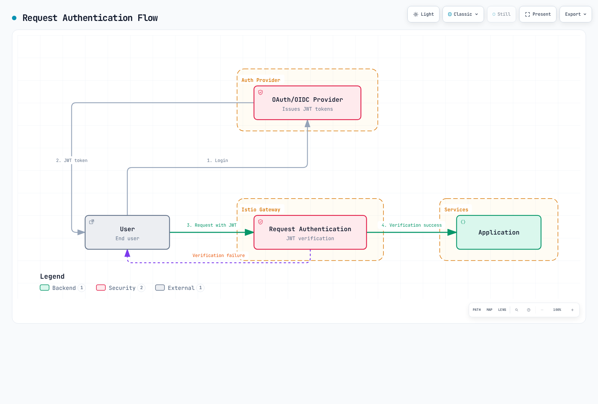

# 認証

Istio は、サービス間認証（Peer Authentication）とエンドユーザー認証（Request Authentication）をサポートしています。

## 目次

1. [認証の概要](#authentication-overview)
2. [Request Authentication（JWT）](#request-authentication-jwt)
3. [OAuth/OIDC 統合](#oauthoidc-integration)
4. [実践例](#practical-examples)
5. [トラブルシューティング](#troubleshooting)

## 認証の概要 {#authentication-overview}

RequestAuthentication は、提示された JWT が無効な場合はリクエストを拒否します。一方、AuthorizationPolicy で認証情報を必須としていなければ、認証情報のないリクエストは受け入れます。RequestAuthentication が行うのはトークンの検証です。ログイン処理、OAuth リダイレクト、トークン更新、不透明なアクセストークンのイントロスペクションは行いません。正確な issuer と JWKS を確認するには issuer の discovery document を参照し、意図した audience を設定してください。以下の例は、default namespace の `app=myapp` HTTP ワークロードに対する代替設定です。図はゲートウェイに認証ポリシーを適用する構成を示しているため、ゲートウェイを認証する場合はポリシーをワークロードではなくゲートウェイに適用してください。

<p align="center">
  
</p>

Istio が提供する認証方式は次の2種類です。

1. **Peer Authentication（サービス間認証）**
   - mTLS を使ってサービス間を認証する
   - SPIFFE ID に基づいて ID を検証する
   - PeerAuthentication CRD で構成する

2. **Request Authentication（エンドユーザー認証）**
   - JWT トークンを使ってユーザーを認証する
   - OAuth/OIDC プロバイダーと連携する
   - RequestAuthentication CRD で構成する



[🔍 インタラクティブ図を見る](https://www.atomai.click/kubernetes-docs/archmaps/en-service-mesh-istio-security-02-authentication-0.html)

## Request Authentication（JWT）

### 基本的な JWT 検証

```yaml
apiVersion: security.istio.io/v1
kind: RequestAuthentication
metadata:
  name: jwt-auth
  namespace: default
spec:
  selector:
    matchLabels:
      app: myapp
  jwtRules:
  - issuer: "https://accounts.google.com"
    jwksUri: "https://www.googleapis.com/oauth2/v3/certs"
    audiences: ["<your-google-client-id>"]
```

### 複数の issuer をサポートする

```yaml
apiVersion: security.istio.io/v1
kind: RequestAuthentication
metadata:
  name: multi-issuer-jwt
  namespace: default
spec:
  selector:
    matchLabels:
      app: myapp
  jwtRules:
  - issuer: "https://accounts.google.com"
    jwksUri: "https://www.googleapis.com/oauth2/v3/certs"
    audiences: ["<your-google-client-id>"]
  - issuer: "https://login.microsoftonline.com/tenant-id/v2.0"
    jwksUri: "https://login.microsoftonline.com/tenant-id/discovery/v2.0/keys"
    audiences: ["<your-api-application-client-id>"]
```

### カスタムヘッダー

```yaml
apiVersion: security.istio.io/v1
kind: RequestAuthentication
metadata:
  name: jwt-custom-header
  namespace: default
spec:
  selector:
    matchLabels:
      app: myapp
  jwtRules:
  - issuer: "https://auth.example.com"
    jwksUri: "https://auth.example.com/.well-known/jwks.json"
    audiences: ["my-api"]
    fromHeaders:
    - name: "x-auth-token"
      prefix: "Bearer "
```

<span id="oauthoidc-integration"></span>

## OAuth/OIDC 統合

### AWS Cognito

```yaml
apiVersion: security.istio.io/v1
kind: RequestAuthentication
metadata:
  name: cognito-jwt
  namespace: default
spec:
  selector:
    matchLabels:
      app: myapp
  jwtRules:
  - issuer: "https://cognito-idp.us-west-2.amazonaws.com/us-west-2_EXAMPLE"
    jwksUri: "https://cognito-idp.us-west-2.amazonaws.com/us-west-2_EXAMPLE/.well-known/jwks.json"
```

Cognito の API アクセスでは、`token_use=access` と、意図した `client_id` を検証してください。ID トークンでは、アプリケーションクライアント ID が `aud` に入ります。アクセストークンの `aud` はリソースバインディングがある場合にのみ含まれるため、ID トークン用の audience ルールをアクセストークンにそのまま適用しないでください。必要に応じて、API 固有の scope や group に基づく認可を追加します。サンプルのユーザープールとクライアントの値は実際の値に置き換えてください。

```yaml
apiVersion: security.istio.io/v1
kind: AuthorizationPolicy
metadata:
  name: cognito-access-token
  namespace: default
spec:
  selector:
    matchLabels:
      app: myapp
  action: ALLOW
  rules:
  - from:
    - source:
        requestPrincipals:
        - "https://cognito-idp.us-west-2.amazonaws.com/us-west-2_EXAMPLE/*"
    when:
    - key: request.auth.claims[token_use]
      values: ["access"]
    - key: request.auth.claims[client_id]
      values: ["<your-app-client-id>"]
```

### Keycloak

```yaml
apiVersion: security.istio.io/v1
kind: RequestAuthentication
metadata:
  name: keycloak-jwt
  namespace: default
spec:
  selector:
    matchLabels:
      app: myapp
  jwtRules:
  - issuer: "https://keycloak.example.com/realms/myrealm"
    jwksUri: "https://keycloak.example.com/realms/myrealm/protocol/openid-connect/certs"
    audiences: ["my-api"]
```

Keycloak の現在のデフォルトでは、コンテキストパスに `/auth` は含まれません。`http-relative-path=/auth` を設定している環境では、その設定に合わせた issuer パスを使ってください。

### Auth0

```yaml
apiVersion: security.istio.io/v1
kind: RequestAuthentication
metadata:
  name: auth0-jwt
  namespace: default
spec:
  selector:
    matchLabels:
      app: myapp
  jwtRules:
  - issuer: "https://your-tenant.auth0.com/"
    jwksUri: "https://your-tenant.auth0.com/.well-known/jwks.json"
    audiences:
    - "https://your-api.example.com"
```

## 実践例 {#practical-examples}

### JWT の検証と認可

```yaml
# JWT Verification
apiVersion: security.istio.io/v1
kind: RequestAuthentication
metadata:
  name: jwt-auth
  namespace: default
spec:
  selector:
    matchLabels:
      app: myapp
  jwtRules:
  - issuer: "https://auth.example.com"
    jwksUri: "https://auth.example.com/.well-known/jwks.json"
    audiences: ["my-api"]
---
# Deny requests without JWT
apiVersion: security.istio.io/v1
kind: AuthorizationPolicy
metadata:
  name: require-jwt
  namespace: default
spec:
  selector:
    matchLabels:
      app: myapp
  action: ALLOW
  rules:
  - from:
    - source:
        requestPrincipals: ["*"]
```

## トラブルシューティング {#troubleshooting}

### JWT 検証の失敗

```bash
# 1. Check RequestAuthentication
kubectl get requestauthentication -A
kubectl describe requestauthentication <name> -n <namespace>

# 2. Decode JWT token
python3 - <<'PYJWT'
import base64, getpass, json
segment = getpass.getpass("JWT (not echoed): ").split(".")[1]
claims = json.loads(base64.urlsafe_b64decode(segment + "=" * (-len(segment) % 4)))
print({k: claims.get(k) for k in ("iss", "aud", "exp", "nbf", "token_use", "client_id")})
PYJWT

# 3. Verify JWKS endpoint
curl -fsS https://auth.example.com/.well-known/jwks.json

# 4. Check Envoy logs
kubectl logs <pod-name> -c istio-proxy -n <namespace> | grep JWT
```

デコードしたクレームは、署名、issuer、audience、時刻を検証するまでは信頼できません。実際に使っているトークンをコマンド履歴に残したり、公開デコーダーに貼り付けたりしないでください。ローカルで JWT を検証しても、issuer 側の失効状態が自動的に確認されるわけではありません。トークンなし、期限切れ、issuer/audience の不一致、有効なトークンの各ケースをテストしてください。ambient モードで L7 認証を行う場合は、ワークロードセレクターではなく waypoint の `targetRefs` を使います。

## 参考資料

- [Istio Request Authentication](https://istio.io/latest/docs/reference/config/security/request_authentication/)
- [JWT Authentication](https://istio.io/latest/docs/tasks/security/authentication/authn-policy/)

- [主な参考資料 1](https://istio.io/latest/docs/reference/config/security/request_authentication/)
- [主な参考資料 2](https://istio.io/latest/docs/reference/config/security/authorization-policy/)
- [主な参考資料 3](https://istio.io/latest/docs/reference/config/security/peer_authentication/)
- [主な参考資料 4](https://docs.aws.amazon.com/cognito/latest/developerguide/amazon-cognito-user-pools-using-the-access-token.html)
- [主な参考資料 5](https://docs.aws.amazon.com/cognito/latest/developerguide/amazon-cognito-user-pools-using-the-id-token.html)
- [主な参考資料 6](https://www.keycloak.org/migration/migrating-to-quarkus)
- [主な参考資料 7](https://www.keycloak.org/securing-apps/oidc-layers)
