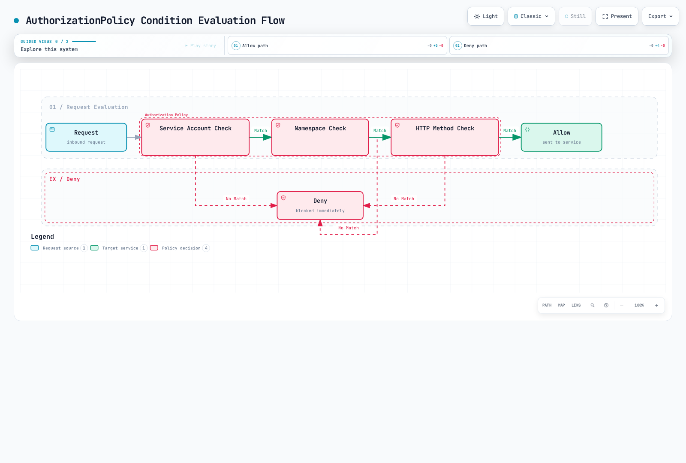

# 認可

AuthorizationPolicy を使うと、サービスへのアクセス権限をきめ細かく制御できます。

## 目次

1. [認可の概要](#authorization-overview)
2. [基本ポリシー](#basic-policies)
3. [高度なポリシー](#advanced-policies)
4. [実践例](#practical-examples)
5. [ベストプラクティス](#best-practices)

## 認可の概要 {#authorization-overview}

<p align="center">
  
</p>

Istio AuthorizationPolicy は、サービスに対するきめ細かなアクセス制御を提供します。上の図は、Authorization Policy の動作を示しています。

1. **リクエストの受信**: Envoy が受信リクエストを受け取ります。
2. **ポリシーの評価**: YAML の記述順ではなく、一致する CUSTOM、次に DENY、最後に ALLOW の各ポリシーが評価されます。
3. **アクセス判定**: ALLOW、DENY、または CUSTOM アクションが適用されます。
4. **監査ログ**: アクセス／監査ログの設定が必要です。AUDIT だけでは、リクエストにマークを付けるにとどまります。

**サポートされる条件**:
- **送信元**: リクエストの発信元 (ServiceAccount、Namespace、IP)
- **操作**: HTTP メソッド、パス、ポート
- **条件**: カスタム条件 (ヘッダー、JWT クレームなど)



[🔍 インタラクティブな図を表示](https://www.atomai.click/kubernetes-docs/archmaps/en-service-mesh-istio-security-03-authorization-0.html)

## 基本ポリシー {#basic-policies}

図は、1つの論理積となるルールを示しています。1つのルール内では、from、to、when の条件がすべて組み合わされます。個別のルールと、一致する ALLOW ポリシー同士は選択肢の関係です。ワークロードに適用される ALLOW ポリシーがなければ、CUSTOM または DENY に拒否されない限りリクエストは許可されます。ALLOW ポリシーが適用されると、少なくとも1つの ALLOW ルールに一致する必要があります。以下の例はそれぞれ別の選択肢です。すべてを許可するポリシーを追加すると、GET のみを許可するポリシーの制限が広がります。

### デフォルト拒否 (すべて拒否)

```yaml
apiVersion: security.istio.io/v1
kind: AuthorizationPolicy
metadata:
  name: deny-all
  namespace: default
spec:
  action: ALLOW
  rules: []  # Default deny with room for specific ALLOW exceptions
```

### デフォルト許可 (すべて許可)

```yaml
apiVersion: security.istio.io/v1
kind: AuthorizationPolicy
metadata:
  name: allow-all
  namespace: default
spec:
  action: ALLOW
  rules:
  - {}  # Allow all requests
```

### HTTP メソッドベース

```yaml
apiVersion: security.istio.io/v1
kind: AuthorizationPolicy
metadata:
  name: httpbin-get-only
  namespace: default
spec:
  selector:
    matchLabels:
      app: httpbin
  action: ALLOW
  rules:
  - to:
    - operation:
        methods: ["GET"]  # Allow only GET
```

## 高度なポリシー {#advanced-policies}

### Service Account ベース

```yaml
apiVersion: security.istio.io/v1
kind: AuthorizationPolicy
metadata:
  name: ratings-sa-policy
  namespace: default
spec:
  selector:
    matchLabels:
      app: ratings
  action: ALLOW
  rules:
  - from:
    - source:
        principals: ["cluster.local/ns/default/sa/reviews"]  # Allow only reviews SA
```

### Namespace ベース

```yaml
apiVersion: security.istio.io/v1
kind: AuthorizationPolicy
metadata:
  name: db-namespace-policy
  namespace: database
spec:
  selector:
    matchLabels:
      app: postgresql
  action: ALLOW
  rules:
  - from:
    - source:
        namespaces: ["production", "staging"]  # Specific namespaces only
```

### パスベース

```yaml
apiVersion: security.istio.io/v1
kind: AuthorizationPolicy
metadata:
  name: path-based-policy
  namespace: default
spec:
  selector:
    matchLabels:
      app: api
  action: ALLOW
  rules:
  - to:
    - operation:
        paths: ["/api/public/*"]  # Allow only public API
  - from:
    - source:
        principals: ["cluster.local/ns/default/sa/admin"]
    to:
    - operation:
        paths: ["/api/admin/*"]  # admin SA can access admin API
```

### JWT クレームベース

```yaml
apiVersion: security.istio.io/v1
kind: AuthorizationPolicy
metadata:
  name: jwt-claims-policy
  namespace: default
spec:
  selector:
    matchLabels:
      app: myapp
  action: ALLOW
  rules:
  - when:
    - key: request.auth.claims[role]
      values: ["admin", "superuser"]  # role claim is admin or superuser
```

## 実践例 {#practical-examples}

デフォルト拒否に例外を設ける場合は、空の ALLOW ポリシーと、意図した個別の ALLOW ルールだけを適用します。`rules: [{}]` を指定した明示的な DENY は強制拒否であり、どの ALLOW でも上書きできません。selector のないポリシーはその namespace に適用されます。root namespace や targetRefs によるアタッチメントのルールは、別途慎重に扱う必要があります。

Service Account／namespace の一致条件には、認証済みの mTLS ピア ID が必要です。JWT ロールの例では、対応する RequestAuthentication を設定し、意図した issuer と audience を検証する必要があります。クライアントが送るヘッダーは、どちらの ID の代わりにもなりません。ネイティブ TCP では、HTTP メソッドや JWT クレームではなく、ID／IP／ポートで照合してください。DENY ルールで HTTP 属性が欠けていると、TCP トラフィックに予期せず一致することがあります。

## ベストプラクティス {#best-practices}

- ポリシーを対象のワークロード／リソースに限定し、適用されるすべての ALLOW ルールをまとめて確認します。
- ambient の L7 ポリシーには waypoint の targetRefs を使います。sidecar の selector は waypoint へのアタッチメントではありません。
- namespace の境界を含め、ポリシーなし、一致なし、明示的な拒否、許可されるリクエストを検証します。
- ログを明示的に設定し、`istioctl x authz check <pod> -n <namespace>` で実効ポリシーを確認します。

## 参考資料

- [Istio Authorization Policy](https://istio.io/latest/docs/reference/config/security/authorization-policy/)
- [認可の例](https://istio.io/latest/docs/tasks/security/authorization/)
