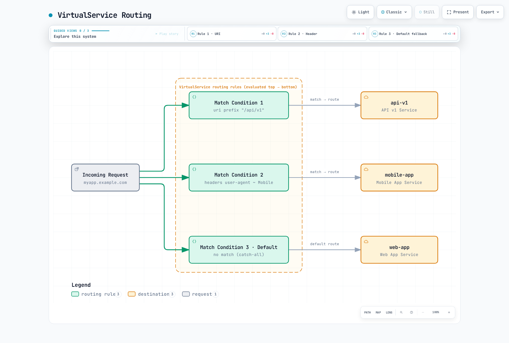

# ルーティング

Istio の高度なルーティング機能を使うと、さまざまなリクエスト属性に基づいてトラフィックをきめ細かく制御できます。

## 目次

1. [ルーティングの概要](#routing-overview)
2. [マッチ条件](#match-conditions)
3. [URI ベースのルーティング](#uri-based-routing)
4. [ヘッダーベースのルーティング](#header-based-routing)
5. [クエリパラメータベースのルーティング](#query-parameter-based-routing)
6. [HTTP メソッドベースのルーティング](#http-method-based-routing)
7. [送信元ベースのルーティング](#source-based-routing)
8. [優先順位とフォールバック](#priority-and-fallback)
9. [実践例](#practical-examples)
10. [トラブルシューティング](#troubleshooting)

## ルーティングの概要 {#routing-overview}

以下は、それぞれ独立したサイドカー向けルーティング例です。例に示す Service と subset を作成し、同じホストには重複する VirtualService を1つだけ適用してください。`gateways` を指定しないルートはメッシュ内のサイドカーに適用されます。外部ホストへの ingress の例では、既存 Gateway へのバインドと一致するホスト名も必要です。ヘッダー、クエリパラメータ、送信元ワークロードのラベルはルーティング入力であり、ユーザー ID の証明にはなりません。テナント／ユーザーの権限は、認証と AuthorizationPolicy で強制してください。

VirtualService のルーティングルールは、**マッチ条件**と**ルートの宛先**で構成されます。



[🔍 インタラクティブ図を表示](https://www.atomai.click/kubernetes-docs/archmaps/en-service-mesh-istio-traffic-management-02-routing-0.html)

### 基本構造

```yaml
apiVersion: networking.istio.io/v1
kind: VirtualService
metadata:
  name: routing-example
spec:
  hosts:
  - myapp.example.com
  http:
  - match:
    - uri:
        prefix: "/api/v1"
    route:
    - destination:
        host: api-v1
  - match:
    - headers:
        user-agent:
          regex: ".*Mobile.*"
    route:
    - destination:
        host: mobile-app
  - route:  # Default route (no match)
    - destination:
        host: web-app
```

## マッチ条件 {#match-conditions}

### マッチ条件の種類

| 条件 | 説明 | マッチ方式 |
|-----------|-------------|------------|
| **uri** | リクエストパス | `exact`, `prefix`, `regex` |
| **scheme** | HTTP/HTTPS | `exact`, `prefix`, `regex` |
| **method** | HTTP メソッド | `exact`, `prefix`, `regex` |
| **authority** | Host ヘッダー | `exact`, `prefix`, `regex` |
| **headers** | HTTP ヘッダー | `exact`, `prefix`, `regex` |
| **queryParams** | クエリパラメータ | `exact`, `prefix`, `regex` |
| **sourceLabels** | 送信元ワークロードのラベル | ラベルセレクター |
| **gateways** | Gateway 名 | リスト |

### マッチ方式

```yaml
# exact: Exact match
match:
- uri:
    exact: "/login"
```

```yaml
# prefix: Prefix match
match:
- uri:
    prefix: "/api/"
```

```yaml
# regex: Regular expression match
match:
- uri:
    regex: "^/api/v[0-9]+/.*"
```

### 複数条件の組み合わせ

```yaml
# AND condition: All conditions must match
http:
- match:
  - uri:
      prefix: "/api"
    headers:
      x-api-version:
        exact: "v2"
    queryParams:
      debug:
        exact: "true"
  route:
  - destination:
      host: api-debug
```

```yaml
# OR condition: Use multiple match blocks
http:
- match:
  - uri:
      prefix: "/api/v1"
  - uri:
      prefix: "/api/v2"
  route:
  - destination:
      host: api-service
```

## URI ベースのルーティング {#uri-based-routing}

### prefix マッチング

```yaml
apiVersion: networking.istio.io/v1
kind: VirtualService
metadata:
  name: uri-prefix-routing
spec:
  hosts:
  - myapp.example.com
  http:
  # API traffic
  - match:
    - uri:
        prefix: "/api/"
    route:
    - destination:
        host: api-service
        port:
          number: 8080

  # Admin traffic
  - match:
    - uri:
        prefix: "/admin/"
    route:
    - destination:
        host: admin-service
        port:
          number: 9000

  # Static files
  - match:
    - uri:
        prefix: "/static/"
    route:
    - destination:
        host: static-service
        port:
          number: 8000

  # Default traffic
  - route:
    - destination:
        host: frontend-service
        port:
          number: 3000
```

### exact マッチング

```yaml
apiVersion: networking.istio.io/v1
kind: VirtualService
metadata:
  name: uri-exact-routing
spec:
  hosts:
  - myapp.example.com
  http:
  # Login page
  - match:
    - uri:
        exact: "/login"
    route:
    - destination:
        host: auth-service

  # Logout
  - match:
    - uri:
        exact: "/logout"
    route:
    - destination:
        host: auth-service

  # Health check
  - match:
    - uri:
        exact: "/health"
    route:
    - destination:
        host: health-service
```

### 正規表現マッチング

```yaml
apiVersion: networking.istio.io/v1
kind: VirtualService
metadata:
  name: uri-regex-routing
spec:
  hosts:
  - myapp.example.com
  http:
  # API version routing: /api/v1/, /api/v2/, etc.
  - match:
    - uri:
        regex: "^/api/v[0-9]+/.*"
    route:
    - destination:
        host: api-service

  # Numeric resource ID: /users/123
  - match:
    - uri:
        regex: "^/users/[0-9]+$"
    route:
    - destination:
        host: user-service

  # File extension: .jpg, .png, .gif
  - match:
    - uri:
        regex: ".*\\.(jpg|png|gif)$"
    route:
    - destination:
        host: image-service
```

## ヘッダーベースのルーティング {#header-based-routing}

### User-Agent ベースのルーティング

```yaml
apiVersion: networking.istio.io/v1
kind: VirtualService
metadata:
  name: header-user-agent-routing
spec:
  hosts:
  - reviews
  http:
  # Tablet devices
  - match:
    - headers:
        user-agent:
          regex: ".*(iPad|Tablet).*"
    route:
    - destination:
        host: reviews
        subset: tablet

  # Mobile devices
  - match:
    - headers:
        user-agent:
          regex: ".*Mobile.*"
    route:
    - destination:
        host: reviews
        subset: mobile

  # Desktop (default)
  - route:
    - destination:
        host: reviews
        subset: desktop
```

### カスタムヘッダーベースのルーティング

```yaml
apiVersion: networking.istio.io/v1
kind: VirtualService
metadata:
  name: header-custom-routing
spec:
  hosts:
  - myapp
  http:
  # Developer/Tester routing
  - match:
    - headers:
        x-dev-user:
          exact: "true"
    route:
    - destination:
        host: myapp
        subset: dev

  # Beta testers
  - match:
    - headers:
        x-beta-tester:
          exact: "true"
    route:
    - destination:
        host: myapp
        subset: beta

  # VIP users
  - match:
    - headers:
        x-user-tier:
          exact: "vip"
    route:
    - destination:
        host: myapp
        subset: vip

  # Regular users
  - route:
    - destination:
        host: myapp
        subset: stable
```

### API バージョンベースのルーティング

```yaml
apiVersion: networking.istio.io/v1
kind: VirtualService
metadata:
  name: header-api-version-routing
spec:
  hosts:
  - api.example.com
  http:
  # API v3
  - match:
    - headers:
        x-api-version:
          exact: "v3"
    route:
    - destination:
        host: api-service
        subset: v3

  # API v2
  - match:
    - headers:
        x-api-version:
          exact: "v2"
    route:
    - destination:
        host: api-service
        subset: v2

  # API v1 (default)
  - route:
    - destination:
        host: api-service
        subset: v1
```

## クエリパラメータベースのルーティング {#query-parameter-based-routing}

### 基本的なクエリパラメータのマッチング

```yaml
apiVersion: networking.istio.io/v1
kind: VirtualService
metadata:
  name: query-param-routing
spec:
  hosts:
  - search.example.com
  http:
  # Debug mode: ?debug=true
  - match:
    - queryParams:
        debug:
          exact: "true"
    route:
    - destination:
        host: search-service
        subset: debug

  # Premium search: ?premium=1
  - match:
    - queryParams:
        premium:
          exact: "1"
    route:
    - destination:
        host: search-service
        subset: premium

  # A/B testing: ?variant=b
  - match:
    - queryParams:
        variant:
          exact: "b"
    route:
    - destination:
        host: search-service
        subset: variant-b

  # Default search
  - route:
    - destination:
        host: search-service
        subset: standard
```

### 複数のクエリパラメータの組み合わせ

```yaml
apiVersion: networking.istio.io/v1
kind: VirtualService
metadata:
  name: query-param-combined-routing
spec:
  hosts:
  - api.example.com
  http:
  # Debug mode + verbose logging
  - match:
    - queryParams:
        debug:
          exact: "true"
        verbose:
          exact: "true"
    route:
    - destination:
        host: api-service
        subset: debug-verbose

  # Debug mode only
  - match:
    - queryParams:
        debug:
          exact: "true"
    route:
    - destination:
        host: api-service
        subset: debug

  # Normal mode
  - route:
    - destination:
        host: api-service
        subset: production
```

## HTTP メソッドベースのルーティング {#http-method-based-routing}

```yaml
apiVersion: networking.istio.io/v1
kind: VirtualService
metadata:
  name: method-based-routing
spec:
  hosts:
  - api.example.com
  http:
  # POST requests → Write-only service
  - match:
    - method:
        exact: "POST"
      uri:
        prefix: "/api/"
    route:
    - destination:
        host: api-write-service

  # PUT/PATCH requests → Update service
  - match:
    - method:
        regex: "PUT|PATCH"
      uri:
        prefix: "/api/"
    route:
    - destination:
        host: api-update-service

  # DELETE requests → Delete service
  - match:
    - method:
        exact: "DELETE"
      uri:
        prefix: "/api/"
    route:
    - destination:
        host: api-delete-service

  # GET requests → Read-only service
  - match:
    - method:
        exact: "GET"
      uri:
        prefix: "/api/"
    route:
    - destination:
        host: api-read-service
```

## 送信元ベースのルーティング {#source-based-routing}

`sourceLabels` と `sourceNamespace` は、どの送信元サイドカーに設定を適用するかを選びます。ingress gateway でリクエストごとの認証済みマッチを行うものではありません。これらのセレクターを適用するには、トップレベルの gateway リストに `mesh` を明示的に含める必要があります。データベースの例は HTTP を受け付ける Service を前提としており、内容を解釈しない SQL プロトコルには適用できません。

### Namespace ベースのルーティング

```yaml
apiVersion: networking.istio.io/v1
kind: VirtualService
metadata:
  name: source-namespace-routing
  namespace: production
spec:
  hosts:
  - database.production.svc.cluster.local
  http:
  # Requests from production namespace
  - match:
    - sourceNamespace: production
    route:
    - destination:
        host: database
        subset: production

  # Requests from staging namespace
  - match:
    - sourceNamespace: staging
    route:
    - destination:
        host: database
        subset: staging

  # Illustrative HTTP rejection; enforce identity policy at the destination
  - directResponse:
      status: 403
```

### 送信元ワークロードのラベルベースのルーティング

```yaml
apiVersion: networking.istio.io/v1
kind: VirtualService
metadata:
  name: source-sa-routing
spec:
  hosts:
  - payment-service
  http:
  # Select configuration for matching source workload labels
  - match:
    - sourceLabels:
        app: frontend
        version: v2
    route:
    - destination:
        host: payment-service
        subset: v2

  # Legacy service
  - match:
    - sourceLabels:
        app: frontend
        version: v1
    route:
    - destination:
        host: payment-service
        subset: v1
```

## 優先順位とフォールバック {#priority-and-fallback}

### マッチルールの優先順位

Istio は VirtualService の HTTP ルーティングルールを**上から下へ**評価します。

```yaml
apiVersion: networking.istio.io/v1
kind: VirtualService
metadata:
  name: priority-example
spec:
  hosts:
  - myapp.example.com
  http:
  # Priority 1: Most specific condition
  - match:
    - uri:
        exact: "/api/v2/users/admin"
      headers:
        x-admin:
          exact: "true"
    route:
    - destination:
        host: admin-api-v2

  # Priority 2: Medium specificity
  - match:
    - uri:
        prefix: "/api/v2/"
    route:
    - destination:
        host: api-v2

  # Priority 3: Less specific
  - match:
    - uri:
        prefix: "/api/"
    route:
    - destination:
        host: api-v1

  # Priority 4 (last): Default fallback
  - route:
    - destination:
        host: frontend
```

### フォールバック戦略

ここでいうフォールバックは、どのルートにも一致しなかったリクエストに適用する最後のルートです。いったんルートが一致した後に上流で障害が起きても、次のルートから評価が再開されるわけではありません。障害からの復旧には、retry／outlier detection またはロールアウトコントローラーを別途設定してください。

```yaml
apiVersion: networking.istio.io/v1
kind: VirtualService
metadata:
  name: fallback-strategy
spec:
  hosts:
  - myapp
  http:
  # Requests matching specific conditions
  - match:
    - headers:
        x-canary:
          exact: "true"
    route:
    - destination:
        host: myapp
        subset: canary
    # No fallback on canary failure - return error

  # Default route for requests that did not match the canary condition
  - route:
    - destination:
        host: myapp
        subset: stable
      weight: 100
```

## 実践例 {#practical-examples}

### 例1: マルチテナントルーティング

```yaml
apiVersion: networking.istio.io/v1
kind: VirtualService
metadata:
  name: multi-tenant-routing
spec:
  hosts:
  - api.example.com
  - tenant-b.api.example.com
  http:
  # Tenant A (identified by header)
  - match:
    - headers:
        x-tenant-id:
          exact: "tenant-a"
    route:
    - destination:
        host: api-service
        subset: tenant-a

  # Tenant B (identified by subdomain)
  - match:
    - authority:
        exact: "tenant-b.api.example.com"
    route:
    - destination:
        host: api-service
        subset: tenant-b

  # Tenant C (identified by path)
  - match:
    - uri:
        prefix: "/tenant-c/"
    rewrite:
      uri: "/"
    route:
    - destination:
        host: api-service
        subset: tenant-c
```

### 例2: Feature Flag ベースのルーティング

```yaml
apiVersion: networking.istio.io/v1
kind: VirtualService
metadata:
  name: feature-flag-routing
spec:
  hosts:
  - myapp
  http:
  # Users with new feature enabled
  - match:
    - headers:
        x-feature-new-ui:
          exact: "enabled"
    route:
    - destination:
        host: myapp
        subset: new-ui

  # Beta feature testers
  - match:
    - headers:
        x-feature-beta:
          exact: "enabled"
    route:
    - destination:
        host: myapp
        subset: beta

  # Workloads labeled role=employee with the feature header
  - match:
    - headers:
        x-feature-experimental:
          exact: "enabled"
      sourceLabels:
        role: employee
    route:
    - destination:
        host: myapp
        subset: experimental

  # Default (stable version)
  - route:
    - destination:
        host: myapp
        subset: stable
```

### 例3: 地理的ルーティング

```yaml
apiVersion: networking.istio.io/v1
kind: VirtualService
metadata:
  name: geo-routing
spec:
  hosts:
  - content.example.com
  http:
  # Korean users
  - match:
    - headers:
        x-country-code:
          exact: "KR"
    route:
    - destination:
        host: content-service
        subset: korea

  # Japanese users
  - match:
    - headers:
        x-country-code:
          exact: "JP"
    route:
    - destination:
        host: content-service
        subset: japan

  # US users
  - match:
    - headers:
        x-country-code:
          exact: "US"
    route:
    - destination:
        host: content-service
        subset: us

  # European users
  - match:
    - headers:
        x-country-code:
          regex: "DE|FR|GB|IT|ES"
    route:
    - destination:
        host: content-service
        subset: europe

  # Other regions (global)
  - route:
    - destination:
        host: content-service
        subset: global
```

### 例4: API Gateway パターン

`api-gateway` を実際の Gateway にバインドし、公開前に保護対象のパスへ[JWT 認証と認可](../security/02-authentication.md)を適用してください。`Bearer ...` という文字列にマッチしても、トークンの検証にはなりません。認証情報がない場合に、保護対象パスがパブリック／一般向けルートへフォールスルーしてはいけません。地理情報やテナントを表すヘッダーをアクセス判断に使う場合は、信頼できる認証済みソースから取得してください。

```yaml
apiVersion: networking.istio.io/v1
kind: VirtualService
metadata:
  name: api-gateway-routing
spec:
  hosts:
  - api.example.com
  gateways:
  - api-gateway
  http:
  # Route protected paths; JWT/authorization must be enforced separately
  - match:
    - uri:
        prefix: "/api/v1/protected/"
    route:
    - destination:
        host: protected-api-service

  # Public APIs
  - match:
    - uri:
        prefix: "/api/v1/public/"
    route:
    - destination:
        host: public-api-service

  # GraphQL endpoint
  - match:
    - uri:
        exact: "/graphql"
      method:
        exact: "POST"
    route:
    - destination:
        host: graphql-service

  # REST API
  - match:
    - uri:
        prefix: "/api/v1/"
    route:
    - destination:
        host: rest-api-service

  # Health check
  - match:
    - uri:
        exact: "/health"
    route:
    - destination:
        host: health-service

  # 404 response for unmatched paths
  - directResponse:
      status: 404
```

## トラブルシューティング {#troubleshooting}

### ルーティングが機能しない場合

```bash
# 1. Check VirtualService status
kubectl get virtualservice -A
kubectl describe virtualservice <name> -n <namespace>

# 2. Check routing rules
istioctl proxy-config routes <pod-name> -n <namespace>

# 3. Check routing to specific service
istioctl proxy-config routes <pod-name> -n <namespace> --name <route-name> -o json

# 4. Validate configuration
istioctl analyze -n <namespace>
```

### マッチ条件のデバッグ

```bash
# Increase Envoy log level
istioctl proxy-config log <pod-name> -n <namespace> --level debug

# Trace requests
kubectl logs -n <namespace> <pod-name> -c istio-proxy -f

# Debug Pilot
kubectl logs -n istio-system -l app=istiod --tail=100
```

### よくある問題

#### 1. マッチ順序の問題

```yaml
# ❌ Wrong order - default route first ignores other rules
http:
- route:  # All traffic goes here
  - destination:
      host: myapp
- match:  # Never executed
  - uri:
      prefix: "/api"
  route:
  - destination:
      host: api-service
```

```yaml
# ✅ Correct order
http:
- match:  # Specific rules first
  - uri:
      prefix: "/api"
  route:
  - destination:
      host: api-service
- route:  # Default route last
  - destination:
      host: myapp
```

#### 2. 正規表現がマッチする範囲

RE2 は文字列全体に対してマッチします。`/api/v[1-3]` は有効な構文で、`/api/v1` には一致しますが、`/api/v1/users` には一致しません。`/` をエスケープする必要はありません。バージョンのルートとその配下のパスの両方にマッチさせるには、次のようにします。

```yaml
match:
- uri:
    regex: "^/api/v[1-3](/.*)?$"
```

#### 3. ヘッダー名

HTTP ヘッダー名は通信上では大文字と小文字を区別しませんが、Istio の match map のキーは小文字にする必要があります。式で別の指定をしない限り、ヘッダー値は大文字と小文字を区別します。

```yaml
match:
- headers:
    x-custom-header:
      exact: "value"
```

## ベストプラクティス

### 1. 具体的なルールを先に置く

```yaml
# ✅ Good example
http:
- match:
  - uri:
      exact: "/api/v2/admin"  # Most specific
  route:
  - destination:
      host: admin-v2
- match:
  - uri:
      prefix: "/api/v2/"  # Medium
  route:
  - destination:
      host: api-v2
- match:
  - uri:
      prefix: "/api/"  # General
  route:
  - destination:
      host: api-v1
- route:  # Default
  - destination:
      host: frontend
```

### 2. 正規表現を最小限にする

```yaml
# ❌ Avoid - complex regex degrades performance
match:
- uri:
    regex: "^/(api|admin|public)/v[0-9]+/(users|products|orders)/[a-zA-Z0-9_-]+$"
```

```yaml
# ✅ Recommended - use prefix or exact
match:
- uri:
    prefix: "/api/v1/"
```

### 3. 分かりやすい命名

```yaml
# ✅ Use clear names
apiVersion: networking.istio.io/v1
kind: VirtualService
metadata:
  name: product-api-routing  # Clear name
  labels:
    app: product-service
    purpose: routing
spec:
  hosts:
  - product-api.example.com
  http:
  - route:
    - destination:
        host: product-api-service
```

### 4. ドキュメント化

```yaml
apiVersion: networking.istio.io/v1
kind: VirtualService
metadata:
  name: myapp-routing
  annotations:
    description: "Routes traffic based on API version and user type"
    owner: "platform-team"
spec:
  hosts:
  - myapp.example.com
  http:
  # Route VIP users to dedicated instance
  - match:
    - headers:
        x-user-tier:
          exact: "vip"
    route:
    - destination:
        host: myapp
        subset: vip
```

### 5. テスト戦略

GATEWAY_URL にはインストール済み ingress のアドレス／ポートを設定し、Host とヘッダーは現在デプロイしている1つの例に合わせてください。メッシュ内のみで動作する例を外部から curl でテストするには、先にその Gateway へバインドする必要があります。調査のため一時的に proxy の debug log level を変更した場合は、調査後に元へ戻してください。

```bash
# Routing rule test script
#!/bin/bash

# API v1 test
curl -H "Host: api.example.com" http://$GATEWAY_URL/api/v1/users

# API v2 test
curl -H "Host: api.example.com" http://$GATEWAY_URL/api/v2/users

# Mobile user test
curl -H "Host: myapp.example.com" -H "User-Agent: Mobile" "http://$GATEWAY_URL/"

# Header-based test
curl -H "Host: myapp.example.com" -H "x-canary: true" "http://$GATEWAY_URL/"
```

## 参考資料

- [Istio のトラフィック管理](https://istio.io/latest/docs/concepts/traffic-management/)
- [VirtualService リファレンス](https://istio.io/latest/docs/reference/config/networking/virtual-service/)
- [HTTP ルートのマッチング](https://istio.io/latest/docs/reference/config/networking/virtual-service/#HTTPMatchRequest)
- [トラフィックルーティング](https://istio.io/latest/docs/tasks/traffic-management/request-routing/)
