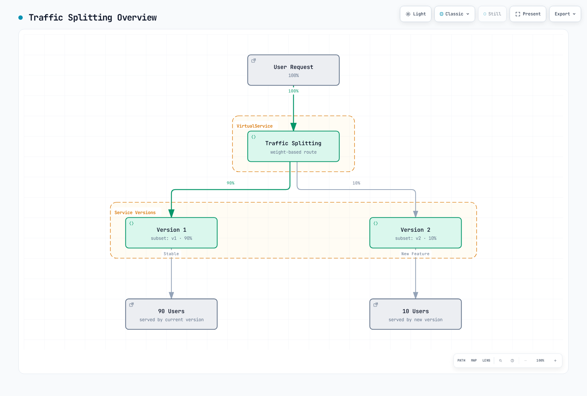
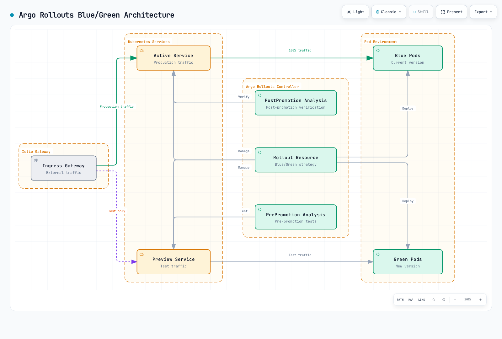

# トラフィック分割

トラフィック分割は、コードを変更せずにカナリアデプロイ、A/B テスト、Blue/Green デプロイを実現できる、Istio の強力な機能の 1 つです。

## 目次

1. [トラフィック分割の概要](#traffic-splitting-overview)
2. [カナリアデプロイ](#canary-deployment)
3. [Blue/Green デプロイ](#bluegreen-deployment)
4. [A/B テスト](#ab-testing)
5. [段階的ロールアウト](#progressive-rollout)
6. [トラフィックミラーリングとの併用](#using-with-traffic-mirroring)
7. [実践例](#practical-examples)
8. [監視とロールバック](#monitoring-and-rollback)
9. [トラブルシューティング](#troubleshooting)

## トラフィック分割の概要 {#traffic-splitting-overview}

Istio 1.31.0 と Argo Rollouts 1.10.1 を基準に確認しています。以下は破棄可能なテスト用 Namespace で使う代替例です。同じ selector を持つ複数の Rollout を同時に実行したり、手動スクリプトや GitOps で Rollout が管理する weight や subset hash を上書きしたりしないでください。ロールアウト前に、参照先の Service、DestinationRule、AnalysisTemplate、Gateway、Prometheus をインストールします。最初のデプロイで stable ReplicaSet を作成し、後続の更新でカナリアの各ステップと分析を実行します。weight が制御するのはリクエストの分配であり、ユーザーの一定割合ではありません。

トラフィック分割では、VirtualService の `weight` フィールドを使い、複数の Service バージョンに比率でトラフィックを分配します。



[🔍 インタラクティブ図を表示](https://www.atomai.click/kubernetes-docs/archmaps/en-service-mesh-istio-traffic-management-04-traffic-splitting-0.html)

### 基本構成

```yaml
apiVersion: networking.istio.io/v1
kind: VirtualService
metadata:
  name: reviews
spec:
  hosts:
  - reviews
  http:
  - route:
    - destination:
        host: reviews
        subset: v1
      weight: 90  # 90% of traffic
    - destination:
        host: reviews
        subset: v2
      weight: 10  # 10% of traffic
```

## カナリアデプロイ {#canary-deployment}

カナリアデプロイは、まず一部のユーザーだけに新バージョンを提供して安全に検証する戦略です。Istio と Argo Rollouts を組み合わせると、段階的なデプロイとメトリクスに基づく自動ロールバックを実行できます。

### Argo Rollouts と Istio のアーキテクチャ


[🔍 インタラクティブ図を表示](https://www.atomai.click/kubernetes-docs/archmaps/en-service-mesh-istio-traffic-management-04-traffic-splitting-1.html)

### カナリアデプロイの流れ


[🔍 インタラクティブ図を表示](https://www.atomai.click/kubernetes-docs/archmaps/en-service-mesh-istio-traffic-management-04-traffic-splitting-2.html)

### ステップ 1: Argo Rollouts のインストール

```bash
# Install Argo Rollouts
kubectl create namespace argo-rollouts
kubectl apply -n argo-rollouts -f https://github.com/argoproj/argo-rollouts/releases/download/v1.10.1/install.yaml

# Install Argo Rollouts CLI (optional)
curl -LO https://github.com/argoproj/argo-rollouts/releases/download/v1.10.1/kubectl-argo-rollouts-linux-amd64
chmod +x kubectl-argo-rollouts-linux-amd64
sudo mv kubectl-argo-rollouts-linux-amd64 /usr/local/bin/kubectl-argo-rollouts

# Run Argo Rollouts Dashboard
kubectl argo rollouts dashboard
```

### ステップ 2: Rollout リソースの定義

```yaml
apiVersion: argoproj.io/v1alpha1
kind: Rollout
metadata:
  name: reviews
  namespace: default
spec:
  replicas: 5
  revisionHistoryLimit: 2
  selector:
    matchLabels:
      app: reviews
  template:
    metadata:
      labels:
        app: reviews
        sidecar.istio.io/inject: "true"
    spec:
      containers:
      - name: reviews
        image: docker.io/istio/examples-bookinfo-reviews-v2:1.20.3
        ports:
        - containerPort: 9080
        resources:
          requests:
            memory: "64Mi"
            cpu: "100m"
          limits:
            memory: "128Mi"
            cpu: "200m"

  # Canary Deployment Strategy
  strategy:
    canary:
      # Traffic Control via Istio VirtualService
      trafficRouting:
        istio:
          virtualService:
            name: reviews-vsvc
            routes:
            - primary
          destinationRule:
            name: reviews-destrule
            canarySubsetName: canary
            stableSubsetName: stable

      # Canary Steps Definition
      steps:
      - setWeight: 10    # 10% traffic to Canary
      - pause:
          duration: 2m   # Wait 2 minutes

      - analysis:
          templates:
          - templateName: success-rate
          - templateName: latency
          args:
          - name: service-name
            value: reviews
          - name: pod-template-hash
            valueFrom:
              podTemplateHashValue: Latest

      - setWeight: 25    # 25% traffic to Canary
      - pause:
          duration: 2m

      - analysis:
          templates:
          - templateName: success-rate
          - templateName: latency
          args:
          - name: service-name
            value: reviews
          - name: pod-template-hash
            valueFrom:
              podTemplateHashValue: Latest

      - setWeight: 50    # 50% traffic to Canary
      - pause:
          duration: 2m

      - analysis:
          templates:
          - templateName: success-rate
          - templateName: latency
          args:
          - name: service-name
            value: reviews
          - name: pod-template-hash
            valueFrom:
              podTemplateHashValue: Latest

      - setWeight: 75    # 75% traffic to Canary
      - pause:
          duration: 2m

      - analysis:
          templates:
          - templateName: success-rate
          - templateName: latency
          args:
          - name: service-name
            value: reviews
          - name: pod-template-hash
            valueFrom:
              podTemplateHashValue: Latest

```

### ステップ 3: Service の作成

まず、Kubernetes Service を作成します。

```yaml
apiVersion: v1
kind: Service
metadata:
  name: reviews
  namespace: default
spec:
  ports:
  - port: 9080
    name: http
  selector:
    app: reviews  # Select all Pods from Rollout
```

### ステップ 4: VirtualService の定義

**重要**: Argo Rollouts は、参照先 VirtualService の route の weight を更新します。VirtualService 自体は作成しないため、先に作成してください。

```yaml
apiVersion: networking.istio.io/v1
kind: VirtualService
metadata:
  name: reviews-vsvc
  namespace: default
spec:
  hosts:
  - reviews
  http:
  - name: primary  # Route name referenced by Rollout (required)
    route:
    - destination:
        host: reviews
        subset: stable  # Stable version
      weight: 100
    - destination:
        host: reviews
        subset: canary  # Canary version
      weight: 0
```

**要点**:
- Rollout で明示的に指定する route には、一致する `http[].name` が必要です。route が 1 つだけの場合は routes の一覧を省略できます。
- Rollout がこの VirtualService で自動更新するのは `weight` の値だけです。
- stable と canary の 2 つの宛先が必要です。

### ステップ 5: DestinationRule の定義

**重要**: Argo Rollouts は DestinationRule を自動作成**しません**。あらかじめ作成しておく必要があります。

```yaml
apiVersion: networking.istio.io/v1
kind: DestinationRule
metadata:
  name: reviews-destrule
  namespace: default
spec:
  host: reviews
  subsets:
  - name: stable
    labels:
      app: reviews
  - name: canary
    labels:
      app: reviews
```

**要点**:
- subset 名（`stable`、`canary`）は、Rollout の `stableSubsetName` および `canarySubsetName` と一致させます。
- Rollout は Pod に `rollouts-pod-template-hash` ラベルを自動で追加します。
- DestinationRule の subset は、このラベルを使って Pod を選択します。
- 必要な場合はアプリケーションの stable ラベルを残してください。Rollout は各 subset の Pod template hash を追加・更新します。トラフィックを送る前に、その selector が反映されるのを待ちます。

### ステップ 6: AnalysisTemplate の定義

このカナリア判定を使う前に、Prometheus で **ワークロードの Istio メトリクスを収集する Pod scrape job** に次の relabeling rule を追加します。scrape した系列に `rollout_hash` と `reporter="destination"` が含まれることを確認してください。これにより `podTemplateHashValue: Latest` が渡す実際のカナリア ReplicaSet を特定できます。Service 全体の平均では、小規模なカナリアの障害が隠れる可能性があります。実態を反映したリクエストトラフィックを用意し、測定値が欠落または NaN の場合はリリースを進めないでください。

```yaml
# Add to the existing pod scrape job's relabel_configs
- source_labels: [__meta_kubernetes_pod_label_rollouts_pod_template_hash]
  target_label: rollout_hash
```

#### 成功率の分析

```yaml
apiVersion: argoproj.io/v1alpha1
kind: AnalysisTemplate
metadata:
  name: success-rate
  namespace: default
spec:
  args:
  - name: service-name
  - name: pod-template-hash

  metrics:
  - name: success-rate
    interval: 30s
    count: 4  # Four measurements; interval is not total elapsed duration
    successCondition: len(result) == 1 && !isNaN(result[0]) && result[0] >= 0.95
    failureLimit: 0  # No failed measurement tolerated
    provider:
      prometheus:
        address: http://prometheus.istio-system:9090
        query: |
          sum(rate(
            istio_requests_total{
              destination_service_name="{{args.service-name}}",
              reporter="destination",
              rollout_hash="{{args.pod-template-hash}}",
              destination_workload_namespace="default",
              response_code!~"5.*"
            }[2m]
          ))
          /
          sum(rate(
            istio_requests_total{
              destination_service_name="{{args.service-name}}",
              reporter="destination",
              rollout_hash="{{args.pod-template-hash}}",
              destination_workload_namespace="default"
            }[2m]
          ))
```

#### レイテンシーの分析

```yaml
apiVersion: argoproj.io/v1alpha1
kind: AnalysisTemplate
metadata:
  name: latency
  namespace: default
spec:
  args:
  - name: service-name
  - name: pod-template-hash

  metrics:
  - name: latency-p95
    interval: 30s
    count: 4
    successCondition: len(result) == 1 && !isNaN(result[0]) && result[0] <= 500
    failureLimit: 0
    provider:
      prometheus:
        address: http://prometheus.istio-system:9090
        query: |
          histogram_quantile(0.95,
            sum(rate(
              istio_request_duration_milliseconds_bucket{
                destination_service_name="{{args.service-name}}",
              reporter="destination",
              rollout_hash="{{args.pod-template-hash}}",
                destination_workload_namespace="default"
              }[2m]
            )) by (le)
          )
```

### デプロイの実行と監視

#### 新バージョンのデプロイ

```bash
# Start Canary deployment with image update
kubectl argo rollouts set image reviews \
  reviews=docker.io/istio/examples-bookinfo-reviews-v3:1.20.3

# Check Rollout status
kubectl argo rollouts get rollout reviews --watch

# Real-time dashboard
kubectl argo rollouts dashboard
```

#### 手動での承認または却下

```bash
# Manual approval to proceed to next step
kubectl argo rollouts promote reviews

# Abort and rollback Canary deployment
kubectl argo rollouts abort reviews

# Rollback to specific revision
kubectl argo rollouts undo reviews
```

#### デプロイの進行状況を監視する

```bash
# Check Rollout status
kubectl argo rollouts status reviews

# Check analysis results
kubectl get analysisrun -w

# Check Canary vs Stable traffic distribution
kubectl get virtualservice reviews-vsvc -o yaml

# Check actual Pod status
kubectl get pods -l app=reviews --show-labels
```

### 高度な設定: メトリクスに基づく自動進行

この設定は、上記の完全な Rollout にマージし、selector と template を維持してください。以下の短縮 Rollout 例も上書き用の差分であり、単独で使う Manifest ではありません。

```yaml
apiVersion: argoproj.io/v1alpha1
kind: Rollout
metadata:
  name: reviews-auto
spec:
  replicas: 5
  strategy:
    canary:
      trafficRouting:
        istio:
          virtualService:
            name: reviews-vsvc
            routes:
            - primary
          destinationRule:
            name: reviews-destrule
            canarySubsetName: canary
            stableSubsetName: stable

      steps:
      - setWeight: 10
      - pause:
          duration: 1m

      # Automatic Analysis - Automatically proceed to next step on success
      - analysis:
          templates:
          - templateName: success-rate
          - templateName: latency
          args:
          - name: service-name
            value: reviews
          - name: pod-template-hash
            valueFrom:
              podTemplateHashValue: Latest

      - setWeight: 25
      - pause:
          duration: 1m

      - analysis:
          templates:
          - templateName: success-rate
          - templateName: latency
          args:
          - name: service-name
            value: reviews
          - name: pod-template-hash
            valueFrom:
              podTemplateHashValue: Latest

      - setWeight: 50
      - pause:
          duration: 1m

      - analysis:
          templates:
          - templateName: success-rate
          - templateName: latency
          args:
          - name: service-name
            value: reviews
          - name: pod-template-hash
            valueFrom:
              podTemplateHashValue: Latest

      - setWeight: 75
      - pause:
          duration: 1m

      - analysis:
          templates:
          - templateName: success-rate
          - templateName: latency
          args:
          - name: service-name
            value: reviews
          - name: pod-template-hash
            valueFrom:
              podTemplateHashValue: Latest
```

### 重要な考慮事項

#### 1. VirtualService と DestinationRule は事前に作成する

Argo Rollouts はこれらのリソースを作成しません。Rollout をデプロイする前に作成してください。

```bash
# Order is important
kubectl apply -f service.yaml
kubectl apply -f destination-rule.yaml
kubectl apply -f virtual-service.yaml
kubectl apply -f analysis-templates.yaml
kubectl apply -f rollout.yaml
```

#### 2. Rollout が管理するラベル

Argo Rollouts は次のラベルを自動で追加・管理します。

```yaml
# Labels automatically added by Rollout
rollouts-pod-template-hash: <hash>  # For ReplicaSet identification
```

これらのラベルは、DestinationRule で subset を選択するために使います。

#### 3. HTTP route 名が必要

参照名が必要なのは、明示的に選択する route だけです。Rollout が管理しない header route に名前は不要です。この例では `primary` を選択します。

```yaml
# Wrong example
http:
- route:  # No name!
  - destination:
      host: reviews
```

```yaml
# Correct example
http:
- name: primary  # Required!
  route:
  - destination:
      host: reviews
```

#### 4. Istio Injection を有効にする

Rollout の Pod に Istio sidecar を Injection する必要があります。

```bash
# Method 1: Namespace level
kubectl label namespace default istio-injection=enabled
```

```yaml
# Method 2: Pod level
template:
  metadata:
    labels:
      sidecar.istio.io/inject: "true"
```

### VirtualService の match 条件との併用

テスター、リージョン、ユーザー階層を示す header が特権アクセスを制御する場合は、信頼できるレイヤーから付与してください。常に `canary` を選択する未管理 route は、weight のロールバックでは変更されず、縮小された canary を参照し続けることがあります。中止やクリーンアップ時に削除または調整してください。

Argo Rollouts は VirtualService の match 条件と併用できます。これにより、特定の条件を満たすトラフィックだけを Canary にルーティングできます。

#### 例 1: header ベースの Canary（社内テスター向け）

```yaml
apiVersion: networking.istio.io/v1
kind: VirtualService
metadata:
  name: reviews-vsvc
spec:
  hosts:
  - reviews
  http:
  # Priority 1: Internal testers always go to Canary
  - match:
    - headers:
        x-canary-tester:
          exact: "true"
    route:
    - destination:
        host: reviews
        subset: canary

  # Priority 2: Normal traffic - Rollout manages this route's weight
  - name: primary
    route:
    - destination:
        host: reviews
        subset: stable
      weight: 100
    - destination:
        host: reviews
        subset: canary
      weight: 0
```

**利用シナリオ**:
```bash
# Internal testers always access Canary version
curl -H "x-canary-tester: true" http://reviews:9080/

# Regular users are routed based on Rollout's weight
curl http://reviews:9080/
```

#### 例 2: リージョン別の段階的デプロイ

```yaml
apiVersion: networking.istio.io/v1
kind: VirtualService
metadata:
  name: reviews-vsvc
spec:
  hosts:
  - reviews
  http:
  # Priority 1: Dev environment always gets latest version
  - match:
    - headers:
        x-env:
          exact: "dev"
    route:
    - destination:
        host: reviews
        subset: canary

  # Priority 2: Only specific region for Canary test (e.g., Seoul)
  - match:
    - headers:
        x-region:
          exact: "ap-northeast-2"
    name: seoul-traffic
    route:
    - destination:
        host: reviews
        subset: stable
      weight: 100
    - destination:
        host: reviews
        subset: canary
      weight: 0

  # Priority 3: Other regions stay on stable version
  - name: other-regions
    route:
    - destination:
        host: reviews
        subset: stable
```

**Rollout の設定**:
```yaml
apiVersion: argoproj.io/v1alpha1
kind: Rollout
metadata:
  name: reviews
spec:
  # ... (same as before)
  strategy:
    canary:
      trafficRouting:
        istio:
          virtualService:
            name: reviews-vsvc
            routes:
            - seoul-traffic  # Only apply Canary to Seoul traffic
          destinationRule:
            name: reviews-destrule
            canarySubsetName: canary
            stableSubsetName: stable
      steps:
      - setWeight: 10
      - pause: {duration: 2m}
      - setWeight: 50
      - pause: {duration: 2m}
```

#### 例 3: ユーザー階層別のデプロイ

```yaml
apiVersion: networking.istio.io/v1
kind: VirtualService
metadata:
  name: reviews-vsvc
spec:
  hosts:
  - reviews
  http:
  # Priority 1: Beta program participants
  - match:
    - headers:
        x-user-tier:
          exact: "beta"
    route:
    - destination:
        host: reviews
        subset: canary

  # Priority 2: Only premium users for Canary test
  - match:
    - headers:
        x-user-tier:
          exact: "premium"
    name: premium-users
    route:
    - destination:
        host: reviews
        subset: stable
      weight: 100
    - destination:
        host: reviews
        subset: canary
      weight: 0

  # Priority 3: Free users get stable version
  - name: free-users
    route:
    - destination:
        host: reviews
        subset: stable
```

#### 例 4: モバイルアプリのバージョン別デプロイ

```yaml
apiVersion: networking.istio.io/v1
kind: VirtualService
metadata:
  name: reviews-vsvc
spec:
  hosts:
  - reviews
  http:
  # Priority 1: Only latest app version users get Canary
  - match:
    - headers:
        x-app-version:
          regex: "^3\\.([1-9][0-9]+)\\.[0-9]+$"  # 3.x.y with minor >= 10; not 4.x
    name: latest-app-version
    route:
    - destination:
        host: reviews
        subset: stable
      weight: 100
    - destination:
        host: reviews
        subset: canary
      weight: 0

  # Priority 2: Legacy app only gets stable version
  - name: legacy-app-version
    route:
    - destination:
        host: reviews
        subset: stable
```

### デプロイ全体の例

新しいラボ環境を構築する場合の、リソースをまとめた参考 Manifest です。既存環境では変更の順序と反映状況を確認してください。この apply は原子的ではありません。

```yaml
---
# Service
apiVersion: v1
kind: Service
metadata:
  name: reviews
spec:
  ports:
  - port: 9080
    name: http
  selector:
    app: reviews

---
# DestinationRule
apiVersion: networking.istio.io/v1
kind: DestinationRule
metadata:
  name: reviews-destrule
spec:
  host: reviews
  subsets:
  - name: stable
    labels: {app: reviews}  # Rollout adds the revision hash
  - name: canary
    labels: {app: reviews}  # Rollout adds the revision hash

---
# VirtualService
apiVersion: networking.istio.io/v1
kind: VirtualService
metadata:
  name: reviews-vsvc
spec:
  hosts:
  - reviews
  http:
  - name: primary
    route:
    - destination:
        host: reviews
        subset: stable
      weight: 100
    - destination:
        host: reviews
        subset: canary
      weight: 0

---
# Rollout
apiVersion: argoproj.io/v1alpha1
kind: Rollout
metadata:
  name: reviews
spec:
  replicas: 3
  selector:
    matchLabels:
      app: reviews
  template:
    metadata:
      labels:
        app: reviews
    spec:
      containers:
      - name: reviews
        image: istio/examples-bookinfo-reviews-v1:1.20.3
        ports:
        - containerPort: 9080

  strategy:
    canary:
      trafficRouting:
        istio:
          virtualService:
            name: reviews-vsvc
            routes:
            - primary
          destinationRule:
            name: reviews-destrule
            canarySubsetName: canary
            stableSubsetName: stable

      steps:
      - setWeight: 20
      - pause: {duration: 1m}
      - setWeight: 40
      - pause: {duration: 1m}
      - setWeight: 60
      - pause: {duration: 1m}
      - setWeight: 80
      - pause: {duration: 1m}
```

### match 条件を使う場合の考慮事項

#### 1. route の順序が重要

VirtualService の HTTP route は**記載順に評価されます**。match 条件付き route は、Rollout が管理する route より前に配置してください。

```yaml
# Correct example
http:
- match:
    - headers:
        x-tester: {exact: "true"}
  route:
    - destination: {host: reviews, subset: canary}

- name: primary  # Managed by Rollout
  route:
    - destination: {host: reviews, subset: stable}
      weight: 100
    - destination: {host: reviews, subset: canary}
      weight: 0
```

```yaml
# Wrong example - match is ignored if primary comes first
http:
- name: primary
  route: [...]

- match: [...]  # Never reached!
  route: [...]
```

#### 2. Rollout は指定した route だけを管理する

Rollout が weight を変更するのは、`routes` フィールドで指定した route だけです。

```yaml
strategy:
  canary:
    trafficRouting:
      istio:
        virtualService:
          name: reviews-vsvc
          routes:
          - primary  # Only modifies this route's weight
          # Other routes with match are not modified
```

#### 3. 複数の route を同時に管理する

必要に応じて、複数の route を同時に管理できます。

```yaml
apiVersion: networking.istio.io/v1
kind: VirtualService
metadata:
  name: reviews-vsvc
spec:
  hosts:
  - reviews
  http:
  # Premium users route
  - match:
    - headers:
        x-user-tier: {exact: "premium"}
    name: premium-route
    route:
    - destination: {host: reviews, subset: stable}
      weight: 100
    - destination: {host: reviews, subset: canary}
      weight: 0

  # Standard users route
  - name: standard-route
    route:
    - destination: {host: reviews, subset: stable}
      weight: 100
    - destination: {host: reviews, subset: canary}
      weight: 0

---
apiVersion: argoproj.io/v1alpha1
kind: Rollout
metadata:
  name: reviews
spec:
  strategy:
    canary:
      trafficRouting:
        istio:
          virtualService:
            name: reviews-vsvc
            routes:
            - premium-route    # Manage both routes
            - standard-route
          destinationRule:
            name: reviews-destrule
            canarySubsetName: canary
            stableSubsetName: stable
      steps:
      - setWeight: 10
      - pause: {duration: 2m}
```

### トラブルシューティング {#troubleshooting}

#### Rollout が Progressing 状態で停止する

```bash
# Check Rollout status
kubectl argo rollouts get rollout reviews

# Check Events
kubectl describe rollout reviews

# Common causes:
# 1. VirtualService/DestinationRule doesn't exist
kubectl get virtualservice reviews-vsvc
kubectl get destinationrule reviews-destrule

# 2. HTTP route name is wrong
kubectl get virtualservice reviews-vsvc -o yaml | grep "name:"

# 3. Istio sidecar not injected
kubectl get pods -l app=reviews -o jsonpath='{.items[*].spec.containers[*].name}'
```

#### トラフィックが Canary に送られない

```bash
# Check VirtualService weight
kubectl get virtualservice reviews-vsvc -o yaml

# Check DestinationRule subsets
kubectl get destinationrule reviews-destrule -o yaml

# Check Pod labels
kubectl get pods -l app=reviews --show-labels

# Check Envoy configuration
istioctl proxy-config routes <pod-name>
```

#### Rollout のロールバック

```bash
# Rollback to previous revision
kubectl argo rollouts undo reviews

# Rollback to specific revision
kubectl argo rollouts undo reviews --to-revision=2

# Abort and rollback immediately
kubectl argo rollouts abort reviews
```

### Argo Rollouts による Blue/Green デプロイ

Argo Rollouts は Blue/Green 戦略にも対応しています。

```yaml
apiVersion: argoproj.io/v1alpha1
kind: Rollout
metadata:
  name: reviews-bluegreen
spec:
  replicas: 5
  selector:
    matchLabels:
      app: reviews
  template:
    metadata:
      labels:
        app: reviews
    spec:
      containers:
      - name: reviews
        image: docker.io/istio/examples-bookinfo-reviews-v2:1.20.3
        ports:
        - containerPort: 9080

  strategy:
    blueGreen:
      activeService: reviews-active
      previewService: reviews-preview
      autoPromotionEnabled: false  # Manual approval
      scaleDownDelaySeconds: 30
      prePromotionAnalysis:
        templates:
        - templateName: smoke-tests
        args:
        - name: service-name
          value: reviews-preview
        - name: pod-template-hash
          valueFrom:
            podTemplateHashValue: Latest
```

<span id="bluegreen-deployment"></span>

## Blue/Green デプロイ

Blue/Green デプロイでは、同一構成の本番環境を 2 つ維持し、トラフィックを即時に切り替えます。Istio と Argo Rollouts を組み合わせることで、安全な切り替えと自動ロールバックを実行できます。

Service selector の変更は非同期に反映されるため、既存の接続は古い ReplicaSet に残ることがあります。手動 Pause は承認失敗を意味しません。Promotion 前に失敗した場合は旧バージョンが本番環境に残ります。Promotion 後の分析で問題が判明した場合は、旧 ReplicaSet が保持されている間に切り戻せます。

### Argo Rollouts による Blue/Green アーキテクチャ



[🔍 インタラクティブ図を表示](https://www.atomai.click/kubernetes-docs/archmaps/en-service-mesh-istio-traffic-management-04-traffic-splitting-3.html)

### Blue/Green デプロイの流れ


[🔍 インタラクティブ図を表示](https://www.atomai.click/kubernetes-docs/archmaps/en-service-mesh-istio-traffic-management-04-traffic-splitting-4.html)

### ステップ 1: Service の定義

Blue/Green デプロイには 2 つの Service が必要です。

```yaml
---
# Active Service - Production traffic
apiVersion: v1
kind: Service
metadata:
  name: reviews-active
spec:
  ports:
  - port: 9080
    name: http
  selector:
    app: reviews
    # Rollout automatically updates selector

---
# Preview Service - Test traffic
apiVersion: v1
kind: Service
metadata:
  name: reviews-preview
spec:
  ports:
  - port: 9080
    name: http
  selector:
    app: reviews
    # Rollout automatically updates selector
```

### ステップ 2: Istio Gateway と VirtualService

```yaml
---
# Gateway
apiVersion: networking.istio.io/v1
kind: Gateway
metadata:
  name: reviews-gateway
spec:
  selector:
    istio: ingressgateway
  servers:
  - port:
      number: 80
      name: http
      protocol: HTTP
    hosts:
    - reviews.example.com
    - reviews-preview.example.com

---
# VirtualService - Active Service
apiVersion: networking.istio.io/v1
kind: VirtualService
metadata:
  name: reviews-vsvc
spec:
  hosts:
  - reviews.example.com
  gateways:
  - reviews-gateway
  http:
  - route:
    - destination:
        host: reviews-active  # Route to Active Service
        port:
          number: 9080

---
# VirtualService - Preview Service (for testing)
apiVersion: networking.istio.io/v1
kind: VirtualService
metadata:
  name: reviews-preview-vsvc
spec:
  hosts:
  - reviews-preview.example.com
  gateways:
  - reviews-gateway
  http:
  - route:
    - destination:
        host: reviews-preview  # Route to Preview Service
        port:
          number: 9080
```

### ステップ 3: Rollout リソースの定義

```yaml
apiVersion: argoproj.io/v1alpha1
kind: Rollout
metadata:
  name: reviews
spec:
  replicas: 3
  revisionHistoryLimit: 2
  selector:
    matchLabels:
      app: reviews
  template:
    metadata:
      labels:
        app: reviews
    spec:
      containers:
      - name: reviews
        image: istio/examples-bookinfo-reviews-v1:1.20.3
        ports:
        - containerPort: 9080

  strategy:
    blueGreen:
      # Specify Active/Preview Services
      activeService: reviews-active
      previewService: reviews-preview

      # Auto-promotion settings
      autoPromotionEnabled: false  # false: manual approval, true: auto-approve
      autoPromotionSeconds: 30     # Ignored while autoPromotionEnabled=false

      # Blue environment retention time
      scaleDownDelaySeconds: 600   # Retain old capacity through the post-promotion checks
      scaleDownDelayRevisionLimit: 2  # Keep up to 2 previous versions

      # Pre-test (validate Preview before deployment)
      prePromotionAnalysis:
        templates:
        - templateName: smoke-tests
        args:
        - name: service-name
          value: reviews-preview
        - name: pod-template-hash
          valueFrom:
            podTemplateHashValue: Latest

      # Post-verification (validate Active after switch)
      postPromotionAnalysis:
        templates:
        - templateName: post-promotion-tests
        args:
        - name: service-name
          value: reviews-active
        - name: pod-template-hash
          valueFrom:
            podTemplateHashValue: Latest

      # Anti-affinity (deploy Blue/Green on different nodes)
      antiAffinity:
        requiredDuringSchedulingIgnoredDuringExecution: {}
```

### ステップ 4: AnalysisTemplate の定義

#### 事前テスト（スモークテスト）

Job provider が成功と判定するのは、Job が終了コード 0 で完了した場合です。出力された HTTP status を `result` として解析するわけではありません。このテストでは Bookinfo の `/health` と `/reviews/0` endpoint を使用します。明示的な native-sidecar annotation によって mesh の mTLS を維持したまま Job を終了できますが、Kubernetes と Istio の native sidecar 対応が必要です。選択した EKS バージョンで動作を確認してください。

```yaml
apiVersion: argoproj.io/v1alpha1
kind: AnalysisTemplate
metadata:
  name: smoke-tests
spec:
  args:
  - name: service-name
  - name: pod-template-hash

  metrics:
  # 1. HTTP status code check
  - name: http-status
    interval: 10s
    count: 5
    provider:
      job:
        spec:
          activeDeadlineSeconds: 60
          template:
            metadata:
              labels:
                sidecar.istio.io/inject: "true"
              annotations:
                sidecar.istio.io/nativeSidecar: "true"
            spec:
              containers:
              - name: curl
                image: curlimages/curl:8.16.0
                command:
                - sh
                - -c
                - |
                  test "$(curl -fsS -o /dev/null -w "%{http_code}" http://{{args.service-name}}:9080/health)" = 200
              restartPolicy: Never
          backoffLimit: 1

  # 2. Basic functional test
  - name: functional-test
    interval: 10s
    count: 3
    provider:
      job:
        spec:
          activeDeadlineSeconds: 60
          template:
            metadata:
              labels:
                sidecar.istio.io/inject: "true"
              annotations:
                sidecar.istio.io/nativeSidecar: "true"
            spec:
              containers:
              - name: test
                image: curlimages/curl:8.16.0
                command:
                - sh
                - -c
                - |
                  # API endpoint test
                  curl -fsS http://{{args.service-name}}:9080/reviews/0
              restartPolicy: Never
          backoffLimit: 1
```

#### 事後検証テスト

```yaml
apiVersion: argoproj.io/v1alpha1
kind: AnalysisTemplate
metadata:
  name: post-promotion-tests
spec:
  args:
  - name: service-name
  - name: pod-template-hash

  metrics:
  # Prometheus metric-based verification
  - name: error-rate
    interval: 30s
    count: 10
    successCondition: len(result) == 1 && !isNaN(result[0]) && result[0] < 0.05
    provider:
      prometheus:
        address: http://prometheus.istio-system:9090
        query: |
          sum(rate(
            istio_requests_total{
              destination_service_name="{{args.service-name}}",
              reporter="destination",
              rollout_hash="{{args.pod-template-hash}}",
              response_code=~"5.."
            }[1m]
          ))
          /
          sum(rate(
            istio_requests_total{
              destination_service_name="{{args.service-name}}",
              reporter="destination",
              rollout_hash="{{args.pod-template-hash}}"
            }[1m]
          ))

  - name: response-time
    interval: 30s
    count: 10
    successCondition: len(result) == 1 && !isNaN(result[0]) && result[0] < 500
    provider:
      prometheus:
        address: http://prometheus.istio-system:9090
        query: |
          histogram_quantile(0.95,
            sum(rate(
              istio_request_duration_milliseconds_bucket{
                destination_service_name="{{args.service-name}}",
              reporter="destination",
              rollout_hash="{{args.pod-template-hash}}"
              }[1m]
            )) by (le)
          )
```

### デプロイの実行と管理

#### 新バージョンのデプロイ

```bash
# Start Blue/Green deployment with image update
kubectl argo rollouts set image reviews \
  reviews=istio/examples-bookinfo-reviews-v2:1.20.3

# Check Rollout status
kubectl argo rollouts get rollout reviews --watch

# Test Preview environment
curl http://reviews-preview.example.com/
```

#### 手動承認（Promotion）

```bash
# Manually approve after pre-tests succeed
kubectl argo rollouts promote reviews

# Or approve from dashboard
kubectl argo rollouts dashboard
```

#### ステータスの確認

```bash
# Rollout status
kubectl argo rollouts status reviews

# Check Active/Preview Services
kubectl get svc reviews-active reviews-preview

# Check Pod status
kubectl get pods -l app=reviews --show-labels

# Check Analysis results
kubectl get analysisrun
```

#### ロールバック

```bash
# Immediate rollback (switch to Blue)
kubectl argo rollouts abort reviews

# Rollback to previous version
kubectl argo rollouts undo reviews

# Rollback to specific revision
kubectl argo rollouts undo reviews --to-revision=3
```

<span id="ab-testing"></span>

## A/B テスト

A/B テストでは、2 つのバージョンを同時に稼働させ、特定の条件でユーザーを分類して効果を測定します。


[🔍 インタラクティブ図を表示](https://www.atomai.click/kubernetes-docs/archmaps/en-service-mesh-istio-traffic-management-04-traffic-splitting-5.html)

### Cookie ベースの A/B テスト

```yaml
apiVersion: networking.istio.io/v1
kind: VirtualService
metadata:
  name: myapp-ab-test
spec:
  hosts:
  - myapp.example.com
  http:
  # Group A (cookie value "a")
  - match:
    - headers:
        cookie:
          regex: "(^|.*;[ ]*)ab_test=a(;.*|$)"
    route:
    - destination:
        host: myapp
        subset: version-a

  # Group B (cookie value "b")
  - match:
    - headers:
        cookie:
          regex: "(^|.*;[ ]*)ab_test=b(;.*|$)"
    route:
    - destination:
        host: myapp
        subset: version-b

  # New users (no cookie) - 50/50 split
  - route:
    - destination:
        host: myapp
        subset: version-a
      weight: 50
      headers:
        response:
          add:
            set-cookie: "ab_test=a; Max-Age=2592000; Path=/; SameSite=Lax"
    - destination:
        host: myapp
        subset: version-b
      weight: 50
      headers:
        response:
          add:
            set-cookie: "ab_test=b; Max-Age=2592000; Path=/; SameSite=Lax"
```

### header ベースの A/B テスト

```yaml
apiVersion: networking.istio.io/v1
kind: VirtualService
metadata:
  name: myapp-ab-header
spec:
  hosts:
  - myapp
  http:
  # Mobile users -> Version B (new mobile UI)
  - match:
    - headers:
        user-agent:
          regex: ".*Mobile.*"
    route:
    - destination:
        host: myapp
        subset: version-b

  # Premium users -> Version B (new features)
  - match:
    - headers:
        x-user-tier:
          exact: "premium"
    route:
    - destination:
        host: myapp
        subset: version-b

  # Regular users -> Version A
  - route:
    - destination:
        host: myapp
        subset: version-a
```

### 地域ベースの A/B テスト

```yaml
apiVersion: networking.istio.io/v1
kind: VirtualService
metadata:
  name: myapp-ab-geo
spec:
  hosts:
  - myapp
  http:
  # Test new version only in specific regions
  - match:
    - headers:
        x-country-code:
          regex: "US|CA"  # USA, Canada
    route:
    - destination:
        host: myapp
        subset: version-b
      weight: 50
    - destination:
        host: myapp
        subset: version-a
      weight: 50

  # Other regions get existing version
  - route:
    - destination:
        host: myapp
        subset: version-a
```

## 段階的ロールアウト {#progressive-rollout}

段階的ロールアウトでは、時間の経過に合わせてトラフィックの割合を自動で引き上げます。Argo Rollouts の Canary 戦略を使うと、段階的なデプロイを自動化できます。

### 手動による段階的ロールアウト

手動運用では Pause を明示的に設定し、AnalysisRun と実際のトラフィックを確認してから次の段階へ進めてください。タイマーと counter の単純な grep だけでは、エラー率の判定にはなりません。この Controller 管理の例では、次の設定を使います。

```bash
kubectl argo rollouts get rollout reviews
kubectl get analysisruns
kubectl argo rollouts promote reviews
# If the active rollout fails validation:
kubectl argo rollouts abort reviews
```

## トラフィックミラーリングとの併用 {#using-with-traffic-mirroring}

トラフィック分割とミラーリングを組み合わせると、より安全にデプロイできます。

```yaml
apiVersion: networking.istio.io/v1
kind: VirtualService
metadata:
  name: myapp-canary-with-mirror
spec:
  hosts:
  - myapp
  http:
  - route:
    # Main traffic: 90% v1, 10% v2
    - destination:
        host: myapp
        subset: v1
      weight: 90
    - destination:
        host: myapp
        subset: v2
      weight: 10
    # Mirroring: duplicate all traffic to v3 (ignore response)
    mirror:
      host: myapp
      subset: v3
    mirrorPercentage:
      value: 100
```

## 実践例 {#practical-examples}

### 例 1: ユーザーセグメント別のデプロイ

```yaml
apiVersion: networking.istio.io/v1
kind: VirtualService
metadata:
  name: myapp-segmented-rollout
spec:
  hosts:
  - myapp.example.com
  http:
  # Internal employees - use new version first
  - match:
    - headers:
        x-employee:
          exact: "true"
    route:
    - destination:
        host: myapp
        subset: v2

  # Beta testers - next to use new version
  - match:
    - headers:
        x-beta-tester:
          exact: "true"
    route:
    - destination:
        host: myapp
        subset: v2

  # VIP customers - Canary 50%
  - match:
    - headers:
        x-user-tier:
          exact: "vip"
    route:
    - destination:
        host: myapp
        subset: v1
      weight: 50
    - destination:
        host: myapp
        subset: v2
      weight: 50

  # Regular customers - Canary 10%
  - route:
    - destination:
        host: myapp
        subset: v1
      weight: 90
    - destination:
        host: myapp
        subset: v2
      weight: 10
```

### 例 2: 時刻別のデプロイ

```yaml
apiVersion: networking.istio.io/v1
kind: VirtualService
metadata:
  name: myapp-time-based
spec:
  hosts:
  - myapp
  http:
  # Korea daytime (KST 09:00-18:00) - stable version
  - match:
    - headers:
        x-country-code:
          exact: "KR"
        x-hour:
          regex: "0[9]|1[0-7]"  # 09-17 hours
    route:
    - destination:
        host: myapp
        subset: v1

  # Korea nighttime - Canary test
  - match:
    - headers:
        x-country-code:
          exact: "KR"
    route:
    - destination:
        host: myapp
        subset: v1
      weight: 80
    - destination:
        host: myapp
        subset: v2
      weight: 20

  # Other regions
  - route:
    - destination:
        host: myapp
        subset: v1
```

### 例 3: マイクロサービス連鎖の Canary

```yaml
# Frontend Canary
apiVersion: networking.istio.io/v1
kind: VirtualService
metadata:
  name: frontend-canary
spec:
  hosts:
  - frontend
  http:
  - route:
    - destination:
        host: frontend
        subset: v1
      weight: 90
    - destination:
        host: frontend
        subset: v2
      weight: 10
---
# Backend Canary (only used by Frontend v2)
apiVersion: networking.istio.io/v1
kind: VirtualService
metadata:
  name: backend-canary
spec:
  hosts:
  - backend
  http:
  # Only requests from Frontend v2 go to Backend v2
  - match:
    - sourceLabels:
        app: frontend
        version: v2
    route:
    - destination:
        host: backend
        subset: v2

  # Rest go to Backend v1
  - route:
    - destination:
        host: backend
        subset: v1
```

## 監視とロールバック {#monitoring-and-rollback}

### Prometheus クエリ

```promql
# Requests per version
sum(rate(istio_requests_total{reporter="destination",destination_service="myapp.default.svc.cluster.local"}[5m])) by (destination_version)

# Error rate per version
sum(rate(istio_requests_total{reporter="destination",destination_service="myapp.default.svc.cluster.local",response_code=~"5.."}[5m])) by (destination_version)
/
sum(rate(istio_requests_total{reporter="destination",destination_service="myapp.default.svc.cluster.local"}[5m])) by (destination_version)

# Latency per version (P95)
histogram_quantile(0.95, sum(rate(istio_request_duration_milliseconds_bucket{reporter="destination",destination_service="myapp.default.svc.cluster.local"}[5m])) by (destination_version, le))

# Traffic split ratio
sum(rate(istio_requests_total{reporter="destination",destination_service="myapp.default.svc.cluster.local"}[5m])) by (destination_version)
/
scalar(sum(rate(istio_requests_total{reporter="destination",destination_service="myapp.default.svc.cluster.local"}[5m])))
```

### 自動ロールバック

上記の AnalysisTemplate をロールアウトの判定条件として使います。Prometheus の counter 合計値は rate ではなく、クエリ結果が空または失敗したことは正常性の証明になりません。最新 ReplicaSet の測定値、最低限のトラフィック量、AnalysisRun の phase を確認してください。ルーティング変更は Argo Rollouts に任せ、競合する VirtualService を適用しないでください。また、`abort` によって希望するイメージが旧版に戻ると考えてはいけません。`undo` は希望する template を元に戻しますが、`abort` は実行中のロールアウトを停止し、戦略上の stable 状態に応じてトラフィックを振り分けます。完全に Promotion した後は、適切な undo または再デプロイの手順を検証してください。

```bash
kubectl get analysisruns
kubectl describe analysisrun <analysis-run>
kubectl argo rollouts get rollout reviews
```

## トラブルシューティング

### トラフィック分割が機能しない

```bash
# 1. Check DestinationRule
kubectl get destinationrule -A
kubectl describe destinationrule <name> -n <namespace>

# 2. Check subset labels
kubectl get pods -n <namespace> --show-labels

# 3. Check VirtualService configuration
istioctl proxy-config routes <pod-name> -n <namespace> -o json

# 4. Check actual traffic distribution
istioctl proxy-config routes <pod-name> -n <namespace> -o json
```

### Weight が想定どおりに動作しない

```bash
# Check Envoy cluster weights
istioctl proxy-config routes <pod-name> -n <namespace> -o json

# Check endpoint status
kubectl get endpointslices -n <namespace> -l kubernetes.io/service-name=<service-name> -o yaml

# Check Pod ready status
kubectl get pods -n <namespace> -l version=v2
```

## ベストプラクティス

### 1. 段階的なロールアウト

```yaml
# Good example: Gradual increase
# 5% -> 10% -> 25% -> 50% -> 100%

# Bad example: Sudden increase
# 5% -> 100%
```

### 2. ロールバック計画を準備する

```bash
# Prepare rollback YAML file in advance
cat > rollback-v1.yaml <<EOF
apiVersion: networking.istio.io/v1
kind: VirtualService
metadata:
  name: myapp
spec:
  hosts:
  - myapp
  http:
  - route:
    - destination:
        host: myapp
        subset: v1
      weight: 100
EOF

# Rollback command
kubectl apply -f rollback-v1.yaml
```

### 3. 監視を徹底する

- **Golden Signals** を監視する: レイテンシー、トラフィック、エラー、飽和度
- **SLO に基づく判断**: 目標 SLO を満たさない場合は自動ロールバックする
- **リアルタイムアラート**: Slack、PagerDuty などへの通知を設定する

### 4. テストを自動化する

Argo Rollouts の AnalysisTemplate を使い、テストと検証を自動化します。

```yaml
# AnalysisTemplate for automated testing and verification
apiVersion: argoproj.io/v1alpha1
kind: AnalysisTemplate
metadata:
  name: success-rate
spec:
  args:
  - name: service-name
  - name: pod-template-hash
  metrics:
  - name: success-rate
    interval: 1m
    count: 10
    successCondition: len(result) == 1 && !isNaN(result[0]) && result[0] >= 0.95
    failureLimit: 3
    provider:
      prometheus:
        address: http://prometheus.istio-system:9090
        query: |
          sum(rate(
            istio_requests_total{
              destination_service_name="{{args.service-name}}",
              reporter="destination",
              rollout_hash="{{args.pod-template-hash}}",
              response_code!~"5.*"
            }[1m]
          ))
          /
          sum(rate(
            istio_requests_total{
              destination_service_name="{{args.service-name}}",
              reporter="destination",
              rollout_hash="{{args.pod-template-hash}}"
            }[1m]
          ))
---
# Using AnalysisTemplate in Rollout
apiVersion: argoproj.io/v1alpha1
kind: Rollout
metadata:
  name: myapp
spec:
  strategy:
    canary:
      steps:
      - setWeight: 10
      - pause: {duration: 1m}
      - analysis:
          templates:
          - templateName: success-rate
          args:
          - name: service-name
            value: myapp
          - name: pod-template-hash
            valueFrom:
              podTemplateHashValue: Latest
```

### 5. ドキュメントを整備する

```yaml
# Annotation excerpt to merge into an existing VirtualService
metadata:
  name: myapp-canary
  annotations:
    description: "Canary deployment for myapp v2"
    owner: "platform-team"
    rollout-date: "2025-11-24"
    rollout-plan: "5% -> 10% -> 25% -> 50% -> 100%"
    monitoring-dashboard: "https://grafana.example.com/d/canary"
```

## 参考資料

### Istio 関連
- [Istio のトラフィックシフト](https://istio.io/latest/docs/tasks/traffic-management/traffic-shifting/)
- [カナリアデプロイ](https://istio.io/latest/blog/2017/0.1-canary/)

### Argo Rollouts 関連
- [Argo Rollouts 公式ドキュメント](https://argo-rollouts.readthedocs.io/)
- [Istio 統合ガイド](https://argo-rollouts.readthedocs.io/en/stable/features/traffic-management/istio/)
- [Argo Rollouts GitHub](https://github.com/argoproj/argo-rollouts)
- [Argo Rollouts の例](https://github.com/argoproj/argo-rollouts/tree/master/examples)

### プログレッシブデリバリー
- [プログレッシブデリバリー](https://www.weave.works/blog/what-is-progressive-delivery-all-about)
- [Argo Rollouts のプログレッシブデリバリーの概念](https://github.com/argoproj/argo-rollouts/blob/v1.10.1/docs/concepts.md)

- [一次資料 1](https://raw.githubusercontent.com/argoproj/argo-rollouts/v1.10.1/docs/features/traffic-management/istio.md)
- [一次資料 2](https://raw.githubusercontent.com/argoproj/argo-rollouts/v1.10.1/docs/analysis/prometheus.md)
- [一次資料 3](https://raw.githubusercontent.com/argoproj/argo-rollouts/v1.10.1/docs/analysis/job.md)
- [一次資料 4](https://raw.githubusercontent.com/argoproj/argo-rollouts/v1.10.1/docs/features/analysis.md)
- [一次資料 5](https://raw.githubusercontent.com/argoproj/argo-rollouts/v1.10.1/docs/features/bluegreen.md)
- [一次資料 6](https://raw.githubusercontent.com/istio/istio/1.31.0/samples/bookinfo/platform/kube/bookinfo.yaml)
- [一次資料 7](https://raw.githubusercontent.com/istio/istio/1.31.0/samples/curl/curl.yaml)
- [一次資料 8](https://istio.io/latest/docs/reference/config/annotations/)
- [一次資料 9](https://istio.io/latest/docs/reference/config/networking/virtual-service/)
- [一次資料 10](https://prometheus.io/docs/prometheus/latest/configuration/configuration/)
