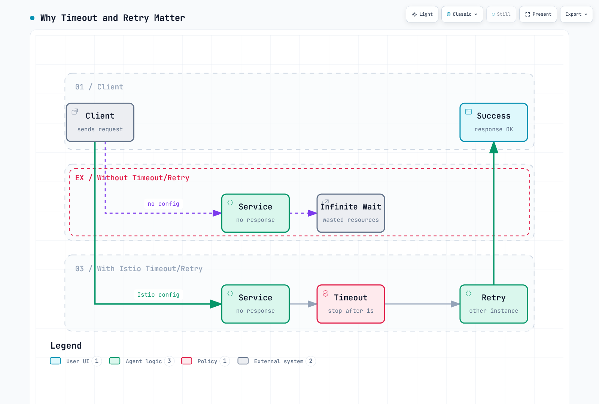
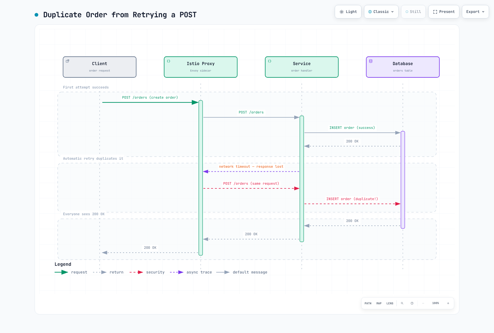

# 再試行とタイムアウト

Istioの再試行とタイムアウトは、マイクロサービスの回復性を高めるための基本機能です。これらのポリシーは、アプリケーションコードを変更せずに設定できます。

## 目次

1. [概要](#overview)
2. [タイムアウトの設定](#timeout-configuration)
3. [再試行の設定](#retry-configuration)
4. [再試行とタイムアウトの組み合わせ](#combining-retry-and-timeout)
5. [実践例](#practical-examples)
6. [重要な注意事項](#important-warnings)
7. [ベストプラクティス](#best-practices)
8. [トラブルシューティング](#troubleshooting)

## 概要 {#overview}

以下の例は、HTTPを使うサイドカー向けの代替ポリシーです。書き込み用のポリシーを示す箇所を除き、操作は安全に再試行できることを前提とします。ネイティブSQLや、暗号化されたアプリケーションHTTPSの内容には、これらのHTTP再試行・タイムアウト規則を適用できません。呼び出し元にも期限を設定してください。複数層で再試行すると、バックエンドへの試行回数が増え、ある層のローカルタイムアウトを越えて処理が続く場合があります。

### タイムアウトと再試行が必要な理由



[🔍 インタラクティブな図を見る](https://www.atomai.click/kubernetes-docs/archmaps/en-service-mesh-istio-traffic-management-05-retry-timeout-0.html)

## タイムアウトの設定 {#timeout-configuration}

### 基本的なタイムアウト

```yaml
apiVersion: networking.istio.io/v1
kind: VirtualService
metadata:
  name: reviews-timeout
spec:
  hosts:
  - reviews
  http:
  - route:
    - destination:
        host: reviews
    timeout: 10s  # Timeout after 10 seconds
```

### パスごとのタイムアウト

```yaml
apiVersion: networking.istio.io/v1
kind: VirtualService
metadata:
  name: api-timeouts
spec:
  hosts:
  - api.example.com
  http:
  # Fast response API - short timeout
  - match:
    - uri:
        prefix: "/api/quick"
    route:
    - destination:
        host: api-service
    timeout: 1s

  # Standard API
  - match:
    - uri:
        prefix: "/api/standard"
    route:
    - destination:
        host: api-service
    timeout: 5s

  # Heavy operations - long timeout
  - match:
    - uri:
        prefix: "/api/batch"
    route:
    - destination:
        host: api-service
    timeout: 30s
```

## 再試行の設定 {#retry-configuration}

> **重要:** `retries` を省略しても、必ず再試行が無効になるとは限りません。Istio 1.31.0で実際に生成されるデフォルトは `attempts: 2` で、`retryOn: connect-failure,refused-stream,unavailable,cancelled,retriable-status-codes` です。`attempts` は元の要求の**後に行う追加の再試行回数**を表すため、合計3回配信されることがあります。Proxyの再試行を無効にするには、ルートで `attempts: 0` を明示してください。

HTTPRetryのリファレンスではこの条件リストが省略形になっています。リリース済みの再試行実装は、設定されたステータスコードに対して `retriable-status-codes` も有効にします。クラスターのデフォルト値は上書きできます。明示的な再試行ポリシーでは対象の条件を指定してください。すべてのタイムアウトが再試行されるわけではなく、常に別の正常なエンドポイントがあるとも限りません。

### 基本的な再試行

```yaml
apiVersion: networking.istio.io/v1
kind: VirtualService
metadata:
  name: reviews-retry
spec:
  hosts:
  - reviews
  http:
  - route:
    - destination:
        host: reviews
    retries:
      attempts: 3  # Maximum 3 retries
      perTryTimeout: 2s  # 2s timeout per attempt
      retryOn: 5xx,reset,connect-failure,refused-stream  # Retry conditions
```

### 再試行の条件

| 条件 | 説明 |
|-----------|-------------|
| `5xx` | HTTP 5xxエラー |
| `gateway-error` | 502、503、504エラー |
| `reset` | 接続のリセット |
| `connect-failure` | 接続失敗 |
| `refused-stream` | HTTP/2 REFUSED_STREAM |
| `retriable-4xx` | 409 競合 |
| `retriable-status-codes` | 任意に指定するステータスコード |

### 高度な再試行設定

`payment-service` は課金要求の送信など、冪等でない書き込みを受け付けます。そのため、すべてのHTTPメソッドに同じ再試行ポリシーを適用すると、`reset` や `5xx` に対してメッシュがPOSTを再送し、このページで説明する曖昧な再実行リスクを生みます。メソッドごとにルートを分けてください。読み取り専用の状態確認は十分に再試行し、書き込み経路ではメッシュによる再試行を完全に無効にします。

```yaml
apiVersion: networking.istio.io/v1
kind: VirtualService
metadata:
  name: advanced-retry
spec:
  hosts:
  - payment-service
  http:
  - name: reads-retryable
    match:
    - method:
        regex: "^(GET|HEAD)$"
    route:
    - destination:
        host: payment-service
    retries:
      attempts: 3
      perTryTimeout: 2s
      retryOn: connect-failure,refused-stream
      retryRemoteLocalities: true  # Retry to other regions
  - name: writes-no-mesh-retry
    match:
    - method:
        regex: "^(POST|PUT|PATCH|DELETE)$"
    route:
    - destination:
        host: payment-service
    retries:
      attempts: 0
```

## 再試行とタイムアウトの組み合わせ {#combining-retry-and-timeout}

### 階層化されたタイムアウト

```yaml
apiVersion: networking.istio.io/v1
kind: VirtualService
metadata:
  name: layered-timeouts
spec:
  hosts:
  - frontend
  http:
  - route:
    - destination:
        host: frontend
    timeout: 10s  # Total timeout
    retries:
      attempts: 3
      perTryTimeout: 3s  # Timeout for each delivery, including the original
```

**計算:** 理論上の配信時間上限は `(1 + attempts) × perTryTimeout = 4 × 3s = 12s` ですが、先にルート単位の `timeout: 10s` が適用されます。バックオフと残りのルートのタイムアウトによって、実際の再試行回数は少なくなる場合があります。

### HTTPメソッドごとに再試行ポリシーを分ける

```yaml
apiVersion: networking.istio.io/v1
kind: VirtualService
metadata:
  name: order-service
spec:
  hosts:
  - order-service
  http:
  # POST/PATCH: do not replay an ambiguous write in the mesh
  - name: writes-no-mesh-retry
    match:
    - method:
        regex: "^(POST|PUT|PATCH|DELETE)$"
    route:
    - destination:
        host: order-service
    timeout: 10s
    retries:
      attempts: 0

  # GET/HEAD: retry only connection establishment and REFUSED_STREAM failures
  - name: reads-limited-retry
    match:
    - method:
        regex: "^(GET|HEAD)$"
    route:
    - destination:
        host: order-service
    timeout: 5s
    retries:
      attempts: 2
      perTryTimeout: 2s
      retryOn: connect-failure,refused-stream
```

POST/PATCH、およびドメイン上の契約で書き込みと定義される操作では、デフォルトでメッシュによる再試行を無効にしてください。PUTやDELETEも、HTTPメソッドだけを根拠に安全とは判断できません。アプリケーションの実際の契約で繰り返し実行しても安全と確認できる場合に限り、再試行してください。

## 実践例 {#practical-examples}

### 例1: マイクロサービスチェーン

```yaml
# Frontend → Backend → Database
apiVersion: networking.istio.io/v1
kind: VirtualService
metadata:
  name: frontend
spec:
  hosts:
  - frontend
  http:
  - route:
    - destination:
        host: frontend
    timeout: 15s  # Consider entire chain
    retries:
      attempts: 2
      perTryTimeout: 7s
---
apiVersion: networking.istio.io/v1
kind: VirtualService
metadata:
  name: backend
spec:
  hosts:
  - backend
  http:
  - route:
    - destination:
        host: backend
    timeout: 10s  # Consider database call
    retries:
      attempts: 3
      perTryTimeout: 3s
      retryOn: 5xx,reset
---
apiVersion: networking.istio.io/v1
kind: VirtualService
metadata:
  name: database
spec:
  hosts:
  - database
  http:
  - route:
    - destination:
        host: database
    timeout: 5s
    retries:
      attempts: 2
      perTryTimeout: 2s
      retryOn: connect-failure,refused-stream
```

### 例2: 外部APIの呼び出し

```yaml
apiVersion: networking.istio.io/v1
kind: VirtualService
metadata:
  name: external-api
spec:
  hosts:
  - api.external.com
  http:
  - route:
    - destination:
        host: api.external.com
    timeout: 30s  # External APIs can be slow
    retries:
      attempts: 5  # External APIs have frequent transient failures
      perTryTimeout: 5s
      retryOn: 5xx,reset,connect-failure,gateway-error
---
apiVersion: networking.istio.io/v1
kind: ServiceEntry
metadata:
  name: external-api
spec:
  hosts:
  - api.external.com
  ports:
  - number: 80
    name: http
    protocol: HTTP
    targetPort: 443
  location: MESH_EXTERNAL
  resolution: DNS
---
apiVersion: networking.istio.io/v1
kind: DestinationRule
metadata:
  name: external-api-tls
spec:
  host: api.external.com
  trafficPolicy:
    tls:
      mode: SIMPLE
      sni: api.external.com
      subjectAltNames:
      - api.external.com
```

この外部API呼び出し例では、アプリケーションから `http://api.external.com` に接続します。ホスト名は実際のサービスに合わせて変更してください。アプリケーションがすでにHTTPSを開始している場合、暗号化されたHTTPメッセージからこれらの再試行条件を検査することはできません。

### 例3: サーキットブレーカーとの組み合わせ

`payment` は冪等でない書き込みを処理します。そのため、この例も前述の `payment-service` と同じようにメソッドごとにルートを分けています。読み取りは十分に再試行し、書き込みではメッシュによる再試行を無効にします。以下のサーキットブレーカーは両方のルートに適用されます。

```yaml
apiVersion: networking.istio.io/v1
kind: VirtualService
metadata:
  name: resilient-service
spec:
  hosts:
  - payment
  http:
  - name: reads-retryable
    match:
    - method:
        regex: "^(GET|HEAD)$"
    route:
    - destination:
        host: payment
    timeout: 10s
    retries:
      attempts: 3
      perTryTimeout: 3s
      retryOn: connect-failure,refused-stream
  - name: writes-no-mesh-retry
    match:
    - method:
        regex: "^(POST|PUT|PATCH|DELETE)$"
    route:
    - destination:
        host: payment
    timeout: 10s
    retries:
      attempts: 0
---
apiVersion: networking.istio.io/v1
kind: DestinationRule
metadata:
  name: payment-circuit-breaker
spec:
  host: payment
  trafficPolicy:
    connectionPool:
      tcp:
        maxConnections: 100
      http:
        http1MaxPendingRequests: 50
        maxRequestsPerConnection: 2
    outlierDetection:
      consecutive5xxErrors: 5
      interval: 30s
      baseEjectionTime: 30s
      maxEjectionPercent: 50
```

## 重要な注意事項 {#important-warnings}

### 冪等でない要求の再試行リスク

**基本原則:** POST/PATCHや、ドメイン上の契約で冪等でないと定義される書き込みにIstio Proxyの自動再試行を適用すると、**データ整合性の問題**が起きる可能性があります。PUT/DELETEは、アプリケーションの実際の契約で冪等性を保証できる場合に限り例外として扱ってください。

#### 問題のシナリオ



[🔍 インタラクティブな図を見る](https://www.atomai.click/kubernetes-docs/archmaps/en-service-mesh-istio-traffic-management-05-retry-timeout-1.html)

#### なぜ危険なのか

1. **重複作成:** POST要求が実際には成功しても、ネットワーク障害で応答だけが失われることがあります。Proxyが再試行すると、**レコードが重複**して作られます。
2. **誤った状態変更:** **支払い、在庫の引き落とし**などの重要な業務処理が複数回実行される場合があります。
3. **成功の判別不能:** Istio Proxyには、要求が成功したかどうかを確認する方法がありません。

#### 安全な再試行戦略

**推奨: メッシュによる再試行を無効にし、アプリケーション層で重複排除を強制する**

```yaml
# Istio: explicitly do not retry a non-idempotent write
apiVersion: networking.istio.io/v1
kind: VirtualService
metadata:
  name: order-service
spec:
  hosts:
  - order-service
  http:
  - match:
    - method:
        exact: POST
    route:
    - destination:
        host: order-service
    timeout: 10s
    retries:
      attempts: 0  # No delivery after the original request
```

`reset`、`503`、timeoutが起きても、サーバーが要求を拒否したとは限りません。サーバーがデータベーストランザクションをコミットした後に、応答だけが失われた可能性もあるため、プロキシには再送が安全かどうか判断できません。結果が曖昧なときは、盲目的に再送せず、アプリケーションから操作の状態を問い合わせてください。

```python
# Client excerpt: requires an API with an atomic idempotency contract.
import requests
from requests.adapters import HTTPAdapter
from urllib3.util.retry import Retry


def create_order_with_idempotency(order_data, idempotency_key):
    # Persist one key per logical order; reuse it after ambiguous failures.
    if not idempotency_key:
        raise ValueError("A persisted operation idempotency key is required")
    retries = Retry(
        total=3,
        status_forcelist=[500, 502, 503, 504],
        allowed_methods=["POST"],
        backoff_factor=1,
    )
    with requests.Session() as session:
        adapter = HTTPAdapter(max_retries=retries)
        session.mount("http://", adapter)
        session.mount("https://", adapter)
        response = session.post(
            "http://order-service/orders",
            json=order_data,
            headers={"X-Idempotency-Key": idempotency_key},
            timeout=(3, 10),
        )
        response.raise_for_status()
        return response.json()
```

サーバー側で契約を原子的に保証する必要があります。Redisの `exists` を確認してから注文を作成し、別々にキャッシュへ書き込む方式では、同時実行される重複注文や処理途中のクラッシュを防げません。安全な重複排除の実装にはなりません。

1. キーを検証し、認証済みの呼び出し元と要求ペイロードのフィンガープリントに結び付けます。
2. データベースの一意制約を使ってキーを確保し、並行する試行を直列化します。
3. 注文の変更と保存する状態と応答を、同じトランザクションでキーとともにコミットします。
4. 同じキーとペイロードなら保存済みの結果を返し、ペイロードが異なるキーの再利用は拒否します。
5. 取り消せない外部処理はアウトボックスパターンや冪等な下流APIを通して調整します。保持期間はサポートする再試行期間を覆うように設定します。

クライアント例は、このサーバー側契約がすでに実装済みであることを前提とします。ヘッダーを追加しただけでPOSTが安全になるわけではありません。Requestsのタイムアウトは各試行の接続・読み取り段階に対するもので、再試行を含む全体の期限ではありません。

本番の書き込みAPIでは、次の対策を組み合わせてください。

- 同じトランザクション内のデータベース一意制約で裏付けた `Idempotency-Key`
- 更新に対する `ETag`/`If-Match` またはバージョンフィールドによるcompare-and-swap
- タイムアウト/リセット後にトランザクションIDまたはコマンドIDで状態を照会すること
- 支払い処理やイベント公開など、取り消せない下流への影響に対するトランザクショナルアウトボックス

#### HTTPメソッドごとの再試行安全性

| メソッド | 冪等 | Istio再試行の安全性 | 推奨設定 |
|--------|------------|-------------------|---------------------|
| **GET** | はい | 安全 | `attempts: 3, retryOn: 5xx,reset` |
| **HEAD** | はい | 安全 | `attempts: 3, retryOn: 5xx,reset` |
| **OPTIONS** | はい | 安全 | `attempts: 3, retryOn: 5xx,reset` |
| **PUT** | 契約による | 注意 | 実際の冪等性契約 + 条件付き更新 |
| **DELETE** | 契約による | 注意 | 実際の冪等性契約 + 結果照会 |
| **POST** | 通常はいいえ | 危険 | `attempts: 0`、冪等性キー |
| **PATCH** | 通常はいいえ | 危険 | `attempts: 0`、version/ETag |

#### 安全に再試行できる場合

```yaml
# Read-only requests - safe
apiVersion: networking.istio.io/v1
kind: VirtualService
metadata:
  name: api-service-reads
spec:
  hosts:
  - api-service
  http:
  - match:
    - method:
        regex: "GET|HEAD|OPTIONS"
    route:
    - destination:
        host: api-service
    retries:
      attempts: 3
      perTryTimeout: 2s
      retryOn: 5xx,reset,connect-failure
```

```yaml
# Write requests with idempotency guaranteed
apiVersion: networking.istio.io/v1
kind: VirtualService
metadata:
  name: idempotent-writes
spec:
  hosts:
  - api-service
  http:
  - match:
    - method:
        exact: PUT
      headers:
        x-idempotency-key:
          regex: ".+"  # Only when Idempotency Key present
    route:
    - destination:
        host: api-service
    retries:
      attempts: 3
      perTryTimeout: 2s
      retryOn: 5xx,reset
```

#### サーキットブレーカーと併用する際の注意

サーキットブレーカーは**障害の分離**には有効ですが、冪等でない要求の**重複実行は防げません**。

```yaml
# Bad example: POST + Circuit Breaker + Retry
apiVersion: networking.istio.io/v1
kind: VirtualService
metadata:
  name: payment-service
spec:
  hosts:
  - payment-service
  http:
  - route:
    - destination:
        host: payment-service
    retries:
      attempts: 3  # 3 retries for POST is dangerous
      retryOn: 5xx
---
apiVersion: networking.istio.io/v1
kind: DestinationRule
metadata:
  name: payment-circuit-breaker
spec:
  host: payment-service
  trafficPolicy:
    outlierDetection:
      consecutive5xxErrors: 5
      baseEjectionTime: 30s

# Result: Before the Circuit Breaker opens,
# duplicate payments can occur 3 times!
```

```yaml
# Good example: Use Circuit Breaker only, retry at application level
apiVersion: networking.istio.io/v1
kind: VirtualService
metadata:
  name: payment-service
spec:
  hosts:
  - payment-service
  http:
  - route:
    - destination:
        host: payment-service
    timeout: 10s
    retries:
      attempts: 0  # Completely disable retry
---
apiVersion: networking.istio.io/v1
kind: DestinationRule
metadata:
  name: payment-circuit-breaker
spec:
  host: payment-service
  trafficPolicy:
    outlierDetection:
      consecutive5xxErrors: 5
      baseEjectionTime: 30s
```

#### 実践ガイドライン

1. **GET/HEAD/OPTIONS:** Istio Proxyの再試行を使用できます。
2. **POST/PATCH:** Istioの再試行を無効にし、アプリケーション層で再試行と冪等性キーを使います。
3. **PUT/DELETE:** 冪等性が保証される場合に限り、Istioの再試行を使います。
4. **重要な処理（支払い/在庫/ポイント）:** アプリケーション層の検証と冪等性キーが必須です。

## ベストプラクティス {#best-practices}

### 1. タイムアウト設定ガイド

```yaml
# Good example: Appropriate timeout per layer
# Frontend: 15s
# API Gateway: 10s
# Backend Service: 5s
# Database: 3s

apiVersion: networking.istio.io/v1
kind: VirtualService
metadata:
  name: api-gateway
spec:
  hosts:
  - api-gateway
  http:
  - route:
    - destination:
        host: api-gateway
    timeout: 10s
    retries:
      attempts: 2
      perTryTimeout: 4s
```

```yaml
# Bad example: Timeout too long
apiVersion: networking.istio.io/v1
kind: VirtualService
metadata:
  name: api-gateway
spec:
  hosts:
  - api-gateway
  http:
  - route:
    - destination:
        host: api-gateway
    timeout: 300s  # Illustrative poor fit for a short interactive request; streaming differs
```

### 2. 再試行戦略

```yaml
# Good example: Consider idempotency
apiVersion: networking.istio.io/v1
kind: VirtualService
metadata:
  name: api-service
spec:
  hosts:
  - api-service
  http:
  # GET - safe to retry
  - match:
    - method:
        exact: GET
    route:
    - destination:
        host: api-service
    retries:
      attempts: 3
      perTryTimeout: 2s
      retryOn: 5xx,reset,connect-failure

  # POST/PATCH - explicitly disable mesh retry
  - match:
    - method:
        regex: "^(POST|PUT|PATCH|DELETE)$"
    route:
    - destination:
        host: api-service
    retries:
      attempts: 0
```

### 3. 指数バックオフ

Envoyは全体にジッターを加えた指数バックオフを使い、デフォルトの基準間隔は25msです。実際の遅延は25/50/100msの固定列ではありません。次の例は読み取り用の基準間隔を設定し、書き込み経路では再試行を明示的に無効にします。

```yaml
apiVersion: networking.istio.io/v1
kind: VirtualService
metadata:
  name: backoff-retry
spec:
  hosts:
  - payment
  http:
  - match:
    - method:
        regex: "^(GET|HEAD)$"
    route:
    - destination:
        host: payment
    retries:
      attempts: 5
      perTryTimeout: 2s
      retryOn: connect-failure,refused-stream
      backoff: 100ms
  - route:
    - destination:
        host: payment
    retries:
      attempts: 0
```

### 4. システム全体のタイムアウトを計算する

```yaml
# Frontend → API Gateway → Backend → Database
# Frontend: 20s
# API Gateway: 15s (must be less than Frontend)
# Backend: 10s (must be less than API Gateway)
# Database: 5s (must be less than Backend)

# Each layer should consider downstream timeout + overhead
```

## トラブルシューティング {#troubleshooting}

### タイムアウトが機能しない

```bash
# 1. Check VirtualService
kubectl get virtualservice -n <namespace>
kubectl describe virtualservice <name> -n <namespace>

# 2. Check Envoy configuration
istioctl proxy-config routes <pod-name> -n <namespace> -o json | grep timeout

# 3. Test actual timeout
kubectl exec -it <pod-name> -n <namespace> -c <app-container> -- \
  curl -v --max-time 15 http://backend-service
```

### 再試行が多すぎる

再試行を測るときは、istio-proxyのUIDではなく、curlを使えるアプリケーションコンテナから要求を送ってください。Proxy UIDからの通信は捕捉を迂回する場合があります。テスト時は、curlの期限を設定済みルートのタイムアウトより長くします。Proxyの統計マッチャーを有効にして、Envoyの再試行カウンターを測定してください。`UR`応答フラグはアップストリームからのリモートリセットを表し、再試行回数を表すカウンターではありません。

```promql
sum(rate(envoy_cluster_upstream_rq_retry[5m]))
```

### 再試行ストームを防ぐ

```yaml
# Use with Circuit Breaker
apiVersion: networking.istio.io/v1
kind: DestinationRule
metadata:
  name: prevent-retry-storm
spec:
  host: backend
  trafficPolicy:
    connectionPool:
      tcp:
        maxConnections: 100
      http:
        http1MaxPendingRequests: 10  # Limit pending requests
        http2MaxRequests: 100
        maxRequestsPerConnection: 1
    outlierDetection:
      consecutive5xxErrors: 3  # Fast circuit break
      interval: 10s
      baseEjectionTime: 30s
```

## 参考資料

- [Istioのタイムアウト](https://istio.io/latest/docs/reference/config/networking/virtual-service/#HTTPRoute)
- [Istioの再試行](https://istio.io/latest/docs/reference/config/networking/virtual-service/#HTTPRetry)
- [Envoyの再試行ポリシー](https://www.envoyproxy.io/docs/envoy/latest/configuration/http/http_filters/router_filter#config-http-filters-router-x-envoy-retry-on)
- [RFC 9110: 冪等なメソッド](https://www.rfc-editor.org/rfc/rfc9110.html#name-idempotent-methods)

- [主要リファレンス1](https://istio.io/latest/docs/reference/config/networking/virtual-service/)
- [主要リファレンス2](https://raw.githubusercontent.com/istio/istio/1.31.0/pilot/pkg/networking/core/route/retry/retry.go)
- [主要リファレンス3](https://www.envoyproxy.io/docs/envoy/latest/configuration/http/http_filters/router_filter)
- [主要リファレンス4](https://www.rfc-editor.org/rfc/rfc9110.html#name-idempotent-methods)
- [主要リファレンス5](https://aws.amazon.com/builders-library/making-retries-safe-with-idempotent-APIs/)
- [主要リファレンス6](https://raw.githubusercontent.com/psf/requests/main/docs/user/advanced.rst)
- [主要リファレンス7](https://raw.githubusercontent.com/urllib3/urllib3/main/src/urllib3/util/retry.py)
- [主要リファレンス8](https://istio.io/latest/docs/tasks/traffic-management/egress/egress-tls-origination/)
