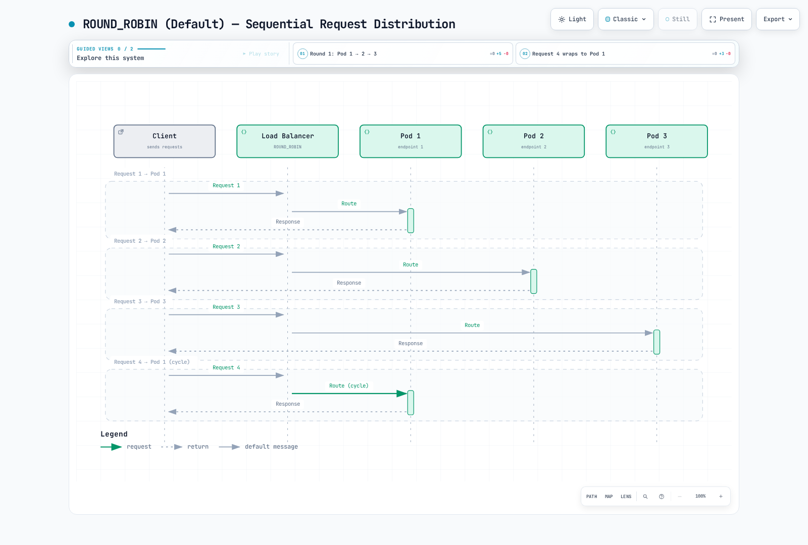

# ロードバランシング

IstioはEnvoyを通じて複数のロードバランシングアルゴリズムを提供し、トラフィックを効率よく分散します。

## 目次

1. [ロードバランシングが必要な理由](#why-load-balancing)
2. [ロードバランシングの概要](#load-balancing-overview)
3. [ロードバランシングのアルゴリズム](#load-balancing-algorithms)
4. [Consistent Hashの詳細](#consistent-hash-details)
5. [Localityベースのロードバランシング](#locality-based-load-balancing)
6. [コネクションプールの設定](#connection-pool-settings)
7. [実践例](#practical-examples)
8. [アルゴリズムの選択ガイド](#algorithm-selection-guide)
9. [ベストプラクティス](#best-practices)
10. [トラブルシューティング](#troubleshooting)

## ロードバランシングが必要な理由 {#why-load-balancing}

### リソースの効率的な利用

ロードバランシングは複数のインスタンスに通信を分散し、システム全体のスループットと安定性を高めます。


[🔍 インタラクティブな図を表示](https://www.atomai.click/kubernetes-docs/archmaps/en-service-mesh-istio-traffic-management-06-load-balancing-0.html)

### 主な利点

| 課題 | ロードバランシングなし | ロードバランシングあり |
| --- | --- | --- |
| **可用性** | 単一障害点（SPOF） | 障害時に自動フェイルオーバー |
| **性能** | 特定のインスタンスに負荷が集中 | 負荷を分散 |
| **スケーラビリティ** | 水平スケーリングが難しい | 容易にスケールアウトできる |
| **応答時間** | ばらつきが大きい（0～1,000 ms超） | 応答時間を均一化 |
| **リソース使用率** | 一部しか使われず非効率 | リソースを効率的に利用 |

## ロードバランシングの概要 {#load-balancing-overview}


[🔍 インタラクティブな図を表示](https://www.atomai.click/kubernetes-docs/archmaps/en-service-mesh-istio-traffic-management-06-load-balancing-1.html)

## ロードバランシングのアルゴリズム {#load-balancing-algorithms}

リリース済みIstio 1.31.0のデフォルトはLEAST_REQUESTです。各例は独立したDestinationRuleであり、同じホストに組み合わせて適用する設定ではありません。結果はエンドポイントの健全性、リクエストの処理コスト、接続の再利用、Proxyの配置によって異なります。CPU負荷を均等にしたり、レイテンシーを一定にしたりするアルゴリズムはありません。`consistentHash`は別の設定分岐であり、`simple: CONSISTENT_HASH`という列挙値ではありません。

Istioは次のロードバランシングアルゴリズムを提供します。

### アルゴリズムの比較

| アルゴリズム | 説明 | 用途 | 長所 | 短所 |
| --- | --- | --- | --- | --- |
| **ROUND_ROBIN** | 順番に分散（明示的な選択肢） | ステートレスサービス | 単純で公平 | 負荷が偏る可能性 |
| **LEAST_REQUEST** | アクティブなリクエストが最も少ない宛先 | 高性能API、DB接続 | 負荷を均等化 | 少しオーバーヘッドがある |
| **RANDOM** | ランダムに分散 | 大量のトラフィック | 単純で高速 | 短期的な偏りが生じる場合がある |
| **PASSTHROUGH** | 元の宛先へ転送 | TCP Proxy、SNIルーティング | 柔軟性がある | 制御が限定的 |
| **CONSISTENT_HASH** | ハッシュに基づく固定性 | セッション維持、キャッシュ | セッションの親和性 | 偏りが生じる可能性 |

### 1. ROUND_ROBIN

各エンドポイントに順番にリクエストを配分します。



[🔍 インタラクティブな図を表示](https://www.atomai.click/kubernetes-docs/archmaps/en-service-mesh-istio-traffic-management-06-load-balancing-2.html)

**設定例：**

```yaml
apiVersion: networking.istio.io/v1
kind: DestinationRule
metadata:
  name: reviews-round-robin
spec:
  host: reviews
  trafficPolicy:
    loadBalancer:
      simple: ROUND_ROBIN
```

**用途：**
- ステートレスなREST API
- Podの性能が同等の場合
- デフォルト設定で十分な場合

**長所：**
- 実装が単純で予測しやすい
- 公平に分散する

**短所：**
- Podごとの負荷の違いを考慮しない
- リクエストが長時間続くと負荷が偏ることがある

### 2. LEAST_REQUEST（デフォルト）

重みが同じエンドポイントの場合、Envoyは通常、利用可能なホストを2つサンプリングし、アクティブなリクエストが少ない方を選びます。すべてのPodを走査したり、CPU／データベースクエリの負荷を測定したりするわけではありません。重みが異なる場合は別の重み付きアルゴリズムを使います。

重みが同じ場合のデフォルトLEAST_REQUESTは、ランダムに選んだ候補エンドポイント2つのうち、負荷が低い方を選択します。

**設定例：**

```yaml
apiVersion: networking.istio.io/v1
kind: DestinationRule
metadata:
  name: api-least-request
spec:
  host: api-service
  trafficPolicy:
    loadBalancer:
      simple: LEAST_REQUEST
      warmup:
        duration: 60s  # 60 second warmup (optional)
```

**詳細設定：**

```yaml
apiVersion: networking.istio.io/v1
kind: DestinationRule
metadata:
  name: api-least-request-advanced
spec:
  host: api-service
  trafficPolicy:
    loadBalancer:
      simple: LEAST_REQUEST
      warmup:
        duration: 120s  # New pod warmup
    connectionPool:
      http:
        http2MaxRequests: 100
        maxRequestsPerConnection: 10
```

**用途：**
- 応答時間にばらつきがあるAPI
- データベース接続プール
- 重い処理を行うサービス
- リアルタイムの負荷分散が重要な場合

**長所：**
- 実際の負荷に応じて適応する
- 応答時間のばらつきを抑えやすい
- Podごとの性能差を吸収する

**短所：**
- アクティブリクエストを追跡する分、わずかなオーバーヘッドがある

### 3. RANDOM

エンドポイントをランダムに選択します。

```yaml
apiVersion: networking.istio.io/v1
kind: DestinationRule
metadata:
  name: reviews-random
spec:
  host: reviews
  trafficPolicy:
    loadBalancer:
      simple: RANDOM
```

**用途：**
- 大量のトラフィック（統計的に均等化される）
- 単純で高速な選択が必要な場合
- Podの性能が同等の場合

**長所：**
- 選択が非常に高速
- 実装が単純
- 大規模では統計的に均等になる

**短所：**
- 短期的な負荷の偏りが生じることがある
- 結果を予測しにくい

### 4. PASSTHROUGH

クライアントが指定した元の宛先へ直接接続します。

```yaml
apiVersion: networking.istio.io/v1
kind: DestinationRule
metadata:
  name: tcp-passthrough
spec:
  host: "*.external-service.com"
  trafficPolicy:
    loadBalancer:
      simple: PASSTHROUGH
```

**用途：**
- TCP Proxy
- SNIベースのルーティング
- 外部サービスへの直接接続
- TLS PASSTHROUGHモード

**長所：**
- 元の宛先アドレスを維持する
- 柔軟にルーティングできる

**短所：**
- ロードバランシングの制御が限定される

DestinationRuleのPASSTHROUGHは、元の宛先へのロードバランシングを使います。Gatewayの`tls.mode: PASSTHROUGH`はTLS終端を制御する別の設定です。SNIルーティングにはTLS VirtualService routeが必要です。

### 5. LEAST_CONN（非推奨 → LEAST_REQUEST）

**注記：**`LEAST_CONN`は**非推奨**で、`LEAST_REQUEST`に置き換えられています。

**移行：**
```yaml
# Old version (deprecated)
trafficPolicy:
  loadBalancer:
    simple: LEAST_CONN
```

```yaml
# New version
trafficPolicy:
  loadBalancer:
    simple: LEAST_REQUEST
```

## Consistent Hashの詳細 {#consistent-hash-details}

Consistent Hashは、エンドポイントの一覧が安定している間、同じキーに対して緩やかな親和性を提供します。エンドポイントの追加／削除、健全性の変化、localityの違いによってリクエストの割当先が変わることがあります。永続的なセッションストレージではありません。

### Consistent Hashの動作原理


[🔍 インタラクティブな図を表示](https://www.atomai.click/kubernetes-docs/archmaps/en-service-mesh-istio-traffic-management-06-load-balancing-4.html)

### 1. HTTPヘッダーベース

特定のHTTPヘッダーの値からハッシュを計算します。

```yaml
apiVersion: networking.istio.io/v1
kind: DestinationRule
metadata:
  name: user-hash
spec:
  host: api-service
  trafficPolicy:
    loadBalancer:
      consistentHash:
        httpHeaderName: "x-user-id"
```

**用途：**
- ユーザーごとのセッション維持
- APIキーに基づくルーティング
- テナントキーによる親和性。ただし分離は別途強制する必要があります。

### 2. HTTP Cookieベース

Cookie値からハッシュを計算します。Cookieがない場合は自動生成します。

```yaml
apiVersion: networking.istio.io/v1
kind: DestinationRule
metadata:
  name: cookie-hash
spec:
  host: web-service
  trafficPolicy:
    loadBalancer:
      consistentHash:
        httpCookie:
          name: "user-session"
          ttl: 3600s  # 1 hour TTL
```

**用途：**
- Webアプリケーションのセッション維持
- ショッピングカートの維持
- 一貫したユーザー体験

### 3. 送信元IPベース

クライアントの送信元IPアドレスからハッシュを計算します。

```yaml
apiVersion: networking.istio.io/v1
kind: DestinationRule
metadata:
  name: source-ip-hash
spec:
  host: api-service
  trafficPolicy:
    loadBalancer:
      consistentHash:
        useSourceIp: true
```

**用途：**
- IPアドレスに基づくセッション維持
- IPごとの外部rate limiterとの親和性。ただしハッシュ自体はレート制限を行いません。
- 地域キャッシュ

**注意点：**
- NAT配下の複数クライアントが同じPodへルーティングされる可能性があります。
- Proxyを使う場合は、実際のクライアントIPを確認してください。

### 4. HTTPクエリパラメータベース

クエリパラメータの値からハッシュを計算します。

```yaml
apiVersion: networking.istio.io/v1
kind: DestinationRule
metadata:
  name: query-param-hash
spec:
  host: api-service
  trafficPolicy:
    loadBalancer:
      consistentHash:
        httpQueryParameterName: "user_id"
```

**用途：**
- REST APIのリソースIDに基づくルーティング
- キャッシュに適したルーティング
- シャーディング戦略

### 5. リングの最小サイズ設定

リングの仮想ノード数を調整すると、異なるキーの分散を改善できます。割当先の変更やホットキーの再マッピングをなくすものではありません。

```yaml
apiVersion: networking.istio.io/v1
kind: DestinationRule
metadata:
  name: hash-with-ring-size
spec:
  host: cache-service
  trafficPolicy:
    loadBalancer:
      consistentHash:
        httpHeaderName: "x-cache-key"
        ringHash:
          minimumRingSize: 1024  # Default: 1024
```

**説明：**
- リングを大きくすると異なるキーをより均等に分散できる
- エンドポイント変更時に再マッピングされる割合が低下する保証はない
- メモリ使用量がわずかに増える

**ベンチマーク用の参考値（普遍的な容量基準ではありません）：**
- 小規模（Pod 10個未満）：1024（デフォルト）
- 中規模（Pod 10～50個）：2048
- 大規模（Pod 50個超）：4096

### Consistent Hashの組み合わせ例

```yaml
apiVersion: networking.istio.io/v1
kind: DestinationRule
metadata:
  name: advanced-consistent-hash
spec:
  host: api-service
  trafficPolicy:
    loadBalancer:
      consistentHash:
        httpCookie:
          name: "session-id"
          path: "/api"
          ttl: 7200s  # 2 hours
        ringHash:
          minimumRingSize: 2048
    connectionPool:
      http:
        maxRequestsPerConnection: 100
        idleTimeout: 300s
```

### Consistent Hashの注意点

#### 1. 偏りのリスク


[🔍 インタラクティブな図を表示](https://www.atomai.click/kubernetes-docs/archmaps/en-service-mesh-istio-traffic-management-06-load-balancing-5.html)

**原因**：特定のハッシュ値にトラフィックが集中すること

**解決策：**
- `ringHash.minimumRingSize`を増やすのは異なるキーの分散が不均一な場合です。単一のホットキーは引き続き1つのホストに割り当てられます。
- 複数のハッシュキーを組み合わせる
- Envoyは`hash_balance_factor`によるbounded-load hashingをサポートしますが、Istio DestinationRuleではその設定を直接公開していません。

#### 2. Pod追加／削除時の再分散

```yaml
# On pod scale out
# - Before: Pod 1, Pod 2, Pod 3
# - After: Pod 1, Pod 2, Pod 3, Pod 4
# - Result: ~25% of sessions redistributed to different pods
```

**影響を抑える方法：**
- graceful shutdownを使う
- 外部セッションストレージ（Redis、Memcached）を使う
- 段階的にスケールする

## Localityベースのロードバランシング {#locality-based-load-balancing}

同じ設定で使うのはlocalityの`distribute`割合か明示的な`failover`のどちらか一方です。両方を同時に指定しないでください。failoverにはヘルス検出と到達可能な健全エンドポイントが必要です。region／zoneラベルはトポロジーを示すもので、実測距離ではありません。DestinationRuleだけではリージョン間ネットワークやサービス検出は構築されません。EKSでは実際のNode topology値を使ってください。

Localityベースのロードバランシングでは、地理的に近いエンドポイントを優先します。

### 基本的なLocality設定

```yaml
apiVersion: networking.istio.io/v1
kind: DestinationRule
metadata:
  name: locality-lb
spec:
  host: reviews
  trafficPolicy:
    loadBalancer:
      localityLbSetting:
        enabled: true
```

### Localityの分散比率

```yaml
apiVersion: networking.istio.io/v1
kind: DestinationRule
metadata:
  name: locality-distribute
spec:
  host: reviews
  trafficPolicy:
    loadBalancer:
      localityLbSetting:
        enabled: true
        distribute:
        - from: us-west/zone-1/*
          to:
            "us-west/zone-1/*": 80  # 80% to same zone
            "us-west/zone-2/*": 20  # 20% to other zone
```

### Locality failover

1つのリージョンに障害が起きた場合、別のリージョンへ自動的に切り替えます。

```yaml
apiVersion: networking.istio.io/v1
kind: DestinationRule
metadata:
  name: locality-failover
spec:
  host: api-service
  trafficPolicy:
    loadBalancer:
      localityLbSetting:
        enabled: true
        failover:
        - from: us-west
          to: us-east
    outlierDetection:
      consecutive5xxErrors: 5
      interval: 5s
      baseEjectionTime: 30s
```

### マルチリージョンの例

```yaml
apiVersion: networking.istio.io/v1
kind: DestinationRule
metadata:
  name: global-service-locality
spec:
  host: global-api
  trafficPolicy:
    loadBalancer:
      simple: LEAST_REQUEST
      localityLbSetting:
        enabled: true
        distribute:
        # US West clients
        - from: us-west/*
          to:
            "us-west/*": 90      # 90% local
            "us-east/*": 10      # 10% remote (DR)
        # US East clients
        - from: us-east/*
          to:
            "us-east/*": 90
            "us-west/*": 10
    outlierDetection:
      consecutive5xxErrors: 5
      interval: 30s
      baseEjectionTime: 30s
```

**用途：**
- マルチリージョンデプロイ
- レイテンシーの最小化
- リージョン間の災害復旧
- コスト最適化（同一AZ内の通信）

## コネクションプールの設定 {#connection-pool-settings}

性能を最適化するには、ロードバランシングとあわせてコネクションプールを設定します。

### HTTP/1.1コネクションプール

```yaml
apiVersion: networking.istio.io/v1
kind: DestinationRule
metadata:
  name: http1-connection-pool
spec:
  host: api-service
  trafficPolicy:
    loadBalancer:
      simple: LEAST_REQUEST
    connectionPool:
      tcp:
        maxConnections: 100        # Maximum connections
        connectTimeout: 3s         # Connection timeout
      http:
        http1MaxPendingRequests: 50  # Pending request count
        maxRequestsPerConnection: 100 # Max requests per connection
        idleTimeout: 300s             # Idle connection timeout
```

### HTTP/2コネクションプール

```yaml
apiVersion: networking.istio.io/v1
kind: DestinationRule
metadata:
  name: http2-connection-pool
spec:
  host: grpc-service
  trafficPolicy:
    loadBalancer:
      simple: LEAST_REQUEST
    connectionPool:
      tcp:
        maxConnections: 50
      http:
        http2MaxRequests: 1000     # HTTP/2 concurrent requests
        maxRequestsPerConnection: 0 # Unlimited (HTTP/2 multiplexing)
        h2UpgradePolicy: UPGRADE    # Allow HTTP/2 upgrade
```

## 実践例 {#practical-examples}

### 例1：高性能APIサービス

```yaml
apiVersion: networking.istio.io/v1
kind: DestinationRule
metadata:
  name: api-high-performance
  namespace: production
spec:
  host: api-service
  trafficPolicy:
    loadBalancer:
      simple: LEAST_REQUEST
      warmup:
        duration: 60s  # New pod warmup
    connectionPool:
      tcp:
        maxConnections: 200
        connectTimeout: 5s
      http:
        http2MaxRequests: 500
        maxRequestsPerConnection: 100
        idleTimeout: 300s
    outlierDetection:
      consecutive5xxErrors: 5
      interval: 30s
      baseEjectionTime: 30s
      maxEjectionPercent: 50
```

**利用場面：**
- 高性能なREST API
- 応答時間が変動するリクエスト
- Podごとの性能差がある環境

### 例2：ユーザーセッションに基づくルーティング

```yaml
apiVersion: networking.istio.io/v1
kind: DestinationRule
metadata:
  name: web-session-affinity
spec:
  host: web-frontend
  trafficPolicy:
    loadBalancer:
      consistentHash:
        httpCookie:
          name: "session-id"
          ttl: 7200s  # 2 hours
        ringHash:
          minimumRingSize: 2048
    connectionPool:
      tcp:
        maxConnections: 500
      http:
        http1MaxPendingRequests: 100
        maxRequestsPerConnection: 50
```

**利用場面：**
- Webアプリケーションのセッション維持
- ショッピングカートの一貫性
- ユーザーごとのキャッシュ利用

### 例3：マルチリージョンのグローバルサービス

```yaml
apiVersion: networking.istio.io/v1
kind: DestinationRule
metadata:
  name: global-api-multi-region
spec:
  host: global-api
  trafficPolicy:
    loadBalancer:
      simple: LEAST_REQUEST
      localityLbSetting:
        enabled: true
        distribute:
        # US West
        - from: us-west-1/*
          to:
            "us-west-1/*": 80
            "us-west-2/*": 15
            "us-east-1/*": 5
        # US East
        - from: us-east-1/*
          to:
            "us-east-1/*": 80
            "us-east-2/*": 15
            "us-west-1/*": 5
        # EU
        - from: eu-central-1/*
          to:
            "eu-central-1/*": 90
            "eu-west-1/*": 10
    connectionPool:
      tcp:
        maxConnections: 1000
      http:
        http2MaxRequests: 2000
    outlierDetection:
      consecutive5xxErrors: 5
      interval: 30s
      baseEjectionTime: 60s
```

**利用場面：**
- グローバルSaaSサービス
- レイテンシーの最小化
- リージョンごとの災害復旧
- AZ間通信コストの削減

### 例4：キャッシュサービスの最適化

これは`x-cache-key`を受け付けるHTTPキャッシュサービスを前提とします。ネイティブRedis通信にはHTTPヘッダーがありません。Redisキーの扱いにはRedis対応クライアント／クラスターシャーディング機構を使ってください。

```yaml
apiVersion: networking.istio.io/v1
kind: DestinationRule
metadata:
  name: cache-service-optimized
spec:
  host: http-cache
  trafficPolicy:
    loadBalancer:
      consistentHash:
        httpHeaderName: "x-cache-key"
        ringHash:
          minimumRingSize: 4096  # Large ring size to minimize redistribution
    connectionPool:
      tcp:
        maxConnections: 100
        connectTimeout: 1s
      http:
        http1MaxPendingRequests: 20
        maxRequestsPerConnection: 1000
        idleTimeout: 600s
    outlierDetection:
      consecutive5xxErrors: 3
      interval: 10s
      baseEjectionTime: 30s
```

**利用場面：**
- キャッシュヒット率の最大化
- キャッシュキーに応じた一貫したルーティング
- シャーディング戦略

### 例5：データベースの接続プール

```yaml
apiVersion: networking.istio.io/v1
kind: DestinationRule
metadata:
  name: database-connection-pool
spec:
  host: postgres-primary
  trafficPolicy:
    loadBalancer:
      simple: ROUND_ROBIN
    connectionPool:
      tcp:
        maxConnections: 50  # DB connection limit
        connectTimeout: 5s
    outlierDetection:
      consecutive5xxErrors: 3
      interval: 60s
      baseEjectionTime: 120s
```

**利用場面：**
- データベース接続プールの管理
- 接続先の選択のみ。実行中のSQLクエリは再分散されません。
- 接続数の上限管理

### 例6：大量トラフィック処理

```yaml
apiVersion: networking.istio.io/v1
kind: DestinationRule
metadata:
  name: high-traffic-service
spec:
  host: analytics-ingestion
  trafficPolicy:
    loadBalancer:
      simple: RANDOM  # Fast selection to minimize overhead
    connectionPool:
      tcp:
        maxConnections: 5000
        connectTimeout: 1s
      http:
        http2MaxRequests: 10000
        maxRequestsPerConnection: 1000
        idleTimeout: 60s
    outlierDetection:
      consecutive5xxErrors: 10
      interval: 30s
      baseEjectionTime: 30s
      maxEjectionPercent: 20  # Limited ejection at scale
```

**利用場面：**
- イベント収集（Analytics）
- ログ収集
- 大規模データ処理

## アルゴリズムの選択ガイド {#algorithm-selection-guide}

### 判断の流れ

HTTPトラフィックではまずLEAST_REQUESTを使います。ソフトな親和性が必要な場合にConsistent Hashを選び、その他のアルゴリズムは代表的な負荷で測定してください。

### サービス種別ごとの推奨アルゴリズム

| サービス種別 | 推奨アルゴリズム | 理由 |
| --- | --- | --- |
| **REST API** | LEAST_REQUEST | 応答時間の一貫性 |
| **GraphQL API** | LEAST_REQUEST | 複雑なクエリの分散 |
| **gRPC** | LEAST_REQUEST | Streaming負荷の分散 |
| **Web Frontend** | CONSISTENT_HASH（Cookie） | セッション維持 |
| **WebSocket** | 必要に応じて再接続時の親和性 | 既存接続は同じ上流にとどまる |
| **Cache Service** | CONSISTENT_HASH（header） | キャッシュヒット率 |
| **Analytics／ログ収集** | RANDOM | 大規模処理 |
| **Database** | DB対応クライアント／Pool。必要ならTCPポリシー | primary／replicaの意味を保つ |
| **Static Content** | ROUND_ROBIN | 単純で十分 |
| **Message Queue** | Broker／Clientのconsumer割当 | HTTPのアクティブリクエスト数はQueue負荷の指標ではない |
| **Batch Processing** | LEAST_REQUEST | Jobの分散 |

### トラフィックパターンによる選択

```yaml
# 1. Uniform small requests (< 10ms)
trafficPolicy:
  loadBalancer:
    simple: ROUND_ROBIN  # Simple and efficient
```

```yaml
# 2. Variable requests (10ms ~ 1s+)
trafficPolicy:
  loadBalancer:
    simple: LEAST_REQUEST  # Load adaptive
```

```yaml
# 3. Very high traffic (10,000+ RPS)
trafficPolicy:
  loadBalancer:
    simple: RANDOM  # Minimize overhead
```

```yaml
# 4. Session-based (user state)
trafficPolicy:
  loadBalancer:
    consistentHash:
      httpCookie:
        name: "session-id"
        ttl: 3600s
```

```yaml
# 5. Multi-region
trafficPolicy:
  loadBalancer:
    simple: LEAST_REQUEST
    localityLbSetting:
      enabled: true
```

## ベストプラクティス {#best-practices}

### 1. アルゴリズム選択の原則

**良い例：**
```yaml
# API with variable response times
apiVersion: networking.istio.io/v1
kind: DestinationRule
metadata:
  name: api-service-best-practice
spec:
  host: api-service
  trafficPolicy:
    loadBalancer:
      simple: LEAST_REQUEST  # Load adaptive
      warmup:
        duration: 60s  # New pod warmup
```

**悪い例：**
```yaml
# Using ROUND_ROBIN with variable response times
apiVersion: networking.istio.io/v1
kind: DestinationRule
metadata:
  name: api-service-bad-practice
spec:
  host: api-service
  trafficPolicy:
    loadBalancer:
      simple: ROUND_ROBIN  # Causes load imbalance
```

### 2. コネクションプールの調整

需要を測定してから任意のコネクションプール上限を調整してください。上限はProxyごとの値であり、サービス全体の接続数上限ではありません。

```yaml
apiVersion: networking.istio.io/v1
kind: DestinationRule
metadata:
  name: complete-lb-config
spec:
  host: api-service
  trafficPolicy:
    loadBalancer:
      simple: LEAST_REQUEST
    connectionPool:  # Optional tuning
      tcp:
        maxConnections: 100
      http:
        http1MaxPendingRequests: 50
        maxRequestsPerConnection: 100
```

### 3. Outlier Detectionとの組み合わせ

障害中のPodを除外するため、Circuit Breakerと組み合わせて使います。

```yaml
apiVersion: networking.istio.io/v1
kind: DestinationRule
metadata:
  name: lb-with-outlier
spec:
  host: api-service
  trafficPolicy:
    loadBalancer:
      simple: LEAST_REQUEST
    outlierDetection:  # Health-based ejection
      consecutive5xxErrors: 5
      interval: 30s
      baseEjectionTime: 30s
```

### 4. Consistent Hashを使う際の注意

```yaml
# Good example: Using session storage
apiVersion: networking.istio.io/v1
kind: DestinationRule
metadata:
  name: web-with-redis-session
  annotations:
    description: "Uses Redis for session storage"
spec:
  host: web-frontend
  trafficPolicy:
    loadBalancer:
      consistentHash:
        httpCookie:
          name: "session-id"
          ttl: 3600s
    # Using Redis session storage maintains
    # sessions even on pod restart
```

```yaml
# Caution: Local session only
apiVersion: networking.istio.io/v1
kind: DestinationRule
metadata:
  name: web-local-session-only
  annotations:
    warning: "No external session storage - sessions lost on pod restart"
spec:
  host: web-frontend
  trafficPolicy:
    loadBalancer:
      consistentHash:
        httpCookie:
          name: "session-id"
          ttl: 3600s
    # Warning: Sessions lost on pod restart
```

### 5. マルチリージョンデプロイ

```yaml
# Good example: Locality + Failover
apiVersion: networking.istio.io/v1
kind: DestinationRule
metadata:
  name: multi-region-best-practice
spec:
  host: global-service
  trafficPolicy:
    loadBalancer:
      simple: LEAST_REQUEST
      localityLbSetting:
        enabled: true
        failover:  # Required
        - from: us-west
          to: us-east
    outlierDetection:
      consecutive5xxErrors: 5
      interval: 5s
      baseEjectionTime: 30s
```

### 6. 監視とメトリクス

ロードバランシングの有効性を監視します。

```promql
# Per-pod inbound request distribution (assumes scrape labels retain namespace/pod)
sum by (namespace, pod) (rate(istio_requests_total{reporter="destination"}[5m]))

# Per-pod inbound P95 latency
histogram_quantile(0.95,
  sum by (namespace, pod, le) (
    rate(istio_request_duration_milliseconds_bucket{reporter="destination"}[5m])
  )
)

# Raw Envoy connection statistics do not have Istio destination_workload labels
sum by (namespace, pod) (envoy_cluster_upstream_cx_active)
```

### 7. 段階的な適用

まず現在のLEAST_REQUESTデフォルトから始めます。代表的なトラフィックを測定してから、選択したアルゴリズム、コネクションプール、warmup、outlier detectionを別々に調整してください。例の値は出発点であり、性能のしきい値を保証するものではありません。

### 8. ドキュメント

以下のannotation値は例示です。サンプルのレイテンシー／負荷値を実測値に置き換えてください。今回の監査で測定したベンチマーク値ではありません。Redisセッションストレージには、DestinationRule annotationだけでなくアプリケーションとの連携も必要です。

```yaml
apiVersion: networking.istio.io/v1
kind: DestinationRule
metadata:
  name: api-service-lb
  annotations:
    # Configuration rationale
    purpose: "Distribute load based on active requests"

    # Algorithm selection basis
    algorithm-rationale: |
      - LEAST_REQUEST: Response times vary 10ms-500ms
      - warmup.duration: New pods need 60s to warm up cache

    # Test results
    test-results: |
      - Load test: 1000 RPS evenly distributed
      - P95 latency: 150ms (improved from 300ms with ROUND_ROBIN)
      - No pod overload observed

    # Monitoring
    monitoring: |
      - Dashboard: grafana.example.com/d/istio-workload
      - Alert: High P95 latency > 500ms
spec:
  host: api-service
```

## トラブルシューティング {#troubleshooting}

### 負荷分散の偏り

**症状：**
```bash
# Check CPU usage per pod
kubectl top pods -n production

# Output:
# NAME                CPU    MEMORY
# api-pod-1           800m   2048Mi
# api-pod-2           200m   1024Mi
# api-pod-3           150m   1024Mi
```

**原因と解決策：**

```yaml
# 1. Change ROUND_ROBIN -> LEAST_REQUEST
apiVersion: networking.istio.io/v1
kind: DestinationRule
metadata:
  name: api-service-fix
spec:
  host: api-service
  trafficPolicy:
    loadBalancer:
      simple: LEAST_REQUEST  # Changed

# 2. Add Warmup
      warmup:
        duration: 60s

# 3. Add Outlier Detection
    outlierDetection:
      consecutive5xxErrors: 5
      interval: 30s
      baseEjectionTime: 30s
```

### Consistent Hashの偏り

**症状：**
```bash
# Check Envoy metrics
kubectl exec -it pod-name -c istio-proxy -- \
  curl localhost:15000/stats/prometheus | grep upstream_rq_total

# Requests concentrated on specific pod
```

**解決策：**

```yaml
apiVersion: networking.istio.io/v1
kind: DestinationRule
metadata:
  name: hash-fix
spec:
  host: api-service
  trafficPolicy:
    loadBalancer:
      consistentHash:
        httpHeaderName: "x-user-id"
        ringHash:
          minimumRingSize: 4096  # Increase 2048 -> 4096
```

### Localityベースのルーティングが機能しない

ワークロードが動作するNode topologyと、Envoyのエンドポイント設定にあるlocalityを確認してください。Kubernetes／EKSでは通常、アプリケーションPodではなくNodeにregion／zoneラベルが設定されます。実際のNode／provisioner設定を修正してください。ルーティングを強制するためにクラウドのregion／zoneラベルを捏造しないでください。

```bash
kubectl get pods -o wide
kubectl get nodes -L topology.kubernetes.io/region,topology.kubernetes.io/zone
istioctl proxy-config endpoints <pod-name> -o json
istioctl proxy-config clusters <pod-name> --fqdn api-service.default.svc.cluster.local -o json
```

## 参考資料

- [Istioロードバランシング](https://istio.io/latest/docs/reference/config/networking/destination-rule/#LoadBalancerSettings)
- [Envoyロードバランシング](https://www.envoyproxy.io/docs/envoy/latest/intro/arch_overview/upstream/load_balancing/load_balancing)
- [Consistent Hashing](https://www.toptal.com/big-data/consistent-hashing)
- [Localityロードバランシング](https://istio.io/latest/docs/tasks/traffic-management/locality-load-balancing/)

- [主要な参考資料1](https://istio.io/latest/docs/reference/config/networking/destination-rule/)
- [主要な参考資料2](https://raw.githubusercontent.com/istio/istio/1.31.0/pilot/pkg/networking/core/cluster_traffic_policy.go)
- [主要な参考資料3](https://www.envoyproxy.io/docs/envoy/latest/intro/arch_overview/upstream/load_balancing/load_balancers)
- [主要な参考資料4](https://www.envoyproxy.io/docs/envoy/latest/api-v3/config/cluster/v3/cluster.proto)
- [主要な参考資料5](https://istio.io/latest/docs/tasks/traffic-management/locality-load-balancing/failover/)
- [主要な参考資料6](https://kubernetes.io/docs/reference/kubectl/generated/kubectl_top/kubectl_top_pod/)
