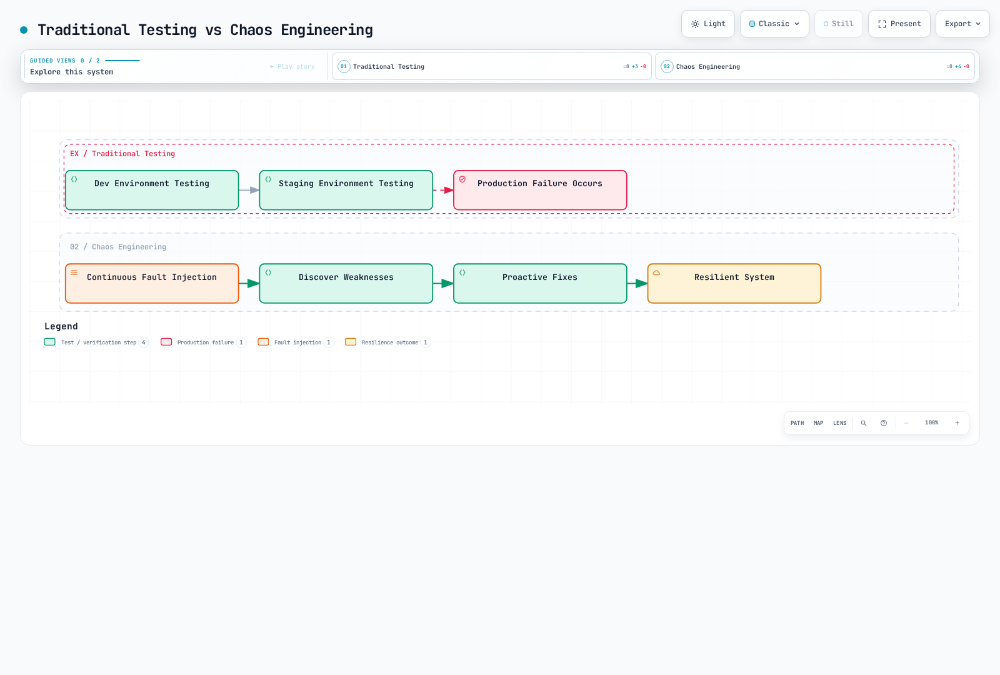
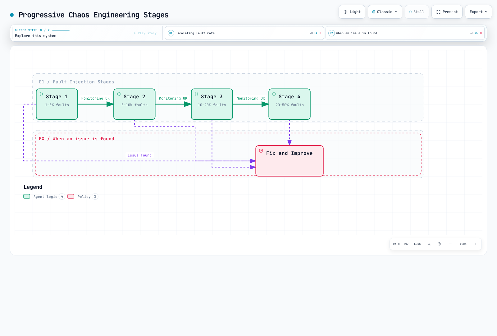

# 障害注入

障害注入（Fault Injection）は、システムの耐障害性をテストするため、意図的に障害を発生させる手法です。

## 目次

1. [障害注入が必要な理由](#why-fault-injection)
2. [障害注入を使用する場面](#when-to-use-fault-injection)
3. [障害注入の概要](#fault-injection-overview)
4. [遅延の注入](#delay-injection)
5. [中断の注入](#abort-injection)
6. [実践例](#practical-examples)
7. [実環境のシナリオ](#real-world-scenarios)
8. [テスト戦略](#testing-strategies)
9. [ベストプラクティス](#best-practices)

ここで紹介するのは、HTTP層で行う相互に代替可能な実験です。分離したnamespaceで始め、障害を注入しない場合のルーティング設定全体を保持し、テストを予定する前に独立したクリーンアップ手順を定めてください。割合は一致するリクエストに適用され、Podの割合ではありません。テスト用ヘッダーは認証ではなく、対象の下流呼び出しまで伝播させる必要があります。ネイティブSQL/TCP、パケット損失、Podのreadiness、Node障害には別のテストが必要です。

## 障害注入が必要な理由 {#why-fault-injection}

### 本番環境における耐障害性のテスト

マイクロサービスアーキテクチャでは、多数のサービスが相互に依存しており、**1つのサービスの障害がシステム全体に影響する可能性があります**。障害注入が重要な理由は次のとおりです。

#### 1. **カオスエンジニアリングの基本原則**

NetflixのChaos Monkeyなどで知られるカオスエンジニアリングは、**本番環境で障害を事前に体験し**、システムの弱点を発見することを目指します。



[🔍 インタラクティブな図を見る](https://www.atomai.click/kubernetes-docs/archmaps/en-service-mesh-istio-traffic-management-08-fault-injection-0.html)

#### 2. **本番環境のシナリオを再現する**

本番環境では、次のような問題が発生する可能性があります。

| シナリオ | 原因 | 障害注入テスト |
|----------|-------|---------------------|
| **ネットワーク遅延** | リージョン間ネットワークの遅延 | 遅延の注入 |
| **サービスのタイムアウト** | データベースクエリの遅延 | 遅延の注入 |
| **一時的な障害** | サービスの再起動、スケールダウン | 中断の注入 |
| **部分障害** | 一部のPodだけが失敗 | 割合を指定した注入 |
| **連鎖障害** | 1つのサービス障害が他のサービスへ伝播 | 障害注入の組み合わせ |

#### 3. **サーキットブレーカーとタイムアウト設定を検証する**

障害注入では、呼び出し元が遅延やエラーをどう処理するかをテストできます。プロキシの再試行、タイムアウト、endpointの除外を検証するには、それらの機構が観測する層で障害を発生させてください。

プロキシによる除外とは別に、呼び出し元の動作を検証してください。ローカルで注入した中断は上流endpointの障害ではありません。呼び出し元が観測する内容は、order serviceが実際に返す応答によって決まります。

#### 4. **安全なデプロイを検証する**

新しいバージョンをデプロイするとき、依存サービスが失敗しても**安全に動作するか**を確認できます。

- 新しいバージョンはタイムアウトを正しく処理しますか？
- 依存サービスが失敗したときに、適切な縮退運転を行いますか？
- エラー処理のロジックは正しく動作しますか？

## 障害注入を使用する場面 {#when-to-use-fault-injection}

障害注入は、次のような状況で使用します。

### 1. **開発環境とテスト環境**

#### シナリオ: 新しいマイクロサービスの開発

```yaml
# Inject faults into service under development
apiVersion: networking.istio.io/v1
kind: VirtualService
metadata:
  name: payment-service-dev
  namespace: dev
spec:
  hosts:
  - payment-service
  http:
  - match:
    - headers:
        x-testing:
          exact: "true"  # Apply only to test traffic
    fault:
      delay:
        percentage:
          value: 50.0
        fixedDelay: 3s
      abort:
        percentage:
          value: 20.0
        httpStatus: 503
    route:
    - destination:
        host: payment-service
        subset: v2
  - route:
    - destination:
        host: payment-service
```

**ユースケース**:
- payment serviceの遅延や障害に対してorder serviceがどう反応するかをテストする
- 適切なエラーメッセージがユーザーに表示されることを確認する

### 2. **ステージング環境での統合テスト**

#### シナリオ: 本番デプロイ前の最終確認

```yaml
# Inject random faults into all dependent services
apiVersion: networking.istio.io/v1
kind: VirtualService
metadata:
  name: database-service-staging
spec:
  hosts:
  - database-service
  http:
  - fault:
      delay:
        percentage:
          value: 10.0  # 10% of requests delayed
        fixedDelay: 5s
      abort:
        percentage:
          value: 5.0   # 5% of requests fail
        httpStatus: 500
    route:
    - destination:
        host: database-service
```

**ユースケース**:
- 本番デプロイ前にシステム全体の耐障害性を検証する
- 監視アラートが正しく機能することを確認する

### 3. **本番環境でのカオステスト**

#### シナリオ: 本番環境で定期的に耐障害性をテストする

```yaml
# Inject faults at very low rate in production
apiVersion: networking.istio.io/v1
kind: VirtualService
metadata:
  name: recommendation-service-prod
spec:
  hosts:
  - recommendation-service
  http:
  - match:
    - headers:
        x-canary:
          exact: "true"  # Apply only to canary users
    fault:
      abort:
        percentage:
          value: 1.0  # Only 1% of requests fail
        httpStatus: 503
    route:
    - destination:
        host: recommendation-service
  - route:
    - destination:
        host: recommendation-service
```

**ユースケース**:
- Netflix式のカオスエンジニアリング
- 本番環境で実際の障害対応能力を検証する
- **注**: ごく低い割合（1～5%）から始め、影響を監視する

### 4. **タイムアウトと再試行ポリシーを調整する**

障害を有効にすると、Istioは同じクライアント側routeでタイムアウトや再試行を有効にしません。以下でroute timeoutを削除しているのは意図的です。このテストでは呼び出し元がdeadlineを適用してください。

#### シナリオ: 適切なタイムアウト値を見つける

```yaml
# Test with various delay times
apiVersion: networking.istio.io/v1
kind: VirtualService
metadata:
  name: search-service-timeout-test
spec:
  hosts:
  - search-service
  http:
  - match:
    - headers:
        x-test-scenario:
          exact: "slow-response"
    fault:
      delay:
        percentage:
          value: 100.0
        fixedDelay: 10s  # 10 second delay
    route:
    - destination:
        host: search-service
  - route:
    - destination:
        host: search-service
```

**ユースケース**:
- 5秒のアプリケーション／クライアントdeadlineに対し、プロキシが10秒の遅延を注入する条件をテストする
- Istioのroute timeoutをテストする場合は、実際に遅い上流を使うか、別のhopで障害を注入する
- ユーザー体験を損なわない値を見つける

### 5. **異常endpointの除外を検証する**

ローカルで注入したabortは上流リクエストを送る前に返るため、そのプロキシのendpointごとの連続エラー検出をテストできません。制御可能なHTTP backendに実際に503を返させ、そのendpointが除外されることを観測してください。たとえば、テストnamespaceにIstioのhttpbinサンプルをデプロイした後で、次を実行します。

```yaml
apiVersion: networking.istio.io/v1
kind: DestinationRule
metadata:
  name: httpbin-outlier-test
spec:
  host: httpbin
  trafficPolicy:
    outlierDetection:
      consecutive5xxErrors: 5
      interval: 5s
      baseEjectionTime: 30s
      maxEjectionPercent: 100
      minHealthPercent: 0
```

mesh内のアプリケーションクライアントから`http://httpbin:8000/status/503`へリクエストを送信します。この設定ではテスト対象のendpointがすべて除外される可能性があります。復旧は除外履歴とその後の健全性に依存し、30秒後の復旧が保証されるわけではありません。この設定を無関係なworkloadに適用しないでください。

### 6. **特定のユーザーグループをテストする**

#### シナリオ: ベータテスターにだけ障害を注入する

```yaml
# Inject faults only for specific users
apiVersion: networking.istio.io/v1
kind: VirtualService
metadata:
  name: api-service-beta
spec:
  hosts:
  - api-service
  http:
  - match:
    - headers:
        end-user:
          exact: "beta-tester"  # Beta testers only
    fault:
      delay:
        percentage:
          value: 20.0
        fixedDelay: 2s
    route:
    - destination:
        host: api-service
  - route:  # Normal routing for regular users
    - destination:
        host: api-service
```

**ユースケース**:
- 実際のユーザーに影響を与えず安全にテストする
- ベータテスターのフィードバックに基づいて改善する

## 障害注入の概要 {#fault-injection-overview}


[🔍 インタラクティブな図を見る](https://www.atomai.click/kubernetes-docs/archmaps/en-service-mesh-istio-traffic-management-08-fault-injection-2.html)

## 遅延の注入 {#delay-injection}

```yaml
apiVersion: networking.istio.io/v1
kind: VirtualService
metadata:
  name: reviews-delay
spec:
  hosts:
  - reviews
  http:
  - fault:
      delay:
        percentage:
          value: 10.0  # Inject delay in 10% of requests
        fixedDelay: 5s  # 5 second delay
    route:
    - destination:
        host: reviews
```

## 中断の注入 {#abort-injection}

```yaml
apiVersion: networking.istio.io/v1
kind: VirtualService
metadata:
  name: reviews-abort
spec:
  hosts:
  - reviews
  http:
  - fault:
      abort:
        percentage:
          value: 10.0  # Abort 10% of requests
        httpStatus: 503  # Return HTTP 503 error
    route:
    - destination:
        host: reviews
```

## 実践例 {#practical-examples}

### 1. 遅延と中断を組み合わせる

本番環境では、遅延と障害が同時に発生することがあります。

```yaml
apiVersion: networking.istio.io/v1
kind: VirtualService
metadata:
  name: ratings-combined-fault
spec:
  hosts:
  - ratings
  http:
  - fault:
      delay:
        percentage:
          value: 20.0  # 20% of requests delayed
        fixedDelay: 3s
      abort:
        percentage:
          value: 10.0  # 10% of requests fail
        httpStatus: 503
    route:
    - destination:
        host: ratings
```

**結果**:
- リクエストの20%に3秒の遅延が発生します
- 中断は遅延と重なる場合があり、中断対象の一部リクエストも先に遅延します
- 2つの割合を、重複のない対象群として合算しないでください。重複を測定してください

### 2. 条件付きの障害注入

特定の条件に一致した場合だけ障害を注入します。

```yaml
apiVersion: networking.istio.io/v1
kind: VirtualService
metadata:
  name: reviews-conditional-fault
spec:
  hosts:
  - reviews
  http:
  # Inject faults only for mobile users
  - match:
    - headers:
        user-agent:
          regex: ".*Mobile.*"
    fault:
      delay:
        percentage:
          value: 30.0
        fixedDelay: 2s
    route:
    - destination:
        host: reviews
        subset: v2
  # Normal routing for regular users
  - route:
    - destination:
        host: reviews
        subset: v1
```

### 3. 段階的な障害注入

障害率を段階的に上げながらテストします。

```yaml
# Stage 1: 5% faults
apiVersion: networking.istio.io/v1
kind: VirtualService
metadata:
  name: api-fault
spec:
  hosts:
  - api-service
  http:
  - fault:
      abort:
        percentage:
          value: 5.0
        httpStatus: 500
    route:
    - destination:
        host: api-service
```

```yaml
# Stage 2: 10% faults (apply after monitoring)
apiVersion: networking.istio.io/v1
kind: VirtualService
metadata:
  name: api-fault
spec:
  hosts:
  - api-service
  http:
  - fault:
      abort:
        percentage:
          value: 10.0
        httpStatus: 500
    route:
    - destination:
        host: api-service
```

```yaml
# Stage 3: 20% faults (apply after sufficient validation)
apiVersion: networking.istio.io/v1
kind: VirtualService
metadata:
  name: api-fault
spec:
  hosts:
  - api-service
  http:
  - fault:
      abort:
        percentage:
          value: 20.0
        httpStatus: 500
    route:
    - destination:
        host: api-service
```

### 4. HTTP status code別にテストする

さまざまなHTTPエラーコードを使ってテストします。

```yaml
apiVersion: networking.istio.io/v1
kind: VirtualService
metadata:
  name: payment-error-scenarios
spec:
  hosts:
  - payment-service
  http:
  # Scenario 1: Service overload (503)
  - match:
    - headers:
        x-test-scenario:
          exact: "overload"
    fault:
      abort:
        percentage:
          value: 50.0
        httpStatus: 503
    route:
    - destination:
        host: payment-service
  # Scenario 2: Internal server error (500)
  - match:
    - headers:
        x-test-scenario:
          exact: "server-error"
    fault:
      abort:
        percentage:
          value: 30.0
        httpStatus: 500
    route:
    - destination:
        host: payment-service
  # Scenario 3: Gateway timeout (504)
  - match:
    - headers:
        x-test-scenario:
          exact: "timeout"
    fault:
      abort:
        percentage:
          value: 20.0
        httpStatus: 504
    route:
    - destination:
        host: payment-service
  # Default routing
  - route:
    - destination:
        host: payment-service
```

## 実環境のシナリオ {#real-world-scenarios}

### シナリオ1: 遅いHTTPデータベースfacadeをシミュレートする

**状況**: データベースクエリが断続的に遅くなる

```yaml
apiVersion: networking.istio.io/v1
kind: VirtualService
metadata:
  name: database-slow-query
  namespace: chaos-tests
spec:
  hosts:
  - database-service
  http:
  - fault:
      delay:
        percentage:
          value: 15.0  # 15% of HTTP requests are delayed
        fixedDelay: 8s   # 8 second delay
    route:
    - destination:
        host: database-service
```

**テスト目標**:
1. アプリケーションのタイムアウト設定は適切ですか？
2. 接続プールが枯渇しますか？
3. 適切なエラーメッセージがユーザーに表示されますか？

**期待される結果**:
- 適切なタイムアウトにより、速やかに失敗させられます
- 接続プールが正常に管理されます
- システム全体の応答が遅れる場合は、サーキットブレーカーが必要です

### シナリオ2: マイクロサービスの連鎖障害をテストする

**状況**: 1つのサービスの障害が他のサービスへ伝播するかを検証する

呼び出し元の動作は、プロキシによるendpoint除外とは分けて確認してください。ローカルで注入した中断は上流endpointの障害ではありません。order serviceが実際に返す応答によって、呼び出し元から見える挙動が決まります。

```yaml
# Inject faults into payment service
apiVersion: networking.istio.io/v1
kind: VirtualService
metadata:
  name: payment-cascade-test
spec:
  hosts:
  - payment-service
  http:
  - fault:
      abort:
        percentage:
          value: 30.0  # 30% failure
        httpStatus: 503
    route:
    - destination:
        host: payment-service
---
# Configure Circuit Breaker for order service
apiVersion: networking.istio.io/v1
kind: DestinationRule
metadata:
  name: order-circuit-breaker
spec:
  host: order-service
  trafficPolicy:
    outlierDetection:
      consecutive5xxErrors: 5
      interval: 30s
      baseEjectionTime: 30s
```

**テスト目標**:
1. order serviceはpayment serviceの障害を適切に処理しますか？
2. order serviceは呼び出し元に対する挙動を維持しますか？endpointの除外はorder serviceが実際に返すエラーに依存します。
3. frontendに適切なユーザーメッセージが表示されますか？

### シナリオ3: API rate limitをテストする

**状況**: 外部APIがrate limitに達する状況をシミュレートする

```yaml
apiVersion: networking.istio.io/v1
kind: VirtualService
metadata:
  name: external-api-rate-limit
spec:
  hosts:
  - external-api-service
  http:
  - match:
    - headers:
        x-api-key:
          exact: "test-key"
    fault:
      abort:
        percentage:
          value: 40.0  # 40% of requests rate limited
        httpStatus: 429  # Too Many Requests
    route:
    - destination:
        host: external-api-service
  - route:
    - destination:
        host: external-api-service
```

**テスト目標**:
1. 429エラーを適切に処理しますか？
2. 再試行ロジックは指数バックオフを使用しますか？
3. API呼び出しを減らすためにcacheを利用しますか？

### シナリオ4: リージョン間ネットワーク遅延をシミュレートする

**状況**: 別リージョンのサービスを呼び出す際の遅延

```yaml
apiVersion: networking.istio.io/v1
kind: VirtualService
metadata:
  name: cross-region-latency
spec:
  hosts:
  - us-east-service
  http:
  - match:
    - sourceLabels:
        region: "eu-west"  # Calling from EU to US
    fault:
      delay:
        percentage:
          value: 100.0
        fixedDelay: 150ms  # 150ms delay (transatlantic)
    route:
    - destination:
        host: us-east-service
  - route:
    - destination:
        host: us-east-service
```

**テスト目標**:
1. グローバルサービスに対するリージョン間遅延の影響を確認します
2. cacheやCDNによる最適化が可能か判断します
3. SLA目標を満たしますか（例: リクエストの95%を500ms以内に処理）？

### シナリオ5: デプロイ中の一時的な障害をシミュレートする

**状況**: Rolling Update中に一部のPodが一時的に利用できなくなる

```yaml
apiVersion: networking.istio.io/v1
kind: VirtualService
metadata:
  name: deployment-transient-failure
spec:
  hosts:
  - app-service
  http:
  - match:
    - headers:
        x-deployment-test:
          exact: "true"
    fault:
      abort:
        percentage:
          value: 25.0  # 25% of matching requests fail; Pods remain running
        httpStatus: 503
      delay:
        percentage:
          value: 10.0
        fixedDelay: 5s   # Some start slowly
    route:
    - destination:
        host: app-service
        subset: v2
  - route:
    - destination:
        host: app-service
```

**テスト目標**:
1. 注入したリクエストエラーに対する呼び出し元の挙動を測定します
2. 制御されたworkload状態の変更を使い、readinessを別途テストします
3. 正常endpointへのルーティングも別途検証します。HTTP abortはPodをNotReadyにしません

## テスト戦略 {#testing-strategies}

### 1. 段階的なカオスエンジニアリング

障害率を段階的に上げて、システムの限界を調べます。



[🔍 インタラクティブな図を見る](https://www.atomai.click/kubernetes-docs/archmaps/en-service-mesh-istio-traffic-management-08-fault-injection-4.html)

**段階的な実行手順**:

```bash
# Stage 1: 1% fault injection
kubectl apply -f fault-injection-1percent.yaml
# Monitor for 15 minutes
kubectl logs -f deployment/monitoring

# If no issues, proceed to stage 2
kubectl apply -f fault-injection-5percent.yaml
# Monitor for 15 minutes

# Continue...
```

### 2. 時間帯を指定したテスト

これはスケジュール実行用のテンプレートです。前提条件を準備するまでは実行しないでください。テストnamespace、組織が所有するshellと互換性のあるkubectlを含むビルド・固定済みのrunner image、事前に作成したテスト用VirtualServiceだけに必要な権限を持つ既存の`chaos-tester` ServiceAccount、同じresourceに対する障害あり／なしのmanifest全体を含む`chaos-fixtures` ConfigMapが必要です。例示のregistry imageはplaceholderです。SIGKILLやNode喪失後にtrapは実行されないため、独立したクリーンアップ確認を用意してください。

特定の時間帯に限って障害を注入します。

```yaml
apiVersion: batch/v1
kind: CronJob
metadata:
  name: fault-injection-scheduler
  namespace: chaos-tests
spec:
  schedule: "0 2 * * *"
  timeZone: "Etc/UTC"
  suspend: true
  concurrencyPolicy: Forbid
  startingDeadlineSeconds: 300
  jobTemplate:
    spec:
      activeDeadlineSeconds: 420
      backoffLimit: 0
      template:
        metadata:
          labels:
            sidecar.istio.io/inject: "false"
        spec:
          serviceAccountName: chaos-tester
          restartPolicy: Never
          containers:
          - name: apply-fault
            image: registry.example.com/ops/chaos-runner:1.0.0
            command: ["/bin/sh", "-ec"]
            args:
            - |
              cleanup() { kubectl apply -n chaos-tests -f /config/no-fault.yaml; }
              trap cleanup EXIT
              trap 'exit 130' INT
              trap 'exit 143' TERM
              kubectl apply -n chaos-tests -f /config/fault-injection.yaml
              sleep 300
            volumeMounts:
            - name: fixtures
              mountPath: /config
              readOnly: true
          volumes:
          - name: fixtures
            configMap:
              name: chaos-fixtures
```

### 3. 自動テストパイプライン

CI/CD pipelineに組み込みます。

```yaml
stages: [fault-injection-test]

fault_injection_test:
  stage: fault-injection-test
  script:
    - kubectl apply -n chaos-tests -f tests/fault-injection.yaml
    - k6 run --vus 100 --duration 5m tests/load-test.js
    - ./tests/check-fault-metrics.sh
  after_script:
    - kubectl apply -n chaos-tests -f tests/no-fault.yaml
```

次の内容をテストプロジェクトの`tests/check-fault-metrics.sh`として保存してください。runnerにはkubectl、k6、curl、jqに加えて、レビュー済みmanifestと負荷テストが必要です。テスト仮説に基づいて対象serviceとしきい値を選んでください。依存先に意図的に注入したエラーが、ユーザー向けSLOの失敗になるとは限りません。応答が存在しない場合やNaNの場合はチェックを失敗させます。GitLabの`after_script`はrunner喪失後に必ず実行されるわけではなく、独自のtimeoutもあります。baselineへの復旧を独立して確認してください。

```bash
#!/usr/bin/env bash
set -euo pipefail
: "${PROMETHEUS_URL:?Set the Prometheus base URL}"
: "${TEST_DESTINATION:?Set the exact destination_service label}"
: "${ERROR_THRESHOLD:?Set the error-fraction limit for the hypothesis}"
QUERY="sum(rate(istio_requests_total{reporter=\"source\",destination_service=\"${TEST_DESTINATION}\",response_code=~\"5..\"}[5m])) / sum(rate(istio_requests_total{reporter=\"source\",destination_service=\"${TEST_DESTINATION}\"}[5m]))"
curl -fsSG "$PROMETHEUS_URL/api/v1/query" --data-urlencode "query=$QUERY" |
  jq -e --argjson limit "$ERROR_THRESHOLD" '
    .status == "success" and
    (.data.result | length) == 1 and
    (.data.result[0].value[1] as $v |
      $v != "NaN" and $v != "+Inf" and $v != "-Inf" and
      (($v | tonumber) <= $limit))'
```

### 4. 監視とアラート

Prometheusでこのrule fileをmount/loadするか、インストール済みoperatorのPrometheusRule resourceを使います。ConfigMapだけではalertは有効になりません。ruleの対象をテストserviceに限定し、参照するEnvoy統計を有効にしてください。

障害注入中に主要なメトリクスを監視します。

```yaml
# Prometheus alert rules
apiVersion: v1
kind: ConfigMap
metadata:
  name: prometheus-alerts
data:
  fault-injection-alerts.yaml: |
    groups:
    - name: fault-injection
      rules:
      # Error rate increase
      - alert: HighErrorRate
        expr: sum by (destination_service) (rate(istio_requests_total{reporter="source",response_code=~"5.."}[5m])) / sum by (destination_service) (rate(istio_requests_total{reporter="source"}[5m])) > 0.1
        for: 2m
        annotations:
          summary: "High error rate during fault injection"

      # Circuit Breaker activation
      - alert: CircuitBreakerOpen
        expr: envoy_cluster_circuit_breakers_default_rq_open > 0
        for: 1m
        annotations:
          summary: "Circuit breaker opened"

      # Response time increase
      - alert: HighLatency
        expr: histogram_quantile(0.95, sum by (destination_service, le) (rate(istio_request_duration_milliseconds_bucket{reporter="source"}[5m]))) > 3000
        for: 5m
        annotations:
          summary: "95th percentile latency > 3s"
```

### 5. Blue-Green障害注入

Blue環境へ障害を注入し、Green環境と比較します。

```yaml
apiVersion: networking.istio.io/v1
kind: VirtualService
metadata:
  name: app-blue-green-test
spec:
  hosts:
  - app-service
  http:
  - match:
    - headers:
        x-version:
          exact: "blue"
    fault:
      delay:
        percentage:
          value: 20.0
        fixedDelay: 3s
    route:
    - destination:
        host: app-service
        subset: blue
  - route:
    - destination:
        host: app-service
        subset: green
```

**比較するメトリクス**:
- エラー率
- 応答時間（P50、P95、P99）
- ユーザー体験の指標

## ベストプラクティス {#best-practices}

### 1. 小さく始める

- 最初は低い割合（1～5%）から始めます
- 開発環境とステージング環境で十分にテストします
- 本番環境ではビジネスへの影響が小さい時間帯に実施します

### 2. 監視を必ず行う

障害注入を適用する前に監視dashboardを準備します。

```yaml
# Grafana dashboard metrics
- istio_requests_total (Error rate)
- istio_request_duration_milliseconds (Latency)
- envoy_cluster_upstream_rq_retry (Retry count)
- envoy_cluster_circuit_breakers_* (Circuit Breaker status)
```

### 3. 明確なlabelを使う

```yaml
# Metadata excerpt for the existing reviewed fault VirtualService
metadata:
  name: payment-fault
  labels:
    fault-injection: "true"
    test-type: "chaos-engineering"
    test-date: "2025-01-15"
  annotations:
    description: "Testing payment service resilience"
    owner: "platform-team"
```

### 4. 自動rollbackの仕組み

```bash
#!/usr/bin/env bash
set -euo pipefail
cleanup() { kubectl apply -n chaos-tests -f tests/no-fault.yaml; }
trap cleanup EXIT
trap 'exit 130' INT
trap 'exit 143' TERM
kubectl apply -n chaos-tests -f tests/fault-injection.yaml
sleep 300
./tests/check-fault-metrics.sh
# EXIT restores the full baseline on success or normal failure.
```

### 5. 文書化する

すべての障害注入テストを文書化します。

```yaml
# Metadata excerpt for the existing reviewed fault VirtualService
metadata:
  name: api-fault-test
  annotations:
    # Test purpose
    test-purpose: "Verify caller error handling; test upstream ejection separately"

    # Expected behavior
    expected-behavior: |
      - Caller handles the injected error according to the test hypothesis
      - Requests fail fast with 503 error
      - Restore baseline and verify recovery

    # Success criteria
    success-criteria: |
      - Error rate < 5%
      - P95 latency < 500ms
      - No cascading failures

    # Rollback plan
    rollback-plan: "Restore the reviewed complete no-fault VirtualService"
```

### 6. 本番環境での注意事項

- **ビジネス影響の評価**: 障害注入が実際のユーザーに及ぼす影響を分析します
- **段階的な拡大**: 1% → 5% → 10%とゆっくり増やします
- **alertの設定**: しきい値を超えたら直ちにalertを送ります
- **rollbackの準備**: いつでもすぐにrollbackできるようにします
- **営業時間を避ける**: trafficの少ない時間帯を選びます

### 7. 定期的にテストする

```bash
# Change the prepared scheduler to weekly; suspension/prerequisites still apply
kubectl patch cronjob fault-injection-scheduler -n chaos-tests --type=merge \
  -p '{"spec":{"schedule":"0 3 * * 0","timeZone":"Etc/UTC"}}'
```

## 参考資料

- [Istioの障害注入](https://istio.io/latest/docs/tasks/traffic-management/fault-injection/)
- [カオスエンジニアリングの原則](https://principlesofchaos.org/)
- [Netflix Chaos Engineering](https://netflix.github.io/chaosmonkey/)
- [Google SRE - 信頼性テスト](https://sre.google/sre-book/testing-reliability/)

- [主要資料1](https://istio.io/latest/docs/reference/config/networking/virtual-service/)
- [主要資料2](https://istio.io/latest/docs/tasks/traffic-management/fault-injection/)
- [主要資料3](https://www.envoyproxy.io/docs/envoy/latest/configuration/http/http_filters/fault_filter)
- [主要資料4](https://www.envoyproxy.io/docs/envoy/latest/intro/arch_overview/upstream/outlier)
- [主要資料5](https://kubernetes.io/docs/concepts/workloads/controllers/cron-jobs/)
- [主要資料6](https://docs.gitlab.com/ci/yaml/)
- [主要資料7](https://raw.githubusercontent.com/prometheus/prometheus/v3.14.0/docs/configuration/configuration.md)
