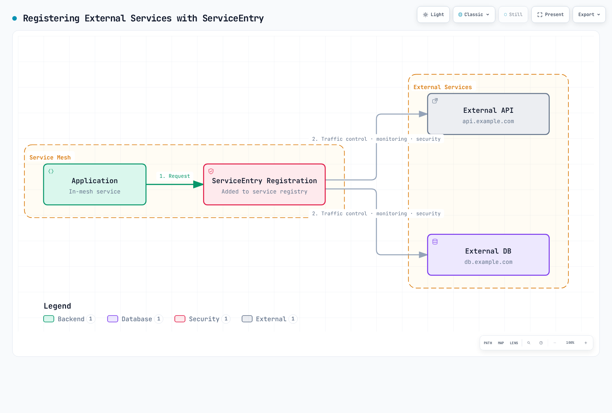

# ServiceEntry

ServiceEntryは、外部サービスをIstioサービスメッシュに登録し、内部サービスと同様に管理できるようにします。

## 目次

1. [ServiceEntryが必要な理由](#why-serviceentry)
2. [ServiceEntryの概要](#serviceentry-overview)
3. [名前解決モード](#resolution-modes)
4. [ロケーション設定](#location-settings)
5. [実践例](#practical-examples)
6. [Egress Gatewayとの組み合わせ](#combining-with-egress-gateway)
7. [セキュリティとTLS](#security-and-tls)
8. [監視と制御](#monitoring-and-control)
9. [ベストプラクティス](#best-practices)

## ServiceEntryが必要な理由 {#why-serviceentry}

### 外部サービスを管理する必要性

`ALLOW_ANY`では、未知の外部宛先への通信も許可されますが、ポリシーやテレメトリが限定される場合があります。ServiceEntryは宛先を登録し、対応するプロキシポリシーを設定できるようにするものです。アクセス制御ルールそのものではありません。

宛先ごとの設定が可能になりますが、実際の監視、TLS、トラフィック制御はプロトコルと適用するポリシーに依存します。

### 主な利点

| 機能 | ServiceEntryなし | ServiceEntryあり |
|---------|---------------------|-------------------|
| **監視** | パススルーのテレメトリが限定的 | プロトコルに応じたテレメトリ。HTTPではL7の可視性が必要 |
| **トラフィック制御** | 設定できない | タイムアウト、リトライ、サーキットブレーカーを設定可能 |
| **セキュリティ** | アプリケーション側のTLSは引き続き利用可能 | TLS/mTLSを別途設定する。外部証明書は自動発行されない |
| **Egress制御** | アウトバウンド設定やネットワークポリシーに依存 | レジストリ登録とルーティングを設定する。ネットワーク上の強制制御は別途必要 |
| **サービスディスカバリー** | 手動管理 | DNSによる自動名前解決 |

## ServiceEntryの概要 {#serviceentry-overview}

これらはサイドカーを使う構成例です。ServiceEntryはistiodとプロキシに参照される登録情報であり、ネットワーク上の中継ホップではありません。`addresses`はサービス／VIPトラフィックの分類に使い、`endpoints`は上流バックエンドを指定します。`resolution`が制御するのはプロキシ側の名前解決であり、アプリケーションのDNSではありません。合成ホスト名を使う場合は、DNSレコードまたはDNSキャプチャを設定してください。ServiceEntryだけではVMのプロキシはメッシュに参加せず、identity用の認証情報も発行されません。

ServiceEntryは、外部サービスをIstioのサービスレジストリに追加します。



[🔍 インタラクティブ図を表示](https://www.atomai.click/kubernetes-docs/archmaps/en-service-mesh-istio-traffic-management-12-service-entry-1.html)

### 基本構造

```yaml
apiVersion: networking.istio.io/v1
kind: ServiceEntry
metadata:
  name: external-api
spec:
  hosts:                  # External service hostname
  - api.example.com
  ports:                  # Port and protocol
  - number: 443
    name: https
    protocol: HTTPS
  location: MESH_EXTERNAL # External/internal location
  resolution: DNS         # Address resolution method
```

## 名前解決モード {#resolution-modes}

Istio 1.31 APIでは、5種類の名前解決モードが定義されています。

### 1. DNS名前解決

最も一般的なモードです。DNSを使ってIPアドレスを動的に解決します。

```yaml
apiVersion: networking.istio.io/v1
kind: ServiceEntry
metadata:
  name: external-api-dns
spec:
  hosts:
  - api.example.com
  ports:
  - number: 443
    name: https
    protocol: HTTPS
  location: MESH_EXTERNAL
  resolution: DNS  # DNS lookup
```

**ユースケース**:
- パブリックAPI（AWS S3、Google Cloud Storage）
- SaaSサービス（Stripe、SendGrid）
- クラウドのマネージドサービス

### 2. STATIC名前解決

固定IPアドレスを明示的に指定します。

```yaml
apiVersion: networking.istio.io/v1
kind: ServiceEntry
metadata:
  name: external-api-static
spec:
  hosts:
  - legacy-api.company.internal
  addresses:
  - 10.10.10.10
  - 10.10.10.11
  ports:
  - number: 8080
    name: http
    protocol: HTTP
  location: MESH_EXTERNAL
  resolution: STATIC  # Fixed IP
  endpoints:
  - address: 10.10.10.10
  - address: 10.10.10.11
```

**ユースケース**:
- DNSを利用できないレガシーシステム
- コンプライアンス上、固定IPアドレスが必要な場合
- 社内データセンターのサービス

### 3. NONE名前解決

名前解決は行わず、クライアントが指定したアドレスをそのまま使用します。

```yaml
apiVersion: networking.istio.io/v1
kind: ServiceEntry
metadata:
  name: wildcard-api
spec:
  hosts:
  - "*.api.example.com"  # Wildcard
  ports:
  - number: 443
    name: https
    protocol: HTTPS
  location: MESH_EXTERNAL
  resolution: NONE  # No address resolution
```

**ユースケース**:
- ワイルドカードドメイン
- クライアント側のロードバランシング
- TCP/TLSプロキシ

### 4. DNS_ROUND_ROBIN名前解決

このモードはサポートされており、非推奨ではありません。DNSモードがDNSから得られるエンドポイント一式を使うのに対し、DNS_ROUND_ROBINでは新しい接続を開始するときにDNSの先頭アドレスを使い、DNSレコードが変わっても既存の接続を維持します。エンドポイントが頻繁に変わるDNSフロントのサービスで、接続プールが常に破棄されるのを避けたい場合に適しています。

### 5. DYNAMIC_DNS名前解決

HTTPのHostまたはSNIから、リクエスト時にワイルドカード宛先を解決します。利用条件はリリース、データプレーン、waypointの構成によって異なります。ホスト名を復元できない不透明なTCPトラフィックには適用できません。利用前にモード固有の要件を確認してください。以下のワイルドカード例では、サイドカーでNONEモードを使います。

## ロケーション設定 {#location-settings}

### MESH_EXTERNAL（メッシュ外部のサービス）

メッシュ外のサービスを登録します。

```yaml
apiVersion: networking.istio.io/v1
kind: ServiceEntry
metadata:
  name: external-service
spec:
  hosts:
  - external-api.com
  ports:
  - number: 443
    name: https
    protocol: HTTPS
  location: MESH_EXTERNAL  # External service
  resolution: DNS
```

**特徴**:
- 適切なDestinationRuleとサーバーの信頼設定を用意すれば、外部サービスとのTLS/mTLSを利用できる
- Egress Gateway経由で送信できる
- 外部トラフィックとして分類される

### MESH_INTERNAL（メッシュ内部のサービス）

サービスをメッシュ内部のものとして扱います（使用するケースはまれです）。

```yaml
apiVersion: networking.istio.io/v1
kind: ServiceEntry
metadata:
  name: internal-vm-service
spec:
  hosts:
  - vm-service.internal
  ports:
  - number: 8080
    name: http
    protocol: HTTP
  location: MESH_INTERNAL  # Treat as internal service
  resolution: STATIC
  endpoints:
  - address: 10.0.0.5
    labels:
      app: vm-service
```

**ユースケース**:
- VMワークロードをメッシュに含める
- マルチクラスター環境
- ハイブリッドクラウド構成

## 実践例 {#practical-examples}

### 1. 外部REST APIの登録

#### シナリオ: 決済ゲートウェイAPI

```yaml
apiVersion: networking.istio.io/v1
kind: ServiceEntry
metadata:
  name: payment-gateway-api
  namespace: production
spec:
  hosts:
  - api.payment-gateway.com
  ports:
  - number: 80
    name: http
    protocol: HTTP
    targetPort: 443
  location: MESH_EXTERNAL
  resolution: DNS
---
# VirtualService: Timeout and Retry settings
apiVersion: networking.istio.io/v1
kind: VirtualService
metadata:
  name: payment-gateway-routing
  namespace: production
spec:
  hosts:
  - api.payment-gateway.com
  http:
  - match:
    - method:
        regex: "^(GET|HEAD)$"
    route:
    - destination:
        host: api.payment-gateway.com
    timeout: 10s
    retries:
      attempts: 3
      perTryTimeout: 3s
      retryOn: connect-failure,refused-stream
  - route:
    - destination:
        host: api.payment-gateway.com
    timeout: 10s
    retries:
      attempts: 0
---
# DestinationRule: Circuit Breaker
apiVersion: networking.istio.io/v1
kind: DestinationRule
metadata:
  name: payment-gateway-circuit-breaker
  namespace: production
spec:
  host: api.payment-gateway.com
  trafficPolicy:
    connectionPool:
      http:
        http1MaxPendingRequests: 10
        maxRequestsPerConnection: 1
    outlierDetection:
      consecutive5xxErrors: 3
      interval: 30s
      baseEjectionTime: 120s
    tls:
      mode: SIMPLE
      sni: api.payment-gateway.com
      subjectAltNames: [api.payment-gateway.com]
```

このTLSオリジネーション構成では、アプリケーションはローカルのサイドカーにHTTPで送信し、プロキシが検証済みのHTTPSで上流へ接続します。アプリケーションがHTTPSを開始する構成と組み合わせないでください。決済の書き込み処理でリトライを有効にするには、アプリケーション側に冪等性を保証する契約が必要です。

### 2. 外部データベースの登録

#### シナリオ: AWS RDS MySQL

```yaml
apiVersion: networking.istio.io/v1
kind: ServiceEntry
metadata:
  name: aws-rds-mysql
spec:
  hosts:
  - mydb.abc123.us-west-2.rds.amazonaws.com
  ports:
  - number: 3306
    name: tcp
    protocol: TCP
  location: MESH_EXTERNAL
  resolution: DNS
---
apiVersion: networking.istio.io/v1
kind: DestinationRule
metadata:
  name: aws-rds-mysql-circuit-breaker
spec:
  host: mydb.abc123.us-west-2.rds.amazonaws.com
  trafficPolicy:
    connectionPool:
      tcp:
        maxConnections: 100
        connectTimeout: 5s
    outlierDetection:
      consecutive5xxErrors: 5
      interval: 60s
      baseEjectionTime: 60s
```

### 3. ワイルドカードドメインの登録

RDSのTLSと証明書検証は、最新のRDS CAバンドルを使ってデータベースドライバー側で設定してください。TCPの登録だけでは、データベース認証やSSLネゴシエーションは設定されません。同じポートを使う複数の外部データベースでは、ポート番号だけで宛先が曖昧にならないよう、DNSキャプチャまたは一意のサービスVIPを使ってください。

#### シナリオ: AWS S3バケットへのアクセス

```yaml
apiVersion: networking.istio.io/v1
kind: ServiceEntry
metadata:
  name: aws-s3-buckets
spec:
  hosts:
  - "*.s3.amazonaws.com"
  - "*.s3.us-west-2.amazonaws.com"
  - "s3.us-west-2.amazonaws.com"
  ports:
  - number: 443
    name: https
    protocol: HTTPS
  location: MESH_EXTERNAL
  resolution: NONE  # Use NONE for wildcards
```

先頭に置くワイルドカード接頭辞だけが有効です。ホスト名の途中に`*`を置くのではなく、実際のリージョン別エンドポイントのサフィックスを列挙してください。これはサイドカー構成の例であり、すべてのS3エンドポイント種別を網羅するものでも、IAMアクセスを許可するものでもありません。

### 4. 複数のエンドポイントを持つ外部サービス

#### シナリオ: マルチリージョンAPI

```yaml
apiVersion: networking.istio.io/v1
kind: ServiceEntry
metadata:
  name: multi-region-api
spec:
  hosts:
  - api.global-service.com
  ports:
  - number: 80
    name: http
    protocol: HTTP
    targetPort: 443
  location: MESH_EXTERNAL
  resolution: DNS
  endpoints:
  - address: us-west.api.global-service.com
    labels:
      region: us-west
  - address: eu-central.api.global-service.com
    labels:
      region: eu-central
---
apiVersion: networking.istio.io/v1
kind: DestinationRule
metadata:
  name: multi-region-api
spec:
  host: api.global-service.com
  trafficPolicy:
    tls:
      mode: SIMPLE
      sni: api.global-service.com
      subjectAltNames: [api.global-service.com]
  subsets:
  - name: us-west
    labels:
      region: us-west
  - name: eu-central
    labels:
      region: eu-central
---
apiVersion: networking.istio.io/v1
kind: VirtualService
metadata:
  name: multi-region-routing
spec:
  hosts:
  - api.global-service.com
  http:
  - match:
    - headers:
        x-region:
          exact: us-west
    route:
    - destination:
        host: api.global-service.com
        subset: us-west
  - match:
    - headers:
        x-region:
          exact: eu-central
    route:
    - destination:
        host: api.global-service.com
        subset: eu-central
  - route:
    - destination:
        host: api.global-service.com
```

どちらのリージョンのエンドポイントも、同じ正規のAPIホスト名と証明書を提供する必要があります。HTTP Hostヘッダーだけを変えても、プロキシが選択するDNSエンドポイントは変わりません。アプリケーションからローカルへはHTTPで送信し、前述のとおり上流へのTLSはプロキシが開始します。

### 5. TCPサービスの登録

#### シナリオ: 外部Redisクラスター

```yaml
apiVersion: networking.istio.io/v1
kind: ServiceEntry
metadata:
  name: external-redis
spec:
  hosts:
  - redis-primary.external-cluster.com
  addresses:
  - 203.0.113.10
  ports:
  - number: 6379
    name: tcp
    protocol: TCP
  location: MESH_EXTERNAL
  resolution: STATIC
  endpoints:
  - address: 203.0.113.10
    labels:
      instance: primary
---
apiVersion: networking.istio.io/v1
kind: DestinationRule
metadata:
  name: external-redis-lb
spec:
  host: redis-primary.external-cluster.com
  trafficPolicy:
    loadBalancer:
      simple: ROUND_ROBIN
    connectionPool:
      tcp:
        maxConnections: 50
        connectTimeout: 3s
```

この例が選択するのは書き込み可能なプライマリだけです。読み取り専用トラフィックにはレプリカを別途登録するか、Redisを理解するクライアントを使用してください。汎用的なラウンドロビンでは、Redisのプライマリ／レプリカ構成やシャーディングの動作を維持できません。例にあるIPアドレスは、到達可能なエンドポイントに置き換えてください。

## Egress Gatewayとの組み合わせ {#combining-with-egress-gateway}

Egress Gatewayを通じて外部トラフィックを一元的に制御します。

### 基本的なEgress Gateway設定

```yaml
# ServiceEntry: Register external service
apiVersion: networking.istio.io/v1
kind: ServiceEntry
metadata:
  name: external-api
spec:
  hosts:
  - api.example.com
  ports:
  - number: 443
    name: https
    protocol: HTTPS
  location: MESH_EXTERNAL
  resolution: DNS
---
# Gateway: Egress Gateway configuration
apiVersion: networking.istio.io/v1
kind: Gateway
metadata:
  name: egress-gateway
  namespace: istio-system
spec:
  selector:
    istio: egressgateway
  servers:
  - port:
      number: 443
      name: tls
      protocol: TLS
    hosts:
    - api.example.com
    tls:
      mode: PASSTHROUGH
---
# VirtualService: Mesh internal -> Egress Gateway
apiVersion: networking.istio.io/v1
kind: VirtualService
metadata:
  name: direct-api-through-egress
spec:
  hosts:
  - api.example.com
  gateways:
  - mesh
  - istio-system/egress-gateway
  tls:
  - match:
    - gateways:
      - mesh
      port: 443
      sniHosts:
      - api.example.com
    route:
    - destination:
        host: istio-egressgateway.istio-system.svc.cluster.local
        port:
          number: 443
  - match:
    - gateways:
      - istio-system/egress-gateway
      port: 443
      sniHosts:
      - api.example.com
    route:
    - destination:
        host: api.example.com
        port:
          number: 443
```

### TLSオリジネーション（内部はHTTP、外部はHTTPS）

```yaml
apiVersion: networking.istio.io/v1
kind: ServiceEntry
metadata:
  name: external-http-to-https
spec:
  hosts:
  - api.secure-service.com
  ports:
  - number: 80
    name: http
    protocol: HTTP
    targetPort: 443
  - number: 443
    name: https
    protocol: HTTPS
  location: MESH_EXTERNAL
  resolution: DNS
---
apiVersion: networking.istio.io/v1
kind: DestinationRule
metadata:
  name: originate-tls
spec:
  host: api.secure-service.com
  trafficPolicy:
    portLevelSettings:
    - port:
        number: 80
      tls:
        mode: SIMPLE  # HTTP -> HTTPS conversion
```

## セキュリティとTLS {#security-and-tls}

### 外部サービスへのmTLS

```yaml
apiVersion: networking.istio.io/v1
kind: ServiceEntry
metadata:
  name: mtls-external-service
spec:
  hosts:
  - mtls-api.example.com
  ports:
  - number: 80
    name: http
    protocol: HTTP
    targetPort: 443
  location: MESH_EXTERNAL
  resolution: DNS
---
apiVersion: networking.istio.io/v1
kind: DestinationRule
metadata:
  name: mtls-external-tls
spec:
  host: mtls-api.example.com
  trafficPolicy:
    tls:
      mode: MUTUAL
      sni: mtls-api.example.com
      subjectAltNames: [mtls-api.example.com]
      clientCertificate: /etc/certs/client-cert.pem
      privateKey: /etc/certs/client-key.pem
      caCertificates: /etc/certs/ca-cert.pem
```

これらの証明書／鍵ファイルをプロキシコンテナにマウントし、証明書管理の手順に沿ってローテーションしてください。外部サーバーはクライアントCAを信頼する必要があります。ServiceEntryはこの認証情報を発行しません。これはアプリケーションからのローカルHTTPをプロキシがmTLSにする構成であり、アプリケーションTLSにもう一段TLSを重ねるものではありません。

### SNIルーティング

```yaml
apiVersion: networking.istio.io/v1
kind: Gateway
metadata:
  name: egress-sni-gateway
  namespace: istio-system
spec:
  selector:
    istio: egressgateway
  servers:
  - port:
      number: 443
      name: tls
      protocol: TLS
    hosts:
    - api.example.com
    - api2.example.com
    tls:
      mode: PASSTHROUGH
---
apiVersion: networking.istio.io/v1
kind: VirtualService
metadata:
  name: sni-routing
spec:
  hosts:
  - api.example.com
  - api2.example.com
  gateways:
  - mesh
  - istio-system/egress-sni-gateway
  tls:
  - match:
    - gateways:
      - mesh
      port: 443
      sniHosts:
      - api.example.com
    route:
    - destination:
        host: istio-egressgateway.istio-system.svc.cluster.local
        port:
          number: 443
  - match:
    - gateways:
      - istio-system/egress-sni-gateway
      port: 443
      sniHosts:
      - api.example.com
    route:
    - destination:
        host: api.example.com
        port:
          number: 443
  - match:
    - gateways:
      - mesh
      port: 443
      sniHosts:
      - api2.example.com
    route:
    - destination:
        host: istio-egressgateway.istio-system.svc.cluster.local
        port:
          number: 443
  - match:
    - gateways:
      - istio-system/egress-sni-gateway
      port: 443
      sniHosts:
      - api2.example.com
    route:
    - destination:
        host: api2.example.com
        port:
          number: 443
```

[Egress Control](11-egress-control.md)に記載されたとおり、Egress GatewayのワークロードとClusterIP Serviceをインストールし、両方の外部ホストをServiceEntryに登録してください。SNIルートは転送先を設定するものであり、すべてのトラフィックがゲートウェイを通過することを強制しません。その境界を必須にするには、ネットワークレベルの強制制御を使ってください。

## 監視と制御 {#monitoring-and-control}

### メトリクスの収集

```bash
# Check ServiceEntry traffic
kubectl exec -it <pod-name> -c istio-proxy -- \
  curl localhost:15000/stats/prometheus | grep "api.example.com"

# Egress traffic metrics
istio_requests_total{reporter="source",destination_service_name="api.example.com"}
```

### Prometheusクエリ

クエリを作る前に、実際のメトリクスラベルを確認してください。HTTPリクエスト／エラー／レイテンシーのメトリクスには、L7の可視性（たとえばTLSオリジネーション）が必要です。不透明なHTTPS/TCPでは接続数やバイト数のメトリクスが公開されます。外部ServiceEntryのnamespaceラベルが空だと決めつけないでください。

```promql
# External service request count
sum(rate(istio_requests_total{reporter="source",destination_service_name="api.example.com"}[5m]))

# External service error rate
sum(rate(istio_requests_total{reporter="source",destination_service_name="api.example.com",response_code=~"5.."}[5m])) /
sum(rate(istio_requests_total{reporter="source",destination_service_name="api.example.com"}[5m]))

# External service response time
histogram_quantile(0.95,
  sum(rate(istio_request_duration_milliseconds_bucket{reporter="source",destination_service_name="api.example.com"}[5m])) by (le)
)
```

### 未登録宛先の検出

```yaml
# Registry/configuration control, not a firewall
apiVersion: networking.istio.io/v1
kind: Sidecar
metadata:
  name: default
  namespace: default
spec:
  egress:
  - hosts:
    - "./*"  # Allow only same namespace
    - "istio-system/*"  # Allow istio-system
  outboundTrafficPolicy:
    mode: REGISTRY_ONLY  # Known Kubernetes and ServiceEntry destinations
```

サイドカーのimport scopeや`REGISTRY_ONLY`はセキュリティ境界ではありません。必須のEgress制御にはネットワークポリシー／ファイアウォールを使い、該当する場合はAuthorizationPolicyも設定してください。

## ベストプラクティス {#best-practices}

### 1. ServiceEntryを明示的に登録する

```yaml
# Good example: Explicit registration
apiVersion: networking.istio.io/v1
kind: ServiceEntry
metadata:
  name: payment-api
  namespace: production
  annotations:
    description: "Payment gateway API"
    owner: "payments-team"
    sla: "99.9%"
spec:
  hosts:
  - api.payment.com
  ports:
  - number: 443
    name: https
    protocol: HTTPS
  location: MESH_EXTERNAL
  resolution: DNS
```

### 2. プロトコルに応じて耐障害性を調整する

```yaml
# Always apply Circuit Breaker for external services
apiVersion: networking.istio.io/v1
kind: DestinationRule
metadata:
  name: external-api-protection
spec:
  host: api.example.com
  trafficPolicy:
    connectionPool:
      http:
        http1MaxPendingRequests: 10
        maxRequestsPerConnection: 1
    outlierDetection:
      consecutive5xxErrors: 3
      interval: 30s
      baseEjectionTime: 120s
```

### 3. タイムアウトを設定する

```yaml
# Set explicit Timeout for external services
apiVersion: networking.istio.io/v1
kind: VirtualService
metadata:
  name: external-api-timeout
spec:
  hosts:
  - api.example.com
  http:
  - route:
    - destination:
        host: api.example.com
    timeout: 10s  # Explicit Timeout
    retries:
      attempts: 2
      perTryTimeout: 5s
```

### 4. 本番環境ではEgress Gatewayを使う

```yaml
# Control external traffic through Egress Gateway in production
# - Centralized monitoring
# - Easy IP whitelist management
# - Consistent security policies
```

### 5. namespace間の設定可視性

```yaml
# Isolate ServiceEntry by namespace
apiVersion: networking.istio.io/v1
kind: Sidecar
metadata:
  name: default
  namespace: team-a
spec:
  egress:
  - hosts:
    - "team-a/*"  # Only own namespace
    - "istio-system/*"
    - "external/*"  # Shared external services
  outboundTrafficPolicy:
    mode: REGISTRY_ONLY
```

### 6. ドキュメントのテンプレート

```yaml
# Metadata excerpt; replace illustrative SLA/cost values with the actual service contract
metadata:
  name: external-service
  annotations:
    # Service information
    service-description: "Third-party payment API"
    service-owner: "payments-team@company.com"
    service-documentation: "https://wiki.company.com/payment-api"

    # SLA information
    sla-availability: "99.9%"
    sla-latency-p95: "500ms"
    rate-limit: "1000 req/min"

    # Cost information
    cost-per-request: "$0.01"
    monthly-budget: "$10000"

    # Incident response
    oncall: "payments-oncall"
    escalation: "CTO"
    fallback-strategy: "Use cached data"
```

## 参考資料

- [Istio ServiceEntry](https://istio.io/latest/docs/reference/config/networking/service-entry/)
- [Istio Egress Traffic](https://istio.io/latest/docs/tasks/traffic-management/egress/)
- [Istio TLS Origination](https://istio.io/latest/docs/tasks/traffic-management/egress/egress-tls-origination/)
- [Envoy External Services](https://www.envoyproxy.io/docs/envoy/latest/intro/arch_overview/upstream/service_discovery)

- [主要資料1](https://istio.io/latest/docs/reference/config/networking/service-entry/)
- [主要資料2](https://istio.io/latest/docs/ops/configuration/traffic-management/dns-proxy/)
- [主要資料3](https://istio.io/latest/docs/reference/config/networking/sidecar/)
- [主要資料4](https://istio.io/latest/docs/reference/config/networking/destination-rule/)
- [主要資料5](https://istio.io/latest/docs/tasks/traffic-management/egress/egress-gateway/)
- [主要資料6](https://istio.io/latest/docs/tasks/traffic-management/egress/egress-tls-origination/)
- [主要資料7](https://docs.aws.amazon.com/AmazonS3/latest/userguide/VirtualHosting.html)
- [主要資料8](https://docs.aws.amazon.com/AmazonRDS/latest/UserGuide/UsingWithRDS.SSL.html)
