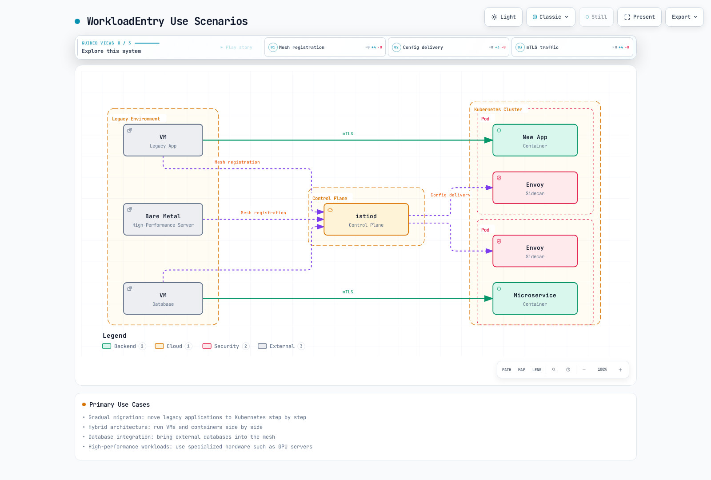

# WorkloadEntry

> **対象バージョン**: Istio 1.31.0
> **最終更新**: 2026年9月11日

WorkloadEntry は、仮想マシン（VM）やベアメタルサーバーを Istio service mesh に登録するためのリソースです。Kubernetes 外で動作するワークロードでも、mesh のトラフィック管理、セキュリティ、可観測性機能を利用できます。

## 目次

1. [概要](#overview)
2. [WorkloadEntry と Kubernetes Pod](#workloadentry-vs-kubernetes-pod)
3. [アーキテクチャ](#architecture)
4. [基本的な使い方](#basic-usage)
5. [ServiceEntry との連携](#serviceentry-integration)
6. [VM 登録の実践ガイド](#vm-registration-practical-guide)
7. [セキュリティ設定（mTLS）](#security-settings-mtls)
8. [ヘルスチェックとモニタリング](#health-checks-and-monitoring)
9. [高度な設定](#advanced-configuration)
10. [トラブルシューティング](#troubleshooting)
11. [ベストプラクティス](#best-practices)

## 概要 {#overview}

WorkloadEntry はワークロードを記述するリソースです。作成しただけでは Envoy のインストール、identity の bootstrap、network connectivity の確立、DNS record の公開は行われません。この章では sidecar mode での VM 連携を扱います。各例は独立しているため、ServiceEntry、選択する WorkloadEntry、ServiceAccount は意図した namespace にそろえてください。図は registry/configuration の関係を示すもので、追加の network hop を表してはいません。

### WorkloadEntry とは

WorkloadEntry は、mesh 外で動作するワークロード（VM、ベアメタルサーバー）を Istio service mesh に登録する Istio Custom Resource Definition（CRD）です。

### 利用シナリオ



[🔍 インタラクティブ図を表示](https://www.atomai.click/kubernetes-docs/archmaps/en-service-mesh-istio-traffic-management-13-workload-entry-0.html)

**主な利用例**:
1. **段階的な移行**: legacy application を段階的に Kubernetes へ移行する
2. **ハイブリッド構成**: VM と container を並行運用する
3. **データベース連携**: 外部 database を mesh に参加させる
4. **高性能ワークロード**: GPU server など専用 hardware を活用する

## WorkloadEntry と Kubernetes Pod {#workloadentry-vs-kubernetes-pod}

### 比較表

| 特性 | Kubernetes Pod | WorkloadEntry（VM） |
|---|---|---|
| **配置場所** | cluster 内 | cluster 外 |
| **Envoy の注入** | sidecar を自動注入 | 手動でインストール |
| **Service discovery** | Service で自動 | WorkloadEntry を手動登録 |
| **IP 管理** | Kubernetes CNI | 手動指定 |
| **mTLS** | 自動 | 自動（証明書の配布が必要） |
| **ヘルスチェック** | 自動（Liveness／Readiness） | 手動設定 |
| **スケーリング** | HPA | 手動 |
| **運用の複雑さ** | 低い | 高い |
| **主な用途** | cloud-native application | legacy application、専用 hardware |

### トラフィックフローの比較


[🔍 インタラクティブ図を表示](https://www.atomai.click/kubernetes-docs/archmaps/en-service-mesh-istio-traffic-management-13-workload-entry-1.html)

## アーキテクチャ {#architecture}

### VM ワークロードの構成


[🔍 インタラクティブ図を表示](https://www.atomai.click/kubernetes-docs/archmaps/en-service-mesh-istio-traffic-management-13-workload-entry-2.html)

### 主なコンポーネント

1. **WorkloadEntry**: VM の情報（IP、port、label）を登録する
2. **ServiceEntry**: Service と WorkloadEntry の関連を定義する
3. **Envoy Proxy**: VM に手動でインストールする sidecar
4. **istiod**: 設定配布と証明書管理を行う
5. **ServiceAccount**: VM の identity 認証に使う

## 基本的な使い方 {#basic-usage}

### WorkloadEntry リソースの定義

```yaml
apiVersion: networking.istio.io/v1
kind: WorkloadEntry
metadata:
  name: legacy-api-vm-1
  namespace: production
spec:
  # VM's IP address
  address: 192.168.1.100

  # Labels for service selection
  labels:
    app: legacy-api
    version: v1.0
    tier: backend

  # Service account for mTLS authentication
  serviceAccount: legacy-api-sa

  # Ports to expose
  ports:
    http: 8080
    https: 8443
    metrics: 9090

  # Locality information (optional)
  locality: us-west-2/us-west-2a

  # Weight (for load balancing, optional)
  weight: 100

  # Network (multi-network environment, optional)
  network: vm-network
```

### 必須フィールドの説明

| Field | 説明 | 例 |
|---|---|---|
| **address** | endpoint の address（IP、または DNS 解決可能な名前。remote network を構成している場合は省略可能） | `192.168.1.100` |
| **labels** | ServiceEntry との照合に使う label | `app: legacy-api` |
| **serviceAccount** | mTLS 認証に使う ServiceAccount | `legacy-api-sa` |
| **ports** | 公開する port の map | `http: 8080` |

### 複数 VM の登録

```yaml
# VM 1
apiVersion: networking.istio.io/v1
kind: WorkloadEntry
metadata:
  name: api-vm-1
  namespace: production
spec:
  address: 192.168.1.101
  labels:
    app: api-service
    version: v1
  serviceAccount: api-sa
  ports:
    http: 8080
---
# VM 2
apiVersion: networking.istio.io/v1
kind: WorkloadEntry
metadata:
  name: api-vm-2
  namespace: production
spec:
  address: 192.168.1.102
  labels:
    app: api-service
    version: v1
  serviceAccount: api-sa
  ports:
    http: 8080
---
# VM 3 (different version)
apiVersion: networking.istio.io/v1
kind: WorkloadEntry
metadata:
  name: api-vm-3
  namespace: production
spec:
  address: 192.168.1.103
  labels:
    app: api-service
    version: v2  # New version
  serviceAccount: api-sa
  ports:
    http: 8080
```

## ServiceEntry との連携 {#serviceentry-integration}

WorkloadEntry は ServiceEntry と組み合わせて使用します。

### 基本的な連携パターン

```yaml
# 1. Define service with ServiceEntry
apiVersion: networking.istio.io/v1
kind: ServiceEntry
metadata:
  name: legacy-api
  namespace: production
spec:
  hosts:
  - api.legacy.internal
  addresses:
  - 240.240.1.1  # Virtual IP
  ports:
  - number: 8080
    name: http
    protocol: HTTP
  location: MESH_INTERNAL
  resolution: STATIC
  workloadSelector:
    labels:
      app: legacy-api  # Match with WorkloadEntry labels
---
# 2. Register VM with WorkloadEntry
apiVersion: networking.istio.io/v1
kind: WorkloadEntry
metadata:
  name: legacy-api-vm-1
  namespace: production
spec:
  address: 192.168.1.100
  labels:
    app: legacy-api  # Match with ServiceEntry
    version: v1
  serviceAccount: legacy-api-sa
  ports:
    http: 8080
```

### 動作の流れ


[🔍 インタラクティブ図を表示](https://www.atomai.click/kubernetes-docs/archmaps/en-service-mesh-istio-traffic-management-13-workload-entry-3.html)

### Load balancing

複数の WorkloadEntry を登録すると、endpoint 間で自動的に load balancing されます。

```yaml
apiVersion: networking.istio.io/v1
kind: ServiceEntry
metadata:
  name: database-cluster
  namespace: vm-workloads
spec:
  hosts:
  - db.cluster.internal
  ports:
  - number: 5432
    name: postgresql
    protocol: TCP
  location: MESH_INTERNAL
  resolution: STATIC
  workloadSelector:
    labels:
      app: postgres
      tier: database
      role: primary
---
# Separate read-only replica service
apiVersion: networking.istio.io/v1
kind: ServiceEntry
metadata:
  name: database-replicas
  namespace: vm-workloads
spec:
  hosts:
  - db-replicas.cluster.internal
  ports:
  - number: 5432
    name: postgresql
    protocol: TCP
  location: MESH_INTERNAL
  resolution: STATIC
  workloadSelector:
    labels:
      app: postgres
      tier: database
      role: replica
---
# Primary DB
apiVersion: networking.istio.io/v1
kind: WorkloadEntry
metadata:
  name: postgres-primary
  namespace: vm-workloads
spec:
  serviceAccount: vm-postgres-sa
  address: 10.0.1.100
  labels:
    app: postgres
    tier: database
    role: primary
  weight: 100  # Weight
---
# Replica DB 1
apiVersion: networking.istio.io/v1
kind: WorkloadEntry
metadata:
  name: postgres-replica-1
  namespace: vm-workloads
spec:
  serviceAccount: vm-postgres-sa
  address: 10.0.1.101
  labels:
    app: postgres
    tier: database
    role: replica
  weight: 50
---
# Replica DB 2
apiVersion: networking.istio.io/v1
kind: WorkloadEntry
metadata:
  name: postgres-replica-2
  namespace: vm-workloads
spec:
  serviceAccount: vm-postgres-sa
  address: 10.0.1.102
  labels:
    app: postgres
    tier: database
    role: replica
  weight: 50
```

書き込みは primary service に送り、replica への読み取りは application が replication semantics を許容する場合に限ってください。一般的な endpoint weight は PostgreSQL の role を認識しません。同じ port の service には DNS capture／一意な VIP を設定し、各 VM を記載の ServiceAccount で bootstrap してください。

## VM 登録の実践ガイド {#vm-registration-practical-guide}

### 前提条件

1. **VM の要件**:
   - Network: Kubernetes cluster と通信できること
   - OS／CPU: 選択する sidecar package がサポートする Linux distribution と architecture を使うこと。この例では Debian package を使用します
   - Connectivity: 公開された VM gateway 経由で istiod の xDS／CA に到達できること（通常 port 15012）。workload traffic は選択した topology に沿って route します。15017 は Kubernetes webhook 用で、VM application の要件ではありません

2. **Kubernetes 側の準備**:
   - Istio の installation を完了する
   - VM 用 namespace を作成する
   - ServiceAccount を作成する

bootstrap file を生成する前に、[公式 VM install 手順](https://istio.io/latest/docs/setup/install/virtual-machine/)に従って、VM から既存 control plane に接続できるようにしてください。cluster 内だけで使う istiod Service では不十分です。この手順は、1つの論理 network 内で Pod と VM 間を route できる前提です。network が分かれている場合は、文書化された east-west／network 構成を使ってください。生成する cluster ID は istiod の設定と一致させます。

### Step 1: ServiceAccount の作成

```bash
# Create namespace
kubectl create namespace vm-workloads

# Create ServiceAccount
kubectl create serviceaccount vm-postgres-sa -n vm-workloads

# VM identity bootstrap does not require listing Kubernetes Secrets.
```

### Step 2: WorkloadGroup の bootstrap 入力を準備

WorkloadGroup は複数の WorkloadEntry に共通する template として使います。

```yaml
apiVersion: networking.istio.io/v1
kind: WorkloadGroup
metadata:
  name: postgres-vms
  namespace: vm-workloads
spec:
  metadata:
    labels:
      app: postgres
      version: v14
  template:
    serviceAccount: vm-postgres-sa
    network: ""  # Same logical network in this walkthrough
    ports:
      postgresql: 5432
      metrics: 9187
```

### Step 3: VM に Envoy をインストール

#### 自動 install script の生成

```bash
# Generate VM registration files with istioctl
umask 077
istioctl x workload entry configure \
  -f workloadgroup.yaml \
  -o vm-postgres-1 \
  --clusterID Kubernetes

# Generated files:
# - cluster.env: Cluster information
# - istio-token: Authentication token
# - mesh.yaml: Mesh configuration
# - root-cert.pem: Root certificate
# - hosts: /etc/hosts entries
```

#### VM 上で install を実行

```bash
# Run on the administration workstation before entering the VM shell
ssh user@192.168.1.100 'install -d -m 700 "$HOME/istio-bootstrap"'
scp vm-postgres-1/* user@192.168.1.100:istio-bootstrap/
ssh user@192.168.1.100

# From this point, run on the VM
VM_BOOTSTRAP_DIR="$HOME/istio-bootstrap"
curl -fsSLo istio-sidecar.deb \
  https://blob.istio.io/istio-release/releases/1.31.0/deb/istio-sidecar.deb
sudo dpkg -i istio-sidecar.deb
sudo install -d -o istio-proxy -m 0750 \
  /etc/certs /var/run/secrets/tokens /var/lib/istio/envoy /etc/istio/config /etc/istio/proxy
sudo install -o istio-proxy -m 0644 "$VM_BOOTSTRAP_DIR/root-cert.pem" /etc/certs/root-cert.pem
sudo install -o istio-proxy -m 0600 "$VM_BOOTSTRAP_DIR/istio-token" /var/run/secrets/tokens/istio-token
sudo install -o istio-proxy -m 0600 "$VM_BOOTSTRAP_DIR/cluster.env" /var/lib/istio/envoy/cluster.env
sudo install -o istio-proxy -m 0600 "$VM_BOOTSTRAP_DIR/mesh.yaml" /etc/istio/config/mesh
# Review/merge once; replace stale istiod entries rather than appending duplicates
cat "$VM_BOOTSTRAP_DIR/hosts" | sudo tee -a /etc/hosts >/dev/null
sudo systemctl enable --now istio
sudo systemctl status istio
```

### Step 4: WorkloadEntry の登録

上記の command は手動登録を使います。VM agent の bootstrap 完了後にこの WorkloadEntry を適用してください。自動登録された VM に同じ entry を手動で重複作成しないでください。

```yaml
apiVersion: networking.istio.io/v1
kind: WorkloadEntry
metadata:
  name: postgres-vm-1
  namespace: vm-workloads
spec:
  address: 192.168.1.100
  labels:
    app: postgres
    version: v14
  serviceAccount: vm-postgres-sa
  ports:
    postgresql: 5432
    metrics: 9187
```

```bash
kubectl apply -f workloadentry.yaml
```

### Step 5: ServiceEntry の作成

```yaml
apiVersion: networking.istio.io/v1
kind: ServiceEntry
metadata:
  name: postgres-service
  namespace: vm-workloads
spec:
  hosts:
  - postgres.vm.internal
  addresses:
  - 240.240.2.1
  ports:
  - number: 5432
    name: postgresql
    protocol: TCP
  - number: 9187
    name: metrics
    protocol: HTTP
  location: MESH_INTERNAL
  resolution: STATIC
  workloadSelector:
    labels:
      app: postgres
```

```bash
kubectl apply -f serviceentry.yaml
```

### Step 6: 接続をテスト

```yaml
apiVersion: v1
kind: Pod
metadata:
  name: pg-client
  namespace: vm-workloads
  labels:
    sidecar.istio.io/inject: "true"
  annotations:
    proxy.istio.io/config: |
      proxyMetadata:
        ISTIO_META_DNS_CAPTURE: "true"
spec:
  containers:
  - name: postgres
    image: postgres:14
    command: ["sleep", "infinity"]
```

```bash
kubectl apply -f pg-client.yaml
kubectl wait -n vm-workloads --for=condition=Ready pod/pg-client --timeout=120s
kubectl exec -it pg-client -n vm-workloads -c postgres -- \
  psql -h postgres.vm.internal -U dbuser -d mydb
```

Pod manifest を `pg-client.yaml` として保存します。PostgreSQL client の version は application の例であり、Istio version とは独立しています。有効な database credential は対話形式で入力してください。後述の制限的な policy を適用した後の test には、許可された ServiceAccount を使います。default の test identity は拒否されます。終了後に test Pod を削除してください。

## セキュリティ設定（mTLS） {#security-settings-mtls}

### mTLS の自動有効化

VM agent を宣言した ServiceAccount で bootstrap すると、mesh proxy は auto mTLS を使用できます。WorkloadEntry だけで、通常の VM が mesh participant になるわけではありません。

```yaml
# Force mTLS with PeerAuthentication
apiVersion: security.istio.io/v1
kind: PeerAuthentication
metadata:
  name: default
  namespace: vm-workloads
spec:
  mtls:
    mode: STRICT  # mTLS required for both VM and pod
```

### VM identity の検証

Pod sidecar の bootstrap とは異なり、VM integration は発行された certificate／key を `/etc/certs` に保存し、既存の mTLS identity を使って更新します。これらの file は bootstrap 成功後に作成されます。key は非公開に保ってください。障害原因を特定した復旧時以外は、bootstrap material を再生成せず、credential を log に表示・コピーしないでください。

```bash
# Check certificates on VM
sudo ls -la /etc/certs/
# cert-chain.pem: Certificate chain
# key.pem: Private key
# root-cert.pem: Root CA

# Check certificate contents
sudo openssl x509 -in /etc/certs/cert-chain.pem -text -noout

# Check Subject Alternative Name (SAN):
# spiffe://cluster.local/ns/vm-workloads/sa/vm-postgres-sa
```

### Access control（AuthorizationPolicy）

```yaml
# PostgreSQL access control
apiVersion: security.istio.io/v1
kind: AuthorizationPolicy
metadata:
  name: postgres-access
  namespace: vm-workloads
spec:
  selector:
    matchLabels:
      app: postgres  # WorkloadEntry labels
  action: ALLOW
  rules:
  # Allow only API service access
  - from:
    - source:
        principals:
        - cluster.local/ns/production/sa/api-service-sa
    to:
    - operation:
        ports: ["5432"]

  # Allow monitoring service access
  - from:
    - source:
        principals:
        - cluster.local/ns/istio-system/sa/prometheus
    to:
    - operation:
        ports: ["9187"]  # postgres_exporter
```

### mTLS を検証

```bash
# Use a PostgreSQL client in an authorized mesh workload; PostgreSQL is not HTTPS
kubectl exec -it <authorized-client-pod> -n production -c <app-container> -- \
  psql -h postgres.vm.internal -U dbuser -d mydb
# Inspect the client proxy's TLS transport and certificates separately
istioctl proxy-config clusters <authorized-client-pod> -n production --fqdn postgres.vm.internal -o json
istioctl proxy-config secret <authorized-client-pod> -n production
# On the VM, inspect public certificate information through its local admin interface
curl -fsS http://127.0.0.1:15000/certs
```

## ヘルスチェックとモニタリング {#health-checks-and-monitoring}

### ヘルスチェックの設定

自動化する任意の workflow では、`PILOT_ENABLE_WORKLOAD_ENTRY_AUTOREGISTRATION` と `PILOT_ENABLE_WORKLOAD_ENTRY_HEALTHCHECKS` が該当する control-plane flag です。文書化された手順に従い、既存の installation 設定に merge してください。

WorkloadGroup は readiness probe をサポートします。文書化された auto-registration／health-check workflow では、istiod flag を有効にし、WorkloadGroup を適用し、`--autoregister` を付けて bootstrap file を生成する必要があります。これは上記の手動手順とは別の opt-in workflow です。以下の DestinationRule は接続失敗を受動的に検出するもので、能動的な health probe ではありません。

```yaml
apiVersion: networking.istio.io/v1
kind: DestinationRule
metadata:
  name: postgres-healthcheck
  namespace: vm-workloads
spec:
  host: postgres.vm.internal
  trafficPolicy:
    connectionPool:
      tcp:
        maxConnections: 100
    outlierDetection:
      consecutive5xxErrors: 5  # Exclude after 5 consecutive failures
      interval: 30s         # Check every 30 seconds
      baseEjectionTime: 30s # Exclude for 30 seconds
      maxEjectionPercent: 50 # Exclude up to 50%
      minHealthPercent: 0    # Disable panic fail-open threshold
```

```yaml
# Optional WorkloadGroup probe fragment for the documented auto-registration workflow
spec:
  probe:
    initialDelaySeconds: 5
    periodSeconds: 5
    timeoutSeconds: 3
    tcpSocket:
      host: 127.0.0.1
      port: 5432
```

### VM の health-check endpoint

VM application に health-check endpoint を追加します。

```python
# Python Flask example
from flask import Flask, jsonify
import psycopg2

app = Flask(__name__)

@app.route('/health', methods=['GET'])
def health():
    try:
        # Verify database connection
        conn = psycopg2.connect("dbname=mydb user=dbuser", connect_timeout=3)
        conn.close()
        return jsonify({"status": "healthy"}), 200
    except psycopg2.Error:
        return jsonify({"status": "unhealthy"}), 503

if __name__ == '__main__':
    app.run(host='127.0.0.1', port=8080)
```

### Prometheus metrics の収集

ServiceMonitor が検出するのは Kubernetes Service／endpoint であり、WorkloadEntry や ServiceEntry を直接検出するわけではありません。この VM では `postgres_exporter` を port 9187 で起動し、WorkloadEntry／ServiceEntry に named port を公開して、既存 collector の設定に明示的な scrape job を追加します。collector は synthetic hostname を名前解決し、mesh mTLS を使用でき、exporter の AuthorizationPolicy が許可する identity を持つ必要があります。

```yaml
# Fragment for the existing Prometheus scrape_configs
- job_name: workloadentry-postgres
  scrape_interval: 30s
  metrics_path: /metrics
  static_configs:
  - targets: ["postgres.vm.internal:9187"]
```

### Grafana dashboard の query

```promql
# Native PostgreSQL traffic has TCP counters, not HTTP status/latency metrics
sum(rate(istio_tcp_connections_opened_total{reporter="source",destination_service="postgres.vm.internal"}[5m]))
sum(rate(istio_tcp_sent_bytes_total{reporter="source",destination_service="postgres.vm.internal"}[5m]))

# Collector/exporter health; inspect the actual emitted labels
up{job="workloadentry-postgres"}
pg_up{job="workloadentry-postgres"}
```

## 高度な設定 {#advanced-configuration}

### Multi-network 環境

network name が示すのは topology だけです。到達性／east-west gateway と、それに対応する mesh network data は別途設定してください。network name を設定しても VPC route、peering connection、gateway は作成されません。locality は region／zone／subzone で構成します。client proxy の設定と一致する実際の値を使ってください。

別々の network にある VM を登録します。

```yaml
# VM in Network A
apiVersion: networking.istio.io/v1
kind: WorkloadEntry
metadata:
  name: api-vm-network-a
spec:
  address: 192.168.1.100
  labels:
    app: api-service
  serviceAccount: api-sa
  network: network-a
  ports:
    http: 8080
---
# VM in Network B
apiVersion: networking.istio.io/v1
kind: WorkloadEntry
metadata:
  name: api-vm-network-b
spec:
  address: 10.0.1.100
  labels:
    app: api-service
  serviceAccount: api-sa
  network: network-b
  ports:
    http: 8080
```

### Locality-aware load balancing

```yaml
apiVersion: networking.istio.io/v1
kind: WorkloadEntry
metadata:
  name: api-vm-us-west
spec:
  address: 192.168.1.100
  labels:
    app: api-service
  locality: us-west-2/us-west-2a
  weight: 100
---
apiVersion: networking.istio.io/v1
kind: WorkloadEntry
metadata:
  name: api-vm-us-east
spec:
  address: 10.0.1.100
  labels:
    app: api-service
  locality: us-east-1/us-east-1a
  weight: 100
---
# Locality-aware routing with DestinationRule
apiVersion: networking.istio.io/v1
kind: DestinationRule
metadata:
  name: api-locality-lb
spec:
  host: api.service.internal
  trafficPolicy:
    loadBalancer:
      localityLbSetting:
        enabled: true
        distribute:
        - from: us-west-2/*
          to:
            "us-west-2/*": 80
            "us-east-1/*": 20
        - from: us-east-1/*
          to:
            "us-east-1/*": 80
            "us-west-2/*": 20
```

### Canary deployment

Canary deployment は WorkloadEntry にも適用できます。

```yaml
# v1 version VM
apiVersion: networking.istio.io/v1
kind: WorkloadEntry
metadata:
  name: api-vm-v1
spec:
  address: 192.168.1.100
  labels:
    app: api-service
    version: v1
  serviceAccount: api-sa
---
# v2 version VM (Canary)
apiVersion: networking.istio.io/v1
kind: WorkloadEntry
metadata:
  name: api-vm-v2
spec:
  address: 192.168.1.101
  labels:
    app: api-service
    version: v2
  serviceAccount: api-sa
---
# Traffic splitting with VirtualService
apiVersion: networking.istio.io/v1
kind: VirtualService
metadata:
  name: api-service-canary
spec:
  hosts:
  - api.service.internal
  http:
  - route:
    - destination:
        host: api.service.internal
        subset: v1
      weight: 90
    - destination:
        host: api.service.internal
        subset: v2
      weight: 10
---
# Define subsets with DestinationRule
apiVersion: networking.istio.io/v1
kind: DestinationRule
metadata:
  name: api-service-subsets
spec:
  host: api.service.internal
  subsets:
  - name: v1
    labels:
      version: v1
  - name: v2
    labels:
      version: v2
```

## トラブルシューティング {#troubleshooting}

### WorkloadEntry が登録されない

**症状**: `kubectl get workloadentry` では resource が見えるが、traffic が route されない

**確認**:

```bash
# 1. Check WorkloadEntry status
kubectl get workloadentry -n vm-workloads -o yaml

# 2. Check ServiceEntry's workloadSelector
kubectl get serviceentry -n vm-workloads -o yaml | grep -A 5 workloadSelector

# 3. Verify label matching
# WorkloadEntry labels:
#   app: postgres
# ServiceEntry workloadSelector:
#   labels:
#     app: postgres  # Must match

# 4. Check Envoy configuration
istioctl proxy-config endpoints <pod-name> -n production

# Output should include WorkloadEntry's IP:
# ENDPOINT            STATUS      CLUSTER
# 192.168.1.100:5432  HEALTHY     outbound|5432||postgres.vm.internal
```

**対処**:

```yaml
# Modify labels to match exactly
apiVersion: networking.istio.io/v1
kind: WorkloadEntry
metadata:
  name: postgres-vm-1
  namespace: vm-workloads
spec:
  address: 192.168.1.100
  serviceAccount: vm-postgres-sa
  labels:
    app: postgres  # Must be identical to ServiceEntry
    version: v14
```

### VM で mTLS 接続に失敗する

**症状**: `connection refused` または `TLS handshake failed`

**確認**:

```bash
# Check Envoy logs on VM
sudo journalctl -u istio -f | grep -i tls

# Check certificates
sudo ls -la /etc/certs/
sudo openssl x509 -in /etc/certs/cert-chain.pem -text -noout

# Check certificate expiration
sudo openssl x509 -in /etc/certs/cert-chain.pem -noout -dates

# Check ServiceAccount token
sudo ls -la /var/run/secrets/tokens/
sudo stat /var/run/secrets/tokens/istio-token
```

**対処**:

```bash
# Regenerate bootstrap inputs from the admin workstation; this command does not issue a certificate
umask 077
istioctl x workload entry configure \
  -f workloadgroup.yaml \
  -o vm-postgres-1 \
  --clusterID Kubernetes

# Copy to VM and restart Envoy
scp vm-postgres-1/* user@192.168.1.100:istio-bootstrap/
# Reapply all reviewed runtime files and permissions using the VM installation steps,
# including the token and mesh configuration; then restart istio. Do not replace only the root CA.
```

### Health check の失敗により traffic が届かない

**症状**: Envoy が WorkloadEntry を `UNHEALTHY` として扱う

**確認**:

```bash
# Check Envoy endpoint status
istioctl proxy-config endpoints <pod-name> -n production | grep postgres

# Output:
# 192.168.1.100:5432  UNHEALTHY  outbound|5432||postgres.vm.internal

# Check DestinationRule's outlierDetection
kubectl get destinationrule -n vm-workloads -o yaml
```

**対処**:

```yaml
# Adjust OutlierDetection settings
apiVersion: networking.istio.io/v1
kind: DestinationRule
metadata:
  name: postgres-healthcheck
  namespace: vm-workloads
spec:
  host: postgres.vm.internal
  trafficPolicy:
    outlierDetection:
      consecutive5xxErrors: 10     # More lenient
      interval: 60s             # Increase check interval
      baseEjectionTime: 60s
      maxEjectionPercent: 50    # Bound ejection; 100 would allow excluding every endpoint
```

### DNS lookup に失敗する

ServiceEntry の VIP を設定しただけでは CoreDNS record は作られません。呼び出し元 sidecar で DNS capture を有効にして Pod を作り直すか、実際の DNS record を用意してください。VM bootstrap で有効になるのは VM 側の DNS proxy であり、すべての Kubernetes client で capture が自動有効になるわけではありません。

**症状**: Pod から `postgres.vm.internal` を名前解決できない

**確認**:

```bash
# Check ServiceEntry
kubectl get serviceentry -n vm-workloads

# DNS lookup test
kubectl exec pg-client -n vm-workloads -c postgres -- getent hosts postgres.vm.internal

# Check Istio DNS Proxy enablement
kubectl get pod <pod-name> -o yaml | grep ISTIO_META_DNS_CAPTURE
```

**対処**:

```yaml
# Add addresses to ServiceEntry
apiVersion: networking.istio.io/v1
kind: ServiceEntry
metadata:
  name: postgres-service
  namespace: vm-workloads
spec:
  hosts:
  - postgres.vm.internal
  addresses:
  - 240.240.2.1  # Specify virtual IP
  ports:
  - number: 5432
    name: postgresql
    protocol: TCP
  location: MESH_INTERNAL
  resolution: STATIC
  workloadSelector:
    labels:
      app: postgres
```

## ベストプラクティス {#best-practices}

### 1. 命名規則

```text
# WorkloadEntry name: <app>-<role>-<id>
name: postgres-primary-1
name: postgres-replica-2
name: api-backend-vm-3

# ServiceEntry name: <app>-service
name: postgres-service
name: api-service

# ServiceAccount name: <app>-sa
name: postgres-sa
name: api-sa
```

### 2. Label 戦略

```yaml
spec:
  labels:
    # Required labels
    app: postgres          # Application name
    version: v14           # Version

    # Optional labels
    tier: database         # Tier (frontend, backend, database)
    role: primary          # Role (primary, replica, canary)
    environment: production # Environment
    team: platform         # Team
```

### 3. ServiceAccount の管理

```bash
# Separate ServiceAccount by namespace
kubectl create sa db-sa -n databases
kubectl create sa api-sa -n applications
kubectl create sa cache-sa -n middleware

# Principle of least privilege
kubectl create role db-limited \
  --verb=get \
  --resource=configmaps \
  -n databases
```

### 4. Monitoring と alert

```yaml
apiVersion: monitoring.coreos.com/v1
kind: PrometheusRule
metadata:
  name: workloadentry-alerts
  namespace: vm-workloads
spec:
  groups:
  - name: workloadentry
    rules:
    - alert: VMExporterScrapeDown
      expr: up{job="workloadentry-postgres"} == 0 or absent(up{job="workloadentry-postgres"})
      for: 5m
      labels:
        severity: critical
      annotations:
        summary: "VM exporter scrape target is unavailable"
    - alert: PostgresExporterReportsDown
      expr: pg_up{job="workloadentry-postgres"} == 0
      for: 5m
      labels:
        severity: warning
```

### 5. ドキュメント

WorkloadEntry ごとに、次の情報を文書化してください。

```yaml
apiVersion: networking.istio.io/v1
kind: WorkloadEntry
metadata:
  name: postgres-primary-1
  annotations:
    description: "Primary PostgreSQL database for production"
    owner: "platform-team@example.com"
    provisioned-date: "2025-11-26"
    os: "Ubuntu 22.04 LTS"
    location: "us-west-2a"
    runbook: "https://wiki.example.com/postgres-vm-runbook"
spec:
  address: 192.168.1.100
  labels:
    app: postgres
    version: v14
```

### 6. Backup と災害復旧

元の WorkloadGroup／ServiceEntry／手動 WorkloadEntry manifest と mesh version は、診断用 export とは分けて保管します。必要に応じて VM に保存された identity も安全に backup してください。export した object には server metadata／status が含まれるため、restore 前に確認が必要です。自動登録された entry は controller に再作成させ、手動で重複登録しないでください。まず namespace／account と control-plane への到達性を復旧します。

```bash
# Backup WorkloadEntry
kubectl get workloadentry -n vm-workloads -o yaml > workloadentries-backup.yaml

# Backup ServiceEntry
kubectl get serviceentry -n vm-workloads -o yaml > serviceentries-backup.yaml

# Restore
kubectl apply -f serviceentry.yaml
# Manual-registration path only: use the reviewed declarative source, not raw status snapshots
kubectl apply -f workloadentry.yaml
```

### 7. 段階的な移行


[🔍 インタラクティブ図を表示](https://www.atomai.click/kubernetes-docs/archmaps/en-service-mesh-istio-traffic-management-13-workload-entry-4.html)

以下の各 phase より前に、legacy VM identity を bootstrap し、下記の共有 ServiceEntry／subset を作成してください。Kubernetes Deployment は `vm-workloads` namespace に `app=api`、`version=k8s` で配置し、traffic 切り替え前に proxy／DNS 設定を準備します。

```yaml
apiVersion: networking.istio.io/v1
kind: ServiceEntry
metadata:
  name: api-migration-service
  namespace: vm-workloads
spec:
  hosts: [api.internal]
  addresses: [240.240.4.1]
  ports:
  - number: 8080
    name: http
    protocol: HTTP
  location: MESH_INTERNAL
  resolution: STATIC
  workloadSelector:
    labels:
      app: api
---
apiVersion: networking.istio.io/v1
kind: DestinationRule
metadata:
  name: api-migration-subsets
  namespace: vm-workloads
spec:
  host: api.internal
  subsets:
  - name: legacy
    labels:
      version: legacy
  - name: k8s
    labels:
      version: k8s
```

**Phase 1: VM を mesh に登録**
```yaml
# Register WorkloadEntry
apiVersion: networking.istio.io/v1
kind: WorkloadEntry
metadata:
  name: legacy-api-vm
  namespace: vm-workloads
spec:
  serviceAccount: api-sa
  address: 192.168.1.100
  labels:
    app: api
    version: legacy
```

**Phase 2: traffic 分割（VM 100%）**
```yaml
apiVersion: networking.istio.io/v1
kind: VirtualService
metadata:
  name: api-migration
  namespace: vm-workloads
spec:
  hosts:
  - api.internal
  http:
  - route:
    - destination:
        host: api.internal
        subset: legacy
      weight: 100
```

**Phase 3: Kubernetes deployment**
```bash
kubectl apply -n vm-workloads -f kubernetes-deployment.yaml
```

**Phase 4: traffic を段階的に切り替え**
```yaml
# 10% Kubernetes
apiVersion: networking.istio.io/v1
kind: VirtualService
metadata:
  name: api-migration
  namespace: vm-workloads
spec:
  hosts:
  - api.internal
  http:
  - route:
    - destination:
        host: api.internal
        subset: legacy  # VM
      weight: 90
    - destination:
        host: api.internal
        subset: k8s     # Kubernetes
      weight: 10
```

**Phase 5: VM を削除**
```bash
# After transitioning 100% traffic to Kubernetes
kubectl delete workloadentry legacy-api-vm -n vm-workloads
```

## 参考資料 {#references}

### 公式ドキュメント
- [WorkloadEntry reference](https://istio.io/latest/docs/reference/config/networking/workload-entry/)
- [WorkloadGroup reference](https://istio.io/latest/docs/reference/config/networking/workload-group/)
- [仮想マシンの installation](https://istio.io/latest/docs/setup/install/virtual-machine/)

### 関連ドキュメント
- [基本概念 - VM workload 登録](../02-basic-concepts.md#vm-workload-registration)
- [ServiceEntry](12-service-entry.md)
- [Egress control](11-egress-control.md)
- [セキュリティ - mTLS](../security/01-mtls.md)

### その他の資料
- [Istio VM integration guide](https://istio.io/latest/blog/2020/workload-entry/)
- [Envoy Proxy documentation](https://www.envoyproxy.io/docs/envoy/latest/)

- [主要な参考資料 1](https://istio.io/latest/docs/setup/install/virtual-machine/)
- [主要な参考資料 2](https://istio.io/latest/docs/ops/diagnostic-tools/virtual-machines/)
- [主要な参考資料 3](https://istio.io/latest/docs/reference/config/networking/workload-entry/)
- [主要な参考資料 4](https://istio.io/latest/docs/reference/config/networking/workload-group/)
- [主要な参考資料 5](https://istio.io/latest/docs/reference/config/security/authorization-policy/)
- [主要な参考資料 6](https://istio.io/latest/docs/ops/configuration/traffic-management/dns-proxy/)
- [主要な参考資料 7](https://prometheus-operator.dev/docs/api-reference/api/)
- [主要な参考資料 8](https://istio.io/latest/docs/reference/config/networking/destination-rule/)
