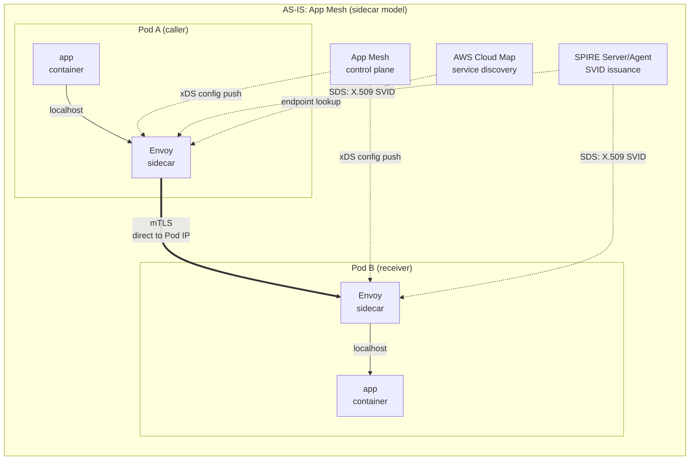
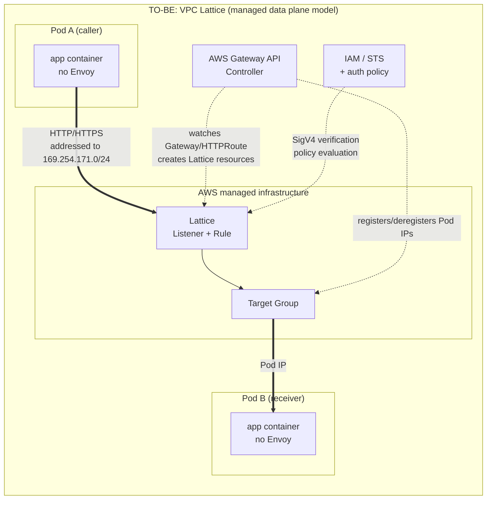

# App Mesh と VPC Lattice のアーキテクチャ比較

> **対象範囲**: VPC Lattice の service/resource API と AWS Gateway API Controller。選択したリリースとインストール済み CRD を確認してください。
> **最終更新**: 2026年10月16日

## このドキュメントの対象

- sidecar とマネージドデータプレーンの各モデルが、どの課題を解決するために設計されたか
- App Mesh のリソースが Lattice のリソースにどう対応するか、また一対一対応ではない理由
- 一対一対応でない部分から生じる機能差と、その間を AWS Gateway API Controller がどうつなぐか

## 2つのモデルが異なる設計になった理由

### Sidecar モデル: アプリケーションの隣に proxy を置く

App Mesh と Istio は、**アプリケーションのコンテキストがなければ判断できない処理がある**ため、Envoy を Pod 内に配置します。

呼び出し元側の proxy は connection pool を維持し、上流の障害を検知して、設定された再試行を適用できます。正確に利用できる制御は製品と API によって異なります。Envoy にある機能が自動的に App Mesh の機能になるわけではありません。マネージドサービスも状態を保持できるため、proxy の配置だけを根拠に、機能が実現不可能だとは言えません。

利用者は注入された Envoy workload と、別途デプロイする SPIRE 基盤を運用します。**App Mesh のコントロールプレーンは AWS が運用していました（サポートは2026年9月30日に終了）。** Proxy のアップグレードとリソース消費は引き続き利用者の workload に関わる課題ですが、App Mesh を全面的に自己運用するコントロールプレーンとして説明しないでください。

### マネージドデータプレーンモデル: proxy を基盤側に移す

Lattice は逆の設計を採用しました。proxy を Pod から取り出し、**AWS が運用する基盤**に配置します。クライアント Pod は、Lattice service 宛ての通常の HTTP リクエストを送り、リクエストがどう処理されるかを意識する必要がありません。基盤がそのリクエストを受け取り、処理します。

この設計が解決するのは、規模と異種環境への対応です。sidecar がないため Pod 数に応じて proxy が増えることはなく、EKS、ECS、EC2、Lambda がすべて**同じ方法で**service network に参加できます。Lambda 関数内に Envoy を配置することはできませんが、基盤層の proxy なら Lambda にも対応できます。VPC とアカウントの境界や、重複する IP range も基盤側で吸収します。

Envoy を取り除くと、耐障害性と telemetry の実装場所が変わります。**App Mesh が提供していた機能と、現在公開されている Lattice API** を比較し、どの制御をアプリケーションや別の proxy に移す必要があるかを特定してください。この概念上の構成図から、AWS 内部の状態の置き場所や、機能上の恒久的な制限を推測しないでください。

## 現状／移行後のアーキテクチャ

目立つ違いが3つあります。

1. **Proxy を通る回数**: 現状では、呼び出し元の Envoy と受信側の Envoy の**2つ**を通ります。移行後は Lattice を**1回**通ります。
2. **コントロールプレーンの所有者**: 現状では App Mesh のコントロールプレーンが xDS 経由で各 Envoy に設定を配信し、SPIRE が証明書を発行します。移行後はこれらの役割が AWS 管理領域に移り、利用者のクラスターに残るのは単一の Gateway API Controller Deployment です。
3. **接続の終端**: 現状では呼び出し元の Envoy が受信側 Pod の IP に**直接**接続します。移行後は Lattice address に接続し、Pod IP を認識するのは Lattice です。

## リソースの対応関係

| App Mesh | VPC Lattice | 関係 |
|---|---|---|
| **Mesh** | **Service Network** | どちらも論理的な境界です。App Mesh mesh は Kubernetes 専用ではありません。Lattice service network は service と VPC を関連付けますが、リソース接続機能は別です。 |
| **VirtualService** | **Lattice Service** | 論理的な service 名。Lattice Service ごとに独自の DNS 名が割り当てられます。 |
| **VirtualRouter** + **Route** | **Listener** + **Listener Rule** | VirtualRouter の protocol 単位の routing 役割は Listener に、Route の match／action は Listener Rule に移ります。 |
| **VirtualNode** | **Target Group** | VirtualNode は「この workload の ID + backend 設定 + listener 設定」を1つのリソースにまとめていました。Target Group が表すのは**backend target の集合**だけです。 |
| **AWS Cloud Map** | **不要** | Lattice には service discovery が組み込まれているため、Cloud Map の namespace／service 管理は不要になります。 |
| **Envoy sidecar** | **削除** | Pod からなくなり、data plane は AWS の基盤に移ります。 |
| **VirtualGateway** | **Lattice Service + Listener**（または ALB／NLB） | North-South traffic は Gateway API Controller の対象外で、AWS Load Balancer Controller が担当します。 |

### この表を一対一の対応表と見なしてはいけない理由

**問題は VirtualNode の行にあります。** App Mesh の VirtualNode は、同時に3つの要素を表現していました。workload が何者か（backend TLS 設定を含む identity）、どこへ向かうか（backend）、どこで traffic を受けるか（listener、health check、connection pool、outlier detection）です。Lattice ではこの3つが異なる場所に分散しています。

- 「どこで受けるか」の**一部だけ**（target 集合、health check）が Target Group に対応します。
- **「どこへ向かうか」はリソースではなく、auth policy と IAM 権限で決まります。**
- **「何者か」は SVID ではなく** ([ドキュメント05](./05-spiffe-to-iam.md)) **IAM Role で表されます。**
- **Connection pool と outlier detection に対応するリソースはありません。**

つまり、右側の列に対応する項目が埋まっていても、左側のリソースが持っていた属性がすべて移行されるわけではありません。**この表が対応付けているのはリソース名であり、機能ではありません。**

## 機能差

ここで挙げるのは**移行時の確認項目**であり、マネージド data plane では今後も実装不可能だと証明するものではありません。App Mesh、Istio、生の Envoy では設定できる内容が異なります。置き換え先を決める前に、移行元で実際に使っている機能を確認してください。

| 機能 | 移行時の確認事項 |
|---|---|
| Connection 上限、再試行、outlier handling | 実際の移行元製品で公開される制御を棚卸しします。Lattice の health check は、すべての Envoy client-side policy を再現するものではありません。アプリケーションの耐障害性と再試行 budget を検証してください。 |
| Fault injection と traffic mirroring | Envoy／Istio の全機能を App Mesh の機能と呼ばないでください。必要に応じて、別途レビューしたテスト／mirroring 経路を設計します。 |
| Health check | Target Group の health check は target を能動的に調査します。リクエスト単位の受動的な outlier detection とは異なります。 |
| Client 証明書の identity | HTTPS service listener と、TLS passthrough による endpoint の mTLS は異なる trust boundary です。[ネットワークの章](./04-networking-basics.md)を参照してください。 |
| Metric と trace | アプリケーションの OpenTelemetry span を保持します。Lattice access log と CloudWatch metric から、リクエスト／target の timing と相関情報を得られますが、Lattice ネイティブの trace span は提供されません。 |

### 実務での機能差の捉え方

移行時に重要な作業の1つが**可観測性**です。既存コンポーネントごとに提供される metric、access log、trace context を棚卸しし、置き換え後の経路を end-to-end で検証してください。

Circuit breaker と retry には「アプリケーションに library を追加する」という分かりやすい代替策があり、そのコストも見積もれます。可観測性にも明確な代替策があるように見えますが、必要な作業の性質は異なります。現状では Envoy が生成する span を**アプリケーションコードに手を加えずに**取得できました。移行後に同じレベルの tracing を得るには、すべての service に OpenTelemetry instrumentation を追加する必要があり、アプリケーションチームの作業項目になります。

通常、client span は downstream server span を内包するため、呼び出し元 span の終了時刻から受信側 span の開始時刻を引いてもネットワーク latency にはなりません。`requestId`、`duration`、`requestToTargetDuration`、`responseFromTargetDuration` などの Lattice log field とアプリケーション span を相関させてください。clock skew、instrumentation の境界、network time が因果関係の特定に影響します。Lattice は HTTP の相関用に `x-amzn-requestid` を追加しますが、これは OpenTelemetry span ではありません。

## AWS Gateway API Controller の役割

CLI または console から Lattice リソースを直接作成できますが、EKS では通常 **AWS Gateway API Controller** を使います。これはクラスター内の Kubernetes Gateway API resource を監視し、対応する Lattice リソースを作成／削除します。

| Kubernetes リソース | 作成される Lattice リソース |
|---|---|
| `GatewayClass` (`amazon-vpc-lattice`) | なし（Lattice を data plane として宣言） |
| `Gateway` | **Service Network** を参照します。namespace を除いた Gateway 名が Service Network 名に対応し、同じ名前の Gateway はすべて同じ Service Network を参照します。 |
| `HTTPRoute`／`GRPCRoute` | **Lattice Service** + **Listener Rule**。Route ごとに**独自の domain name** が割り当てられます。 |
| `TLSRoute` | TLS Passthrough 用 Lattice Service（[ドキュメント04](./04-networking-basics.md)を参照） |
| `backendRefs` が参照する Service | **Target Group** と、その中の **Target** |
| `TargetGroupPolicy` | Target Group の protocol と health check の設定 |
| `IAMAuthPolicy` | attachment の対象に応じて、service network または service の auth policy（[ドキュメント03](./03-auth-flow.md)） |

### この Controller が機能差を埋めるうえで中心となる理由

App Mesh では、Pod IP を追跡していたのは Cloud Map と Envoy でした。Lattice では、この Controller がその役割を担います。

Controller は `backendRefs` が参照する Kubernetes Service の**endpoint 変更**を監視します。Deployment の scale-out で Pod が追加されたり、rolling update で Pod IP が変わったりすると、Controller は変更を検出し、Lattice Target Group の Target を**登録／登録解除**します。Kubernetes の宣言状態と Lattice の実際の target list を同期させることが、この Controller の中心的な役割です。

実務上、次の2点が重要です。

**1つ目に、Controller が停止すると routing target が古いままになります。** Lattice は traffic の転送を続けますが、新しく起動した Pod は Target として登録されず、停止した Pod も登録解除されません。Controller Deployment の可用性と IAM 権限は、data path の信頼性に直結します。

**2つ目に、Pod readiness gate を使えます。** Lattice Target Group の health が `Healthy` になるまで Pod を Ready としない設定にできます。これにより、Lattice から見て新 Pod が正常になるまで、rolling update で旧 Pod が**終了しないようにできます。** これは移行中の downtime をゼロにするための重要な仕組みです。

### Controller の対象範囲の制限

Gateway API は North-South（Ingress）と East-West（Mesh）の両方の traffic を扱う設計ですが、**AWS Gateway API Controller の現行対象は Lattice 経由の East-West traffic だけです。** ALB／NLB のような North-South 機能を期待しないでください。それらは AWS Load Balancer Controller の担当です。

ingress-nginx も使う環境では特に重要です。ingress-nginx が処理する North-South traffic はこの移行の対象外で、East-West traffic だけが Lattice に移ります。両方の経路が共存する構成が通常の結果です。

## まとめ

- 製品 API と設定済み機能を比較してください。proxy の移動によって責任範囲は変わりますが、機能差が恒久的だと証明されるわけではありません。
- リソース対応表が示すのは名前です。VirtualNode の属性は複数箇所に分散するか、対応するものがなくなります。
- 見落とされやすい差は可観測性です。Envoy が自動で提供していた span は、独立した instrumentation 作業になります。
- AWS Gateway API Controller が Kubernetes endpoint の変更を Lattice Target に反映します。その可用性は data path の信頼性に直結します。

次の「[レイテンシへの影響分析](./02-latency.md)」では、proxy hop の減少と VPC traversal の追加がどう作用するかを検討します。

## 参考資料

- [AWS Containers Blog: AWS App Mesh から Amazon VPC Lattice への移行](https://aws.amazon.com/blogs/containers/migrating-from-aws-app-mesh-to-amazon-vpc-lattice/)
- [aws-samples/migrating-from-aws-app-mesh-to-amazon-vpc-lattice](https://github.com/aws-samples/migrating-from-aws-app-mesh-to-amazon-vpc-lattice)
- [AWS Gateway API Controller: Controller の概要](https://www.gateway-api-controller.eks.aws.dev/latest/concepts/overview/)
- [AWS Gateway API Controller: Gateway API reference](https://www.gateway-api-controller.eks.aws.dev/latest/api-types/gateway/)
- [Amazon VPC Lattice User Guide](https://docs.aws.amazon.com/vpc-lattice/latest/ug/what-is-vpc-lattice.html)
- [App Mesh ドキュメントの変更履歴](https://docs.aws.amazon.com/app-mesh/latest/userguide/doc-history.html)
