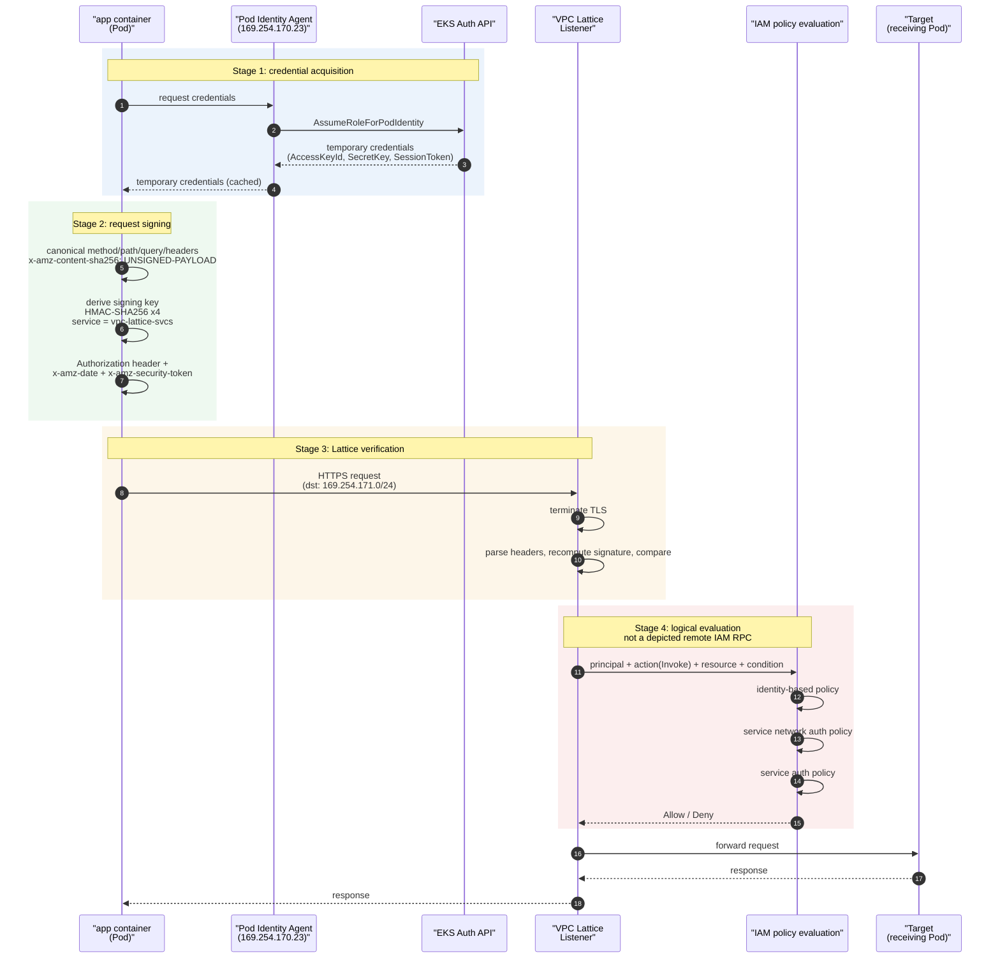
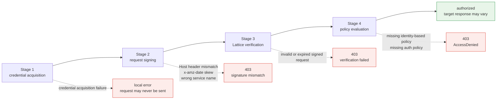

# IAM認証フローの詳細

> **対象範囲**: VPC Lattice service／resource APIとAWS Gateway API Controller。選択したreleaseとインストール済みCRDを確認する。
> **最終更新日**: 2026年9月13日

## この文書で扱うこと

- Lattice IAM Authにおけるrequest処理の4段階: credential取得、request署名、Lattice検証、policy評価
- credential、署名、policy、networkの失敗を証拠から区別する。失敗頻度の順位付けは行わない。
- 接続単位の相互認証から**request単位の署名検証**へ移る意味

## なぜrequestに署名するのか?

App MeshのmTLSでは、接続確立時に両側の証明書を**1度だけ検証**し、その後は接続を信頼します。Identityは接続に結び付いています。

Latticeは異なる方式を選びました。**すべてのrequestに署名し、すべてのrequestを検証します**。理由を理解すると、後述する制約も自然に理解できます。

IAM request署名は、AWS compute clientが共有する文書化済みのidentity方式の1つです。Lambdaでも、適切なsecret／rotation管理を行えば証明書を利用できます。Lambdaでclient証明書が不可能だと主張したり、文書化されていないAWSの設計判断の説明に使ったりしないでください。

つまりLatticeは、「AWSの各compute platformがすでに持つidentity system」を再利用することにしました。そのsystemは接続単位ではなく、**API request単位**で動作します。以降の内容はすべてこの選択に由来します。

## 4段階のシーケンス



各段階で403が発生する場所を対応付けます。



## 段階1: Credentialの取得

SigV4署名にはaccess key、secret key、session tokenが必要です。Podは2つの方法のいずれかでこれらを取得します。

### EKS Pod IdentityとIRSA

| 項目 | EKS Pod Identity（推奨） | IRSA |
|---|---|---|
| **信頼関係の設定** | EKS Auth APIを介する。Role trust policyが`pods.eks.amazonaws.com` service principalを参照する | clusterごとにIAMへOIDC providerを登録し、Role trust policyにOIDC conditionを記述する |
| **追加clusterごとの作業** | Roleを再利用できる | clusterごとにOIDC providerを登録し、trust policyを更新する |
| **Credentialの配布経路** | node DaemonSetのPod Identity Agentがlink-local addressで提供する | 投影されたServiceAccount token → SDKが`AssumeRoleWithWebIdentity`を呼ぶ |
| **関連付け方法** | EKS APIで管理する`ServiceAccount` ↔ Role association | `ServiceAccount` annotation `eks.amazonaws.com/role-arn` |
| **Session tag** | Pod／cluster contextをsession tagとして渡し、条件付き認可に利用できる | 限定的 |
| **前提条件** | Pod Identity Agent add-onをインストールし、node Roleに`AssumeRoleForPodIdentity`が必要 | OIDC provider association |

**Pod Identityを優先する実務上の理由は、multi-cluster利用です**。Latticeを採用する主な動機の1つはcluster間通信です。IRSAではclusterごとにOIDC providerを登録し、各cluster分のRole trust policyを管理する必要があります。Pod Identityにはその負担がありません。

### STSの一時credential依存

どちらの方法も最終的には**STSが発行する一時credential**を取得します。これはアーキテクチャ上重要な特性です。

- Credentialには**有効期限があります**。SDKはcacheし、期限前に更新しますが、更新経路が動作していなければなりません。
- 設定されたcredential providerが更新できないと署名がローカルで失敗することがあります。すでに署名された期限切れrequestも拒否される場合があります。IRSAはSTSを使い、Pod IdentityはAgent／EKS Auth経路からcredentialを取得します。
- つまり**East-West data pathがSTSに依存する**ことになります。これはAS-ISでSPIRE Serverが担っていた位置に似ていますが、所有者は顧客からAWSに移ります（[文書05](./05-spiffe-to-iam.md)、[06](./06-constraints.md)）。

レイテンシへの影響は[文書02](./02-latency.md)で説明しています。更新がrequest pathをブロックすると、p99 tailに現れます。

## 段階2: Request署名

### Canonical request → signing key → Authorization header

SigV4署名は3段階で進みます。

**第1にcanonical requestを作ります**。method、path、query、署名対象headerをcanonicalizeします。**Latticeでは`x-amz-content-sha256: UNSIGNED-PAYLOAD`を含めます**。payload署名には対応していません。転送中のbodyを保護するためHTTPSを使い、必要ならapplication-level integrity制御も追加します。

**第2にsigning keyを導出します**。secret keyから始め、HMAC-SHA256をdate → region → **service name** → terminating stringの順に4回適用します。Latticeのservice **nameは`vpc-lattice-svcs`です**。

このservice name自体が署名入力のため、**間違えると署名を検証できません**。Lattice control plane APIのservice nameである`vpc-lattice`と混同しやすいですが、data plane requestは`vpc-lattice-svcs`で署名する必要があります。これは`<service>-<id>.<hash>.vpc-lattice-svcs.<region>.on.aws`というservice DNS名とも一致します。

**第3にheaderを付けます。**`Authorization` headerにはalgorithm、credential scope、署名対象header一覧（`SignedHeaders`）、signature valueが含まれます。`x-amz-date`はrequest時刻を持ち、一時credentialの場合は`x-amz-security-token`にsession tokenが入ります。

### 実務上の3つの落とし穴

#### ① Host headerは署名対象: custom domainに注意する

SigV4では`Host` headerが**必ず署名に含まれます**。requestの宛先hostが署名に結び付いています。

**Custom domain**を設定すると問題になることがあります。顧客domain（`api.internal.example.com`）をLattice serviceに関連付けると、clientはそのdomainにrequestを送り、`Host: api.internal.example.com`で署名します。検証側が期待する値と異なれば署名は一致しません。逆にLattice生成domainで署名し、実際のrequestのHostがcustom domainなら、やはり一致しません。

**基本ルール: 署名時のHost値を、実際のrequestのHost headerと一致させること**。Custom domainの導入時には、署名logicがどちらの値を使うか明示的に確認してください。問題が表面化するのは移行開始時ではなく、**custom domainを関連付ける時点**です。そのため見落としやすくなります。

#### ② x-amz-dateのclock skew

一般的なAWS SigV4 guideでは、**多くの場合**、requestはtimestampから5分以内に到着する必要があると説明しています。clockを同期し、実際の期限切れ／skew errorを確認してください。これはLattice固有に別途測定された保証ではありません。

そのため**node clockの同期は認証の前提条件**です。Amazon Time Sync Serviceを使うEC2／EKS nodeでは通常問題になりませんが、次の場合に問題となります。

- nodeまたはhybrid hostの時刻同期設定に不備がある
- applicationが誤ったtimestampやtimezoneで署名する
- hostがclock driftした状態でresumeする

この失敗は**断続的で特定nodeに限られる**ため、診断しにくいことがあります。「特定node上のPodだけ403になる」場合は、まずclock同期を確認します。

#### ③ 中間proxyによるheader変更: 最終hopで署名する

署名はrequest内容に結び付いているため、署名後に署名対象要素が変更されると、**検証に失敗します。**

実際に原因となる例:

- 署名対象pathまたは実際の`Host`値を変更するproxy
- query parameterを追加／削除したり、値／encodingを変えるproxy。同等のparameterを並べ替えるだけなら、canonical queryが必ず変わるわけではない。
- 必須の`UNSIGNED-PAYLOAD`を使うLattice SigV4ではbody変更を検知できない。TLSとapplication制御で保護する。

**ルール: Lattice直前の最終hopで署名すること**。署名後からLatticeまでの間にrequestを変更するlayerを置かないでください。

特に**egress proxy経由で署名する場合**に重要です。aws-samplesの参照実装では、8080で待ち受ける`sigv4proxy` sidecarと、iptablesで**Lattice範囲の`169.254.171.0/24`宛て通信だけ**をローカル8080 portへredirectするinit containerを使います。proxyが署名し、そのままrequestをLatticeへ送るので、間にrequestを変更するものがありません。署名済みrequestを別のproxyがさらに処理する構成は避けてください。

## 段階3: Latticeによる検証

HTTPS listenerでは、Latticeが**TLSを終端し、headerを解析**して、`Authorization` headerのsignatureを再計算して照合します。

アーキテクチャ上、最も重要な制約はここにあります。

> **署名を検証するにはheaderを読む必要があり、headerを読むにはTLSを終端する必要があります。**

**TLS PassthroughではTLSを終端しないため、Latticeは`Authorization` headerを読めず、呼び出し元のSigV4署名を認証できません。これが**[文書06](./06-constraints.md)で説明する制約です。ただし、すべてのauth policyが禁止されるわけではありません。TLS listenerではanonymous principalに限定したpolicyを使えますが、認証済みcaller identityは確立しません。

ControllerではGateway、HTTPRoute、GRPCRouteへのpolicy attachmentを文書化しています。対応するattachment targetはインストール済みCRDで確認してください。**このControllerの制限は、すべてのVPC Lattice TLS auth policyが拒否されるという意味ではありません。**

::: tip 文書化されたTLS動作
AWSは、認証済みSigV4 identityやHTTP header／pathの検査を使わない、**anonymous principalに基づく**TLS passthrough auth policyを許可しています。TLS listenerには、平文SNIと一致するcustom domainおよびTCP target groupが必要です。ECH／ESNIはサポートされません。このrepositoryではwildcard principalのpolicy例を推奨しません。[TLS listener資料](https://docs.aws.amazon.com/vpc-lattice/latest/ug/tls-listeners.html)を参照してください。
:::

認証済みrequest署名とanonymous network-context認可は別の制御です。endpoint認証と適用されるservice-network／service policyを明示的に設計してください。

もう1つの落とし穴は、**`authType`が`AWS_IAM`のときだけauth policyが有効**になることです。`NONE`では付与されたpolicyは動作しません。「policyを付けたのに誰でも通れる」というときの最も多い原因です。

## 段階4: Policy評価

認証済みprincipalについて、呼び出し元の権限と適用される各Lattice resource policyを評価します。**auth policyを強制するのは`AWS_IAM`に設定されたresourceだけで、`NONE`ではそのresource policyを評価しません。明示的denyやその他のIAM制御は引き続き適用されます**。3つのpolicyを示す図を、anonymousまたは設定の異なるrequestすべてに共通する規則として扱わないでください。

| Policy | 紐付け先 | 答える質問 | 所有者 | Gateway API resource |
|---|---|---|---|---|
| **identity-based policy** | 呼び出し元IAM Role | 「このRoleは`vpc-lattice-svcs:Invoke`を実行できるか?」 | application／platform team | なし（IAMで直接設定） |
| **service network auth policy** | Service Network | 「このprincipalはこのservice networkに入れるか?」（粗粒度） | network／cloud administrator | `IAMAuthPolicy` → `Gateway` |
| **service auth policy** | Lattice Service | 「このprincipalはこのserviceを呼び出せるか?」（細粒度） | service所有チーム | `IAMAuthPolicy` → `HTTPRoute`／`GRPCRoute` |

**service呼び出し用auth policy**で使うactionは`vpc-lattice-svcs:Invoke`です。Resource configurationは別のaccess modelを使い、service-network auth policyを継承しません。

### 利用可能なcondition key

以下のkeyはauth policyのconditionとして利用できます。評価時に利用できるkeyはprotocolとSigV4署名の有無によって異なります。

| Condition key | 条件対象 |
|---|---|
| `vpc-lattice-svcs:Port` | request先service port |
| `vpc-lattice-svcs:RequestMethod` | request method |
| `vpc-lattice-svcs:RequestPath` | request URLのpath部分 |
| `vpc-lattice-svcs:RequestHeader/<header-name>` | request内のheader名／値の組 |
| `vpc-lattice-svcs:RequestQueryString/<key-name>` | request URL内のquery string key／値の組 |
| `vpc-lattice-svcs:ServiceArn` | 対象Lattice serviceのARN |
| `vpc-lattice-svcs:ServiceNetworkArn` | service networkのARN |
| `vpc-lattice-svcs:SourceVpc` | requestの送信元VPC |
| `vpc-lattice-svcs:SourceVpcOwnerAccount` | 送信元VPCを所有するaccount |

`aws:PrincipalOrgID`、`aws:PrincipalTag/<key>`などのIAM global condition keyも併用できます。

::: warning 要確認
上記一覧は[service authorization reference](https://docs.aws.amazon.com/service-authorization/latest/reference/list_vpc-lattice-svcs.html)とGateway API Controller文書のpolicy例からまとめたものです。Latticeは機能追加が続くため、設計を確定する前に、**参照先で最新一覧を確認してください。**
:::

path、method、headerのconditionは実務で役立ちます。例えば、アプリケーションコードの外側で「このRoleだけがpayments serviceの`POST /refund`を呼べる」という規則を強制できます。一方、**path単位の認可をauth policyに置くとAPI変更に伴ってpolicy変更も必要**になるため、どのlayerで認可を表現するか意図的に決めてください。

### 403でよくある失敗パターン

`vpc-lattice-svcs:Invoke`権限が欠けていることは、認証済みrequest失敗の**文書化された原因の1つ**です。incident頻度のdatasetは提示されていないため、最も多い原因とは順位付けしません。

直感に反するため、見落とされやすい問題です。「serviceのauth policyでこのRoleを許可したから終わり」と考えがちですが、**呼び出し元Role自体にもInvoke権限が必要です**。Resource policyだけでは通過できません。

参照実装からの実際のerror message:

```text
AccessDeniedException: User: arn:aws:sts::111122223333:assumed-role/eksctl-...-Role1-yz1hNJittmXj/1726632845600682009
is not authorized to perform: vpc-lattice-svcs:Invoke
on resource: arn:aws:vpc-lattice:us-west-2:111122223333:service/svc-0b13d4b53748cbdc7/catalogdetail
because no identity-based policy allows the vpc-lattice-svcs:Invoke action
```

**末尾の`because no identity-based policy allows...`が診断の鍵です**。どのpolicyが不足しているかmessageが示しているため、403になったらまず読みます。

### 403の診断順序

| 順番 | 確認するもの | 方法 |
|---:|---|---|
| 1 | error messageの末尾 | `no identity-based policy`なら呼び出し元Role権限、それ以外ならauth policy |
| 2 | Lattice access logと返されたerror | request ID、caller log、policy、network証拠を相関する |
| 3 | requestは実際に署名されていたか | 未署名requestと署名失敗は別問題。egress proxy logを確認する |
| 4 | `authType`は`AWS_IAM`か | `NONE`ではpolicyは動作しない |
| 5 | node clock | 1 nodeだけ失敗する場合は`x-amz-date`のskewを疑う |
| 6 | Host header | custom domainを導入した直後なら、まずここを確認する |

### 見落としやすい落とし穴: k8s Service DNS直呼びは認可を迂回する

AWS Gateway API Controllerの文書には明記されています。

> `IAMAuthPolicy`が認可できるのは、**Gateway、HTTPRoute、GRPCRouteを通る**通信だけです。clientがk8s service DNSへ直接通信すると認可は適用されません。

`http://proddetail.prodcatalog-ns.svc.cluster.local`を直接呼ぶと**Lattice data pathを迂回**するため、そのrequestはauth policyで評価されません。これは設計境界の話であり、incident原因の頻度順位ではありません。

移行期間中、AS-IS経路（cluster内の直接呼び出し）とTO-BE経路（Lattice経由）が共存すると、**認可が適用される経路とされない経路が同時に存在します**。NetworkPolicyなどでcluster内の直接呼び出しをブロックする補完制御が必要であり、移行計画に含めてください。

## AS-ISとの比較

| 項目 | AS-IS: App Mesh + SPIRE mTLS | TO-BE: Lattice IAM Auth |
|---|---|---|
| **認証スコープ** | **接続**（接続確立時に1回） | **request**（各request） |
| **方向性** | **双方向の相互認証**（clientとserverの両方がidentityを証明） | **単方向**: clientは証明する。serverはTLS server証明書でのみ証明される |
| **Identityの形式** | X.509 SVID内のSPIFFE ID（URI） | IAM Role ARN／assumed-role session ARN |
| **証明方法** | 短期X.509証明書（秘密鍵所有の証明） | SigV4署名（secret key所有の証明） |
| **検証主体** | 相手側workloadのEnvoy | Lattice（AWS管理基盤） |
| **信頼のroot** | 顧客が運用するSPIRE Server CA | AWS IAM／STS |
| **認可の実行場所** | 受信側Envoyの認可filter | Latticeの3段階policy評価 |
| **TLS終端** | 受信PodのEnvoy | Lattice（HTTPS listener） |
| **Credential期限切れ時** | SVID自動更新（SPIRE Agent） | STS credential自動更新（SDK） |
| **可観測性** | Envoy metrics／log | Lattice access log（spanなし） |

### 最も重要な2行

**「方向性」の行**が審査会の核心です。mTLSではserver側もidentityを証明していました。Lattice IAM Authでは、server側identityの証明はTLS server証明書の範囲にとどまり、workload identity system内で「本当にそのteamが運用するserviceか」を確認する段階がありません。詳細は[文書05](./05-spiffe-to-iam.md)を参照してください。

ClientからLatticeへのHTTPS接続はLatticeで終端します。target protocolは別設定です。そのsegmentがHTTPなら平文となり、HTTPSなら暗号化されますが、Latticeはtarget証明書を検証しません。Endpoint TLS／mTLS passthroughでは信頼境界が変わり、暗号化されたHTTPのSigV4 identityをLatticeに見せられません。

## まとめ

- Latticeは、**EKS、ECS、EC2、Lambdaが共有するIAM／STS基盤**を再利用するrequest署名を選びました。このsystemは接続単位ではなくrequest単位で動作します。
- 署名service **nameは`vpc-lattice-svcs`です**。署名への入力なので、間違えると検証に失敗します。
- 実務上の3つの落とし穴: **Host headerも署名される**（custom domainに注意）、**x-amz-dateの5分clock skew**（node clock同期）、**最終hopで署名する**（間にrequestを変更するproxyを置かない）。
- TLS passthroughでは暗号化されたHTTP SigV4 headerを認証できませんが、その経路ではAWSがanonymous network-context auth policyをサポートします。
- Invoke権限不足は403の原因の1つです。根拠のない頻度順位を付けず、返された理由と相関logを使ってください。
- **k8s Service DNSを直接呼ぶとauth policy評価を迂回します**。移行中は補完制御が必要です。

次に読む[基礎: Link-LocalとSNI](./04-networking-basics.md)では、「headerを見るにはなぜTLS終端が必要か」をさらに下の層から説明します。

## 参考資料

- [Auth policyでVPC Lattice serviceへのアクセスを制御する](https://docs.aws.amazon.com/vpc-lattice/latest/ug/auth-policies.html)
- [Amazon VPC Lattice Servicesのaction、resource、condition key](https://docs.aws.amazon.com/service-authorization/latest/reference/list_vpc-lattice-svcs.html)
- [AWS Gateway API Controller: IAMAuthPolicy API Reference](https://www.gateway-api-controller.eks.aws.dev/latest/api-types/iam-auth-policy/)
- [aws-samples: network保護とAWS IAM認証の実装](https://github.com/aws-samples/migrating-from-aws-app-mesh-to-amazon-vpc-lattice/blob/main/vpc-lattice-config/IAMAUTH.md)
- [Amazon VPC LatticeとAmazon EKSでAWS IAM認証を実装する](https://aws.amazon.com/blogs/containers/implement-aws-iam-authentication-with-amazon-vpc-lattice-and-amazon-eks/)
- [EKS Pod Identity](https://docs.aws.amazon.com/eks/latest/userguide/pod-identities.html) / [IAM Roles for Service Accounts](https://docs.aws.amazon.com/eks/latest/userguide/iam-roles-for-service-accounts.html)
- [AWS API requestへの署名（SigV4）](https://docs.aws.amazon.com/IAM/latest/UserGuide/reference_sigv.html)

- [Lattice SigV4認証request](https://docs.aws.amazon.com/vpc-lattice/latest/ug/sigv4-authenticated-requests.html): unsigned payload headerと有効時間の要件
