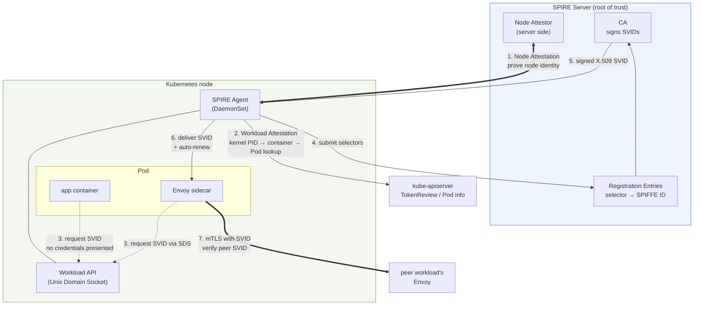

# ワークロードアイデンティティの移行: SPIFFEからIAMへ

> **対象範囲**: VPC Latticeのサービス／リソースAPIとAWS Gateway API Controller。選択したリリースとインストール済みCRDを確認してください。
> **最終更新日**: September 13, 2026

## このドキュメントで扱うこと

- SPIFFE／SPIREがワークロードアイデンティティの問題を解決した方法。特にアテステーションが初期設定時の信頼問題を解決する仕組み
- SPIFFEベースのmTLSとLattice IAM Authの類似点（短期間の認証情報とプラットフォームによるアテステーション）と、**結論を左右する2つの違い**
- 金融業界のセキュリティレビューで、それらの違いが中心的な論点となる理由

## 出発点となる問題: ワークロードはどう自分を証明するか

サービスAがサービスBを呼び出すとき、Bは「この要求は本当にAから来たのか」を知る必要があります。難しいのは、証明に必要な秘密情報を**どうやって最初に渡すか**です。

ワークロードへ証明書やAPIキーなどの秘密情報を渡すには、そのワークロードが本物かを知る必要があります。それを知るには秘密情報が必要です。これが**ブートストラップ問題**であり、従来の回避策はいずれも問題を別の場所へ移すだけです。

| 回避策 | 問題の移動先 |
|---|---|
| 証明書をイメージに焼き込む | イメージの漏えいがアイデンティティの漏えいになる。更新には再ビルドが必要 |
| Secretとしてマウントする | Secretを読める人なら誰でも、そのアイデンティティを偽装できる |
| デプロイ時に注入する | CI/CDシステムがすべてのアイデンティティのマスターキーを保持する |

SPIFFE／SPIREとLattice IAM Authは、**プラットフォームがワークロードの正当性を保証することで、この問題を解決します**。それゆえに構造がよく似ています。そして類似しているからこそ、レビューでは**どこが異なるか**が焦点になります。

## SPIFFEを構成する3つの要素

SPIFFE（Secure Production Identity Framework For Everyone）は、ワークロードアイデンティティの**標準仕様**であり、実装そのものではありません。

### ① SPIFFE ID: アイデンティティの名前

ワークロードをURIとして識別します。

```text
spiffe://<trust-domain>/<workload-path>

e.g.: spiffe://finance.example.com/ns/prodcatalog/sa/prodcatalog-sa
```

`trust-domain`は、**信頼境界の名前**です。同じtrust domain内のワークロードは、同じCAという共通の信頼の起点を共有します。パスの部分は組織が自由に設計でき、Kubernetes環境ではnamespaceとServiceAccountを表すのが一般的です。

注目すべきなのは、**名前にネットワーク情報が含まれないこと**です。IP、ホスト名、ポートはいずれもありません。ワークロードがどこに配置され、IPがどう変わっても、アイデンティティは同じままです。 [ドキュメント04](./04-networking-basics.md)で扱う「IPベースの制御からアイデンティティベースの制御へ」という転換はここから始まります。

### ② SVID: アイデンティティを証明する認証情報

**SPIFFE Verifiable Identity Document**（SPIFFE検証可能アイデンティティ文書）です。SPIFFE IDを検証可能な文書に含め、次のいずれかの形式で提供します。

| 形式 | 内容 | 主な用途 |
|---|---|---|
| **X.509-SVID** | SAN URIにSPIFFE IDを含むX.509証明書と秘密鍵 | mTLSによる相互認証 |
| **JWT-SVID** | `sub`クレームにSPIFFE IDを含むJWT | HTTPヘッダーでのアイデンティティ伝達、L7認可 |

**重要な性質は、有効期間が短いことです。** SVIDは通常、数十分から数時間の有効期間で発行され、自動更新されます。有効期間が短いと、**失効処理の問題を回避できます。** CRLとOCSPは運用上扱いづらく、いずれにしても認証情報の有効期限がすぐ切れるなら、失効機構がなくても侵害が役立つ時間を制限できます。

### ③ Workload API: アイデンティティを渡す経路

ワークロードがSVIDを取得するためのインターフェースです。重要なのは、**Unix Domain Socket（UDS）経由で公開されること**です。

この設計の本質はUDSにあります。**ワークロードは認証情報を一切提示せずにソケットへ接続します**。代わりにカーネルがピアプロセスの情報（PID、UID、GID）を確実に提供し、SPIRE Agentがその情報から、相手が誰なのかを**直接調査します**。

つまり、これは「**アイデンティティを証明するため秘密情報を提示する」のではなく、「プラットフォームがアイデンティティを観測して判定する**」仕組みです。そこでブートストラップ問題が解決されます。

## SPIREのコンポーネント

SPIREはSPIFFEの参照実装です。



| コンポーネント | 役割 |
|---|---|
| **SPIRE Server** | **信頼の起点**。CAを保持し、SVIDに署名／発行します。どのセレクターにどのSPIFFE IDを割り当てるかをRegistration Entryで管理します |
| **SPIRE Agent**（DaemonSet） | 各ノードで稼働します。まず自身のノードのアイデンティティをServerに証明し、次にノード上のワークロードを調査して、代わりにSVIDを取得、配布、更新します |
| **アテステーション** | アイデンティティを判定する手順。Node AttestationとWorkload Attestationの2段階があります |
| **Envoy SDS統合** | Envoyは**Secret Discovery Service**プロトコルでAgentから証明書を受け取ります。アプリケーションコードはmTLSを意識しません |

### アテステーションでブートストラップ問題を解決する

ここがSPIREの核心であり、IAMとの比較の基準点です。

**Node Attestation**: AgentはServerに対して「自分はこのノードです」と証明します。その証拠は**あらかじめ配置した秘密情報ではなく、プラットフォームが発行したアテステーション**です。AWSではEC2インスタンスの署名付きIMDS文書またはインスタンスID文書を使います。ServerはAWSを通じてその証拠を検証できるため、ノードに事前共有秘密を置く必要がありません。

**Workload Attestation**: Agentはノード上のワークロードを調査します。

1. ワークロードは**認証情報なし**でUDSに接続する
2. AgentはカーネルからピアプロセスのPIDを取得する（**偽造できない**）。カーネルが報告する事実である
3. PIDからcgroupを読み取り、どのコンテナかを特定する
4. kubelet／kube-apiserverに問い合わせ、そのコンテナのPod、namespace、ServiceAccount、ラベルを確認する
5. 属性を**セレクター**にまとめ、Serverへ送信する
6. ServerはRegistration Entryから一致するSPIFFE IDを見つけ、SVIDを発行する

**手順2でブートストラップ問題が解消されます**。ワークロードは自分が誰かを主張しません。その必要もありません。カーネルが事実を報告し、それをプラットフォーム（Kubernetes）の記録と照合します。**これを偽造するにはカーネルまたはKubernetes APIサーバーを侵害しなければならず、そのレベルで侵害されていれば、ほかのものもすでにすべて失われています。**

一言で言えば、**アイデンティティは提示されるのではなく、観測され判定されます。**

## IAM Authとの比較

Lattice IAM Authの手順は[ドキュメント03](./03-auth-flow.md)で説明しています。項目ごとに比較します。

| 項目 | SPIFFE／SPIRE（現状） | Lattice IAM Auth（移行後） |
|---|---|---|
| **アイデンティティの名前** | SPIFFE ID（`spiffe://<trust-domain>/ns/<ns>/sa/<sa>`） | IAM Role ARN／AssumeRoleセッションARN |
| **認証情報の形式** | X.509-SVIDまたはJWT-SVID | STS一時認証情報（アクセスキー＋シークレット＋セッショントークン） |
| **証明方法** | 証明書秘密鍵の所持を証明（TLSハンドシェイク） | SigV4リクエスト署名（秘密鍵の所持を証明） |
| **証明の範囲** | **接続**（確立時に1回） | **リクエスト**（毎回） |
| **アテステーションを行う主体** | SPIRE Agent（ノード）＋SPIRE Server | EKS Pod Identity Agent＋EKS Auth API |
| **アテステーションの証拠** | カーネルPID → cgroup → Pod／ServiceAccountの照会 | `ServiceAccount`とRoleの関連付け（EKS Auth API）、またはOIDCトークン（IRSA） |
| **検証方法** | ピアのEnvoyが信頼バンドルを使ってSVIDチェーンを検証 | Latticeが署名を再計算／比較し、その後3つのポリシーを評価 |
| **信頼の起点** | **顧客が運用するSPIRE ServerのCA** | **AWS IAM／STS** |
| **認証情報の有効期間** | 数十分から数時間、自動更新 | STS一時認証情報、自動更新 |
| **認可の表現方法** | Envoy認可フィルター（SPIFFE IDベース） | 3つのIAMポリシー（アイデンティティベース＋サービスネットワーク＋サービス） |
| **可観測性** | Envoyメトリクス／ログ（SPIFFE ID単位） | Latticeアクセスログ（プリンシパル単位。トレーススパンはなし） |
| **運用負荷** | **高い**: SPIRE ServerのHA、CA鍵管理、CAローテーション、Registration Entry管理、Agentのデプロイ／アップグレード、信頼バンドル配布 | **低い**: Pod Identity AgentアドオンとServiceAccount／Roleの関連付け。CAや鍵管理は不要 |
| **マルチクラスター** | trust domainの設計とフェデレーションが必要 | Pod IdentityでRoleを再利用でき、クラスターごとの設定は最小限 |
| **AWS外のワークロード** | 適切なSPIREアテスターがあれば可能 | 適切なIAM認証情報プロバイダーと、サポートされるLattice接続が必要。IAM自体の制約ではない |

## 類似点: 移行が可能な理由

比較表ではまったく別のシステムに見えますが、**構造上は同じパターン**です。そのため、移行に一貫性があります。

### ① どちらも有効期間の短い認証情報を使う

SVIDとSTS一時認証情報はどちらも有効期間が短く、自動更新されます。どちらも同じ理由でこの方式を採用しています。つまり、失効機構を使わずに、侵害された認証情報が使われる期間を**制限する**ためです。

両方式ともアプリケーションに長期間有効な秘密情報を配布せずに済みますが、レビューでは認証情報の有効期間、更新、侵害時の対応、認可を確認する必要があります。有効期間を短くしても、失効や緊急拒否の要件がなくなるわけではありません。

### ② どちらもプラットフォームによるアテステーションに基づく

ワークロードが事前に秘密情報を持つのではなく、プラットフォームが正当性を保証します。

| 段階 | SPIRE | EKS Pod Identity |
|---|---|---|
| ノードのアイデンティティ | Node Attestation（EC2 ID文書など） | ノードRoleの`AssumeRoleForPodIdentity`権限 |
| ワークロードの判定 | カーネルPID → cgroup → Pod／SA | PodのServiceAccountとRoleの関連付け |
| 認証情報の配布 | Workload API（UDS） | Pod Identity Agent（リンクローカルアドレス） |
| 認証情報の更新 | AgentがSVIDを更新 | SDKが認証情報を更新 |

どちらもプラットフォームの証拠を使いますが、セレクター、トークン検証、認証情報の露出、信頼境界は異なります。両者を同等だと宣言せず、実際のアテスターまたは認証情報プロバイダーを検証してください。

**事前に長期有効な秘密を用意しなくてよいことと、実行時に秘密が存在しないことは同じではありません。** X.509-SVIDの配布には秘密鍵が含まれ、一時IAM認証情報にはシークレットアクセスキー／セッショントークンが含まれます。Agentのソケット／エンドポイント、メモリ、ログ、認証情報キャッシュを保護してください。アテステーションの強さは、設定された信頼前提の範囲を超えません。

## 結論を左右する2つの違い

類似点が多いため、レビューで実際に議論になるのは**異なる点**です。次の2つは構造的な違いであり、運用上の利便性だけでは解決しません。

### 違い(a): 双方向の相互認証から、片方向の認証＋リクエスト認証へ

**現状は双方向です。**

mTLSハンドシェイクでは、クライアントとサーバーがお互いのSVIDを検証します。クライアントはSPIFFE IDを使って「接続先のピアは本当にpaymentsサービスか」を確認し、サーバーは「接続してくるピアは本当にordersサービスか」を確認します。ワークロードアイデンティティシステムの中で、双方が自分を証明します。

**移行後は非対称です。**

| 方向 | 現状 | 移行後 |
|---|---|---|
| クライアント → サーバー（クライアントが証明） | SVIDによる相互認証 | **SigV4リクエスト署名**（毎回のリクエストで、より細粒度） |
| サーバー → クライアント（サーバーが証明） | SVIDによる相互認証 | **TLSサーバー証明書**（通常のTLSレベル） |

SigV4は各リクエストの署名対象フィールドを認証し、mTLSはTLSピアを認証します。また、どちらの設計でもリクエスト単位の認可を追加できます。どちらかが普遍的に強いとは言えません。Latticeは`UNSIGNED-PAYLOAD`を要求するため、TLSでペイロードを保護し、リプレイや認証情報窃取のリスクを明示的に考慮してください。

**問題はサーバー側の証明です。** クライアントが確認できるのは「このTLS証明書が有効で、ドメインが一致している」ことだけです。ワークロードアイデンティティシステム内で「これは本当に担当チームが運用しているサービスか」を確認する手順は**ありません**。

レビューで実際に問われるのは次の点です。

> DNS、証明書、サービス関連付け、ターゲット登録が不正に変更された場合、このワークロードのトラフィックは別の宛先へ誘導されるか。エンドポイント認証とともに、それらのコントロールプレーン権限もレビューしてください。表示名が一致していても、既存の自動生成サービスDNSアイデンティティが引き継がれるわけではありません。

正直な答えは、「**ワークロードアイデンティティシステムの範囲内では防げないため、サービスネットワークとLatticeリソースへのIAM制御によって防ぐ必要がある**」です。つまり、**防御の軸がワークロード間の相互認証から、リソース作成権限の制御へ移ります。**

これは悪い答えではありません。Lattice Serviceを作成できる主体をIAMで厳しく制限し、サービスネットワークとの関連付けを制御し、CloudTrailでリソース作成を監視すれば、実際的なリスクを管理できます。しかし、**レビュー資料に「相互認証」と書かれている場合は、その記述を書き換え、別の層で制御する根拠を示す必要があります**。移行の終盤でこの点に気付くと、スケジュールに大きな遅れが生じます。

### 違い(b): 信頼の起点を誰が所有するか

**金融業界のレビューでは、こちらの方が重い論点です。**

| 項目 | 現状 | 移行後 |
|---|---|---|
| **信頼の起点** | 顧客が運用するSPIRE ServerのCA | AWS IAM／STS |
| **CA秘密鍵の所有者** | 顧客または設定済みの上流CA | 顧客がLattice用CAを持つ必要はない。一時IAM秘密認証情報は引き続き存在 |
| **アイデンティティの発行者** | 顧客定義のRegistration Entryに基づく顧客のCA | AWS STS |
| **発行ルールを決める主体** | 顧客が全面的に制御 | 顧客がIAMで制御し、AWSが実行 |
| **監査証跡** | 顧客が保持するSPIRE Serverログ | CloudTrail（AWSサービス） |
| **CAローテーションの決定者** | 顧客 | 該当なし |
| **AWS外での利用** | アテスターと接続性による | 適切な認証情報プロバイダーとサポート対象のプライベート接続があれば可能。Pod Identityだけで提供されるものではない |
| **運用負荷** | 顧客が負担 | AWSが負担 |

トレードオフは明確です。**信頼の起点の所有権を渡す代わりに、運用負荷をAWSへ移します。**

この点が金融業界で重要なのは、規制とレビュー慣行によるものです。多くの組織のセキュリティ基準には、「**認証システムの信頼の起点は自社で管理しなければならない**」という明示的な要件、またはそのように読める条項があります。自社CAを運用するのがその要件を満たすもっとも直接的な方法であり、SPIRE採用もまさにそのレビューを通過した結果かもしれません。

Lattice IAM Authへ移行するには、その根拠を組み立て直す必要があります。利用できる根拠の例:

| 論点 | 内容 |
|---|---|
| **責任共有モデル** | IAM／STSは、AWSが複数の認定規制フレームワークの下で運用する既存の制御である |
| **ポリシー権限を維持** | 誰が何を呼び出せるかは、引き続き顧客のIAMポリシーで全面的に定義する |
| **監査証跡を保護** | CloudTrailで認証情報発行とAPI呼び出しの履歴を記録し、Latticeアクセスログでデータ経路の履歴を記録する |
| **CA運用を軽減** | AWSがサービスのPKIを処理する一方、顧客は一時認証情報、Role、トークン、エンドポイント鍵を引き続き保護する |
| **有効期間とアテステーションを維持** | 上記の類似点2つは引き続き満たされる |

**ただし、これは「制御を別の方法で行う」という主張であり、「同等である」という主張ではありません**。前者をレビュー担当者が受け入れるかは組織の基準によります。技術だけで解決できる問題ではありません。

### 金融業界のレビュー項目としての位置付け

レビュー上の論点をまとめます。

| 項目 | レビュー状況 | 根拠 |
|---|---|---|
| 長期有効な秘密情報の焼き込みを避ける | 設定を検証 | どちらも自動更新する短期認証情報を使える |
| 実行時の秘密情報の露出 | レビューが必要 | 短期間有効な秘密鍵／トークンも保護が必要 |
| リクエスト単位の認可 | 設定済みポリシーを比較 | mTLSのアイデンティティもリクエスト単位の認可に利用可能。SigV4だけが方法ではない |
| クライアントのアイデンティティ証明 | 方式が変更 | TLSピアの証明とリクエスト署名では対象範囲と脅威前提が異なる |
| **サーバーのアイデンティティ証明** | ⚠️ **弱くなる: 代替制御が必要** | ワークロードアイデンティティシステムからTLSサーバー証明書のレベルに下がる。防御の軸はリソース作成へのIAM制御に移る |
| **信頼の起点の所有権** | ⚠️ **移転する: 根拠を書き換える必要あり** | 顧客CAからAWS IAM／STSへ |
| エンドツーエンド暗号化 | 信頼境界を選択 | HTTPSはLatticeで終端。passthroughはエンドポイントTLSを維持するが、認証済みHTTP SigV4アイデンティティは維持しない |
| 可観測性（トレーシング） | ⚠️ **弱くなる** | Envoyのスパンがなくなる。アプリケーションへの計装が必要（[ドキュメント01](./01-appmesh-vs-lattice.md)） |
| AWS外のワークロード | 別途設計 | 不可能と決めつけず、認証情報とサポート対象のネットワークアクセスを評価する |

変更される信頼境界と運用境界を、責任を持つセキュリティチームとレビューしてください。エンドポイントmTLS、Latticeの認証済みHTTP、匿名のネットワークコンテキストポリシーは異なる制御です。1つの設定が組織のすべてのレビュー基準を満たすと断定せず、実際の要件に基づいて選択してください。

### SPIREを残す選択肢

移行しても、SPIREを必ず廃止する必要はありません。

- AWS外のワークロードでは、ほかの認証情報／アイデンティティ方式を評価しながらSPIREを使い続ける選択肢があります。
- **TLS Passthrough構成を選ぶ場合**は、エンドポイントが自らmTLSを実行する必要があり、SPIREはそれらの証明書を引き続き提供できます。
- この場合は**App Meshを廃止してSPIREを残す**構成になります。App Meshのサポート終了への対応と、SPIREを維持するかどうかは別の判断です。

移行目的の1つがSPIREの運用負荷をなくすことである場合、上記の条件がその目的と矛盾しないか先に確認してください。

## まとめ

- SPIFFEの3要素は、**SPIFFE ID**（URI形式の名前）、**SVID**（有効期間の短いX.509／JWT）、**Workload API**（UDS経由）です。
- SPIREのアテステーションは、**アイデンティティを提示するのではなく、観測して判定する**ことでブートストラップ問題を解決します。カーネルが報告するPIDは偽造できません。
- どちらの方式も短期認証情報とプラットフォームの証拠を利用できますが、実行時の秘密情報とポリシーの違いはレビューが必要です。
- 決定的な違いは2つです。(a) **双方向の相互認証が、片方向の認証＋リクエスト認証に変わり、サーバーのアイデンティティ証明が弱くなる**こと、(b) **信頼の起点が顧客CAからAWS IAM／STSへ移る**ことです。
- どちらも技術だけでは解決せず、組織として判断する必要があります。**アーキテクチャが変わるため、開始前にセキュリティレビュー担当者と検討してください。**

次は[制約と判断点](./06-constraints.md)で、設計を最終決定する前に確定すべき内容をまとめます。

## 参考資料

- [SPIFFEドキュメント](https://spiffe.io/docs/latest/spiffe-about/overview/)
- [SPIFFE ID仕様](https://github.com/spiffe/spiffe/blob/main/standards/SPIFFE-ID.md)／[X.509-SVID仕様](https://github.com/spiffe/spiffe/blob/main/standards/X509-SVID.md)
- [SPIREの概念: アテステーション](https://spiffe.io/docs/latest/spire-about/spire-concepts/)
- [EKS Pod Identity](https://docs.aws.amazon.com/eks/latest/userguide/pod-identities.html)
- [VPC LatticeとPod Identity IAMセッションタグを使ったEKSの安全なクロスクラスター通信](https://aws.amazon.com/blogs/containers/secure-cross-cluster-communication-in-eks-with-vpc-lattice-and-pod-identity-iam-session-tags/)
- [Istioセキュリティ: mTLS](../istio/security/01-mtls.md): サイドカーベースの相互認証の仕組み
