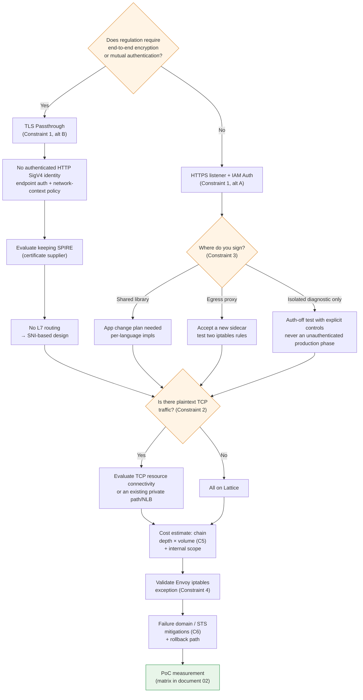

# 制約と意思決定のポイント

> **対象範囲**: VPC Latticeのservice/resource APIとAWS Gateway API Controller。選択したリリースとインストール済みCRDを確認してください。
> **最終更新日**: 2026年10月16日

## この文書で扱うこと

- 設計を確定する前に答えるべき6つの制約と、それぞれの代替策
- 制約を合わせて形成される意思決定ツリー。一つの選択が別の選択肢を閉ざす関係
- 移行前のチェックリスト

## 制約の一覧

| # | 制約 | 性質 | 代替策の有無 | 決める時期 |
|---|---|---|---|---|
| 1 | TLS passthroughではHTTP SigV4 identityを認証できない | 現行仕様として文書化されたサービス動作 | endpoint認証、anonymous network-context policy | 最初 |
| 2 | raw TCPはservice listenerではない | TCP resource接続との区別が必要 | resource gateway、既存のprivate経路、NLB | 早期 |
| 3 | SigV4署名がアプリケーションに与える影響 | 実装方式の選択 | 3方式 | 早期 |
| 4 | mesh共存時の経路／署名の検証 | 設定に依存 | 明示的な除外、または設定済みの転送 | 移行前 |
| 5 | hopごとのrequest料金とデータ料金 | 構造上の制約 | アーキテクチャの調整 | 設計中 |
| 6 | 障害ドメインの集中とSTS依存 | 構造上の制約 | 緩和策のみ | 設計中 |

制約1と2は、**現在の機能と信頼境界に関する選択**です。AWSが将来も機能を追加できないという予測ではありません。service listener、resource接続、controllerの対応状況を分けて考えてください。

## 制約1: TLS passthroughと認証済みHTTP identity

### 原則

文書[03](./03-auth-flow.md)と[04](./04-networking-basics.md)の2つの事実から、この制約が導かれます。

1. SigV4の検証には`Authorization` headerを読む必要がある
2. headerを読むにはTLSを終端する必要がある

TLS passthroughでは定義上TLSを終端しません。したがって、**Latticeは署名headerを確認できず、request署名に基づく認証を適用できません。**

Controllerのpolicy attachment対応とAWSサービス自体の機能は別のものです。TLSRouteは文書化されたIAMAuthPolicyのattachment先に含まれません。一方、AWSのTLS listenerはanonymous principalとnetwork contextに基づくpolicyに対応しています。

::: note 確認済みの制約
TLS passthroughでは、暗号化されたHTTP SigV4 identityもHTTP path／header条件も評価できません。anonymous principalのpolicyには対応しています。すべてのpolicyが拒否または無視されるという推測ではなく、[TLS listenerの資料](https://docs.aws.amazon.com/vpc-lattice/latest/ug/tls-listeners.html)を参照してください。
:::

### 2つの選択肢

| 選択肢 | 設定 | 得られるもの | 失うもの |
|---|---|---|---|
| **A. HTTPS listener + IAM Auth** | LatticeでTLSを終端し、SigV4を検証して3つのpolicyを評価 | IAM認可、path／method／header条件、L7 routing、詳細なaccess log | end-to-end暗号化（Latticeで一度終端）、endpoint独自のmTLS |
| **B. TLS passthrough + endpoint mTLS** | custom-domain SNIでserviceを選択し、endpointでTLS認証 | endpointまでの暗号化と証明書identity | 認証済みHTTP SigV4 identityとHTTP L7検査。anonymous network-context policyは別の制御 |

### どちらを選ぶか

**これは移行における最も重要な分岐点です**。ほかの多くの判断はこれに依存します。

判断基準は、**規制要件がend-to-end暗号化またはworkload間の相互認証を要求するかどうか**です。

- **要求されない場合はAを選びます**。IAM Authの認可粒度と可観測性の利点は大きく、Latticeはこの使い方を想定して設計されています。
- **要求される場合はBを選びます**。ただし、認可をどこで表現するか再設計が必要です。Latticeが認識するのはSNIだけなので、認可はアプリケーションまたはendpointのmTLS証明書検証で行います。また、[文書05](./05-spiffe-to-iam.md)で説明したとおり、**SPIREが引き続き必要となる場合があります。**

併用も可能です。**serviceごとにAとBを分けられます**。規制対象serviceにはB、その他にはAを選びます。その代わり、2つの認可モデルを同時に運用することになります。

## 制約2: service接続かresource接続かを選ぶ

### 原則

raw TCPを受け付けるservice listenerがないからといって、TCP resourceを利用できないわけではありません。Latticeのresource構成／resource gatewayは別のaccess modelを提供します。serviceへのTLS passthroughでは、clientが最初からTLSを開始し、設定したcustom-domain SNIを送る必要があります。

製品全体の恒久的な制限と決めつけず、protocol要件と現在のcontroller対応状況を確認してください。

### 影響範囲を特定する

計画の早い段階で、**平文TCPを使うEast-West通信をすべて洗い出してください**。よく使われるものを確認します。

平文のデータベース／cache／独自TCP protocolを一覧化してください。gRPC over HTTP/2（h2c）を、同じ非対応カテゴリに含めないでください。正確なHTTP listener、route、targetの設定を検証します。

### 代替策: Hybrid構成

| 通信種別 | 経路 |
|---|---|
| HTTP / HTTPS / gRPC | **VPC Lattice** |
| TLSを使うTCP | Lattice **TLS passthrough**（SNI routingが実現可能な場合） |
| 平文TCP | Lattice TCP resource接続、既存のprivate接続、NLBを評価する。serviceのL7機能が自動的に引き継がれるわけではない |

推奨理由は単純です。**すべてをLatticeへ移そうとすることが、移行を遅らせる最も一般的な原因です**。平文TCP serviceへのTLS導入まで移行範囲に入れると、アプリケーション変更が必要になり、スケジュールを自分でコントロールできなくなります。

App MeshはTCP routeにも対応していました。HTTPだけでなく、**実際にApp Meshに依存していた通信をすべて**洗い出して置き換えてください。App Meshのサポートは2026年9月30日に終了しました。

## 制約3: SigV4署名がアプリケーションに与える影響

IAM Authを選んだ場合（制約1の選択肢A）、**誰かがrequestに署名を付ける必要があります**。担当を決めることは、アプリケーションチームに最も直接的な影響を与える選択です。

| 方式 | 実装 | 利点 | 欠点 |
|---|---|---|---|
| **① 共有ライブラリ** | 各serviceのHTTP clientにSigV4署名を適用（AWS SDK署名または言語別ライブラリ） | hopが増えず遅延を最小化できる。認証情報管理をSDKに任せられる | **すべてのserviceでコード変更が必要**。言語ごとの実装が必要。署名logicのバージョン管理 |
| **② egress proxy sidecar** | `sigv4proxy` sidecarと、Latticeの範囲だけを転送するiptables | **アプリケーションコードの変更が不要**。言語に依存しない。参照実装がある | sidecarが再び必要となり、Envoyをなくす利点が一部相殺される。hopが1つ増える。sidecarの運用とupgrade |
| **③ IAM Authを使わない** | `authType`を`NONE`にし、別の層で認可 | アプリケーション変更もoverheadもない | **Lattice層の認可がなくなる**。service network内の誰でも呼び出せる。審査を通すのが難しい |

### 実務上の推奨

**複数の言語が使われている、またはアプリケーションチームの対応余力が限られるなら、②から始めてください**。aws-samplesの参照実装には検証済みmanifestがあり、8080で待ち受ける`sigv4proxy` sidecarと、`169.254.171.0/24`宛ての通信だけをproxyへ転送するinit containerを使います。

②の皮肉は明らかです。**Envoy sidecarをなくすために移行したのに、署名用sidecarが増えます**。ただし`sigv4proxy`はEnvoyよりかなり軽量で、xDS control planeがなく、設定もstaticです。「sidecarをなくすこと」が中核の目標なら①が必要であり、それに伴うアプリケーション変更の計画が必要です。

認証を無効にした比較は、業務トラフィックがなく、補完的なnetwork／application制御があり、明示的な承認を得た隔離テスト経路に限ります。移行やbenchmarkを簡単にするためだけに、本番の認可を無効にしてはいけません。

**どの方式を選んでも、[文書03](./03-auth-flow.md)にある3つの注意点（Host header、x-amz-dateの時刻、最終hopでの署名）を確認してください。**

## 制約4: 共存期間中のEnvoy iptables例外

除外設定と、明示的に設定したproxy経路のどちらを使うか決める前に、インストール済みmesh policyと実際の転送動作を確認してください。宛先不明の通信を必ず拒否するとは限りません。Envoy設定によって動作は異なります。

meshのiptablesルールがLattice宛ての通信を捕捉することがあります。転送されるか、失敗するか、署名済みの項目が変更されるかは、outbound policyとroute設定に依存します。実際のruleとlogを確認し、選択したIPv4／IPv6の署名経路を検証してください。

| 項目 | 値 |
|---|---|
| 除外する範囲（IPv4） | `169.254.171.0/24` |
| 除外する範囲（IPv6） | `fd00:ec2:80::/64` |
| App Meshの設定場所 | init containerのegress-ignore CIDR一覧 |
| Istioの設定場所 | `traffic.sidecar.istio.io/excludeOutboundIPRanges` annotation |

### 見落としやすい点

- **IPv6を使うなら、IPv6の範囲も除外する必要があります**。dual-stack clusterでIPv4だけを除外すると、断続的な失敗が起こります。
- **Pod単位のannotationは、新しく作成されたPodにだけ適用されます**。既存Podは再起動する必要があります。
- **制約3の方式②と組み合わせる場合、iptables ruleが2つあります**。App Meshによる捕捉からLattice範囲を除外すると同時に、その範囲を署名proxyへ転送しなければなりません。2つのruleの順番と相互作用を必ず検証してください。

移行を始める**前に**この設定を検証します。初回のLattice呼び出しが失敗する原因の第1位です。

## 制約5: hopごとの料金は呼び出しチェーンの深さで増える

### 課金の構造

VPC Latticeの料金は3つの軸で構成されます。

| 軸 | 性質 |
|---|---|
| **serviceのprovisioning** | service数に比例する時間単位の課金 |
| **data processing** | GB単位。**AZ間料金はここに含まれる**（cross-AZ料金は別途発生しない） |
| **request／connection** | HTTP/HTTPS listenerは**request数**、TLS listenerは**TCP connection数** |

::: warning 要確認
単価はリージョンや時期によって変わり、無料枠もあります。設計を確定する**前に**、[VPC Latticeの料金ページ](https://aws.amazon.com/vpc/lattice/pricing/)で利用リージョンの単価を直接確認してください。この文書では単価を示しません。
:::

### 呼び出しチェーンの深さがコストを左右する理由

重要なのは、料金が**hopごとに発生する**ことです。

4回呼び出す単純なchainで、各edgeにLattice requestが1つある場合、1回のユーザー操作でservice requestが4件発生します。実際のコストにはfan-out、retry、polling、payload量、provisioning時間も含まれるため、chainの深さだけではコストを完全に見積もれません。

AS-ISのApp Meshでは構造が異なりました。App Mesh自体にはrequest単位の課金がなく、Envoyが消費する計算リソースがコストになっていました。**課金モデルが「計算リソース」から「request数」へ移る**ことが、この移行のコスト面での特徴です。

### 実務上の影響

| 影響 | 対応 |
|---|---|
| **頻繁に呼び出すserviceは高くなる** | requestごとに多数の呼び出しを行う設計を、batch／aggregate呼び出しにまとめる |
| **深いchainは高くなる** | chainを短くするとコストと遅延を両方改善できる（[文書02](./02-latency.md)） |
| **すべての通信をLatticeへ移すとコストが急増しうる** | **cluster内の通信をLattice経由にしない**方が妥当なことがある |
| **client pollingはtrafficを発生させる** | 課金対象listenerを実際に通る呼び出しを数える。料金を確認せずに、client probeとLattice管理のtarget health checkを同じものとして扱わない |

**最後の2点が特に重要です**。Latticeはcluster、VPC、accountの境界を越える通信に強みがあります。同一cluster内の通信では利点が少ない一方、コストと遅延が増えます。**境界を越える通信だけLatticeに通し、cluster内通信はClusterIPのままにする**ことが、コストと性能の両面で適切な場合がよくあります。

ただし、この場合は[文書03](./03-auth-flow.md)の制約に直面します。**cluster内からk8s Service DNSを直接呼び出すと、auth policyの評価を迂回します。**「内部通信はLatticeを経由しない」と決めた場合は、NetworkPolicyまたはapplication層を使って、内部通信の認可を**別途設計する必要があります**。ここでコスト最適化と認可の一貫性が衝突します。

### コスト見積もりに必要なデータ

移行前に以下の情報を収集してください。これらがなければコストを見積もれません。

| 項目 | 収集方法 |
|---|---|
| Latticeへ移行するservice数 | 移行範囲の定義から取得 |
| serviceペアごとのrequest rate（RPS） | App Mesh Envoy metricsまたはapplication metrics |
| **平均呼び出しchainの深さ** | 移行前後のapplication tracing。Latticeのrequest ID／logと相関させる |
| serviceペアごとのdata転送量 | Envoy metricsまたはflow log |
| health check／pollingの頻度 | 各serviceの設定 |

移行中もapplication tracingを維持または追加してください。Latticeがnative spanを作成しなくても、application traceがなくなるわけではなく、呼び出しchainの分析ができなくなるわけでもありません。

## 制約6: 障害ドメインの集中とSTS依存

### 障害ドメインが集中する

AS-ISとTO-BEでは障害の特性が異なります。

| 観点 | sidecar経路 | Lattice経路 |
|---|---|---|
| 障害範囲 | proxyは局所的に停止することがある。共有設定、identity、network依存関係は広範囲に影響しうる | 影響を受けたservice、AZ、policy、基盤依存関係による。East-West通信がすべて停止するとは限らない |
| 復旧対応 | workload／設定のrollback、capacity変更、承認済み代替経路 | 顧客側のpolicy／target／controller対応と、該当する場合はAWS側の復旧 |
| 責任 | 顧客のworkloadと共有基盤の責任 | AWS管理serviceに加え、顧客のIAM、target、controller、applicationの責任 |

この章ではどちらのモデルについても、測定済みの障害確率を示していません。依存関係ごとの障害モデルを作り、承認された復旧経路をテストしてください。managed serviceでも、顧客の復旧責任がなくなるわけではありません。

### STSへの依存

IAM Authでは、**認証情報の取得と更新が設定済みproviderに依存します**（[文書03](./03-auth-flow.md)）。IRSAはSTSを使い、EKS Pod Identityはnode agentとEKS Authを使います。有効な認証情報がcacheされていれば、service呼び出しごとに外部から認証情報を取得する必要はありません。

- 一時認証情報には有効期限があり、providerは新しい認証情報を取得しなければならない。
- 更新が失敗し、有効な認証情報が残っていない場合、clientはrequest送信前に失敗することも、Latticeが拒否するrequestを送ることもある。どの失敗もHTTP 403だと決めつけず、区別する。
- 実際の認証情報配布経路が停止すると、cache済み認証情報が尽きた後にservice呼び出しが中断される可能性がある。署名のないrequestへ切り替えてはいけない。

AS-ISではSPIRE Serverがこの位置を担っていました。**依存関係そのものが新しく生まれるのではなく、所有者が顧客からAWSに移ります**（[文書05](./05-spiffe-to-iam.md)の差分(b)と同じ構造です）。

### 緩和策

この制約をなくすことはできず、影響を緩和することだけが可能です。

| 緩和策 | 内容 |
|---|---|
| **認証情報cacheの有効期間を確認する** | 選択したproviderの認証情報の有効期限、更新時期、cache、障害時の動作を記録する。まだ有効な認証情報があれば、配布経路の停止にどれだけ耐えられるかが決まる |
| **更新失敗時の動作をテストする** | 承認された隔離環境で実際のprovider経路を遮断する。IRSAならSTS、Pod Identityならagent／EKS Auth経路を対象とする。認証情報の期限切れまで観察し、ローカルの取得失敗とLatticeの応答を区別し、retry動作を記録してから経路を復旧する。Podからの直接STS egressだけを遮断するテストが常に有効とは限らない |
| **重要経路に冗長性を持たせる** | 特に重要な通信では、別経路（直接呼び出し、NLB）を残すことを検討する |
| **段階的に移行する** | 一度にすべてを移さず、重要度の低い通信から始める。rollback経路を維持する |
| **RTO/RPOを再計算する** | 障害特性が変わったため、既存の目標値の根拠を見直す |
| **AWS Health／status通知を取り込む** | 顧客が直接復旧できないため、早期検知が対応の中核となる |

「**重要経路の冗長化」と「段階的な移行」が、実務上最も有効な策です**。特にrollback経路を維持してください。App Meshのサポートは2026年9月30日に終了したため、App Meshへrollbackできるとは限りません。検証期間中に、直接呼び出しやNLBなど別の経路へ戻せる必要があります。

## 未確認事項

::: warning 要確認
以下の項目は公式文書で確認できませんでした。設計に関係する場合は、個別に検証してください。

**① API Gatewayとのbridge:** 正確なREST／HTTP API integration typeを確認してください。Lattice service-network ARNをVPC Linkのtargetと決めつけたり、ALB/NLBがLatticeのlink-local addressを直接targetにできると想定したりしないでください。bridgeする設計には、明示的に実装したproxy／consumerと、対応するprivate connectivityが必要です。その認証と障害時の動作も個別に設計します。

**② Quota:** 必要なresource数、target数、帯域、connection数、request数の上限を、[最新のquota資料](https://docs.aws.amazon.com/general/latest/gr/vpc-lattice-service.html)と利用account／リージョンで確認してください。古い既定値や変更可能性を、常に当てはまるものとして扱わないでください。

**③ AZの動作:** AWSはclient側DNSのAZ affinityを文書化していますが、backend targetは複数AZに配置できます。そのDNS動作だけから、同一AZのtargetが選択されると推測しないでください。選択したtargetとclient経路で測定します。

**④ TLS policyの動作**（確認済み）: anonymous principalのpolicyは適用できますが、認証済みHTTP SigV4 identityは認証できません。制約1を参照してください。

**⑤ ECH/ESNI:** AWSはTLS listenerでこれらを明示的に除外しています。[文書04](./04-networking-basics.md)を参照してください。
:::

**一方、以下は確認済みです**。link-local範囲（`169.254.171.0/24`、`fd00:ec2:80::/64`）、SigV4のservice name（`vpc-lattice-svcs`）、3つのlistener protocol（HTTP/HTTPS/TLS_PASSTHROUGH）、condition key一覧、App Meshのサポート終了日（2026年9月30日）、AZ間料金がdata processingに含まれること、trace spanには対応しないことです。

## 意思決定ツリー

各制約は互いに関係するため、**決める順番が重要です**。先の選択によって、後の選択肢が閉ざされる場合があります。

**最初の分岐である規制要件が、すべてを左右します**。この判断は技術ではなく組織の審査基準に基づきます。まず[文書05](./05-spiffe-to-iam.md)の審査課題一覧を使い、security teamと合意してください。後になって確認すると、それまでに決めた設計をすべて見直すことになります。

## 移行前チェックリスト

| 分類 | 項目 |
|---|---|
| **審査** | [文書05](./05-spiffe-to-iam.md)の課題一覧にある⚠️／❌項目をsecurity reviewerと確認した |
| **審査** | 弱まるserver identityの証明を補う制御（resource作成時のIAM制御、CloudTrail監視）に合意した |
| **審査** | 信頼のrootの移転（顧客CA → AWS IAM/STS）について説明を見直した |
| **設計** | 制約1の分岐（HTTPS listener + IAM Auth / TLS passthrough）を決めた |
| **設計** | 平文TCP通信を一覧化し、Hybrid構成の範囲を確定した |
| **設計** | 署名方式（library / egress proxy / 段階導入）を決めた |
| **設計** | Latticeの対象範囲（境界を越える通信のみ／内部も含む）と内部通信の認可方式を決めた |
| **データ** | アプリケーションのtracingを維持し、移行前後の呼び出しchainを比較する |
| **データ** | serviceペアごとのRPSとdata転送量を収集した |
| **データ** | AS-ISの遅延基準値を測定した（Envoy CPU使用率を含む[文書02](./02-latency.md)の表） |
| **設定** | Envoy iptablesの例外CIDR（IPv4 + IPv6）を検証した |
| **設定** | nodeのsecurity groupでLattice管理prefix listからのinboundを許可した |
| **設定** | Lattice access logを有効にし、request IDをclient／server logと相関できるようにした |
| **設定** | Pod readiness gate（停止時間なしのrolling update）を評価した |
| **検証** | 未確認項目①～⑤を最新の公式文書で確認した |
| **検証** | 利用リージョンの最新quota値と単価を確認した |
| **運用** | Lattice spanがない状況への可観測性対応（application OpenTelemetry instrumentation）を計画した |
| **運用** | rollback経路を確保し、段階的な移行順を定めた |
| **運用** | STS更新失敗時の動作をテストした |
| **運用** | RTO/RPOを再計算した |

## まとめ

- TLSの認証済みidentityとanonymous policy、service listenerとTCP resource接続を区別します。
- **最初の判断がすべてを左右します**。end-to-end暗号化または相互認証が規制で必要かどうかが、その後の設計を決めます。技術作業を始める前にsecurity reviewerと合意してください。
- **すべてをLatticeへ移そうとしないでください**。平文TCPにはNLB、cluster内通信にはClusterIPを使うHybrid構成が、コスト、遅延、スケジュールの面で適切なことがよくあります。ただし内部通信の認可は別途設計が必要です。
- **コストモデルは計算リソースからrequest数へ移ります**。費用はrequest数×chainの深さに比例するため、呼び出し頻度が高く深いchainほど高くなります。
- アプリケーションのtracingを維持してください。Latticeのnative spanがなくても、呼び出しchainの測定は可能です。
- 障害ドメインの集中とSTS依存はなくせません。**段階的な移行と、確保したrollback経路で影響を緩和してください。**

## 参考資料

- [Amazon VPC Latticeの料金](https://aws.amazon.com/vpc/lattice/pricing/)
- [Amazon VPC Latticeのendpointとquota](https://docs.aws.amazon.com/general/latest/gr/vpc-lattice-service.html)
- [VPC Lattice serviceへのアクセスをauth policyで制御する](https://docs.aws.amazon.com/vpc-lattice/latest/ug/auth-policies.html)
- [AWS Gateway API Controller: IAMAuthPolicy](https://www.gateway-api-controller.eks.aws.dev/latest/api-types/iam-auth-policy/)
- [AWS Gateway API Controller: Pod Readiness Gates](https://www.gateway-api-controller.eks.aws.dev/latest/guides/pod-readiness-gates/)
- [aws-samples/migrating-from-aws-app-mesh-to-amazon-vpc-lattice](https://github.com/aws-samples/migrating-from-aws-app-mesh-to-amazon-vpc-lattice)
- [Amazon VPC Latticeを使った一般的なnetwork構成パターンのコスト比較](https://repost.aws/articles/AR9Tt9m6kKR6mF5Ohj5K-3Og/comparing-the-costs-of-common-network-architecture-patterns-with-amazon-vpc-lattice)
- [App Meshの文書変更履歴](https://docs.aws.amazon.com/app-mesh/latest/userguide/doc-history.html)
