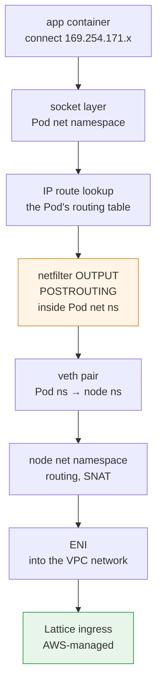
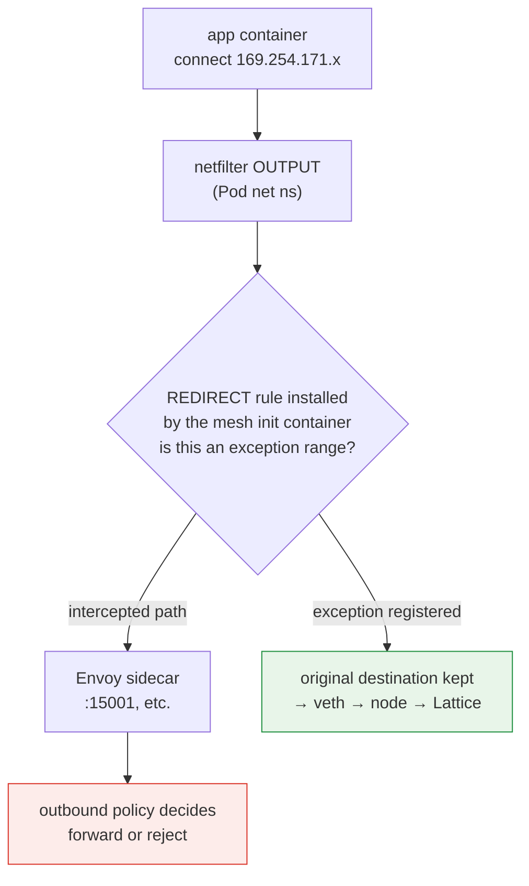
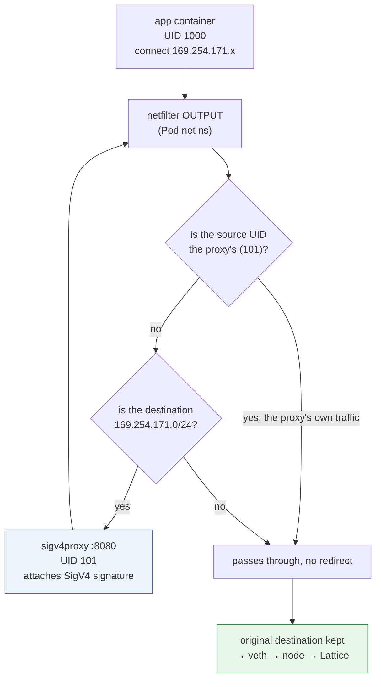

# カーネルのデータパス: リンクローカル通信の横取りが実際に起きる仕組み

> **対象範囲**: VPC Latticeのサービス／リソースAPIとAWS Gateway API Controller。選択したリリースとインストール済みCRDを確認してください。
> **最終更新日**: 2026年10月12日

## このドキュメントで扱うこと

- PodがLatticeアドレス宛てに送信したパケットが、カーネル内を実際に通る経路
- サイドカーメッシュのiptablesによる横取りが、カーネル内のどこでLatticeトラフィックと競合するか
- この構成でのconntrackの動作と、egress proxy方式がルールの順序に左右される理由

## このドキュメントの目的

[ドキュメント04](./04-networking-basics.md)では、リンクローカルアドレスは「このパケットはインフラストラクチャが処理する」という意味を持つ目印だと説明しました。概念を理解するにはそれで十分ですが、**移行中に実際の障害を引き起こす問題はカーネル層にあります。**

| 本番環境での症状 | カーネル層で起きていること |
|---|---|
| 「Latticeへの呼び出しがすべて失敗する」 | Envoyのiptables REDIRECTもLatticeのアドレス範囲を横取りしている |
| 「例外CIDRを追加しても失敗する」 | ルールの順序が不適切、またはIPv6範囲が不足している |
| 「egress proxyを追加したらループする」 | プロキシ自身のトラフィックが再びリダイレクトされている |
| 「接続がときどき切れる」 | conntrackの枯渇またはタイムアウト |
| 「一部のノードだけ失敗する」 | ノードごとのルール状態の不一致、または時刻同期の差 |

このドキュメントは[ドキュメント04](./04-networking-basics.md)と[Linuxカーネルの章](../../kernel/README.md)をつなぎます。カーネル全般の概念は、[コンテナを支えるカーネル機能](../../kernel/01-container-primitives.md)と[カーネルのネットワーキングスタック](../../kernel/02-network-stack.md)で扱います。ここでは**Lattice構成に固有の内容だけ**を説明します。

## サイドカーがない場合のパケット経路

まず、Envoyを使わずアプリケーションが直接署名する、きれいな移行後の状態を見ます。



3つの点に注目してください。

**① IPスタックは通常の接続を使います。** 認証は別の仕組みです。アプリケーションまたは署名プロキシは、選択したLatticeリクエスト認証方式を引き続き実装する必要があります。

**② 経路検索はPodのルーティングテーブルで行われます。** ネットワーク名前空間がPodの境界になるため（[コンテナを支えるカーネル機能](../../kernel/01-container-primitives.md)）、Pod内で実行する`ip route`がこの判断を行います。VPC CNIでは、Podのデフォルト経路はvethを通ってノードへ進み、リンクローカルのアドレス範囲もこのデフォルト経路に従います。

> 図はVPC CNIの経路を概念的に示したもので、文書化されていないAWS内部の仕組みを断定するものではありません。一般的なリンクローカル／ULAアドレスのスコープと、AWS固有のサービス経路制御は別のものです。対象環境で実際の経路とサポートされる接続性を確認してください。

**③ netfilterフックはPodのネットワーク名前空間内で評価されます。** これが次の節で説明する競合を可能にします。

## 競合: Envoyによるiptablesの横取り

### サイドカーメッシュが設定する内容

App MeshとIstioのinitコンテナは、Podのネットワーク名前空間内にiptablesルールを設定します。基本構造は単純です。

```text
# Conceptual form (real rules are more complex)
OUTPUT  → jump to a custom chain
custom chain:
  - traffic from Envoy's own UID → RETURN (prevents an infinite loop)
  - exception ranges → RETURN
  - everything else → REDIRECT to Envoy's port
```

`REDIRECT`は、**宛先をローカルポートに書き換える**netfilterのDNAT系ターゲットです。パケットはEnvoyに送られても、アプリケーションは元のアドレスに送信したままだと認識します。

### 競合が起きる正確な場所



メッシュによる横取りは**Podのネットワーク名前空間にあるOUTPUTチェーン**で起こる場合があります。横取り後の要求を転送するか、失敗させるか、署名フィールドを変更するかは、Envoyのアウトバウンドポリシーと設定済みの宛先によって変わります。Envoyのログに要求が記録されていれば、Envoyを通過した証拠にはなりますが、それだけで失敗原因が証明されるわけではありません。

### 設定と合わせてプロキシの証拠を解釈する

制限付きプロキシは未知の宛先にエラーを返すことがありますが、任意許可／パススルーポリシーなら転送できます。例外がないと必ず即座に503になると決めつけず、経路と実際に返されたエラーの両方を確認してください。

**診断手順**: Latticeへの呼び出しが失敗したときは、Envoyサイドカーのログに`169.254.171.x`宛ての該当要求があるか確認します。これはプロキシを通過したことを示します。失敗を横取りのせいにする前に、返されたエラー、経路／アウトバウンドポリシー、署名対象フィールドの変更を照合してください。設定済みのプロキシが要求を正常に転送している可能性もあります。

### 例外を登録する: 対象と設定場所

| メッシュ | 設定 |
|---|---|
| App Mesh | initコンテナのegress-ignore CIDR一覧にLatticeの範囲を追加する |
| Istio | `traffic.sidecar.istio.io/excludeOutboundIPRanges`アノテーション |

除外するアドレス範囲:

| 範囲 | 必須か |
|---|---|
| `169.254.171.0/24` | **必須** |
| `fd00:ec2:80::/64` | **デュアルスタッククラスターでは必須** |

### 実際によく起きる4つの落とし穴

**① IPv6の除外漏れ**: IPv4だけを除外すると、デュアルスタッククラスターで断続的な障害が起きます。クライアントがAAAAレコードを受け取り、IPv6で接続すると、その経路は引き続き横取りされます。**症状が「ときどき失敗する」ため、診断しにくくなります**。DNS応答の順序とクライアントのアドレス選択に左右されるからです。

**② アノテーションは新しいPodにだけ適用される**: Podレベルのアノテーションは、Pod作成時にinitコンテナが読み取ります。既存のPodには再起動が必要です。

**③ ルールの順序**: netfilterはチェーン内のルールを**上から順に**評価し、最初に一致したルールを適用します。例外の`RETURN`ルールは`REDIRECT`ルールより**前**に置く必要があります。標準のメッシュinitコンテナでは正しい順序ですが、自分でルールを追加した場合は必ず確認してください。

**④ ほかのリンクローカルサービスとの混同**: Pod Identity Agentは`169.254.170.23`、IMDSは`169.254.169.254`です。Latticeは`169.254.171.0/24`です。**これらは同じ`169.254.0.0/16`に含まれる別々の範囲**です。そのため`169.254.0.0/16`全体を除外すると、IMDSとPod Identityのトラフィックもメッシュによる横取りから外れます。そうする意図がある場合もあります（通常、これらのトラフィックは横取りすべきではありません）が、**意図を明記し、よく検討して決めてください。**

### 検証

```bash
# Required, explicit test target; these are diagnostic reads.
: "${LATTICE_CONTEXT:?}" "${LATTICE_NAMESPACE:?}" "${LATTICE_POD:?}"
: "${LATTICE_DIAG_CONTAINER:?}" "${LATTICE_APP_CONTAINER:?}" "${LATTICE_URL:?}"
kubectl --context "$LATTICE_CONTEXT" -n "$LATTICE_NAMESPACE" \
  exec "$LATTICE_POD" -c "$LATTICE_DIAG_CONTAINER" -- iptables -t nat -L -n -v

# Unsigned connectivity observation: AWS_IAM may reject it.
kubectl --context "$LATTICE_CONTEXT" -n "$LATTICE_NAMESPACE" \
  exec "$LATTICE_POD" -c "$LATTICE_APP_CONTAINER" -- \
  curl -sv --max-time 5 "$LATTICE_URL"

# Inspect the configured proxy container only when present.
kubectl --context "$LATTICE_CONTEXT" -n "$LATTICE_NAMESPACE" \
  logs "$LATTICE_POD" -c "$LATTICE_DIAG_CONTAINER" --tail=50
```

移行を開始する**前に**この検証を行います。[ドキュメント06](./06-constraints.md)の制約4に該当します。

## egress proxy方式でのカーネル層

[ドキュメント03](./03-auth-flow.md)の署名方式②（egress proxy）は、**反対の目的で同じiptablesの仕組みを使います。**

### 構成



これはaws-samplesのリファレンス実装の構成です。initコンテナはiptablesを使い、**`169.254.171.0/24`宛てのトラフィックだけ**をローカルポート8080へリダイレクトします。プロキシは送信時にSigV4署名を付与します。

### UIDによる例外が必須である理由

図の最初の分岐が、**無限ループを防ぐ仕組み**です。

署名してプロキシが送信するパケットも、`169.254.171.x`宛てです。UID例外がなければ、同じルールに再度一致してプロキシ自身へリダイレクトされ、ループします。

**プロキシ専用のUID**を使い、対応するowner例外を設定してください。図のUID 101は例にすぎません。リリース間でUIDが固定されていると決めつけず、実際のサンプルまたはインストール済みマニフェストを確認してください。プロキシの権限はアプリケーションと分けてください。

**運用上の意味**: プロキシコンテナの`runAsUser`と、iptablesルールのUIDは**一致していなければなりません**。一方だけを変えるとループするか、署名が行われなくなります。これはマニフェストをカスタマイズする際に、特に壊れやすい部分です。

### 2組のiptablesルールが共存する場合

移行中は1つのPodに、**メッシュの横取り例外と署名プロキシへのリダイレクトの両方**が設定されることがあります。[ドキュメント06](./06-constraints.md)の制約4で「2つのルールの順序と相互作用を必ずテストする」としているのはこのためです。

論理的に必要な順序は次のとおりです。

| 順序 | ルール | 目的 |
|---|---|---|
| 1 | プロキシUID → `RETURN` | ループ防止（最優先） |
| 2 | Lattice範囲 → 署名プロキシへの`REDIRECT` | 署名を付与する |
| 3 | メッシュのその他の例外範囲 → `RETURN` | メッシュによる横取りから除外する |
| 4 | その他すべて → Envoyへの`REDIRECT` | メッシュによる横取り |

LatticeのトラフィックをEnvoyではなく署名プロキシに到達させるには、**ルール2をルール4より先に置く**必要があります。2つのinitコンテナがそれぞれルールを設定する場合、順序はコンテナの実行順に左右されます。

幸い、メッシュ側の順序は確認できます。以下で説明するとおり、Istioについてはソースから確認済みです。

### Istioの実際のルール順序（ソースで確認済み）

Istioの`istio-iptables`（`tools/istio-iptables/pkg/capture/run.go`）が`ISTIO_OUTPUT`チェーンにルールを**追加する**順序:

| 順序 | ルール | 目的 |
|---|---|---|
| 1 | ポート単位の除外 → `RETURN` | ソースコメント:「自身への接続をリダイレクトする前に適用すること」 |
| 2 | ループバック／自身への呼び出しの処理 | `appN => Envoy => Envoy => appN`の経路を処理する |
| 3 | **`-m owner --uid-owner <proxy-uid>` → `RETURN`** | **ループ防止**。ソースコメント:「無限ループを防ぐ。EnvoyのトラフィックをEnvoy自身へ直接リダイレクトしない」 |
| 4 | **除外CIDR（`excludeOutboundIPRanges`）→ `RETURN`** | 横取りから除外する |
| 5 | 対象ポートの処理 | |
| 6 | **`-j ISTIO_REDIRECT`（ワイルドカードの包括ルール）** | それ以外すべてをEnvoyへ送る |

**重要な確認結果**: 除外CIDRの`RETURN`（4）は、包括的な`REDIRECT`（6）より前に置かれます。したがってIstioの`traffic.sidecar.istio.io/excludeOutboundIPRanges`にLatticeの範囲を指定すれば、それだけで正しく機能し、順序の調整は不要です。

さらに、**プロキシUIDの`RETURN`（3）は除外CIDRよりも前**です。つまりIstio自体も、このドキュメントで説明したUIDベースのループ防止を使っています。

::: warning 要検証
上記の順序は**Istioの**ソースで確認しています。**App Meshのinitコンテナが実際に設定するルール順序は未検証**です。これは別の実装であり、App Meshのサポートは2026年9月30日に終了しました。

また、**署名プロキシのinitコンテナを追加する**構成では、2つのinitコンテナがそれぞれルールを設定するため、順序は`initContainers`配列内の順序に左右されます。この組み合わせでは、対象環境で`iptables -t nat -L -n -v`を実行して実際のルールをダンプし、確認してください。
:::

## この構成でのconntrackの動作

### Latticeトラフィックがconntrackに残すもの

[コンテナを支えるカーネル機能](../../kernel/01-container-primitives.md)で説明したとおり、NATはconntrackエントリーを作成します。この構成で確認するエントリーは次のとおりです。

| 構成 | 確認するトラッキング |
|---|---|
| アプリケーションが直接署名する | NATがなくてもPod／ノードのトラッキングが存在する場合がある。実際のCNI経路とSNATの有無を確認する |
| egress signing proxy | 設定に応じて、アプリからプロキシ、プロキシからサービスへの接続とNATを確認する。接続プーリングにより件数が変わる |
| メッシュとの共存 | 経路と名前空間が増える。プロキシ数だけから固定の倍率を推定しない |

egress proxyによって、アプリからプロキシへの接続と、プロキシからサービスへの接続が別々に作られます。追跡に必要なリソースは、名前空間、接続の再利用、NAT設定によって変わります。プロキシ数だけからノードのテーブルが一定量増えると推定しないでください。

実際の負荷をかけたときのPod／ノードのconntrack使用量と、eBPFマップの占有状況を測定してください。プロキシは上流接続をプールできる一方、ローカル接続区間を追加します。普遍的な倍率を仮定せず、実際のトレードオフを評価してください。

### 診断

[カーネルの章](../../kernel/03-eks-node-tuning.md)で説明しているように、conntrackが枯渇すると**接続が通知なく破棄されます**。Lattice構成で「接続がときどき切れる」場合は、原因候補になります。

```bash
# Correlate insertion/drop signals with count/max and kernel logs.
conntrack -S | grep -E "insert_failed|drop"

# Check entries toward the Lattice range
conntrack -L | grep 169.254.171 | head

# Utilization
echo "$(cat /proc/sys/net/netfilter/nf_conntrack_count) / $(cat /proc/sys/net/netfilter/nf_conntrack_max)"
```

一部だけ失敗する場合でも、conntrackの負荷は否定できません。名前空間、ゾーン、テーブル、接続再利用、パケットの到着時刻が異なることがあります。問題が起きている経路で、件数／上限、drop／insertカウンター、ログを照合してください。他の宛先が動作しているかどうかだけで診断しないでください。

## セキュリティグループとカーネル

[ドキュメント04](./04-networking-basics.md)では、プレフィックスリストを使ってセキュリティグループを開放する方法を説明しました。カーネルの観点から、次の点を加えておきます。

**セキュリティグループはカーネルのnetfilterではありません。** VPCレベルでENIに適用され、インスタンスの外側（ハイパーバイザー／ネットワークインフラストラクチャ）で強制される、AWSのステートフルファイアウォールです。

この違いから、次のことが分かります。

- ノード上でiptablesを一覧表示しても、AWSのセキュリティグループルールは表示されません。
- 受信側ノードに届く前に拒否された受信パケットは、そのノードのキャプチャポイントには現れません。
- 外部のセキュリティグループが破棄する前なら、送信側の内部でアウトバウンドパケットをキャプチャできる場合があります。`tcpdump`の結果はインターフェース、名前空間、方向を確認して解釈してください。応答がないことだけでは、セキュリティグループの問題だと特定できません。

診断は次の順序で行います。

| 観測結果 | 原因候補 |
|---|---|
| `tcpdump`にアウトバウンドパケットがない | Pod内のルーティング、横取り、DNS |
| アウトバウンドは見えるが応答がない | セキュリティグループ（両方向を確認）、ルーティング、Lattice側 |
| 応答は届くがアプリケーションが受信しない | ソケットバッファー、または横取り経路の問題 |
| dropカウンターが増えている | conntrackまたはqdisc（[カーネルのネットワーキングスタック](../../kernel/02-network-stack.md)） |

## ノードごとの差: 「一部のノードだけ失敗する」

この症状から、原因候補をある程度絞り込めます。

| 原因 | 確認内容 |
|---|---|
| **ノードのセキュリティグループが異なる** | プレフィックスリストの受信ルールがノードグループごとに適用されているか |
| **カーネルのバージョンが異なる** | `kernel-default` AMIでは、置換のタイミングによって6.1と6.18が混在することがある（[カーネルのチューニング](../../kernel/03-eks-node-tuning.md)） |
| **conntrackの設定が異なる** | 起動時点のConfigMapの状態によって異なるか |
| **時刻同期** | `x-amz-date`の5分のずれにより、特定ノードだけ403になる（[ドキュメント03](./03-auth-flow.md)） |
| **Podが再起動されたか** | アノテーションの変更が古いPodに反映されていないか |

**「一部のノードだけ」という傾向そのものが診断情報です。** 全体の失敗は設定または認証を示唆します。ノード単位の失敗は、ノードの状態が一致していないことを示唆します。

## まとめ

- Lattice宛てのパケットは**通常のIPv4／IPv6接続**です。特殊な処理はアプリケーションではなくインフラストラクチャ側で行われます。
- IPv4リンクローカル、IPv6 ULA、文書化されたAWS固有のサービス経路を区別してください。プレフィックスだけを根拠に内部ルーティングを推測しないでください。
- Podのネットワーク名前空間にあるOUTPUTチェーン、アウトバウンドポリシー、実際のプロキシログを確認してください。横取りされたからといって必ず失敗するわけではありません。
- 例外設定の落とし穴は、**IPv6の除外漏れ**（断続的な障害に見える）、アノテーションが新しいPodにだけ適用されること、**ルールの順序**、`169.254.0.0/16`全体を除外するとIMDSとPod Identityも対象になることです。
- egress proxy方式では**UIDを使ったループ防止**が必要であり、プロキシの`runAsUser`とiptablesのUIDを一致させます。また、**conntrackエントリーが追加で作られます。**
- 2組のiptablesルールが共存する場合、**実際のルールをダンプして調べる方法だけが信頼できる検証手段です。**
- セキュリティグループとnetfilterは異なるレイヤーです。パケットキャプチャの見え方は、方向とキャプチャポイントによって異なります。

## 参考資料

- [Linuxカーネルの概要](../../kernel/README.md): このドキュメントの一般的な背景
- [コンテナを支えるカーネル機能](../../kernel/01-container-primitives.md): 名前空間、netfilter、conntrack
- [カーネルのネットワーキングスタック](../../kernel/02-network-stack.md): パケット経路と観測ポイント
- [EKSノードのカーネルチューニング](../../kernel/03-eks-node-tuning.md): conntrackの設定方法
- [aws-samples: VPC LatticeとEKSでのIAM認証](https://github.com/aws-samples/migrating-from-aws-app-mesh-to-amazon-vpc-lattice/blob/main/vpc-lattice-config/IAMAUTH.md)
- [AWS Gateway API Controller: Controllerのデプロイ](https://www.gateway-api-controller.eks.aws.dev/latest/guides/deploy/)
- [iptables-extensions(8): ownerマッチ](https://man7.org/linux/man-pages/man8/iptables-extensions.8.html)
- [istio/istio: tools/istio-iptables/pkg/capture/run.go](https://github.com/istio/istio/blob/master/tools/istio-iptables/pkg/capture/run.go): ルール順序を確認する一次資料

診断コマンドの実行には、対象のコンテナ／ネットワーク名前空間における、指定ユーティリティと権限が必要です。未署名HTTP要求の拒否だけでは、IAM設定の失敗を証明できません。認可テストにはレビュー済みの署名方式を使い、詳細ログから認証情報を削除してください。
