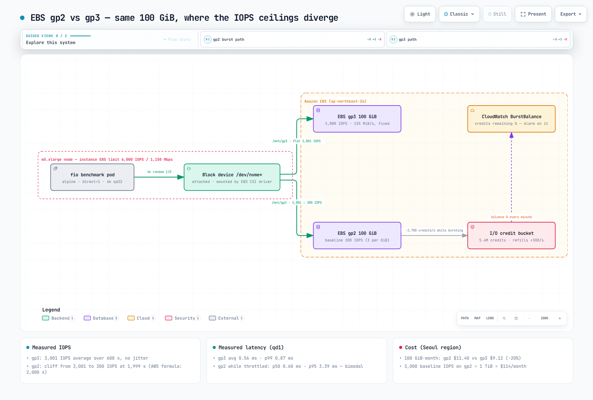
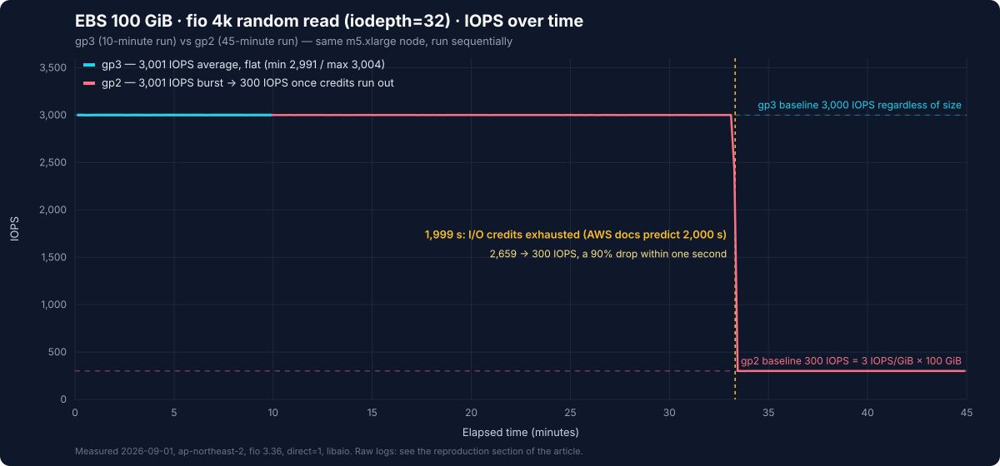

# EBS gp2 と gp3 の実測ベンチマーク

> **記録したテスト環境**: Kubernetes 1.36（Amazon EKS）、EBS CSI ドライバー、fio 3.36
> **最終更新**: 2026年10月16日

AWSの決まり文句である「gp2からgp3に移行すれば20%節約でき、同等以上の性能が得られる」は有名ですが、その差がKubernetesのPVCで**いつ、どのような形で**現れるのかを示すグラフはあまり見つかりません。この記事では、単一のEKSノードに**100 GiBのgp2 PVCを1つ、100 GiBのgp3 PVCを1つ**接続し、fioでgp3を10分間、gp2を45分間測定します。要点は「gp2は遅い」ということではありません。**gp2は33分間gp3と見分けがつかず、その後1秒以内に性能が10分の1まで落ちる**ということです。ここに示す数値は実際の1回の実行で得られた結果であり、再実行しても同じ結果になるとは限りません。実行を比較する場合は、初期クレジット残高、ドライバーとイメージのバージョン、ノードの状態を記録してください。



[🔍 インタラクティブな図を見る](https://www.atomai.click/kubernetes-docs/archmaps/en-storage-01-ebs-gp2-gp3-benchmark-0.html)

## 要約: 測定結果

| 指標（100 GiB、m5.xlarge） | gp3 | gp2 |
|-----------------------------|-----|-----|
| 4kランダム読み取りIOPS（qd32） | **平均3,001**、600秒間ほぼ一定（最小2,991） | **3,001から300へ低下**、1,999秒で急落 |
| 4kランダム読み取りp99レイテンシー（qd32） | 12.9 ms | 109.6 ms（急落後の時間帯が大半を占める） |
| 4kランダム書き込みIOPS（qd32、クレジット枯渇後） | **3,025** | 601（一部再充填されたバケットを含む） |
| 4kランダム読み取りレイテンシー（qd1） | 平均 **0.56 ms** / p99 0.87 ms | 平均1.65 ms、二峰性: p50 0.60 / p95 3.39 ms |
| 1 MiBシーケンシャル読み取り / 書き込み | 127 / 126 MiB/s（ベースライン125 MiB/s） | 130 / 129 MiB/s（170 GiB以下の上限128 MiB/s） |
| 月額料金（ソウルリージョン、100 GiB） | **$9.12** | $11.40 |

ひと言でまとめると、**同じ容量なら、gp2は25%高い料金で3,000 IOPSを33分間提供します。**

## テスト環境

| 項目 | 値 |
|------|-------|
| クラスター | Amazon EKS、Kubernetes 1.36、ap-northeast-2 |
| ノード | **m5.xlarge**（4 vCPU、16 GiB）、Karpenterでプロビジョニング。インスタンスのEBS上限: ベースライン6,000 IOPS / 1,150 Mbps（143.75 MB/s ≈137 MiB/s）、バースト18,750 IOPS / 4,750 Mbps |
| ボリューム | EBS **gp2 100 GiBを1つ**、**gp3 100 GiBを1つ**、どちらもデフォルト設定（StorageClass `gp2` / `gp3`、EBS CSIドライバー） |
| Pod | `alpine:3.20` + `fio 3.36`、`direct=1`（ページキャッシュを迂回）、`libaio`エンジン、テストファイル8 GiB |
| 実行方法 | **2つのボリュームは同時に測定していません**。複数のボリュームはインスタンスの継続・バーストI/O予算を共有するため、同時に測定すると干渉が起きます。 |
| 料金 | gp2 $0.114/GB・月、gp3 $0.0912/GB・月 + 追加IOPS $0.0057/IOPS・月 + 追加スループット $0.0456/MiB/s・月（ソウルリージョン、Pricing API、2026年9月） |

`nodeSelector`でm5.xlargeを指定した理由は1つだけです。インスタンスレベルのEBS上限（6,000 IOPS）がボリューム上限（3,000 IOPS）を十分に上回るため、ボリュームの性能を観察する余裕を確保できます。ノード全体のI/Oと、インスタンスおよびボリュームの上限超過メトリクスも確認して、ボトルネックを特定してください。より小さいインスタンス（m5.largeはベースライン3,600 IOPS）では2つの上限が近くなり、結果を解釈しにくくなります。

### デプロイ用マニフェスト

記録した実行では`alpine:3.20` / fio 3.36を使用しました。Alpine 3.20は通常サポートを終了しているため、以下の**再実行用**の例では3.24.2を使います。パッケージのバージョンは変わる可能性があるため、表示されたfioのバージョンとイメージダイジェストを保存し、新しい結果は過去の測定結果と分けてください。この例は、`ebs.csi.aws.com`と必要なIAM権限を設定した通常のEC2ノード向けであり、EKS Auto Modeのプロビジョナーには対応していません。

```yaml
apiVersion: v1
kind: Namespace
metadata:
  name: bench-storage
---
apiVersion: storage.k8s.io/v1
kind: StorageClass
metadata:
  name: bench-gp2
provisioner: ebs.csi.aws.com
parameters:
  type: gp2
  encrypted: "true"
volumeBindingMode: WaitForFirstConsumer
reclaimPolicy: Delete
---
apiVersion: storage.k8s.io/v1
kind: StorageClass
metadata:
  name: bench-gp3
provisioner: ebs.csi.aws.com
parameters:
  type: gp3
  encrypted: "true"
  iops: "3000"
  throughput: "125"
volumeBindingMode: WaitForFirstConsumer
reclaimPolicy: Delete
---
apiVersion: v1
kind: PersistentVolumeClaim
metadata:
  name: bench-gp2
  namespace: bench-storage
spec:
  accessModes: ["ReadWriteOnce"]
  storageClassName: bench-gp2
  resources:
    requests:
      storage: 100Gi
---
apiVersion: v1
kind: PersistentVolumeClaim
metadata:
  name: bench-gp3
  namespace: bench-storage
spec:
  accessModes: ["ReadWriteOnce"]
  storageClassName: bench-gp3
  resources:
    requests:
      storage: 100Gi
---
apiVersion: v1
kind: Pod
metadata:
  name: fio
  namespace: bench-storage
  annotations:
    karpenter.sh/do-not-disrupt: "true"   # keep consolidation from evicting a 45-minute measurement
spec:
  nodeSelector:
    node.kubernetes.io/instance-type: m5.xlarge
  containers:
    - name: fio
      image: alpine:3.24.2
      command: ["sh", "-c", "apk add --no-cache fio && fio --version && sleep infinity"]
      resources:
        requests: { cpu: "1", memory: 1Gi }
        limits: { cpu: "2", memory: 2Gi }
      volumeMounts:
        - { name: gp2, mountPath: /mnt/gp2 }
        - { name: gp3, mountPath: /mnt/gp3 }
  volumes:
    - name: gp2
      persistentVolumeClaim: { claimName: bench-gp2 }
    - name: gp3
      persistentVolumeClaim: { claimName: bench-gp3 }
  restartPolicy: Never
```

> `karpenter.sh/do-not-disrupt`アノテーションを付けているのは、最初のベンチマーク実行がこの設定なしで実際に失敗したためです。ノード上の別のワークロードが終了すると、Karpenterはノードを「Underutilized」と判断して統合を開始し、45分の実行途中でfio Podを退避しました（終了コード137）。このアノテーションは一部の自発的な中断を防ぎますが、ノード障害、Spot中断、強制終了、terminationGracePeriodの経過を防ぐ保証はありません。PDBも非自発的な障害を防げません。結果を永続化し、再実行できるようにしてください。

### fioコマンド

以下の共通オプションを使い、各フェーズを記載順に1つずつ実行しました。

```bash
COMMON="--ioengine=libaio --direct=1 --group_reporting --output-format=json"

# 0. lay out the test files (8 GiB, sequential write)
fio --name=layout --filename=/mnt/gp3/testfile --size=8G --rw=write --bs=1M $COMMON
fio --name=layout --filename=/mnt/gp2/testfile --size=8G --rw=write --bs=1M $COMMON

# 1. 4k random read, qd32: gp3 for 600 s, gp2 for 2,700 s (45 minutes, to catch the credit cliff)
fio --name=gp3-randread --filename=/mnt/gp3/testfile --size=8G --rw=randread --bs=4k \
    --iodepth=32 --runtime=600  --time_based --write_iops_log=gp3_rr --log_avg_msec=1000 $COMMON
fio --name=gp2-randread --filename=/mnt/gp2/testfile --size=8G --rw=randread --bs=4k \
    --iodepth=32 --runtime=2700 --time_based --write_iops_log=gp2_rr --log_avg_msec=1000 $COMMON

# 2. 4k random write, qd32, 120 s (gp2 has exhausted its credits by now)
fio --name=gp3-randwrite --filename=/mnt/gp3/testfile --size=8G --rw=randwrite --bs=4k --iodepth=32 --runtime=120 --time_based $COMMON
fio --name=gp2-randwrite --filename=/mnt/gp2/testfile --size=8G --rw=randwrite --bs=4k --iodepth=32 --runtime=120 --time_based $COMMON

# 3. 4k random read, qd1, 60 s: end-to-end completion latency at low concurrency
fio --name=gp3-lat --filename=/mnt/gp3/testfile --size=8G --rw=randread --bs=4k --iodepth=1 --runtime=60 --time_based $COMMON
fio --name=gp2-lat --filename=/mnt/gp2/testfile --size=8G --rw=randread --bs=4k --iodepth=1 --runtime=60 --time_based $COMMON

# 4. 1 MiB sequential read/write, qd8, 60 s: throughput ceiling
fio --name=gp3-seqread  --filename=/mnt/gp3/testfile --size=8G --rw=read  --bs=1M --iodepth=8 --runtime=60 --time_based $COMMON
fio --name=gp3-seqwrite --filename=/mnt/gp3/testfile --size=8G --rw=write --bs=1M --iodepth=8 --runtime=60 --time_based $COMMON
fio --name=gp2-seqread  --filename=/mnt/gp2/testfile --size=8G --rw=read  --bs=1M --iodepth=8 --runtime=60 --time_based $COMMON
fio --name=gp2-seqwrite --filename=/mnt/gp2/testfile --size=8G --rw=write --bs=1M --iodepth=8 --runtime=60 --time_based $COMMON
```

## 測定1: 4kランダム読み取りを45分実行した場合のクレジット急落



これはfioが記録した1秒ごとのIOPSログを、そのままプロットしたものです（gp2は2,699サンプル、gp3は600サンプル）。下表では各ログの最初の1秒分のサンプルを除いています。どちらのボリュームも5,997 IOPSで、原因を別途調査する必要がある初期の過渡値です。このサンプルを含めると、集計平均が変わることがあります。

| | gp3（600秒） | 急落前のgp2（0～1,999秒） | 急落後のgp2（2,000～2,700秒） |
|---|---|---|---|
| 平均IOPS | **3,001** | **3,001** | **300** |
| 最小 / 最大 | 2,991 / 3,004 | 2,997 / 3,005 | 297 / 304 |
| 平均レイテンシー（qd32） | 10.4 ms | 約10.4 ms | 約106 ms |

結果の見方:

- **急落前のgp2はgp3と見分けがつきません**。どちらも3,001 IOPSを達成し、p50は10.0～10.2 msです。この状況で「gp2は遅い」とするのは誤りです。クレジットが残っているgp2ボリュームは3,000 IOPSのボリュームとして動作します。
- **急落は1秒で起きました**。1,998秒時点では3,001 IOPS、1,999秒では2,659 IOPS、2,000秒では300 IOPSでした。徐々に性能が落ちるのではなく、容量の90%がスイッチを切ったように失われます。アプリケーションから見ると、「データベースのクエリが突然10倍遅くなったが、何もデプロイされていない」という障害パターンです。
- **数値はAWSのドキュメントと1秒以内の差で一致します**。100 GiBのgp2ボリュームのベースラインは3 IOPS/GiB × 100 = **300 IOPS**で、クレジットバケットは540万クレジット、バースト継続時間は`5,400,000 ÷ (3,000 − 300) = 2,000秒`です。AWSの表では「100 GiB → 2,000秒」とされており、今回の測定では1,999秒でした。
- **レイテンシー106 msは、ボリューム自体が遅いことを意味しません**。リトルの法則（平均レイテンシー = 未完了I/O数 ÷ スループット）では32 ÷ 300 = 106.7 msです。完了数が毎秒300回なのに対し、32件のI/Oを同時に処理中に保つため、キューが増えます。3,000 IOPS時の10.4 msも同じ計算（32 ÷ 3,000 = 10.7 ms）に近い値です。**これは平均約32件のI/Oが未完了の場合の総応答時間の近似値であり、キューイング時間とサービス時間を分離した値ではありません**。実行間で比較する場合は、fioの同じ`slat`、`clat`または`lat`メトリクスを比べてください。

> **テスト条件の開示**: 記録した実行の約13分前、最初の試行ではKarpenterによる退避で中断されるまで、同じgp2ボリュームに約8分間（14:55～15:03 UTC）、3,000 IOPSの負荷をかけていました。単純なクレジット計算では、その事前負荷によって急落が2,000秒より早まるはずですが、実測では2,000秒でした。退避前に実際にI/Oが続いた時間が不明なため、理由は特定できませんでした。**この実行で得られた結果として扱うのは、急落の形（1秒以内に90%低下）と下限（300 IOPS）です。正確な継続時間の計画値には、AWSの計算式による2,000秒を使ってください。**

## 測定2: クレジット枯渇後のランダム書き込み — 3,025対601 IOPS

| 4kランダム書き込み、qd32、120秒 | gp3 | gp2（枯渇直後） |
|---|---|---|
| IOPS | **3,025** | **601** |
| 平均レイテンシー | 10.3 ms | 52.0 ms |
| p50 / p95 / p99 | 10.2 / 11.2 / 12.0 ms | 11.1 / 109.6 / 133.7 ms |

ここでの要点は、gp2がベースラインの300 IOPSではなく601 IOPSを記録した理由です。gp2への書き込みテスト直前の120秒間（gp3への書き込みテスト中）、gp2はアイドル状態で、**毎秒300クレジット × 120秒 = 36,000クレジット**を蓄積しました。この36,000クレジットを120秒のテストで使うと、ベースラインの300 IOPSに毎秒300 IOPSが上乗せされ、ちょうど**600 IOPS**になります。実測値は601でした。

つまりgp2のクレジットバケットは「一度空になったら永久に空」の状態ではありません。ボリュームが休止している間に少しずつ補充される**銀行口座のようなもの**です。そのため、断続的なトラフィックではgp2が「速いときも遅いときもある」状態になります。要求したタイミングで再現しにくく、調査が困難です。二峰性の分布（p50が11 ms、p95が110 ms）はその特徴です。クレジットが残っている間は速く、なくなるとキューで待たされます。

## 測定3: qd1レイテンシー — 低い並行度での分布

キュー深度1では、アプリケーションが発生させる並行度が下がります。それでもカーネル、仮想化、EBSサービス、スロットリングによる遅延は加わるため、物理SSDだけを測定した結果ではありません。

| 4kランダム読み取り、qd1、60秒 | gp3 | gp2（スロットリング中） |
|---|---|---|
| 平均レイテンシー | **0.564 ms** | 1.651 ms |
| p50 | 0.569 ms | **0.602 ms** |
| p95 | 0.627 ms | 3.391 ms |
| p99 | 0.872 ms | 3.555 ms |
| 達成IOPS | 1,759 | 603 |

- **gp3の0.56 ms（p99 0.87 ms）は、この環境におけるEBS汎用SSDの実際の往復時間です**。qd1での1,759 IOPSは上限の3,000を下回っているためスロットリングはなく、レイテンシーだけでスループットが決まりました（1 ÷ 0.564 ms ≈ 1,773）。
- **gp2のp50、0.602 msに注目してください**。I/Oの半分はgp3と同程度の速さです。p50が似ていても、物理デバイスやサービス内部の仕組みが同一だとは言えません。残りの半分は3.4～3.6 msで完了しました。毎秒の許容量を超えたI/O（603 IOPS。測定2と同じ計算で、60秒の休止中に蓄積した18,000クレジットにベースラインの300を加算）は、スロットリングキューに保持されました。
- 実務上の結論: **スロットリングは平均値ではなく、分布の形に現れます**。平均レイテンシーだけを表示するダッシュボードには「少し遅い」程度の1.6 msと表示されますが、p95は6倍に跳ね上がっています。そのため、ストレージのダッシュボードではp95/p99とともにp50も確認してください。

## 測定4: 1 MiBシーケンシャルI/O — どちらも125～128 MiB/sで上限

| 1 MiBシーケンシャル、qd8、60秒 | gp3読み取り | gp3書き込み | gp2読み取り | gp2書き込み |
|---|---|---|---|---|
| スループット | 127.3 MiB/s | 126.0 MiB/s | 130.3 MiB/s | 128.9 MiB/s |
| 平均レイテンシー | 58.0 ms | 58.5 ms | 56.7 ms | 57.3 ms |

ここではgp2とgp3は実質的に同じ性能です。gp3はベースラインの125 MiB/sで頭打ちになり、gp2は容量170 GiB以下のボリューム上限である128 MiB/sで頭打ちになります。また、この計算はgp2のシーケンシャルテストが空のクレジットバケットで遅くならなかった理由も説明します。EBSでは1 MiBのI/Oを256 KiBの操作4回として数えるため、130 MiB/sは約520 IOPSです。直前の120秒の休止中に蓄積した36,000クレジットの範囲内です。IOPS上限より先にスループット上限に達しました。

もう1点、m5.xlargeノードのインスタンスレベルEBS帯域幅のベースラインは1,150 Mbps ≈ **137 MiB/s**です。インスタンスのバースト容量が使える間は、スループットを250 MiB/sに設定したgp3ボリュームで137 MiB/sを超えることがあります。**長期にわたる継続的な需要は、約137 MiB/sのベースラインを基準に計画してください**。AWSが示すのは、24時間ごとに少なくとも1回、30分間にわたって最大性能を発揮できるという仕様であり、常に正確に30分間使えるという保証ではありません。ボリュームをアップグレードする前に、インスタンスの仕様表でEBS帯域幅を確認してください。[ClickHouseベンチマーク](../database/01-clickhouse-on-eks.md)でも、同じ理由でフルスキャンが125～137 MiB/sの範囲で停滞しました。

## 料金で比較

ソウルリージョンの料金（Pricing API、2026年9月）を見ると、「3,000 IOPSを得るにはどうすればよいか」という点でgp2を使い続ける理由はありません。

| 構成 | 月額料金 | 継続可能なIOPS | スループット |
|---------------|--------------|------------------|------------|
| gp2 100 GiB | $11.40 | **300**（3,000 IOPSのバーストは最大33分間） | 128 MiB/s |
| gp3 100 GiB（デフォルト） | **$9.12** | **3,000（継続可能）** | 125 MiB/s |
| gp3 100 GiB + 6,000 IOPS | $26.22（$9.12 + 3,000 × $0.0057） | 6,000 | 125 MiB/s |
| gp3 100 GiB + 250 MiB/s | $14.82（$9.12 + 125 × $0.0456） | 3,000 | 250 MiB/s |
| gp2 1,000 GiB（「IOPS確保のために容量を増やした」ボリューム） | $114.00 | 3,000 | 250 MiB/s |

最後の行は、実際によくある無駄な構成です。gp2の時代には、IOPSを必要とする100 GiBのデータセットに1,000 GiBを割り当てるのが一般的でした。gp3の100 GiBボリュームなら同じ3,000 IOPSを$**9.12**で得られます。12.5倍安くなります（$114.00 ÷ $9.12）。IOPSを容量から切り離せることがgp3の本質であり、この表はその効果を示しています。

## Kubernetesでgp3に移行する

### 新しいボリューム: gp3をStorageClassのデフォルトにする

StorageClassのデフォルトは、クラスターのバージョンやプロビジョニング方法によって異なります。`kubectl get storageclass -o yaml`でプロビジョナー、タイプ、デフォルトのアノテーションを確認してください。以下は一般的なEBS CSIの例です。既存のデフォルトクラスがあれば、明示的に調整してください。

```yaml
apiVersion: storage.k8s.io/v1
kind: StorageClass
metadata:
  name: gp3
  annotations:
    storageclass.kubernetes.io/is-default-class: "true"
provisioner: ebs.csi.aws.com
parameters:
  type: gp3
  encrypted: "true"
volumeBindingMode: WaitForFirstConsumer
allowVolumeExpansion: true
```

```bash
# Run only if gp2 actually exists and is the default.
kubectl annotate storageclass gp2 storageclass.kubernetes.io/is-default-class="false" --overwrite
kubectl apply -f gp3-storageclass.yaml
```

### 既存のPVC: VolumeAttributesClassでインプレース変更する

`VolumeAttributesClass`（`storage.k8s.io/v1`、Kubernetes 1.34からGA）は、PVCを削除せずにボリュームのタイプを変更します。EBS CSIドライバーは`type`、`iops`、`throughput`のパラメーターをサポートし、内部でEBS Elastic Volumesの`ModifyVolume`を呼び出すため、Podは稼働を継続できます。

```yaml
apiVersion: storage.k8s.io/v1
kind: VolumeAttributesClass
metadata:
  name: gp3-baseline
driverName: ebs.csi.aws.com
parameters:
  type: gp3
```

上記のVACを`gp3-baseline-volumeattributesclass.yaml`として保存してください。`kubectl api-resources --api-group=storage.k8s.io`でAPIの検出を確認し、互換性のあるEBS CSI、external-provisioner、resizerの各バージョンをインストールします。対象PVCの名前空間を指定してください。タイプだけを指定すると、gp2でより高いスループットが設定されていた場合に、gp3のベースラインへ下げずに引き継がれ、追加料金が発生することがあります。

```bash
kubectl apply -f gp3-baseline-volumeattributesclass.yaml
kubectl patch pvc data-postgres-0 --type=merge -p '{"spec":{"volumeAttributesClassName":"gp3-baseline"}}'
kubectl get pvc data-postgres-0 -o jsonpath='{.status.currentVolumeAttributesClassName}'
```

注意点が2つあります。EBSでは、同じボリュームに対する次の変更を行う前に、前の変更が`completed`状態になる必要があります（1 TiBのボリュームでは通常、完了まで最大6時間かかることがありますが、完了時間はベストエフォートです）。また、**ローリング24時間あたり、1ボリュームにつき最大4回まで**変更できます。そのため、タイプ、IOPS、スループットの変更を1つのリクエストにまとめてください。Kubernetes 1.31～1.33では、ディストリビューションの`v1beta1` APIと、コントロールプレーンおよびサイドカーの機能ゲート設定を確認してください。直接のModifyVolume呼び出しもVACも、既存の`storageClassName`を自動では変更しません。希望する属性はPVC/VACで管理し、PVCの変更状態と実際のEBSタイプ、IOPS、スループットの両方を確認してください。

### 残っているgp2ボリュームを監視する

移行が終わるまで、**CloudWatchのEBSメトリクス`BurstBalance`**（残っているクレジットの割合）にアラームを設定してください。この記事のgp2ボリュームでは、15%は3,000 IOPSを一定に消費した場合、約5分に相当します。実際の消費量、アラームの評価期間、欠落データも考慮してください。急落は予告なく起こります。クレジット残高がその予告になります。

## 再現手順

1. 上記のマニフェストを適用します: `kubectl apply -f bench-storage.yaml`を実行し、続けて`kubectl wait -n bench-storage pod/fio --for=condition=Ready --timeout=300s`を実行します。
2. fioコマンドブロックをPod内のシェルスクリプトに入れ、**`nohup`で実行**して、結果をボリューム（`/mnt/gp3/results`）に書き込みます。`kubectl exec`が45分間切断されないとは限りません。また、Podの`/tmp`はPodとともに削除されます。
3. IOPSの時系列を得るには、`--write_iops_log`の出力（`*_iops.1.log`、形式は`time_ms, iops, ...`）を直接プロットします。
4. 専用の`bench-storage`名前空間を削除する前に、未加工のJSON、IOPSログ、CloudWatchの時系列データ、PVC/EBSの設定をクラスター外にエクスポートします。この例ではDeleteのreclaimPolicyを使うため、データも削除されます。クラスター全体に適用される`bench-gp2` / `bench-gp3` StorageClassは別途削除してください。料金は、実行後にリソースを残す時間も含め、実際のノード、ボリューム、EKSコントロールプレーン、ネットワークの使用量によって変わります。

## 注意事項

- **単一ボリューム、単一実行です**。AWSはgp2とgp3の両方について、「プロビジョニングした性能を99%の時間で提供する」よう設計しています。そのため、別の日に別のボリュームを使うとIOPSが数%異なることがあります。この記事で扱うのは絶対値ではなく、**クレジットモデルの挙動**です。
- 急落を測定する前にgp2ボリュームへ負荷をかけた条件については、測定1の開示を参照してください。
- `direct=1`はページキャッシュを迂回します。実際のデータベースはバッファープールとOSキャッシュを使うため、はるかに少ないIOPSでも動作します。だからこそgp2の急落は「ときどき」しか現れず、診断に時間がかかります。
- 100 GiBを超えるgp2ボリュームではベースラインも比例して高くなります（334 GiB → 1,002 IOPS）。1,000 GiB以上ではベースラインが少なくとも3,000 IOPSとなり、性能の急落はありません。ここでの結論は、**ベースラインが3,000 IOPS未満のgp2ボリューム**に当てはまります。

## 関連資料

- [ストレージの概要](./README.md): EKSストレージの選び方と、このベンチマークの位置付け
- [EKSストレージ 第1部](../eks/04-eks-storage-part1.md): EBS CSIドライバーのインストールとStorageClassの基本
- [EKS上のClickHouse実測ベンチマーク](../database/01-clickhouse-on-eks.md): この記事のスループット上限125 MiB/sが、実際のデータベースのフルスキャンにどう現れるか

## 参照資料

- [EBS gp2/gp3の性能](https://docs.aws.amazon.com/ebs/latest/userguide/general-purpose.html)
- [EC2のEBS最適化帯域幅](https://docs.aws.amazon.com/AWSEC2/latest/UserGuide/ebs-optimized.html)
- [EBSボリューム変更時の考慮事項](https://docs.aws.amazon.com/ebs/latest/userguide/ebs-modify-volume.html)
- [VolumeAttributesClass](https://kubernetes.io/docs/concepts/storage/volume-attributes-classes/)
- [EBS CSIによるボリューム変更](https://github.com/kubernetes-sigs/aws-ebs-csi-driver/blob/master/docs/modify-volume.md)
- [Karpenterの中断](https://karpenter.sh/docs/concepts/disruption/)
- [fioのレイテンシー定義](https://github.com/axboe/fio/blob/master/HOWTO.rst)
- [Alpineのリリースサポート](https://alpinelinux.org/releases/)
