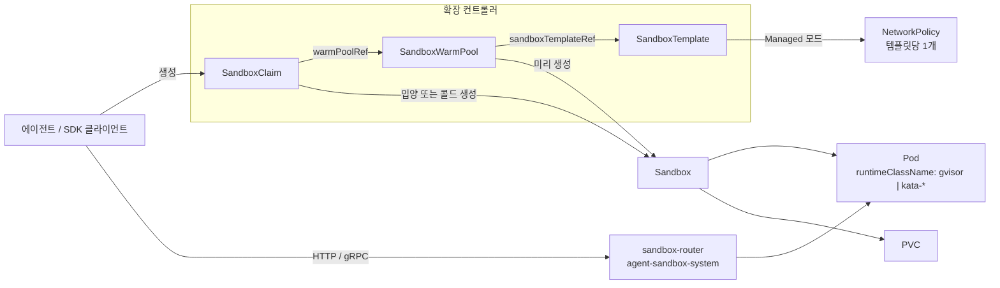

# EKS에서 Agent Sandbox 운영하기 — AI 에이전트를 위한 격리된 상태 유지 런타임

> **지원 버전**: Agent Sandbox v1.0.6(API `v1beta1`), Python SDK `k8s-agent-sandbox` 1.0.6, `cpuOptions.nestedVirtualization`은 Karpenter v1.13.0 이상
> **마지막 업데이트**: 2026년 10월 16일

[Agent Sandbox](https://github.com/kubernetes-sigs/agent-sandbox)(`kubernetes-sigs/agent-sandbox`)는 Kubernetes SIG Apps 하위 프로젝트입니다. **격리되고 상태를 유지하는 단일 인스턴스 워크로드**를 위해 `Sandbox` 커스텀 리소스와 컨트롤러를 제공합니다. Sandbox 하나는 안정적인 이름을 가진 Pod 하나이며, 선택적으로 영구 스토리지를 붙이고 만료·일시 중지·재개 같은 수명 주기를 선언적으로 다룰 수 있습니다. Deployment나 StatefulSet이 직접 표현하지 못하는 부분입니다. 대표적인 사용처는 LLM이 생성한 코드를 실행하는 AI 에이전트, 강화학습(RL) 롤아웃, 노트북, 사용자별 개발 환경입니다.

이 문서는 `v1.0.6` 태그 기준 API를 설명하고, Amazon EKS에서 운영할 때 달라지는 점을 다룹니다. 런타임 격리 선택지, Amazon VPC CNI에서 기본 NetworkPolicy가 실제로 어떻게 동작하는지, 라우터의 비공개 노출, IAM이 그 대상입니다.

> 이 문서의 사실은 `v1.0.6` 태그의 업스트림 소스(CRD 타입, 컨트롤러, 릴리스 노트, 위협 모델), AWS 문서, Karpenter 소스에서 확인했습니다. 매니페스트는 이 문서 작성을 위해 EKS 클러스터에서 실행하지 않았습니다. 시작점으로 삼고, 실제 노드·네트워크 구성에서 테스트하세요.

---

## 1. 왜 새로운 워크로드 API가 필요한가

| 요구 사항 | Deployment | StatefulSet(replicas: 1) + Service + PVC | Sandbox |
|-----------|------------|-------------------------------------------|---------|
| 안정적인 이름을 가진 정확히 하나의 Pod | 불가(임의 접미사) | 가능(`name-0`) | 가능(Pod 이름 = Sandbox 이름) |
| Pod 재시작 후에도 남는 인스턴스별 스토리지 | 불가 | 가능 | 가능(`volumeClaimTemplates`) |
| 컴퓨팅만 멈추고 객체와 볼륨은 유지 | 0으로 축소(전체 복제본) | 0으로 축소 | `operatingMode: Suspended` |
| 절대 시각 기준 만료 | 불가 | 불가 | `shutdownTime` + `shutdownPolicy` |
| 미리 띄워 둔 인스턴스를 요청 시 할당 | 불가 | 불가 | `SandboxWarmPool` + `SandboxClaim` |
| 신뢰할 수 없는 코드를 위한 보안 기본값 | 없음 | 없음 | `SandboxTemplate`(SA 토큰 미마운트, 관리형 NetworkPolicy) |

에이전트 플랫폼에는 세션이나 사용자 하나가 소유하고, 짧게 살거나 대부분 유휴 상태인 환경이 수천 개 필요한 경우가 많습니다. 각각을 크기 1짜리 StatefulSet과 Service, PVC로 만들어도 동작은 하지만, 만료·웜 풀·할당 지연·격리 기본값은 모두 직접 구현해야 합니다.

### 프로젝트 현황(2026년 10월 16일)

| 항목 | 값 |
|------|-----|
| 저장소 생성 | 2025년 8월 12일 |
| v1.0.0 | 2026년 8월 28일. `v1alpha1`과 변환 웹훅을 제거했고 모든 CRD가 `v1beta1`만 제공 |
| 최신 릴리스 | v1.0.7(2026년 10월 15일). v1.0.0 이후 매주 패치 릴리스. 이 문서는 v1.0.6 기준 |
| API 그룹 | `agents.x-k8s.io/v1beta1`(코어), `extensions.agents.x-k8s.io/v1beta1`(확장) |
| 컨트롤러 네임스페이스 | `agent-sandbox-system` |
| SDK | Python(`k8s-agent-sandbox`, Python 3.11 이상), Go(`sigs.k8s.io/agent-sandbox/clients/go/sandbox`), TypeScript |
| 격리 | Pod의 `RuntimeClass`(예: gVisor, Kata Containers)에 위임 |

프로젝트 버전은 1.0이지만 API 버전은 아직 `v1beta1`입니다. 릴리스를 고정하고, 업그레이드 전에 각 릴리스의 "Breaking Changes / Action Required" 항목을 읽으세요. v1.0.2, v1.0.5, v1.0.6, v1.0.7처럼 패치 릴리스에도 조치 항목이 있습니다.

---

## 2. 아키텍처



| Kind | 그룹 | 약칭 | 역할 |
|------|------|------|------|
| `Sandbox` | `agents.x-k8s.io` | `sandbox` | 안정적인 이름의 Pod 하나, 선택적 PVC와 헤드리스 Service, 수명 주기와 일시 중지 |
| `SandboxTemplate` | `extensions.agents.x-k8s.io` | `sandboxtemplate` | 재사용 가능한 청사진과 플랫폼 정책(NetworkPolicy, 환경 변수·볼륨 주입 규칙) |
| `SandboxWarmPool` | `extensions.agents.x-k8s.io` | `swp` | 템플릿으로 할당 전 Sandbox N개를 준비해 둠. HPA용 scale 서브리소스 제공 |
| `SandboxClaim` | `extensions.agents.x-k8s.io` | `sandboxclaim` | 웜 풀에 Sandbox를 요청. 입양 후에는 Claim이 Sandbox를 소유 |

보조 구성 요소는 다음과 같습니다.

- **sandbox-router**(선택): Go로 작성된 HTTP 리버스 프록시(`registry.k8s.io/agent-sandbox/sandbox-router-go`)입니다. `X-Sandbox-ID` 헤더로 라우팅하며, `--path-routing-prefix`를 켜면 URL 경로로도 라우팅합니다. v1.0.2부터 매니페스트가 `agent-sandbox-system`에 있고, Sandbox UID·포트·메서드·경로에 묶인 Ed25519 scoped token(v2)을 지원합니다.
- **sandboxd**: 샌드박스 안에서 동작하는 런타임 데몬입니다(`:8080` REST 파일 시스템, `:9090` gRPC `ProcessService`). SDK가 명령 실행, 파일 작업, 대화형 프로세스에 사용합니다.

---

## 3. 코어 `Sandbox` 리소스

```yaml
apiVersion: agents.x-k8s.io/v1beta1
kind: Sandbox
metadata:
  name: py-session-42           # Pod 이름과 같음. spec.service가 true면 63자 이하
  namespace: agents
spec:
  podTemplate:
    metadata:
      labels:
        team.example.com/owner: data-science
    spec:
      runtimeClassName: gvisor   # 격리는 Agent Sandbox가 아니라 런타임이 담당
      automountServiceAccountToken: false
      containers:
      - name: runtime
        image: <your-registry>/python-runtime:<tag>
        ports:
        - containerPort: 8888
        resources:
          requests: { cpu: 250m, memory: 512Mi }
          limits:   { cpu: "1",  memory: 1Gi }
  volumeClaimTemplates:          # 생성 후 변경 불가
  - metadata:
      name: workspace
    spec:
      accessModes: [ReadWriteOnce]
      storageClassName: gp3
      resources:
        requests:
          storage: 5Gi
  service: true                  # Sandbox 이름으로 헤드리스 Service 생성
  operatingMode: Running         # 또는 Suspended
  shutdownTime: "2026-10-14T00:00:00Z"
  shutdownPolicy: Delete         # 기본값 Retain
```

`v1beta1` 필드 동작은 다음과 같습니다.

| 필드 | 동작 |
|------|------|
| `podTemplate` | 필수입니다. 레이블과 어노테이션이 Pod로 전파되지만, `agents.x-k8s.io/`와 `extensions.agents.x-k8s.io/` 아래의 시스템 예약 키는 컨트롤러가 걸러냅니다. |
| `volumeClaimTemplates` | Sandbox마다 PVC를 만듭니다. CEL 규칙으로 변경이 금지됩니다. |
| `service` | 미설정이면 새 Service를 만들지 않습니다(하위 호환을 위해 기존 Service는 유지). `true`면 Sandbox 이름으로 헤드리스 Service를 만들고, `false`면 Service를 제거합니다. |
| `operatingMode` | `Running`(기본값)은 Pod를 유지하고, `Suspended`는 Pod를 삭제하되 Sandbox 객체와 PVC는 남깁니다. |
| `shutdownTime` | 절대 만료 시각입니다. 이 시각에 Pod와 Service가 삭제됩니다. |
| `shutdownPolicy` | `Retain`(기본값)은 Sandbox 객체를 `Ready=False, reason=SandboxExpired` 상태로 남기고, `Delete`는 객체도 삭제합니다. |

상태 조건은 Gateway API 관례를 따릅니다.

| 조건 | 의미 |
|------|------|
| `Ready` | Pod가 Running이고 Ready이며 IP가 있을 때(Service가 필요하면 Service도 있을 때)만 True입니다. False 사유로는 `DependenciesNotReady`, `SandboxSuspended`, `SandboxExpired`, `InvalidConfiguration`, `ReconcilerError` 등이 있습니다. |
| `Suspended` | 일시 중지 진행 상황입니다. `PodTerminating` 다음 `PodTerminated`가 되고, 다시 실행되면 `NotSuspended`가 됩니다. |
| `PodScheduled` | Pod의 `PodScheduled` 조건(예: `Unschedulable`)을 그대로 복사하므로 Pod를 따로 조회하지 않아도 됩니다. |
| `Finished` | Pod가 `Succeeded` 또는 `Failed`에 도달하면 설정됩니다. |

`status`에는 `serviceFQDN`, `podIPs`, `nodeName`도 있습니다.

> **v1.0.6 조치 항목**: `spec.service`가 `true`인데 이름이 63자를 넘는 Sandbox를 CEL 규칙이 거부합니다(Service 이름은 DNS-1035 레이블). 기존 객체도 예외가 아니므로, 이런 Sandbox는 `spec.service`를 해제하거나 더 짧은 이름으로 다시 만들기 전까지 상태 업데이트를 포함한 모든 업데이트가 실패합니다.

---

## 4. 확장: Template, Warm Pool, Claim

### SandboxTemplate — 플랫폼 정책을 두는 곳

```yaml
apiVersion: extensions.agents.x-k8s.io/v1beta1
kind: SandboxTemplate
metadata:
  name: python-gvisor
  namespace: agents
spec:
  podTemplate:
    metadata:
      annotations:
        karpenter.sh/do-not-disrupt: "true"   # 선택: 진행 중인 세션을 통합(consolidation) 대상에서 제외
    spec:
      runtimeClassName: gvisor
      containers:
      - name: python-runtime
        image: <your-registry>/python-runtime-sandbox:<tag>
        ports:
        - containerPort: 8888
        readinessProbe:
          httpGet: { path: "/", port: 8888 }
          periodSeconds: 1
        resources:
          requests: { cpu: 250m, memory: 512Mi, ephemeral-storage: 512Mi }
          limits:   { cpu: "1",  memory: 1Gi }
  networkPolicyManagement: Managed      # 기본값
  # networkPolicy 생략 시 컨트롤러가 보안 기본 정책을 적용(6절)
  envVarsInjectionPolicy: Disallowed    # 기본값. Allowed | Overrides
  volumeClaimTemplatesPolicy: Disallowed  # 기본값. Allowed | Overrides
```

템플릿을 거쳐(웜 풀이나 Claim으로) 만들어진 Sandbox에는 다음 보안 기본값이 적용됩니다.

- PodSpec에 `automountServiceAccountToken`이 없으면 컨트롤러가 `false`로 설정합니다.
- `networkPolicyManagement: Managed`(기본값)이면 컨트롤러가 **템플릿마다 공유 NetworkPolicy 하나**를 만듭니다. 규칙을 고치면 그 템플릿에서 나온 기존·신규 Sandbox 전체의 적용이 바뀝니다.
- 템플릿이 허용하지 않는 한 Claim은 환경 변수나 볼륨 템플릿을 주입할 수 없습니다.

`Sandbox`를 직접 만들면 이 기본값이 하나도 적용되지 않습니다. 사용자가 `Sandbox`를 직접 만들 수 있다면 승인 제어(ValidatingAdmissionPolicy, Kyverno, Gatekeeper)를 쓰거나, 사용자에게는 `SandboxClaim` RBAC만 주세요.

### SandboxWarmPool — 미리 만들어 둔 용량

```yaml
apiVersion: extensions.agents.x-k8s.io/v1beta1
kind: SandboxWarmPool
metadata:
  name: python-gvisor-pool
  namespace: agents
spec:
  replicas: 10                 # 기본값 1. scale 서브리소스가 있어 HPA가 관리 가능
  sandboxTemplateRef:
    name: python-gvisor
  updateStrategy:
    type: OnReplenish          # 기본값. Recreate는 오래된 미할당 Sandbox를 즉시 교체
```

템플릿의 청사진이 바뀌면 할당되지 않은 Sandbox는 오래된(stale) 상태가 됩니다. `OnReplenish`는 할당되거나 삭제될 때만 교체하고, `Recreate`는 즉시 삭제합니다. 이미 할당된 Sandbox는 소유권이 Claim으로 넘어갔기 때문에 건드리지 않습니다.

### SandboxClaim — 에이전트 세션이 요청하는 것

```yaml
apiVersion: extensions.agents.x-k8s.io/v1beta1
kind: SandboxClaim
metadata:
  name: session-7f3a
  namespace: agents
spec:
  warmPoolRef:
    name: python-gvisor-pool
  lifecycle:
    shutdownTime: "2026-10-13T12:00:00Z"
    shutdownPolicy: Delete       # Delete | DeleteForeground | Retain(기본값)
    ttlSecondsAfterFinished: 600
```

- Claim은 풀에서 준비된 Sandbox를 입양합니다. 웜 후보가 `--sandbox-claim-warm-candidate-grace-period`(기본값 `2s`, v1.0.6에서 추가) 안에 Pod IP를 보고하지 않으면 콜드 생성으로 전환합니다.
- `spec.env`나 `spec.volumeClaimTemplates`를 설정하면 항상 콜드 스타트가 됩니다. 이 값들은 Pod가 만들어지기 전에 정해져야 하기 때문입니다.
- `additionalPodMetadata` 레이블은 허용된 도메인만 쓸 수 있습니다(기본값 `sandbox.users.io`, `agent-sandbox-config` ConfigMap으로 변경).
- `status.sandbox`에 연결된 Sandbox의 `name`, `podIPs`, `serviceFQDN`이 표시됩니다.

---

## 5. EKS에서의 격리: RuntimeClass 선택

Agent Sandbox는 오케스트레이터입니다. 위협 모델은 컨테이너 탈출을 `runtimeClassName`으로 선택한 더 강한 런타임으로 막으라고 하며, 사용자가 빼지 못하도록 `SandboxTemplate`에 설정하라고 권장합니다. 기본 `runc`에서는 LLM이 만든 코드가 같은 노드의 다른 모든 Pod와 커널을 공유합니다.

| EKS에서의 선택지 | 격리 경계 | 노드 요구 사항 | 비고 |
|------------------|-----------|----------------|------|
| `runc`(기본) | Linux 네임스페이스와 cgroup | 없음 | 공유 노드에서 신뢰할 수 없는 코드를 돌리기에는 부족 |
| gVisor(`runsc`) | 사용자 공간 애플리케이션 커널 | `runsc`, `containerd-shim-runsc-v1` 설치 후 containerd에 `runsc` 핸들러 등록 | 일반 가상화 인스턴스에서 동작. 일부 시스템 콜과 워크로드는 동작이 달라 테스트 필요 |
| Kata Containers | Pod마다 경량 VM | 하드웨어 가상화: 베어메탈(`*.metal`) 또는 중첩 가상화 지원 인스턴스 | 이 중 가장 강한 경계. Pod당 오버헤드가 큼 |
| 테넌트 전용 노드 | EC2 인스턴스 | taint, toleration, nodeSelector | gVisor나 Kata와 함께 사용 가능 |

EKS에서 주의할 점은 다음과 같습니다.

- **EKS Auto Mode**: AMI를 AWS가 정하고 컨테이너 런타임도 AWS가 책임지며, SSH로 접근할 수 없습니다. 따라서 `runsc`나 Kata를 추가할 수 없습니다. 샌드박스용 노드 풀은 관리형 노드 그룹, 자체 관리형 노드, 또는 커스텀 AMI·사용자 데이터를 쓰는 Karpenter로 구성하세요.
- **gVisor**: 바이너리를 커스텀 AMI에 넣거나 부팅 시 설치하고 런타임 핸들러를 등록합니다. AL2023에서는 nodeadm `NodeConfig`의 `spec.containerd.config`에 인라인 TOML을 넣을 수 있습니다. containerd 1.x는 config version 2(`plugins."io.containerd.grpc.v1.cri"`), 2.x는 version 3(`plugins."io.containerd.cri.v1.runtime"`)을 쓰므로, 런타임 섹션을 쓰기 전에 AMI에서 `containerd --version`을 확인하세요.
- **Kata와 중첩 가상화**: EC2는 M7i, M7i-flex, M8i, M8id, M8i-flex, C7i, C7i-flex, C8i, C8id, C8i-flex, R7i, R7iz, R8i, R8id, R8i-flex, X8i, I7i, I7ie에서 중첩 가상화(L1 하이퍼바이저는 KVM 또는 Hyper-V)를 지원하며, CPU 옵션 `NestedVirtualization=enabled`로 켭니다. 성능에 민감한 워크로드에는 AWS가 베어메탈을 권장합니다.
  - Karpenter v1.13.0 이상은 `EC2NodeClass`에 `spec.cpuOptions.nestedVirtualization: enabled`를 제공하고, `nested-virtualization`을 보고하는 인스턴스 유형만 고릅니다.
  - 관리형 노드 그룹의 경우, containers-roadmap 요청([#2784](https://github.com/aws/containers-roadmap/issues/2784))이 시작 템플릿 설정이 반영된다는 사용자 보고 뒤 2026년 10월 12일 완료로 닫혔습니다. 의존하기 전에 테스트 노드에서 확인하세요(`grep -cE 'vmx|svm' /proc/cpuinfo`).
- **Fargate**는 Pod마다 별도 VM에서 실행하지만, VPC CNI는 Fargate Pod에 네트워크 정책을 적용하지 못합니다. 따라서 템플릿의 관리형 NetworkPolicy가 적용되지 않습니다. 선택하기 전에 Fargate 고려 사항을 확인하세요.

샌드박스 Pod가 핸들러가 없는 노드에 배치되지 않도록 RuntimeClass를 준비된 노드에 묶어 두세요.

```yaml
apiVersion: node.k8s.io/v1
kind: RuntimeClass
metadata:
  name: gvisor
handler: runsc
scheduling:
  nodeSelector:
    sandbox.example.com/runtime: gvisor
  tolerations:
  - key: sandbox.example.com/untrusted
    operator: Exists
    effect: NoSchedule
---
# Karpenter: 중첩 가상화 인스턴스에서 Kata 노드를 위한 NodeClass
apiVersion: karpenter.k8s.aws/v1
kind: EC2NodeClass
metadata:
  name: kata-nested
spec:
  cpuOptions:
    nestedVirtualization: enabled   # Karpenter v1.13.0 이상
  # amiSelectorTerms, role, subnetSelectorTerms, securityGroupSelectorTerms,
  # Kata를 설치하는 사용자 데이터는 생략
```

---

## 6. EKS 네트워킹

### 관리형 기본 정책이 하는 일

템플릿에 `networkPolicy`가 없고 `Managed` 모드이면 컨트롤러는 다음 정책을 만듭니다(v1.0.6의 `buildDefaultNetworkPolicySpec`).

| 방향 | 규칙 |
|------|------|
| Ingress | `agent-sandbox-system` 네임스페이스에서 `app: sandbox-router` 레이블을 가진 Pod만 허용 |
| Egress(IPv4) | `0.0.0.0/0`에서 `10.0.0.0/8`, `172.16.0.0/12`, `192.168.0.0/16`, `169.254.0.0/16` 제외 |
| Egress(IPv6) | `::/0`에서 `fc00::/7`, `fe80::/10` 제외 |
| DNS | 허용하지 않음. CoreDNS는 사설 IP이며, 내부 서비스 탐색을 막기 위한 의도적인 동작이라고 코드 주석에 적혀 있음 |

EKS에서는 다음과 같은 결과가 생깁니다.

1. **정책 엔진이 있어야 적용됩니다.** Amazon VPC CNI 애드온(1.21.0 이상)에서 네트워크 정책을 켜세요(`enableNetworkPolicy: "true"`). Auto Mode에서는 `kube-system`의 `amazon-vpc-cni` ConfigMap에 `enable-network-policy-controller: "true"`를 설정합니다. NodeClass의 `networkPolicy` 설정은 선택 사항입니다. 적용 엔진이 없으면 NetworkPolicy 객체는 있어도 아무것도 막지 않습니다.
2. **기본 설정에서는 공용 호스트 이름이 해석되지 않습니다.** `pip install`을 하거나 이름으로 공용 API를 부르는 에이전트는 DNS를 허용하거나 다른 리졸버를 지정하기 전까지 실패합니다.
3. **사설 대역 목록은 VPC 주소 계획과 다릅니다.** 기본 정책이 무엇을 열어 두는지 확인하세요.
   - RFC1918 밖의 VPC CIDR(예: VPC CNI 커스텀 네트워킹에 쓰는 `100.64.0.0/10` 보조 CIDR)은 **제외되지 않습니다**.
   - IPv4 클러스터에서는 IMDS(`169.254.169.254`)와 Route 53 Resolver(`169.254.169.253`)가 차단되며, 이는 의도된 동작입니다. EKS Pod Identity Agent(`169.254.170.23`)도 차단되므로 기본 정책에서는 Pod Identity 자격 증명을 받을 수 없습니다.
   - **IPv6 클러스터**에서는 VPC CNI가 IPv4 규칙을 무시하고 IPv6 규칙만 적용합니다. IMDS, Resolver, Pod Identity Agent의 IPv6 주소(`fd00:ec2::254`, `fd00:ec2::253`, `fd00:ec2::23`)는 `fc00::/7`에 속해 차단됩니다. 하지만 Pod와 노드 주소는 VPC IPv6 CIDR의 글로벌 유니캐스트 주소라서 `::/0` 규칙이 허용합니다.
   - 역시 IPv6 클러스터에서 VPC CNI는 Pod의 기본 인터페이스(`eth0`)에만 정책을 적용합니다. IPv4 egress(`ENABLE_V4_EGRESS=true`)가 켜져 있으면 IPv4 트래픽은 정책이 걸리지 않는 추가 인터페이스로 나가며, `169.254.169.254`와 RFC1918 주소로 가는 트래픽도 여기에 포함됩니다. 필요 없다면 샌드박스 노드에서 IPv4 egress를 끄고, IMDS 홉 제한을 1로 유지하세요.
   - VPC 인터페이스 엔드포인트는 사설 IP라서 차단됩니다. AWS API를 호출한다면 NAT를 거쳐 공용 엔드포인트로 나갑니다.
4. **클러스터 내부 직접 연결이 차단됩니다.** Ingress는 라우터만 허용하므로, SDK의 in-cluster 모드(Service DNS나 Pod IP)를 쓰는 에이전트 Pod에는 해당 네임스페이스를 위한 ingress 규칙이 따로 필요합니다.

VPC가 `10.0.0.0/16`과 Pod용 `100.64.0.0/16`을 쓰는 IPv4 클러스터라면 다음과 같은 사용자 정의 정책을 생각할 수 있습니다. DNS는 CoreDNS로만 허용하고, 에이전트 네임스페이스의 직접 연결을 허용하며, 공용 egress에서 VPC 대역을 모두 제외합니다.

```yaml
spec:
  networkPolicyManagement: Managed
  networkPolicy:
    ingress:
    - from:
      - namespaceSelector:
          matchLabels: { kubernetes.io/metadata.name: agent-sandbox-system }
        podSelector:
          matchLabels: { app: sandbox-router }
      - namespaceSelector:
          matchLabels: { kubernetes.io/metadata.name: agent-orchestrator }
      ports:
      - { protocol: TCP, port: 8888 }
    egress:
    - to:
      - namespaceSelector:
          matchLabels: { kubernetes.io/metadata.name: kube-system }
        podSelector:
          matchLabels: { k8s-app: kube-dns }
      ports:
      - { protocol: UDP, port: 53 }
      - { protocol: TCP, port: 53 }
    - to:
      - ipBlock:
          cidr: 0.0.0.0/0
          except: [10.0.0.0/8, 172.16.0.0/12, 192.168.0.0/16, 169.254.0.0/16, 100.64.0.0/10]
```

CoreDNS를 허용하면 샌드박스가 내부 Service 이름을 해석할 수 있습니다. 이것이 문제라면 DNS는 막아 두고, Pod에 리졸버를 직접 지정하세요(`dnsPolicy: None`과 `dnsConfig.nameservers`에 egress 규칙으로 도달할 수 있는, 직접 관리하는 리졸버). FQDN 단위 허용 목록이 필요하면 이를 지원하는 CNI나 프록시를 쓰세요. Kubernetes NetworkPolicy는 IP 블록과 셀렉터만 매칭합니다. VPC CNI는 모든 정책을 합쳐 CIDR 하나당 포트·프로토콜 조합을 최대 24개까지 셉니다.

### 라우터 노출

업스트림 SDK 예시에는 공용 클라우드 로드 밸런서를 거치는 "Gateway 모드"가 있습니다. EKS에서는 데이터 플레인을 비공개로 유지하세요.

| 호출자 | 경로 |
|--------|------|
| 같은 클러스터의 에이전트 | SDK in-cluster 모드로 Pod에 직접 연결(위의 ingress 규칙 추가), 또는 `sandbox-router-svc` ClusterIP Service(포트 8080) |
| 개발자 노트북이나 CI | SDK 터널 모드(라우터 Service로 `kubectl port-forward`) |
| 브라우저나 외부 클라이언트 | CloudFront → CloudFront VPC origin → **internal** ALB → 라우터 Service. internal ALB 보안 그룹은 CloudFront VPC origin 보안 그룹이나 CloudFront 관리형 접두사 목록만 허용합니다. 이 경로에서 인터넷에 노출되는 것은 CloudFront뿐입니다. |

라우터의 기본 권한 부여기는 `AllowAll`입니다. 위협 모델에 따르면 권한 부여기를 설정하지 않으면 `X-Sandbox-Pod-IP`의 로컬·메타데이터 IP 리터럴 거부가 유일한 SSRF 방어입니다. 클러스터 밖으로 라우터를 노출하기 전에 scoped-token v2 권한 부여(Ed25519, Sandbox UID·포트·메서드·경로에 바인딩, v2에서는 Pod IP 재정의 거부)를 켜고, 라우터가 WebSocket에 대해 직접 하지 않는 속도·연결 제한을 ALB나 Envoy 계층에서 적용하세요.

---

## 7. IAM과 자격 증명

- `automountServiceAccountToken: false`(템플릿 기본값)를 유지하세요. 토큰으로 Kubernetes API에 접근할 수 있는 에이전트는 권한 상승을 시도할 수 있습니다.
- 기본적으로 샌드박스 Pod에 AWS 자격 증명을 주지 마세요. IPv4 클러스터에서는 관리형 정책이 이미 IMDS와 Pod Identity Agent를 막지만, IPv6 클러스터의 IPv4 egress에는 해당하지 않습니다(6절). 두 번째 방어선으로 샌드박스 노드에는 IMDSv2 필수와 홉 제한 1을 유지하세요.
- 샌드박스가 AWS를 호출해야 한다면 가장 좁은 역할을 가진 전용 ServiceAccount를 한 네임스페이스에만 두고, NetworkPolicy를 의도적으로 변경하세요(Pod Identity는 `169.254.170.23/32`, IPv6 클러스터에서는 `fd00:ec2::23/128`의 80번 포트, IRSA는 리전 STS 엔드포인트). 이 변경은 정책 예외로 기록하세요.
- 최종 사용자에게는 자신의 네임스페이스에서 `SandboxClaim` RBAC만 주세요. `SandboxTemplate`과 `SandboxWarmPool`은 플랫폼 팀이 소유합니다.

---

## 8. 설치와 업그레이드

```bash
export VERSION=v1.0.6
# 코어 + 확장(권장. Argo CD / Flux에서도 일반 매니페스트로 사용 가능)
kubectl apply -f "https://github.com/kubernetes-sigs/agent-sandbox/releases/download/${VERSION}/sandbox-with-extensions.yaml"

kubectl get crd sandboxes.agents.x-k8s.io \
  sandboxclaims.extensions.agents.x-k8s.io \
  sandboxtemplates.extensions.agents.x-k8s.io \
  sandboxwarmpools.extensions.agents.x-k8s.io
kubectl -n agent-sandbox-system get deploy agent-sandbox-controller

# 선택: 라우터는 같은 태그의 sandbox-router/deploy/ 매니페스트를 적용하고,
# 이미지를 registry.k8s.io/agent-sandbox/sandbox-router-go:${VERSION}으로 고정
```

- 태그마다 릴리스 자산은 `sandbox.yaml`(코어), `extensions.yaml`, `sandbox-with-extensions.yaml`입니다. 컨트롤러와 라우터 이미지는 `registry.k8s.io/agent-sandbox/`에 같은 `v1.0.x` 태그로 게시됩니다.
- Helm 차트는 저장소의 `helm/`에 있으며(v1.0.6 기준 차트 버전 0.1.2), 소스를 받아 `helm install agent-sandbox ./helm/`으로 설치합니다. 차트 저장소는 게시되지 않았습니다.
- **v0.5.0 미만에서 업그레이드**: v1.x로 바로 올릴 수 없습니다. v0.5.2 이상으로 올리고, 저장된 객체를 `v1beta1`로 마이그레이션한 뒤, 모든 CRD의 `status.storedVersions`에 `v1beta1`만 남았는지 확인하고 업그레이드하세요. Helm 사용자는 `helm upgrade` 전에 `helm/crds/`를 적용합니다.
- v1.0.0 이후의 다른 조치 항목은 다음과 같습니다.
  - v1.0.0은 `agents.x-k8s.io/pod-name` 어노테이션 기록을 중단했습니다. `.metadata.name`을 쓰세요.
  - v1.0.2는 라우터 매니페스트를 `default`에서 `agent-sandbox-system`으로 옮겼고, Go `Authorizer` 인터페이스를 바꿨습니다.
  - v1.0.6은 63자 이름 규칙을 추가했고, scoped-token v2와 `proxy.Lookup` 계약을 바꿨습니다.
- 제거: CRD를 삭제하면 클러스터의 모든 Sandbox, Claim, 템플릿, 풀이 연쇄 삭제됩니다. 먼저 목록을 확인하세요.

---

## 9. Python SDK 사용

```bash
pip install k8s-agent-sandbox==1.0.6
```

```python
from k8s_agent_sandbox import SandboxClient
from k8s_agent_sandbox.models import SandboxLocalTunnelConnectionConfig

# 터널 모드: agent-sandbox-system의 sandbox-router-svc로 port-forward
client = SandboxClient(connection_config=SandboxLocalTunnelConnectionConfig())

sandbox = client.create_sandbox(warmpool="python-gvisor-pool", namespace="agents")
try:
    result = sandbox.commands.run("python -c 'print(2 + 2)'")
    print(result.stdout)
finally:
    sandbox.terminate()
```

- `create_sandbox`는 지정한 웜 풀에 대해 `SandboxClaim`을 만듭니다. `env=`를 넘기면 콜드 스타트가 됩니다.
- 재시도에 안전한 워크플로라면 고정된 `claim_name`과 `adopt_existing=True`를 함께 넘기세요. `409 Conflict`가 나면 기존 Claim을 입양합니다. `shutdown_after_seconds`로 만료를 지정하면 클라이언트가 죽어도 샌드박스가 남지 않습니다.
- 다른 연결 설정으로는 `SandboxInClusterConnectionConfig`(레거시 런타임. Pod IP를 먼저 시도하고 클러스터 DNS로 전환), `SandboxdInClusterConnectionConfig`(v1.0.6부터 모드 이름이 `in-cluster-service`, `in-cluster-pod-ip`), `SandboxDirectConnectionConfig`(명시적 URL, 선택적 mTLS)가 있고, asyncio용 `AsyncSandboxClient`도 있습니다.
- 저장소에는 LangChain, OpenAI Agents, Deep Agents, NVIDIA NeMo Gym, Gymnasium, Ray RLlib 통합 예시와 MCP 서버가 있습니다.

---

## 10. 대규모 운영

| 관심사 | 할 일 |
|--------|------|
| 할당 지연 | 수요에 맞춰 웜 풀 크기를 정하고, `launch_type`(warm/cold)별 `agent_sandbox_claim_controller_startup_latency_ms`를 보세요. IPAM이 느린 클러스터에서 콜드 전환이 급증하면 `--sandbox-claim-warm-candidate-grace-period`를 늘리세요. |
| 풀 크기 | `agent_sandbox_warmpool_size`(풀·준비 상태별)와 `agent_sandboxes` 게이지를 보세요. 풀의 scale 서브리소스로 HPA나 KEDA가 `replicas`를 조절할 수 있습니다. |
| API 서버 부하 | 대량 보충이 Claim과 경쟁합니다. 프로젝트 문서에 APF `FlowSchema`/`PriorityLevelConfiguration` 매니페스트와 Helm 차트 `controller.*`에 노출된 컨트롤러 플래그(`--api-connections`, `--sandbox-warm-pool-replenish-delay`, write-behind 윈도)가 있습니다. |
| 노드 통합 | Karpenter가 유휴 웜 Pod나 진행 중인 세션이 있는 노드를 통합할 수 있습니다. 세션 Pod에는 템플릿 Pod 메타데이터에 `karpenter.sh/do-not-disrupt: "true"`를 넣고, 샌드박스 노드는 별도 NodePool로 분리하세요. |
| 일시 중지와 재개 | `Suspended`는 Pod를 삭제하고 PVC를 남깁니다. EBS 볼륨은 AZ에 묶여 있으므로 재개된 Pod는 그 AZ에 배치되어야 합니다. 해당 AZ에 용량을 확보하거나 재개 패턴에 맞는 스토리지 클래스를 쓰세요. |
| 정리 | Claim에는 항상 `shutdownTime`(SDK에서는 `shutdown_after_seconds`)과 `ttlSecondsAfterFinished`를 설정하세요. `Retain`은 조사를 위해 객체를 남깁니다. |
| 자원 남용 | 템플릿에 요청·제한을 두고, 테넌트 네임스페이스마다 `LimitRange`와 `ResourceQuota`를 두세요. |

---

## 11. 언제 쓰는가

| 상황 | 권장 |
|------|------|
| 세션마다 신뢰할 수 없는 코드를 실행하는 EKS 자체 호스팅 에이전트 플랫폼 | 템플릿, gVisor 또는 Kata 노드, 비공개 라우터와 함께 Agent Sandbox 사용 |
| 격리된 단기 환경이 수천 개 필요한 RL·평가 롤아웃 | Agent Sandbox 웜 풀. 프로젝트의 성능 튜닝·APF 가이드를 따름 |
| 안정적인 이름이 필요한 소수의 장기 단일 Pod 서비스 | StatefulSet이 더 단순할 수 있음. 만료나 일시 중지가 필요해지면 Agent Sandbox가 도움이 됨 |
| 코드 실행용 런타임과 노드를 직접 운영하고 싶지 않음 | 관리형 코드 실행 서비스(예: Amazon Bedrock AgentCore Code Interpreter)를 검토하고, 격리·네트워크·데이터 상주 모델을 요구 사항과 비교 |

### 운영 전 점검표

- [ ] 릴리스를 고정했고(`v1.0.6`), 업그레이드 전에 각 릴리스의 조치 항목을 검토함
- [ ] 모든 템플릿이 `runtimeClassName`을 설정하고, RuntimeClass에 준비된 노드용 `scheduling`이 있음
- [ ] 사용자에게는 `SandboxClaim` RBAC만 있고, `Sandbox` 직접 생성은 제한되거나 승인 정책으로 검증됨
- [ ] VPC CNI 네트워크 정책 적용을 켰고, 점검용 Pod로 DNS, IMDS, VPC CIDR, 다른 샌드박스 접근을 테스트함. IPv6 클러스터라면 IPv4 egress 경로도 확인함
- [ ] egress 예외가 RFC1918 밖의 대역과 IPv6 대역을 포함해 모든 VPC CIDR을 다룸
- [ ] 라우터는 비공개로만 도달 가능하고 scoped-token v2 권한 부여가 켜져 있음
- [ ] 모든 Claim에 `shutdownTime` 또는 SDK 만료가 있고, 네임스페이스별 쿼터가 있음
- [ ] 컨트롤러와 웜 풀 메트릭을 수집하고 알림을 설정함

---

## 참고 자료

- [kubernetes-sigs/agent-sandbox](https://github.com/kubernetes-sigs/agent-sandbox)와 [문서 사이트](https://agent-sandbox.sigs.k8s.io/docs/)
- [릴리스 v1.0.6](https://github.com/kubernetes-sigs/agent-sandbox/releases/tag/v1.0.6) · [릴리스 v1.0.0](https://github.com/kubernetes-sigs/agent-sandbox/releases/tag/v1.0.0) · [로드맵](https://github.com/kubernetes-sigs/agent-sandbox/blob/main/roadmap.md)
- [위협 모델(v1.0.6)](https://github.com/kubernetes-sigs/agent-sandbox/blob/v1.0.6/docs/security/threat_model.md)
- [CRD 타입: Sandbox](https://github.com/kubernetes-sigs/agent-sandbox/blob/v1.0.6/api/v1beta1/sandbox_types.go) · [확장](https://github.com/kubernetes-sigs/agent-sandbox/tree/v1.0.6/extensions/api/v1beta1) · [기본 NetworkPolicy](https://github.com/kubernetes-sigs/agent-sandbox/blob/v1.0.6/extensions/controllers/sandboxtemplate_controller.go)
- [Python SDK README(v1.0.6)](https://github.com/kubernetes-sigs/agent-sandbox/blob/v1.0.6/clients/python/agentic-sandbox-client/README.md) · [메트릭](https://github.com/kubernetes-sigs/agent-sandbox/blob/v1.0.6/docs/metrics.md)
- [Amazon EC2 중첩 가상화](https://docs.aws.amazon.com/AWSEC2/latest/UserGuide/amazon-ec2-nested-virtualization.html)
- [Kubernetes 네트워크 정책으로 Pod 트래픽 제한(Amazon EKS)](https://docs.aws.amazon.com/eks/latest/userguide/cni-network-policy.html)
- [gVisor 설치](https://gvisor.dev/docs/user_guide/install/) · [Kata Containers](https://katacontainers.io/)
- 관련 문서: [EKS 기반 에이전틱 AI 플랫폼](03-agentic-ai-platform.md) · [LLM 게이트웨이](08-llm-gateway.md) · [Pod Security Standards](../security/03-pod-security-standards.md)
