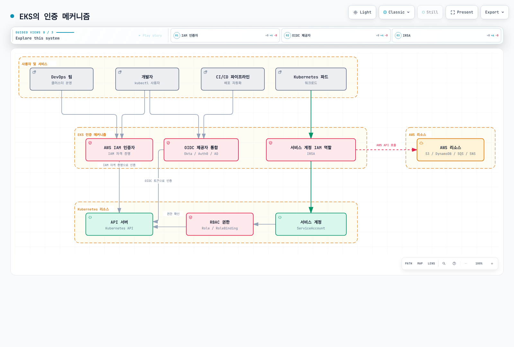

# EKS 클러스터 접근 인증: IAM과 Access Entry

> **마지막 업데이트**: 2026년 11월 21일

이 문서는 [Amazon EKS 보안](./05-eks-security.md)의 "IAM 및 인증" 절을 분리한 상세 페이지입니다. 사람·자동화 IAM 주체가 Kubernetes API에 인증하고 권한을 받는 경로, EKS 클러스터 역할과 생성 호출자의 권한, access entry와 네임스페이스 범위 RBAC·access policy 구성을 다룹니다. 워크로드(Pod)가 AWS 자격 증명을 받는 방법은 [IRSA와 OIDC Provider](./05-eks-security-irsa-oidc.md)와 [EKS Pod Identity](./05-eks-security-pod-identity.md)에서 이어서 설명하며, 여기서 준비하는 `security-demo` 네임스페이스를 두 페이지의 예제에서도 사용합니다.

## 목차

1. [신원과 권한 계층](#신원과-권한-계층)
2. [클러스터 역할과 생성 호출자](#클러스터-역할과-생성-호출자)
3. [Access Entry와 네임스페이스 권한](#access-entry와-네임스페이스-권한)

## 신원과 권한 계층

| 신원·제어 | 목적 |
|---|---|
| 사람·자동화 IAM 주체 | 설정한 IAM 매핑/access-entry 경로로 클러스터 접근 인증 |
| Kubernetes RBAC·EKS access policy | Kubernetes 작업 허용; 허용 권한은 합산됨 |
| 외부 OIDC identity provider | Client·claim 설정이 별도인 Kubernetes API 사용자 로그인 |
| EKS cluster IAM role | EKS 서비스의 클러스터 관련 AWS API 호출 |
| EC2 node IAM role | Bootstrap·필요한 node agent AWS 작업 |
| IRSA·EKS Pod Identity 역할 | 앱에 임시 AWS 자격 증명 제공 |
| Kubernetes ServiceAccount token | RBAC 권한에 따른 Pod의 Kubernetes API 인증 |

IRSA용 IAM OIDC provider와 Kubernetes 사용자 로그인을 위해 연결한 외부 OIDC provider는 다릅니다. 앱 AWS 권한이 Kubernetes API 권한을 자동 부여하지는 않습니다.

<!-- Diagram repair pending: IRSA/Pod Identity give workload AWS credentials; the ordinary Pod-to-Kubernetes API path uses its Kubernetes ServiceAccount token/RBAC.


[🔍 인터랙티브 다이어그램 보기](https://www.atomai.click/kubernetes-docs/archmaps/ko-eks-05-eks-security-2.html)
-->

## 클러스터 역할과 생성 호출자

일반 EKS cluster role은 EKS 서비스를 신뢰합니다. 다음은 그 신뢰 관계이며 개발자 사용자의 권한 정책이 아닙니다:

```json
{
  "Version": "2012-10-17",
  "Statement": [
    {
      "Effect": "Allow",
      "Principal": {
        "Service": "eks.amazonaws.com"
      },
      "Action": "sts:AssumeRole"
    }
  ]
}
```

이 역할에는 서비스 작업에 맞는 AmazonEKSClusterPolicy 또는 지원 custom policy가 필요하며 Auto Mode에는 추가 역할·정책 요구가 있습니다. 생성 호출자에게는 선택한 구성의 작업 권한과 대상 역할 전달 권한이 별도로 필요합니다. 현재 권한 참조에서 CreateCluster는 resource ARN 범위를 지원하지 않으므로 지원 request condition을 사용하고 ARN 범위를 지원하는 작업·PassRole은 범위를 제한합니다. 개발자 역할에 AmazonEKSClusterPolicy를 연결해도 Kubernetes 앱 접근 권한이 생기지는 않습니다.

## Access Entry와 네임스페이스 권한

IAM 클러스터 접근에는 지원 access-entry API를 우선 검토합니다. 현재 모드를 조회하고 이전 전에 관리자·노드 매핑을 보존합니다. CONFIG_MAP에서 API_AND_CONFIG_MAP/API로의 전환은 자유롭게 되돌리는 스위치가 아닙니다. 노드 역할이 빠진 짧은 예제로 aws-auth를 덮어쓰지 마세요. API-only 선택 전에 전체 신원·정책·노드·복구 경로를 검토합니다.

```bash
set -euo pipefail
: "${CLUSTER_NAME:?Set the existing cluster name}"
: "${AWS_REGION:?Set its Region}"
aws eks describe-cluster --name "$CLUSTER_NAME" --region "$AWS_REGION" \
  --query 'cluster.{Name:name,Status:status,Endpoint:endpoint,Access:accessConfig}' --output json
```

다음은 승인된 기존 IAM 개발자 역할·access entry가 이미 활성화된 클러스터·플랫폼 운영자의 권한을 전제로 합니다. 소유자를 통해 전용 네임스페이스를 준비합니다. Pod Security Admission 버전은 검토한 EKS 1.36 예제에 맞추었으므로 대상 클러스터에 적절한 버전을 선택하세요:

```yaml
apiVersion: v1
kind: Namespace
metadata:
  name: security-demo
  labels:
    pod-security.kubernetes.io/enforce: restricted
    pod-security.kubernetes.io/enforce-version: v1.36
```

```bash
set -euo pipefail
: "${CLUSTER_NAME:?Set the verified cluster name}"
: "${AWS_REGION:?Set its Region}"
: "${DEVELOPER_ROLE_ARN:?Set a prepared IAM role ARN, not an STS session ARN}"
MODE=$(aws eks describe-cluster --name "$CLUSTER_NAME" --region "$AWS_REGION" \
  --query cluster.accessConfig.authenticationMode --output text)
case "$MODE" in
  API|API_AND_CONFIG_MAP) ;;
  *) echo "Access entries are not enabled; review the migration first"; exit 1 ;;
esac
aws eks list-access-entries --cluster-name "$CLUSTER_NAME" --region "$AWS_REGION" \
  --output json > security-access-entries.json
python3 - "$DEVELOPER_ROLE_ARN" <<'PY'
import json, sys
with open("security-access-entries.json") as stream:
    existing = json.load(stream)["accessEntries"]
if sys.argv[1] in existing:
    raise SystemExit("Entry already exists; inspect its groups/policies instead of overwriting")
PY
aws eks create-access-entry --cluster-name "$CLUSTER_NAME" --region "$AWS_REGION" \
  --principal-arn "$DEVELOPER_ROLE_ARN" --type STANDARD \
  --kubernetes-groups security-demo-developers
```

```yaml
apiVersion: rbac.authorization.k8s.io/v1
kind: Role
metadata:
  name: developer
  namespace: security-demo
rules:
- apiGroups:
  - ''
  resources:
  - pods
  verbs:
  - get
  - list
  - watch
- apiGroups:
  - apps
  resources:
  - deployments
  verbs:
  - get
  - list
  - watch
  - create
  - update
  - patch
- apiGroups:
  - batch
  resources:
  - jobs
  verbs:
  - get
  - list
  - watch
  - create
  - update
  - patch
---
apiVersion: rbac.authorization.k8s.io/v1
kind: RoleBinding
metadata:
  name: developer
  namespace: security-demo
subjects:
- kind: Group
  name: security-demo-developers
  apiGroup: rbac.authorization.k8s.io
roleRef:
  kind: Role
  name: developer
  apiGroup: rbac.authorization.k8s.io
```

Entry는 IAM 주체를 그룹에 매핑하고 RoleBinding은 표시한 네임스페이스 권한을 부여합니다. 그룹 이름만으로 네임스페이스 경계가 생기지는 않습니다. 워크로드 컨트롤러 생성 권한으로 네임스페이스의 ServiceAccount·Secret·PVC를 사용하는 Pod가 생길 수 있습니다. 테넌트를 구분하고 적절한 admission·소유권 제어로 워크로드·ServiceAccount 사용을 제한합니다.

별도로 검토한 viewer entry에는 custom RBAC 대신 EKS access policy를 사용할 수 있습니다. 아래 namespace view를 추가하기 전에 현재 그룹·연결 정책을 조회합니다:

```bash
set -euo pipefail
: "${CLUSTER_NAME:?Set the verified cluster name}"
: "${AWS_REGION:?Set its Region}"
: "${VIEWER_ROLE_ARN:?Set the IAM principal of a prepared, reviewed access entry}"
aws eks list-associated-access-policies --cluster-name "$CLUSTER_NAME" --region "$AWS_REGION" \
  --principal-arn "$VIEWER_ROLE_ARN"
aws eks associate-access-policy --cluster-name "$CLUSTER_NAME" --region "$AWS_REGION" \
  --principal-arn "$VIEWER_ROLE_ARN" \
  --policy-arn arn:aws:eks::aws:cluster-access-policy/AmazonEKSViewPolicy \
  --access-scope type=namespace,namespaces=security-demo
```

View 추가가 더 넓은 RBAC/access-policy 권한을 취소하지는 않습니다. 변경 전파에 시간이 걸릴 수 있습니다. 의도한 실제 IAM 로그인으로 검증하며 kubectl --as는 Kubernetes impersonation/RBAC 검사이지 IAM access-policy 경로의 증거가 아닙니다. Kubeconfig는 클러스터·자격 증명 경로를 가리킬 뿐 자체적으로 권한을 부여하지 않습니다.

IAM eks:DescribeCluster/ListClusters는 AWS 관리·검색 작업용입니다. eks:AccessKubernetesApi는 콘솔 조회 권한입니다. eks:namespaces 조건은 access-policy association 요청을 필터링하며 kubectl API 호출의 범용 네임스페이스 필터가 아닙니다.

## 참고 자료

- [EKS access entry](https://docs.aws.amazon.com/eks/latest/userguide/access-entries.html)
- [EKS access policy](https://docs.aws.amazon.com/eks/latest/userguide/access-policies.html)
- [Kubernetes RBAC](https://kubernetes.io/docs/reference/access-authn-authz/rbac/)

## 다음 단계

- 다음: [IRSA와 OIDC Provider](./05-eks-security-irsa-oidc.md)
- 관련: [EKS Pod Identity](./05-eks-security-pod-identity.md)
- 개요로 돌아가기: [Amazon EKS 보안](./05-eks-security.md)

## 퀴즈

이 장에서 배운 내용을 테스트하려면 [주제 퀴즈](../quizzes/eks/05-eks-security-cluster-access-quiz.md)를 풀어보세요.
