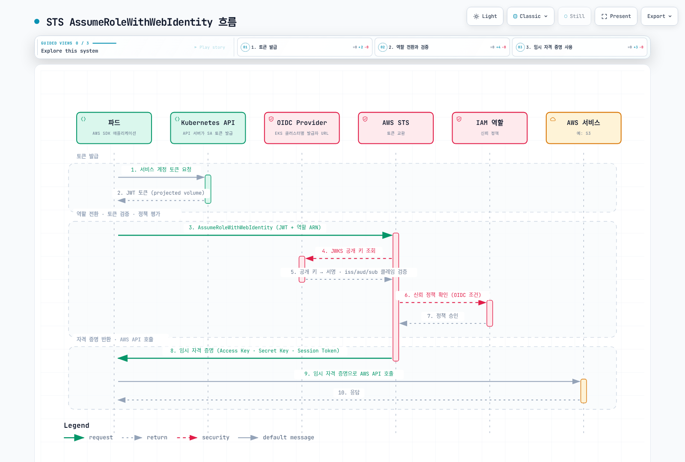

# IRSA와 OIDC Provider

> **마지막 업데이트**: 2026년 11월 21일

이 문서는 [Amazon EKS 보안](./05-eks-security.md)의 "OIDC Provider 심화" 절을 분리한 상세 페이지입니다. 클러스터 OIDC issuer와 IAM OIDC provider의 관계, IRSA 토큰이 STS에서 임시 자격 증명으로 바뀌는 과정, discovery·JWKS 조회와 범위를 제한한 IRSA 역할·Job 예제를 다룹니다. 예제는 [클러스터 접근 인증](./05-eks-security-cluster-access.md#access-entry와-네임스페이스-권한) 페이지에서 준비한 `security-demo` 네임스페이스를 사용합니다. 단계별 IRSA 흐름 그림은 [IRSA 동작 원리](../security/17-eks-workload-identity-migration.md#irsa-flow)에도 있습니다.

## 목차

1. [OIDC issuer와 IAM OIDC provider](#oidc-issuer와-iam-oidc-provider)
2. [IRSA 토큰과 역할 전환](#irsa-토큰과-역할-전환)
3. [Discovery와 JWKS 조회](#discovery와-jwks-조회)
4. [범위를 제한한 IRSA 예제](#범위를-제한한-irsa-예제)

## OIDC issuer와 IAM OIDC provider

EKS는 클러스터 OIDC issuer와 공개 서명 키를 게시합니다. Endpoint만으로 IAM OIDC provider가 생성되거나 역할 전환이 허용되지는 않습니다. IRSA에는 역할 계정의 대상 IAM OIDC provider, 올바른 issuer/subject/audience 신뢰 조건과 호환 SDK가 필요합니다.



[🔍 인터랙티브 다이어그램 보기](https://www.atomai.click/kubernetes-docs/archmaps/ko-eks-05-eks-security-3.html)

## IRSA 토큰과 역할 전환

IRSA webhook은 대상 Pod에 projected token·role 설정을 추가합니다. SDK는 AssumeRoleWithWebIdentity로 web-identity token을 STS와 교환합니다. STS가 issuer·서명·토큰·역할 신뢰를 검증하면 임시 AWS 자격 증명을 반환하며 앱은 허용된 AWS 작업에 이를 사용합니다. Kubernetes의 projected token 갱신과 SDK의 AWS 자격 증명 갱신은 수명이 다릅니다.

다음은 오래되어 만료된 시각과 placeholder 신원을 사용한 **decoded payload 구조 예제**입니다. 서명된 토큰·인증 테스트가 아닙니다. STS audience는 IRSA 경로용이며 Pod Identity는 다른 audience를 사용합니다:

```json
{
  "aud": [
    "sts.amazonaws.com"
  ],
  "exp": 1234567890,
  "iat": 1234567800,
  "iss": "https://oidc.eks.us-west-2.amazonaws.com/id/REPLACE_WITH_CLUSTER_ISSUER_ID",
  "kubernetes.io": {
    "namespace": "security-demo",
    "pod": {
      "name": "irsa-read-check-example",
      "uid": "example-pod-uid"
    },
    "serviceaccount": {
      "name": "irsa-reader",
      "uid": "example-serviceaccount-uid"
    }
  },
  "sub": "system:serviceaccount:security-demo:irsa-reader"
}
```

JSON decode 성공 여부뿐 아니라 issuer·audience·만료·예상 subject를 검증합니다. 실제 토큰·AWS secret access key·session token을 예제·로그에 출력하지 않습니다. 역할이 명시적으로 허용한 여러 ServiceAccount·issuer를 신뢰할 수 있으며 IRSA가 ServiceAccount당 역할 하나를 강제하지는 않습니다.

## Discovery와 JWKS 조회

실제 클러스터가 반환한 issuer를 사용합니다. 다음 진단은 공개 discovery/JWKS를 조회하고 discovery issuer·HTTPS scheme을 확인합니다. 워크로드 토큰·IAM 권한 검증은 아닙니다:

```bash
set -euo pipefail
: "${CLUSTER_NAME:?Set the verified cluster}"
: "${AWS_REGION:?Set its Region}"
OIDC_URL=$(aws eks describe-cluster --name "$CLUSTER_NAME" --region "$AWS_REGION" \
  --query cluster.identity.oidc.issuer --output text)
case "$OIDC_URL" in https://*) ;; *) echo "Unexpected issuer URL"; exit 1 ;; esac
curl --fail --silent --show-error --proto '=https' --connect-timeout 5 --max-time 20 \
  "${OIDC_URL%/}/.well-known/openid-configuration" > oidc-discovery.json
JWKS_URI=$(python3 - "$OIDC_URL" <<'PY'
import json, sys, urllib.parse
with open("oidc-discovery.json") as stream:
    doc = json.load(stream)
if doc["issuer"] != sys.argv[1]:
    raise SystemExit("Discovery issuer does not match the cluster issuer")
uri = doc["jwks_uri"]
parsed = urllib.parse.urlparse(uri)
if parsed.scheme != "https" or not parsed.hostname or parsed.username or parsed.password:
    raise SystemExit("JWKS must be an HTTPS URL without embedded credentials")
print(uri)
PY
)
curl --fail --silent --show-error --proto '=https' --connect-timeout 5 --max-time 20 \
  "$JWKS_URI" > oidc-jwks.json
python3 - <<'PY'
import json
with open("oidc-jwks.json") as stream:
    keys = json.load(stream).get("keys")
if not isinstance(keys, list) or not keys or not all(isinstance(k, dict) and "kty" in k for k in keys):
    raise SystemExit("Unexpected JWKS response")
print("Fetched", len(keys), "public keys; no token signature was validated")
PY
```

자동 validator는 Cache-Control에 따라 키를 캐시하고 검토한 JWT 라이브러리로 서명 키 교체·알 수 없는 kid를 처리해야 합니다. EKS OIDC 서명 키는7일마다 교체됩니다. 현재 EKS는 인터넷 egress가 없는 validator용 클러스터 OIDC discovery/JWKS PrivateLink interface endpoint인 `com.amazonaws.region-code.oidc-eks`도 지원합니다. 해당 endpoint의 리전·DNS 조건을 확인하세요. EKS 관리 API endpoint와는 다른 서비스입니다.

## 범위를 제한한 IRSA 예제

소유자를 통해 IAM OIDC provider·역할·버킷을 준비합니다. 계정·전체 issuer hostname/path·role ARN을 일관되게 교체하세요. IPv6 클러스터는 dual-stack issuer hostname을 사용할 수 있습니다. 다음은 security-demo/irsa-reader와 STS audience만 연결한 신규 역할 신뢰 예제이며 기존 역할의 다른 신뢰 문장을 대체하는 정책이 아닙니다:

```json
{
  "Version": "2012-10-17",
  "Statement": [
    {
      "Effect": "Allow",
      "Principal": {
        "Federated": "arn:aws:iam::111122223333:oidc-provider/oidc.eks.us-west-2.amazonaws.com/id/REPLACE_WITH_CLUSTER_ISSUER_ID"
      },
      "Action": "sts:AssumeRoleWithWebIdentity",
      "Condition": {
        "StringEquals": {
          "oidc.eks.us-west-2.amazonaws.com/id/REPLACE_WITH_CLUSTER_ISSUER_ID:sub": "system:serviceaccount:security-demo:irsa-reader",
          "oidc.eks.us-west-2.amazonaws.com/id/REPLACE_WITH_CLUSTER_ISSUER_ID:aud": "sts.amazonaws.com"
        }
      }
    }
  ]
}
```

읽기 정책은 특정 버킷 접두사만 허용합니다. 객체가 customer managed 암호화 키를 사용하면 필요한 KMS 권한만 추가하고 버킷·endpoint 정책도 확인합니다. 이 접두사 하나의 예제에 계정 전체 AmazonS3ReadOnlyAccess가 필요한 것은 아닙니다:

```json
{
  "Version": "2012-10-17",
  "Statement": [
    {
      "Effect": "Allow",
      "Action": [
        "s3:ListBucket"
      ],
      "Resource": "arn:aws:s3:::replace-with-owned-security-bucket",
      "Condition": {
        "StringLike": {
          "s3:prefix": [
            "security-demo/",
            "security-demo/*"
          ]
        }
      }
    },
    {
      "Effect": "Allow",
      "Action": [
        "s3:GetObject"
      ],
      "Resource": "arn:aws:s3:::replace-with-owned-security-bucket/security-demo/*"
    }
  ]
}
```

[security-demo 네임스페이스](./05-eks-security-cluster-access.md#access-entry와-네임스페이스-권한)·역할 준비 후 다음 ServiceAccount와 제한 시간이 있는 목록 조회 Job을 생성합니다. 공식 AWS CLI 이미지에는 client가 있지만 임의 amazonlinux:2 이미지에 있다고 보장되지 않습니다. 버킷·리전·역할 값을 교체하세요. Job은 비밀 값 출력 없이 접두사 목록을 조회하며 성공이 모든 앱 GetObject/KMS 권한의 증거는 아닙니다.

```yaml
apiVersion: v1
kind: ServiceAccount
metadata:
  name: irsa-reader
  namespace: security-demo
  annotations:
    eks.amazonaws.com/role-arn: arn:aws:iam::111122223333:role/SecurityDemoIRSAReader
---
apiVersion: batch/v1
kind: Job
metadata:
  name: irsa-read-check
  namespace: security-demo
spec:
  backoffLimit: 0
  activeDeadlineSeconds: 120
  template:
    spec:
      serviceAccountName: irsa-reader
      restartPolicy: Never
      securityContext:
        runAsNonRoot: true
        runAsUser: 1000
        runAsGroup: 1000
        fsGroup: 1000
        seccompProfile:
          type: RuntimeDefault
      containers:
      - name: reader
        image: public.ecr.aws/aws-cli/aws-cli:2.36.43
        command:
        - aws
        args:
        - s3api
        - list-objects-v2
        - --bucket
        - replace-with-owned-security-bucket
        - --prefix
        - security-demo/
        - --max-items
        - '5'
        env:
        - name: AWS_REGION
          value: us-west-2
        - name: AWS_EC2_METADATA_DISABLED
          value: 'true'
        securityContext:
          allowPrivilegeEscalation: false
          readOnlyRootFilesystem: true
          capabilities:
            drop:
            - ALL
        resources:
          requests:
            cpu: 100m
            memory: 128Mi
          limits:
            cpu: 500m
            memory: 256Mi
        volumeMounts:
        - name: private-home
          mountPath: /root
        - name: tmp
          mountPath: /tmp
      volumes:
      - name: private-home
        emptyDir: {}
      - name: tmp
        emptyDir: {}
      nodeSelector:
        kubernetes.io/os: linux
```

## 참고 자료

- [EKS IRSA](https://docs.aws.amazon.com/eks/latest/userguide/iam-roles-for-service-accounts.html)
- [IRSA 최소 SDK 버전](https://docs.aws.amazon.com/eks/latest/userguide/iam-roles-for-service-accounts-minimum-sdk.html)
- [EKS 노드 IAM 권한을 IRSA와 Pod Identity로 이전하기](../security/17-eks-workload-identity-migration.md)

## 다음 단계

- 이전: [EKS 클러스터 접근 인증: IAM과 Access Entry](./05-eks-security-cluster-access.md)
- 다음: [EKS Pod Identity](./05-eks-security-pod-identity.md)
- 개요로 돌아가기: [Amazon EKS 보안](./05-eks-security.md)

## 퀴즈

이 장에서 배운 내용을 테스트하려면 [주제 퀴즈](../quizzes/eks/05-eks-security-irsa-oidc-quiz.md)를 풀어보세요.
