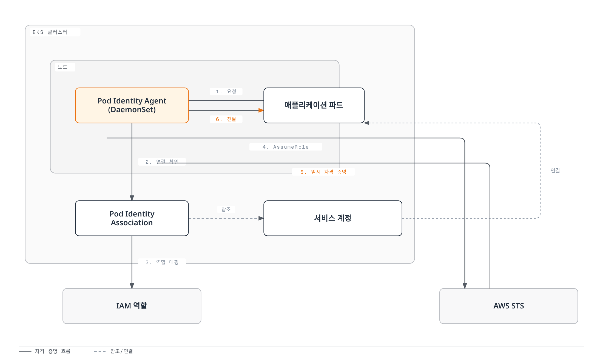

# EKS Pod Identity

> **마지막 업데이트**: 2026년 11월 21일

이 문서는 [Amazon EKS 보안](./05-eks-security.md)의 "EKS Pod Identity" 절을 분리한 상세 페이지입니다. Pod Identity Agent와 자격 증명 흐름, 역할 신뢰와 association 준비, 교차 계정·캐시 고려 사항을 설정 참조로 정리합니다. IRSA와의 동작 비교, 운영 클러스터 이전 순서와 라이브 데모는 워크북 [EKS 노드 IAM 권한을 IRSA와 Pod Identity로 이전하기](../security/17-eks-workload-identity-migration.md)가 기준 문서이므로 이 페이지에서는 요약과 링크만 둡니다.

## 목차

1. [Pod Identity 개요](#pod-identity-개요)
2. [IRSA와 비교](#irsa와-비교)
3. [Agent와 자격 증명 흐름](#agent와-자격-증명-흐름)
4. [역할과 Association 준비](#역할과-association-준비)
5. [교차 계정과 캐시 고려 사항](#교차-계정과-캐시-고려-사항)
6. [IRSA에서 Pod Identity로 마이그레이션](#irsa에서-pod-identity로-마이그레이션)

## Pod Identity 개요

EKS Pod Identity는 SDK의 container credential provider와 EKS Auth를 통해 임시 AWS 자격 증명을 제공합니다. Association은 클러스터/네임스페이스/ServiceAccount와 IAM 역할의 매핑이며 ServiceAccount 생성·Kubernetes RBAC 권한 부여 기능은 아닙니다.

## IRSA와 비교

두 방식의 동작 원리와 항목별 비교(클러스터 쪽 준비, 신뢰 정책, 확장 한도, 교차 계정, 권한 분리)는 워크북의 [IRSA와 Pod Identity 비교](../security/17-eks-workload-identity-migration.md#irsa와-pod-identity-비교) 표를 기준으로 합니다. 이 페이지의 설정 예제를 읽을 때 기억할 차이는 다음과 같습니다.

- **신뢰와 연결**: IRSA는 IAM OIDC provider와 issuer·subject·audience 신뢰 조건을, Pod Identity는 `pods.eks.amazonaws.com` 역할 신뢰와 EKS API association을 사용합니다.
- **자격 증명 경로**: IRSA는 SDK가 web identity token을 STS와 교환하고([IRSA 동작 원리](../security/17-eks-workload-identity-migration.md#irsa-flow)), Pod Identity는 SDK가 노드 agent의 container credential endpoint를 거쳐 EKS Auth에서 자격 증명을 받습니다([Pod Identity 동작 원리](../security/17-eks-workload-identity-migration.md#pod-identity-flow)).
- **Session tag**: Pod Identity의 Kubernetes session tag는 기본 활성화되며 의도적으로 비활성화할 수 있습니다. Session tag는 assumed-role session의 속성이며 앱이 생성하는 모든 AWS 리소스를 자동으로 태깅하지 않습니다.

설정이 간단해져도 IAM·네트워크·SDK·앱 검증 요구가 없어지지는 않습니다.

## Agent와 자격 증명 흐름

<!-- Diagram repair pending: SDK calls container credential endpoint; agent calls EKS Auth AssumeRoleForPodIdentity, not STS directly or arbitrary request interception.


[🔍 인터랙티브 다이어그램 보기](https://www.atomai.click/kubernetes-docs/archmaps/ko-eks-05-eks-security-4.html)
-->

Association이 있는 새 Pod에는 EKS가 audience가 pods.eks.amazonaws.com인 token·token-file 환경 변수·container credentials URI를 주입합니다. SDK가 agent endpoint(일반적으로169.254.170.23/v1/credentials)를 호출하고 agent는 **EKS Auth의 AssumeRoleForPodIdentity**를 호출하여 반환된 자격 증명을 SDK에 제공합니다. 모든 앱 요청을 투명하게 가로채는 방식이 아니며 앱은 그 자격 증명으로 AWS 서비스에 직접 요청합니다. 단계별 흐름 그림은 [EKS Pod Identity 동작 원리](../security/17-eks-workload-identity-migration.md#pod-identity-flow)에 있습니다.

지원되는 일반 EC2 노드는 Pod Identity Agent add-on/DaemonSet을 사용합니다. Auto Mode는 관리형 노드의 일부로 기능을 제공합니다. Hybrid Nodes는 문서화된 OS·agent·노드 자격 증명 설정(노드 `nodeadm`의 `spec.hybrid.enableCredentialsFile: true`와 agent add-on의 `daemonsets.hybrid.create`, Bottlerocket은 별도 설정. [Hybrid Nodes 애드온 배치와 Pod Identity](../eks-hybrid-nodes/04-node-bootstrap.md#애드온-배치와-pod-identity) 참고)으로 지원하므로 일반 EC2 agent 구성을 그대로 적용하지 않습니다. EKS Fargate는 이 Pod Identity agent 경로를 지원하지 않으며 Windows 노드·Outposts·EKS Anywhere도 지원 대상이 아닙니다. 실제 컴퓨팅 지원·노드 EKS Auth 권한·네트워크를 확인하세요.

## 역할과 Association 준비

일반 관리형 agent를 설치할 때는 소유자를 통해 실제 클러스터 버전·호환 add-on catalog를 조회합니다. 이전v1.0.0 build를 하드코딩하거나 Auto Mode·다른 소유자의 설치에 agent를 중복 설치하지 마세요:

```bash
set -euo pipefail
: "${CLUSTER_NAME:?Set the existing cluster}"
: "${AWS_REGION:?Set its Region}"
EKS_VERSION=$(aws eks describe-cluster --name "$CLUSTER_NAME" --region "$AWS_REGION" \
  --query cluster.version --output text)
aws eks describe-addon-versions --addon-name eks-pod-identity-agent \
  --kubernetes-version "$EKS_VERSION" --region "$AWS_REGION" --output json
```

[IRSA 예제의 범위가 제한된 S3 읽기 정책](./05-eks-security-irsa-oidc.md#범위를-제한한-irsa-예제)과 다음 신뢰 관계로 같은 계정의 IAM 역할을 준비합니다. 계정·클러스터 값을 함께 교체하세요. 이 예제는 기본 session tag에 의존하므로 tag를 비활성화하면 조건을 재검토해야 합니다. 호출자에게는 해당 association 권한·대상 역할의 iam:PassRole이 필요합니다:

```json
{
  "Version": "2012-10-17",
  "Statement": [
    {
      "Effect": "Allow",
      "Principal": {
        "Service": "pods.eks.amazonaws.com"
      },
      "Action": [
        "sts:AssumeRole",
        "sts:TagSession"
      ],
      "Condition": {
        "StringEquals": {
          "aws:RequestTag/eks-cluster-arn": "arn:aws:eks:us-west-2:111122223333:cluster/my-cluster",
          "aws:RequestTag/kubernetes-namespace": "security-demo",
          "aws:RequestTag/kubernetes-service-account": "podid-reader"
        }
      }
    }
  ]
}
```

다음 신규 association 예제는 기존 association을 덮어쓰지 않습니다. IAM 역할·agent·Kubernetes 계정을 생성하는 명령은 아닙니다:

```bash
set -euo pipefail
: "${CLUSTER_NAME:?Set the verified cluster}"
: "${AWS_REGION:?Set its Region}"
: "${POD_ID_ROLE_ARN:?Set the prepared same-account role matching the trust example}"
aws eks list-pod-identity-associations --cluster-name "$CLUSTER_NAME" --region "$AWS_REGION" \
  --namespace security-demo --service-account podid-reader --output json > podid-associations-before.json
python3 - <<'PY'
import json
with open("podid-associations-before.json") as stream:
    existing = json.load(stream)["associations"]
if existing:
    raise SystemExit("Association exists; review its owner/configuration before changing it")
PY
aws eks create-pod-identity-association --cluster-name "$CLUSTER_NAME" --region "$AWS_REGION" \
  --namespace security-demo --service-account podid-reader --role-arn "$POD_ID_ROLE_ARN"
```

Association 전파 후 ServiceAccount·제한 시간이 있는 새 테스트 Job을 생성합니다. IAM 역할 신뢰·네임스페이스·계정 이름·버킷 접두사를 맞추세요. Association보다 먼저 생성된 Pod는 주입 설정을 받기 위해 재생성이 필요할 수 있습니다. 실제 선택한 provider·대표 권한을 검증하고 자격 증명·token 파일은 출력하지 않습니다.

```yaml
apiVersion: v1
kind: ServiceAccount
metadata:
  name: podid-reader
  namespace: security-demo
---
apiVersion: batch/v1
kind: Job
metadata:
  name: podid-read-check
  namespace: security-demo
spec:
  backoffLimit: 0
  activeDeadlineSeconds: 120
  template:
    spec:
      serviceAccountName: podid-reader
      restartPolicy: Never
      securityContext:
        runAsNonRoot: true
        runAsUser: 1000
        runAsGroup: 1000
        fsGroup: 1000
        seccompProfile:
          type: RuntimeDefault
      containers:
      - name: reader
        image: public.ecr.aws/aws-cli/aws-cli:2.36.43
        command:
        - aws
        args:
        - s3api
        - list-objects-v2
        - --bucket
        - replace-with-owned-security-bucket
        - --prefix
        - security-demo/
        - --max-items
        - '5'
        env:
        - name: AWS_REGION
          value: us-west-2
        - name: AWS_EC2_METADATA_DISABLED
          value: 'true'
        securityContext:
          allowPrivilegeEscalation: false
          readOnlyRootFilesystem: true
          capabilities:
            drop:
            - ALL
        resources:
          requests:
            cpu: 100m
            memory: 128Mi
          limits:
            cpu: 500m
            memory: 256Mi
        volumeMounts:
        - name: private-home
          mountPath: /root
        - name: tmp
          mountPath: /tmp
      volumes:
      - name: private-home
        emptyDir: {}
      - name: tmp
        emptyDir: {}
      nodeSelector:
        kubernetes.io/os: linux
```

## 교차 계정과 캐시 고려 사항

Association 역할은 EKS 클러스터 계정에 있어야 합니다. 선택적 target IAM role은 다른 계정에 둘 수 있으며 양쪽 신뢰·assume-role 권한으로 같은 계정의 역할에서 target으로 chaining합니다. 임의의 외부 역할을 association 역할로 직접 연결할 수 있다는 뜻은 아닙니다.

현재 target-role 안내는 target이 없으면6시간, 있으면59분 자격 증명 캐시를 설명합니다. Association 변경이 캐시를 초기화하지 않으며 Pod 재생성으로 새 구성을 더 빨리 받을 수 있습니다. 실제 앱의 갱신·취소 동작을 확인하세요. 새 association session-policy 옵션은 session tag 비활성화가 필요하고 target role이 있으면 그 권한을 제한합니다. 해당 tag가 필요한 신뢰 조건과 검토 없이 조합하지 않습니다.

## IRSA에서 Pod Identity로 마이그레이션

운영 클러스터의 단계별 이전 순서와 카나리 전환 명령은 워크북의 [운영 클러스터의 이전 순서](../security/17-eks-workload-identity-migration.md#운영-클러스터의-이전-순서)를, 같은 앱 세 벌을 실제로 이전한 결과는 [라이브 데모](../security/17-eks-workload-identity-migration.md#live-demo)를 따릅니다. 이 페이지에는 이전 전에 지켜야 할 점만 남깁니다.

이전 준비 전에 기존 IRSA 신뢰·ServiceAccount 구성을 보존합니다. 역할 신뢰를 Pod Identity 서비스 Principal만으로 덮어쓰면 기존 소비자의 자격 증명 갱신이 실패할 수 있습니다. 다음은 구성 기록만 수행합니다:

```bash
set -euo pipefail
: "${IRSA_ROLE_NAME:?Set the existing role whose trust must be preserved}"
: "${WORKLOAD_NAMESPACE:?Set the workload namespace}"
: "${SERVICE_ACCOUNT:?Set the existing application ServiceAccount}"
aws iam get-role --role-name "$IRSA_ROLE_NAME" \
  --query Role.AssumeRolePolicyDocument --output json > irsa-trust-before.json
kubectl -n "$WORKLOAD_NAMESPACE" get serviceaccount "$SERVICE_ACCOUNT" \
  -o yaml > irsa-serviceaccount-before.yaml
```

- 실제 컴퓨팅 지원, 호환 SDK·container credential provider, Pod Identity agent 또는 내장 기능, 준비한 IAM 역할 권한을 먼저 확인합니다.
- Pod Identity 신뢰 문장은 소유자 경로로 기존 신뢰 정책에 병합하고, 모든 소비자가 이전될 때까지 IRSA issuer·subject·audience 조건과 다른 유효한 문장을 유지합니다.
- 같은 ServiceAccount에 IRSA annotation과 association이 함께 있으면 EKS는 **새 Pod**에 Pod Identity 변수만 주입하고 IRSA 변수는 넣지 않습니다. 이미 실행 중인 Pod는 다시 만들기 전까지 IRSA 변수를 유지하므로 통제된 rollout으로 Pod를 새로 만들고, 전환이 끝나면 쓰지 않는 annotation을 지웁니다. 운영 ServiceAccount에 association을 만들면 그 ServiceAccount의 새 Pod가 모두 Pod Identity로 바뀌므로, 먼저 별도 ServiceAccount를 쓰는 canary로 검증하고 그 전에 운영 IRSA annotation을 지우거나 운영 Deployment를 재시작하지 않습니다.
- 같은 IAM 역할이 표시되는 get-caller-identity 성공만으로 IRSA·Pod Identity를 구별할 수는 없습니다. 토큰·비밀 값을 출력하지 않고 새 Pod에 주입된 환경 변수 이름과 필요한 AWS 작업의 성공 여부를 확인하며, 명시적 자격 증명처럼 SDK 체인에서 앞서는 공급자가 남아 있지 않은지 검토합니다.
- 워크로드 구성을 되돌릴 검증된 경로를 유지하고, 남은 소비자를 모두 조사해 이전 완료를 확인한 뒤에만 이전 IRSA 신뢰를 제거합니다.

## 참고 자료

- [EKS Pod Identity](https://docs.aws.amazon.com/eks/latest/userguide/pod-identities.html)
- [Pod Identity 동작 원리](https://docs.aws.amazon.com/eks/latest/userguide/pod-id-how-it-works.html)
- [Hybrid 애드온·Pod Identity](https://docs.aws.amazon.com/eks/latest/userguide/hybrid-nodes-add-ons.html)
- [EKS 노드 IAM 권한을 IRSA와 Pod Identity로 이전하기](../security/17-eks-workload-identity-migration.md)

## 다음 단계

- 이전: [IRSA와 OIDC Provider](./05-eks-security-irsa-oidc.md)
- 다음: [Amazon EKS 보안 - Cluster Endpoint 접근 제어](./05-eks-security.md#cluster-endpoint-접근-제어)
- 관련: [EKS 클러스터 접근 인증: IAM과 Access Entry](./05-eks-security-cluster-access.md)
- 개요로 돌아가기: [Amazon EKS 보안](./05-eks-security.md)

## 퀴즈

이 장에서 배운 내용을 테스트하려면 [주제 퀴즈](../quizzes/eks/05-eks-security-pod-identity-quiz.md)를 풀어보세요.
