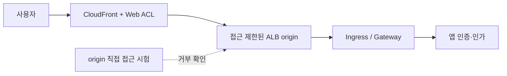

# WAF·엣지·API 보안과 origin 우회 차단

> **검토 기준**: AWS WAF·CloudFront·ALB 공식 문서. 기능·검사 한도는 연결 리소스별로 구분합니다.
> **마지막 업데이트**: 2026년 10월 15일

이 장의 목표는 “WAF가 있다”를 “보호 대상 요청이 WAF를 통과하고, 검사 범위와 예외를 알며, 앱까지 안전하게 처리된다”로 바꾸는 것입니다. 앱·origin·운영 검증 항목은 이 가이드의 설계 제안입니다.

## 1. WAF, NGFW, 앱 인가를 구분한다

AWS WAF는 Web ACL을 연결한 지원 리소스의 웹 요청을 검사합니다. CloudFront, ALB, API Gateway **REST API** 등 지원 목록을 확인합니다. API Gateway HTTP API·WebSocket API나 NLB에 동일 방식으로 직접 연결할 수 있다고 가정하지 않습니다. CloudFront용 Web ACL은 `CLOUDFRONT` scope와 `us-east-1` API endpoint, ALB 등은 `REGIONAL` scope와 리소스 Region을 사용합니다. [S09]

Palo Alto VM-Series와 FortiGate의 NGFW 기능, Palo Alto·Fortinet의 별도 WAF 제품을 혼동하지 않습니다. 웹 애플리케이션 인가도 별도 계층입니다. 인증된 사용자의 다른 고객 데이터 접근, 잘못된 object ID 인가, 결제 한도·중복 처리, LLM 도구 권한은 앱에서 검증할 항목으로 제안합니다.

| 흐름 | 주 통제 | 남는 검증 |
|---|---|---|
| 공개 HTTP(S) | CloudFront/ALB에 연결한 WAF | 직접 origin, body 한도, 규칙 예외, 앱 인가 |
| TLS가 유지된 IP 세션 | NGFW 경로와 선택적 복호화 | 실제 payload 가시성·예외 |
| 클러스터 내부 webhook | 접근 제한, admission·RBAC | Pod에서의 도달성과 controller 권한 |
| 업로드·gRPC·WebSocket | 지원 경로와 앱 처리별 검증 | 초기 요청 이후 메시지·파일 처리 범위 |

ingress-nginx admission CVE는 Pod 네트워크에서 접근하는 webhook 경로를 다루므로, 공개 URL의 WAF 검증과 별도로 시험해야 합니다. [S01]

## 2. 보호 경로와 origin을 함께 설계한다



그림은 논리적 설계입니다. CloudFront WAF만 사용하는 경우와 ALB에도 별도 Regional Web ACL을 연결하는 경우를 선택해 문서화합니다. 이중 검사를 자동 기본값으로 두지 않고 로그·오탐·비용을 확인합니다.

### 선택 A: 공인 ALB origin

AWS의 CloudFront→ALB 제한 예제를 기반으로 다음 통제를 결합합니다. [S16]

1. ALB security group에서 CloudFront origin-facing managed prefix list를 검토합니다.
2. CloudFront origin custom header와 ALB listener의 해당 header 조건을 함께 사용합니다.
3. 기본 listener action은 승인 경로에 해당하지 않는 요청을 거부하도록 설계합니다.
4. origin HTTPS와 secret header의 교체·설정 조회 권한을 관리합니다.
5. ALB DNS·대체 도메인·IP·별도 listener·추가 LB·NodePort를 통한 우회를 시험합니다.

**CloudFront IP 범위만으로 자신의 distribution을 식별할 수 없습니다.** Header는 다른 CloudFront 경로와 구분하기 위한 추가 조건이며 노출되면 공유 비밀로서 효력이 낮아집니다. 실사용 값을 소스·스크린샷·일반 로그에 남기지 않습니다. 앱이 받는 전달 header만 믿는 구성과 listener가 origin 접근을 제한하는 구성도 구분합니다. [S16]

### 선택 B: CloudFront VPC origin

CloudFront VPC origins는 지원되는 VPC 내 private subnet origin으로 전달하는 선택지입니다. Internet Gateway 부착 요구가 origin에 공인 IP를 부여하라는 뜻은 아닙니다. 지원 Region·리소스·프로토콜 제약, subnet 주소와 서비스 관리 security group 설정을 현재 문서에서 확인합니다. NLB의 지원과 WAF의 NLB 직접 연결은 서로 다른 문제입니다. [S17]

어느 선택이든 별도 공인 Service·NodePort·관리 endpoint가 같은 앱을 노출하는지 확인합니다. private origin이라는 명칭만으로 모든 진입 경로 검토를 끝내지 않습니다.

## 3. 규칙 순서와 terminating action

AWS WAF는 숫자가 작은 priority부터 평가합니다. `Allow`와 `Block`은 terminating action이고, `Count`는 평가를 계속합니다. `CAPTCHA`·`Challenge`는 유효 token이 있으면 non-terminating이며 없거나 유효하지 않으면 평가를 종료합니다. 종료 action으로 결정되지 않은 요청에는 Web ACL default action이 적용됩니다. [S10]

| 함정 | 발생하는 문제 | 설계 제안 |
|---|---|---|
| 앞단의 넓은 `Allow` | 뒤의 managed rule·rate rule 평가가 끝남 | 꼭 필요한 좁은 범위만 허용하고 정책 순서 재검토 |
| 전체 rule group을 예외 | 다른 보호까지 제거될 수 있음 | 개별 규칙·경로·method·소유자·기한을 기록 |
| `Count`를 차단으로 간주 | 모니터링만 수행 | rule action·override·effective result를 확인 |
| Challenge를 모든 API에 적용 | 자동 클라이언트 호환성 문제 | 브라우저와 기계 API를 분리해 시험 |

Managed Rules 선택·업데이트도 변경 관리 대상입니다. AWS managed baseline·known bad inputs·SQLi 등 필요한 그룹을 정상 업무 자료와 비교하고, 제품이 지원하는 버전 고정·변경 알림을 확인합니다. 그룹 이름만으로 모든 공격을 탐지한다고 표현하지 않습니다.

## 4. request body와 oversize의 실제 한계

| 연결 리소스 | AWS WAF body 검사 크기 |
|---|---|
| ALB, AppSync | 고정 8 KB |
| CloudFront, API Gateway, Cognito, App Runner, Verified Access, Bedrock AgentCore Gateway | 기본 16 KB, 지원 설정으로 최대 64 KB |
| gRPC 요청 | AWS 문서는 body 검사 규칙이 적용되지 않는다고 명시 |

이 표는 body 검사 크기이며 업로드 허용 크기나 전체 요청 크기와 다릅니다. 크기를 늘릴 때 비용·리소스 지원을 확인합니다. 일부 managed rule의 자체 크기 조건은 Web ACL의 검사 크기 변경과 별도로 평가해야 합니다. [S11]

검사 가능한 부분보다 body·headers·cookies가 크면 해당 rule statement의 oversize handling이 중요합니다. [S12]

- `CONTINUE`: 전달된 검사 가능 부분으로 평가합니다.
- `MATCH`: 초과를 그 statement의 match로 취급합니다.
- `NO_MATCH`: 초과를 그 statement의 non-match로 취급합니다.

**`MATCH`는 자체로 Block 명령이 아닙니다.** rule action과 `NOT` 등 statement 조합에 따라 최종 결과가 달라집니다. 앞선 terminating `Allow`는 뒤의 초과 크기 차단 규칙에도 도달하지 않게 할 수 있습니다. [S10] [S12]

앱에서 전체 body 크기·schema·content type·압축 해제·파일 처리·인가를 검증하도록 제안합니다. 대용량 업로드에는 별도 경로와 저장소 기반 후속 검사를 검토합니다. 임계치 전후 정상 JSON·multipart와 검사 prefix 뒤의 데이터로 WAF와 앱의 처리 결과를 비교합니다. 공격 payload 없이도 한도와 경로를 확인할 수 있습니다.

## 5. 클라이언트 IP와 rate-based rule

CloudFront→ALB→Ingress→앱의 각 단계에서 연결 peer IP와 전달된 client IP가 다를 수 있습니다. 신뢰할 proxy·origin 경로를 정의한 뒤 forwarded IP 설정을 사용합니다. Geo match·ASN match·rate-based statement는 첫 주소를 사용합니다. IP set match는 설정한 `FIRST`·`LAST`·`ANY` 위치를 사용하며, `ANY`는 최대 10개를 검사하고 주소가 더 많으면 마지막 10개를 검사합니다. [S13]

Header가 없으면 직접 statement는 no match이며 malformed 값의 fallback을 호출하지 않습니다. 바깥의 `NOT`는 no match를 match로 반전할 수 있으므로 forwarded-IP 설정뿐 아니라 전체 statement 조합을 시험합니다. [S13]

다음은 API 남용 방어의 설계 제안입니다.

| 요청 유형 | 검토할 집계·앱 통제 | 시험 자료 |
|---|---|---|
| 로그인·비밀번호 재설정 | client IP, 계정 단위 앱 정책, 경로·method scope | 공유 NAT, 정상 재시도, 존재하지 않는 계정 |
| 검색·고비용 API | 지원되는 custom aggregation과 앱 quota | 쿼리 비용, token 발급·교체, client 유형 |
| 웹 수집·봇 | browser token·지원 bot 규칙·앱 검증 | SDK, 모바일, 접근성 도구 |
| 업로드·결제 | 앱 인가·크기·idempotency·업무 한도 | 중복 제출, 실패 후 재시도 |

Rate-based rule은 근사 추적이며 정확한 초당 quota가 아닙니다. 현재 지원 evaluation window는 60·120·300·600초입니다. limit·window·집계·scope 변경은 카운트를 초기화하고 enforcement가 최대 1분 중단될 수 있습니다. token이나 arbitrary header를 집계 키로 쓰면 공격자의 값 분산과 누락 값을 시험합니다. [S14] [S37] [S43]

## 6. 로그에서 무엇을 검증할 것인가

`terminatingRuleId`, `action`, `nonTerminatingMatchingRules`, managed rule 내부 결과, labels, `ruleMatchDetails`, `oversizeFields`, 요청 경로·method·요청 ID를 확인합니다. Count 결과를 terminating rule만으로 찾지 않습니다. WAF 로그의 필드 의미는 [공식 필드 문서][S36]를 기준으로 합니다.

개인정보·token·인증 header는 필요한 범위로 제한합니다. **로그 redaction은 request sampling이나 Security Lake 수집을 자동으로 보호하지 않습니다.** 샘플링·data protection 설정을 별도로 검토하고 실제 관측 데이터를 확인합니다. 수집 지연·누락도 앱 로그와 함께 관찰할 것을 제안합니다. [S15]

ALB의 `waf.fail_open.enabled`는 WAF로 요청을 전달할 수 없을 때 target으로 허용할지를 결정하며 기본값은 `false`입니다. 현재 값을 읽고 장애 시 허용·거부 기대를 명시합니다. “WAF 장애 시 항상 차단”을 제품 연결만으로 가정하지 않습니다. 다른 failure behavior 설정은 현재 리소스의 공식 속성에 있는지부터 확인합니다. [S18]

## 7. 안전한 검증과 적용 순서

아래 JSON은 **Web ACL 안의 단일 Rule 예시**이며 완성된 ACL·association·배포 명령이 아닙니다. 승인한 테스트 요청의 고유 header를 `Count`하여 요청 경로와 로그를 확인합니다.

```json
{
  "Name": "DocumentedCanaryCount",
  "Priority": 0,
  "Statement": {
    "ByteMatchStatement": {
      "SearchString": "security-review",
      "FieldToMatch": { "SingleHeader": { "Name": "x-doc-waf-canary" } },
      "TextTransformations": [{ "Priority": 0, "Type": "NONE" }],
      "PositionalConstraint": "EXACTLY"
    }
  },
  "Action": { "Count": {} },
  "VisibilityConfig": {
    "SampledRequestsEnabled": false,
    "CloudWatchMetricsEnabled": true,
    "MetricName": "DocumentedCanaryCount"
  }
}
```

고유 priority와 metric name은 기존 ACL과 조정합니다. 이 예시는 악성 요청·오탐 검증을 대신하지 않습니다. 이어서 staging에서 좁게 제한한 benign canary의 Block 동작과 앱 미도달을 확인하고, 업무 replay로 실제 보호 규칙을 평가합니다. Count→Block 전환, 예외 기한, rollback 담당자를 기록합니다.

| 검증 | 기대 결과·저장할 증거 |
|---|---|
| 정상 업무·자동 API client | 성공, 오류율·p95·토큰/Challenge 결과 |
| canary Count·Block | 비종료/종료 action 구분, WAF와 앱 로그 연관 |
| origin 직접·다른 distribution | 설정한 origin 경계에서 거부 |
| body 임계치 전후·대용량 | oversize 처리와 앱 전체 입력 검증 |
| forwarded header 누락·위조 | 신뢰 경계와 규칙 적용 여부 |
| 공유 NAT·분산 키·rate rule 변경 | 정상 사용자 영향과 근사 제한·초기화 |
| ACL 분리·허용 예외·WAF 실패 | 변경 탐지와 명시한 장애 정책 |

실제 WAF·장비 배포, 공격 재현, 부하 측정은 이번 문서 보강에서 실행하지 않았습니다.

## 다음 학습

- [다층 방어와 침해 대응](./13-defense-in-depth-incident-response.md)
- [Palo Alto·Fortinet NGFW](./15-ngfw-paloalto-fortinet.md)
- [GWLB·GENEVE](./16-gwlb-geneve-inspection.md)
- [이 장의 퀴즈](../quizzes/security/14-waf-edge-api-security-quiz.md)

## 참고 자료와 조사 기준

아래 공식 자료는 2026-10-15에 조회했습니다. 변경 시 해당 제품·브랜치의 최신 경보와 제약을 다시 확인합니다.

- [S01: Kubernetes: CVE-2025-1974][S01]
- [S09: AWS WAF: Associating a web ACL][S09]
- [S10: AWS WAF: Rule action][S10]
- [S11: AWS WAF: Body inspection sizes][S11]
- [S12: AWS WAF: Oversize request components][S12]
- [S13: AWS WAF: Forwarded IP addresses][S13]
- [S14: AWS WAF: Rate-based rules][S14]
- [S15: AWS WAF: Logging][S15]
- [S16: CloudFront: Restricting access to ALB origins][S16]
- [S17: CloudFront: VPC origins][S17]
- [S18: ALB: Attributes][S18]
- [S36: AWS WAF: Log fields][S36]
- [S37: AWS WAF: Rate evaluation window][S37]
- [S43: AWS WAF: Rate rule caveats][S43]

[S01]: https://kubernetes.io/blog/2025/03/24/ingress-nginx-cve-2025-1974/
[S09]: https://docs.aws.amazon.com/waf/latest/developerguide/web-acl-associating-aws-resource.html
[S10]: https://docs.aws.amazon.com/waf/latest/developerguide/waf-rule-action.html
[S11]: https://docs.aws.amazon.com/waf/latest/developerguide/web-acl-setting-body-inspection-limit.html
[S12]: https://docs.aws.amazon.com/waf/latest/developerguide/waf-oversize-request-components.html
[S13]: https://docs.aws.amazon.com/waf/latest/developerguide/waf-rule-statement-forwarded-ip-address.html
[S14]: https://docs.aws.amazon.com/waf/latest/developerguide/waf-rule-statement-type-rate-based.html
[S15]: https://docs.aws.amazon.com/waf/latest/developerguide/logging.html
[S16]: https://docs.aws.amazon.com/AmazonCloudFront/latest/DeveloperGuide/restrict-access-to-load-balancer.html
[S17]: https://docs.aws.amazon.com/AmazonCloudFront/latest/DeveloperGuide/private-content-vpc-origins.html
[S18]: https://docs.aws.amazon.com/elasticloadbalancing/latest/application/application-load-balancers.html
[S36]: https://docs.aws.amazon.com/waf/latest/developerguide/logging-fields.html
[S37]: https://docs.aws.amazon.com/waf/latest/developerguide/waf-rule-statement-type-rate-based-high-level-settings.html
[S43]: https://docs.aws.amazon.com/waf/latest/developerguide/waf-rule-statement-type-rate-based-caveats.html
