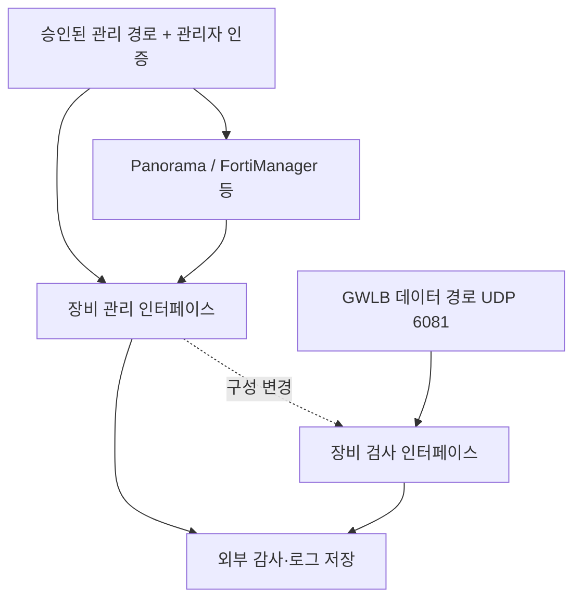

# Palo Alto·Fortinet NGFW의 AWS·EKS 설계와 운영

> **검토 기준**: VM-Series·FortiGate-VM의 공식 AWS GWLB 통합 문서와 제조사 보안 경보. 구성 예시는 지원 브랜치·배포 모드별로 검토해야 합니다.
> **마지막 업데이트**: 2026년 10월 15일

NGFW(Next-Generation Firewall)는 통과한 세션에 설정한 정책을 적용합니다. 장비를 추가하는 것만으로 VPC·Pod 트래픽 전체가 검사되지는 않습니다. 이 장은 제조사별 통합 조건과 관리면·TLS·세션·용량을 비교하고, [GWLB 경로 검증](./16-gwlb-geneve-inspection.md)으로 연결합니다.

## 1. 먼저 선택해야 할 배치 방식

| 방식 | 구조 | PoC에서 입증할 사항 |
|---|---|---|
| 분산 검사 | 워크로드 VPC마다 검사 경로와 장비 배치 | 로컬 경로·AZ 분리·여러 fleet의 정책 일관성 |
| 중앙 검사 | 여러 VPC의 지정 트래픽을 TGW·검사 VPC로 집약 | 대칭 경로·TGW appliance mode·NAT·예외 |
| GWLB 삽입 | GWLBE에서 GWLB와 GENEVE 호환 fleet으로 전달 | encapsulation·health check·세션 재배치·장비 정책 |
| 제조사 관리형 서비스 | 관리형 NGFW 상품의 지원 배치 사용 | 상품별 routing·정책·로그·계정 책임 |

중앙 검사는 TGW에 라우팅한 트래픽에 적용됩니다. 동일 VPC local·노드 내부·다른 연결 경로는 별도 검증합니다. GWLB endpoint와 TGW appliance mode는 장비가 없어도 검사 기능을 제공하는 서비스가 아닙니다. [S24] [S29] [S30]

VM-Series와 Palo Alto Cloud NGFW, FortiGate-VM과 FortiWeb는 서로 다른 제품입니다. 기능·지원·보안 경보의 범위를 제품 이름에 맞춰 구분합니다. CVE-2026-0322의 Cloud NGFW 제외는 이 경보에 한정됩니다. [S03]

## 2. 제조사별 GWLB 통합

| 검토 항목 | Palo Alto VM-Series | Fortinet FortiGate-VM |
|---|---|---|
| GWLB 연동 | PAN-OS GWLB integration 기능, 제조사 deployment template 또는 수동 구성 | GENEVE interface, 단일·다중 AZ deployment guide |
| 데이터 경로 | GENEVE decapsulation 후 interface·zone·보안 정책 | GWLB에서 유입된 GENEVE를 해제하고 interface·정책에 따라 처리 |
| encapsulation | UDP 6081, 지원 릴리스·모드의 GWLB integration | UDP 6081, GWLB node를 향한 GENEVE 설정과 AWS TLV 처리 [S42] |
| 정책의 시작점 | 인터페이스·zone·허용 정책·security profile 확인 | GENEVE interface·firewall policy·UTM/security profile 확인 |
| 운영 관리 | Panorama 등 해당 관리 구조와 변경 감사 | FortiManager/FortiAnalyzer 등 해당 관리 구조와 변경 감사 |
| 장애·스케일 | GWLB 등록·해제와 장비 세션/설정 처리 | GWLB 등록·해제와 장비 세션/설정 처리 |

통합 근거는 [VM-Series 개요][S19], [수동 구성][S20], [integration 활성화][S21], [Fortinet interface 구성][S22], [FortiGate 배치 가이드][S23]입니다. AWS는 GENEVE TLV 형식과 Option Class `0x0108`을 [target group 문서][S42]에 별도로 정의합니다. Fortinet 7.0.0 가이드는 배치 동작의 근거이며 **운영 권장 버전이 아닙니다**. 실제 채택한 최신 지원 브랜치의 가이드·PSIRT·이미지를 확인합니다.

### Palo Alto: integration·interface·기본 zone 정책 검토

GWLB integration 지원과 실제 인터페이스·zone·health-check·보안 정책이 일치해야 합니다. 공식 enable 가이드는 data/management interface swap과 GWLB inspection 활성화를 설명합니다. 기능의 최소 지원 버전은 현재 안전한 patch 버전이나 운영 권장 버전이 아닙니다. [S21]

수동 구성 가이드는 HTTP health check를 사용할 수 없고 HTTPS 또는 TCP를 사용하라고 설명하지만, 뒤의 management profile 단계에는 HTTP 활성화 문장이 함께 있습니다. **이 모호성을 자동 설정으로 옮기지 않습니다.** 선택 버전·template에서 TCP/HTTPS 등 지원 protocol과 실제 응답을 확인하고 제조사 설명을 요청합니다. endpoint 응답만으로 위협 검사·서명·라이선스·정책 동작까지 입증되지 않습니다. [S20]

AWS는 TLS 1.3만 지원하는 target의 HTTPS health check가 실패하므로 health endpoint가 TLS 1.2 같은 이전 버전을 지원해야 한다고 설명합니다. 이는 검사 대상 앱의 TLS 지원과는 별개의 조건입니다. [S26]

같은 가이드는 GWLB 통합 트래픽을 intrazone으로 취급하고 기본 intrazone 규칙이 모든 트래픽을 허용한다고 설명합니다. 의도한 보안 규칙에 일치하지 않는 트래픽을 거부하도록 default intrazone action과 실제 profile 적용을 확인합니다. interface 활성화만으로 차단 정책이 완성됐다고 보지 않습니다. [S20]

### Fortinet: GENEVE interface와 정책을 함께 검토

Fortinet post-deployment 가이드는 같은 AZ의 GWLB interface IPv4 주소를 GENEVE remote로 사용하고, 유입 GENEVE interface로 반환하도록 egress route를 구성합니다. 장비 측 원격 주소를 관리 IP나 애플리케이션 IP로 임의 치환하지 않습니다. 필요한 encapsulation metadata와 선택 모드의 지원도 배포 가이드에서 확인합니다. [S22] [S23]

GENEVE interface가 있어도 허용·거부 firewall policy와 검사 profile이 빠지면 목표 검사가 적용됐다고 판단할 수 없습니다. 별도의 FGCP HA 구성과 독립 GWLB target fleet도 같은 것으로 간주하지 않습니다. 제조사 HA·세션 공유의 지원 모드를 선택한 후 검증합니다.

## 3. 관리면은 보호하는 장비 자신도 보호해야 한다

이 그림은 논리적 책임 분리를 나타내며 실제 ENI·subnet 개수는 선택한 제품 template에 따릅니다.

관리면의 운영 기준으로 다음을 제안합니다.

- 장비·중앙 manager의 HTTPS/SSH/API를 승인된 관리 네트워크와 소스로 제한합니다.
- 관리자별 계정·최소 권한·지원 MFA와 별도 복구 계정을 관리합니다.
- 자동화 token·SSO·중앙 관리 권한에도 동일한 계정 생성·정책 변경 감사를 적용합니다.
- public IP·EIP·공인 listener·대체 관리 포트·다른 ENI의 실제 노출을 점검합니다.
- 장비 외부에 로그와 configuration revision을 보존하고 시간 동기화를 확인합니다.
- 지원 브랜치·hotfix·signature·manager 호환성을 자산에 기록합니다.

PAN-OS 경보는 관리 접근을 trusted internal IP로 제한하도록 안내합니다. 2026 RCE는 인증된 공격자도 포함하므로 소스 제한과 관리자 인증을 함께 검토합니다. [S03] [S04]

수동 배포 가이드의 관리 ENI EIP 할당은 예시 구성 단계입니다. 이를 운영의 기본 공인 노출 요구로 해석하지 않고, 실제 접근을 경보의 trusted internal source 제한과 일치시킵니다. [S20] [S03] [S04]

FortiCloud SSO 사고는 다른 계정의 로그인과 administrator/VPN 설정 변경을 포함했습니다. 공식 정정은 제3자 SAML IdP·FortiAuthenticator를 해당 문제에서 제외합니다. 모든 SSO 방식이 동일하게 영향받았다고 적지 않습니다. [S05] [S06]

## 4. TLS 가시성: 어디서 무엇이 보이는가

| 검사 위치 | 기본적으로 볼 수 있는 것 | payload 검사에 필요한 검토 |
|---|---|---|
| HTTPS 종료 전 NGFW | 패킷·연결과 노출되는 TLS metadata | 지원 decryption 방식·키/인증서·client 호환성 |
| WAF가 연결된 CloudFront/ALB | 연결 리소스에서 WAF에 제공하는 요청 부분 | body·gRPC·oversize 한계 |
| ALB→Pod 재암호화 구간의 NGFW | 해당 구간의 TLS 연결 | 별도 decryption 또는 endpoint 계층 검사 |
| service mesh mTLS 구간 | 피어/전송 metadata의 관측 가능 부분 | mesh의 신뢰·인가·지원 검사 위치 |

GWLB는 GENEVE encapsulation을 수행하며 TLS 종료를 제공하지 않습니다. GENEVE도 암호화가 아닙니다. Network Firewall의 TLS inspection 역시 별도 정책·certificate 설정이 필요한 기능입니다. 장비가 경로에 있다는 사실과 복호화가 된 사실을 구분합니다. [S24] [S31] [S35]

복호화 PoC에는 TLS 버전·cipher·HTTP/2·gRPC·WebSocket·mTLS·certificate pinning·신뢰 CA 배포·규제 예외를 포함할 것을 제안합니다. 복호화 제외 트래픽의 보완 통제를 기록하고, “SSL inspection on”이라는 이름으로 모든 encrypted payload가 검사됐다고 주장하지 않습니다.

ALB에서 target group을 HTTPS로 선택하는 것은 backend certificate 신뢰 검증의 증거가 아닙니다. AWS 문서는 ALB가 target certificate를 검증하지 않는다고 명시합니다. 앱에서 요구하는 서버 신원 검증은 별도로 설계합니다. [S38]

## 5. NAT·원본 IP·Pod 식별

다음 정보를 한 세션의 관측 기록에 묶는 것을 제안합니다.

| 구간 | 기록할 정보 |
|---|---|
| 앱·Pod | workload/namespace, 요청 ID, Pod·node IP, 관측 시각 |
| 노드·CNI | SNAT 여부와 적용 모드, 적용 NetworkPolicy |
| 검사 장비 | 관측 5-tuple, 적용 정책/profile, action, decryption 결과 |
| NAT Gateway·외부 | 변환 후 주소, 목적지, 응답·재시도 |
| TGW·GWLBE | attachment·AZ·route table·endpoint ID |

노드 SNAT 후에는 장비가 Pod IP 대신 노드 IP를 볼 수 있습니다. EKS 문서는 VPC CNI의 기본 IPv4 외부 통신에서 VPC CIDR 밖으로 나갈 때 노드 primary IP로 변환한다고 설명합니다. 실제 external-SNAT·OS·라우팅 설정을 확인하며 모든 구성에 일반화하지 않습니다. [S44]

Pod IP가 보이더라도 Pod 교체 시 바뀔 수 있어 영구 신원이 되지 않습니다. 방화벽 IP 정책과 Kubernetes label/identity 정책을 구분하고 CNI·IPAM 관측과 연관합니다. [S33]

동일 흐름의 request/response가 다른 장비나 서로 다른 tuple로 들어가면 stateful inspection이 실패할 수 있습니다. stickiness, NAT 위치, TGW appliance mode와 장비의 선택 배포 모드를 함께 검증합니다. TGW appliance mode에는 5-tuple이 필요하며 2/3-tuple은 지원되지 않습니다. 기본 투명 GWLB 설계에 임의 SNAT를 넣지 않습니다. [S25] [S29] [S30]

## 6. 세션·스케일·라이선스·용량

GWLB는 target 선택·health·flow failover를 제공하지만 독립 장비 간 세션 상태 복제를 자동 제공하지 않습니다. Target 추가·해제, `rebalance`, 장비 reboot, AZ 손실 각각에서 **기존 세션과 새 세션**을 따로 시험합니다. 제조사 HA/세션 공유가 필요하면 해당 모드의 지원 범위와 실패 조건을 확인합니다. [S25]

실측 계획에 다음을 포함할 것을 제안합니다.

| 측정 | 함께 고정할 조건 |
|---|---|
| 처리량·packet rate | packet 크기, 양방향 비율, 작은 packet·큰 body |
| 새 연결·동시 세션 | TCP/UDP, keepalive, 장시간 gRPC/WebSocket |
| 검사 활성 처리량 | IPS·malware·URL·logging·TLS decryption 실제 profile |
| p50/p95/p99·오류 | 앱 처리, 장비, TGW, AZ 경로와 정상 기준 |
| N-1·AZ 손실 | 남은 장비의 license/instance/CPU/memory와 정책 상태 |
| 유지보수·스케일 | 등록 준비, drain, signature·정책 반영, 세션 끊김 |

제품 데이터시트 수치를 동일 조건의 비교 실험으로 간주하지 않습니다. 포트·CPU·암호화 처리·license/구독의 병목을 기록합니다. 총비용은 appliance EC2·EBS·license·GWLB/GWLBE·TGW·NAT·AZ 전송·로그·운영을 포함해 실제 Region 가격으로 별도 산정합니다. 이번 조사에는 비용 견적이나 성능 측정이 없습니다.

## 7. 패치와 침해 제거의 완료 조건

| 상태 | 확인할 항목 |
|---|---|
| 영향 확인 | 제품·브랜치·hotfix·활성 기능·노출, 제조사 advisory 수정 시각 |
| 패치 완료 | 실제 배포된 fixed release, manager·template·signature 호환 |
| 침해 제거 | 관리자·VPN·system/config 변조·관련 비밀 사용 조사 |
| 복구 검증 | 검사와 정상 업무, 관리면 접근 거부, 기존/신규 세션, 외부 로그 |

Fortinet의 2025 분석은 기존 SSL-VPN 취약점 패치 후에도 읽기 접근이 남을 수 있음을 설명합니다. 2026 SSO 분석도 확인된 침해 시 설정 감사·정상 설정 복구와 관련 자격 증명 교체를 안내합니다. 버전만 최신이면 침해 제거가 끝났다는 판단은 피합니다. [S07] [S05]

당시 symbolic link 문제에 대한 안내는 7.6.2·7.4.7·7.2.11·7.0.17·6.4.16으로 업그레이드하면 link를 제거한다고 명시하면서 설정 검토도 요구했습니다. 이 값은 과거 조치의 근거이며 2026년 운영 권장 버전이 아닙니다. [S07]

PAN-OS의 fixed release·ETA 표는 브랜치별로 바뀔 수 있습니다. 고정된 “권장 패치 버전”을 이 장에서 배포 지시로 만들지 않고 실제 변경 시 제조사 경보를 다시 확인합니다. [S03]

## 8. PoC 수용 기준

아래는 제조사 공통 수용 기준 제안입니다. 필수 항목을 통과한 뒤 관리 편의·운영비·성능을 비교합니다.

1. 실제 지원 image·license·브랜치와 공식 integration이 일치합니다.
2. 관리면 접근 제한과 administrator/configuration 변경 기록을 확인합니다.
3. 허용·거부 세션의 request/response·tuple·profile을 연관할 수 있습니다.
4. 복호화 대상·예외와 정상 client 호환성을 설명할 수 있습니다.
5. 모든 unhealthy·한 target 실패·AZ 실패·scale-in·upgrade를 기존/신규 세션으로 검증합니다.
6. N-1 용량과 앱 latency/error SLO를 실측합니다.
7. 제조사 경보 확인부터 patch·침해 제거·rollback까지 담당자와 증거가 있습니다.

## 다음 학습

- [GWLB·GENEVE 검사 경로](./16-gwlb-geneve-inspection.md)
- [WAF·origin 보호](./14-waf-edge-api-security.md)
- [침해 대응](./13-defense-in-depth-incident-response.md)
- [이 장의 퀴즈](../quizzes/security/15-ngfw-paloalto-fortinet-quiz.md)

## 참고 자료와 조사 기준

아래 공식 자료는 2026-10-15에 조회했습니다. 변경 시 해당 제품·브랜치의 최신 경보와 제약을 다시 확인합니다.

- [S03: Palo Alto: CVE-2026-0322][S03]
- [S04: Palo Alto: CVE-2025-0108][S04]
- [S05: Fortinet: Analysis of SSO abuse on FortiOS][S05]
- [S06: CISA: Known Exploited Vulnerabilities Catalog][S06]
- [S07: Fortinet: Analysis of threat actor activity][S07]
- [S19: VM-Series: GWLB integration][S19]
- [S20: VM-Series: Manual GWLB integration][S20]
- [S21: VM-Series: Enable GWLB integration][S21]
- [S22: FortiGate: GWLB post-deployment configuration][S22]
- [S23: FortiGate: Security inspection with GWLB integration][S23]
- [S24: AWS: Gateway Load Balancers][S24]
- [S25: AWS GWLB: Target group attributes][S25]
- [S26: AWS GWLB: Health checks][S26]
- [S29: AWS: Centralized inspection with GWLB and TGW][S29]
- [S30: AWS: NAT Gateway scenarios][S30]
- [S31: RFC 8926: GENEVE][S31]
- [S33: EKS: Network security][S33]
- [S35: AWS Network Firewall: TLS inspection configurations][S35]
- [S38: ALB: Target groups][S38]
- [S42: AWS GWLB: Target groups][S42]
- [S44: EKS: Outbound internet access and SNAT][S44]

[S03]: https://security.paloaltonetworks.com/CVE-2026-0322
[S04]: https://security.paloaltonetworks.com/CVE-2025-0108
[S05]: https://www.fortinet.com/blog/psirt-blogs/analysis-of-sso-abuse-on-fortios
[S06]: https://www.cisa.gov/sites/default/files/feeds/known_exploited_vulnerabilities.json
[S07]: https://www.fortinet.com/blog/psirt-blogs/analysis-of-threat-actor-activity
[S19]: https://docs.paloaltonetworks.com/vm-series/deployment/public-cloud/set-up-the-vm-series-firewall-on-aws/vm-series-integration-with-gateway-load-balancer
[S20]: https://docs.paloaltonetworks.com/vm-series/deployment/public-cloud/set-up-the-vm-series-firewall-on-aws/vm-series-integration-with-gateway-load-balancer/manually-integrate-the-vm-series-with-a-gateway-load-balancer
[S21]: https://docs.paloaltonetworks.com/vm-series/deployment/public-cloud/set-up-the-vm-series-firewall-on-aws/vm-series-integration-with-gateway-load-balancer/enabling-vm-series-integration-with-a-gwlb
[S22]: https://docs.fortinet.com/document/fortigate-public-cloud/7.0.0/aws-administration-guide/337773/post-deployment-configuration
[S23]: https://docs.fortinet.com/document/fortigate-public-cloud/7.0.0/aws-administration-guide/571235/security-inspection-with-gateway-load-balancer-integration
[S24]: https://docs.aws.amazon.com/elasticloadbalancing/latest/gateway/gateway-load-balancers.html
[S25]: https://docs.aws.amazon.com/elasticloadbalancing/latest/gateway/edit-target-group-attributes.html
[S26]: https://docs.aws.amazon.com/elasticloadbalancing/latest/gateway/health-checks.html
[S29]: https://aws.amazon.com/blogs/networking-and-content-delivery/centralized-inspection-architecture-with-aws-gateway-load-balancer-and-aws-transit-gateway/
[S30]: https://docs.aws.amazon.com/vpc/latest/userguide/nat-gateway-scenarios.html
[S31]: https://www.rfc-editor.org/info/rfc8926/
[S33]: https://docs.aws.amazon.com/eks/latest/best-practices/network-security.html
[S35]: https://docs.aws.amazon.com/network-firewall/latest/developerguide/tls-inspection-configurations.html
[S38]: https://docs.aws.amazon.com/elasticloadbalancing/latest/application/load-balancer-target-groups.html
[S42]: https://docs.aws.amazon.com/elasticloadbalancing/latest/gateway/target-groups.html
[S44]: https://docs.aws.amazon.com/eks/latest/userguide/external-snat.html
